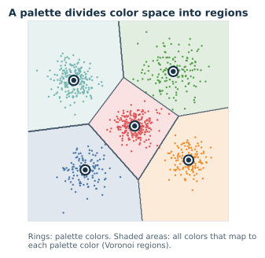
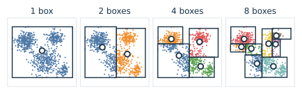
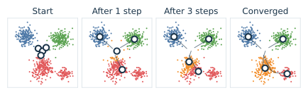

# Palette Clustering

## Scope

This document explains how a palette can be chosen for an image: why the problem is a form of clustering, what makes it hard, how the main families of methods work, and which choices beyond the algorithm matter. It is meant to be read from start to finish and assumes the [color difference](../../quality/color-difference.md) chapter.

The [palette quantization reference](../../encoder/palette-construction/quantization/README.md) documents the `-Q` models libsixel implements, with their exact rules, costs, and measurements. [Dithering](../dithering/README.md) explains how the chosen palette is then used to draw the image.

**Key ideas in one minute:**

- Every pixel's color is a **point** in a three-dimensional color space; an image is a cloud of such points.
- A palette is a small set of points. Each pixel is drawn with its **nearest** palette color, so the palette divides color space into regions.
- Choosing the palette that minimizes the total error is a **clustering** problem, and finding the true optimum is computationally hard.
- Practical methods **split** the cloud into boxes, **move** representatives toward cluster centers, **merge** small clusters, or **cover** the extremes; each optimizes something different.
- The result also depends on **where distance is measured** (the color space) and **which pixels count** (weighting and important rare colors).

## Colors as points

Each pixel has three numbers, for example red, green and blue, or lightness and two opponent color axes. Plotting every pixel of a photograph as a point gives a cloud whose shape is characteristic of the image: dense where the image has large areas of similar color, thin where colors are rare.

*Figure 1. The colors of a photograph as a cloud of points in CIELAB, each point drawn in its own color. The palette must represent this cloud with only a few points.*

## A palette divides color space

When each pixel is drawn with its nearest palette color, every palette color "owns" the region of color space that is closer to it than to any other palette color. These regions are called **Voronoi regions**, and together they divide the whole space.

*Figure 2. A palette divides color space into regions. Every color in a region is drawn with that region's palette color.*

The quality of a palette can then be stated as a number. The most common measure is the **total squared error**: for every pixel, the squared distance from its color to its palette color, summed over the image. A good palette places its colors where pixels are dense, so that most pixels are close to a palette color.

## Why the best palette is hard to find

Choosing K points to minimize the total squared error is the *k-means problem* of statistics and machine learning. It is NP-hard in general (Aloise et al., 2009): no known algorithm finds the guaranteed optimum efficiently for realistic image sizes and palette sizes. Every practical method is therefore a heuristic, a strategy that usually finds a good palette but not provably the best one. Heuristics differ in speed, in what they optimize, and in how they fail.

## Families of methods

### Fixed palettes: no clustering at all

The simplest palette ignores the image: a regular grid of colors, a hardware palette, or a standard set such as a terminal's 16 colors. It is fast and the same for every image, but most of its colors may be far from the image's cloud. The leftmost image in Figure 6 uses the eight corners of the RGB cube.

### Splitting boxes: median cut and its relatives

Heckbert's **median cut** (1982) starts with one box that encloses all the colors, repeatedly splits a box at the median of its longest side, so that each half holds about the same number of pixels, and finally represents each box by the average of its colors. Implementations differ in which box they split next and in how they choose the representative.

*Figure 3. Median cut splits boxes until there are as many boxes as palette colors.*

Median cut is fast and predictable and gives every dense region some colors. Its boxes follow the color axes, not the shape of the clusters, so it is rarely optimal. Wu (1991) refined the idea by choosing each split to minimize the variance of the two halves, using precomputed moment tables to make that fast. **Octree quantization** (Gervautz and Purgathofer, 1988) takes a related tree-based route: it inserts colors into an octree that halves each axis at every level and merges leaves until the palette size is reached.

### Moving centers: k-means

**k-means** improves a palette by alternating two steps, an idea described by Lloyd (written in 1957, published in 1982):

1. **Assign** every pixel to its nearest palette color.
2. **Update** every palette color to the average of the pixels assigned to it.

*Figure 4. k-means moves each palette color to the center of the pixels it represents, then reassigns pixels, until nothing changes.*

Each round can only lower the total squared error, so the process converges, but only to a *local* optimum that depends on where it started. A good start matters: k-means++ (Arthur and Vassilvitskii, 2007) picks initial colors far apart from each other at random, and a common practical choice is to start from a median-cut palette. Because every palette color becomes an average, k-means can produce colors that are not in the image, and it tends to pull colors toward dense regions.

### Choosing real colors: k-medoids

**k-medoids** (Kaufman and Rousseeuw, 1990) requires every palette color to be one of the image's own colors, called a medoid, and searches for the set of medoids with the smallest total distance. Its palettes never invent colors that are absent from the image, and it is less pulled by outliers than k-means, at a higher computational cost. Sampling variants such as CLARA make it practical for large images.

### Covering the extremes: k-center

Minimizing the *total* error favors the many pixels of common colors. A small area of a vivid color, a logo, a warning light or a flower, contributes little to the total, and an average-minimizing method may leave it without a palette color of its own. **k-center** minimizes the *largest* distance from any pixel to its palette color instead. Gonzalez's farthest-first traversal (1985) gives a simple solution within a factor of two of the optimum: start with any color, then repeatedly add the color farthest from all chosen colors.

*Figure 5. Average error and worst error lead to different palettes. k-means spends its colors on the large gray cloud and leaves the vivid group uncovered; k-center covers it, at the cost of spending a color on the edge of the cloud.*

The figure also shows k-center's weakness: it reacts to every extreme point, including stray pixels that a viewer would never notice. Practical systems therefore combine objectives, for example by building an average-minimizing palette and then reserving some colors for important extremes.

### Merging: hierarchical clustering

Ward's method (1963) works bottom up: start with many small clusters and repeatedly merge the pair whose union increases the total squared error the least. Used after another method has produced more clusters than needed, it reduces them to the palette size while keeping the error low.

### Learning: neural methods

NeuQuant (Dekker, 1994) trains a self-organizing map, a simple neural network whose units move toward the colors presented to them, and uses the trained units as the palette. It belongs to the same family of ideas as k-means: palette colors move toward the colors they represent.

## Comparing the results

*Figure 6. The same eight-color budget spent three ways. A fixed palette wastes most of its colors; median cut and k-means adapt to the image, and k-means, started from the median-cut colors, lowers the error further. Mean ΔE\*ab is measured against the original in CIELAB.*

## Beyond the algorithm

Three choices affect the palette as much as the clustering method itself.

**Where distance is measured.** The nearest color and the average of a cluster depend on the coordinates. In gamma-encoded RGB, equal distances are not equal visible differences, as [color difference](../../quality/color-difference.md) explains: dark colors and blues are crowded, and a palette built there spends colors unevenly. Clustering in a perceptually more uniform space such as CIELAB, OKLab or DIN99d spreads colors more evenly by eye; clustering in linear light makes averages match mixed light. The [clustering color space](../../encoder/palette-construction/clustering-colorspace/README.md) reference measures these choices in libsixel.

**Which pixels count.** Weighting every pixel equally favors large areas. Counting each distinct color once favors variety. Sampling a subset of pixels makes clustering fast but can miss rare colors. libsixel separates these decisions into [sampling and binning](../../encoder/palette-construction/pipeline/README.md) policies.

**What must not be lost.** Some colors matter more than their pixel count suggests: saturated extremes that define an object, neutral grays whose tint a viewer would notice, and the end points of a gradient. If no palette color lies near them, no amount of dithering can reach them, because dithering can only mix colors that lie around the target. The [cover policy](../../encoder/palette-construction/cover-policy/README.md) adds such anchors after clustering, and the [snap policy](../../encoder/palette-construction/snap-policy/README.md) moves palette colors onto values that SIXEL can transmit exactly.

## From palette to image

Clustering only chooses the palette. Drawing the image then needs two more steps: finding the nearest palette color for each pixel, which the [lookup policy](../../encoder/palette-application/lookup-policy/README.md) makes fast, and distributing the remaining error so that the eye sees the right tones, which is the subject of [dithering](../dithering/README.md).

## In libsixel

| Idea | libsixel control | Reference |
| --- | --- | --- |
| Median cut, k-means, k-medoids, k-center | `-Q` | [Palette quantization](../../encoder/palette-construction/quantization/README.md) |
| Color space for clustering | `-X` | [Clustering color space](../../encoder/palette-construction/clustering-colorspace/README.md) |
| Ward merging after oversplitting | `-F` | [Final palette merge policy](../../encoder/palette-construction/merge-policy/README.md) |
| Reserving important extreme colors | `-a` | [Cover policy](../../encoder/palette-construction/cover-policy/README.md) |
| Exactly transmittable palette values | `-_` | [Snap policy](../../encoder/palette-construction/snap-policy/README.md) |
| Which pixels feed the clustering | `-4`, `-5` | [Palette construction pipeline](../../encoder/palette-construction/pipeline/README.md) |
| Fixed and external palettes | `-b`, `-m` | [Built-in palettes](../../encoder/palette-construction/fixed-palettes.md), [External palettes](../../encoder/palette-construction/external-palettes.md) |

## Figures and reproduction

All figures are generated by [`tools/plot_clustering_concept_figures.py`](../../../tools/plot_clustering_concept_figures.py) with Matplotlib, NumPy and Pillow. Run it to regenerate them and with `--check` to verify that the committed files are current. The algorithms are implemented in the script in their textbook form, so the figures illustrate the methods and do not measure libsixel's implementations. Figures 2 to 5 use synthetic two-dimensional points to make the geometry visible; real palettes live in three dimensions. Figure 6 clusters `images/snake.png` in encoded sRGB and reports the error in CIELAB; the parameters and results are recorded in [`figures/figures.json`](figures/figures.json).

## References

- Aloise, D., A. Deshpande, P. Hansen, and P. Popat. "NP-hardness of Euclidean sum-of-squares clustering." Machine Learning 75(2):245–248, 2009. doi:[10.1007/s10994-009-5103-0](https://doi.org/10.1007/s10994-009-5103-0)
- Arthur, D., and S. Vassilvitskii. "k-means++: the advantages of careful seeding." Proceedings of the Eighteenth Annual ACM-SIAM Symposium on Discrete Algorithms (SODA), 1027–1035, 2007.
- Dekker, A. H. "Kohonen neural networks for optimal colour quantization." Network: Computation in Neural Systems 5(3):351–367, 1994. doi:[10.1088/0954-898X/5/3/003](https://doi.org/10.1088/0954-898X/5/3/003)
- Gervautz, M., and W. Purgathofer. "A simple method for color quantization: octree quantization." In *New Trends in Computer Graphics*, Springer, 219–231, 1988. doi:[10.1007/978-3-642-83492-9_20](https://doi.org/10.1007/978-3-642-83492-9_20)
- Gonzalez, T. F. "Clustering to minimize the maximum intercluster distance." Theoretical Computer Science 38:293–306, 1985. doi:[10.1016/0304-3975(85)90224-5](https://doi.org/10.1016/0304-3975(85)90224-5)
- Heckbert, P. "Color image quantization for frame buffer display." Computer Graphics (SIGGRAPH '82 Proceedings) 16(3):297–307, 1982. doi:[10.1145/965145.801294](https://doi.org/10.1145/965145.801294)
- Kaufman, L., and P. J. Rousseeuw. *Finding Groups in Data: An Introduction to Cluster Analysis*. Wiley, 1990.
- Lloyd, S. "Least squares quantization in PCM." IEEE Transactions on Information Theory 28(2):129–137, 1982. doi:[10.1109/TIT.1982.1056489](https://doi.org/10.1109/TIT.1982.1056489)
- Ward, J. H. "Hierarchical grouping to optimize an objective function." Journal of the American Statistical Association 58(301):236–244, 1963.
- Wu, X. "Efficient statistical computations for optimal color quantization." In J. Arvo, ed., *Graphics Gems II*, Academic Press, 126–133, 1991.
