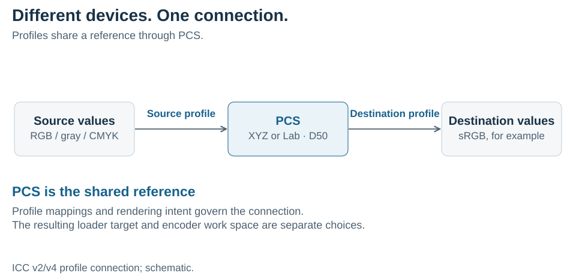

# Color Management Basics

## Scope

This document explains why image files carry color profiles and how a color-management system (CMS) uses them. It covers what an ICC profile describes, the profile connection space (PCS) that links profiles, chromatic adaptation between reference whites, and the rendering intents that decide what happens to colors a destination cannot show. It assumes [Color spaces](../colorspace/README.md), especially [primaries, white point, and transfer function](../colorspace/README.md#primaries-white-point-and-transfer-function).

How libsixel's loaders apply profiles, and which options control them, is described in [Color-space handling](../../encoder/colorspace-handling/README.md) and [Loader Color Management](../../loader/color-management/README.md).

**Key ideas in one minute:**

- The same RGB numbers look different on different devices. A **profile** records what a device's or file's numbers mean.
- ICC profiles connect through a shared **profile connection space** (PCS), so any source profile can be paired with any destination profile.
- The PCS uses a **D50** reference white, while sRGB and Display P3 use **D65**. Moving between them needs **chromatic adaptation**, not relabeling.
- When the destination cannot show a source color, the **rendering intent** decides whether to keep exact colors, overall appearance or vividness.
- In libsixel, color management happens on **input**: loaders turn profiled images into known coordinates. A SIXEL stream itself carries no profile.

## Why the numbers need a description

A camera, a scanner, a display and a printer each have their own primaries, white and response. A phone camera may store photographs in Display P3, a screenshot tool in sRGB, and a print workflow in a CMYK space of a particular press and paper. In each case the file stores numbers, and the numbers alone do not say which color they mean.

If an image encoded in Display P3 is read as if it were sRGB, every color is shown with the wrong primaries. Saturated reds and greens look duller, and skin tones shift slightly, although no pixel value has changed. The error is not in the pixels but in their interpretation.

A **color profile** supplies that interpretation. The International Color Consortium (ICC) defines the most widely used profile format. An ICC profile can be embedded in PNG, JPEG, TIFF, WebP and other files, and operating systems keep profiles for displays and printers.

> **Try it.** If you have a photograph from a recent phone that carries a Display P3 profile, compare `img2sixel --cms-engine=none photo.jpg` with `img2sixel --cms-engine=auto photo.jpg`. Without color management, saturated colors are read as sRGB and look duller.

## What a profile contains

A profile describes a conversion between a device's own values and a standard, device-independent description of color. Its header names the **profile class**, such as input (cameras and scanners), display, output (printers) or color space, and the device's color space, such as RGB, gray or CMYK.

The conversion itself takes one of two common forms.

- **Matrix and curves.** For a well-behaved RGB device, three tone curves decode the stored values to linear light, and a 3 × 3 matrix converts linear RGB to XYZ. The curves are the transfer function, and the matrix follows from the primaries and white point. Most display and standard RGB profiles, including sRGB and Display P3, take this form.
- **Lookup tables.** Devices that mix colors less simply, such as printers, use multidimensional tables that map grids of device values to the connection space, with curves before and after them. Tables can describe almost any device, at the cost of size and interpolation.

Transfer decoding, matrix conversion, and any required white-point adaptation answer different questions; changing only a tag on the image performs none of them. The [loader CMS comparison](../../loader/color-management/README.md#supported-profile-structures-and-practical-differences) describes which profile structures libsixel's engines support.

## PCS: the connection between color profiles

PCS means **Profile Connection Space**. It gives profiles a common connection: the source profile describes device values relative to the PCS, and a destination profile describes how to obtain destination device values from that connection. A CMS can pair profiles without requiring a separately authored transform for every source/destination combination. With N devices, N profiles replace N × (N − 1) direct conversions.

<picture>
  <source media="(max-width: 640px)" srcset="figures/pcs-connection-mobile.svg">
  
</picture>

*Figure 1. A source profile and a destination profile meet in the profile connection space.*

ICC v2/v4 color profiles use XYZ or Lab PCS representations under D50 reference conditions. PCS names the connecting role; it is not a third coordinate system in addition to XYZ and Lab. Rendering intent also governs the connection, so interpreting PCS requires more than a three-number tuple. See the [ICC introduction](https://www.color.org/getting-started/) and [ICC.1:2022](https://www.color.org/specifications/ICC.1-2022-05.pdf).

The PCS is a connection used during a conversion, not a space that libsixel's encoder works in. The table separates it from other uses of XYZ and Lab in this documentation.

| Boundary | Coordinates and reference white | Purpose |
| --- | --- | --- |
| ICC PCS | XYZ or Lab, D50 | Connect source and destination profile interpretations. |
| XYZ in the internal sRGB/Oklab route | XYZ D65 | Relate the sRGB primary basis to other color coordinates. |
| libsixel `linear` | Linear sRGB, D65 | Common internal RGB conversion basis and light-mixing coordinates. |
| libsixel `cielab` | Project-normalized CIELAB derived using D65 | Palette/CMS-target working coordinates; distinct from ICC Lab PCS encoding and white point. |

An intermediate PCS is therefore neither the loader's requested `cms_target` nor the encoder's `-W`. In particular, `cms_target=cielab` does not request that the loader expose its raw ICC Lab PCS.

## Chromatic adaptation

The eye adapts to the color of the light, so a sheet of paper looks white under warm indoor light and under bluish daylight. The [visual perception](../../quality/visual-perception/README.md) chapter describes this adaptation in the eye. Color management models it with a **chromatic adaptation transform**: a conversion that maps colors seen relative to one reference white to the colors that look the same relative to another.

Because the ICC PCS uses D50 and sRGB uses D65, a conversion from a profile to sRGB must adapt from D50 to D65. When a profile's measured white is not D50, an ICC v4 profile stores the adaptation matrix it applied in a chromatic adaptation (`chad`) tag, and ICC.1 recommends the linear Bradford transform for it. Adaptation is a 3 × 3 matrix in a cone-like space, so it can be combined with the other matrices of a conversion.

Chromatic adaptation relates colors under different reference whites; it is distinct from decoding a transfer curve and cannot be replaced by relabeling D50 numbers as D65. Relabeling would make every neutral gray slightly yellow or blue.

For libsixel's builtin CMS, [`src/icc-apply.c`](../../../src/icc-apply.c) connects supported profile paths through XYZ D50. A Lab PCS is decoded to that basis. The source-to-sRGB route then applies D50-to-D65 chromatic adaptation and the XYZ-to-linear-sRGB matrix before producing the required RGB representation. These adjacent matrix operations may be combined without requiring an image buffer for each conceptual step.

## Rendering intents

A destination often cannot show every source color. A photograph in a wide-gamut space can contain greens that sRGB cannot reach, and a display can show colors that no ink can print. A **rendering intent** tells the CMS what to preserve when it maps the source gamut into the destination gamut. ICC.1 defines four.

| Intent | What it preserves | Typical use |
| --- | --- | --- |
| Perceptual | The overall appearance of the image. The whole source gamut is compressed so that out-of-gamut colors and the in-gamut colors around them keep their relationships, at the cost of shifting colors that were reproducible. | Photographs |
| Media-relative colorimetric | Exact colors inside the destination gamut, measured relative to each medium's white: the source white maps to the destination white. Out-of-gamut colors are moved to the nearest reproducible color, which can merge nearby shades. | Proofs, logos, images mostly inside the destination gamut |
| Saturation | Vivid, saturated colors, at the cost of hue and lightness accuracy. | Charts and business graphics |
| ICC-absolute colorimetric | Exact colors without adapting the white, so a print can simulate the paper color of another medium. | Proofing one printing condition on another |

The perceptual and saturation mappings are not fixed formulas: each profile contains its own tables, built by its creator's gamut-mapping method. Two perceptual conversions with different profiles can therefore give different results. Matrix-and-curve display profiles usually carry no separate perceptual tables, so their intents give nearly the same result.

## Color management in libsixel

In libsixel, color management is **input normalization**. A loader that finds a usable profile converts the image into a known internal space, such as linear sRGB, before the encoder sees it. This prevents images authored for different primaries or transfer functions from being misinterpreted as sRGB. The default `-Ugamma` output remains gamma-encoded sRGB; CMS does not expand the output gamut. Mapping that result to a physical display, or deliberately enhancing it beyond sRGB, belongs to the receiving terminal and display stack. See [Why loader CMS matters](../../loader/color-management/README.md#why-loader-cms-matters) for the limits of this division of responsibility.

A SIXEL stream carries palette numbers but no profile, so the receiver must assume what they mean. Unless a terminal states otherwise, it treats them as sRGB. The CLI's `-Uauto` option can ask a terminal which definition it uses through the [terminal graphics color management proposal](../../protocols/graphics-color-management.md).

libsixel supports three engines: its builtin ICC implementation, Little CMS (lcms2), and ColorSync on macOS. The [builtin CMS architecture](../../loader/builtin-cms.md#pixel-execution-and-numerical-behavior) describes supported transforms and precision; its [rendering-intent policy](../../loader/builtin-cms.md#rendering-paths-and-fallback) also limits which profile semantics builtin implements. lcms2 and ColorSync own their backend-specific profile connection behavior. Engine selection, `cms_target`, rendering-intent order and the other loader settings are described in [Color-space handling](../../encoder/colorspace-handling/README.md#loader-color-management).

## Figures and reproduction

Figure 1 is generated by [`tools/plot_colorspace_figures.py`](../../../tools/plot_colorspace_figures.py) together with the figures of [Color spaces](../colorspace/README.md); its parameters are recorded in the shared [`figures.json`](../colorspace/figures/figures.json). The figure is schematic.

## References

- International Color Consortium. [*Specification ICC.1:2022 (Profile version 4.4.0.0): Image technology colour management — Architecture, profile format, and data structure*](https://www.color.org/specifications/ICC.1-2022-05.pdf). 2022.
- International Color Consortium. [*Getting started with ICC color management*](https://www.color.org/getting-started/).
- W3C. [*CSS Color Module Level 4*](https://www.w3.org/TR/css-color-4/), sections on predefined color spaces and gamut mapping.
