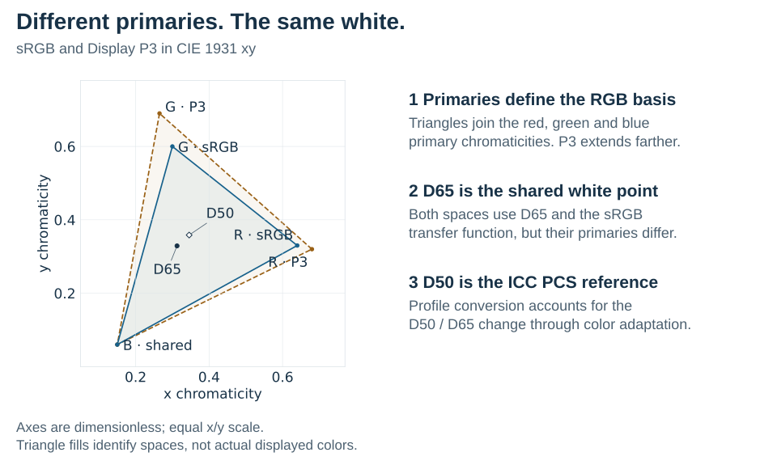
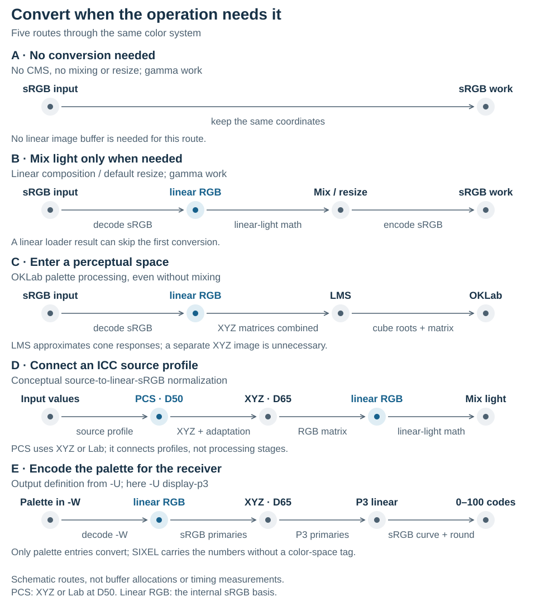
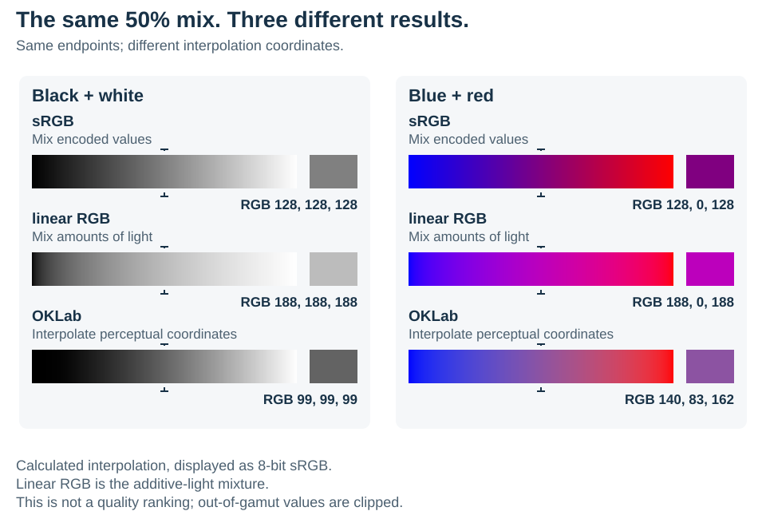

# Color Spaces

## Scope

A three-component pixel value is not a complete color description. The same numeric triplet can represent different light depending on its primaries, white point and transfer function. This document explains what a color space specifies, why gamma-encoded and linear-light values differ, how conversions connect spaces through linear RGB and XYZ, what out-of-gamut and imaginary colors are, and why mixing colors needs linear light. It builds on [Visual perception](../../quality/visual-perception/README.md).

Two companion pages go deeper: [transfer functions and gamma](transfer-functions.md) explains why images are gamma-encoded, which curves are in use and what the word "gamma" can mean, and [primaries and white points](primaries-and-white-points.md) explains chromaticity diagrams, the gamuts and whites of common standards and how a conversion matrix follows from them. [Color management basics](../color-management/README.md) continues with ICC profiles, the profile connection space and rendering intents. [Color-space handling](../../encoder/colorspace-handling/README.md) describes where libsixel converts between spaces and what its `-X`, `-W` and `-U` options control.

**Key ideas in one minute:**

- Stored **numbers**, their **memory layout**, their **color space** and a file's **color profile** are four different things.
- An RGB space is defined by its **primaries**, its **white point** and its **transfer function**. Change any one and the same numbers mean a different color.
- Stored sRGB values are **gamma-encoded**: they are spaced for the eye, not proportional to light. Adding or averaging light needs **linear** values.
- **Linear RGB** and **XYZ** serve as hubs: conversions between spaces pass through them.
- A color can lie **outside a device's gamut**, or even outside all real colors. Such values are clipped only at an explicit destination, not in the middle of a calculation.

## Four concepts that must remain separate

| Concept | Question it answers | libsixel example |
| --- | --- | --- |
| Channel values | What numbers are stored? | `(0.5, 0.2, 0.1)` or `(128, 51, 26)` |
| Pixel format | How are those numbers laid out and represented in memory? | `RGB888`, `RGBA8888`, `RGBFLOAT32`, or `OKLABFLOAT32` |
| Color space | What light or perceptual coordinates do the numbers mean? | gamma-encoded sRGB, linear-light sRGB, Oklab, CIELAB, or DIN99d |
| Color profile and CMS | How are colors described by an input device or file transformed into a known destination space? | an embedded ICC profile interpreted by the builtin, lcms2, or ColorSync engine |

The [pixel-format guide](../pixelformat.md) describes memory layout. A pixel-format tag can imply a normal internal color space, but layout and interpretation are still different contracts: copying three bytes does not perform a color conversion, and changing only color-space metadata does not change the pixels. Profiles and CMS are the subject of [Color management basics](../color-management/README.md).

## Primaries, white point, and transfer function

An RGB value gives amounts of three basis colors, but the letters R, G, and B do not specify which red, green, and blue those are. A color-space definition supplies the missing information. This section summarizes the three properties; [primaries and white points](primaries-and-white-points.md) and [transfer functions and gamma](transfer-functions.md) treat them in depth.

| Property | Meaning | Why conversion needs it |
| --- | --- | --- |
| Primaries | The chromaticities of the red, green, and blue basis colors. Chromaticity describes a color's hue/chromatic character independently of its luminance. | Different primaries span different RGB gamuts and give different colors to the same triplet. |
| White point | The reference chromaticity considered neutral white. For a normalized RGB space, equal full linear channels combine to this white. | Together with the primaries, it fixes their relative scaling for the RGB-to-XYZ matrix and supplies the reference for chromatic adaptation. |
| Transfer function | The mapping between a stored channel number and linear light. | It must be decoded before applying a linear primary-conversion matrix or additive-light mixing. |

For example, sRGB and Display P3 share the sRGB transfer function and D65 white, but use different primaries. Decoding both triplets into linear light therefore does not make their channel values interchangeable: a primary conversion is still required. Conversely, gamma sRGB and linear sRGB share both primaries and white point; their difference is the transfer encoding. [CSS Color 4's predefined RGB spaces](https://www.w3.org/TR/css-color-4/#predefined) specifies these properties separately.

<picture>
  <source media="(max-width: 640px)" srcset="figures/primaries-whitepoints-mobile.svg">
  
</picture>

*Figure 1. The primaries and white points of sRGB and Display P3 in the CIE 1931 xy chromaticity diagram, with the D50 white used by ICC profiles.*

The plot uses the standard primary and white-point chromaticities from CSS Color 4, with equal scale on both axes. The triangles describe chromaticity coverage, not a complete three-dimensional color volume or a map of the colors this page can display. Their fills identify the two spaces; the D50 and D65 markers identify reference whites rather than example image pixels.

D50 and D65 are standardized daylight references, with correlated color temperatures of approximately 5000 K and 6500 K respectively. D50 is warmer; D65 is bluer. The names specify reference whites, not an instruction to change the terminal display's color temperature. A white point is also not simply the brightest pixel found in an image. ICC profiles connect through a D50 reference, while sRGB and Oklab use D65; [chromatic adaptation](../color-management/README.md#chromatic-adaptation) accounts for that difference when connecting them.

For matrix-based RGB conversion, the primaries and white point determine a matrix from linear RGB to XYZ. Transfer decoding, this matrix conversion, and any required white-point adaptation answer different questions. Changing only a frame tag performs none of them.

> **Try it.** In Figure 1, find the green corner of each triangle. Display P3's green lies farther from the white point, so a P3 image can contain greens that no sRGB triplet can express. Reading P3 numbers as if they were sRGB moves every green inward, toward the duller sRGB green.

## Gamma encoding and linear light

The eye is more sensitive to differences between dark tones than between bright ones, so stored image values are spaced for the eye rather than in proportion to light. [Transfer functions and gamma](transfer-functions.md) shows this with examples, compares the curves in use and untangles the meanings of "gamma"; this section gives the definition that libsixel implements. This **gamma encoding** lets 256 levels per channel look smooth from black to white. For a normalized sRGB component `C` in `[0, 1]`, libsixel decodes the channel to linear light as:

```text
C_linear = C / 12.92                         when C <= 0.04045
           ((C + 0.055) / 1.055) ^ 2.4       otherwise
```

The inverse transformation is:

```text
C = 12.92 * C_linear                         when C_linear <= 0.0031308
    1.055 * C_linear ^ (1 / 2.4) - 0.055     otherwise
```

The distinction matters whenever values are averaged or mixed. Resizing, alpha composition, and error diffusion are arithmetic operations on colors; performing their additions in gamma-encoded coordinates does not in general produce the same light as performing them in linear RGB. Linear processing is physically meaningful for additive light, while a perceptual space can be more appropriate when the objective is to make numerical errors resemble visible differences.

The sRGB transfer and `srgb-linear` definitions are described by [CSS Color Module Level 4](https://www.w3.org/TR/css-color-4/#predefined-sRGB). Oklab's matrices and design motivation are described in [A perceptual color space for image processing](https://bottosson.github.io/posts/oklab/). libsixel's exact normalizations and conversion constants are defined by [`src/colorspace.c`](../../../src/colorspace.c).

## Spaces used by libsixel

| CLI name | Meaning in libsixel | Available at |
| --- | --- | --- |
| `gamma` | sRGB primaries and D65 white with the piecewise sRGB transfer function | loader CMS target, `-X`, `-W`, and `-U` |
| `linear` | linear-light sRGB with the same primaries and white point as sRGB | loader CMS target, `-X`, `-W`, and `-U` |
| `oklab` | Oklab opponent coordinates derived from linear sRGB | loader CMS target, `-X`, and `-W` |
| `cielab` | libsixel's normalized CIE 1976 L*a*b* coordinates, derived through D65 XYZ | loader CMS target, `-X`, and `-W` |
| `din99d` | DIN99d with its XYZ correction, using a common `/100` coordinate scale | loader CMS target, `-X`, and `-W` |
| `smpte-c` | SMPTE-C primaries with the output transfer used by libsixel | `-U` only |
| `display-p3` | Display P3 primaries and D65 white with the sRGB transfer function | `-U`, on the selected CPU float path described in [Output color space](../../encoder/output/output-colorspace.md#display-p3-selected-cpu-float-path) |

Within this project, `gamma` is not shorthand for an arbitrary power-law curve. It specifically means the sRGB encoded representation. SMPTE-C output uses a different primary conversion and a nominal 2.2 power transfer.

Gamma, linear RGB, SMPTE-C, and Display P3 are device-oriented RGB spaces: their coordinates ultimately describe amounts or encodings of red, green, and blue primaries. Oklab, CIELAB, and DIN99d are opponent or perceptual working spaces designed so that geometric distance is more useful for color decisions. They are internal calculation spaces, not SIXEL palette syntaxes. The [DIN99d guide](../din99d/README.md) shows why a color-difference-oriented space can change a nearest-palette-color decision, explains the corrected XYZ transform and common coordinate scale, and connects that example to measured image results.

## Linear RGB and XYZ as conversion hubs

Color spaces form a connected conversion network. Linear sRGB is libsixel's common internal RGB basis: the general converter first obtains linear sRGB from the source coordinates, then constructs the destination coordinates. XYZ supplies a device-independent connection between RGB primaries and other color descriptions. Its three tristimulus components describe color without choosing a monitor's RGB primaries; `Y` represents luminance on the chosen scale. The white point still matters, so XYZ D50 and XYZ D65 must be distinguished.

The five routes below show when these common bases are needed. Route C follows sRGB into Oklab; route D shows the distinct [profile connection space](../color-management/README.md#pcs-the-connection-between-color-profiles) boundary in color management. Route E is the output side: only the final palette entries leave the working coordinates, pass through linear RGB and, for a destination with other primaries such as Display P3, through XYZ D65, and are encoded as the integer percentages that SIXEL carries.

<picture>
  <source media="(max-width: 640px)" srcset="figures/conversion-routes-mobile.svg">
  
</picture>

*Figure 2. Five conversion routes and the common bases they pass through. Nodes are mathematical steps, not image buffers.*

Conceptually, the Oklab route includes linear sRGB → XYZ D65 → LMS. In `sixel_linear_to_oklab()`, libsixel combines those two matrices into a direct linear-sRGB-to-LMS transform, followed by cube-root lookup and the opponent transform. It does not allocate an XYZ image or run a separate XYZ pass for every Oklab conversion. Adjacent linear matrices can be combined; the nonlinear sRGB transfer and cube-root stages must retain their order. This is the distinction between a mathematical intermediate and a stored image representation. The [Oklab author's implementation](https://bottosson.github.io/posts/oklab/#converting-from-linear-srgb-to-oklab) provides the direct matrix form.

Other destinations share parts of the route. libsixel's CIELAB conversion explicitly computes XYZ D65 and applies its reference-white-dependent nonlinear transform. DIN99d first corrects the sample and reference-white `X` values using `X′ = 1.12X − 0.12Z`, then computes Lab-like values and applies its lightness/chroma transformations. It cannot be obtained by applying only the later DIN99d stages to ordinary CIELAB. Reverse transforms undo the correction and recover linear RGB before applying a destination transfer function. Converting to Oklab therefore needs linear-light intermediate values even when no image mixing is requested.

XYZ has another role in color management: it can serve as the ICC profile connection space. That profile boundary uses D50 conventions, while the internal sRGB/Oklab route above uses D65. The word "hub" describes reuse of a common basis; it does not mean every stage stores pixels in XYZ or uses the same reference white.

## Out-of-gamut and imaginary colors

A finite color coordinate need not fit a particular device gamut, and a mathematically valid coordinate need not describe physically realizable light. Keep these cases distinct. A color outside a monitor's gamut may be reproducible by another device; an imaginary color lies outside the physically realizable color volume, for example beyond the spectral locus. The [CSS Color 4 discussion of gamut mapping](https://www.w3.org/TR/css-color-4/#gamut-mapping) makes this distinction and explains why intermediate conversion results are retained before destination gamut mapping.

Negative RGB components alone do not identify an imaginary color. With the standard D65 definitions, Display P3 red `(1,0,0)` becomes approximately `(1.22494,-0.04206,-0.01964)` in linear sRGB, as recorded in the independent [color fixtures](../../../tests/data/color-numeric/manifest.json). This is a real color outside the sRGB gamut. Clamping that intermediate to `(1,0,0)` changes it to sRGB red; converting the clipped result back to P3 cannot recover the original. A component above one can also express intensity above a chosen reference level. Its physical meaning depends on the coordinates and scaling, not just its numeric range.

Calculations can also produce imaginary colors. Negative-lobe resampling, extrapolation, or error-feedback arithmetic can move intermediate coordinates beyond the physically realizable region. Such values can remain useful mathematical state for later operations. Clamping every intermediate RGB triplet changes the computation: it removes filter overshoot, discards a color-error residual, or changes the input to an inverse transform. In extended-color paths, preserve finite coordinates through RGB/XYZ matrices and the defined nonlinear operations instead of imposing an intervening sRGB cube. Oklab, CIELAB, and DIN99d coordinates likewise are not channel intensities to be clipped to `[0,1]`.

Changing coordinates does not make the destination device's gamut larger. Conversion from a perceptual space or from SMPTE-C to an RGB basis can produce negative or above-one coordinates. Float storage can preserve finite out-of-range coordinates, including extended encoded RGB where the transfer function defines it, but it cannot make an out-of-gamut color reproducible by a device whose gamut excludes it. A bounded destination such as 8-bit RGB storage, a SIXEL palette component, or a physical device imposes a separate representation limit. Gamut mapping or clipping belongs at that explicit boundary, after converting to the destination's coordinates. Coverage and alpha have their own bounded meanings; preserving extended color does not make a mask unbounded. [Color-space handling](../../encoder/colorspace-handling/README.md#internal-extended-coordinate-foundation) describes which libsixel paths preserve extended values.

## Why mixing and background composition use linear RGB

For additive-light mixing, the channel values must be proportional to light. For a straight-alpha foreground `F` over an opaque background `B`, each channel is computed as:

```text
C_linear = alpha * F_linear + (1 - alpha) * B_linear
```

Foreground and background must first be interpreted in the same linear RGB basis. Their profiles or transfer functions can differ, so applying the same arithmetic to the original sample numbers is insufficient. Alpha is a coverage/opacity weight and is not sRGB-transfer-decoded. If the next stage needs gamma sRGB, the result is encoded afterward. This is also the order specified by [PNG alpha channel processing](https://www.w3.org/TR/png-3/#13Alpha-channel-processing).

Consider equal contributions of white and black, such as 50% white over opaque black or an equal-area resize average. The linear result is `0.5`, which becomes approximately `0.73536` in encoded sRGB, or byte tone `188`. Averaging encoded values produces `0.5` in sRGB, approximately byte tone `128`, which decodes to only `0.21404` linear light. The darker result is a change in the computed mixture, not merely a storage-rounding difference. The [resize precision experiment](../pixelformat-precision/README.md#measured-resize-quality) demonstrates this distinction with an analytical reference, and [Dithering](../dithering/README.md) shows the same effect in a checkerboard of black and white.

<picture>
  <source media="(max-width: 640px)" srcset="figures/mixing-mobile.svg">
  
</picture>

*Figure 3. The same two colors mixed half and half in encoded sRGB, linear RGB and Oklab coordinates.*

The bracket marks the equal-weight position on each gradient, and the separate swatch shows that result. All values are calculated from the same endpoints and rounded only for display as 8-bit sRGB. The Oklab row illustrates perceptual-coordinate interpolation; it is not another implementation of physical alpha composition. This is a comparison of mathematical operations, not a quality ranking or a measured libsixel encode/decode result.

XYZ is also linear in light and can express the same additive mixture when the basis, white point, and scaling agree. Linear RGB is convenient here because source samples, resize buffers, and eventual RGB output already use RGB components. Oklab serves a different objective: interpolation in it can produce a perceptually smooth gradient, and distances or centroids can guide palette optimization. Such operations need not reproduce an additive-light mixture. In libsixel, palette clustering follows `-X`, and lookup and error diffusion follow `-W`; their arithmetic is not automatically redirected into linear RGB.

> **Try it.** Compare the black-to-white swatches of Figure 3 with the black-and-white checkerboard in the [linear-light averaging figure](../dithering/README.md#dithering-in-color) of the dithering chapter, viewed from far enough that its squares disappear. The checkerboard matches the linear-light swatch (byte 188), because the eye receives the average light. The encoded midpoint (byte 128) instead looks close to halfway between black and white in lightness. Mixing light and looking halfway are different questions, which is why mixing uses linear light and color differences use perceptual spaces.

## Reproducing the figures

The static SVGs above require no scripts or interactive viewer. Each has an accessible title and description, a separate mobile layout, and a wide layout that can also be embedded with ordinary Markdown image syntax. The responsive `picture` elements choose between those checked-in assets.

[`tools/plot_colorspace_figures.py`](../../../tools/plot_colorspace_figures.py) generates these figures together with those of [Color management basics](../color-management/README.md) and [Color-space handling](../../encoder/colorspace-handling/README.md). Regenerate the SVGs rather than editing them by hand. [`figures.json`](figures/figures.json) records the coordinate data, midpoint values, route assumptions, color roles, sources and the output directory of each figure. The chromaticity plot uses Matplotlib with equal axis scales. To regenerate with Python 3.12 and Matplotlib 3.10.3 in an optional environment, run:

```sh
python tools/plot_colorspace_figures.py
python tools/plot_colorspace_figures.py --check
```

The generator and Matplotlib are not needed for normal C builds or `make docs`; the documentation build reads the checked-in SVG files. The interpolation images are calculated examples, and the route diagram is schematic.

## References

- W3C. [*CSS Color Module Level 4*](https://www.w3.org/TR/css-color-4/), sections on predefined RGB spaces, the sRGB transfer function and gamut mapping.
- Ottosson, B. [*A perceptual color space for image processing*](https://bottosson.github.io/posts/oklab/). 2020.
- W3C. [*Portable Network Graphics (PNG) Specification (Third Edition)*](https://www.w3.org/TR/png-3/), alpha channel processing.
- International Color Consortium. [*Specification ICC.1:2022*](https://www.color.org/specifications/ICC.1-2022-05.pdf), for the D50 profile connection space.
