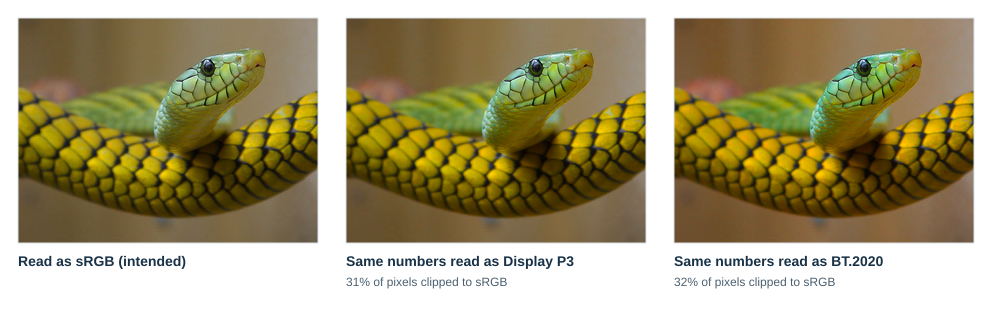
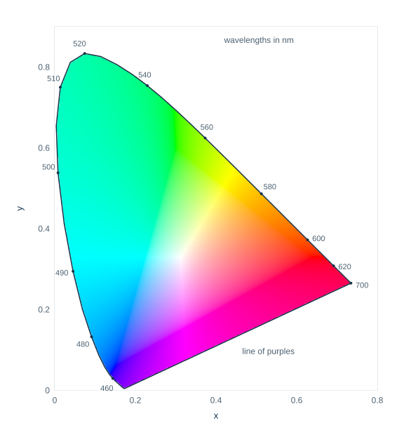
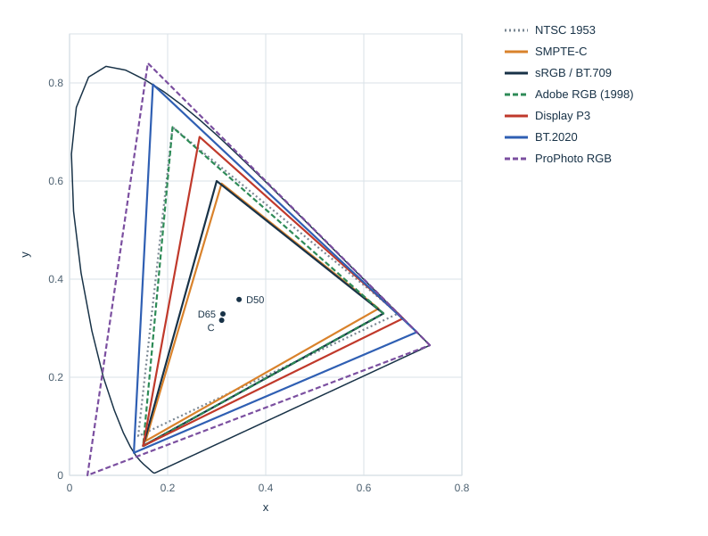
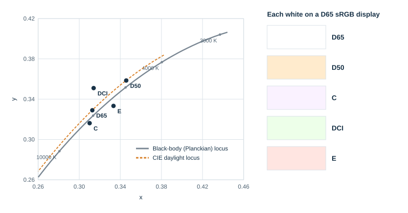
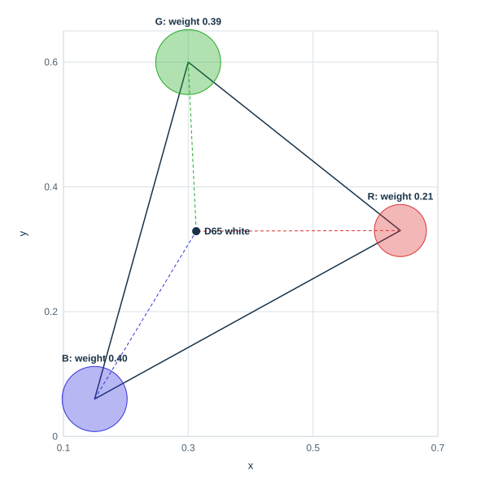

# Primaries and White Points

## Scope

"RGB" names three ingredients but not which ones. A color space has to say which red, green and blue it mixes, its *primaries*, and which color counts as neutral white, its *white point*. This page explains how chromaticity diagrams describe them, compares the primaries and whites of common standards, shows how a conversion matrix follows from them, and describes where they matter in libsixel. It extends the short section on [primaries, white point and transfer function](README.md#primaries-white-point-and-transfer-function) in [Color spaces](README.md). Its companion page, [transfer functions and gamma](transfer-functions.md), covers the third ingredient, and [color management basics](../color-management/README.md) describes chromatic adaptation and ICC profiles.

**Key ideas in one minute:**

- The same RGB numbers produce **different colors** under different primaries. Numbers alone are not a color.
- A **chromaticity diagram** shows every color's hue and saturation independent of brightness. Primaries are three points in it, and the **triangle** between them is the gamut at that level of description.
- Standards differ mainly in how far their **green** and **red** reach. sRGB is small; Display P3 and BT.2020 are progressively larger.
- A **white point** is a chosen neutral, named after a light source such as **D65** (daylight, about 6,500 K) or **D50** (about 5,000 K). It is not the brightest pixel of an image.
- Primaries and white point together fix the **matrix** between linear RGB and XYZ. It can be computed in a few lines.

## The same numbers, different colors

Here is one stored image shown three ways:

<picture>
  <source media="(max-width: 640px)" srcset="figures/pw-misread-mobile.svg">
  
</picture>

*Figure 1. One set of stored values read as sRGB (left), as Display P3 (middle) and as BT.2020 (right), each converted correctly to sRGB for display. All three are decoded with the sRGB curve, so only the primaries differ.*

Nothing about the numbers changed; only the assumed primaries. Read with wider primaries, every color becomes more saturated, and about a third of the pixels fall outside what an sRGB display can show and must be clipped. The opposite mistake, showing wide-gamut numbers as if they were sRGB, makes images look dull. Both errors are common when files lose their color tags or software ignores them.

## Where colors live: the chromaticity diagram

The CIE 1931 color-matching functions turn any spectrum into three numbers, X, Y and Z. Y is luminance. Dividing out the overall amount gives *chromaticity coordinates*:

```text
x = X / (X + Y + Z)        y = Y / (X + Y + Z)
```

Two lights of the same color but different brightness share one point (x, y). Plotting all colors this way gives the familiar horseshoe:



*Figure 2. The CIE 1931 xy chromaticity diagram. The curved edge is the spectral locus of single wavelengths; the straight bottom edge is the line of purples. Colors outside sRGB are shown at the nearest displayable color, so the picture is an illustration rather than an accurate rendering.*

Three properties make the diagram useful:

- **Pure spectral colors lie on the curved edge**, labeled with their wavelengths. Every real color lies on or inside it. Points outside are not physically realizable.
- **Mixtures lie on straight lines.** Mixing two lights gives a chromaticity on the segment between them, nearer to the one that contributes more. Three primaries can therefore mix every chromaticity inside their triangle and nothing outside it.
- **Purples are not in the spectrum.** The bottom edge joins violet and red, which no single wavelength produces.

> **Try it.** Find 520 nm on the edge. It is the most saturated green there is, and it lies far above the greens a computer display can show. Which standards reach toward it is the subject of the next section.

## Gamuts of common standards

| Standard | Red x, y | Green x, y | Blue x, y | White | Typical use |
| --- | --- | --- | --- | --- | --- |
| NTSC (FCC, 1953) | 0.67, 0.33 | 0.21, 0.71 | 0.14, 0.08 | C | Original color television; the phosphors were never used for long |
| SMPTE-C (RP 145, 1987) | 0.630, 0.340 | 0.310, 0.595 | 0.155, 0.070 | D65 | North American studio monitors of the CRT era |
| EBU (Tech 3213) | 0.64, 0.33 | 0.29, 0.60 | 0.15, 0.06 | D65 | European PAL and SECAM television |
| sRGB and BT.709 | 0.64, 0.33 | 0.30, 0.60 | 0.15, 0.06 | D65 | HDTV, computer images, the web |
| Adobe RGB (1998) | 0.64, 0.33 | 0.21, 0.71 | 0.15, 0.06 | D65 | Photography and print preparation |
| Display P3 | 0.680, 0.320 | 0.265, 0.690 | 0.150, 0.060 | D65 | Wide-gamut computer and phone displays |
| DCI-P3 (RP 431-2) | 0.680, 0.320 | 0.265, 0.690 | 0.150, 0.060 | DCI | Digital cinema |
| BT.2020 | 0.708, 0.292 | 0.170, 0.797 | 0.131, 0.046 | D65 | Ultra-high-definition television |
| ProPhoto RGB | 0.7347, 0.2653 | 0.1596, 0.8404 | 0.0366, 0.0001 | D50 | Raw photo editing |

*Table 1. Primaries and white points. Values for sRGB, Display P3, Adobe RGB, ProPhoto RGB and BT.2020 follow CSS Color 4; the others follow the standards named.*

<picture>
  <source media="(max-width: 640px)" srcset="figures/pw-gamuts-mobile.svg">
  
</picture>

*Figure 3. The gamut triangles of Table 1 in the chromaticity diagram, with the D65, D50 and C white points.*

Several stories are visible in Figure 3:

- **sRGB inherits the CRT.** Its primaries are those of BT.709, close to the SMPTE-C and EBU phosphors of television monitors. The [specification layers](../../sixel-format/specification-layers.md#interpretation-1-register-rgb-values-default-to-srgb) page discusses what that means for SIXEL devices of the same era.
- **The 1953 NTSC triangle is large, but only on paper.** Its green reached far, but phosphors that bright and saturated were not practical, and studio practice moved to the SMPTE-C primaries.
- **Wide gamuts grow toward green and red.** Adobe RGB extends green for print colors, Display P3 extends red and green, and BT.2020 places its primaries on the spectral locus itself, at the single wavelengths 630, 532 and 467 nm.
- **ProPhoto reaches beyond reality.** Two of its primaries lie outside the horseshoe: they are mathematical, not lights. The space can describe almost every real surface color, at the cost of wasting codes on colors that cannot exist.

A triangle in this diagram is a flat slice. It shows which chromaticities a space can reach, not how bright they can be; the full gamut is a three-dimensional volume that narrows toward white. Two spaces with the same triangle can still differ in what they can show near black and white.

## What white means

White is a decision, not a measurement. A *white point* is the chromaticity that a color space treats as neutral: equal amounts of its three primaries at full strength produce it. Standards name their whites after *illuminants*, reference light sources:

<picture>
  <source media="(max-width: 640px)" srcset="figures/pw-whites-mobile.svg">
  
</picture>

*Figure 4. White points near the black-body locus (left) and how each white looks if shown on a D65 display without adaptation (right).*

- **Black-body (Planckian) locus.** A heated object glows red, then orange, white and bluish as its temperature rises. Its color at each temperature traces the gray curve. A light's *correlated color temperature* (CCT) is the temperature of the black body closest to it.
- **D65 and D50.** The CIE D illuminants describe daylight, which lies slightly above the black-body curve, on the dashed daylight locus. D65 (CCT about 6,500 K, x 0.3127, y 0.3290) is average daylight and the white of sRGB, Display P3 and BT.2020. D50 (about 5,000 K) is warmer, the illuminant of graphic-arts viewing, and the white of the [ICC profile connection space](../color-management/README.md#pcs-the-connection-between-color-profiles) and of ProPhoto RGB.
- **C.** An older daylight simulation made with filtered lamps, used by the 1953 NTSC system. It is close to D65 but slightly bluer, at about 6,800 K.
- **DCI.** Digital cinema's white is greenish compared with daylight. It reflects the xenon-lamp projectors of digital cinema rather than a standard daylight.
- **E.** The equal-energy white at x = y = 1/3, with a flat spectrum. It is a mathematical reference used, for example, by the original CIE RGB space.

The swatches of Figure 4 show what happens without adaptation. A D50 white sent to a display whose white is D65 looks yellowish, and E looks pinkish. In a real room the eye adapts and accepts either as white after a while, as described under [chromatic adaptation](../../quality/visual-perception/README.md#chromatic-adaptation). Converting images between whites does the same arithmetically, with a [chromatic adaptation transform](../color-management/README.md#chromatic-adaptation) that maps one white onto the other.

A white point is also not the brightest pixel of an image. An image of a sunset may have no neutral pixel at all; its white point still defines what equal RGB values mean.

## From primaries to a matrix

Primaries and white point are all that is needed to convert linear RGB to XYZ. The computation is short enough to do by hand, and it explains several numbers that appear throughout color science.

**Step 1: each primary as a direction.** A chromaticity (x, y) with luminance Y = 1 has `X = x / y` and `Z = (1 − x − y) / y`. For sRGB:

| | x | y | X at Y = 1 | Z at Y = 1 |
| --- | --- | --- | --- | --- |
| Red | 0.64 | 0.33 | 1.9394 | 0.0909 |
| Green | 0.30 | 0.60 | 0.5000 | 0.1667 |
| Blue | 0.15 | 0.06 | 2.5000 | 13.1667 |
| D65 white | 0.3127 | 0.3290 | 0.9505 | 1.0891 |

**Step 2: scale the primaries so that they add up to white.** Find luminances `Y_R`, `Y_G`, `Y_B` such that the three scaled directions sum to the white's (X, Y, Z) = (0.9505, 1, 1.0891). This is a small linear system, and its solution is

```text
Y_R = 0.2126        Y_G = 0.7152        Y_B = 0.0722
```

These are the familiar luminance weights of BT.709 and sRGB: they are not chosen separately but follow from the primaries and the white.

**Step 3: write the matrix.** Each column is a scaled primary:

```text
| X |   | 0.4124  0.3576  0.1805 |   | R |
| Y | = | 0.2126  0.7152  0.0722 | × | G |      (linear sRGB, D65)
| Z |   | 0.0193  0.1192  0.9505 |   | B |
```

The white point acts as a balance point. In the chromaticity diagram, white is the center of mass of the three primaries, each weighted by the X + Y + Z it contributes:



*Figure 5. White as the weighted center of the sRGB primaries. Blue contributes 40 percent of X + Y + Z but only 7 percent of the luminance.*

The same steps give the matrix of any other space, and two matrices combine into a conversion between spaces. Applied to the SMPTE-C primaries and D65, they give a conversion from linear sRGB whose first row is (1.06538, −0.05540, −0.00998). libsixel's `-U smpte-c` uses a fixed matrix in [`src/colorspace.c`](../../../src/colorspace.c) whose entries agree with these to within 0.0003; the small difference reflects the constants used in its derivation. For Display P3 the same computation shows that P3 red, (1, 0, 0), is (1.22494, −0.04206, −0.01964) in linear sRGB: a real color outside the sRGB gamut, as discussed under [out-of-gamut and imaginary colors](README.md#out-of-gamut-and-imaginary-colors).

When the two spaces have different white points, such as a D50 ICC profile and D65 sRGB, a chromatic adaptation transform is inserted between the matrices; the [color management](../color-management/README.md#chromatic-adaptation) guide describes it.

## Primaries and white points in libsixel

- **Internal work.** libsixel's RGB working values use sRGB primaries and D65, in encoded or linear form, as listed under [spaces used by libsixel](README.md#spaces-used-by-libsixel). Oklab, CIELAB and DIN99d are derived from them through XYZ D65.
- **Input files.** Loaders convert images with other primaries using embedded ICC profiles or file metadata, as described in [color management](../color-management/README.md) for ICC profiles and [PNG color metadata](../../loader/png-color-metadata.md) for PNG's `cHRM` and `cICP` chunks.
- **SIXEL output.** SIXEL color registers carry RGB or HLS percentages without defined primaries or white point. libsixel writes sRGB values by default; `-U smpte-c` writes SMPTE-C values for emulating the CRT era, and `-U display-p3` writes Display P3 values. The [specification layers](../../sixel-format/specification-layers.md#interpretation-1-register-rgb-values-default-to-srgb) page explains the reasoning, and [output color space](../../encoder/output/output-colorspace.md) the exact conversions.

## Reproducing the figures

The figures of this page are generated by [`tools/plot_colorspace_foundation_figures.py`](../../../tools/plot_colorspace_foundation_figures.py) with NumPy and Pillow. The spectral locus and the black-body locus use the CIE 1931 2° color-matching functions at 5 nm intervals, as tabulated by the Colour & Vision Research Laboratory, which the generator embeds; the daylight locus uses the CIE formula for D illuminants. Primaries, white points and the matrices quoted above are recorded in [`figures/foundations.json`](figures/foundations.json). Run the tool to regenerate the figures and with `--check` to verify that the committed files are current.

## References

- CIE 015:2018. *Colorimetry*, 4th ed. Commission Internationale de l'Éclairage.
- W3C. [*CSS Color Module Level 4*](https://www.w3.org/TR/css-color-4/), predefined RGB color spaces and the D50 and D65 white points.
- ITU-R Recommendation BT.709. *Parameter values for the HDTV standards for production and international programme exchange.*
- ITU-R Recommendation BT.2020. *Parameter values for ultra-high definition television systems for production and international programme exchange.*
- SMPTE RP 145. *Color Monitor Colorimetry*, 1987.
- SMPTE RP 431-2. *D-Cinema Quality – Reference Projector and Environment.*
- EBU Tech 3213. *EBU Standard for Chromaticity Tolerances for Studio Monitors.*
- International Color Consortium. [*Specification ICC.1:2022*](https://www.color.org/specifications/ICC.1-2022-05.pdf), the D50 profile connection space.
- Colour & Vision Research Laboratory. CIE 1931 2° colour-matching functions, [cvrl.org](http://www.cvrl.org/).
