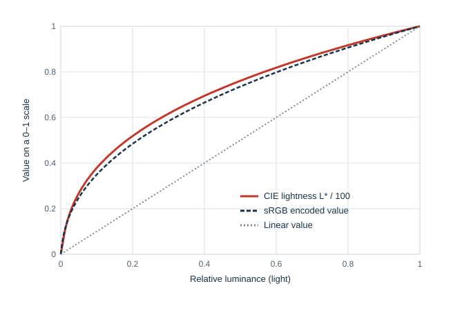
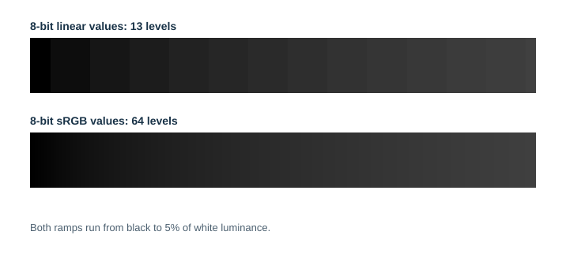
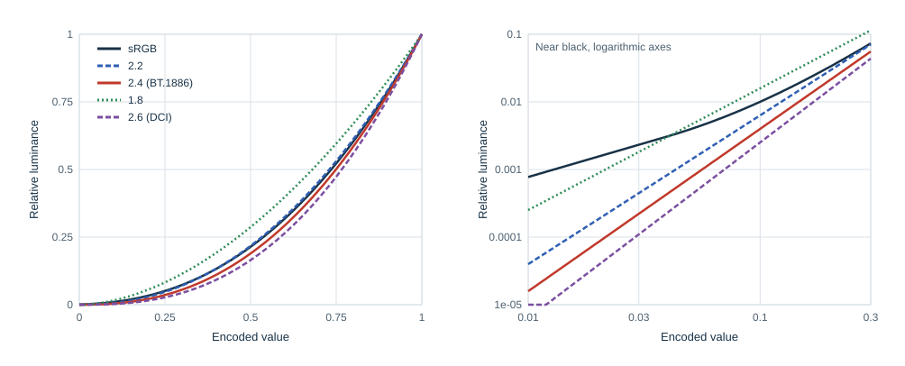
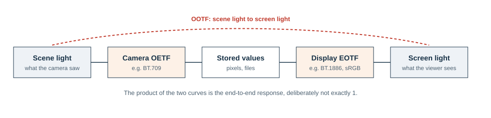
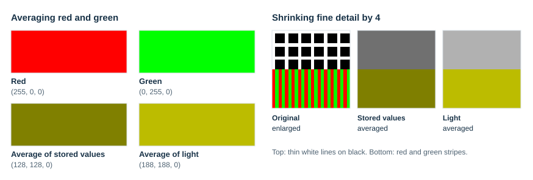

# Transfer Functions and Gamma

## Scope

A stored RGB value is almost never proportional to the light it stands for. Between the numbers in a file and the light of a screen sits a *transfer function*, usually called *gamma*. This page explains why images are stored that way, which curves are in use and where they came from, what the many meanings of the word "gamma" are, and when arithmetic on colors has to undo the curve first. It extends the short section on [gamma encoding and linear light](README.md#gamma-encoding-and-linear-light) in [Color spaces](README.md), which also gives the exact sRGB formulas that libsixel implements. Its companion page, [primaries and white points](primaries-and-white-points.md), covers the other two parts of an RGB color space.

**Key ideas in one minute:**

- Stored values are spaced for the **eye**, not for **light**. Equal steps in stored sRGB values look roughly equal; equal steps in light do not.
- This spacing is what lets **8 bits** per channel look smooth. Linear 8-bit values would band visibly in dark tones.
- Several curves are in use: the **sRGB** curve, simple **power** curves of 1.8 to 2.6, and the broadcast **OETF/EOTF** pair. They differ mostly near **black**.
- "Gamma" names an **exponent**, a **curve**, an **encoding**, a **file field** and a **display setting**. Say which one is meant.
- **Mixing light** (averaging, resizing, blending) needs **linear** values; storing and comparing images is better done in **encoded** or perceptual values.

## Which gray is halfway?

Start with an experiment. Both rows below run from black to white in eleven patches.

*Figure 1. Equal steps in stored sRGB values (top) and equal steps in light (bottom). The numbers are the stored 8-bit values.*

The top row looks like an even staircase. The bottom row, whose patches are evenly spaced in *light*, does not: its first step from black is a large jump, and its right half is a crowd of nearly identical light grays. The patch that emits half as much light as white is stored as 188, not 128, and it looks much lighter than halfway.

> **Try it.** Find the patch in the bottom row that looks halfway between black and white. Most people pick the second or third patch, which emit only 10 to 20 percent of white's light.

The eye judges lightness roughly by ratios, so a fixed increase of light is conspicuous in the dark and negligible in the bright. [Weber's law](../../quality/visual-perception/README.md#how-adaptation-works) in the visual perception chapter describes the same behavior.

## A curve shaped like perception

CIE lightness L\*, defined in 1976 as a uniform scale of perceived lightness, rises steeply from black and levels off toward white. It is essentially a cube root of relative luminance with a short straight segment near black. The sRGB encoding nearly follows it:

*Figure 2. CIE lightness L\* (divided by 100) and the sRGB encoded value against relative luminance. A linear value is the diagonal.*

That closeness is the reason for gamma encoding. If stored values were linear, they would follow the diagonal, and most of the 256 available codes would describe bright tones that the eye can barely tell apart.

The history is a happy coincidence. A cathode-ray tube produced light roughly as a power of about 2.5 of its drive voltage, for reasons of electron physics rather than perception. Television therefore encoded its signal with the inverse curve at the camera, so that the tube would reproduce the scene's light. That inverse curve happens to be close to the eye's lightness scale, so the encoding also spent its precision where the eye needed it. Flat panels have no such physics, but they imitate the curve because every image and video in existence is encoded for it.

## What 8 bits can and cannot do

The benefit can be measured. Figure 3 shows how much CIE lightness changes from one 8-bit code value to the next for several encodings:

*Figure 3. Lightness step between neighboring 8-bit codes. The shaded band marks roughly the smallest step that is visible between large adjacent areas.*

With linear coding, the first step above black changes lightness by 3.5 L\* units, several times a visible step, while the last steps near white change it by only 0.15, far less than anyone can see. sRGB keeps every step at or below about 0.5. The same budget of 256 codes is simply distributed better. Figure 4 shows what that means for a dark gradient:

*Figure 4. The same dark ramp, from black to 5 percent of white's luminance, stored in 8 bits as linear values (top) and as sRGB values (bottom).*

Only 13 of the 256 linear codes fall in this range, against 64 sRGB codes. Linear values need about 12 or more bits per channel to match 8-bit sRGB in the shadows, which is why linear storage is used for floating-point and high-precision work but almost never for 8-bit images. libsixel keeps the same distinction: 8-bit pixels are encoded, while linear intermediate values are held as floating point, as described under [pixel-format precision](../pixelformat-precision/README.md).

## The curves in use

Several curves coexist, each with its own history:

| Curve | Definition | Where it comes from and where it is used |
| --- | --- | --- |
| sRGB | Piecewise: linear below a small threshold, then an offset power of 2.4; overall close to a 2.2 power. Formulas in [Color spaces](README.md#gamma-encoding-and-linear-light). | Proposed by HP and Microsoft in 1996, standardized as IEC 61966-2-1 in 1999. The default for images on computers and the web, and for Display P3. |
| Power 2.2 | `L = V^2.2` | The usual target of computer monitors and the common approximation of sRGB. Also used by Adobe RGB (1998), whose exponent is 563/256 ≈ 2.2, and by libsixel's `-U smpte-c` output. |
| Power 1.8 | `L = V^1.8` | The classic Macintosh system gamma, chosen to suit printing, until Mac OS X 10.6 adopted 2.2 in 2009. ProPhoto RGB also uses 1.8 with a short linear segment. |
| BT.709 OETF | `V = 4.5 L` below 0.018, else `1.099 L^0.45 − 0.099` | The camera curve of high-definition television, ITU-R BT.709. It describes encoding at the camera, not display. |
| BT.1886 EOTF | `L = V^2.4` for an ideal black | The reference display curve for HDTV studio monitors, ITU-R BT.1886 (2011), and the decoding curve CSS Color 4 assigns to `rec2020`. |
| DCI power 2.6 | `L = V^2.6` | Digital cinema projection (SMPTE RP 431-2), viewed in a dark theater. |
| CIE L\* | Cube root with a linear segment | A lightness scale rather than an image encoding, but used as a transfer curve by some profiles. |

High-dynamic-range video uses different curves altogether: PQ (SMPTE ST 2084) maps values to absolute luminance up to 10,000 cd/m², and HLG (ITU-R BT.2100) extends a conventional curve for bright highlights. libsixel does not handle HDR transfer functions; SIXEL's register values have no notion of absolute luminance.

<picture>
  <source media="(max-width: 640px)" srcset="figures/tf-curves-mobile.svg">
  
</picture>

*Figure 5. Decoding curves over the full range (left) and near black on logarithmic axes (right).*

On the left the curves look alike; most of their difference is hidden in the dark tones. On the right, near black, they spread over orders of magnitude. The sRGB curve turns into a straight line below code 10: at code 5 it gives 0.0015 of white's luminance, eight times the 0.00018 of a pure 2.2 power, and at code 20 still about twice as much. Around the middle, at code 128, the two agree within 2 percent.

This near-black difference is a real source of disagreement. An image encoded with the sRGB curve but displayed with a pure 2.2 power, which many monitors and systems do, shows slightly deeper shadows than intended; the reverse mismatch lifts them. Neither is wrong by much, and in the midtones they are indistinguishable, but shadow detail and dark gradients can change visibly.

## Who applies which curve

Broadcast engineering separates three functions, and the names help in every context:

<picture>
  <source media="(max-width: 640px)" srcset="figures/tf-chain-mobile.svg">
  
</picture>

*Figure 6. The OETF encodes light into values, the EOTF decodes values into light, and the OOTF is the combined effect from scene to screen.*

- The **OETF** (opto-electronic transfer function) turns scene light into a signal, for example the BT.709 camera curve.
- The **EOTF** (electro-optical transfer function) turns a signal into displayed light, for example BT.1886 or the sRGB decoding curve.
- The **OOTF** (opto-optical transfer function) is the end-to-end result.

In television the OOTF is deliberately not the identity. A scene is usually much brighter than the room in which it is watched, and pictures shown at the same relative contrast look flat in dim surroundings. The camera and display curves are therefore chosen so that the end-to-end response has an exponent somewhat above 1, commonly quoted as about 1.2. Computer images are usually treated more simply: the sRGB curve is applied once to encode and once to decode, and the image is taken to describe what the display should show.

For libsixel, which receives finished images rather than camera signals, the relevant function is the EOTF that the receiving display applies. Encoding for SIXEL means producing values that the terminal will decode the same way, which is the subject of the [output color space](../../encoder/output/output-colorspace.md) guide.

## The many meanings of "gamma"

The word is used for at least five things, and confusing them causes most gamma bugs:

| When someone says "gamma" they may mean | Example | Note |
| --- | --- | --- |
| A decoding exponent | "the display gamma is 2.2" | Light = value^2.2. Larger means darker midtones. |
| An encoding exponent | "the file gamma is 0.45" | Value = light^0.45, the reciprocal of the above. |
| A whole curve, not just an exponent | "the sRGB gamma" | sRGB is not a pure power function. |
| Encoded data as opposed to linear | "convert to gamma space" | libsixel's `gamma` color space means sRGB-encoded values specifically. |
| A field in a file | PNG `gAMA` | Stores the *encoding* exponent times 100,000: 45455 means 1/2.2. |

The PNG case is a classic trap: a decoder that treats 45455 as a display exponent of 0.45 instead of an encoding exponent of 1/2.2 brightens every image enormously. How libsixel's loaders interpret `gAMA` together with `cHRM`, `sRGB`, `iCCP` and `cICP` is documented in [PNG color metadata](../../loader/png-color-metadata.md).

"Gamma correction" is also ambiguous. In television it originally meant the camera's encoding curve, which pre-corrected for the CRT. In image editors it often means a brightness adjustment applied by a user. Neither is a correction of an error.

## When arithmetic needs linear light

Light adds linearly. When two lights mix, on a screen seen from a distance, inside a resize filter, or along an anti-aliased edge, the result is the sum of their light, not of their stored values. Arithmetic on encoded values therefore gives wrong mixtures:

<picture>
  <source media="(max-width: 640px)" srcset="figures/tf-mixing-mobile.svg">
  
</picture>

*Figure 7. Averaging stored values (darker) and averaging light (correct) for a color mixture and for shrinking fine detail.*

On the left, red and green averaged as stored values give a dark olive, (128, 128, 0), while their average light is the brighter yellow (188, 188, 0). On the right, the same happens when fine detail is shrunk: thin white lines and fine red and green stripes come out darker and duller when the resize filter averages stored values. The effect is strongest exactly where detail is fine and contrast high, such as text, foliage, stars and lattices.

This is why libsixel performs resizing, background composition and other light mixing in linear RGB, as explained under [why mixing and background composition use linear RGB](README.md#why-mixing-and-background-composition-use-linear-rgb). The reverse also holds: comparing colors, deciding which palette entry is nearest, or measuring an error that should match visible differences works better in encoded or perceptual coordinates, which is why the working spaces for palette lookup and error diffusion are selectable with `-W` and `-X` and described in [color-space handling](../../encoder/colorspace-handling/README.md).

> **Try it.** Look at the dithering chapter's [linear-light averaging figure](../dithering/README.md#dithering-in-color) from a distance. The black-and-white checkerboard matches the patch stored as 188, the average of the light, not the one stored as 128.

## Transfer functions in libsixel

- **Internal working values.** 8-bit pixels are treated as sRGB-encoded by default. Linear values exist only as floating-point intermediates where an operation needs them. The `gamma` and `linear` color-space names in options refer to sRGB-encoded and linear-light sRGB, as listed under [spaces used by libsixel](README.md#spaces-used-by-libsixel).
- **Input files.** Loaders read transfer information from file metadata where it exists, such as the PNG chunks described in [PNG color metadata](../../loader/png-color-metadata.md) and ICC profiles described in [color management](../color-management/README.md).
- **SIXEL output.** The SIXEL format does not say which transfer function its register values use. libsixel writes sRGB-encoded values by default and explains that choice, and its historical alternatives, in [interpretation 1 of the specification layers](../../sixel-format/specification-layers.md#interpretation-1-register-rgb-values-default-to-srgb). `-U linear` writes linear values and `-U smpte-c` a 2.2 power with SMPTE-C primaries, as described in [output color space](../../encoder/output/output-colorspace.md).

## Reproducing the figures

The figures of this page are generated by [`tools/plot_colorspace_foundation_figures.py`](../../../tools/plot_colorspace_foundation_figures.py) with NumPy and Pillow. They are hand-written SVG, so their bytes do not depend on a plotting library; run the tool to regenerate them and with `--check` to verify that the committed files are current. The numbers quoted in the text, such as lightness steps and the comparison of the sRGB curve with a 2.2 power, are recorded in [`figures/foundations.json`](figures/foundations.json).

## References

- IEC 61966-2-1:1999. *Multimedia systems and equipment – Colour measurement and management – Part 2-1: Default RGB colour space – sRGB.*
- ITU-R Recommendation BT.709. *Parameter values for the HDTV standards for production and international programme exchange.*
- ITU-R Recommendation BT.1886. *Reference electro-optical transfer function for flat panel displays used in HDTV studio production*, 2011.
- ITU-R Recommendation BT.2100. *Image parameter values for high dynamic range television for use in production and international programme exchange.*
- SMPTE ST 2084. *High Dynamic Range Electro-Optical Transfer Function of Mastering Reference Displays.*
- SMPTE RP 431-2. *D-Cinema Quality – Reference Projector and Environment.*
- W3C. [*CSS Color Module Level 4*](https://www.w3.org/TR/css-color-4/), predefined RGB color spaces.
- W3C. [*Portable Network Graphics (PNG) Specification (Third Edition)*](https://www.w3.org/TR/png-3/), the `gAMA` and `sRGB` chunks.
- Poynton, C. *Digital Video and HD: Algorithms and Interfaces*, 2nd ed. Morgan Kaufmann, 2012.
- Apple. *Mac OS X v10.6: About gamma 2.2*, 2009; and TidBITS, [*Why Web Content Will Look Darker under Snow Leopard*](https://tidbits.com/2009/09/06/why-web-content-will-look-darker-under-snow-leopard/), 2009.
