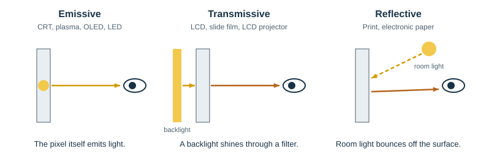
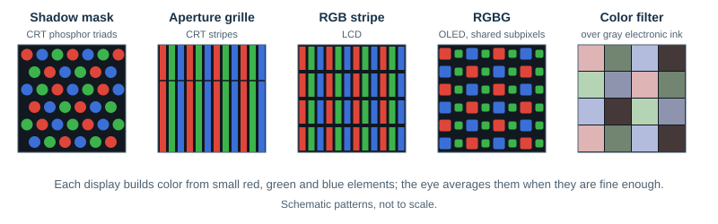

# Display Technologies

## Scope

This document looks at the devices that finally turn image data into light: printed paper and photographic film, cathode-ray tubes, liquid crystal panels including Mini LED backlit ones, plasma and organic LED panels, projectors, and electronic paper. It follows their history, compares how each sends light to the eye and mixes color, traces how pixel density grew relative to the eye's resolution, and explains why electronic paper makes dithering and small palettes important again. It builds on [Visual perception](../../quality/visual-perception/README.md) and [Color spaces](../colorspace/README.md), and it prepares the [Palettes](../palettes/README.md) and [Dithering](../dithering/README.md) chapters.

**Key ideas in one minute:**

- A display either **emits** light, **transmits** a backlight through a filter, or **reflects** room light. Emissive and backlit displays lose contrast in bright rooms; reflective ones keep a fixed contrast and get brighter.
- Color is mixed **subtractively** by inks and dyes, or **additively** by light, either side by side (**spatially**) or one after another (**temporally**). Every display relies on the eye to average small elements.
- Pixel density, measured in **pixels per degree** of visual angle, grew slowly for decades and even **fell** for many consumer screens in the 2000s, before the "Retina" displays of the 2010s reached the eye's resolution.
- Where pixels are finer than the eye resolves, dither patterns disappear. Where levels are few and updates are slow, as on **electronic paper**, dithering is again the main tool.
- Color electronic paper revives the situation of 1980s terminals such as the VT340: **a few colors at a time, chosen from a limited set**.

## How a display sends light



*Figure 1. Emissive, transmissive and reflective displays.*

**Emissive** displays make light in each pixel: the phosphors of a cathode-ray tube, the gas cells of a plasma panel, organic and inorganic LEDs. **Transmissive** displays modulate light from a separate source: a liquid crystal panel in front of a backlight, a color slide in front of a projector lamp. **Reflective** displays have no light of their own: printed paper and electronic paper return part of the light that falls on them.

The difference matters most when the room light changes. The figure below compares the three kinds with simple, illustrative values: a 300 cd/m² emissive or backlit display whose glass reflects 2% of the room light, a liquid crystal panel with a native contrast of 1000:1, electronic paper whose white reflects 40% and black 3% of the light, and printed paper with 85% and 3%.


*Figure 2. Luminance of white and contrast ratio as the room gets brighter. The optical values are illustrative assumptions, not measurements of particular products.*

- An emissive or backlit display has fixed brightness. Room light reflected from its surface adds to both its white and its black, so its contrast falls as the room gets brighter. In sunlight, the reflection can be brighter than the picture. Local dimming of a backlight, as in Mini LED LCDs, lowers the display's own black level, but not the reflected room light.
- A reflective display reflects a fixed fraction of the light, so its contrast ratio does not depend on the room light at all, and its white becomes brighter as the room does. It is easiest to read in sunlight and impossible to read in the dark without a front light.
- A transmissive display in a dark room, such as a slide projected in a darkened hall, combines a bright source with a dark surround and can show a very wide range of tones.

The eye adapts to all of this, as [Visual perception](../../quality/visual-perception/README.md#light-level-and-adaptation) explains. A reflective display is always seen at the adaptation level of the room around it; an emissive display can be much brighter or darker than its surroundings.

## How colors are mixed


*Figure 3. Four ways to mix color.*

**Subtractive mixing.** Inks and dyes absorb part of the light that passes through them. Cyan absorbs red, magenta absorbs green and yellow absorbs blue, so layers of them remove more and more light, toward black. Color photographic film and slide film use layers of subtractive dyes; printing presses use cyan, magenta, yellow and black (CMYK) inks.

**Additive mixing.** Lights add up: red and green light together look yellow, and all three primaries together look white. Displays mix additively, but they rarely put two lights on the same spot. Instead they use one of two tricks that rely on the eye's averaging.

- **Spatial (partitive) mixing.** Small red, green and blue elements sit side by side. When they are smaller than the eye can resolve, the eye averages their light. Every color CRT, LCD and OLED panel works this way, and so did the Autochrome plates of 1907, whose dyed starch grains formed a random color mosaic.
- **Temporal mixing.** Colors are shown one after another, faster than the eye can follow. Single-chip DLP projectors show red, green and blue fields in turn through a rotating color wheel. A viewer who moves their eyes quickly can see the fields separate as colored fringes, the "rainbow effect". Plasma panels similarly build each gray level from short pulses of light within a frame.

Printing combines both kinds. A halftone screen prints dots of each ink; where dots overlap, the inks mix subtractively, and the uncovered paper and dots of different colors mix spatially in the eye. The resulting colors are mixtures of a few "Neugebauer primaries", which the [cover policy](../../encoder/palette-construction/cover-policy/README.md#printing-supplies-the-convex-mixture-model) uses as a model for palette coverage.



*Figure 4. Subpixel layouts of different display families. The patterns are schematic.*

The arrangement of the colored elements differs between technologies. A shadow-mask CRT places round red, green and blue phosphor dots in triangles; an aperture-grille CRT uses continuous vertical phosphor stripes; an LCD divides each pixel into three vertical stripes; many OLED panels share red and blue subpixels between neighboring pixels and give every pixel its own green, because the eye's resolution depends mostly on the luminance that green carries. Color electronic paper can place a color filter array over a monochrome ink layer, so that several gray ink pixels form one color pixel.

> **Try it.** Look at a white area of your screen through a magnifying glass, or take a close-up photograph with a phone. You will see the subpixel pattern of Figure 4 that your eye normally averages into white.

## A timeline


*Figure 5. Display technologies from 1881 to 2025.*

### Print and photography

Printing presses can only put ink or no ink on paper. The **halftone** process, made commercially practical by Frederic Ives in 1881 and patented by Georg Meisenbach in Germany in 1882, broke photographs into dots of varying size, so that a press could print gray tones: the first widely used dithering. Color printing extended it to several inks, each with its own screen.

Photography brought color through additive and subtractive processes. The **Autochrome** plate of the Lumière brothers, marketed from 1907, was an additive mosaic of microscopic starch grains dyed red-orange, green and blue-violet over a black-and-white emulsion. **Kodachrome**, introduced in 1935, was a subtractive color reversal film whose slides were viewed by projection. Slide film is transmissive, like a later LCD, and projected in a dark room it shows deep blacks and bright highlights.

### Cathode-ray tubes

Ferdinand Braun built the first cathode-ray tube display in 1897. In a CRT, an electron beam scans the screen and makes a phosphor glow. Color tubes need three phosphors and a way to keep each beam on its own color. RCA's **CT-100** of 1954, the first mass-produced color television, used a **shadow mask**: a metal sheet with holes that let each of three beams reach only its phosphor dots. Sony's **Trinitron** of 1968 replaced the holes with a grille of vertical wires and continuous phosphor stripes, giving a brighter picture.

A CRT has no fixed pixel grid. The video signal sets how many pixels are drawn per line, and the same tube can show 640 × 480 or 1600 × 1200. The sharpness, however, is limited by the spot size of the beam and the pitch of the phosphor pattern, typically around 0.24 to 0.28 mm on later computer monitors. A resolution setting above what the phosphor pitch supports draws pixels that the tube cannot actually separate.

A CRT pixel also has no sharp edge. The electron beam's spot is brightest in the middle and fades gradually, phosphors glow in all directions, and light spreads a little in the thick front glass. Neighboring pixels therefore blend into each other, and the screen acts as a gentle blur that smooths the pixel grid away. An LCD of the same pixel density draws each pixel as a sharp-edged rectangle separated by a thin dark line, so its grid stays visible where a CRT's had already disappeared. Many viewers of good CRTs never saw individual pixels, even at densities where an LCD's pixels are obvious. The same blur softened dither patterns, which is one reason why pixel art and dithered images made for CRTs can look harsher on modern flat panels.

The CRT was the computer display for half a century: the DEC VT340 and other SIXEL terminals, and the PC graphics adapters of the [palette chapter](../palettes/README.md#personal-computers), all drew on CRTs. Flat displays that kept the CRT's principle, such as the surface-conduction electron-emitter display (SED) developed by Canon and Toshiba, did not reach the market: Canon ended SED development in 2010.

### Terminals and printers of the SIXEL lineage

Digital Equipment Corporation's terminals and printers carried the ideas that became SIXEL. The DECwriter LA30 of 1970 was a dot-matrix printing terminal that formed characters from 5 × 7 dots; the DECwriter II, LA36, of 1974 printed 7 × 7 dot characters at 10 characters per inch and became DEC's first widely successful keyboard terminal. The VT100 of 1978 moved the terminal onto a CRT.

SIXEL itself began as a way to send bitmap graphics to DEC's dot-matrix printers such as the LA50 of 1983, which printed 144 × 72 dots per inch, and continued in the LA75 companion printer of 1986. Graphics terminals followed: the VT240 of 1984 drew 800 × 240 pixels in gray, and its color version, the VT241, showed 4 colors at a time from 64. The VT340 of 1987 drew 800 × 480 pixels with 16 colors from 4,096, and the LJ250 color inkjet printer of the same year printed SIXEL images at 180 dots per inch. The [SIXEL format](../../sixel-format/README.md) chapter describes the protocol these devices shared.

The pixels of these devices were not square. The VT240's 800 × 240 pixels filled a 4:3 screen, so each pixel was about two and a half times as tall as it was wide, and the LA50 placed dots twice as densely across the line as down the page. Figure 6 below draws such devices as a bar from the vertical to the horizontal density.

### Flat panels

**Plasma.** The plasma display panel was invented in 1964 at the University of Illinois by Donald Bitzer, Gene Slottow and Robert Willson for the PLATO computer-based education system (Bitzer and Slottow, 1966). Each cell is a tiny fluorescent lamp. Color plasma televisions arrived in the late 1990s; Fujitsu's 42-inch panel of 1997 showed 852 × 480 pixels. Plasma's emissive picture had wide viewing angles, but the technology lost the television market to LCDs.

**Liquid crystal.** George Heilmeier's group at RCA demonstrated the first liquid crystal displays in 1968, using dynamic scattering (Heilmeier, Zanoni and Barton, 1968). The **twisted nematic** (TN) cell of Schadt and Helfrich (1971) needed little power and became the basis of watches, calculators and later of computer screens. Liquid crystal does not emit light: it rotates the polarization of light from a backlight, and polarizers turn this into brightness. Active-matrix panels with a thin-film transistor per subpixel made fast, high-resolution screens possible, and in-plane switching (IPS), commercialized by Hitachi in 1996, widened the viewing angle. LCD desktop monitors outshipped CRTs worldwide from the third quarter of 2004, and LCD televisions outsold CRT televisions from the fourth quarter of 2007.

An LCD has a fixed **native resolution**: one transistor per subpixel. Any other resolution must be resampled, which blurs the picture. This simple fact shaped the pixel-density history below.

**Mini LED backlights.** An LCD cannot block its backlight completely, so its black glows slightly and its native contrast is limited to about 1000:1 to a few thousand to one. **Local dimming** divides the backlight into zones and dims each zone behind dark parts of the picture. Mini LED backlights make the zones small by using thousands of tiny LEDs. TCL's 8-Series of 2019 brought the first Mini LED televisions, with about 1,000 zones in the 75-inch model, and Apple's 12.9-inch iPad Pro of 2021 lit its LCD with more than 10,000 mini LEDs in 2,596 zones. The picture is then the product of two images: a coarse backlight image, one value per zone, and the fine LCD image in front of it. Because a zone is much larger than a pixel, a small bright object on a dark background lights its whole zone, and a faint halo, called blooming, can appear around it. Since 2025, RGB Mini LED televisions also build the backlight itself from separate red, green and blue LEDs, so that each zone can change its color as well as its brightness.

**Organic LED.** Ching Tang and Steven VanSlyke at Kodak reported efficient organic light-emitting diodes in 1987 (Tang and VanSlyke, 1987). OLED subpixels emit their own light and can switch off completely, so an OLED panel shows true black in a dark room. Sony's XEL-1 of 2007, with an 11-inch 960 × 540 screen, was the first OLED television; OLED panels later became common in phones.

**MicroLED.** Arrays of microscopic inorganic LEDs were first demonstrated by Hongxing Jiang and Jingyu Lin in 2000 (Jiang et al., 2001). Sony showed a 55-inch "Crystal LED" prototype with one LED per subpixel in 2012. MicroLED combines emissive black with the brightness and lifetime of inorganic LEDs, but remains expensive to manufacture.

### Projectors

Projectors enlarge a small image onto a screen, so they mix color in the projector, not on the screen. Epson's VPJ-700 of 1989 was the first **3LCD** projector, with one transmissive LCD panel for each primary and optics that combine the three images. Larry Hornbeck at Texas Instruments invented the **digital micromirror device** (DMD) in 1987: an array of tiny mirrors that tilt toward or away from the lens thousands of times per second. A DLP projector forms gray levels by how long each mirror points at the screen and, with a single chip, forms color by temporal mixing through a color wheel. The first DLP projector came to market in 1997.

### Electronic paper

Nick Sheridon's **Gyricon** at Xerox PARC, from 1974, used tiny beads that were black on one side and white on the other, rotated by an electric field. The electrophoretic ink of E Ink, a company founded in 1997 by MIT Media Lab researchers and students, uses microcapsules of charged white and black pigment particles that move toward or away from the surface (Comiskey et al., 1998). The image stays without power; only changes cost energy.

Sony's Librie of 2004 was the first e-reader with E Ink, followed by Amazon's Kindle in 2007, which showed four gray levels; later generations show 16. Color electronic paper took three routes:

- **Color filters.** E Ink Kaleido places a color filter array over a monochrome ink layer. E Ink describes Kaleido 3 (2022) as showing 16 gray levels and 4,096 colors. The filters reduce the color resolution and the saturation of the reflected light.
- **Several colored pigments per pixel.** E Ink Gallery 3 (2022) moves cyan, magenta, yellow and white particles in each pixel, with color updates of about half a second.
- **A few vivid pigments.** E Ink Spectra 6 (2023) shows six display colors, black, white, red, yellow, blue and green, for signage and labels.

## Pixel density and the eye

### Pixels per degree

How sharp a display looks depends on how large its pixels appear to the eye, which depends on both pixel pitch and viewing distance. [Visual perception](../../quality/visual-perception/README.md#from-pixels-to-cycles-per-degree) defines the measure used here:

```text
pixels per degree = viewing distance × tan(1°) / pixel pitch
finest pattern    = pixels per degree / 2    cycles per degree (cpd)
```

A one-pixel checkerboard on a display with 60 pixels per degree is a 30 cpd pattern. That is the detail of a letter that a person with normal 20/20 acuity can just resolve; the eye's absolute resolution limit lies near 50 to 60 cpd, or 100 to 120 pixels per degree.

![A scatter chart of pixels per degree against year from 1983 to 2024, with numbered points listed below the chart. DEC terminals and printers of the 1980s span about 15 to 43 pixels per degree, drawn as bars because their pixels are not square. CRT monitors rise to about 50, with bars down to the limit set by their phosphor pitch. Desktop and notebook LCDs stay between 34 and 46 in the 2000s, and two arrows mark falls: from a 17-inch to a 19-inch 1280 by 1024 LCD, and from a 15-inch 1600 by 1200 notebook to a 15.6-inch 1366 by 768 notebook. The IBM T221 reaches 84 in 2001. From 2010, premium phones, notebooks, high-density monitors and e-readers reach 67 to 95, above the 60 pixels per degree line that marks 20/20 acuity, while mainstream 1366 by 768 and 1080p notebooks and monitors of 2015 to 2024 stay between 34 and 54; a 4K television at 2.5 m reaches 116 and a 643 pixels per inch phone 133, while VR headsets and display glasses rise from 7 in 2013 to about 40 in the mid-2020s, a ceiling-light projector gives about 32, and a color e-reader spans 36 to 72.](figures/pixel-density.svg)

*Figure 6. Pixels per degree of representative displays, computed from their resolution and size at typical viewing distances: 60 cm for terminals and desktop monitors, 50 cm for notebooks, 40 cm for tablets, 35 cm for printed pages and e-readers, 30 cm for phones, and 2.5 m for a television and for an 80-inch projected picture. Head-mounted displays are plotted with published or estimated pixels per degree. Bars show a range: the horizontal and vertical density of non-square pixels, the addressable and phosphor-limited density of a CRT, or the monochrome and color density of a color e-reader. CRTs are drawn hollow.*

### The long plateau and the 2000s step back

For two decades, desktop displays stayed between about 25 and 45 pixels per degree. The VT340's 800 × 480 pixels on a 13-inch tube gave about 34 pixels per degree across and 27 down; a page from the LJ250 at reading distance gave about 43. CRT monitors grew larger and supported more lines, and a 21-inch CRT at 1600 × 1200 reached about 100 pixels per inch, or 41 pixels per degree at 60 cm. High-end 21- and 22-inch CRTs, such as Sony's Trinitron GDM-F520, accepted 2048 × 1536, and Sony's 24-inch widescreen GDM-FW900 of 2002 was specified for 2304 × 1440, about 50 pixels per degree; owners have also driven it at 2560 × 1600 with custom timings beyond its specification. Their phosphor pitch of about 0.24 mm, however, limited the detail they could separate to about 42 to 44 pixels per degree at 60 cm.

The move to LCDs in the 2000s brought sharp, geometrically perfect pixels, but for many consumers it did not bring more of them, and in some common cases fewer:

- **Fixed native resolutions.** A CRT could be run at any resolution its electronics allowed. An LCD looks good only at its native resolution. Popular 17- and 19-inch LCDs both had 1280 × 1024 pixels, so the larger 19-inch panel had larger pixels: 86 instead of 96 pixels per inch.
- **Fewer lines on wider screens.** Around 2009 notebook and monitor makers moved from 16:10 and 4:3 panels to the 16:9 shape of televisions, which let them cut more panels from each sheet of glass. Many 15-inch notebooks that had offered 1400 × 1050, 1600 × 1200 or 1920 × 1200 were replaced by 15.6-inch models with 1366 × 768 pixels, and desktop monitors moved from 1920 × 1200 to 1920 × 1080.

Figure 6 marks two such steps. A 15-inch 1600 × 1200 notebook of 2006 offered 133 pixels per inch, or 46 pixels per degree at 50 cm; a typical 15.6-inch 1366 × 768 notebook of 2009 offered 100 pixels per inch, or 35 pixels per degree. Professional displays had already gone much further: IBM's T220 and T221 of 2001 put 3840 × 2400 pixels on a 22.2-inch LCD, 204 pixels per inch, but remained a niche product.

### How the pixels looked

Pixel density is not the whole story. Figure 7 simulates the same text, a thin line and a dithered gradient on three displays: a CRT at 40 pixels per degree, a mainstream 1080p LCD at 36 and a high-density LCD at 90. The upper row shows a close-up of the light leaving each screen; the lower row blurs it as a rough model of the eye, with less sharpness for color than for brightness.

![Three columns. CRT at 40 pixels per degree: close-up of vertical red, green and blue phosphor stripes with soft dark shapes; seen by the eye, the text, line and dither dots look smooth and slightly soft, with faint vertical stripes. 1080p LCD at 36 pixels per degree: close-up of square pixels made of three subpixels inside a black grid; seen by the eye, the text and line show stair steps, the dither dots are square blocks and a fine dotted grid covers the image. High-density LCD at 90 pixels per degree: close-up of much smaller subpixels; seen by the eye, the text and line are crisp and the dither is a fine, even texture.](figures/pixel-appearance.svg)

*Figure 7. Simulated appearance of a CRT, a 1080p LCD and a high-density LCD. The lower row is magnified for print, so fine stripes and grids appear more prominent than at real size. The model and its parameters are listed in the figures manifest.*

At similar density the CRT and the LCD look different. The CRT reconstructs the image with soft spots, so edges and dither dots blend smoothly and no pixel grid appears; its phosphor stripes are finer than its pixels and do not follow the image. The LCD draws every pixel as a sharp square in a dark grid, so slanted edges show steps, dither dots become visible blocks, and the grid itself can be seen. The high-density LCD is both sharp and smooth.

The claim that the change from CRTs to LCDs made images look worse in the early 2000s, not only in resolution, is therefore reasonable, with qualifications on both sides:

- **Pixel structure.** At the same density an LCD shows its pixel grid and the steps of edges, where a CRT shows neither.
- **Black and contrast.** Early LCDs could not block their backlight well. In a comparison of the time, the black of an LCD in a dark room was about 58 times brighter than that of a CRT, and colors shifted when the LCD was viewed from an angle (Sharma, 2002).
- **What improved.** The same study found that under typical room light the LCD kept a much larger contrast range, mainly because it was much brighter, so reflected room light lifted its black less in proportion. LCDs were also free of flicker, geometric distortion and color misconvergence, and their sharp pixels made small text crisper than on most CRTs. The sharpness that shows the grid is the same sharpness that made text clearer.

### Retina: reaching the eye's resolution

In 2010 Apple introduced the iPhone 4 with a 326 pixels per inch "Retina" display (Apple, 2010). Presenting it, Steve Jobs argued that about 300 pixels per inch, held 10 to 12 inches from the eye, was the limit of what the eye could resolve. At 30 cm this is about 68 pixels per degree, just above the 60 of 20/20 acuity. Notebooks, monitors and e-readers followed during the 2010s, as Figure 6 shows.

At these densities, single pixels are no longer visible at normal distance. Fine details, such as the steps of a slightly slanted edge, can still be noticed beyond the resolution limit, because the eye compares positions more precisely than it resolves patterns. Operating systems therefore draw text and images at two or three device pixels per logical pixel instead of making everything smaller.

### 2018 and later: a split

Since about 2018 displays have divided into two groups. Premium phones, notebooks, tablets and professional monitors are above 60 pixels per degree, and phones and televisions at their usual distances are near or beyond the eye's resolution limit, where more pixels bring little visible gain. The mainstream has not followed: inexpensive and company-issued notebooks and monitors are still 1920 × 1080 in the 2020s, at 34 to 54 pixels per degree. A 27-inch 1080p monitor has coarser pixels than a good CRT of 2003.

Head-mounted displays are a group of their own. Their optics spread a small panel over a wide field of view, so even panels with more than 1,000 pixels per inch give only a few dozen pixels per degree. They have improved from about 7 pixels per degree in 2013 to about 40 in the mid-2020s, still below 60. Ceiling-light projectors and the color layer of color electronic paper also stay in the 30s.

> **Try it.** Compute your own pixels per degree. Divide your screen's horizontal resolution by its width in centimeters to get pixels per centimeter, then multiply by your viewing distance in centimeters and by 0.01745. If the result is above 60, a one-pixel checkerboard should look like flat gray to you; below about 35, you will see its texture.

## Displays and dithering

### Fine pixels hide dither patterns

Dithering trades spatial resolution for tones, as the [dithering chapter](../dithering/README.md#the-idea-trade-resolution-for-tone) explains. Its noise is least visible when it sits at spatial frequencies the eye barely resolves. On a 35 pixels per degree display, a one-pixel dither pattern is a 17 cpd pattern: attenuated, but visible in smooth areas. On a 70 pixels per degree display, the same pattern is 35 cpd, beyond 20/20 acuity, and the eye sees mostly its average. High-density displays have made dithering both less visible and, for full-color content, rarely necessary. Many people, however, still look at images on 1080p office monitors and notebooks at 34 to 54 pixels per degree, where a one-pixel dither pattern lies between 17 and 27 cpd and can be seen in smooth areas. Image quality decisions should not assume a Retina display.

Displays themselves still dither. Many LCD panels with 6-bit drivers show 8-bit input by alternating between neighboring levels from frame to frame, a temporal dithering known as frame rate control, and plasma and DLP displays build their gray levels from pulses in time.

### Electronic paper brings dithering back

Electronic paper reverses these conditions. A monochrome panel shows 16 gray levels at most; color panels show a fixed set of pigment colors or a coarse color filter mosaic. Updates take hundreds of milliseconds and cost energy, so frame-by-frame temporal dithering, which LCDs use invisibly, is not an option. A photograph on electronic paper is therefore drawn with **spatial dithering** to a small palette, exactly as on a 1980s computer or in a printed newspaper.


*Figure 8. One photograph prepared for different electronic paper constraints, with Floyd–Steinberg error diffusion. The six-color palette uses idealized saturated colors; real pigments are less saturated.*

Figure 8 shows how much the choice of palette matters. A fixed palette of six vivid pigments must build the muted greens and browns of the photograph from widely separated colors, so the dither noise is strong. An adaptive palette of 16 colors chosen for this image keeps the dither noise low, even though each color is restricted to 16 levels per channel.

### A return to "16 of 4,096"

That last panel follows the design of DEC's color terminals. The VT241 showed 4 colors at a time from a set of 64 (Terminals Wiki); the VT340 showed 16 at a time from 4,096, that is, 16 levels for each of red, green and blue, and SIXEL streams chose the 16 colors for each image. Color electronic paper of the 2020s has a similar shape: a color filter panel advertised as able to show 4,096 colors, or a pigment panel with a handful of display colors, driven by a controller with little memory, and slow to update.

A picture pipeline for such devices may therefore return to small adaptive palettes: choose a few colors per image from the colors the panel can actually produce, and dither with them. This is what SIXEL was designed for. A stream defines up to as many color registers as the device has and then paints with them, and libsixel's palette construction and dithering apply directly. The [palette](../palettes/README.md), [clustering](../clustering/README.md) and [dithering](../dithering/README.md) chapters describe the tools.

> **Try it.** Prepare an image the way a small-palette device would show it: `img2sixel -b gray4 image.png` uses 16 evenly spaced grays, like a monochrome e-reader, and `img2sixel -p 16 image.png` chooses 16 colors for the image, like a VT340. To match a particular panel, write its colors to a GPL palette file and use `img2sixel -m panel.gpl image.png`.

## Outlook

### Where density is heading

The share of displays above 60 pixels per degree will probably keep growing. Phones already reach it at every price, and notebooks are moving toward it as higher-resolution panels become cheaper. Televisions passed it years ago at ordinary viewing distances.

Displays with a visible pixel grid are nevertheless unlikely to disappear, for reasons that are not only about price:

- **Cost grows with the number of pixels.** Panel manufacturing, the bandwidth to drive the panel and the work of drawing every frame all grow with the pixel count. An office 1080p monitor is the cheapest screen that does the job, and it is likely to remain common.
- **Some users trade resolution for speed.** Games must draw every pixel of every frame, so players who value frame rate choose lower resolutions with higher refresh rates.
- **Some displays cannot yet reach the density.** Head-mounted displays have risen from about 7 to about 40 pixels per degree in a decade, but their optics still spread a small panel over a wide field of view. Color electronic paper with color filters halves its color resolution, projectors spread a modest number of pixels over a large picture, and large LED walls are built to be seen from far away.
- **Returns diminish.** Beyond about 60 pixels per degree, more density brings little visible improvement, so mainstream products tend to stop at "good enough".

Usage surveys agree, with caveats. The Steam Hardware & Software Survey, which records the native resolution of Windows displays, showed in its latest edition when this chapter was written that 1920 × 1080 was the primary display of about 48% of respondents and 2560 × 1440 of about 27%, while 3840 × 2160 accounted for less than 5%. A 27-inch 2560 × 1440 monitor gives about 45 pixels per degree at 60 cm, so even this group of mostly gamers, who often choose lower resolutions for higher frame rates, mostly uses displays below 60 pixels per degree. Monthly figures of this survey fluctuate with its sample, and macOS entries such as 1512 × 982 are logical, scaled resolutions rather than native ones. Web statistics that report browser screen sizes count logical pixels after operating-system scaling, so a 4K display at 200% is counted as 1920 × 1080; they describe the working area that applications see, not the physical pixel density.

### The effective density of a terminal image

For images in a terminal, the density that matters is that of the image's own pixels, which can be lower than that of the screen. Whether one SIXEL pixel covers one device pixel or one logical pixel depends on the terminal and its configuration. On a display scaled by two, the second choice enlarges each image pixel to 2 × 2 device pixels and halves the effective pixels per degree. Larger fonts and zooming have a similar effect, and some terminals rescale images to keep their size in character cells.

Bandwidth pulls in the same direction. Filling the same area of a screen with twice the density in each direction takes four times as many pixels, and the SIXEL stream and the time to encode and decode it grow accordingly. Applications therefore have reasons to send images at a lower resolution and let them be shown enlarged.

### What density does and does not change for dithering

It is tempting to conclude that low effective density simply calls for more dithering, or that high density makes dithering free. Neither follows. Density changes mainly how visible the *pattern* of dithering noise is; it changes neither what dithering is for nor most of what it costs.

- **The benefit does not depend on density.** Without dithering, a smooth gradient reproduced with too few colors shows bands. Bands are a coarse, low-frequency artifact, visible at any pixel density, and dithering removes them by replacing them with fine noise.
- **The visibility of the noise does.** Above about 60 pixels per degree the noise of good dithering is close to invisible. At 30 to 50 pixels per degree it can be seen in smooth areas, and when a terminal enlarges image pixels with nearest-neighbor scaling, each dot becomes a visible block. Smooth enlargement averages the dots away, but it also blurs edges.
- **Other costs remain at any density.** Dithering makes SIXEL streams larger and slower to decode, as the [dithering chapter](../dithering/README.md#dithering-in-sixel) explains. In animation, noise that changes from frame to frame can shimmer, as described for [cover misses](../../encoder/palette-construction/cover-policy/README.md#what-a-cover-miss-looks-like-in-animation). On text, line art and flat interface graphics, noise around edges and in flat areas is a defect rather than an improvement, and no dithering or structure-preserving dithering serves such content better.

No single setting is therefore best for every display and every image. The choice depends on the content (photograph, gradient, text or flat graphics), on the expected viewing conditions, and on bandwidth and animation. Comparisons between settings should state the viewing geometry they assume, and the [image quality metrics](../../quality/metrics.md) used to compare them should be read with that geometry in mind.

## In libsixel

| Situation | libsixel control | Reference |
| --- | --- | --- |
| Few colors per image, chosen for the image | `-p` | [Palette quantization](../../encoder/palette-construction/quantization/README.md) |
| Grayscale panels, 2 to 256 levels | `-b gray1` … `-b gray8` | [Built-in palettes](../../encoder/palette-construction/fixed-palettes.md) |
| The fixed colors of a particular panel | `-m` | [External palettes](../../encoder/palette-construction/external-palettes.md) |
| Dithering method for coarse palettes | `-d` | [Dithering](../../encoder/palette-application/dithering/README.md) |
| Reserving vivid extreme colors in a small palette | `-a` | [Cover policy](../../encoder/palette-construction/cover-policy/README.md) |
| Updating only changed pixels on a slow display | `-Z delta` | [Delta encoding](../../encoder/output/delta-encoding.md) |

## Figures and reproduction

All figures are generated by [`tools/plot_display_concept_figures.py`](../../../tools/plot_display_concept_figures.py) with Matplotlib, NumPy and Pillow. Run it to regenerate them and with `--check` to verify that the committed files are current. Pixel densities in Figure 6 are computed from the nominal resolution and diagonal of each display, so a value can differ slightly from a manufacturer's figure; the viewing distances are typical assumptions. The optical values of Figure 2 are illustrative assumptions. Figure 7 is a simulation in linear light with a Gaussian beam spot, faceplate halation and an aperture-grille mask for the CRT, subpixel stripes in a black matrix for the LCDs, and separate Gaussian blurs of luminance and opponent chroma for the eye; it illustrates the differences and does not predict visibility thresholds. Figure 8 dithers `images/snake.png` with Pillow, so it illustrates palette constraints and does not measure libsixel's quantizers. All parameters and computed values are recorded in [`figures/figures.json`](figures/figures.json).

## References

- Apple Inc. ["Apple Presents iPhone 4."](https://www.apple.com/newsroom/2010/06/07Apple-Presents-iPhone-4/) Press release, 7 June 2010.
- Apple Inc. ["Apple unveils new iPad Pro with M1 chip and stunning Liquid Retina XDR display."](https://www.apple.com/newsroom/2021/04/apple-unveils-new-ipad-pro-with-m1-chip-and-stunning-liquid-retina-xdr-display/) Press release, April 2021.
- Bitzer, D. L., and H. G. Slottow. "The plasma display panel: a digitally addressable display with inherent memory." AFIPS Conference Proceedings 29 (Fall Joint Computer Conference), 541–547, 1966. doi:[10.1145/1464291.1464349](https://doi.org/10.1145/1464291.1464349)
- Comiskey, B., J. D. Albert, H. Yoshizawa, and J. Jacobson. "An electrophoretic ink for all-printed reflective electronic displays." Nature 394:253–255, 1998. doi:[10.1038/28349](https://doi.org/10.1038/28349)
- E Ink Holdings. "E Ink Launches E Ink Kaleido 3, the Next Generation of Print Color ePaper Technology." Press release, 7 April 2022.
- E Ink Holdings. ["E Ink Launches E Ink Spectra 6, a Revolutionary New Color ePaper for Paper Sign Replacement."](https://www.eink.com/news/detail/E-Ink-Launches-E-Ink-Spectra-6-a-Revolutionary-New-Color-ePaper-for-Paper-Sign-Replacement) Press release, 6 April 2023.
- FlatpanelsHD. ["TCL launches 8-series LCD TVs with miniLED."](https://www.flatpanelshd.com/news.php?subaction=showfull&id=1571225764) 2019.
- Heilmeier, G. H., L. A. Zanoni, and L. A. Barton. "Dynamic scattering: a new electrooptic effect in certain classes of nematic liquid crystals." Proceedings of the IEEE 56(7):1162–1171, 1968. doi:[10.1109/PROC.1968.6513](https://doi.org/10.1109/PROC.1968.6513)
- Jiang, H. X., S. X. Jin, J. Li, J. Shakya, and J. Y. Lin. "III-nitride blue microdisplays." Applied Physics Letters 78:1303, 2001. doi:[10.1063/1.1351521](https://doi.org/10.1063/1.1351521)
- Sharma, G. "LCDs versus CRTs—color-calibration and gamut considerations." Proceedings of the IEEE 90(4):605–622, 2002. doi:[10.1109/JPROC.2002.1002530](https://doi.org/10.1109/JPROC.2002.1002530)
- Schadt, M., and W. Helfrich. "Voltage-dependent optical activity of a twisted nematic liquid crystal." Applied Physics Letters 18(4):127–128, 1971. doi:[10.1063/1.1653593](https://doi.org/10.1063/1.1653593)
- [DEC VT240](https://terminals-wiki.org/wiki/index.php/DEC_VT240). Terminals Wiki, for the VT240 and VT241 specifications.
- [DECwriter](https://gunkies.org/wiki/DECwriter) and [DECwriter II](https://gunkies.org/wiki/DECwriter_II). Computer History Wiki, for the LA30 and LA36.
- [Printer: DEC LA50](https://www.openprinting.org/printer/DEC/DEC-LA50), [DEC LA75](https://www.openprinting.org/printer/DEC/DEC-LA75) and [DEC LJ250](https://www.openprinting.org/printer/DEC/DEC-LJ250). OpenPrinting, for printer resolutions.
- Digital Equipment Corporation. [*LJ250/LJ252 Companion Color Printer Programmer Reference Manual*](https://vt100.net/manx/part/dec/ek-lj250-rm/), August 1987.
- EIZO. ["EIZO Introduces New Generation of ColorEdge Monitors with Flagship 27-inch HDR Models for Editing and Post Production."](https://www.eizoglobal.com/press/releases/2022/NR21-017.html) Press release, January 2022.
- iFixit. ["Vision Pro Teardown Part 2: What's the Display Resolution?"](https://www.ifixit.com/News/90409/vision-pro-teardown-part-2-whats-the-display-resolution) February 2024.
- iiyama. ProLite XB2779QQS announcement, reported by [Elmitage Akihabara](https://www.gdm.or.jp/pressrelease/2018/0301/254239), 1 March 2018.
- Meta. ["Introducing Meta VR Glasses."](https://www.meta.com/blog/meta-vr-glasses-announcement-meta-connect/) 2026.
- Meta. ["Meta Ray-Ban Display."](https://www.meta.com/blog/meta-ray-ban-display-ai-glasses-connect-2025/) 2025.
- Valve. [*Steam Hardware & Software Survey*](https://store.steampowered.com/hwsurvey/Steam-Hardware-Software-Survey-Welcome-to-Steam), primary display resolution, accessed October 2026.
- MIXED. ["Quest Pro: all you need to know."](https://mixed-news.com/en/quest-pro-all-you-need-to-know/) For Meta's pixels per degree of the Quest 2 and Quest Pro.
- Road to VR. ["Understanding Pixel Density & Retinal Resolution, and Why It's Important for AR/VR Headsets."](https://roadtovr.com/understanding-pixel-density-retinal-resolution-and-why-its-important-for-vr-and-ar-headsets/) For the Rift DK1.
- VRcompare. [*Oculus Rift*](https://www.vr-compare.com/headset/oculusrift) and [*Oculus Go*](https://vr-compare.com/headset/oculusgo) specifications.
- Meta. ["Major News & Updates for VR & Mixed Reality Developers from Meta Connect 2023."](https://developers.meta.com/horizon/blog/news-updates-meta-connect-2023-developers-quest-3-state-of-union/) September 2023, for the Quest 3 pixel density.
- Rakuten Kobo. [*Kobo Libra Colour*](https://us.kobobooks.com/products/kobo-libra-colour) product page.
- Sony. [*GDM-F520*](https://crtdatabase.com/crts/sony/sony-gdm-f520) and [*GDM-FW900*](https://crtdatabase.com/crts/sony/sony-gdm-fw900) specifications, CRT Database.
- Tang, C. W., and S. A. VanSlyke. "Organic electroluminescent diodes." Applied Physics Letters 51(12):913–915, 1987. doi:[10.1063/1.98799](https://doi.org/10.1063/1.98799)
- Hisense. ["RGB MiniLED TV: The Pinnacle of Picture Technology."](https://www.hisense-usa.com/post/rgb-miniled-tv-the-pinnacle-of-picture-technology)
- Digital Equipment Corporation. [*VT330/VT340 Programmer Reference Manual, Volume 2: Graphics Programming*](https://bitsavers.trailing-edge.com/pdf/dec/terminal/vt340/EK-VT3XX-GP-002_VT330_VT340_Graphics_Programming_198805.pdf), second edition, May 1988.
