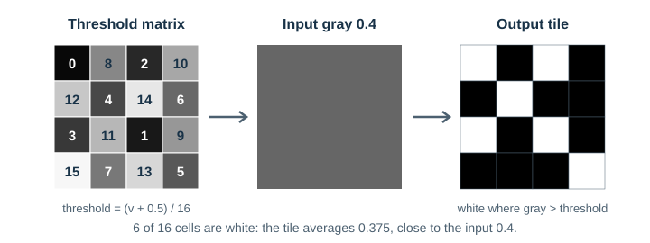
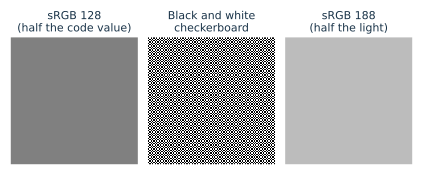

# Dithering

## Scope

This document explains dithering as an idea: why an image drawn with few colors needs it, how the main families of methods work, where each puts its error, and what limits apply in color and in SIXEL. It builds on [visual perception](../../quality/visual-perception/README.md), in particular on how the eye integrates fine detail, and it is meant to be read from start to finish.

[Palette clustering](../clustering/README.md) explains how the palette itself is chosen. The [dithering reference](../../encoder/palette-application/dithering/README.md) documents every `-d` method libsixel implements, with its exact rules, costs, and measurements. [Image-quality metrics](../../quality/metrics.md#measuring-dither-noise) explains how dither noise is measured.

**Key ideas in one minute:**

- With a small palette, choosing the nearest color for every pixel turns smooth shading into visible **steps**.
- Dithering mixes nearby palette colors in fine patterns so that their **average**, as the eye sees it, matches the wanted color.
- Every method leaves error; the methods differ in **where** they put it: at random, in a regular pattern, or pushed to the finest scales.
- Error at fine scales, called **blue noise**, is the least visible, because the eye averages it away.
- Averaging happens in **light**, not in encoded pixel values, and in SIXEL finer noise also costs **bytes**.
- Pixels may or may not be visible on the viewer's screen, so a default method should keep **neighboring colors close** and reproduce **luminance** first, because the eye resolves luminance far more finely than color.

## Why dithering is needed

A palette image can use only the colors in its palette. The simplest approach gives every pixel the nearest palette color. Where the image changes slowly, as in skies, shadows and skin, many neighboring pixels then receive the same color, and the smooth change becomes a staircase of flat bands. This effect is called **posterization**, or contouring or banding.


*Figure 1. Nearest-color quantization (middle row and middle photograph) turns smooth shading into flat steps. Error diffusion with exactly the same colors (bottom row, right photograph) hides the steps by mixing the available colors in fine patterns.*

Dithering does not add colors. It rearranges the error that quantization makes, so that the image seen by the eye is closer to the original even though more pixels differ from it.

## The idea: trade resolution for tone

[Visual perception](../../quality/visual-perception/README.md#spatial-integration-and-noise-visibility) explains that the eye cannot resolve detail finer than a limit set by the viewing distance and pixel size, and that it perceives such detail through its local average. A fine mixture of black and white pixels is seen as gray; a mixture of red and yellow pixels is seen as orange.

Dithering exploits this. To show a color that is not in the palette, it uses a pattern of palette colors whose local average is that color. It gives up some spatial resolution, which the eye cannot use anyway at a normal distance, and gains tones that the palette lacks.

The idea is much older than computers. Printers have reproduced photographs with patterns of ink dots, called halftones, since the late nineteenth century. Digital dithering developed in the 1970s for displays and printers that could show only black and white: Bayer's ordered dither (1973), Floyd and Steinberg's error diffusion (1976), and Jarvis, Judice, and Ninke's survey of such methods (1976). Ulichney's analysis of halftone spectra (1987, 1988) explained why some patterns look better than others and introduced the term *blue noise*.

## Four families of methods

### Random dither

The simplest method adds random noise before choosing the nearest color, or equivalently compares each pixel with a random threshold. On average the right fraction of pixels is light, but the randomness forms clumps and holes at every scale, which the eye sees as grain and mottle.

### Ordered dither

Ordered dither compares each pixel with a threshold taken from a small repeating matrix. Bayer (1973) arranged the thresholds so that, for any input level, the lit pixels are spread as evenly as possible within the tile.



*Figure 2. Ordered dither. Each pixel is compared with the threshold at its position in the repeating matrix. A gray of 0.4 lights 6 of 16 cells, an average of 0.375.*

Ordered dither is fast and has no dependence between pixels, so every pixel can be processed independently and in parallel. Its weakness is the regular pattern: the repeating tile produces a visible crosshatch texture, and it can form moiré with patterns in the image.

### Error diffusion

Error diffusion processes pixels in scan order. It chooses the nearest palette color for the current pixel, computes the error between the wanted and the chosen color, and adds that error, split by fixed weights, to the neighbors that have not been processed yet. A pixel that came out too dark makes its neighbors slightly lighter, so that the area as a whole keeps the right tone.


*Figure 3. The Floyd–Steinberg error-diffusion weights (1976). Because the weights sum to one, no error is lost; it is only moved.*

Many variants change the weights and the neighborhood: Jarvis, Judice, and Ninke (1976) and Stucki (1981) spread the error over two rows below; Atkinson's method, named after Bill Atkinson of Apple, passes on only three quarters of the error, which keeps highlights and shadows clean at the cost of tone accuracy. Error diffusion adapts to the image and produces fine, irregular patterns, but its sequential dependence makes it hard to parallelize, and fixed scan order can produce directional "worm" textures in some tones.

### Blue-noise masks

A blue-noise mask is a threshold matrix like Bayer's, but large and irregular. Ulichney's void-and-cluster method (1993) builds it by repeatedly moving points from the tightest cluster to the largest void, so that every threshold level lights an even, aperiodic set of pixels. A blue-noise mask keeps the speed and independence of ordered dither while avoiding its regular pattern.


*Figure 4. The four families drawing the same gradient with only black and white. Up close all are noisy; from a distance random dither remains blotchy, ordered dither shows its grid most clearly up close, and error diffusion and the blue-noise mask blur most cleanly.*

> **Try it.** Look at the left column of Figure 4 from normal distance, then lean back or squint until the dots disappear. Notice which rows turn into smooth gradients first, and which leave a texture behind.

## Noise spectrum: where the error goes

### Quantization error as a signal

Palette quantization replaces each pixel with a palette color, leaving an error image `e = y − x`. Whether the result looks good depends far more on the *spectrum* of `e`, that is, on how its energy is distributed between coarse and fine scales, than on its total power. Ulichney's analysis of halftoning (*Digital Halftoning*, MIT Press, 1987, and "Dithering with blue noise", Proceedings of the IEEE 76(1), 1988) classified dither patterns by the radially averaged power spectrum of their error:

- **White noise** (independent random dither): flat spectrum. It places substantial energy at the low and middle frequencies where the eye is most sensitive, so it looks grainy and mottled.
- **Low-frequency (red or clustered) noise**: energy concentrated at low frequencies, seen as blotches, contours, and banding. Plain nearest-color quantization of a smooth gradient produces this.
- **Periodic patterns** (ordered dither): energy at discrete spectral peaks. The pattern is regular and can produce visible texture or moiré with image content and resampling.
- **Blue noise**: little energy below a principal frequency and most energy above it, with an isotropic, aperiodic distribution. Ulichney identified this as the ideal for a pattern that must carry tone with minimal visibility.

![Top: two-dimensional power spectra of a flat 30 percent gray dithered by the four methods. Random dither has a uniform spectrum; ordered dither has isolated bright points; error diffusion and the blue-noise mask have a dark center, meaning little coarse-scale error. Bottom: radially averaged noise power on a logarithmic scale against spatial frequency from 0 to 0.5 cycles per pixel. Random dither is flat; ordered dither has sharp peaks; error diffusion and the blue-noise mask are low at coarse scales and rise toward fine scales.](figures/spectra.svg)

*Figure 5. Where each method puts its error, for a flat 30% gray. In the squares, the center is the coarsest scale and the edges the finest; dark means little error. Error diffusion and the blue-noise mask keep the center dark: their error is concentrated at fine scales.*

### Why push the error upward

At normal viewing distance the visual system integrates fine detail and is least sensitive to high spatial frequencies, especially in the chromatic channels ([spatial integration and noise visibility](../../quality/visual-perception/README.md#spatial-integration-and-noise-visibility)). If the quantization error has little energy at low frequencies, the perceived image keeps the local average tone and color of the reference, and the remaining error lies where sensitivity is lowest. Blue-noise placement minimizes the visible part of a fixed error budget, which a palette makes unavoidable.

Error diffusion achieves this by *noise shaping*. Modeling the quantizer as additive noise `n`, the output error is the noise filtered by `(1 − H)`, where `H` is the transfer function of the diffusion filter:

```text
E(ω) = (1 − H(ω)) · N(ω)
```

Because the weights sum to one, `H(0) = 1`, so the error response is zero at DC and grows with frequency: a high-pass filter applied to the quantization noise. Kite, Evans, and Bovik ("Modeling and quality assessment of halftoning by error diffusion", IEEE Transactions on Image Processing 9(5), 2000) extended this linear model to account for the sharpening that error diffusion also introduces and used it to build CSF-weighted quality measures for halftones.

Pushing noise upward has limits:

- **Viewing geometry.** Blue noise is invisible only while its frequencies lie beyond the viewer's sensitivity. Enlarging terminal cells or viewing closely brings it into view.
- **Directionality.** Fixed raster-order diffusion produces oriented "worm" textures and start-up artifacts in highlights and shadows, which are anisotropic and therefore more conspicuous than isotropic noise.
- **Low-frequency leakage.** Error clamping, limited palettes near the gamut boundary, and serpentine or band-parallel processing can leave low-frequency residue, seen as drift in tone, color casts, or seams.
- **Stream size.** SIXEL compresses runs of equal palette indices within six-pixel-high bands. High-frequency noise shortens those runs, so a more thoroughly shaped dither usually produces a larger stream. Quality and size are separate axes and should be reported together.

## Dithering in color

With a color palette the same ideas apply in three dimensions: the error is a color difference, and it is diffused to neighbors as a vector. Two choices then matter.

**In which space the error is measured and diffused.** The eye averages *light*, not encoded pixel values. Encoded sRGB values are compressed by a gamma curve, so the average of two encoded values is not the encoded value of their average light.



*Figure 6. A black and white checkerboard emits half the light of white. That is sRGB 188, not sRGB 128, the midpoint of the code values.*

> **Try it.** View Figure 6 at 100% zoom and move back until the checkerboard looks uniform. It should match the right panel. If your browser or display scales the image, the checkerboard can show moiré instead; zoom until each square is a whole number of screen pixels.

A ditherer that averages encoded values therefore reproduces mid-tones too dark when it mixes light and dark colors. The [palette working color space](../../encoder/palette-application/working-colorspace/README.md) controls where libsixel measures and diffuses error.

**Which palette color is chosen.** Error diffusion chooses the nearest palette color for each adjusted pixel, so the definition of "nearest" also shapes the pattern; the [lookup policy](../../encoder/palette-application/lookup-policy/README.md) explains how libsixel finds it.

## Structure-preserving dithering and luminance priority

The noise-shaping view treats the ditherer's goal as reproducing tone after low-pass filtering, with the residual pushed out of sight. A complementary line of work adds an explicit *structure* objective: the dithered image should also preserve edges, fine lines, and texture orientation of the original, as judged by a structural measure, rather than only its local averages. Because structure is perceived mainly through luminance ([luminance and chroma in spatial vision](../../quality/visual-perception/README.md#luminance-and-chroma-in-spatial-vision)), these methods in practice protect luminance structure first.

Several approaches follow this idea:

- **Edge-enhancing error diffusion.** Eschbach and Knox ("Error-diffusion algorithm with edge enhancement", Journal of the Optical Society of America A 8(12), 1991) modulate the quantization threshold by the input signal, which sharpens edges that ordinary error diffusion softens.
- **Structure-aware halftoning.** Pang, Qu, Wong, Cohen-Or, and Heng ("Structure-aware halftoning", ACM Transactions on Graphics 27(3), 2008) optimize the halftone against an objective that combines tone similarity after Gaussian filtering with an SSIM-style structural similarity. Chang, Alain, and Ostromoukhov ("Structure-aware error diffusion", ACM Transactions on Graphics 28(5), 2009) obtain a similar effect within error diffusion by adapting it to local image structure.
- **Luminance priority in color dithering.** With a color palette, several candidate colors can give nearly the same local average color. Choosing among them so that luminance varies as little as possible keeps the dither noise mostly chromatic, where the eye is least sensitive, and leaves luminance structure intact. The minimum brightness variation criterion of Shaked, Arad, Fitzhugh, and Sobel ("Color diffusion: error diffusion for color halftones", Proceedings of SPIE 3648, 1998) formalizes this for printer colorants. Kolpatzik and Bouman ("Optimized error diffusion for image display", Journal of Electronic Imaging 1(3), 1992) designed error-diffusion filters with separate luminance and chrominance visual models, so that luminance error is shaped more aggressively than chrominance error.

Structure preservation and blue-noise tone reproduction can conflict. Sharpening edges or aligning dots with structure adds energy that is neither isotropic nor confined to high frequencies, and choosing colors to minimize luminance variation can increase chroma noise and per-pixel color difference. The [image-quality metrics](../../quality/metrics.md#combining-metrics-for-dithered-output) observe the trade-off from both sides. libsixel's current dither policies, listed in the [dithering reference](../../encoder/palette-application/dithering/README.md), do not include an explicit structural objective or a luminance-priority color choice; this section describes the idea, not an implemented mode.

## Choosing a default when pixel size is unknown

An image prepared by libsixel may be seen with its pixels far below the eye's resolution or clearly visible. [Display technologies](../displays/README.md#2018-and-later-a-split) shows that mainstream screens remain at 30 to 50 pixels per degree while premium screens exceed 60, and that a terminal can enlarge each image pixel further ([effective density of a terminal image](../displays/README.md#the-effective-density-of-a-terminal-image)). A default dithering method must therefore not assume either case. It should look right when the pixels are too small to see and remain acceptable when they are not.

### Keep neighboring colors close

When pixels are visible, the eye no longer averages a dither pattern; it sees the individual colors. A pattern that builds a mean color from widely separated colors, such as black and white for gray or two contrasting colors for an intermediate tone, then becomes a visible texture, as the two-color gradient of the [pixel appearance comparison](../displays/README.md#how-the-pixels-looked) shows. A pattern that alternates between nearby colors stays inconspicuous even with large pixels.

The deciding quantity is the color difference between neighboring pixels, not the family of the method. Ordered dithering that thresholds between the two palette colors nearest to the target also keeps neighbors close, and error diffusion with a sparse palette can still place distant colors side by side. Error diffusion with nearest-color lookup, however, adapts to whatever palette is available and tends to choose colors near the target, so it meets the requirement without tuning. This is why error diffusion is libsixel's default: `-d auto` selects Floyd–Steinberg for palettes of more than 16 colors and Atkinson's method, which diffuses only three quarters of the error and keeps neighbors even closer, for smaller palettes. Ordered and blue-noise methods remain available because they have other strengths: they are temporally stable in animation and independent of scan order, so they parallelize well. The [dithering reference](../../encoder/palette-application/dithering/README.md) documents all methods.

### Match luminance first

The 30 cycles per degree used as the visibility boundary in [Display technologies](../displays/README.md#pixels-per-degree) is the detail of letters that a person with 20/20 acuity can just read: a limit of *luminance* vision. Color vision resolves much less. Isoluminant red-green and blue-yellow gratings reach their resolution limit at about 11 to 12 cycles per degree (Mullen, 1985), as described in [contrast sensitivity](../../quality/visual-perception/README.md#contrast-sensitivity).

A one-pixel pattern has half the display's pixels per degree as its frequency, which gives two thresholds:

| Pixel-scale error in | Invisible above about | Displays that reach it |
| --- | --- | --- |
| Luminance | 60 pixels per degree (30 cpd) | premium phones, notebooks and monitors |
| Chroma only | 24 pixels per degree (12 cpd) | nearly every display, except head-mounted displays and strongly enlarged images |

Dither error that changes chroma but not luminance is therefore hidden on almost every screen, while luminance error is visible on most of them. This supports the policy of [luminance priority](#structure-preserving-dithering-and-luminance-priority): reproduce luminance as closely as possible pixel by pixel, and let the remaining error appear as chroma or hue variation, which [luminance and chroma in spatial vision](../../quality/visual-perception/README.md#luminance-and-chroma-in-spatial-vision) explains the eye integrates away.

The policy has limits:

- **Enlargement.** When a terminal enlarges image pixels until a one-pixel pattern falls below about 12 cycles per degree, for example two device pixels per image pixel on a 36 pixels per degree screen, chroma noise becomes visible too.
- **Low frequencies.** Moving error into chroma helps only if that error stays fine and averages to zero locally. A chroma error that accumulates over an area is a color cast, and color casts are visible at any density.
- **The palette.** Matching luminance pixel by pixel requires palette colors of the right lightness near each target color. With a sparse palette, the best luminance match may have a large hue error, so the choice remains a trade-off measured by the [image quality metrics](../../quality/metrics.md#combining-metrics-for-dithered-output).

libsixel's current error diffusion chooses the nearest palette color in the working color space; it does not yet implement an explicit luminance-priority choice. The reasoning above is the basis for treating luminance error as the more important target when such methods are developed and measured.

## Dithering in SIXEL

Three properties of SIXEL output interact with dithering:

- **Stream size.** SIXEL writes each palette color's pixels in six-pixel-high bands and compresses runs of equal values. Fine dither patterns break those runs, so the same image usually becomes larger as the dither becomes finer; the [dithering reference](../../encoder/palette-application/dithering/README.md#measured-static-image-quality-size-and-speed) measures this trade-off for each method.
- **Parallel bands.** Error diffusion is sequential, so libsixel processes large images in horizontal work bands that start from fresh error state. The [threading overview](../../threading/overview.md) explains the small seams this can introduce.
- **Animation.** Every frame gets its own palette and its own dither pattern, so a region that does not change in the source can still change on screen: its pattern moves from frame to frame, and when the palette near a saturated color changes, the region flashes between nearby approximations. [Cover policy](../../encoder/palette-construction/cover-policy/README.md#what-a-cover-miss-looks-like-in-animation) shows how such a cover miss looks in motion and how anchoring important colors in the palette keeps them reachable. [6delta](../../encoder/output/delta-encoding.md) (`--update-policy=delta`) is especially effective from the output side: the encoder remembers the colors already on screen and leaves a pixel untouched when that color is still within the keep threshold of the wanted color, so unchanged regions are not repainted with a new pattern, and the stream becomes smaller as well. It needs a receiver that keeps unpainted pixels between frames.

## Figures and reproduction

All figures are generated by [`tools/plot_dithering_concept_figures.py`](../../../tools/plot_dithering_concept_figures.py) with Matplotlib, NumPy and Pillow. Run it to regenerate them and with `--check` to verify that the committed files are current. The methods are implemented in the script itself from their published definitions, so the figures illustrate the methods and do not measure libsixel's implementation; the parameters are recorded in [`figures/figures.json`](figures/figures.json). The photograph is the repository image `images/snake.png`.

## References

- Bayer, B. E. "An optimum method for two-level rendition of continuous-tone pictures." Conference Record of the IEEE International Conference on Communications, vol. 1, 26-11–26-15, 1973.
- Chang, J., B. Alain, and V. Ostromoukhov. "Structure-aware error diffusion." ACM Transactions on Graphics 28(5), 2009. doi:[10.1145/1618452.1618508](https://doi.org/10.1145/1618452.1618508)
- Eschbach, R., and K. T. Knox. "Error-diffusion algorithm with edge enhancement." Journal of the Optical Society of America A 8(12):1844–1850, 1991. doi:[10.1364/JOSAA.8.001844](https://doi.org/10.1364/JOSAA.8.001844)
- Floyd, R. W., and L. Steinberg. "An adaptive algorithm for spatial greyscale." Proceedings of the Society for Information Display 17(2):75–77, 1976.
- Jarvis, J. F., C. N. Judice, and W. H. Ninke. "A survey of techniques for the display of continuous tone pictures on bilevel displays." Computer Graphics and Image Processing 5:13–40, 1976.
- Kite, T. D., B. L. Evans, and A. C. Bovik. "Modeling and quality assessment of halftoning by error diffusion." IEEE Transactions on Image Processing 9(5):909–922, 2000.
- Kolpatzik, B. W., and C. A. Bouman. "Optimized error diffusion for image display." Journal of Electronic Imaging 1(3):277–292, 1992. doi:[10.1117/12.60027](https://doi.org/10.1117/12.60027)
- Mullen, K. T. "The contrast sensitivity of human colour vision to red-green and blue-yellow chromatic gratings." Journal of Physiology 359:381–400, 1985. doi:[10.1113/jphysiol.1985.sp015591](https://doi.org/10.1113/jphysiol.1985.sp015591)
- Pang, W.-M., Y. Qu, T.-T. Wong, D. Cohen-Or, and P.-A. Heng. "Structure-aware halftoning." ACM Transactions on Graphics 27(3), article 89, 2008. doi:[10.1145/1360612.1360688](https://doi.org/10.1145/1360612.1360688)
- Shaked, D., N. Arad, A. Fitzhugh, and I. Sobel. "Color diffusion: error diffusion for color halftones." Proceedings of SPIE 3648:459–465, 1998. doi:[10.1117/12.334589](https://doi.org/10.1117/12.334589)
- Stucki, P. "MECCA—a multiple-error correcting computation algorithm for bilevel image hardcopy reproduction." IBM Research Report RZ1060, IBM Zurich Research Laboratory, 1981.
- Ulichney, R. *Digital Halftoning*. MIT Press, 1987.
- Ulichney, R. "Dithering with blue noise." Proceedings of the IEEE 76(1):56–79, 1988.
- Ulichney, R. "Void-and-cluster method for dither array generation." Proceedings of SPIE 1913:332–343, 1993. doi:[10.1117/12.152707](https://doi.org/10.1117/12.152707)
