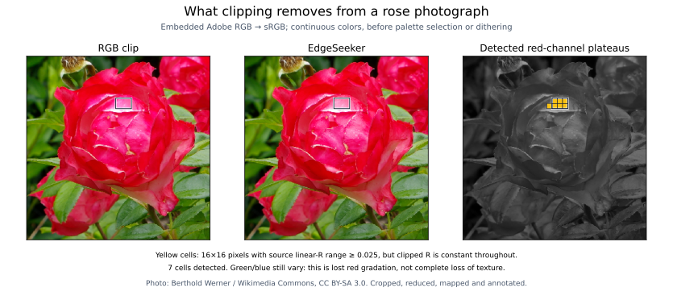
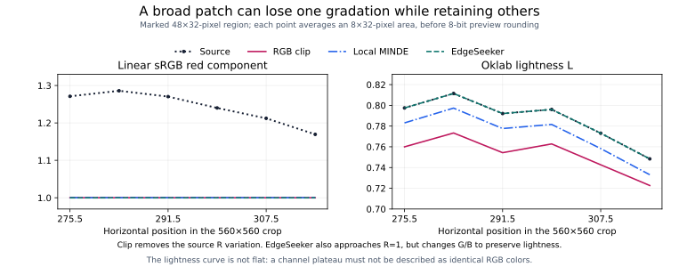
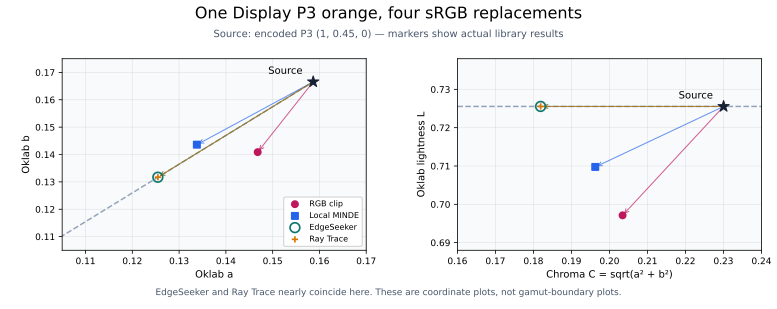
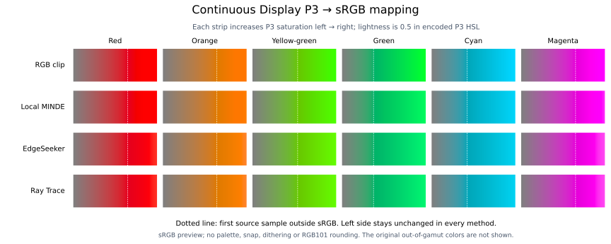
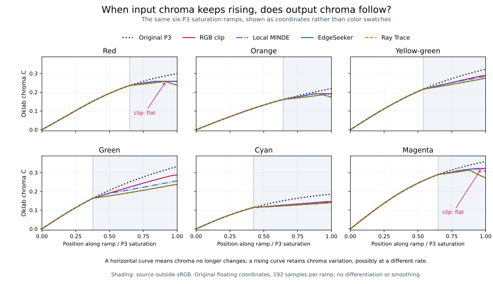
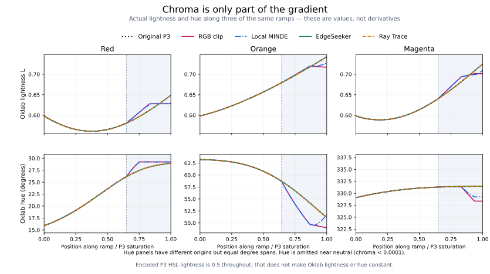
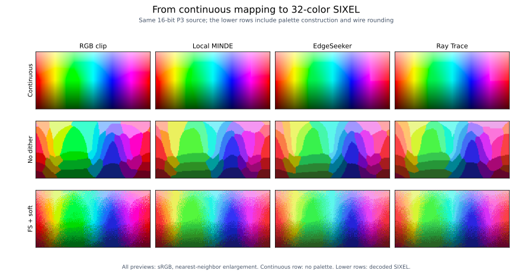
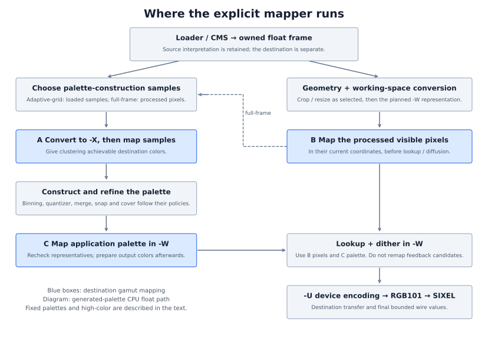

# Gamut mapping: choosing a color the output can reproduce

A vivid rose is not just one red. Small color differences describe the curvature of its petals, while other differences separate its leaves from the background. When a photograph contains colors beyond the output gamut, choosing replacements can change those relationships. Making every RGB value fit is necessary, but it does not by itself preserve the picture's gradations.



Photo: [Berthold Werner / Wikimedia Commons](https://commons.wikimedia.org/wiki/File:Adobe_RGB_2017-07-02_17-15-33.jpg), [CC BY-SA 3.0](https://creativecommons.org/licenses/by-sa/3.0/); cropped, reduced, mapped and annotated.

The photograph has an embedded Adobe RGB profile. Both color previews above are sRGB replacements, produced by the built library **before palette quantization or dithering**. The yellow cells identify regions where the input red component varies across a whole 16 × 16-pixel area, but clipping makes it constant. They are not simply an out-of-gamut mask: many out-of-gamut regions retain gradation and are not marked.

**A lost channel gradation is not the same as a completely flat picture.** Green and blue still vary in these cells, so some petal shading remains. This example does not demonstrate a large patch of identical RGB colors, nor does it establish that every mapper preserves every kind of detail better. It makes a narrower problem visible: clipping removes one part of the color variation, and another mapping rule can distribute the change differently.



The outlined 48 × 32-pixel region has source linear-sRGB red values from about `1.028` to `1.357`. All become exactly `1` under clipping. Its mean Oklab lightness changes from about `0.7864` to `0.7526`. EdgeSeeker also brings red close to its upper limit, but adjusts green and blue to retain lightness more closely (`0.7864` here). Thus a red-channel plateau alone cannot rank the methods: the other coordinates matter too. The curves plot values, not derivatives; each point averages an 8 × 32-pixel area.

## A whole shading pattern can disappear

To isolate complete loss of detail, use a controlled synthetic image. Its pixels are valid encoded Display P3 `(R, 0, 0)` colors, with `R` varying smoothly from about `0.92` to `1.00`. Two broad lobes carry a light-to-dark variation over tens of pixels. The gray panel below shows the shape of this variation by scaling the input red coordinate to black–white; it is a diagnostic, **not a preview of the original color**.


The loss follows directly from the coordinates. Converting this input to linear sRGB gives red values from about `1.014` to `1.225`, while green and blue are negative throughout. Channel clipping therefore replaces **every pixel** with `(1, 0, 0)`. Different input colors have become exactly the same output color, so no palette size or subsequent dithering can recover their distinction from those clipped values.

The lower color row tests the actual encoder, whose `clip` policy defers bounding rather than pre-clipping every source pixel. It uses a **256-color palette budget**, Floyd–Steinberg dithering and the soft feedback limiter. Decoding the resulting SIXEL confirms that `clip` still produces just one RGB color, `(255, 0, 0)`, throughout this image. Its flatness is therefore not caused by an artificially small palette. EdgeSeeker and Ray Trace preserve the broad shading by changing the RGB mixture, accepting less chroma to retain lightness. Local MINDE permits some clipping within its local error criterion and strongly compresses the shading in this example.

The graph measures large-scale structure rather than repeated palette indices or isolated dither dots. Each point is the arithmetic mean of per-pixel Oklab lightness in a 16 × 32-pixel block across the marked central strip. The span between the largest and smallest of these block means is:

| Method | Continuous lightness span | Decoded SIXEL lightness span |
| --- | ---: | ---: |
| Original P3 coordinates | 0.036187 | — |
| RGB clip | 0 | 0 |
| Local MINDE | 0.004011 | 0.005176 |
| EdgeSeeker | 0.036187 | 0.036434 |
| Ray Trace | 0.036187 | 0.036409 |

Palette selection, RGB101 rounding and diffusion account for the differences between continuous and decoded measurements. The color panels have no contrast enhancement. The [16-bit P3 input](figures/p3-red-shading.png), [block measurements](measurements/clipping-detail.csv) and [generation record](measurements/examples.json) make the construction and comparison reproducible. This deliberately chosen counterexample demonstrates that channel clipping cannot preserve every image's structure; it does not establish how often such loss occurs in photographs or that a particular mapper is universally best.

## Conversion is not replacement

A color-space conversion asks, “What coordinates describe this color in another space?” Gamut mapping asks a different question: “If the output cannot reproduce this color, which reproducible color should replace it?” Conversion can preserve the color while producing negative RGB values or values above one. Mapping deliberately changes the color. Keeping these two operations separate is essential to wide-gamut encoding.

This chapter starts with spatial examples, then builds from individual colors to a complete SIXEL pipeline. It explains the implemented methods and illustrates their results. The [output gamut-mapping reference](../../encoder/output/gamut-mapping.md) owns option syntax, defaults, numeric tolerances, supported profiles and regression contracts. For the underlying coordinates, see [primaries and white points](../colorspace/primaries-and-white-points.md) and [transfer functions](../colorspace/transfer-functions.md).

For example, these commands choose the same sRGB output interpretation but different handling of colors that do not fit it:

```sh
img2sixel wide-gamut.png -U gamma:gamut=clip
img2sixel wide-gamut.png -U gamma:gamut=local-minde
```

## One pixel that does not fit

Consider the encoded Display P3 color `(1, 0.45, 0)`. Converting it to **linear sRGB**, without changing its intended color, produces approximately:

```text
Display P3, encoded:  (1.000000, 0.450000,  0.000000)
sRGB, linear:        (1.186555, 0.135765, -0.033056)
```

These extended coordinates are meaningful. They describe a valid P3 color that an ordinary sRGB display cannot reproduce: reproducing it would require more than full red and negative blue. The negative component is not evidence of corrupt input, and removing it during CMS conversion would lose information before the output destination is known.

If the destination is Display P3, this pixel already fits. If the destination is sRGB, something has to change. Setting the red component to one and the blue component to zero is one possible answer. It is simple, but it changes lightness and hue as well as chroma. A gamut mapper offers other answers by choosing which attributes to preserve most closely.

Here are results obtained from the built library for that pixel, before palette quantization or RGB101 rounding:

| Result | Encoded sRGB replacement | Oklab lightness L | Chroma C | Hue, degrees |
| --- | --- | ---: | ---: | ---: |
| Original P3 color | Not representable in bounded sRGB | 0.725543 | 0.230039 | 46.390 |
| RGB channel clip | `(1.000000, 0.404107, 0.000000)` | 0.697121 | 0.203453 | 43.819 |
| Local MINDE | `(1.000000, 0.441607, 0.000000)` | 0.709755 | 0.196267 | 47.022 |
| EdgeSeeker | `(0.999974, 0.480776, 0.181993)` | 0.725543 | 0.181886 | 46.390 |
| Ray Trace | `(1.000000, 0.480754, 0.181915)` | 0.725543 | 0.181902 | 46.390 |



The left plot shows hue as direction from neutral and chroma as distance from neutral. The right plot separates chroma from lightness. For this orange, clipping keeps more chroma but darkens the color; EdgeSeeker and Ray Trace preserve lightness and hue more closely by reducing chroma further. Local MINDE accepts a small local clipping error and lies between them in lightness. These are measured properties of this example, not a ranking for every color or image.

The original point is drawn as a coordinate marker, not a purported sRGB color swatch. An sRGB illustration cannot display that out-of-gamut original faithfully.

## Why lightness, chroma and hue help

RGB describes amounts of three primaries. Its axes are convenient for testing whether the destination can reproduce a color, but changing one RGB component can alter several aspects of appearance at once.

Oklab provides a more useful geometry for deciding how to replace the color. Its `L` coordinate describes lightness; `a` and `b` form an opponent-color plane. Chroma is the radius `C = sqrt(a² + b²)`, and hue is the direction in that plane. Holding `L` fixed and multiplying both `a` and `b` by a factor between zero and one moves toward a neutral color of the same lightness, without rotating the hue direction. At zero chroma, hue has no visual meaning.

This is often described in Oklch coordinates, but the implementation need not calculate a polar angle to reduce chroma. Nor does it require `-W oklch`: the mapper can temporarily use Oklab while clustering and dithering continue to use the selected `-X` and `-W` spaces. A mathematical intermediate is not necessarily a separate image buffer.

There are two useful geometries here: the destination's linear RGB box tells us what is reproducible; Oklab helps decide which attributes to preserve while moving into that box. A perceptual approximation is still an approximation, so preserving an Oklab hue direction does not guarantee identical perceived hue under every viewing condition.

## Four ways to choose the replacement

### RGB clipping: stop each component at its limit

Convert to destination RGB and bound each component independently. For the orange above, `(1.186555, 0.135765, -0.033056)` becomes `(1, 0.135765, 0)` in linear sRGB. No search is needed.

Clipping can keep a color vivid, but it does not ask whether its hue or lightness changed. It can also flatten a gradient: several distinct inputs beyond the same boundary may end at the same output value. With the encoder's `clip` policy, input samples are not mapped before clustering; destination clipping happens on the output colors. That pipeline distinction matters when comparing a complete encoded image with a continuously clipped reference.

### Local MINDE: reduce chroma, but allow a small local clipping error

Move toward neutral at the original Oklab lightness and hue, testing candidate chromas. For each candidate, clip it to the destination and measure the Oklab difference **between that candidate and its clipped result**. A binary search finds the region where this local difference is small enough.

“Local” is important: this does not minimize the distance from the original over every possible output color. It allows a little clipping near the boundary instead of insisting on a mathematically exact constant-lightness/hue intersection. As the orange example shows, this can retain more chroma than strict boundary reduction while accepting some lightness or hue change. The reference specifies the stopping criteria and error budget.

### EdgeSeeker: model the boundary, then look it up

For each destination, build a table describing the most chromatic point, or **cusp**, at each Oklab hue and the curvature of the upper boundary. Below the cusp, use a straight boundary model toward black; above it, use a curved model toward white. An out-of-gamut pixel selects the boundary at its hue and reduces chroma at its lightness, followed by a final containment clip.

The table is constructed once for the mapper rather than by searching separately for each pixel. This trades construction work and memory for a compact per-pixel evaluation. It is a model of a suitable RGB gamut, not an arbitrary ICC boundary solver; unusual destination geometry can be rejected. The [numeric reference](../../encoder/output/gamut-mapping.md#edgeseeker) defines those limits.

### Ray Trace: intersect RGB boundaries and correct the direction

Start at the neutral color with the original Oklab lightness and trace a ray toward the out-of-gamut color in destination linear RGB. Finding where that ray meets the RGB box is geometrically simple. However, a straight ray in linear RGB does not generally preserve Oklab lightness and hue.

The algorithm therefore converts the intersection to Oklab, restores the original lightness and hue while keeping the newly obtained chroma, and traces again. A small bounded sequence of these corrections approaches a suitable boundary point. No destination hue table is needed. The [numeric reference](../../encoder/output/gamut-mapping.md#ray-trace) describes the iteration limit and geometric recovery cases. “Ray Trace” here concerns rays through a color volume, not rendering a three-dimensional scene.

## What the differences look like

The strips below use actual mapping results from the library. Each starts at neutral gray and increases saturation toward a Display P3 color. The dotted line marks the first sampled color that lies outside sRGB. Left of that line, all four rows agree; the explicit mappers leave representable colors unchanged.



Look near the right side of the orange and yellow-green strips for changes in lightness and tint. Compare the magenta strip for a different hue region rather than assuming the orange example applies everywhere. EdgeSeeker and Ray Trace can look nearly identical; a small numerical difference need not be visibly significant. All strips are sRGB previews, and these particular ramps are defined in **encoded P3 HSL**, not constant Oklab lightness/hue. HSL is used only to construct the test pattern.

This figure excludes palette selection, snap, dithering and RGB101 rounding. It answers “How does the continuous color change?” rather than “What image does `img2sixel` finally send?”

### Read the same ramps as coordinate curves

Small differences between colored strips can be hard to judge. Plotting the actual coordinates exposes a plateau without requiring the reader to distinguish nearly identical swatches:



The horizontal axis is position along the same 192-sample ramp; the vertical axis is Oklab chroma. A horizontal segment means the output no longer follows that part of the input chroma gradient. These are the values themselves, with no differentiation, smoothing or image readback. Shading begins at the first sample outside sRGB.

For the red ramp, clipping gives 32 adjacent intervals out of 191 with unchanged full Oklab coordinates, even while the input continues changing. Magenta has 12 such intervals. Local MINDE also has 27 flat intervals in the red example: allowing a small local clipping error does not guarantee preservation of every gradient. The orange clip curve continues changing, but its last color step is only about 12% of the corresponding input step. The [raw coordinates](measurements/ramp-coordinates.csv) and [summary measurements](measurements/examples.json) retain those distinctions; `10⁻¹²` Delta E OK is used only to report numerically flat intervals.

Chroma alone does not determine whether two colors are identical. In particular, EdgeSeeker and Ray Trace can reduce chroma as the end of the red ramp becomes lighter. Inspect lightness and hue alongside it:



The clipped red and magenta tails become constant in lightness and hue as well as chroma. The other methods can retain changes in lightness while changing chroma differently. Hue panels use different origins with the same degree span, and omit near-neutral samples where hue is unstable. A steeper curve is not automatically better: exaggerated changes or discontinuities are also possible. The graphs explain where the differences occur rather than assigning a universal quality ranking.

### Why only red, orange and magenta turn downward here

In these six ramps, EdgeSeeker and Ray Trace turn downward near the right end for **red, orange and magenta**, while yellow-green, green and cyan continue upward. The falling quantity is chroma `C`, not hue `h`. This is not a rule that these methods always desaturate red more than green: it depends on the input's path through the destination gamut.

To understand the difference, hold Oklab hue fixed and consider a slice with lightness on the vertical axis and chroma on the horizontal axis. Black and white have zero chroma. Between them, the boundary reaches a most-chromatic point, the **cusp**. On its darker side, increasing lightness can make more chroma available. On its lighter side, approaching white leaves less room for chroma. The RGB primaries contribute differently to lightness, so the cusp's lightness and chroma depend on hue; there is no single lightness above which every color must lose chroma. This is the geometry used by [EdgeSeeker's boundary model](https://www.w3.org/TR/2026/CRD-css-color-4-20261009/#GMA-EdgeSeeker).


Call the available chroma at a given lightness and hue `Cmax(L, h)`. A strict lightness/hue-preserving reduction aims for `Cout = min(Cin, Cmax(L, h))`. EdgeSeeker approximates that boundary with a lookup table and a fitted curve; Ray Trace approaches it through RGB intersections and Oklab corrections. Their numerical answers need not coincide, but both encounter the same geometric restriction. Local MINDE allows a small clipping error, and plain channel clipping can change lightness and hue, so their curves need not follow this rule as closely.

The input pattern keeps **encoded P3 HSL lightness at 0.5**. That does not keep Oklab lightness constant: toward the saturated end, all six inputs become lighter in Oklab, and their Oklab hues also change somewhat. Thus each input follows a changing `L, h` pair, rather than moving horizontally across one fixed-hue diagram. In the red, orange and magenta cases, that path enters the whiteward side of the boundary. `Cin` keeps increasing, but `Cmax(L, h)` starts decreasing. In the other three cases, the path stays on the darker side through the endpoint, where more chroma is still available as lightness rises.

The actual EdgeSeeker samples make that distinction concrete. `S` is the horizontal position in the ramp, from zero to one; peak positions are sampled values, not analytically exact turning points. Ray Trace has the same sampled peak positions in these six examples.

| Ramp | S at maximum output C | Maximum output C | Output C at S = 1 | Boundary at the endpoint, in linear sRGB |
| --- | ---: | ---: | ---: | --- |
| Red | 0.9058 | 0.2570 | 0.2374 | Upper red face: R ≈ 1 |
| Orange | 0.9319 | 0.1861 | 0.1739 | Upper red face: R ≈ 1 |
| Yellow-green | 1.0000 | 0.2746 | 0.2746 | Lower blue face: B ≈ 0 |
| Green | 1.0000 | 0.2384 | 0.2384 | Lower red face: R ≈ 0 |
| Cyan | 1.0000 | 0.1398 | 0.1398 | Lower red face: R ≈ 0 |
| Magenta | 0.8796 | 0.3136 | 0.2714 | Upper red face: R ≈ 1 |

For the declining cases, red is already at its output limit. To reproduce a lighter color while keeping its hue, the mapper must adjust the other channels, bringing the result closer to neutral and lowering chroma. At the lower faces reached by the other ramps, a channel is still zero and the remaining channels can increase toward the cusp. A higher numerical lightness in the green ramp is not a contradiction: its cusp is at a different lightness. The [measurement record](measurements/examples.json) includes peak positions and endpoint RGB values, alongside the [full Oklab sample coordinates](measurements/ramp-coordinates.csv).

Changing the input lightness, hue path or output profile can change which ramps turn downward. At a fixed Oklab lightness **and** hue, increasing only input chroma would instead reach a fixed boundary and then plateau under the ideal reduction above. Preserving each color's lightness and hue therefore does not, by itself, preserve the ordering or slope of chroma along an arbitrary image gradient. These mappers choose a replacement for each color; they do not jointly optimize neighboring colors to preserve spatial contrast. A smooth chroma decrease can retain lightness gradation, while a constant chroma can accompany a loss of all color variation, so the other coordinate plots remain necessary.

The smooth downturn shared by EdgeSeeker and Ray Trace in these ramps is a boundary effect. It differs from an abrupt hue reversal caused by a numerical instability; decreasing chroma alone is not evidence of such a failure.

### Add palette quantization and SIXEL

This example isolates the stages of encoding; it is not a diagnostic of clipping-induced detail loss. Unlike the red shading example above, many colors in this pattern retain visible variation after clipping. Use a two-dimensional P3 pattern: hue varies horizontally, and encoded HSL lightness decreases from top to bottom. The top row maps the continuous colors using the source's actual embedded profile. The next two rows encode the same 192 × 96, 16-bit, ICC-tagged PNG with a 256-color palette budget, then decode the actual SIXEL bytes as sRGB: first without dithering, then with Floyd–Steinberg and the soft feedback limiter.



The bands in the middle row come from a finite palette. Dither redistributes that approximation error into a spatial pattern; it cannot restore colors that the destination cannot produce. Each column builds its own palette from the input seen by its policy. Thus differences include palette allocation and feedback behavior, not just the final mapping of one RGB triplet. In particular, the `clip` column clusters unmapped source colors, whereas the explicit methods cluster mapped samples.

Ray Trace must stop when its correction has numerically converged. Near a boundary, extending a tiny reversed direction can reach the opposite RGB face and introduce a colored streak even before quantization. The [convergence safeguard](../../encoder/output/gamut-mapping.md#ray-trace) retains the last boundary point in that situation. The continuous row makes this stage independently inspectable; palette banding and dither texture belong to the rows below it. The [measurement file](measurements/examples.json) records the largest adjacent horizontal Oklab step, with both source and mapped triples, as a local diagnostic rather than an aggregate quality score.

The 256-color budget avoids making severe low-color quantization the main subject of the comparison. The pattern illustrates palette construction and diffusion, not a ranking of the gamut mappers or evidence that a method should become the default. Parameters are fixed to one thread, seeded k-means, full-frame sampling, no binning, Oklab clustering and workspace, no merge, no cover, no snap, exact lookup, and RGB output. The [reproduction data](measurements/examples.json) records the complete flags, decoded-pixel hashes and source profile hash.

## Where the mapper sits in the implemented pipeline

The destination definition belongs to the encoder's output intent. It is separate from the source profile and from the current frame's coordinate tag. Loader CMS first interprets the input; it must preserve the information needed to choose the output later. Gamut mapping belongs to the encoder, where that output is known.



The diagram describes generated palettes on the CPU float path. The three blue boxes have different jobs:

| Point | Input and placement | Why it is needed |
| --- | --- | --- |
| A: construction samples | A private clustering view is converted to `-X`, then gamut-mapped before palette construction. | Let the quantizer allocate its limited representatives to achievable target colors. |
| B: application pixels | The owned float frame completes geometry preprocessing and its planned working-space conversion, then visible pixels are mapped before palette application. | Ask lookup and dither to reproduce the mapped target, rather than continually compensate for an impossible source color. |
| C: application palette | Representatives are mapped after construction, merge, cover and workspace conversion, before output colors are prepared. | A new representative can fall outside the destination even when its input samples fit, especially when operations use nonlinear coordinates. |

Sampling controls which pixels reach A. Adaptive-grid sampling uses the loaded-frame sampling branch; full-frame sampling uses the processed frame from B. The mapper does not move adaptive sampling after resize. A sample already mapped by B normally takes A's in-gamut identity path rather than undergoing another deliberate contraction.

For a fixed mapfile palette, the source definition remains separate and its application copy is mapped for the selected destination. High-color mode maps its source plane before destination conversion and cell construction. These variants do not build a generated palette as shown on the left of the diagram.

Inside each mapping call, the implementation temporarily converts the input triplet from its declared space to canonical linear RGB, tests membership in destination linear RGB, uses Oklab if a replacement is needed, and returns the result in the input's coordinate space. Double intermediates protect the arithmetic; frame and palette storage remains float32. Representable colors take the identity path. This is a per-triplet operation, not an extra full-size Oklab frame.

The placement is therefore more precise than “map before `-W`.” Mapping already precedes clustering and lookup, but A operates on the `-X` view and B on the preprocessed working view. Changing a coordinate representation is color-preserving; choosing a replacement color is not. Resize and mapping can produce different results when reordered because mapping is nonlinear. The implemented B placement lets resize finish before choosing the application target colors.

Implementation navigation is maintained in the [reference's pipeline section](../../encoder/output/gamut-mapping.md#pipeline-and-policy-boundaries), alongside policy ownership and exact supported-path contracts.

## Device gamut, palette reachability and snap are different limits

A destination gamut contains the continuous colors its RGB model can reproduce. A SIXEL image then chooses a small number of those colors for its palette, and each transmitted channel is rounded to one of 101 percentage values. These are three different restrictions:

| Restriction | Example | Relevant operation |
| --- | --- | --- |
| Destination gamut | This P3 orange is outside sRGB. | Output gamut mapping chooses a reproducible replacement. |
| Selected palette | Gray is absent from a black/white palette. | Quantization chooses representatives; dithering can approximate gray by spatial mixtures. |
| Wire grid | A chosen RGB channel lies between adjacent percentage values. | Snap can account for the wire grid before encoding; serialization ultimately emits integer percentages. |

A missing palette entry is not automatically an unreachable average color. Black and white pixels can produce a gray average even with no gray palette entry. Under linear-light averaging, the possible mixtures form the palette's **convex hull**: all nonnegative weighted averages whose weights sum to one. A red that lies outside that hull cannot be produced by any such mixture. The [cover-policy explanation](../../encoder/palette-construction/cover-policy/README.md) develops this geometry and its limits for actual diffusion.

The full RGB101 grid includes the RGB-cube corners, so its linear-light convex hull is still the full device cube. Merely replacing continuous RGB with the full wire grid does not create a smaller continuous hull. Choosing a particular small palette, or moving its particular entries by snap, does change the relevant hull. Also, an arithmetic average in gamma RGB or Oklab is not necessarily the physical linear-light average of displayed pixels; the selected `-W` geometry matters.

The current mapper uses the destination definition. It does **not** construct a hull from the final selected palette, optimize against its snapped entries, or iterate between gamut mapping and palette generation. Input mapping based on that final reachable set would be an additional algorithm. A fixed palette makes the set available early; a generated palette requires a preliminary palette or a feedback stage. Such a design would need to decide how much of the source approximation error belongs to mapping and how much should be left for dithering.

Nor is gamut mapping the `-0` diffusion limiter. After B has selected the target color, accumulated error can push a lookup candidate outside the destination. Mapping that candidate back into the gamut at every pixel would discard part of the compensation mechanism. The mapper leaves these candidates and accumulated errors alone; the [clamp policy](../../encoder/palette-application/clamp-policy.md) controls feedback separately. Ordinary color-space conversion also remains separate from these policies.

## Reading and reproducing the examples

### Photograph source and region measurement

The detector requires a source red range of at least `0.025` in linear RGB, and a clipped range no greater than `10⁻¹²`, throughout a complete square. At 8-, 16- and 32-pixel scales it finds 75, 7 and 1 red-channel plateaus respectively; none is also flat in all three channels. These are illustration-specific criteria, not visibility thresholds or production regression tolerances. Detection uses floating values before preview rounding. The [measurement record](measurements/rose.json), [marked-region coordinates](measurements/rose-strip.csv) and [binary 16-pixel mask](figures/rose-red-plateau-mask.png) make the selection inspectable.

For a **quantized** image, repeated palette indices alone would be a poor detector: small flat runs are expected, and dither deliberately adds pixel-scale variation. A comparison must examine larger-scale structure and separate changes introduced by continuous gamut mapping from those introduced by palette construction and application. The region analysis above establishes the former only; it is not a quality test for decoded SIXEL.

Photo: [*Rose Nostalgie from Tantau*, Berthold Werner](https://commons.wikimedia.org/wiki/File:Adobe_RGB_2017-07-02_17-15-33.jpg), [CC BY-SA 3.0](https://creativecommons.org/licenses/by-sa/3.0/). The [560 × 560 input](figures/rose-adobe-rgb.png) is cropped and reduced 2:1 from the original, with its ICC profile retained and no saturation enhancement. The photograph, its mapped previews and photo-derived annotated figures in this chapter are distributed under the same CC BY-SA 3.0 license. Cropping, reduction, mapping and annotations are the modifications; this attribution does not imply the photographer's endorsement. The original JPEG checksum and crop rectangle are recorded with the measurements.

### Reproduction

All comparison outputs are encoded sRGB illustrations. A color-managed viewer is needed for meaningful display. The [Adobe RGB rose input](figures/rose-adobe-rgb.png), [P3 hue/lightness PNG](figures/p3-hue-lightness.png) and [P3 red shading PNG](figures/p3-red-shading.png) are provided as input data, not as sRGB previews; their embedded ICC profiles must be honored. None of the sRGB figures claims to show the original out-of-gamut colors. The continuous-color previews use 8-bit sRGB image storage; the JSON retains floating-point coordinates. Browser scaling, screen characteristics and ambient light can make subtle differences harder to see, which is why the first example includes numerical coordinates.

The figures are generated by [plot_gamut_mapping_figures.py](../../../tools/plot_gamut_mapping_figures.py). It compiles [gamut_mapping_samples.c](../../../tools/gamut_mapping_samples.c) against a built static libsixel to call the actual mapper, then runs the built converters for the encoded comparison. It does not carry a second implementation of the mapping algorithms. The continuous `RGB clip` row applies destination-channel bounding directly; it is explicitly not an emulation of the encoder's entire `clip` pipeline.

From a configured and built Autotools tree with the static library and converters, install NumPy, Matplotlib and Pillow into a maintainer Python environment, then run:

```sh
python3 tools/plot_gamut_mapping_figures.py --build-dir .
# Write a separate copy for comparison without replacing checked-in figures:
python3 tools/plot_gamut_mapping_figures.py --build-dir . --output-dir /tmp/gamut-figures
```

The photo input is checked in, so ordinary regeneration needs no download. To recreate it from the original JPEG linked in the [photo record](measurements/rose.json), add `--rose-original /path/to/Adobe_RGB_2017-07-02_17-15-33.jpg`; the tool verifies its SHA-1 before cropping and reducing it. Photo detection runs on the 560 × 560 input, not the original 6016 × 4000 image; spatial scales refer to that prepared input. The source reduction uses a box average in encoded Adobe RGB before measurement, and the exact prepared input is retained so this preprocessing is not confused with gamut mapping.

The generator clears `SIXEL_*` tuning variables, fixes the encoding options, checks finite bounded results and an in-gamut identity control, and stores the measured values in JSON. For the hue/lightness comparison it also saves each decoded image as a separate tagged sRGB PNG for inspection at native size. The red shading comparison checks both continuous and decoded clip uniformity; its block-level measurements and decoded-pixel hashes are retained alongside the figure. SVG layout can depend on plotting-library versions, which are recorded; small floating-point differences across compilers are not a reason to require byte-identical measurement data on every platform.

These are implementation illustrations, not independent expected-value tests. The [reference's coverage inventory](../../encoder/output/gamut-mapping.md#test-coverage) separately links the numerical reference tests, integration tests and quality checks. Use those to assess correctness; use these figures to understand which color changes each stage is responsible for.
