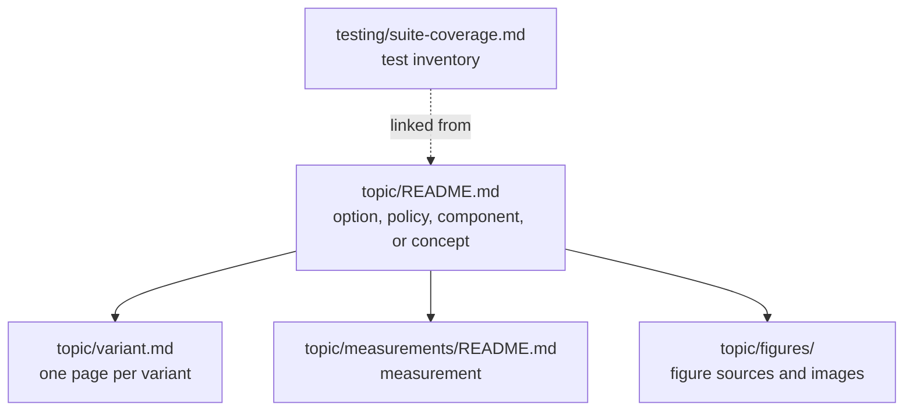

# Document kinds

This reference is for anyone who writes or reviews a document under `docs/`. It defines the kinds of document the documentation uses, the sections each kind has, their order, and their canonical heading names, so that a reader who knows one document of a kind knows where to look in the next. The [documentation manifesto](manifesto.md) explains why documents of a kind share a skeleton (P5, P11), the [documentation workflow](workflow.md) says when a document's kind is decided and checked, and the [documentation instructions](../AGENTS.md) own the formatting, directory, and traceability rules that every kind follows.

Tutorials and how-to guides have no fixed skeleton. They follow only the [common opening](#common-opening) and [common closing sections](#common-closing-sections).

## Kinds at a glance

A document's kind is its shape. Its [Diátaxis type](../AGENTS.md#document-type-inventory) is its purpose. Each kind has one usual type:

| Kind | What it covers | Usual Diátaxis type | Model documents |
| --- | --- | --- | --- |
| [Option or policy](#option-or-policy) | One option family or policy: its interface, contract, mechanism, and cost | reference | [Final palette merge policy](../encoder/palette-construction/merge-policy/README.md), [Dither clamp policy](../encoder/palette-application/clamp-policy.md) |
| [Variant](#variant) | One selectable method within an option or policy family | reference | The per-policy chapters of [Lookup policy](../encoder/palette-application/lookup-policy/README.md) |
| [Component](#component) | One loader, writer, format family, or backend | reference | [Builtin GIF loader](../loader/builtin/gif.md), [Builtin PNG loader](../loader/builtin/png/README.md) |
| [Concept](#concept) | One idea the implementation relies on, explained independently of options | explanation | [Palettes](../concepts/palettes/README.md), [Dithering](../concepts/dithering/README.md) |
| [Measurement](#measurement) | The evidence behind one topic's measured claims | reference | [High-color measurement reference](../encoder/output/high-color/measurement.md) |
| [Test inventory](#test-inventory) | Every test of one suite and what each one observes | reference | [Mapfile parser coverage inventory](../testing/mapfile-parser-coverage.md) |

A variant, a measurement, or a test inventory is usually a companion of a topic rather than a topic of its own. The topic's own coverage ledger is not a companion: it stays in the `## Test coverage` section at the end of the topic. The figure shows how companions sit beside the document they support:



## Rules for every kind

### Common opening

Every document begins with its `#` title and, directly below it, an opening paragraph with no heading of its own. The opening says three things:

1. **Who the document is for**, such as CLI users, library integrators, or contributors.
2. **What it covers**, in one or two sentences, and what it deliberately leaves out.
3. **Where neighboring material lives**: the parent topic, the concepts it relies on, and its companions.

A concept document may follow the opening with a short bulleted summary introduced by `**Key ideas in one minute:**`. A `## Scope` or `## Purpose` heading for the opening is not used.

### Section names and order

Each kind below lists its sections in order. A section marked *required* is present in every document of the kind; an *optional* section appears only when the document has that material, but always under its canonical name and in its listed position.

A row named *Subject sections* is a slot for headings specific to the topic, such as `## Ward agglomeration` in a merge-policy document. Subject sections appear only in that slot. They never use the name of a canonical section for different material, and canonical material never moves into a subject section.

### Common closing sections

The last sections of a document, when present, appear in this order and under these names, whatever the kind:

| Section | Required | Content |
| --- | --- | --- |
| `## Implementation map` | optional | Links to the owning source files, functions, and build switches, with one line each on what they do |
| `## Reproduction` | optional | How to regenerate the document's figures and measurements: commands, inputs, and generator scripts |
| `## Test coverage` | when enforced | The coverage inventory defined in the [documentation-to-test traceability rules](../AGENTS.md#documentation-to-test-traceability); only `## References` may follow it |
| `## References` | optional | External sources: specifications, papers, and other implementations |

### Retired heading names

These names are no longer used for new material. When a document that uses one is next restructured, its heading is renamed to the canonical name and every link to the old anchor is updated in the same change.

| Retired names | Canonical name |
| --- | --- |
| `Scope`, `Purpose`, `Scope and status of this document` | The headingless [common opening](#common-opening) |
| `Implementation landmarks`, `Implementation references`, `Implementation`, `Implementation and validation`, `Implementation and tests`, `Implementation and test map`, `Implementation and existing coverage` | `Implementation map`; test material moves to `Test coverage` |
| `Figures and reproduction`, `Reproducing the figures`, `Reproducing the measurements`, `Reproduction and validation`, `Reproduce the comparison` | `Reproduction` |
| `CLI surface`, `CLI values and suboptions`, `Policy values`, `Policies` | `Options` in an option or policy document |
| `Cost model` | `Cost` |
| `Measured quality, speed, and size`, `Quality, speed, and encoded size`, `Measured static-image quality, size, and speed` | `Measured trade-offs` |
| `Name and source` | `Name and sources` |
| `Complete inventory`, `Exhaustive inventory` | `Inventory` |

## Option or policy

An option or policy document is the owner of one user-visible control, such as `-F`, `-d`, or `--lookup-policy`, or of one cross-cutting policy. It states the contract before the mechanism and the mechanism before the evidence (P6).

| Section | Required | Content |
| --- | --- | --- |
| Opening | required | Includes the option's short and long forms |
| `## Pipeline position` | optional | Where the option acts in the encoder or decoder pipeline, and what runs before and after it |
| `## Options` | required | Accepted values and suboptions, defaults, library API and environment-variable equivalents |
| `## Contract` | required | What the option guarantees: observable behavior, numeric contracts, and failure behavior |
| `## Precedence and interactions` | optional | How sources of configuration combine, and how the option interacts with other options |
| Subject sections | optional | How it works: the mechanism, its mathematics, and its rationale |
| `## Variants` | optional | A comparison table of the selectable variants, linking to one [variant](#variant) page each |
| `## Cost` | optional | Time and memory cost, asymptotic and practical |
| `## Measured trade-offs` | optional | A summary of measured quality, speed, and size, linking to the [measurement](#measurement) companion for the evidence |
| `## Limitations` | optional | Known gaps, unsupported combinations, and planned boundaries stated as current behavior |
| Closing sections | — | [Common closing sections](#common-closing-sections) |

```markdown
# <Option or policy name>

<Opening: reader, scope, neighbors; the option's short and long forms.>

## Pipeline position
## Options
## Contract
## Precedence and interactions
## <Subject sections>
## Variants
## Cost
## Measured trade-offs
## Limitations
## Implementation map
## Reproduction
## Test coverage
## References
```

## Variant

A variant page describes one selectable value of an option or policy family, such as one lookup policy or one dithering kernel. Its family's option or policy document owns everything the variants share; the variant page states only what is particular to it.

| Section | Required | Content |
| --- | --- | --- |
| Opening | required | Names the family and the value that selects the variant, and links back to the family document |
| `## Purpose and intuition` | required | What the variant is for and the idea behind it, before any formula |
| `## Method` | required | The algorithm and its mathematics |
| `## Guarantee` | required | What the variant guarantees beyond the family contract, such as exactness or determinism |
| `## Cost` | required | Its preparation and per-pixel or per-query cost |
| `## Name and sources` | optional | Where the name and the method come from, with citations |
| `## History` | optional | The variant's history in libsixel, written as self-contained current knowledge |
| Closing sections | — | [Common closing sections](#common-closing-sections) |

```markdown
# <Family>: <variant>

<Opening: family, selecting value, link back to the family document.>

## Purpose and intuition
## Method
## Guarantee
## Cost
## Name and sources
## History
## Implementation map
## Reproduction
## Test coverage
## References
```

## Component

A component document describes one loader, writer, format family, or backend: what it accepts, what it produces, and where it stops.

| Section | Required | Content |
| --- | --- | --- |
| Opening | required | Names the component and the options or build switches that select it |
| `## Format lineage` | optional | The origin and versions of the format or library, and how libsixel came to support it |
| Subject sections | optional | Container, color model, metadata, pipeline, and other format-specific material |
| `## Options and observable differences` | optional | Options that affect the component, and how its output differs from other components for the same input |
| `## Comparison with other backends` | optional | A comparison with alternative components for the same format |
| `## Unsupported behavior and security boundary` | required | What the component rejects or ignores, and how it treats malformed and hostile input |
| Closing sections | — | [Common closing sections](#common-closing-sections) |

```markdown
# <Component name>

<Opening: reader, scope, neighbors; how the component is selected.>

## Format lineage
## <Subject sections>
## Options and observable differences
## Comparison with other backends
## Unsupported behavior and security boundary
## Implementation map
## Test coverage
## References
```

## Concept

A concept document explains one idea independently of libsixel's options, so that option and component documents can rely on it instead of explaining it again. It leans on figures and worked examples (P11).

| Section | Required | Content |
| --- | --- | --- |
| Opening | required | May be followed by **Key ideas in one minute** |
| Subject sections | required | The idea, built up step by step, with figures and examples |
| `## History` | optional | How the idea developed, when that helps the reader understand it |
| `## In libsixel` | required | Where libsixel applies the idea, linking to the option and component documents that own the details |
| Closing sections | — | [Common closing sections](#common-closing-sections) |

```markdown
# <Concept>

<Opening: reader, scope, neighbors.>

**Key ideas in one minute:**

- <Idea>

## <Subject sections>
## History
## In libsixel
## Reproduction
## References
```

## Measurement

A measurement document holds the evidence for the measured claims of one topic. It does not define contracts; the topic it supports states them, and links here (P6).

| Section | Required | Content |
| --- | --- | --- |
| Opening | required | Names the topic and the claims this evidence supports |
| `## Questions` | required | What the measurements are meant to answer |
| `## Conditions` | required | Inputs, settings, builds, machines, and metrics, following the [quality measurement policy](../quality/measurement-policy.md) |
| `## Results` | required | Figures and tables, with subsections per question when there are several |
| `## Interpretation` | required | What the results show and where they stop applying |
| `## Reproduction` | required | Commands and scripts that regenerate every figure and table |

```markdown
# <Topic> measurements

<Opening: topic, claims supported, link back to the topic.>

## Questions
## Conditions
## Results
## Interpretation
## Reproduction
```

## Test inventory

A test inventory lists every test of one suite so that each remains discoverable. It follows the [test-plan inventory rules](../AGENTS.md#documentation-to-test-traceability) and does not state public guarantees.

| Section | Required | Content |
| --- | --- | --- |
| Opening | required | Names the suite, its directory, and the policy documents its tests support |
| `## Coverage summary` | optional | Counts and groupings that make the inventory scannable |
| `## Inventory` | required | The delimited test-plan inventory |
| `## Coverage boundary` | required | What the suite does not establish |
| `## Maintenance` | optional | How to regenerate or extend the inventory |

```markdown
# <Suite> coverage inventory

<Opening: suite, directory, supported policy documents.>

## Coverage summary
## Inventory
## Coverage boundary
## Maintenance
```
