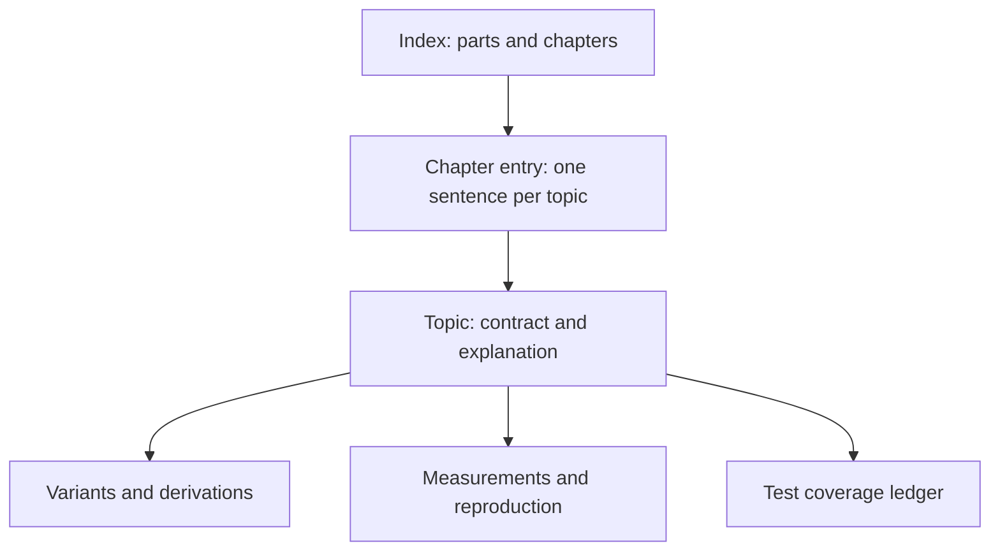

# Documentation manifesto

This manifesto states the design principles behind libsixel's documentation. It is written for anyone who adds to or reorganizes `docs/`, whether a human contributor or an automated agent. The [documentation instructions](../AGENTS.md) turn these principles into concrete rules and checks, and the [documentation workflow](workflow.md) describes the review steps that apply them to a change. When a rule and a principle seem to disagree, the principle explains what the rule is for; fix the rule rather than working around the principle.

## The problem these principles answer

Documentation grows one change at a time, and each change is usually written to answer the question in front of its author. Without a shared design, the result is a pile rather than a body of work: pages of very different scope sitting side by side, the same rule stated in several places with slightly different wording, measurements and test ledgers burying the contract they support, and an index that has to be read in full before it can be used. Each addition may be correct on its own and still make the whole harder to use. These principles exist so that every change is made as part of the whole.

## Principles at a glance

| | Principle | In one line |
| --- | --- | --- |
| P1 | One work, not a collection | Every document has a nameable place in a single structure. |
| P2 | One concern, one owner | Each fact is stated once; everything else links to it. |
| P3 | Readers arrive with a purpose | One primary purpose and audience per document. |
| P4 | Depth is layered and opt-in | Short layers on top, details one layer below. |
| P5 | Siblings have comparable granularity | Position predicts scope. |
| P6 | Contracts first, evidence beneath | Measurements and ledgers support, never define. |
| P7 | Consistency is maintained deliberately | Conflicts are reconciled in the owner. |
| P8 | Describe the present, durably | Current behavior for a reader with only the repository. |
| P9 | A change to a part is a change to the whole | Place, link, index, and prune with every addition. |
| P10 | Machines check structure; people check meaning | Static checks first, then human review. |
| P11 | Reading should never be a burden | Plain prose, supported by figures and tables. |

## Principles

### P1. The documentation is one work, not a collection

Every document has a place in a single structure: a part, a chapter within it, and a position among its siblings. A document whose author cannot name that place, the documents beside it, and the reader who arrives at it is not ready to be added. Structure is designed first and filled second; a new subject that fits no existing chapter is a proposal to change the structure, not a reason to add an unattached page.

### P2. One concern, one owner

Each fact, rule, definition, and contract has exactly one owning document. Every other document that needs it links to the owner's section instead of restating it. A short, scoped sentence of context is allowed; a second definition is not. When two documents state the same thing, one of them is wrong already or will become wrong later.

### P3. Readers arrive with a purpose

A reader comes to learn (tutorial), to accomplish a task (how-to), to look something up (reference), or to understand why (explanation), and comes as a user, a contributor, or both. Each document has one primary purpose and one primary audience. Material that serves a different purpose or audience goes into a companion document next to it rather than being interleaved, so that each reader can stop reading at the point where their question is answered.

### P4. Depth is layered and opt-in

The documentation is read from the top down: the index points to chapters, chapter entries point to topics, and a topic points to its details. Each layer stays short enough to scan and says only enough for the reader to choose where to go next. Details that only some readers need, such as per-variant descriptions, measurement evidence, derivations, and test ledgers, live one layer below the contract they support and are linked from it.

### P5. Siblings have comparable granularity

Documents at the same level of the structure cover subjects of comparable scope, so a reader can predict what a page contains from where it sits. A topic is the unit a reader would look for by name: one policy, one option family, one pipeline stage, one concept. A page that has grown to cover several such units is split; a page too small to stand alone is merged into its natural owner. Length is a signal, not a goal: a page that is much longer than its siblings needs a reason or a split.

### P6. Contracts first, evidence beneath

A topic states what is guaranteed before it explains why, and explains why before it presents evidence. Measurements, sweeps, historical comparisons, and test inventories support a contract; they do not define it and never carry normative statements of their own. Evidence is placed where it can be consulted and reproduced without standing between the reader and the contract.

### P7. Consistency is maintained deliberately

A term means the same thing everywhere it is used, and it is defined once by its owner. A change that introduces or alters a normative statement checks every other statement about the same subject and reconciles them in the owner. A contradiction is never resolved by adding a third statement, and never by silently preferring the newer or the closer text.

### P8. Describe the present, durably

Documents describe current behavior and the lasting reasons behind it, for a reader who has only the repository. The history of an edit, a debugging session, or a review belongs in commit messages and issue trackers. Project history that is itself durable has its own owner.

### P9. A change to a part is a change to the whole

Adding material means placing it, linking it from its parent, updating the index, and removing or shortening what it supersedes. Editing an existing owner is preferred to adding a new document, and every addition should ask what can be deleted. Restructuring is ordinary maintenance, not an exceptional event.

### P10. Machines check structure; people check meaning

Paths, inventories, reciprocal links, distribution lists, and similar structural invariants are enforced by static checks so that review attention is spent on what machines cannot judge: placement, granularity, overlap, consistency, and whether the reader's question is answered. A passing check is a precondition for review, not a substitute for it.

### P11. Reading should never be a burden

A reader should be able to follow a document without fighting its prose. Sentences are short and direct, each paragraph carries one idea, terms are defined before they are used, and a concrete example comes before or right after the abstraction it illustrates. A long run of items, conditions, or cases is written as a list or a table, not packed into a sentence.

Words alone are a poor medium for structure, flow, geometry, and comparison, so a concept explained in prose is supported by a figure or a table wherever one makes it easier to grasp: a diagram for a pipeline, a data flow, or a relationship between components; a plot or an illustration for a geometric or numeric idea; a table for options, variants, trade-offs, or any comparison along shared attributes. The prose states the point and the figure or table shows it; neither replaces the other. Every figure or table is introduced by the text that relies on it and says in one sentence what the reader should take from it, and a figure is kept as maintainable source next to the document so it can be regenerated when the behavior changes.

## What these principles imply in practice

- The index and chapter entries are navigation. Each entry is one sentence that says what the reader will find; the detailed scope statement belongs at the top of the document itself.
- Every document opens by saying who it is for, what it covers, and where neighboring material lives.
- A paragraph that a reader has to reread to follow, or a concept that needs a mental picture the text does not draw, is a defect to fix like a wrong value: split the sentences, add an example, or add the figure or table.
- Documents of the same kind share a skeleton, so a reader who has read one policy page knows where to look in the next. The [document kinds](document-kinds.md) reference defines those skeletons.
- A topic with substantial evidence or test inventories is a directory whose `README.md` holds the contract and whose companions hold the rest.
- Loose numeric limits on the length of documents, sections, and paragraphs are enforced mechanically, so that clear overgrowth never reaches review; whether a unit is the right size for its place and its reader is judged by people.
- Structural changes, such as new documents, new chapters, splits, merges, and moves, are proposed and reviewed before the prose is written, as described in the [documentation workflow](workflow.md).
