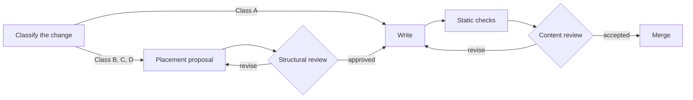

# Documentation workflow

This document defines how a change to `docs/` is planned, reviewed, and accepted. It applies to human contributors and automated agents alike. The maintainer approves every structural review and accepts every change; no other person or tool can stand in for that approval. The [documentation manifesto](manifesto.md) explains the principles (cited here as P1 to P11) that the review steps enforce, and the [documentation instructions](../AGENTS.md) own the formatting, ownership, traceability, and inventory rules that each step relies on.

## Overview

A documentation change passes through up to four stages. Small edits take the short path; anything that changes the shape of the documentation takes the full path, which places a structural review before any prose is written.

## Stage 1: classify the change

Classify the change by its effect on the structure, not by its size in lines.

| Class | Change | Path |
| --- | --- | --- |
| A | Correction or clarification inside an existing section: a fixed value, a broken link, a reworded sentence, an updated figure, with no new normative statement. | Short path: write, check, content review. |
| B | New section, new normative statement, or new evidence in an existing owner. | Full path. The proposal may be brief. |
| C | New document, or a new companion of an existing document. | Full path. |
| D | Restructuring: a new part or chapter, or a split, merge, move, rename, or deletion of documents. | Full path. The proposal lists every affected document and inbound link. |

A change belongs to the highest class that any part of it reaches. If in doubt, take the full path; a brief proposal costs less than a misplaced page.

## Stage 2: placement proposal

Before writing the prose of a Class B, C, or D change, write a placement proposal. The proposal is a working record, not a document: put it in the pull request description, in the issue, or, for an agent, in the conversation with the maintainer. Do not commit it under `docs/`.

The proposal answers these questions:

1. **Reader and question.** Who arrives at this material, and what question brings them? (P3)
2. **Purpose and audience.** The primary Diátaxis type (`tutorial`, `how-to`, `reference`, `explanation`) and audience (`user`, `contributor`, `both`), and which parts, if any, serve a different purpose and therefore belong in a companion. (P3, P4)
3. **Kind.** The [document kind](document-kinds.md) of each resulting document, which fixes its sections and their names. (P5)
4. **Existing owners.** The documents found through the [index](../README.md) and a repository search that already discuss the subject, with what each one owns. (P2)
5. **Decision.** Extend an existing owner, add a companion, add a new document, or restructure, with the reason the alternatives were rejected. Extending an owner is the default. (P1, P9)
6. **Place in the structure.** The part and chapter of the index, the parent document that links to it, and the siblings it sits beside. (P1)
7. **Granularity.** How its scope compares with those siblings, and its expected size. A proposal for a page much larger or smaller than its siblings explains why or adjusts the split. (P5)
8. **Normative statements.** The contracts, defaults, and definitions the change introduces or alters, the other statements in the documentation about the same subjects, and how any conflict will be reconciled in the owner. (P2, P7)
9. **Terms.** Terms the change introduces or relies on, and the document that defines each one. (P7)
10. **Supersession.** What the change makes redundant, and what will be deleted, shortened, or replaced with a link. (P9)
11. **Evidence and coverage.** Where measurements, reproduction material, and test ledgers will live, and which tests the contracts link to. (P6, P10)
12. **Figures and tables.** The structures, flows, geometric ideas, and comparisons the material explains, and the figure or table planned for each. (P11)

## Stage 3: structural review

The structural review decides whether the proposal fits the whole before effort is spent on prose. The maintainer performs it and approves every Class B, C, and D proposal.

The reviewer reads the proposal against the current index and the existing owners it names, and answers:

- Does the material have a single, nameable place, and is it the right one? (P1)
- Is there an existing owner that should be extended instead? (P2, P9)
- Does each resulting document have one primary purpose and audience? (P3)
- Is the contract kept above its evidence, variants, and ledgers? (P4, P6)
- Is the granularity comparable with the siblings? (P5)
- Does the plan pair each structure, flow, geometric idea, or comparison with a figure or table? (P11)
- Are all overlapping and conflicting statements identified, with a reconciliation in the owner? (P7)
- Does the change remove or shorten what it supersedes? (P9)

The outcome is approval, approval with conditions, or a request to revise the proposal. Prose written before approval is not reviewed. A restructuring proposal may be approved in stages, each stage leaving the documentation consistent.

## Stage 4: write, check, and review the content

Write the change as approved. A deviation from the approved placement, such as an extra document, a different chapter, or a merged companion, returns the change to Stage 3.

Run the documentation static checks before requesting the content review. They are part of `make staticcheck` and are listed in the [test coverage section of the documentation instructions](../AGENTS.md#test-coverage). A failing check is fixed by correcting whichever side of the contract is wrong, never by weakening the check. The checks include loose numeric limits on the length of documents, sections, and paragraphs, defined in the [length limits section of the documentation instructions](../AGENTS.md#length-limits); a unit that exceeds its limit is split, and adding an exception or raising a limit is a Class D change.

The maintainer performs the content review of every change, including Class A changes. Passing the length checks does not settle whether a unit is the right length for its siblings and its reader; the review judges that. The content review confirms:

- The document opens by stating its reader, its scope, and where neighboring material lives.
- The document follows the skeleton of its [kind](document-kinds.md): its sections appear in the listed order under their canonical names, and subject-specific headings stay in the subject-section slot.
- Each normative statement appears only in its owner; other occurrences are links or have been reconciled. Search the documentation for the subject of every new or altered statement, not only for the exact wording.
- Terms are used with the meaning their owner defines.
- The text reads easily: short sentences, one idea per paragraph, terms defined before use, and examples near the abstractions they illustrate. Structures, flows, geometric ideas, and comparisons that are explained in prose are supported by a figure or a table, each introduced by the text and stating what the reader should take from it. (P11)
- The index entry and the parent's link are one sentence that tells the reader what they will find.
- Superseded material has been removed or replaced with links, and inbound links to moved material are updated.
- The text describes current behavior for a reader who has only the repository. (P8)
- Formatting, inventory, distribution, and traceability rules in the [documentation instructions](../AGENTS.md) are followed.

## Rules for automated agents

An agent working on documentation follows the same stages, with two additional constraints:

- Before writing a Class B, C, or D change, the agent presents its placement proposal to the maintainer and waits for approval. Approval of one proposal does not extend to another document or to a later change.
- The agent checks its own draft against the Stage 4 checklist before presenting it and reports what it searched for and what it found. This self-check prepares the maintainer's review; it is not a review and does not replace it.

## Periodic consolidation

Review stops new disorder; consolidation repairs the disorder that already exists or accumulates despite review. A chapter is due for consolidation when its documents diverge markedly in size or skeleton, when the same subject is discussed in several of its documents, when its index entries no longer fit in a short scan, or when a reader reports being unable to find something it contains.

Consolidation is a Class D change. Its proposal surveys one chapter at a time: it lists each document's purpose, audience, owned concerns, and size, identifies duplicated and conflicting statements, and proposes the splits, merges, moves, and companion extractions that would bring the chapter in line with the manifesto. Each approved step is carried out as its own change so that the documentation remains consistent after every merge.
