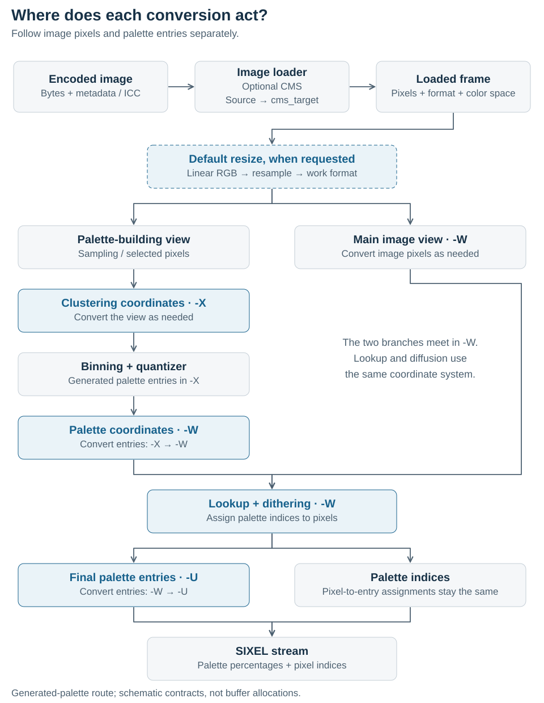
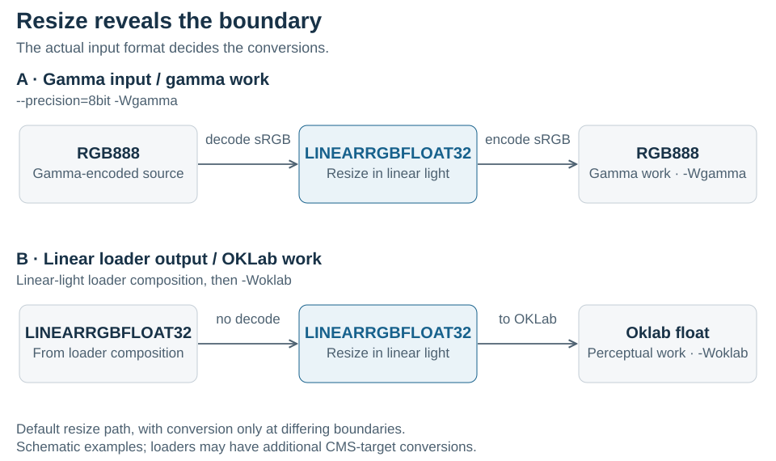

# Color-Space Handling

## Scope

This document describes how libsixel applies color spaces and color management: where conversions occur even when no option asks for them, how the loader and encoder hand frames to each other, what `-X`, `-W` and `-U` control, which loader CMS settings exist, how extended coordinates are preserved, and which configurations and mistakes are common.

It assumes the concepts in [Color spaces](../../concepts/colorspace/README.md) (primaries, white points, transfer functions, linear light, conversion hubs and gamut) and in [Color management basics](../../concepts/color-management/README.md) (ICC profiles, the profile connection space and rendering intents). The storage types and implicit promotion boundaries are defined in [Pixel-format precision](../../concepts/pixelformat-precision/README.md); broader quantizer, dither, lookup, speed, and size effects are measured in [Encoder working precision](../precision/README.md); palette-construction geometry is measured in [Palette clustering color space](../palette-construction/clustering-colorspace/README.md); and palette-application geometry is measured in [Working color space](../palette-application/working-colorspace/README.md).

## Implicit conversions users should expect

**Internal color conversion can occur even when no color-space option is supplied.** Loader CMS, background composition, and the default resize path can require a different representation before palette processing starts. `-Wgamma` selects palette-application coordinates, and `--precision-policy=8bit` requests the byte base path; neither forbids a temporary linear-light float buffer. Likewise, `--cms-engine=none` disables loader CMS but does not disable linear-light resize or composition on loader paths that implement it. These conversions can change intermediate pixel values, memory use, processing time, and the resulting image.

The purpose is to perform each operation in suitable coordinates while preserving the interpretation of the color. The [conversion hubs](../../concepts/colorspace/README.md#linear-rgb-and-xyz-as-conversion-hubs) explain the mathematics; [lazy conversion at operation boundaries](#lazy-conversion-at-operation-boundaries) identifies the triggers and how to inspect the effective path. Loader behavior is path-specific, so the explanation does not imply that every backend composites in linear light.

## End-to-end pipeline

The useful mental model is a sequence of explicit interpretation and conversion boundaries. Follow the two branches separately: the palette-building view supplies colors in `-X`, while the main image supplies pixels in `-W`. Palette entries enter `-W` before lookup and dithering use both inputs.

<picture>
  <source media="(max-width: 640px)" srcset="figures/encoding-pipeline-mobile.svg">
  
</picture>

This figure shows the generated-palette route; fixed-palette shortcuts can bypass its palette-building branch. Lookup and dithering use palette coordinates in `-W`. On the selected Display P3 and ordinary sRGB float paths, the encoder prepares a separate serialized palette before lookup, without replacing those working coordinates with inverse-converted wire values. The final `-W` to `-U` conversion changes the output copy while pixel indices keep their assignments; see [where the conversion happens](../output/output-colorspace.md#where-the-conversion-happens). Preparing wire values does not enable palette snapping. A stage box represents a contract, not a promise of a separate buffer, worker or execution order.

The implementation may reuse storage, clone only the palette-building view, or skip a conversion when source and destination already match. Those optimizations do not change the conceptual contracts. The frame carries its effective pixel format and color space so later stages can choose the correct conversion instead of inferring it from whether resize or another option was requested.

## Lazy conversion at operation boundaries

Float-buffer conversion may reuse exact promoted-byte sRGB transfer values and previously converted triplets within each worker chunk. These are exact arithmetic caches: they do not snap coordinates, approximate cube roots, or change failure publication. The [float conversion arithmetic contract](../../concepts/pixelformat-precision/README.md#float-conversion-arithmetic) defines their scope and equivalence coverage.

Here, "lazy" means converting when a consuming operation needs different coordinates or storage. It is implemented through loader branches, frame metadata, and the encoder planner; it is not a cache holding a copy of every image in every color space. A linear intermediate inside one pixel's conversion also does not imply a separate full-frame linear buffer.

| Trigger | Why conversion occurs | Where it happens |
| --- | --- | --- |
| A loader applies a recognized source profile | Source device values must acquire a known interpretation. | Loader CMS connects through the profile transform and produces the effective `cms_target` representation, subject to loader precision/path rules. |
| A loader takes a linear-light background-composition path | Foreground and background must share a linear basis before weighted addition. | Composition happens during loading; the returned frame can already be `LINEARRGBFLOAT32`. |
| Default resize processing is requested | Resampling combines contributions from multiple source pixels. | The planner requests `LINEARRGBFLOAT32` before resize and the effective working format afterward. |
| `-X` or `-W` requires different coordinates | Palette decisions need the selected geometry, even without composition or resize. | Conversion affects the palette-building view or main work view respectively. |
| Final palette coordinates differ from `-U` | The serialized RGB numbers must have the requested output interpretation. | The final palette entries are converted before writing; this does not require converting all image pixels back to output RGB. |

For resize, `sixel_encoding_planner_analyze()` compares the actual frame format with the required resize input and work formats. The encoder inserts pre-resize and post-resize conversion steps only where those formats differ. An already linear float frame needs no pre-resize transfer decoding; an Oklab frame must return to linear RGB for the default resize path and can re-enter Oklab afterward. If resize is absent, there is no resize buffer, although CMS or `-X`/`-W` may independently require conversion. The general color converter likewise skips matching source and destination color spaces.

For example, an opaque `RGB888` source with no applied CMS transform, no resize, and gamma palette policies can stay on the gamma byte path. Adding a resize with `--precision-policy=8bit -Wgamma` introduces a temporary linear float stage, shown in case A below. If a loader's background-composition path instead returns linear float and `-Woklab` is selected, case B applies: resize already has its required input coordinates, and conversion to Oklab follows the resize.

<picture>
  <source media="(max-width: 640px)" srcset="figures/resize-boundaries-mobile.svg">
  
</picture>

Case B needs no extra sRGB decoding before resize. The planner retains loader-originated float precision for subsequent work. These are examples of stage-dependent conversion, not a promise of globally minimal transforms: individual loaders can have additional CMS-target round trips, and alpha/high-depth paths can produce float frames even without actual background blending.

### Inspecting and controlling the effective path

Use verbose planner output to see the source, work, and resize representations together:

```sh
img2sixel --cms-engine=none --precision-policy=8bit -Wgamma \
  -w50% -v -o /dev/null image.png
```

For an opaque byte source that reaches the planner as `RGB888`, the relevant fields are:

```text
formats: source=rgb888 work=rgb888 scale_out=linear-f32
resize: mode=2 input=linear-f32
```

Reading only `work=rgb888` misses the temporary conversion. To investigate a loader-produced float source, use the [loader contract trace](../../concepts/pixelformat-precision/README.md#observing-the-resolved-path) and check CMS, source alpha, and the resolved background. The planner report begins at the returned frame; it does not enumerate internal PCS calculations or every loader conversion.

The explicit `-j auto:resize_precision=preserve` policy can keep a byte resize in gamma RGB, reducing buffer memory at the cost of different mixing results. It does not disable CMS or loader background processing. Conversely, `--precision-policy=float32` selects float storage but does not by itself make gamma coordinates linear. See [Pixel-format precision](../../concepts/pixelformat-precision/README.md#operations-that-promote-to-float32) for the exact promotion and preservation rules.

## The three encoder color-space options

| Option | Boundary controlled | Default | Accepted values |
| --- | --- | --- | --- |
| `-X`, `--clustering-colorspace` | coordinates used by binning and the palette solver after sample selection | `gamma`, unless an explicit `-W` supplies the implicit `-X` value | `gamma`, `linear`, `oklab`, `cielab`, `din99d` |
| `-W`, `--working-colorspace` | coordinates used when applying the palette, including lookup and dithering | `gamma` | `gamma`, `linear`, `oklab`, `cielab`, `din99d` |
| `-U`, `--output-colorspace` | RGB definition of the palette entries written to the SIXEL stream | `gamma` | `gamma`, `linear`, `smpte-c`, `display-p3`, `auto` (CLI negotiation) |

The names are defined in [spaces used by libsixel](../../concepts/colorspace/README.md#spaces-used-by-libsixel).

### `-X`: palette-construction geometry

`-X` changes the distances, ranges, centroids, and partitions seen by a generated-palette algorithm. It operates on a palette-building view; specifying it does not by itself convert the main image path. After palette construction, the `K` generated entries are converted from `-X` to `-W` before palette lookup and dithering.

An explicit `-X` is authoritative regardless of whether it appears before or after `-W`. When `-W` is specified and `-X` has never been specified, the encoder makes `-X` follow `-W`; this convenience keeps the two geometries matched without preventing an intentional mixed-space configuration. `-X` is ignored by paths that use a fixed palette through `-b`, `-m`, or `-e`, because those paths do not construct a new palette.

### `-W`: palette-application geometry

`-W` selects the shared working coordinates for the main image and the generated palette. Lookup policies compare pixels with palette entries in this space, and dithering propagates its error in this space. Changing `-W` can therefore change selected indices even when the palette itself was generated in another space.

`-Wgamma` can use either the 8-bit or float32 precision path. `linear`, `oklab`, `cielab`, and `din99d` require float32 working storage. This is why a non-gamma `-W` can change memory use and runtime as well as color geometry.

The mathematical role of each accepted space and the controlled quality, runtime, and stream-size comparison are documented in [Working color space](../palette-application/working-colorspace/README.md).

### `-U`: serialized palette coordinates

`-U` selects how the numbers in SIXEL color definitions are to be interpreted: gamma sRGB by default, linear-light sRGB, SMPTE-C, or Display P3. It is a destination definition, not another processing geometry. On the legacy palette paths it converts the final palette entries from the working coordinates without rerunning palette generation or lookup. The selected Display P3 and ordinary sRGB float paths retain native working palette coordinates for lookup and dithering. A separate destination view applies conversion, final gamut clipping and RGB101/HLS rounding for transmission; this does not implicitly enable snap. Display P3 is available on that selected CPU float palette path and the separately admitted [high-color RGB path](../output/high-color/README.md#display-p3-boundary). High-color output converts samples to the selected destination before selecting its lookup keys and register representatives. [Output color space](../output/output-colorspace.md) owns these rules, their rounding, and the supported option combinations.

Palette export is a separate boundary. `-M` always writes sRGB8 ACT, PAL, RIFF PAL, or GPL files, whatever `-U` selects, so a wide-gamut palette is clipped to sRGB in the file; see [External palette input and output](../palette-construction/external-palettes.md#exporting-a-palette-with-m).

SIXEL carries numeric palette components but does not embed an ICC profile or an explicit color-space tag. A receiving terminal therefore cannot discover from the stream alone whether values were prepared as sRGB, linear RGB, SMPTE-C, or Display P3. `-Ugamma` is the interoperable default; an explicit alternate output space is meaningful only when the receiving environment is known to interpret the numeric values accordingly. The CLI-only `-Uauto` choice negotiates the definition with the terminal through the [terminal graphics color management proposal](../../protocols/graphics-color-management.md) for images sent directly to a terminal on stdout. Files and pipes keep gamma sRGB; a terminal that does not answer at all also receives unconfirmed gamma output, while a partial or malformed reply stops before image output.

## Loader color management

For the CMS integration policy, loader support tables, engine comparison, supported ICC structures and quality/performance tradeoffs, see [Loader Color Management](../../loader/color-management/README.md). Loader and CMS engine selection are independent; successful decoding alone does not prove that the source profile was applied.

Loader CMS establishes a color interpretation from file metadata, as described in [color management basics](../../concepts/color-management/README.md#color-management-in-libsixel). This is different from asking the encoder to measure distances in Oklab or linear RGB: `-X` and `-W` assume the frame already has a valid color interpretation.

### Loader CMS defaults and engine selection

For participating `img2sixel` and `lsqa` loaders, CMS defaults to `auto`. Library API loader defaults remain disabled. Use `-# ENGINE` or `--cms-engine=ENGINE` to supply a process-wide loader default:

| Engine | Behavior |
| --- | --- |
| `none` | disable libsixel loader CMS |
| `auto` | prefer lcms2, then ColorSync on macOS, then the builtin engine |
| `builtin` | use libsixel's internal ICC implementation |
| `lcms2` | request Little CMS; if unavailable, resolve through the automatic fallback chain |
| `colorsync` | request ColorSync; if unavailable, resolve through the automatic fallback chain |

The global selection applies to the builtin, libpng, libjpeg, libwebp, and libtiff loader components. A loader-specific `cms_engine` suboption or its backend-specific environment variable overrides the process-wide default. Other loader backends can have native framework color behavior outside this switch, so `--cms-engine=none` should be read as “disable the libsixel CMS path,” not as a universal promise that every operating-system decoder returns untouched device samples.

### Source interpretation and internal target

When an enabled loader recognizes usable color metadata, it first resolves the file's source interpretation and converts profile-managed samples to the project's known RGB basis. It then converts the frame to the requested internal CMS target. Source-declaration rules belong to the format: the [common PNG precedence](../../loader/png-color-metadata.md), including builtin PNG, preserves ColorSync-compatible handling of conflicting declarations. Supported profile classes, validation, and malformed-profile fallback still depend on the decoder and CMS integration; a shared precedence rule does not imply identical metadata acceptance.

The common loader suboption is:

```text
cms_target=gamma|linear|cielab|oklab|din99d
```

Its short suboption form is `Tvalue`, its environment fallback is `SIXEL_LOADER_CMS_TARGET_COLORSPACE`, and its default is `linear`. This target controls the frame representation produced after a successful CMS conversion. It does not set `-X`, `-W`, or `-U`; the encoder still performs any conversions required by those later boundaries.

For example, this command asks the builtin loader to apply an available CMS backend and leave the managed frame in linear-light float32 before the encoder applies its default gamma working and output policies:

```sh
img2sixel --cms-engine=auto --loaders='builtin:cms_target=linear!' image.png
```

This command keeps palette construction and palette application in Oklab after the same loader-side normalization, then converts the palette to gamma-encoded sRGB for SIXEL output:

```sh
img2sixel --cms-engine=auto --loaders='builtin:cms_target=linear!' -Xoklab -Woklab -Ugamma image.png
```

### Adopted native source definitions

A native named color space and an exported ICC byte representation need not use identical numerical transfer curves. The [CoreGraphics PNG source contract](../../loader/coregraphics.md#source-and-format-boundaries) distinguishes a verified named sRGB source from an adopted ICC source. Missing embedded ICC alone does not select sRGB, and changing global CMS preferences does not disable native color interpretation on that backend.

For native pure-power RGB profiles, [direct-linear source preparation](../../loader/color-management/README.md#behavioral-contract-tests) can change the spelling of an equivalent curve and exchange channels together with their matrix columns. Exchanging only the sample values or only the profile would change the physical color. The paired exchange preserves the original float bits and ICC coefficients and leaves transfer evaluation and color adaptation to ColorSync. This equivalence at the source boundary does not imply exact native arithmetic for arbitrary subnormal inputs or matrices with large cancellation.

### Loader precision preference

`prefer_8bit=0|1` (`V0` or `V1`, environment fallback `SIXEL_LOADER_PREFER_8BIT`) controls the representation requested after CMS conversion. The default `0` preserves the selected target in float32. The current `prefer_8bit=1` contract requests `RGB888`; because `RGB888` is gamma-encoded sRGB storage, it trades the selected float target for an 8-bit gamma representation. It can reduce memory and conversion cost, but it is not a byte-precision encoding of Oklab, CIELAB, DIN99d, or linear RGB.

### Rendering intent

`cms_intent=INTENT[+INTENT][!]` (`Rvalue`, environment fallback `SIXEL_LOADER_CMS_RENDERING_INTENT`) selects the order in which the CMS tries `perceptual`, `relative`, `saturation`, and `absolute` rendering intents. Without the exclusive `!`, omitted defaults remain available as fallbacks. Rendering intent governs profile gamut mapping, as explained in [rendering intents](../../concepts/color-management/README.md#rendering-intents); it does not replace `cms_target`, `-X`, `-W`, or `-U`.

### Background composition on loader paths

The [background policy](../../loader/background-policy.md#colorspace) distinguishes the background's interpretation from the blend arithmetic. Static non-indexed PNG float paths composite in linear light, as described in [why mixing uses linear RGB](../../concepts/colorspace/README.md#why-mixing-and-background-composition-use-linear-rgb), whereas retained indexed-palette paths and APNG inter-frame blending have different behavior. The [PNG loader comparison](../../loader/builtin/png/README.md#background-source-interpretation-and-blend-arithmetic) records those differences. Linear-light composition is the model, not a guarantee that all existing loader paths implement it.

## Internal extended-coordinate foundation

The [out-of-gamut principles](../../concepts/colorspace/README.md#out-of-gamut-and-imaginary-colors) call for preserving finite coordinates until an explicit destination boundary. This section describes how libsixel implements that and where it does not yet.

The internal `sixel_color_convert()` entry point in [`colorspace.c`](../../../src/colorspace.c) connects gamma sRGB, linear sRGB, Oklab, normalized CIELAB, and DIN99d using double triplets. It preserves finite negative and above-one intermediates. Its sRGB transfer functions apply the positive piecewise curve to the absolute value and restore the sign. Oklab uses analytic cube roots outside the legacy lookup path; reverse transforms preserve negative linear RGB. CIELAB retains the existing `L/100`, `a/128`, `b/128` convention and rounded D65 matrix; DIN99d retains the corrected XYZ basis and common `/100` scale. Invalid identifiers, non-finite input/results, and undefined domains such as DIN99d's logarithm fail without writing the destination. Public float conversion through `sixel_helper_convert_colorspace()` and internal conversion through `sixel_color_convert_rgbf32()` use this same arithmetic; the [frame precision contract](../../concepts/pixelformat-precision/README.md#float-frame-coordinate-changes) describes validation and storage. This does not change the bounded byte converters or establish extended-range support for every CLI, palette lookup, or dithering path.

Preservation still requires a defined transform. Use the signed transfer or other extended-domain rule implemented for that space; replacing a cube root with a generic fractional power of a negative value, for example, can create a domain error. An ICC LUT's declared input range remains a separate profile constraint. An undefined logarithm, nonfinite result, or storage overflow must follow the operation's error contract rather than being concealed by gamut clipping. The [precision guide](../../concepts/pixelformat-precision/README.md#storage-precision-and-arithmetic-precision) explains why even float32 storage can require double intermediates and why double alone does not guarantee accuracy.

A shared color-space name does not guarantee a shared extension outside the nominal domain. An ICC sRGB destination can extend the negative branch as a straight line, while libsixel's analytic sRGB coordinate transform applies the positive curve to the magnitude and restores the sign. For example, a native ICC result of `-0.5432505608` represents approximately `-0.0420472570` when decoded by the profile's linear branch (`value / 12.92`), but becomes approximately `-0.2562793250` under the signed analytic power branch. Mixing those two rules changes the color even though neither stage clips. Connect original PNG samples and their ICC profile directly to a linear RGB destination through the same CMS; do not reinterpret the native extended gamma output using a different analytic TRC. The [PNG source-sample tests](../../loader/png-color-metadata.md#original-samples-and-extended-linear-rgb) exercise this boundary with independent expectations.

For PNG source primaries, exact collinearity means that the source RGB-to-XYZ matrix is undefined. The libpng adapter makes that classification on the original integer grid and retains the applicable transfer-metadata fallback. Signed nonzero primary areas remain eligible for the existing solve; the guard does not impose positive scale factors or clip the result. The [precision discussion](../../concepts/pixelformat-precision/README.md#storage-precision-and-arithmetic-precision) separates this exact zero decision from the accuracy of floating matrix evaluation.

`RGB888` conversion and the final SIXEL palette's 0–100 component values impose representation limits, and gamut mapping or clipping belongs at those boundaries. These principles describe the extended-coordinate paths in this section and the [float-frame contract](../../concepts/pixelformat-precision/README.md#float-frame-coordinate-changes). The [storage and compatibility boundary inventory](../output/output-colorspace.md#storage-and-compatibility-boundaries) distinguishes intentional byte storage and serialized output from policy combinations outside native palette admission; float storage alone is not a pipeline-wide preservation guarantee.

### Color definitions and transforms

The opaque `sixel_color_def_t` and `sixel_color_xform_t` interfaces in [`cms.h`](../../../src/cms.h) describe RGB endpoints separately from a frame's current coordinates and storage precision. Named `srgb` and `display-p3` definitions and explicit white/primary chromaticities with sRGB or power TRCs share a matrix/TRC representation. The power exponent is the decoding exponent, unlike the reciprocal file-gamma convention of the older CMS constructor. Native white is Bradford-adapted to ICC D50 `(0.9642, 1, 0.8249)` once. XYZ is a relative, unbounded intermediate; device gamut handling belongs to an endpoint, not to an intervening sRGB cube.

An ICC definition owns both its profile bytes and parsed tables. Cloning and transform creation make independent endpoint copies, so releasing the caller's definitions or original byte buffer cannot invalidate a transform. These new objects use the builtin ICC evaluator regardless of the legacy CMS engine selector; external backend handles cannot be mixed into them. They currently accept RGB profiles, reject legacy v2 Lab PCS, require an exact declared byte length and `acsp` signature, and cap stored input at 16 MiB. These checks do not constitute complete ICC conformance validation. Selected intent slots 0, 1, and 2 are explicit; absolute intent is rejected. The interface evaluates the selected tables without additional black-point compensation or inter-profile perceptual reference-medium adjustment. Consequently, slot execution must not be presented as equivalence to a full external-CMS intent pipeline. Unsupported reverse paths fail instead of numerically inventing a reverse CLUT.

ICC device curves and LUT domains remain bounded as specified by ICC. This differs from the signed analytic TRCs of standard RGB definitions and does not justify clipping intermediate sRGB. On the new descriptor path, XYZ LUT8 and LUT16/mAB PCS encodings are decoded with their respective u1.7 and u1.15 scales; matrix tags already contain XYZ values. The [builtin CMS architecture](../../loader/builtin-cms.md) describes the inherited parser/evaluator support envelope, including unsupported processing elements and legacy LUT limitations.

Output capability requires successful device-to-PCS evaluation and PCS-to-device encoding. `sixel_cdef_output_ready()` executes both directions on six representative device colors with separate encoding and evaluation intents. A one-way input profile is not thereby an output profile, while two usable LUTs need not be mathematical inverses. This setup probe does not replace checking every finalized wire palette entry when an encoder caller adopts the interface. The selected Display P3 output path and `-Uauto` negotiation build on these definitions; their scope is specified in [Output color space](../output/output-colorspace.md), and other encoder paths do not gain wide-gamut output merely because the foundations exist.

Independent fixtures in [`tests/data/color-numeric`](../../../tests/data/color-numeric/) record primaries, white points, transfer values, XYZ D65/D50, extended linear sRGB, opponent coordinates, wire percentages, and reconstructed RGB8 separately. [`generate_color_fixtures.py`](../../../tools/generate_color_fixtures.py) derives them without production CMS/conversion calls. The [numeric tests](../../../tests/processing/colorspace/) and [definition tests](../../../tests/processing/cms/) cover transfer knees, signed range, endpoint ownership, asymmetric LUT capability, and a 17×17×17 SDR P3 grid through float32 work coordinates. Tolerances distinguish analytic TRC/XYZ arithmetic, rounded opponent matrices, sampled ICC curves, and wire quantization; passing these tests is not an end-to-end loader or terminal gamut claim.

## Common configurations

### Profile-aware input with default encoder geometry

```sh
img2sixel --cms-engine=auto image.png
```

The loader may normalize a recognized source profile, while palette generation, lookup, dithering, and emitted palette values retain their default gamma policy. A linear float loader result can still be converted later because its frame metadata records the actual representation.

### Perceptual palette construction with gamma lookup

```sh
img2sixel --cms-engine=auto -Xoklab -Wgamma -Ugamma image.png
```

Only the palette-building view enters Oklab. The generated palette returns to gamma sRGB before lookup and dithering, and the emitted SIXEL palette remains gamma sRGB.

### Perceptual construction and application

```sh
img2sixel --cms-engine=auto -Woklab -Ugamma image.png
```

Because no explicit `-X` is present, `-X` follows `-Woklab`. Palette construction, lookup, and dithering use Oklab float32, then the palette is converted to gamma sRGB for output.

### Fixed palette

```sh
img2sixel -m palette.map -Xoklab -Wlinear -Ugamma image.png
```

The map supplies the palette, so `-Xoklab` has no palette-construction work to control. `-Wlinear` can still affect palette application, and `-Ugamma` still governs final palette serialization.

## Measuring color-space choices

A perceptual space can improve the geometry of an optimization while a later RGB conversion still clips some results. Quality measurements must state the loader CMS engine and target, effective precision, `-X`, `-W`, and `-U`, because changing any one of them can change the comparison.

## Common mistakes

- Treating `RGB888` as a complete source profile. It describes three-byte storage and implies libsixel's gamma representation after normalization, but it does not explain how unconverted file samples were authored.
- Treating `cms_target` as an alias for `-W`. The former is a loader output contract; the latter is an encoder processing contract.
- Treating `-X` as a global conversion. It changes generated-palette geometry and leaves the main image path alone until another stage requires conversion.
- Treating `-W` as the wire color space. The final palette conversion is controlled by `-U`.
- Assuming `-U` embeds color management metadata. SIXEL has no ICC-profile field, so the terminal receives only numeric palette components.
- Treating a `-M` palette file as the `-U` output. Exported palette files are always sRGB8.
- Comparing spaces without controlling precision and loader behavior. A float32 promotion or a profile conversion can otherwise be mistaken for an effect of the named palette space.

## Reproducing the figures

The figures are generated by [`tools/plot_colorspace_figures.py`](../../../tools/plot_colorspace_figures.py), which also draws the figures of [Color spaces](../../concepts/colorspace/README.md) and [Color management basics](../../concepts/color-management/README.md). Maintain pipeline stages and connections in the generator's `PIPELINE` and `PIPELINE_EDGES` definitions, with layout geometry kept separately; edit `RESIZE_CASES` for the resize examples. Regenerate the SVGs rather than editing them by hand. The shared [`figures.json`](../../concepts/colorspace/figures/figures.json) records the pipeline graph, resize cases, sources and the output directory of each figure. Run the generator with `--check` to verify that the committed files are current.

## Implementation references

- [`src/colorspace.c`](../../../src/colorspace.c) owns component transfer functions, RGB primary conversions, perceptual transforms, normalization, clamping, lookup tables, and accelerated conversion paths.
- [`src/cms.c`](../../../src/cms.c) owns CMS engine selection, ICC profile handling, rendering-intent order, and the builtin/lcms2/ColorSync abstraction.
- [`src/icc-apply.c`](../../../src/icc-apply.c) evaluates builtin profile transforms, connects XYZ/Lab PCS through XYZ D50, and adapts toward the internal sRGB basis.
- [`src/frame.c`](../../../src/frame.c) keeps pixel-format conversion and frame color-space metadata synchronized.
- [`src/planner.c`](../../../src/planner.c) selects resize and work formats and gates conversion before and after resize according to the actual source representation.
- [`src/frompng.c`](../../../src/frompng.c) implements the builtin static PNG float composition paths, including source/background interpretation before linear-light blending.
- [`src/loader-common.c`](../../../src/loader-common.c) resolves `cms_target`, `prefer_8bit`, and rendering-intent settings into a loader output representation.
- [`src/encoder.c`](../../../src/encoder.c) separates palette-building and main-image views and converts generated palettes from `-X` to `-W`.
- [`src/encoder-core-encode.c`](../../../src/encoder-core-encode.c) converts final palette entries from the working source color space to `-U` before SIXEL serialization.
