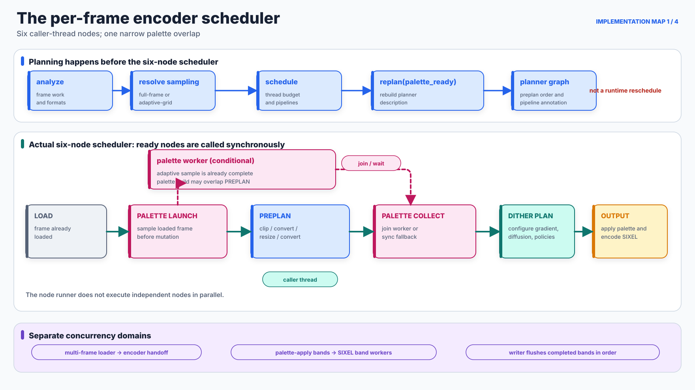

# Encoder Execution Map

## Scope

This document is the implementation-oriented companion to the introductory [Encoding Pipeline](../pipeline/README.md). It maps the normal per-frame palette path: loader selection, frame preparation, optional palette construction, lookup and dither application, and SIXEL serialization. It also marks the asynchronous boundaries that touch that path.

The diagrams are intentionally layered rather than pretending that one graph has a single meaning. The implementation contains a six-node execution scheduler, a more descriptive planner graph, filters inside those nodes, model-specific palette solvers, and a separate band pipeline inside palette application and output. Collapsing all of them into one flat DAG would imply dependencies and concurrency that do not exist.

High-color output, DRCS, macro playback, 6delta retained-screen comparison, animation timing, and palette export share parts of this route but add specialized branches. They are named where they change a boundary, not expanded into every internal step here.

## 1. The scheduler and the real asynchronous boundary

<picture>
  <source media="(max-width: 640px)" srcset="figures/encoder-scheduler-mobile.svg">
  
</picture>

*Figure 1. The per-frame macro scheduler and its adjacent concurrency domains. Solid teal arrows are caller-thread execution dependencies. Dashed magenta arrows are the conditional palette worker lifetime. Purple labels identify concurrency that is implemented elsewhere rather than by this six-node runner.*

[`sixel_encode_dag_run_nodes`](../../../src/encoder.c) scans the six macro nodes for satisfied dependency masks and calls each ready node directly. It does not submit independent nodes to a pool, so calling this structure a DAG does not mean that its ready nodes execute concurrently.

| Macro node | What it does in the current path | Execution context |
| --- | --- | --- |
| `LOAD` | Establishes the scheduler dependency root; the frame was already delivered by the loader. | Caller thread; currently a no-op. |
| `PALETTE_LAUNCH` | For adaptive sampling, finishes sampling from the loaded frame before preprocessing may mutate it. When admitted, starts the palette worker after the sample exists. Full-frame sampling waits for preprocessing. | Caller thread for sampling and launch; optional worker for the palette build. |
| `PREPLAN` | Materializes the ordered clip, colorspace, resize, working-space and optional gamut filters described by the planner graph. | Caller thread with eligible color/gamut tile overlap; may also overlap the worker-side palette build. |
| `PALETTE_COLLECT` | Joins the palette worker, executes documented synchronous fallbacks, prepares selected eager lookup structures, and configures diffusion-related state. | Caller thread; waits for the optional worker. |
| `DITHER_PLAN` | Prepares gradient/dither filter state. It does not yet run the whole per-pixel PaletteApply loop. | Caller thread. |
| `OUTPUT` | Calls the encoder output path; ordinary non-indexed input reaches PaletteApply here, then SIXEL band generation. | Caller thread plus the separate optional dither/encode band pipeline. |

The palette overlap is deliberately narrow. `adaptive-grid` sampling reads the loaded frame and completes before `PREPLAN`; only palette construction from that owned sample may run on the worker while `PREPLAN` processes the main frame. The automatic scheduler admits that worker only when palette work is eligible, the resolved sampling policy is adaptive, more than one thread exists, and the thread budget remains above one after the planner's heavy-operation accounting. An explicit adaptive policy can still sample without a worker.

### What `replan` actually means

`sixel_encoding_planner_replan()` is real, but it is not an event-driven runtime rescheduler. It clears and rebuilds the planner's descriptive graph from the analyzed frame state and a `palette_ready` flag. The normal setup calls it during scheduling and again after palette-worker readiness is resolved; verbose planner dumping rebuilds the same description for diagnostics.

The palette branch in that planner graph is omitted when no asynchronous palette job is ready and when a loader-provided indexed palette can be preserved. Synchronous palette construction can nevertheless still happen later in `PALETTE_COLLECT`. The planner graph is therefore a filter-order and pipeline description, not a complete record of every operation that will execute. Palette-worker failure also does not invoke `replan`: `PALETTE_COLLECT` performs its fallback inline.

### Palette worker fallback

The worker is an overlap optimization, so failure to start it does not automatically fail the encode. A thread-creation failure can rebuild synchronously from the already completed adaptive sample. For an automatically selected sampling policy, other palette-worker failures can reset attempt-local binning state and retry synchronously from the preprocessed full frame. An explicitly selected sampling policy does not silently cross into a different sampling policy; its failure is propagated unless the same-sample fallback applies.

The loader/encoder multi-frame handoff and the PaletteApply/encoder band pipeline are separate scheduling systems. Loader handoff becomes eligible only after multi-frame metadata is known and the main thread budget allows it. The callback updates handoff metadata without replanning the per-frame DAG. The band pipeline is entered later from the output node and is described in [Encoder Threading](../../threading/encoder.md).

## 2. Loader fallback, frame representation, and preprocessing

<picture>
  <source media="(max-width: 640px)" srcset="figures/frame-preparation-mobile.svg">
  
</picture>

*Figure 2. Loader selection and the two sampling-source boundaries. Blue is the main frame path, magenta is palette sampling, purple is a colorspace/pixelformat conversion, and red is fallback control flow.*

The loader manager constructs an ordered candidate chain. Each component has its own predicate, options, decode implementation, metadata precedence, CMS support, orientation handling, and alpha finalization. A failed candidate advances to the next component only for the explicitly recognized mismatch or decode-error statuses; allocation, argument, cancellation, and other terminal failures stop the chain. Loader CMS is consequently not one universal filter that runs after every decoder. [Image Loader Architecture](../../loader/README.md) expands the `-L` construction rule, compiled backend registry, exact fallback boundary, and backend-dependent output contract.

### The frame is not universally RGBA

The stable handoff is a semantic frame, not a particular four-channel byte layout. A frame records dimensions, byte or float pixels, `pixelformat`, `colorspace`, animation timing, optional indexed palette metadata, a possible transparent palette index, alpha-zero interpretation, and an optional per-pixel transparency mask.

Common concrete forms include:

- three-component byte or float pixels plus an optional binary transparency mask;
- indexed pixels plus a palette and transparent palette index;
- a temporary packed alpha-bearing layout when a loader or later transparency path still needs it.

The first form is common after normalization, but it is not universal. Code at this boundary must inspect the frame's `pixelformat` and transparency metadata. Labels such as “Loaded Frame (RGBA)” or “Get pixel (RGBA)” would be incorrect as general contracts.

### Preplan order and color conversions around resize

The planner builds the main preprocessing order as:

```text
loaded frame
  -> optional early clip when clipfirst is active
  -> optional colorspace/pixelformat conversion to the resize input
  -> optional resize
  -> optional late clip when clipfirst is false
  -> optional colorspace/pixelformat conversion to the effective working representation
  -> optional output-gamut mapping
```

Ordinary quality-preserving resize converts non-float input to linear RGB float32, resamples there, and converts again after resizing when the working representation differs. An explicit preserve-precision runtime mode can keep integer input in RGB888 instead. Non-RGB working spaces cannot be resampled directly and therefore pass through the selected linear RGB scale representation. Alpha-bearing key-preservation paths can suppress a post conversion that would otherwise discard the still-required alpha channel.

The gamut component remains independently runnable. Adjacent float colorspace and gamut filters may use a bounded tile pipeline under the preparation budget, retaining separate callbacks and numerical loops. Resize and clip remain ordering barriers. The [gamut reference](../output/gamut-mapping.md#pipeline-and-policy-boundaries) owns mapping placement and sampling semantics; [encoder threading](../../threading/encoder.md#float-colorspace-transactions) describes actual admission and timing boundaries.

Adaptive sampling branches from the loaded frame before this chain and owns a compact sample frame. Full-frame sampling runs after preprocessing and borrows the resulting frame. These sources intentionally differ; thread count can therefore affect the automatically resolved sample population even though the named quantizer is unchanged.

### Every colorspace boundary

| Boundary | Conversion controlled here |
| --- | --- |
| Loader-local CMS | File/profile interpretation to `cms_target`, using the selected loader's supported CMS path and metadata precedence. |
| Resize input | Loaded/current representation to the scale input, normally linear RGB float32 for quality-preserving resize. |
| Resize output | Scale representation to the effective main-image working representation selected by `-W`. |
| Palette input | Sample view to the clustering representation selected by `-X`. |
| Generated palette handoff | Completed palette from `-X` coordinates to `-W` coordinates. |
| Wire palette copy | Reusable working palette from `-W` to the output RGB coordinates selected by `-U`. |
| SIXEL color introducer | Emit type-2 RGB percentages, or convert those RGB components to DEC's rotated type-1 HLS coordinates when HLS palette output is selected. |

The last two operations are different. `-U` changes the RGB basis of a private palette copy before serialization. HLS palette output then derives hue, lightness, and saturation from that RGB copy and emits a different DECGCI representation; it is not the `-X` or `-W` clustering geometry.

## 3. Generated palette construction

<picture>
  <source media="(max-width: 640px)" srcset="figures/palette-build-mobile.svg">
  
</picture>

*Figure 3. Common palette contracts around model-specific solver bodies. A uniform card shape means that every solver returns a palette object; it does not mean that every solver performs the same initialization, iteration, or finalization.*

`sixel_encoder_prepare_palette()` resolves the effective quantizer and binning contracts, selects or clones the palette-building frame, converts that view to `-X` when required, and calls the palette component. Binning is a separate artifact boundary: `none`, `exact`, `hard`, and `soft` produce different retained populations and weights before the solver begins.

The top-level `-Q auto` value uses the existing [staged quantizer resolver](../palette-construction/quantization/README.md#auto-compatibility-selection), including binning-driven K-means selection; it is not an image-dependent competition among all models. K-means, K-center and K-medoids select arithmetic from the actual input type and return typed float failures without retrying bytes or another solver. The [quantization reference](../palette-construction/quantization/README.md#ordinary-float-iterative-solvers) owns these failure and precision contracts.

| Quantizer family | Initialization and preprocessing | Repeated or principal work | Model-specific result |
| --- | --- | --- | --- |
| Heckbert median cut | Build a finite color histogram and one initial occupied box. Profiles select range, luminance, or PCA-oriented split behavior and representative rules. | Repeatedly choose and split boxes near a weighted median until the provisional target is reached. | One representative per leaf; an optional oversplit result can enter Ward merge. |
| K-means | Construct weighted points, select legacy distance-weighted or PCA seeds, and run the requested restarts. | Assign points to nearest centroids and replace centroids with weighted means until the configured stop; pruning, feedback, and polishing alter this body. | Continuous centroids minimizing a local weighted squared-error objective. |
| K-medoids | Construct or reduce a candidate set and select sample-constrained medoids. | `pam`, CLARA `sample`, CLARANS `random`, and `bandit` execute different exhaustive, sampled, randomized, or progressive swap searches. | Representatives remain retained samples before optional Ward merge. |
| K-center | Collect/prune candidate points and seed one or more trials. | Farthest-first traversal, replacement swaps, or a hybrid of both; optional polish is accepted only under the radius guard. | A discrete center set selected primarily to control maximum nearest-center distance before optional Ward merge. |

The common telemetry fields `init`, `iterate`, `merge`, and `export` are accounting categories. They must not be read as evidence that all four families share one loop or even that every algorithm has a meaningful iterative phase.

### Final palette ordering

Optional Ward final merge and supported Lloyd passes run inside the model-specific builders. Snap timing may add hooks inside solver iterations or merge iterations; when snap is enabled, the generated palette also receives its required final snap. The byte-palette path then applies cover repair in `palette.c`, after final snap. The selected native float path also applies explicitly selected soft or hard cover there, with active snap excluded; see [cover policy](../palette-construction/cover-policy/README.md#soft-mode). This ordering means a cover replacement can introduce an entry outside the reversible snap set.

After the palette component returns, the encoder converts generated entries from clustering space `-X` to working space `-W`. If the transparency policy reserves a key, the encoder appends that key entry after the conversion and excludes it from ordinary nearest-color competition.

Monochrome, built-in, map-file, grayscale-preserving, and qualifying indexed-input paths bypass some or all sampling, binning, solver, merge, snap, and cover work. They still proceed to the working image, lookup/dither, and wire-output stages that apply to their representation. A fixed palette must not be drawn as though it passed through `-Q`.

For the mathematical objective and detailed sub-algorithms of each family, see [Palette Quantization](../palette-construction/quantization/README.md). [Palette Construction Pipeline](../palette-construction/pipeline/README.md), [Final Palette Merge Policy](../palette-construction/merge-policy/README.md), [Palette Snap Policy](../palette-construction/snap-policy/README.md), and [Palette Cover Policy](../palette-construction/cover-policy/README.md) define the surrounding policies.

## 4. Lookup, per-pixel application, and output

<picture>
  <source media="(max-width: 640px)" srcset="figures/palette-apply-output-mobile.svg">
  
</picture>

*Figure 4. The final mapping and wire stages. “Read sample” means a sample in the current working pixelformat and colorspace plus separate transparency metadata; it does not mean RGBA.*

### Lookup preparation is policy-specific

`PALETTE_COLLECT` retains eager CPU FHEDT, VP-tree and Eytzinger preparation; FHEDT can still overlap palette-worker construction with full-frame float conversion. A GPU candidate defers FHEDT and registered GPU lookup construction until admission chooses CPU or GPU. The byte CPU preparer freezes its palette and can retain an already built immutable FHEDT grid. It does not destructively transfer another prepared lookup's state. Other policies prepare through their application context. Lookup preparation therefore need not appear as a node immediately after palette generation.

This distinction matters in performance traces: “lookup preparation” is not guaranteed to be one node immediately after palette generation. Some policies pay a substantial eager build, some allocate a lazy cache and populate it on queries, and `none` performs an exhaustive palette scan for every candidate.

The indexed RGB8 path injects `lookup_preparer`, `gpu_lookup_preparer` and a selected `gpu_device` into PaletteApply. Preparers own resolved settings; creating them does not build lookup tables. PaletteApply chooses the execution capability using the GPU policy, size cutoff and dither eligibility. It never interprets a lookup enum, class name or policy-specific configuration. CPU preparation is lazy. Under GPU `auto`, only an unsupported capability (`SIXEL_FEATURE_ERROR`) permits CPU preparation before output. Allocation and runtime errors propagate; execution never retries on CPU after output starts. A failed prepare leaves the prior prepared application intact.

`gpu_lookup_plan` freezes palette order, searchable count, settings, shader source and device identity. `begin` returns an exclusive binding to policy-owned workspace; a second unfinished invocation is rejected. The runtime calls `finish` exactly once, including cancellation before submission. Successful completion certifies all builder and query commands, allowing cache reuse. A failed attempted rebuild cannot publish a valid cache. A binding retains its plan, and a plan survives release of its preparer. Independently retained plans for different palettes never overwrite one another's workspace.

The initial program ABI, `metal.lookup-rgb8.v1`, admits independent byte RGB lookup. Each provider owns its shader, builder passes and private table layout. The runtime validates and compiles the supplied program before accepting a plan, then composes `prepare_query -> lookup_rgb8 -> finish_pixel` into one pixel kernel. Builder encoder boundaries order GPU writes before queries; no full-frame query image or intermediate CPU wait is introduced. Native buffers remain opaque to providers. Compiled programs are cached by complete source and builder entry order, with dimensions validated for each plan; diagnostic names never select algorithms.

`ordered`, `vptree`, [RBC](../palette-application/lookup-policy/rbc.md#metal-rgb8-execution), [Mahalanobis](../palette-application/lookup-policy/mahalanobis.md#metal-rgb8-execution) and [certlut](../palette-application/lookup-policy/certlut.md#metal-rgb8-execution) have separate construction, query and cache implementations. Each owns its search arithmetic and tables, avoiding a shared search service with unrelated reasons to change. Only the composition registry knows concrete constructors. The explicitly named legacy adapter preserves the existing GPU implementations of the other policies; those implementations have not yet been migrated to independent program providers. The legacy adapter is not an extension point for new policies.

Concrete policy files share the `lookup-policy-<name>` stem. The following certlut paths show where to read each responsibility; the GPU source is embedded at build time and is never opened by the running library. [Metal embedding](../../build/support-scripts.md#embedded-metal-sources) owns generation and build dependencies.

| Responsibility | Source or build product |
| --- | --- |
| CPU policy | [lookup-policy-certlut.c](../../../src/lookup-policy-certlut.c) |
| GPU preparation, cache and workspace lifetime | [lookup-policy-certlut-gpu.c](../../../src/lookup-policy-certlut-gpu.c) and its private header |
| GPU construction and search arithmetic | [lookup-policy-certlut-gpu.metal](../../../src/lookup-policy-certlut-gpu.metal) |
| Embedded literal fragments | Build-tree `src/generated-metal/lookup-policy-certlut-gpu-shader.inc.h` |

Legacy shader extraction follows the same policy-first naming without changing component ownership. Its build-only includes remain in the legacy runtime: [FHEDT](../../../src/lookup-policy-fhedt-gpu.inc.h) and the [5bit/6bit table](../../../src/lookup-policy-bitlut-gpu.inc.h) are host fragments, while their `.metal` files contain GPU code. Palette query preparation, retained-pixel handling and fused application stay in `gpu-palette-*.metal`; they do not become shared lookup algorithms.

### The per-pixel loop belongs to the dither policy

`sixel_dither_apply_palette()` resolves precision, transparency fences, GPU eligibility, scan order, the dither policy, and the lookup policy. The selected `IDitherPolicy.apply()` implementation then owns the serial or per-band pixel loop. Its conceptual contract is:

```text
for each sample in the policy's scan order:
    if transparency metadata marks the sample:
        emit the reserved key index and skip ordinary lookup
    candidate = policy_adjust(sample, position, carried_state)
    index = lookup_policy.map_pixel(candidate)
    apply an optional 6delta keep decision
    emit index
    residual = candidate - palette[index]
    update diffusion or ordered-policy state
```

The exact order has specialized fences for 6delta, inter-frame modes, accumulation capture, and GPU execution, but the lookup remains the operation that selects a palette index. The selected [native delta path](../output/delta-encoding.md#native-float-comparison-and-retained-precision) compares retained display RGB with the selected emitted RGB101 color while leaving working float centroids unchanged. `-d none` still calls lookup per pixel; `--lookup-policy=none` still runs PaletteApply and any selected dither policy.

When eligible, the CPU pipeline divides PaletteApply into overlapped row bands and notifies SIXEL band workers as output rows become ready. Lookup state can be shared or worker-local according to policy. A writer thread flushes encoded band buffers in image order. Eligible GPU PaletteApply runs use the same row publication boundary: the GPU computes later ranges while CPU workers encode completed prefixes. The generic GPU consumer owns range dispatch and validation; the injected lookup component still owns its shader, construction and workspace lease. IndexedFrame owns publication, and encoder_core sees only ready rows. Legacy adapters retain whole-image publication. [Typed row publication and drain](../../threading/encoder.md#typed-row-publication-and-drain) defines grouping, the bounded submission window and failure cleanup; retained history still commits only after complete stream acceptance.

### Prepared dither configuration

`dither_policy.prepare()` takes resolved values and copies them into the policy: scan order, working pixel format, palette count and reserved-slot interpretation, clamp/deadzone/perturbation settings, and positional-dither strength, phase, channel and table size. `get_configuration()` returns those prepared values. Changing or releasing the prepare request does not change later applications. Reconfiguration requires another successful prepare before any application workers start.

`dither_policy.apply()` takes borrowed execution views: source and result rows, prepared lookup, working palette, transparency, retained RGB and validity, delta selection, optional gradient analysis, and row notifications. These views live through the completion of all consuming workers. The policy owns no source, output, retained plane or per-frame diffusion buffer between calls. Scan order and pixel format come from prepare; apply cannot override them.

Delta comparison is invocation state: the encoder passes `palette_apply_delta.compare` to PaletteApply, which binds it into `dither_execution.delta_compare` for CPU workers and the equivalent GPU request. Zero selects the compatible target basis. The positional policy owns query construction; the retained plane continues to own only emitted RGB and validity. Changing this setting requires no lookup rebuild, source image copy or additional per-pixel buffer. The [delta comparison tests](../output/delta-encoding.md#test-coverage) cover both gates and their CPU/GPU propagation.

The legacy `sixel_dither_t` adapter resolves option precedence at preparation and translates frame hints into these execution views. It is not part of the subordinate component interface. Existing CPU kernels use an invocation-local compatibility context populated only from the prepared values and borrowed views; it is not a second mutable settings owner. PaletteApply obtains the same prepared configuration for its GPU dispatch and rejects a mismatched source format or scan plan before output.

### Indexed encode components

The ordinary byte RGB path executes a typed subgraph in [`encoder-core-session.inc.h`](../../../src/encoder-core-session.inc.h). `PaletteApply` owns policy dispatch and publishes `IndexedFrame` rows. `WirePalette` owns the exact serialized definitions and their decoded display RGB. `encoder_core` consumes published indexes and final skip coverage and emits ordered body bytes; it has no dither, source-frame, writer or retained-plane dependency. `SixelWriter` owns framing and callback acceptance and returns a `StreamReceipt`. `RetainedPlane` accepts that receipt and commits painted indexes directly into its RGB/validity storage.

The adapter injects CPU and GPU lookup preparers as described above; resolved lookup settings belong to those preparers. Successful GPU planning builds no CPU lookup table. CPU instance-sharing constraints apply when CPU preparation is selected: a parallel plan that would share worker-local mutable lookup is declined before output and uses the legacy adapter. These constraints do not reject an independent GPU table. Metal [5bit](../palette-application/lookup-policy/5bit.md#metal-application) and [6bit](../palette-application/lookup-policy/6bit.md#metal-application) use shared center tables; CPU packing and instance-sharing controls are not GPU preparation inputs. Runtime failure seals the indexed result FAILED and never retries the frame on CPU, even if no rows have been published.

The physical `indexed-sixel-stream` filter drives its `palette-apply` producer while ready CPU bands flow to body workers. Its typed output is a receipt; the following `retained-commit` filter consumes that receipt and the indexed image after releasing the baseline read lease. This synchronous subgraph does not change the six-node macro scheduler. Filter edges identify working frames, indexed frames, retained reads and receipts separately. Timeline events describe actual apply, body and commit work rather than a fictitious RGB conversion filter.

A native commit scans final skip coverage once, expands only painted indexes at their destination, and computes paint count, approximate-keep status and optional presentation marks in that loop. RetainedPlane owns its private [row kernels](../../../src/retained-plane-rows.c) and [row executor](../../../src/retained-plane-workers.c); no lookup or encoder component depends on those implementation helpers. Its [prepared execution budget](../../threading/encoder.md#typed-row-publication-and-drain) permits bounded parallel commit without allocating after stream acceptance. It creates no full-frame emitted-RGB intermediate. This does not remove GPU baseline uploads, index validation or the body encoder's coverage scans.

Admission occurs before output. Highcolor, OR mode, non-gamma interpretation, authoritative float palettes, source-mask adapters, parallel CPU plans with worker-local lookup policies and gradient-modulated application use the explicit legacy adapter until their representation and lifetime contracts are migrated. The legacy low-level API can also supply retained pointers without a RetainedPlane owner; those requests retain their existing path. Unsupported plans never retry after external output has started, and no mode is changed to qualify for native execution.

### Palette serialization and RGB/HLS output

The legacy adapter copies byte and, when available, float palette entries so the reusable dither palette remains in `-W`. It converts the private copy from the core's source colorspace to `-U`, preferring the float copy to avoid an unnecessary byte-rounding cycle. Indexed rows and the converted palette then enter SIXEL serialization.

RGB palette output emits DECGCI type 2 with integer component percentages. HLS palette output reads the RGB components, calculates lightness and saturation, rotates hue by 120 degrees to DEC's blue-zero convention, and emits DECGCI type 1. For the indexed subgraph, the adapter constructs immutable WirePalette definitions before output; encoder_core serializes those same fields, and RetainedPlane uses the RGB derived from them. No HLS definition is reconstructed from rounded retained RGB. Body serialization emits palette selections, six-pixel-high raster bands, runs and carriage movement; SixelWriter adds the configured DCS envelope.

## Implementation landmarks

| Concern | Primary symbols and files |
| --- | --- |
| Six-node scheduler and palette fallback | `sixel_encode_dag_run_nodes`, `sixel_encode_dag_node_palette_launch`, `sixel_encode_dag_node_palette_collect`, and `sixel_encoder_encode_frame_internal` in [`encoder.c`](../../../src/encoder.c) |
| Planner graph, replan, and thread admission | `sixel_encoding_planner_build_dag`, `sixel_encoding_planner_schedule`, `sixel_encoding_planner_replan`, and `sixel_encoding_planner_update_loader_handoff` in [`planner.c`](../../../src/planner.c) |
| Loader candidate chain | `sixel_loader_manager_load` in [`loader-manager.c`](../../../src/loader-manager.c) and `sixel_helper_load_image_file` in [`loader.c`](../../../src/loader.c) |
| Frame representation | `sixel_frame` in [`frame-private.h`](../../../src/frame-private.h), with the semantic contract in [Pixel Formats and Alpha Representation](../../concepts/pixelformat.md) |
| Preplan filters and color conversion | `sixel_encode_dag_node_preplan`, `sixel_encoder_convert_frame_colorspace`, and `sixel_encoder_convert_palette_colorspace` in [`encoder.c`](../../../src/encoder.c) |
| Palette dispatch | `sixel_encoder_prepare_palette` in [`encoder.c`](../../../src/encoder.c) and `sixel_palette_vtbl_generate` in [`palette.c`](../../../src/palette.c) |
| Quantizer implementations | [`palette-heckbert.c`](../../../src/palette-heckbert.c), [`palette-kmeans.c`](../../../src/palette-kmeans.c), [`palette-kmedoids.c`](../../../src/palette-kmedoids.c), and [`palette-kcenter.c`](../../../src/palette-kcenter.c) |
| Lookup preparation and PaletteApply | `sixel_encoder_apply_lut_filter` in [`encoder.c`](../../../src/encoder.c), plus `sixel_dither_apply_palette` and `sixel_dither_resolve_indexes` in [`dither.c`](../../../src/dither.c) |
| Per-policy pixel loops | [`dither-policy-none.c`](../../../src/dither-policy-none.c), [`dither-policy-fs.c`](../../../src/dither-policy-fs.c), and the other `dither-policy-*.c` implementations |
| Wire palette conversion and RGB/HLS | `sixel_encode_dither`, `output_rgb_palette_definition`, and `output_hls_palette_definition` in [`encoder-core-encode.c`](../../../src/encoder-core-encode.c) |

## Reproducing the figures

The figures are deterministic explanatory assets generated from reviewed topology, not timing measurements extracted from a run:

```sh
tools/reproduce_encoder_execution_map_figures.sh
tools/reproduce_encoder_execution_map_figures.sh --check
```

The semantic roles and implementation anchors used by the generator are recorded in [`encoder-execution-map-figures.json`](figures/encoder-execution-map-figures.json). When any referenced execution boundary changes, update the prose, both aspect-ratio variants, and the manifest together.

## Test coverage

<!-- test-coverage: enforced -->

### Behavioral contract tests

These tests cover prepared configuration ownership at the dither-policy boundary. They do not establish terminal presentation timing or end-to-end playback throughput.

| ID | Contract | Owning test |
| --- | --- | --- |
| DP-01 | Stored configuration survives request reuse: none byte prepared options | [tests/dither/dispatch/0022_none_byte_prepared_options.t](../../../tests/dither/dispatch/0022_none_byte_prepared_options.t) |
| DP-02 | Stored configuration survives request reuse: none float prepared options | [tests/dither/dispatch/0023_none_float_prepared_options.t](../../../tests/dither/dispatch/0023_none_float_prepared_options.t) |
| DP-03 | Stored configuration survives request reuse: fs byte prepared options | [tests/dither/dispatch/0024_fs_byte_prepared_options.t](../../../tests/dither/dispatch/0024_fs_byte_prepared_options.t) |
| DP-04 | Stored configuration survives request reuse: fs float prepared options | [tests/dither/dispatch/0025_fs_float_prepared_options.t](../../../tests/dither/dispatch/0025_fs_float_prepared_options.t) |
| DP-05 | Stored configuration survives request reuse: atkinson byte prepared options | [tests/dither/dispatch/0026_atkinson_byte_prepared_options.t](../../../tests/dither/dispatch/0026_atkinson_byte_prepared_options.t) |
| DP-06 | Stored configuration survives request reuse: atkinson float prepared options | [tests/dither/dispatch/0027_atkinson_float_prepared_options.t](../../../tests/dither/dispatch/0027_atkinson_float_prepared_options.t) |
| DP-07 | Stored configuration survives request reuse: jajuni byte prepared options | [tests/dither/dispatch/0028_jajuni_byte_prepared_options.t](../../../tests/dither/dispatch/0028_jajuni_byte_prepared_options.t) |
| DP-08 | Stored configuration survives request reuse: jajuni float prepared options | [tests/dither/dispatch/0029_jajuni_float_prepared_options.t](../../../tests/dither/dispatch/0029_jajuni_float_prepared_options.t) |
| DP-09 | Stored configuration survives request reuse: stucki byte prepared options | [tests/dither/dispatch/0030_stucki_byte_prepared_options.t](../../../tests/dither/dispatch/0030_stucki_byte_prepared_options.t) |
| DP-10 | Stored configuration survives request reuse: stucki float prepared options | [tests/dither/dispatch/0031_stucki_float_prepared_options.t](../../../tests/dither/dispatch/0031_stucki_float_prepared_options.t) |
| DP-11 | Stored configuration survives request reuse: burkes byte prepared options | [tests/dither/dispatch/0032_burkes_byte_prepared_options.t](../../../tests/dither/dispatch/0032_burkes_byte_prepared_options.t) |
| DP-12 | Stored configuration survives request reuse: burkes float prepared options | [tests/dither/dispatch/0033_burkes_float_prepared_options.t](../../../tests/dither/dispatch/0033_burkes_float_prepared_options.t) |
| DP-13 | Stored configuration survives request reuse: sierra1 byte prepared options | [tests/dither/dispatch/0034_sierra1_byte_prepared_options.t](../../../tests/dither/dispatch/0034_sierra1_byte_prepared_options.t) |
| DP-14 | Stored configuration survives request reuse: sierra1 float prepared options | [tests/dither/dispatch/0035_sierra1_float_prepared_options.t](../../../tests/dither/dispatch/0035_sierra1_float_prepared_options.t) |
| DP-15 | Stored configuration survives request reuse: sierra2 byte prepared options | [tests/dither/dispatch/0036_sierra2_byte_prepared_options.t](../../../tests/dither/dispatch/0036_sierra2_byte_prepared_options.t) |
| DP-16 | Stored configuration survives request reuse: sierra2 float prepared options | [tests/dither/dispatch/0037_sierra2_float_prepared_options.t](../../../tests/dither/dispatch/0037_sierra2_float_prepared_options.t) |
| DP-17 | Stored configuration survives request reuse: sierra3 byte prepared options | [tests/dither/dispatch/0038_sierra3_byte_prepared_options.t](../../../tests/dither/dispatch/0038_sierra3_byte_prepared_options.t) |
| DP-18 | Stored configuration survives request reuse: sierra3 float prepared options | [tests/dither/dispatch/0039_sierra3_float_prepared_options.t](../../../tests/dither/dispatch/0039_sierra3_float_prepared_options.t) |
| DP-19 | Stored configuration survives request reuse: lso2 byte prepared options | [tests/dither/dispatch/0040_lso2_byte_prepared_options.t](../../../tests/dither/dispatch/0040_lso2_byte_prepared_options.t) |
| DP-20 | Stored configuration survives request reuse: lso2 float prepared options | [tests/dither/dispatch/0041_lso2_float_prepared_options.t](../../../tests/dither/dispatch/0041_lso2_float_prepared_options.t) |
| DP-21 | Stored configuration survives request reuse: a dither byte prepared options | [tests/dither/dispatch/0042_a_dither_byte_prepared_options.t](../../../tests/dither/dispatch/0042_a_dither_byte_prepared_options.t) |
| DP-22 | Stored configuration survives request reuse: a dither float prepared options | [tests/dither/dispatch/0043_a_dither_float_prepared_options.t](../../../tests/dither/dispatch/0043_a_dither_float_prepared_options.t) |
| DP-23 | Stored configuration survives request reuse: x dither byte prepared options | [tests/dither/dispatch/0044_x_dither_byte_prepared_options.t](../../../tests/dither/dispatch/0044_x_dither_byte_prepared_options.t) |
| DP-24 | Stored configuration survives request reuse: x dither float prepared options | [tests/dither/dispatch/0045_x_dither_float_prepared_options.t](../../../tests/dither/dispatch/0045_x_dither_float_prepared_options.t) |
| DP-25 | Stored configuration survives request reuse: bluenoise byte prepared options | [tests/dither/dispatch/0046_bluenoise_byte_prepared_options.t](../../../tests/dither/dispatch/0046_bluenoise_byte_prepared_options.t) |
| DP-26 | Stored configuration survives request reuse: bluenoise float prepared options | [tests/dither/dispatch/0047_bluenoise_float_prepared_options.t](../../../tests/dither/dispatch/0047_bluenoise_float_prepared_options.t) |
| DP-27 | Prepared strength controls the actual lookup candidate: a dither prepared apply | [tests/dither/dispatch/0048_a_dither_prepared_apply.t](../../../tests/dither/dispatch/0048_a_dither_prepared_apply.t) |
| DP-28 | Prepared strength controls the actual lookup candidate: x dither prepared apply | [tests/dither/dispatch/0049_x_dither_prepared_apply.t](../../../tests/dither/dispatch/0049_x_dither_prepared_apply.t) |
| DP-29 | Prepared strength controls the actual lookup candidate: bluenoise prepared apply | [tests/dither/dispatch/0050_bluenoise_prepared_apply.t](../../../tests/dither/dispatch/0050_bluenoise_prepared_apply.t) |

### Indexed subgraph equivalence

| ID | Contract | Owning test |
| --- | --- | --- |
| IE-01 | none CPU RGB preserves legacy stream bytes. | [tests/encoder/indexed/0026_none_cpu_rgb_bytes.t](../../../tests/encoder/indexed/0026_none_cpu_rgb_bytes.t) |
| IE-02 | none CPU RGB preserves legacy retained pixels and validity. | [tests/encoder/indexed/0027_none_cpu_rgb_history.t](../../../tests/encoder/indexed/0027_none_cpu_rgb_history.t) |
| IE-03 | bluenoise CPU RGB preserves legacy stream bytes. | [tests/encoder/indexed/0028_bluenoise_cpu_rgb_bytes.t](../../../tests/encoder/indexed/0028_bluenoise_cpu_rgb_bytes.t) |
| IE-04 | bluenoise CPU RGB preserves legacy retained pixels and validity. | [tests/encoder/indexed/0029_bluenoise_cpu_rgb_history.t](../../../tests/encoder/indexed/0029_bluenoise_cpu_rgb_history.t) |
| IE-05 | fs CPU RGB preserves legacy stream bytes. | [tests/encoder/indexed/0030_fs_cpu_rgb_bytes.t](../../../tests/encoder/indexed/0030_fs_cpu_rgb_bytes.t) |
| IE-06 | fs CPU RGB preserves legacy retained pixels and validity. | [tests/encoder/indexed/0031_fs_cpu_rgb_history.t](../../../tests/encoder/indexed/0031_fs_cpu_rgb_history.t) |
| IE-07 | none CPU HLS preserves legacy stream bytes. | [tests/encoder/indexed/0032_none_cpu_hls_bytes.t](../../../tests/encoder/indexed/0032_none_cpu_hls_bytes.t) |
| IE-08 | none CPU HLS preserves legacy retained pixels and validity. | [tests/encoder/indexed/0033_none_cpu_hls_history.t](../../../tests/encoder/indexed/0033_none_cpu_hls_history.t) |
| IE-09 | none GPU RGB preserves legacy stream bytes. | [tests/encoder/indexed/0034_none_gpu_rgb_bytes.t](../../../tests/encoder/indexed/0034_none_gpu_rgb_bytes.t) |
| IE-10 | none GPU RGB preserves legacy retained pixels and validity. | [tests/encoder/indexed/0035_none_gpu_rgb_history.t](../../../tests/encoder/indexed/0035_none_gpu_rgb_history.t) |
| IE-11 | bluenoise GPU RGB preserves legacy stream bytes. | [tests/encoder/indexed/0036_bluenoise_gpu_rgb_bytes.t](../../../tests/encoder/indexed/0036_bluenoise_gpu_rgb_bytes.t) |
| IE-12 | bluenoise GPU RGB preserves legacy retained pixels and validity. | [tests/encoder/indexed/0037_bluenoise_gpu_rgb_history.t](../../../tests/encoder/indexed/0037_bluenoise_gpu_rgb_history.t) |
| IB-01 | Wire RGB percentages determine retained bytes. | [tests/encoder/indexed/0038_wire_rgb_rounding.t](../../../tests/encoder/indexed/0038_wire_rgb_rounding.t) |
| IB-02 | DEC blue-zero HLS determines retained bytes. | [tests/encoder/indexed/0039_wire_hls_rounding.t](../../../tests/encoder/indexed/0039_wire_hls_rounding.t) |
| IB-03 | Failed import leaves both source allocations with the caller. | [tests/encoder/indexed/0040_indexed_take_failure.t](../../../tests/encoder/indexed/0040_indexed_take_failure.t) |
| IB-04 | The body encoder refuses rows the producer has not published. | [tests/encoder/indexed/0041_core_unpublished_rows.t](../../../tests/encoder/indexed/0041_core_unpublished_rows.t) |
| IB-05 | The body encoder refuses an incomplete producer at finish. | [tests/encoder/indexed/0042_core_early_finish.t](../../../tests/encoder/indexed/0042_core_early_finish.t) |
| IB-06 | The normal factory publishes the indexed body interface. | [tests/encoder/indexed/0043_core_normal_factory.t](../../../tests/encoder/indexed/0043_core_normal_factory.t) |
| IB-07 | The ormode factory publishes the indexed body interface. | [tests/encoder/indexed/0044_core_ormode_factory.t](../../../tests/encoder/indexed/0044_core_ormode_factory.t) |

| ID | Contract | Owning test |
| --- | --- | --- |
| IXGPU-01 | GPU `force` omits CPU lookup; the complete output agrees with CPU encoding. | [tests/encoder/indexed/0045_gpu_force_omits_cpu_lookup.t](../../../tests/encoder/indexed/0045_gpu_force_omits_cpu_lookup.t) |
| IXGPU-02 | GPU `auto` omits CPU lookup; the complete output agrees with CPU encoding. | [tests/encoder/indexed/0046_gpu_auto_omits_cpu_lookup.t](../../../tests/encoder/indexed/0046_gpu_auto_omits_cpu_lookup.t) |
| IXGPU-03 | Frames below the GPU threshold prepare CPU lookup and match CPU encoding. | [tests/encoder/indexed/0047_gpu_threshold_prepares_cpu_lookup.t](../../../tests/encoder/indexed/0047_gpu_threshold_prepares_cpu_lookup.t) |
| IXGPU-04 | GPU `off` prepares CPU lookup and matches CPU encoding. | [tests/encoder/indexed/0048_gpu_off_prepares_cpu_lookup.t](../../../tests/encoder/indexed/0048_gpu_off_prepares_cpu_lookup.t) |
| IXGPU-05 | GPU-ineligible dithering prepares CPU lookup and matches CPU encoding. | [tests/encoder/indexed/0049_gpu_unsupported_prepares_cpu_lookup.t](../../../tests/encoder/indexed/0049_gpu_unsupported_prepares_cpu_lookup.t) |
| IXGPU-06 | FHEDT force no cpu grid; complete stream equals CPU. | [tests/lookup/fhedt/0134_gpu_force_no_cpu_grid.t](../../../tests/lookup/fhedt/0134_gpu_force_no_cpu_grid.t) |
| IXGPU-07 | FHEDT auto no cpu grid; complete stream equals CPU. | [tests/lookup/fhedt/0135_gpu_auto_no_cpu_grid.t](../../../tests/lookup/fhedt/0135_gpu_auto_no_cpu_grid.t) |
| IXGPU-08 | FHEDT threshold cpu grid; complete stream equals CPU. | [tests/lookup/fhedt/0136_gpu_threshold_cpu_grid.t](../../../tests/lookup/fhedt/0136_gpu_threshold_cpu_grid.t) |
| IXGPU-09 | FHEDT off cpu grid; complete stream equals CPU. | [tests/lookup/fhedt/0137_gpu_off_cpu_grid.t](../../../tests/lookup/fhedt/0137_gpu_off_cpu_grid.t) |
| IXGPU-10 | FHEDT diffusion cpu grid; complete stream equals CPU. | [tests/lookup/fhedt/0138_gpu_diffusion_cpu_grid.t](../../../tests/lookup/fhedt/0138_gpu_diffusion_cpu_grid.t) |
| IXGPU-11 | FHEDT cache cpu grid; complete stream equals CPU. | [tests/lookup/fhedt/0139_gpu_cache_cpu_grid.t](../../../tests/lookup/fhedt/0139_gpu_cache_cpu_grid.t) |

### Injected lookup ownership tests

Lifetime and admission cases use opaque test-device allocations and run without GPU hardware. Injected-program and complete-encoder cases require Metal. Each case fixes one provider and one observation; policy-specific tests cover shader indexes and delta behavior.

| ID | Contract | Owning test |
| --- | --- | --- |
| GPUL-01 | vptree palette snapshot. | [tests/encoder/indexed/0050_vptree_palette_snapshot.t](../../../tests/encoder/indexed/0050_vptree_palette_snapshot.t), [tests/encoder/indexed/0050_vptree_palette_snapshot.c](../../../tests/encoder/indexed/0050_vptree_palette_snapshot.c) |
| GPUL-02 | vptree cache reuse. | [tests/encoder/indexed/0051_vptree_cache_reuse.t](../../../tests/encoder/indexed/0051_vptree_cache_reuse.t), [tests/encoder/indexed/0051_vptree_cache_reuse.c](../../../tests/encoder/indexed/0051_vptree_cache_reuse.c) |
| GPUL-03 | vptree device identity. | [tests/encoder/indexed/0052_vptree_device_identity.t](../../../tests/encoder/indexed/0052_vptree_device_identity.t), [tests/encoder/indexed/0052_vptree_device_identity.c](../../../tests/encoder/indexed/0052_vptree_device_identity.c) |
| GPUL-04 | vptree live plan isolation. | [tests/encoder/indexed/0053_vptree_live_plan_isolation.t](../../../tests/encoder/indexed/0053_vptree_live_plan_isolation.t), [tests/encoder/indexed/0053_vptree_live_plan_isolation.c](../../../tests/encoder/indexed/0053_vptree_live_plan_isolation.c) |
| GPUL-05 | vptree busy lease. | [tests/encoder/indexed/0054_vptree_busy_lease.t](../../../tests/encoder/indexed/0054_vptree_busy_lease.t), [tests/encoder/indexed/0054_vptree_busy_lease.c](../../../tests/encoder/indexed/0054_vptree_busy_lease.c) |
| GPUL-06 | vptree completed reuse. | [tests/encoder/indexed/0055_vptree_completed_reuse.t](../../../tests/encoder/indexed/0055_vptree_completed_reuse.t), [tests/encoder/indexed/0055_vptree_completed_reuse.c](../../../tests/encoder/indexed/0055_vptree_completed_reuse.c) |
| GPUL-07 | vptree aborted rebuild. | [tests/encoder/indexed/0056_vptree_aborted_rebuild.t](../../../tests/encoder/indexed/0056_vptree_aborted_rebuild.t), [tests/encoder/indexed/0056_vptree_aborted_rebuild.c](../../../tests/encoder/indexed/0056_vptree_aborted_rebuild.c) |
| GPUL-08 | vptree double finish. | [tests/encoder/indexed/0057_vptree_double_finish.t](../../../tests/encoder/indexed/0057_vptree_double_finish.t), [tests/encoder/indexed/0057_vptree_double_finish.c](../../../tests/encoder/indexed/0057_vptree_double_finish.c) |
| GPUL-09 | vptree finished view. | [tests/encoder/indexed/0058_vptree_finished_view.t](../../../tests/encoder/indexed/0058_vptree_finished_view.t), [tests/encoder/indexed/0058_vptree_finished_view.c](../../../tests/encoder/indexed/0058_vptree_finished_view.c) |
| GPUL-10 | vptree provider lifetime. | [tests/encoder/indexed/0059_vptree_provider_lifetime.t](../../../tests/encoder/indexed/0059_vptree_provider_lifetime.t), [tests/encoder/indexed/0059_vptree_provider_lifetime.c](../../../tests/encoder/indexed/0059_vptree_provider_lifetime.c) |
| GPUL-11 | vptree binding lifetime. | [tests/encoder/indexed/0060_vptree_binding_lifetime.t](../../../tests/encoder/indexed/0060_vptree_binding_lifetime.t), [tests/encoder/indexed/0060_vptree_binding_lifetime.c](../../../tests/encoder/indexed/0060_vptree_binding_lifetime.c) |
| GPUL-12 | vptree float decline. | [tests/encoder/indexed/0061_vptree_float_decline.t](../../../tests/encoder/indexed/0061_vptree_float_decline.t), [tests/encoder/indexed/0061_vptree_float_decline.c](../../../tests/encoder/indexed/0061_vptree_float_decline.c) |
| GPUL-13 | ordered palette snapshot. | [tests/encoder/indexed/0062_ordered_palette_snapshot.t](../../../tests/encoder/indexed/0062_ordered_palette_snapshot.t), [tests/encoder/indexed/0062_ordered_palette_snapshot.c](../../../tests/encoder/indexed/0062_ordered_palette_snapshot.c) |
| GPUL-14 | ordered cache reuse. | [tests/encoder/indexed/0063_ordered_cache_reuse.t](../../../tests/encoder/indexed/0063_ordered_cache_reuse.t), [tests/encoder/indexed/0063_ordered_cache_reuse.c](../../../tests/encoder/indexed/0063_ordered_cache_reuse.c) |
| GPUL-15 | ordered device identity. | [tests/encoder/indexed/0064_ordered_device_identity.t](../../../tests/encoder/indexed/0064_ordered_device_identity.t), [tests/encoder/indexed/0064_ordered_device_identity.c](../../../tests/encoder/indexed/0064_ordered_device_identity.c) |
| GPUL-16 | ordered live plan isolation. | [tests/encoder/indexed/0065_ordered_live_plan_isolation.t](../../../tests/encoder/indexed/0065_ordered_live_plan_isolation.t), [tests/encoder/indexed/0065_ordered_live_plan_isolation.c](../../../tests/encoder/indexed/0065_ordered_live_plan_isolation.c) |
| GPUL-17 | ordered busy lease. | [tests/encoder/indexed/0066_ordered_busy_lease.t](../../../tests/encoder/indexed/0066_ordered_busy_lease.t), [tests/encoder/indexed/0066_ordered_busy_lease.c](../../../tests/encoder/indexed/0066_ordered_busy_lease.c) |
| GPUL-18 | ordered completed reuse. | [tests/encoder/indexed/0067_ordered_completed_reuse.t](../../../tests/encoder/indexed/0067_ordered_completed_reuse.t), [tests/encoder/indexed/0067_ordered_completed_reuse.c](../../../tests/encoder/indexed/0067_ordered_completed_reuse.c) |
| GPUL-19 | ordered aborted rebuild. | [tests/encoder/indexed/0068_ordered_aborted_rebuild.t](../../../tests/encoder/indexed/0068_ordered_aborted_rebuild.t), [tests/encoder/indexed/0068_ordered_aborted_rebuild.c](../../../tests/encoder/indexed/0068_ordered_aborted_rebuild.c) |
| GPUL-20 | ordered double finish. | [tests/encoder/indexed/0069_ordered_double_finish.t](../../../tests/encoder/indexed/0069_ordered_double_finish.t), [tests/encoder/indexed/0069_ordered_double_finish.c](../../../tests/encoder/indexed/0069_ordered_double_finish.c) |
| GPUL-21 | ordered finished view. | [tests/encoder/indexed/0070_ordered_finished_view.t](../../../tests/encoder/indexed/0070_ordered_finished_view.t), [tests/encoder/indexed/0070_ordered_finished_view.c](../../../tests/encoder/indexed/0070_ordered_finished_view.c) |
| GPUL-22 | ordered provider lifetime. | [tests/encoder/indexed/0071_ordered_provider_lifetime.t](../../../tests/encoder/indexed/0071_ordered_provider_lifetime.t), [tests/encoder/indexed/0071_ordered_provider_lifetime.c](../../../tests/encoder/indexed/0071_ordered_provider_lifetime.c) |
| GPUL-23 | ordered binding lifetime. | [tests/encoder/indexed/0072_ordered_binding_lifetime.t](../../../tests/encoder/indexed/0072_ordered_binding_lifetime.t), [tests/encoder/indexed/0072_ordered_binding_lifetime.c](../../../tests/encoder/indexed/0072_ordered_binding_lifetime.c) |
| GPUL-24 | ordered float decline. | [tests/encoder/indexed/0073_ordered_float_decline.t](../../../tests/encoder/indexed/0073_ordered_float_decline.t), [tests/encoder/indexed/0073_ordered_float_decline.c](../../../tests/encoder/indexed/0073_ordered_float_decline.c) |
| GPUL-25 | auto unsupported fallback. | [tests/encoder/indexed/0074_auto_unsupported_fallback.t](../../../tests/encoder/indexed/0074_auto_unsupported_fallback.t), [tests/encoder/indexed/0074_auto_unsupported_fallback.c](../../../tests/encoder/indexed/0074_auto_unsupported_fallback.c) |
| GPUL-26 | force unsupported no fallback. | [tests/encoder/indexed/0075_force_unsupported_no_fallback.t](../../../tests/encoder/indexed/0075_force_unsupported_no_fallback.t), [tests/encoder/indexed/0075_force_unsupported_no_fallback.c](../../../tests/encoder/indexed/0075_force_unsupported_no_fallback.c) |
| GPUL-27 | runtime no fallback. | [tests/encoder/indexed/0076_runtime_no_fallback.t](../../../tests/encoder/indexed/0076_runtime_no_fallback.t), [tests/encoder/indexed/0076_runtime_no_fallback.c](../../../tests/encoder/indexed/0076_runtime_no_fallback.c) |
| GPUL-28 | allocation no fallback. | [tests/encoder/indexed/0077_allocation_no_fallback.t](../../../tests/encoder/indexed/0077_allocation_no_fallback.t), [tests/encoder/indexed/0077_allocation_no_fallback.c](../../../tests/encoder/indexed/0077_allocation_no_fallback.c) |
| GPUL-29 | off cpu only. | [tests/encoder/indexed/0078_off_cpu_only.t](../../../tests/encoder/indexed/0078_off_cpu_only.t), [tests/encoder/indexed/0078_off_cpu_only.c](../../../tests/encoder/indexed/0078_off_cpu_only.c) |
| GPUL-30 | cutoff cpu only. | [tests/encoder/indexed/0079_cutoff_cpu_only.t](../../../tests/encoder/indexed/0079_cutoff_cpu_only.t), [tests/encoder/indexed/0079_cutoff_cpu_only.c](../../../tests/encoder/indexed/0079_cutoff_cpu_only.c) |
| GPUL-31 | A program absent from production registration builds and selects exact indexes through the unchanged fused consumer. | [tests/encoder/indexed/0080_injected_gpu_program.t](../../../tests/encoder/indexed/0080_injected_gpu_program.t), [tests/encoder/indexed/0080_injected_gpu_program.c](../../../tests/encoder/indexed/0080_injected_gpu_program.c) |
| GPUL-32 | An invalid provider index fails execution before output is published. | [tests/encoder/indexed/0081_invalid_gpu_index.t](../../../tests/encoder/indexed/0081_invalid_gpu_index.t), [tests/encoder/indexed/0081_invalid_gpu_index.c](../../../tests/encoder/indexed/0081_invalid_gpu_index.c) |
| GPUL-33 | Forced VP-tree GPU execution avoids CPU lookup construction and preserves the complete stream. | [tests/encoder/indexed/0082_vptree_force_no_cpu.t](../../../tests/encoder/indexed/0082_vptree_force_no_cpu.t), [tests/encoder/indexed/0082_vptree_force_no_cpu.c](../../../tests/encoder/indexed/0082_vptree_force_no_cpu.c) |
| GPUL-34 | Admitted automatic VP-tree GPU execution avoids CPU lookup construction and preserves the complete stream. | [tests/encoder/indexed/0083_vptree_auto_no_cpu.t](../../../tests/encoder/indexed/0083_vptree_auto_no_cpu.t), [tests/encoder/indexed/0083_vptree_auto_no_cpu.c](../../../tests/encoder/indexed/0083_vptree_auto_no_cpu.c) |
| GPUL-35 | A prepared CPU lookup retains its palette bytes independently of later caller mutation. | [tests/encoder/indexed/0084_cpu_palette_snapshot.t](../../../tests/encoder/indexed/0084_cpu_palette_snapshot.t), [tests/encoder/indexed/0084_cpu_palette_snapshot.c](../../../tests/encoder/indexed/0084_cpu_palette_snapshot.c) |
