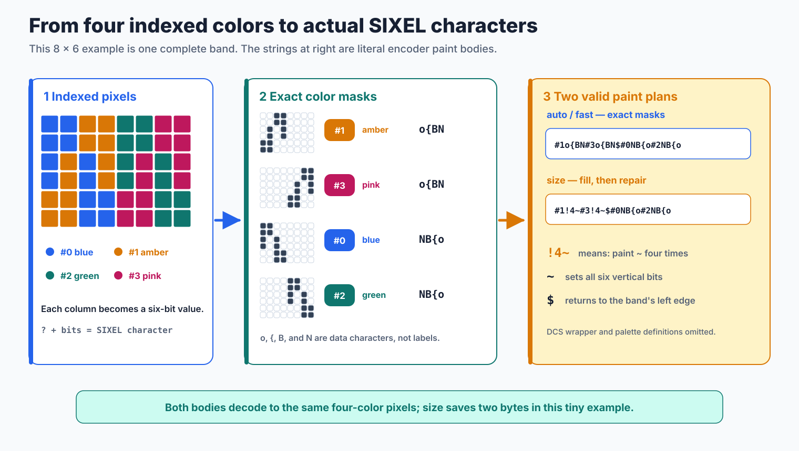
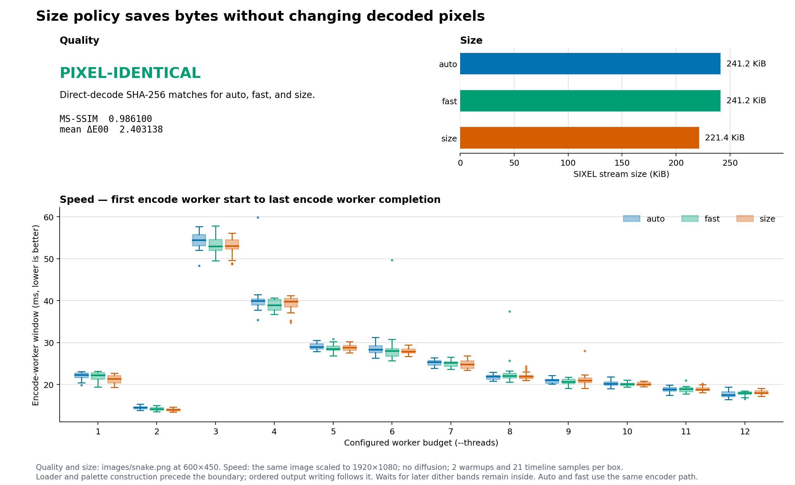

# Encoding Policy

`img2sixel -E POLICY` controls how the already indexed image is serialized into SIXEL bytes. It does not choose the palette, assign pixels to palette entries, or change dithering. Use `-E size` when stream size matters and accept a little extra encoding work; use the default `auto` or explicit `fast` for the direct mask-preserving path.

```console
img2sixel -E size image.png
img2sixel --encode-policy=size image.png
```

The option and its size-oriented overpainting idea were introduced by Araki Ken in [commit `c8283ed`](https://github.com/libsixel/libsixel/commit/c8283ed460aab6baafd72a15f56882e904c8cc8e). His Japanese article ["SIXEL Graphics: 100% Practical Know-How"](https://qiita.com/arakiken/items/4a216af6547d2574d283) is the historical source for the explanation below. This document updates that model for the current implementation and measurements.

## Where `-E` acts

SIXEL divides an image into bands six pixels high. Within a band, a SIXEL data character stores six vertical paint bits. The encoder selects a palette register with `#n`, writes that color's mask, uses `$` to return to the band's left edge, and uses `-` to advance to the next band. Repeated data characters can be shortened with `!n` run-length encoding.

<picture>
  <source media="(max-width: 640px)" srcset="figures/encode-policy-band-mobile.svg">
  
</picture>

*Figure 1. Literal paint bodies emitted for the illustrated 8 by 6, four-color band. The DCS wrapper, raster attributes, palette definitions, and string terminator are omitted so the part controlled by `-E` remains visible.*

For this concrete band, the current encoder emits the following paint bodies:

```text
auto / fast  #1o{BN#3o{BN$#0NB{o#2NB{o
size         #1!4~#3!4~$#0NB{o#2NB{o
```

These are actual SIXEL characters, not pseudocode. Subtracting ASCII `?` from a data character recovers its six vertical paint bits: `o`, `{`, `B`, and `N` describe the holes in the exact masks, while `~` sets all six bits. Thus `!4~` paints four full-height columns. The size plan first lays down four amber columns and four pink columns, returns left with `$`, and repairs the blue and green pixels. Its 23-byte paint body is two bytes shorter than the 25-byte exact body, yet both decode to the same indexed pixels. A taller image would use `-` between six-row bands.

The CPU classifier reads source rows in order and preserves the first-seen color order used to break equal-span ties. On little-endian AArch64 builds with NEON enabled, it examines 16 mask bytes together and enumerates only the painted lanes of a sparse vector. A zero mask byte paints; every nonzero value skips. Fully painted vectors use the ordinary pixel loop without bit enumeration. Other targets, disabled-NEON builds, and short tails use scalar classification. Mask coordinates remain relative to the source raster even when transparent offsets add virtual margins.

Only classification and safe size-policy underpaint write the private color maps. Each sets row bits below the band height, which is at most six, so the serializer receives values in `[0, 63]`; zero participates in ordinary empty-cell runs. Source palette indices are checked before map access. Palette register numbers below 1000 use direct decimal digit emission, while larger values retain the general formatter. These internal paths preserve wire order, decimal spelling, run boundaries, and packet flushing; they do not change palette selection or image quality.

This boundary is useful when diagnosing an option. If changing `-E` changes decoded pixels for the same indexed input, that is a correctness problem rather than an expected quality tradeoff.

## Why `size` can save bytes

The ordinary path preserves the holes in every color mask: it never temporarily paints a pixel belonging to another color. The `size` path may instead fill a span with an early color and let later colors repaint their own pixels. Solid or repeated columns can form shorter `!n` runs, so a little overdraw can produce fewer bytes.

The current encoder does not count pixels and choose one globally most frequent color as an underpaint. `sixel_band_compose()` creates one node for each nearby run of one color and records its horizontal interval `[sx, mx)`. It orders nodes by increasing `sx`, with a farther `mx` first when nodes start at the same column. Exact span ties are resolved by the current insertion order. `sixel_band_emit()` then makes one greedy left-to-right sweep while `fillable` is true: it fills the selected node's interval with `fill_mask`, which contains every valid row bit in the band, leaves overlapping nodes for later, and can select another node only when its `sx` is at or beyond the current cursor. After that sweep it clears `fillable` and emits the remaining overlapping nodes with their exact masks. `fill_mask` is `~` for the complete six-row band in the example.

<picture>
  <source media="(max-width: 640px)" srcset="figures/encode-policy-overpaint-mobile.svg">
  
</picture>

*Figure 2. The actual node plan for the same four-color band and literal bodies as Figure 1. Every color occurs 12 times. The composed node order is `#1 [0,4)`, `#0 [0,4)`, `#3 [4,8)`, `#2 [4,8)`: this fixture's equal-span insertion order, not a frequency ranking, puts `#1` and `#3` first. The fillable sweep takes those two nonoverlapping nodes and writes `#1!4~#3!4~`; the next sweep writes the skipped `#0` and `#2` masks exactly as `$#0NB{o#2NB{o`. The decoded pixels remain identical while the complete paint body shrinks from 25 to 23 bytes.*

The optimization is not a compressor applied after encoding; it changes the paint plan itself. It is therefore content-dependent. Large spans with reusable fills tend to help, while noisy masks may provide little benefit and can occasionally offset savings with extra paint commands.

## Where fill-and-repaint cannot combine

The central weakness belongs specifically to the fill-and-repaint optimization behind `-E size`, not to the `-E` parser or the exact-mask `auto` and `fast` paths. Filling a hole is safe only when a later paint is guaranteed to restore that pixel. Several other modes give a hole the opposite meaning, so their defining behavior and the Figure 2 optimization cannot operate on the same pixels.

| Other feature | Why the fill-and-repaint idea conflicts |
| --- | --- |
| `-I` high color | Later passes intentionally omit pixels completed by earlier passes while redefining palette registers. Filling those holes could overwrite completed pixels, and no later pass is guaranteed to restore them. |
| `-O` OR mode | Painting sets color-plane bits by OR. A later paint can add another bit but cannot clear a bit introduced by a solid underpaint, so the Figure 2 repair step is impossible. |
| Transparent pixels or `--transparent-offset` | Under DCS `P2=1`, an omitted cell means “keep the destination pixel.” Painting through that cell destroys the screen content it was meant to preserve. |
| 6delta encoding | An omitted/key-color cell means “this pixel is unchanged from the retained plane.” Underpainting it would turn an unchanged pixel into a changed one and defeat delta encoding. |

This is an algorithmic incompatibility, not necessarily a command-line rejection. The current implementation can accept some of these option combinations, but it must fence off the generic overpaint opportunity wherever a protected hole occurs. Its OR-mode `size` path can skip an empty bit plane, for example, but that is a separate size optimization rather than fill-and-repaint. Similarly, transparent-offset clipping can still optimize a fully opaque safe span, but not a transparent hole within it. In practice the characteristic `-E size` saving is strongest for one opaque, indexed, replace-mode image; it cannot simply be stacked with the characteristic savings or semantics of `-I`, `-O`, transparent reuse, or 6delta on the same region.

## Policies

| Policy | Current behavior | Practical use |
| --- | --- | --- |
| `auto` | The default. It currently follows the same non-size body path as `fast`. | Preserve the default interface so future automatic selection remains possible. |
| `fast` | Preserves each color mask without the size-policy fill and repaint strategy. | Request the direct serialization path explicitly. |
| `size` | Enables safe fill and repaint opportunities and skips some empty work in specialized paths. | Prefer smaller streams when the receiver or transport is the bottleneck. |

`auto` is a policy name, not currently an image-adaptive choice between the other two modes. Both values take the same non-size encoder path, and the measurement below produced byte-identical streams. They are therefore not distinct performance modes in the current implementation: any observed timing difference between them is measurement noise. Code should nevertheless pass `fast` when that exact intent matters instead of relying on today's implementation of `auto`.

Transparency is therefore more nuanced than the original 2014 description. The current size-policy code checks whether each band can be filled safely and clips transparent-offset work at image boundaries; it does not categorically reject the option combination. The [alpha policy](../../../loader/alpha-policy/README.md) still owns whether a source pixel is composited or omitted, while `-E` only decides how the surviving safe masks are serialized.

## Measured quality, speed, and size

The controlled comparison used the repository's `images/snake.png` fixture at revision `a639171f5a3ab8207dbb5450edb8b0a000e1f1c0`. All runs used the builtin loader, RGB palette space, 8-bit precision, high quality, a fixed 256-color budget, no diffusion, and no GPU. Quality and size used the original 600 by 450 image with one thread; each SIXEL stream was decoded through `sixel2png --direct` before assessment.

Speed was measured separately on the same image scaled to 1920 by 1080. For every policy and every `--threading-policy` value from 1 through 12, the harness performed two warmups and recorded 21 JSON timelines. The serial sample spans the first `encode/worker/start` event through the last matching `finish`; parallel samples span the earliest `encode/worker/worker_start` through the latest matching `worker_done`. Both select the body encoder's per-band events, so image loading, palette construction, dither work before the first encode band starts, and ordered writer work are excluded. Once the first encode worker has started, however, waiting for later banded-dither results remains inside the interval.



*Figure 3. Thread count is the horizontal axis of the speed panel; one is the serial body path. Each box spans the interquartile range, its line is the median, whiskers extend to 1.5 times the IQR, and isolated points are outliers. `auto` and `fast` use the same encoder path, so small separations between their boxes are sampling noise rather than a policy effect. Size bars report exact stream bytes converted to KiB.*

| Policy | MS-SSIM | Mean Delta E00 | SIXEL bytes |
| --- | ---: | ---: | ---: |
| `auto` | 0.986100 | 2.403138 | 247,009 |
| `fast` | 0.986100 | 2.403138 | 247,009 |
| `size` | 0.986100 | 2.403138 | 226,666 |

| Threads | `auto` median [Q1--Q3] | `fast` median [Q1--Q3] | `size` median [Q1--Q3] |
| ---: | ---: | ---: | ---: |
| 1 | 22.294 [21.695--22.745] ms | 22.181 [21.243--22.821] ms | 21.321 [20.411--22.153] ms |
| 2 | 14.516 [14.223--14.720] ms | 14.128 [13.902--14.518] ms | 13.987 [13.714--14.232] ms |
| 3 | 54.443 [53.105--55.746] ms | 52.940 [52.030--54.599] ms | 52.994 [52.320--54.520] ms |
| 4 | 39.945 [38.972--40.389] ms | 38.950 [37.775--40.335] ms | 39.779 [38.490--40.552] ms |
| 8 | 21.900 [21.242--22.240] ms | 22.050 [21.590--22.710] ms | 21.892 [21.448--22.184] ms |
| 12 | 17.522 [17.131--18.328] ms | 18.007 [17.637--18.263] ms | 17.951 [17.808--18.537] ms |

All three direct-decode PNG files had the same SHA-256 digest, so quality was pixel-identical rather than merely equal after metric rounding. `auto` and `fast` also had the same encoded-stream digest. Across the full thread grid their median gaps were at most 1.503 ms and their boxes overlapped; the data provides no evidence that they are distinct speed modes. `size` reduced the stream by 20,343 bytes, or 8.24%, while its encode-window distribution remained interleaved with the same-path policies. Ordered writing is outside this timing boundary, so the smaller byte count does not automatically make the measured interval shorter.

The serial and 2-thread plans both finish dithering before body encoding begins, so they directly answer whether a small encoder worker pool helps on this input. The `fast` median falls from 22.181 ms to 14.128 ms, a 36.3% reduction; the other policies show similar 34.4--34.9% reductions. This result supports retaining encoder parallelism, at least through two workers for this 1920 by 1080 fixture.

It does not show that every additional worker reduces encoder CPU time. From 3 threads onward, dither and encode overlap and this requested boundary includes later-band arrival waits, while `--threading-policy` is a pipeline budget rather than an isolated encoder-worker count. The 3-thread point must therefore not be read as an encoder regression against two threads. The IQR widens from 0.497--0.616 ms across policies at two threads to 2.200--2.641 ms at three, consistent with uneven band completion becoming visible to encode. It does not then widen monotonically: at 12 threads the range is 0.626--1.197 ms. Deciding the best worker allocation would require a separate pre-indexed body benchmark or an end-to-end latency comparison, not this hybrid interval alone.

This single fixture demonstrates the intended pixel invariant, one realistic byte saving, and one host's scheduling behavior. It is not a universal compression ratio or speed ranking.

## Reproduce the comparison

Run the measurement only from a clean tracked worktree so the recorded revision identifies the binary under test:

```console
PYTHON=/path/to/python-with-matplotlib-and-numpy \
tools/reproduce_encoding_mode_measurements.sh
```

The script rebuilds the selected tree, records commands and provenance, measures both this comparison and the companion [high-color comparison](../high-color/README.md), regenerates the plots, and validates semantic invariants. The durable artifacts are the [quality and size CSV](measurements/encode-policy-comparison.csv), the [raw speed samples](measurements/encode-policy-speed.csv), and the [JSON run record](measurements/encode-policy-run.json). Regenerate the explanatory figures with `tools/reproduce_encoding_mode_figures.sh`; its `--check` mode verifies byte-for-byte freshness.

## Implementation and existing coverage

Policy parsing is in [`encoder.c`](../../../../src/encoder.c), the public constants are in [`sixel.h`](../../../../include/sixel.h), and mask serialization is in [`encoder-core-encode.c`](../../../../src/encoder-core-encode.c). Existing focused coverage includes transparent-offset fill clipping in [`0074_transparent_offset_encode_policy_size.t`](../../../../tests/palette/alpha/0074_transparent_offset_encode_policy_size.t) and size-policy handling of empty OR planes in [`0005_encoder_core_ormode_body_skips_empty_planes.c`](../../../../tests/encoder/ormode/0005_encoder_core_ormode_body_skips_empty_planes.c).

The node plan stays in start-column buckets through emission. Each bucket orders nodes by decreasing end column; a newly inserted node precedes existing equal-span nodes. A bitset records nonempty buckets and finds the first start at or beyond the current cursor, so overlapping nodes need not be traversed again on each greedy sweep. The serializer removes a node only after successful emission and clears the bucket bit when its last node leaves. This preserves color-selection bytes, carriage returns, and the first-sweep-only `size` underpaint. Empty bands still advance with `-`, while offsets and final partial bands retain their valid-row masks.

The serializer keeps one output packet and its retained suffix in `sixel_output_t.buffer`. The C array declares two complete `SIXEL_OUTPUT_PACKET_SIZE` packets, and storage allocation uses `sizeof(sixel_output_t)` without an additional trailing allocation. The declared object bounds therefore match the writable storage seen by compiler bounds analysis. After a packet is flushed, the retained position is below one packet; the second packet accommodates bytes appended across that boundary.

The serializer reserves a node’s uncompressed column span, including any leading empty gap, plus a conservative palette-selector bound when that entire upper bound fits in the current packet. It then keeps the output cursor local across runs. Repeat encoding never exceeds the uncompressed span; long decimal counts and limited `!255` chunks use a separate helper. Nodes that do not fit retain packet-aware writes. Speculative literal stores may touch the second packet, but only emitted bytes advance the cursor. This preserves the exact stream, packet callback sizes, monochrome selector rules, and mapped register spelling without persistent per-frame storage.

## Test coverage

<!-- test-coverage: enforced -->

| ID | Contract | Owning test |
| --- | --- | --- |
| EP-01 | Unlimited DECGRI preserves the frozen bytes at repeat-count digit boundaries. | [tests/encoder/pipeline/0033_emit_runs_unlimited.c](../../../../tests/encoder/pipeline/0033_emit_runs_unlimited.c) |
| EP-02 | Limited DECGRI preserves repeat splitting and its frozen bytes. | [tests/encoder/pipeline/0034_emit_runs_limited.c](../../../../tests/encoder/pipeline/0034_emit_runs_limited.c) |
| EP-03 | Unlimited DECGRI preserves bytes when a run crosses an output packet boundary. | [tests/encoder/pipeline/0035_emit_packet_unlimited.c](../../../../tests/encoder/pipeline/0035_emit_packet_unlimited.c) |
| EP-04 | Limited DECGRI preserves bytes when split runs cross an output packet boundary. | [tests/encoder/pipeline/0036_emit_packet_limited.c](../../../../tests/encoder/pipeline/0036_emit_packet_limited.c) |
| EP-05 | The declared output array holds two packets and allocation follows the complete object size. | [tests/_static/sh/staticcheck-output-buffer-storage.sh](../../../../tests/_static/sh/staticcheck-output-buffer-storage.sh) |
| EP-06 | A longer node precedes a shorter node with the same start. | [tests/encoder/pipeline/0064_bucket_longest_first.t](../../../../tests/encoder/pipeline/0064_bucket_longest_first.t) |
| EP-07 | An equal-span tie emits the most recently inserted node first. | [tests/encoder/pipeline/0065_bucket_equal_span_tie.t](../../../../tests/encoder/pipeline/0065_bucket_equal_span_tie.t) |
| EP-08 | First-seen color order determines insertion order for equal spans. | [tests/encoder/pipeline/0066_bucket_first_seen_tie.t](../../../../tests/encoder/pipeline/0066_bucket_first_seen_tie.t) |
| EP-09 | A greedy sweep skips overlapping starts and chooses its next eligible span. | [tests/encoder/pipeline/0067_bucket_greedy_successor.t](../../../../tests/encoder/pipeline/0067_bucket_greedy_successor.t) |
| EP-10 | Start lookup crosses a 64-column word boundary without skipping a node. | [tests/encoder/pipeline/0068_bucket_start_word_boundary.t](../../../../tests/encoder/pipeline/0068_bucket_start_word_boundary.t) |
| EP-11 | Padding bits beyond the encoded width never create a node. | [tests/encoder/pipeline/0069_bucket_start_padding.t](../../../../tests/encoder/pipeline/0069_bucket_start_padding.t) |
| EP-12 | An empty first band still advances before the next paint. | [tests/encoder/pipeline/0070_bucket_empty_first_band.t](../../../../tests/encoder/pipeline/0070_bucket_empty_first_band.t) |
| EP-13 | Empty middle bands preserve advances without stale bucket starts. | [tests/encoder/pipeline/0071_bucket_empty_middle_band.t](../../../../tests/encoder/pipeline/0071_bucket_empty_middle_band.t) |
| EP-14 | Horizontal and vertical offsets preserve exact bytes across a band boundary. | [tests/encoder/pipeline/0072_bucket_offset_band_boundary.t](../../../../tests/encoder/pipeline/0072_bucket_offset_band_boundary.t) |
| EP-15 | Size underpaints only its first nonoverlapping sweep. | [tests/encoder/pipeline/0073_bucket_size_first_sweep.t](../../../../tests/encoder/pipeline/0073_bucket_size_first_sweep.t) |
| EP-16 | Size fills only the valid rows of a partial band. | [tests/encoder/pipeline/0074_bucket_size_partial_rows.t](../../../../tests/encoder/pipeline/0074_bucket_size_partial_rows.t) |
| EP-17 | A masked hole disables unsafe size underpaint. | [tests/encoder/pipeline/0075_bucket_size_masked_hole.t](../../../../tests/encoder/pipeline/0075_bucket_size_masked_hole.t) |
| EP-18 | Monochrome serialization preserves its omitted palette selector. | [tests/encoder/pipeline/0076_bucket_mono_selector.t](../../../../tests/encoder/pipeline/0076_bucket_mono_selector.t) |
| EP-19 | Parallel final partial bands preserve the band-local palette selector. | [tests/encoder/pipeline/0077_bucket_parallel_final_band.t](../../../../tests/encoder/pipeline/0077_bucket_parallel_final_band.t) |
| EP-20 | Serial final partial bands preserve the active palette selector. | [tests/encoder/pipeline/0078_bucket_serial_final_band.t](../../../../tests/encoder/pipeline/0078_bucket_serial_final_band.t) |
| EP-21 | A short scalar tail preserves its first and last painted columns. | [tests/encoder/pipeline/0080_mask_scalar_tail_15.t](../../../../tests/encoder/pipeline/0080_mask_scalar_tail_15.t) |
| EP-22 | Alternating zero and 255 mask bytes preserve lane order in a full vector. | [tests/encoder/pipeline/0081_mask_vector_lanes_16.t](../../../../tests/encoder/pipeline/0081_mask_vector_lanes_16.t) |
| EP-23 | A painted scalar tail follows the final vector lane without a gap. | [tests/encoder/pipeline/0082_mask_vector_tail_17.t](../../../../tests/encoder/pipeline/0082_mask_vector_tail_17.t) |
| EP-24 | Two fully painted vectors retain one exact run. | [tests/encoder/pipeline/0083_mask_dense_vector_32.t](../../../../tests/encoder/pipeline/0083_mask_dense_vector_32.t) |
| EP-25 | Two fully skipped vectors emit no paint commands. | [tests/encoder/pipeline/0084_mask_empty_vector_32.t](../../../../tests/encoder/pipeline/0084_mask_empty_vector_32.t) |
| EP-26 | A sparse vector followed by a dense vector preserves its run boundary. | [tests/encoder/pipeline/0085_mask_sparse_dense_transition.t](../../../../tests/encoder/pipeline/0085_mask_sparse_dense_transition.t) |
| EP-27 | Sparse lanes preserve first-seen color ordering for equal-span nodes. | [tests/encoder/pipeline/0086_mask_sparse_first_seen_order.t](../../../../tests/encoder/pipeline/0086_mask_sparse_first_seen_order.t) |
| EP-28 | Sparse monochrome output preserves the omitted palette selector. | [tests/encoder/pipeline/0087_mask_sparse_mono_selector.t](../../../../tests/encoder/pipeline/0087_mask_sparse_mono_selector.t) |
| EP-29 | Parallel sparse lanes preserve source-relative mask coordinates across offset bands. | [tests/encoder/pipeline/0088_mask_sparse_offset_parallel.t](../../../../tests/encoder/pipeline/0088_mask_sparse_offset_parallel.t) |
| EP-30 | An out-of-range index in a painted vector lane emits no paint. | [tests/encoder/pipeline/0089_mask_sparse_invalid_index.t](../../../../tests/encoder/pipeline/0089_mask_sparse_invalid_index.t) |
| EP-31 | A transparent index in a painted vector lane emits no paint. | [tests/encoder/pipeline/0090_mask_sparse_keycolor.t](../../../../tests/encoder/pipeline/0090_mask_sparse_keycolor.t) |
| EP-32 | A nonzero mask byte prevents size underpaint through a protected hole. | [tests/encoder/pipeline/0091_mask_size_protected_hole.t](../../../../tests/encoder/pipeline/0091_mask_size_protected_hole.t) |
| EP-33 | Dense size underpaint sets only the valid rows in a partial band. | [tests/encoder/pipeline/0092_mask_size_dense_partial_rows.t](../../../../tests/encoder/pipeline/0092_mask_size_dense_partial_rows.t) |
| EP-34 | All 64 six-bit column values retain their literal SIXEL spelling. | [tests/encoder/pipeline/0093_map_all_sixbit_values.t](../../../../tests/encoder/pipeline/0093_map_all_sixbit_values.t) |
| EP-35 | Palette register 0 emits one zero digit. | [tests/encoder/pipeline/0094_register_decimal_0.t](../../../../tests/encoder/pipeline/0094_register_decimal_0.t) |
| EP-36 | Palette register 9 emits one digit. | [tests/encoder/pipeline/0095_register_decimal_9.t](../../../../tests/encoder/pipeline/0095_register_decimal_9.t) |
| EP-37 | Palette register 10 emits two digits. | [tests/encoder/pipeline/0096_register_decimal_10.t](../../../../tests/encoder/pipeline/0096_register_decimal_10.t) |
| EP-38 | Palette register 99 emits two digits. | [tests/encoder/pipeline/0097_register_decimal_99.t](../../../../tests/encoder/pipeline/0097_register_decimal_99.t) |
| EP-39 | Palette register 100 emits three digits. | [tests/encoder/pipeline/0098_register_decimal_100.t](../../../../tests/encoder/pipeline/0098_register_decimal_100.t) |
| EP-40 | Palette register 999 emits three digits. | [tests/encoder/pipeline/0099_register_decimal_999.t](../../../../tests/encoder/pipeline/0099_register_decimal_999.t) |
| EP-41 | Palette register 1000 retains the general decimal spelling. | [tests/encoder/pipeline/0100_register_decimal_1000.t](../../../../tests/encoder/pipeline/0100_register_decimal_1000.t) |
| EP-42 | Palette register 65535 retains all five digits. | [tests/encoder/pipeline/0101_register_decimal_65535.t](../../../../tests/encoder/pipeline/0101_register_decimal_65535.t) |
| EP-43 | A three-digit register selector survives a packet boundary. | [tests/encoder/pipeline/0102_register_decimal_100_packet.t](../../../../tests/encoder/pipeline/0102_register_decimal_100_packet.t) |
| EP-44 | A four-digit register selector survives a packet boundary. | [tests/encoder/pipeline/0103_register_decimal_1000_packet.t](../../../../tests/encoder/pipeline/0103_register_decimal_1000_packet.t) |
| EP-45 | An unlimited 1-column run preserves its exact wire spelling. | [tests/encoder/pipeline/0104_run_count_1.t](../../../../tests/encoder/pipeline/0104_run_count_1.t) |
| EP-46 | An unlimited 2-column run preserves its exact wire spelling. | [tests/encoder/pipeline/0105_run_count_2.t](../../../../tests/encoder/pipeline/0105_run_count_2.t) |
| EP-47 | An unlimited 3-column run preserves its exact wire spelling. | [tests/encoder/pipeline/0106_run_count_3.t](../../../../tests/encoder/pipeline/0106_run_count_3.t) |
| EP-48 | An unlimited 4-column run preserves its exact wire spelling. | [tests/encoder/pipeline/0107_run_count_4.t](../../../../tests/encoder/pipeline/0107_run_count_4.t) |
| EP-49 | An unlimited 9-column run preserves its exact wire spelling. | [tests/encoder/pipeline/0108_run_count_9.t](../../../../tests/encoder/pipeline/0108_run_count_9.t) |
| EP-50 | An unlimited 10-column run preserves its exact wire spelling. | [tests/encoder/pipeline/0109_run_count_10.t](../../../../tests/encoder/pipeline/0109_run_count_10.t) |
| EP-51 | An unlimited 99-column run preserves its exact wire spelling. | [tests/encoder/pipeline/0110_run_count_99.t](../../../../tests/encoder/pipeline/0110_run_count_99.t) |
| EP-52 | An unlimited 100-column run preserves its exact wire spelling. | [tests/encoder/pipeline/0111_run_count_100.t](../../../../tests/encoder/pipeline/0111_run_count_100.t) |
| EP-53 | An unlimited 999-column run preserves its exact wire spelling. | [tests/encoder/pipeline/0112_run_count_999.t](../../../../tests/encoder/pipeline/0112_run_count_999.t) |
| EP-54 | An unlimited 1000-column run preserves its exact wire spelling. | [tests/encoder/pipeline/0113_run_count_1000.t](../../../../tests/encoder/pipeline/0113_run_count_1000.t) |
| EP-55 | A limited 255-column run preserves its split and remainder. | [tests/encoder/pipeline/0114_run_limited_255.t](../../../../tests/encoder/pipeline/0114_run_limited_255.t) |
| EP-56 | A limited 256-column run preserves its split and remainder. | [tests/encoder/pipeline/0115_run_limited_256.t](../../../../tests/encoder/pipeline/0115_run_limited_256.t) |
| EP-57 | A limited 258-column run preserves its split and remainder. | [tests/encoder/pipeline/0116_run_limited_258.t](../../../../tests/encoder/pipeline/0116_run_limited_258.t) |
| EP-58 | A limited 259-column run preserves its split and remainder. | [tests/encoder/pipeline/0117_run_limited_259.t](../../../../tests/encoder/pipeline/0117_run_limited_259.t) |
| EP-59 | A three-byte literal run survives a packet boundary. | [tests/encoder/pipeline/0118_run_literal_packet.t](../../../../tests/encoder/pipeline/0118_run_literal_packet.t) |
| EP-60 | A repeat command survives a packet boundary. | [tests/encoder/pipeline/0119_run_repeat_packet.t](../../../../tests/encoder/pipeline/0119_run_repeat_packet.t) |
| EP-61 | A limited repeat command and remainder survive a packet boundary. | [tests/encoder/pipeline/0120_run_limited_packet.t](../../../../tests/encoder/pipeline/0120_run_limited_packet.t) |
| EP-62 | A node wider than one output packet preserves its repeat count. | [tests/encoder/pipeline/0121_run_large_node.t](../../../../tests/encoder/pipeline/0121_run_large_node.t) |
| EP-63 | A long leading gap preserves its unlimited repeat spelling. | [tests/encoder/pipeline/0122_run_gap_unlimited.t](../../../../tests/encoder/pipeline/0122_run_gap_unlimited.t) |
| EP-64 | A long leading gap preserves limited splitting before paint. | [tests/encoder/pipeline/0123_run_gap_limited.t](../../../../tests/encoder/pipeline/0123_run_gap_limited.t) |

These small fixed rasters establish literal wire ordering, including transparency and size-policy interactions. They do not assert a content-independent speedup; allocator ownership and failure cleanup are covered by the [threading reference](../../../threading/encoder.md#test-coverage).

The mask cases use fixed 15-, 16-, 17-, 32-, and 33-column rasters to exercise vector boundaries, scalar tails, sparse/dense transitions, invalid and transparent indices, mono output, partial-row underpaint, and parallel offsets. The map fixture independently derives all six-bit column masks from its source pixels. Decimal cases check literal selectors at digit boundaries and across packet flushes. These cases establish output behavior on the configured CPU path, not a speed guarantee or proof of which machine instructions executed.

The individual run cases cover literal lengths, decimal digit transitions, limited-run remainders, leading gaps, packet-edge writes, and a node wider than one packet. Each case asserts one fixed wire stream; it does not require an optimized branch or a particular instruction sequence.
