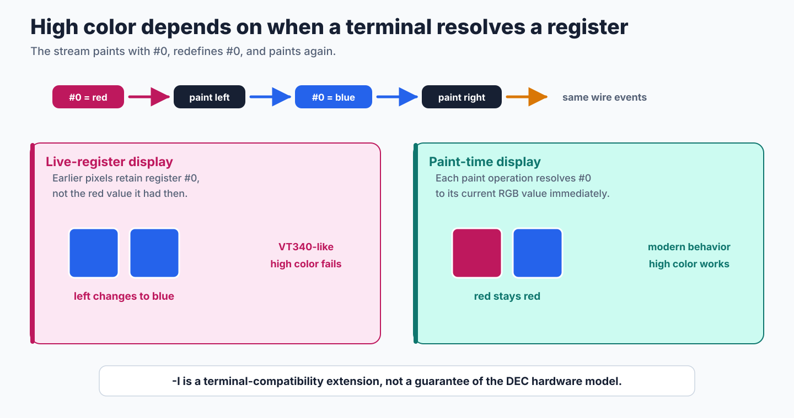
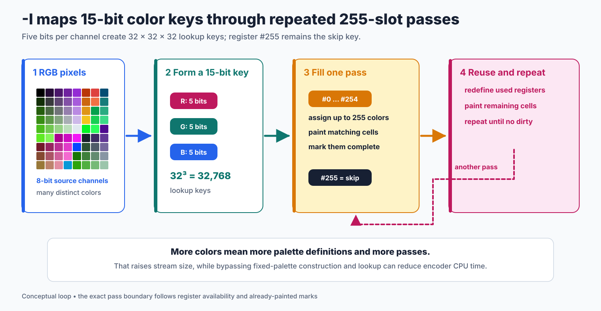
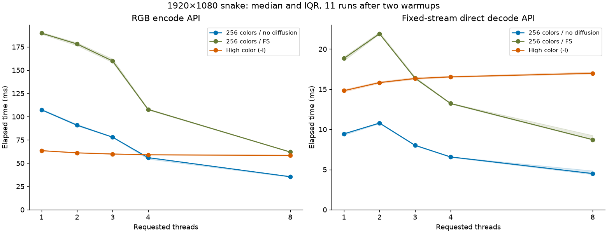

# High-Color Output

`img2sixel -I` enables the legacy high-color path. It can paint more than 256 colors by redefining palette registers during an image, but it is not a general quality upgrade. Its color assignment and pass scheduling remain serial, it does not benefit from the complete normal palette pipeline, and the retained measurements expose visible tone steps and a historical malformed-output stress case. Keeping this mode useful requires independent band encoding and evidence about color representation and quality.

```console
img2sixel -I image.png
img2sixel --high-color image.png
```

The familiar “maximum 15bit color” description refers to its 32,768 internal lookup keys. It does **not** promise 32,768 colors in each image, or even impose that exact maximum on the distinct RGB values painted over the complete stream. See [what the color counts mean](measurement.md#what-32768-means) and the [side-by-side comparisons](measurement.md#visual-comparisons).

Araki Ken introduced the encoder in [commit `0382aef`](https://github.com/libsixel/libsixel/commit/0382aef1afa5333ad2d69f4412900accca866ef2). His 2014 article [“libsixelによるSixel Graphicsへの変換処理について”](https://qiita.com/arakiken/items/4a216af6547d2574d283) explains the original algorithm and terminal distinction. The following describes the current implementation, including differences from that historical design.

## The terminal decides whether it works

The extension relies on paint-time palette semantics. Suppose a stream defines register `#0` as red, paints a pixel, redefines `#0` as blue, and paints another pixel. A paint-time renderer resolves the RGB value when each pixel is drawn, leaving one red and one blue pixel. A live-register renderer retains the register reference, so redefining `#0` also changes the earlier pixel to blue.

<picture>
  <source media="(max-width: 640px)" srcset="figures/high-color-register-mobile.svg">
  
</picture>

*Figure 1. The same wire events produce different pixels under the two register models.*

Historical DEC hardware such as the VT340 follows the live-register model, so high color is not a guarantee of the original hardware semantics. Use `-I` only with a receiving terminal known to implement paint-time register resolution. Terminal support can change independently of libsixel and must be verified on the actual receiver.

## How repeated passes extend the palette

The encoder takes the top five bits of each RGB channel and packs them into a 15-bit lookup key. It registers the original RGB representative, not necessarily the value with its low three bits cleared. It uses registers `#0` through `#254` for paint colors and reserves `#255` as a skip key. A pass assigns available registers to new keys, paints matching pixels with their current representatives, and marks them complete. If colors remain, later passes reuse registers with new definitions and paint only the unfinished pixels.

<picture>
  <source media="(max-width: 640px)" srcset="figures/high-color-passes-mobile.svg">
  
</picture>

*Figure 2. Conceptual high-color loop. Exact pass boundaries depend on register availability, color reuse, and already-painted marks.*

This explains why high color can improve fidelity and enlarge the stream at the same time: the image can use far more distinct colors, but it may carry repeated palette definitions and multiple paint passes.

## Pipeline and option interactions

High color is an alternate encoding path, not a larger value for `-p`.

- It bypasses fixed-palette construction and fixed-palette nearest-color lookup. `-p`, `-b`, `-m`, and `-e` select incompatible color modes and are rejected when combined with `-I`.
- The current CLI resolves palette-space diffusion to `none` for `-I`. Supplying `-d fs` or another diffusion method does not recreate the historical high-color diffusion path described in the 2014 article.
- It converts source coordinates to the selected `-U gamma`, `-U linear`, `-U smpte-c` or `-U display-p3` destination before building lookup keys. Display P3 accepts opaque RGB frames with ordinary CPU RGB or HLS SIXEL output. See [destination samples](#destination-samples-and-precision) and [Output color space](../output-colorspace.md#scope-and-current-gaps).
- Register `#255` is an internal skip value for multi-pass painting. Transparent offset is supported as a separate geometry feature; source alpha semantics still follow the [alpha policy](../../../loader/alpha-policy/README.md).
- Validation must use a direct decoder. A final indexed plane and final palette cannot represent the earlier colors painted before a register redefinition. Use `sixel2png --direct` (`-D`) rather than an indexed snapshot. See the [PNG writer boundary](../../../writers/png/README.md) for details.

## Destination samples and precision

High-color output uses the frame/core source color space independently of the destination selected by `-U`. Conversion uses the extended-coordinate helpers, including the primary matrix before clipping for SMPTE-C or Display P3. Negative and above-one source components survive that conversion. Once the destination RGB is known, it is restricted to the representable destination gamut; this is channel clipping, not perceptual gamut mapping.

The high-level encoder disables high-color diffusion. For float input or a nonidentity output conversion, this path retains float destination samples and float register representatives. A separate RGB888 projection supplies the existing 15bit lookup key. Multiple samples sharing that key still share its selected representative, but key quantization does not replace the representative. The writer rounds the representative directly to RGB101 or DEC HLS. This does not enable palette snap or change the first-encountered representative policy.

RGB888 input with identical source and destination coordinates keeps the byte path, its historical wire rounding and its lack of a converted image buffer. Converted no-diffusion input uses a temporary RGB float32 plane (12 bytes per pixel), plus a 256-entry float register table (3,072 bytes); packed byte input can also require the existing 3-byte normalization plane. The conversion validates the whole input before output begins. Nonfinite input or an invalid transform fails without writing an image; the caller's pixel format is not replaced by the temporary format, so the context remains reusable.

Low-level callers that explicitly enable the legacy 15bpp diffusion routines still receive a bounded RGB888 diffusion plane after destination conversion. Those routines are not the native float palette-diffusion implementation and do not provide its clamp-policy semantics. Their float migration, source-alpha handling, retained delta history, and pass-scheduling redesign are separate limitations; the destination handoff does not establish support for them.

### Display P3 boundary

`-I -U display-p3` keeps the frame's source definition separate from the destination. It accepts RGB888 or typed float32 gamma, linear, Oklab, CIELAB or DIN99d frames and `-W` in those five spaces. One common sRGB-to-Display-P3 transform is prepared per frame; no profile is parsed per pixel or register replacement. Source alpha must already have been resolved to opaque RGB. Packed-alpha storage, preserved masks, delta, OR mode, DRCS, terminal macros and PNG snapshots reject before output. These are implementation boundaries of this high-color path, not limitations of the P3 definition.

The ordinary palette solver and lookup restrictions do not apply to high color because those stages are bypassed. High-level diffusion remains disabled, even if `-d` selects a method. GPU and active snap remain unsupported; a zero snap approach is inactive. The receiver must interpret these RGB or HLS definitions as Display P3, as described in [output interpretation](../output-colorspace.md). The low-level `sixel_encode()` API retains its existing legacy destination setup; the P3 intent is carried privately by the high-level encoder without changing public API signatures.

## Pending final bands

A pass that runs out of paint registers must return to the unfinished physical six-row band, including at end of input. End of input alone does not mean all pixels are painted. The body leaves the cursor at that band's origin; the next pass retains its completed-pixel marks and replaces registers to paint the remainder. Only a pass with no pending pixels emits the final body and footer.

Rewinding uses the number of source rows actually present in that band, which can be one through six. With a transparent top margin, the first band's source rows can also be fewer than six. Repeated passes retain the starting row bit for that band without repeating whole bands of top padding. These rules apply to byte and float representatives and do not change palette-key selection or the 255 paint-register limit.

## Parallelism: the current boundary

The high-color front end in [`sixel_encode_highcolor()`](../../../../src/encoder-core-highcolor.c) walks pixels and chooses register replacements serially. `rgbhit`, `rgb2pal`, palette representatives, and six-row `marks` carry information between passes; a pass can cover several bands and then return to an unfinished band. Clearing `palstate` and hit counters at `next:` is a **pass reset**, not an independently initialized image band.

The common [`sixel_encode_body()`](../../../../src/encoder-core-encode.c) can already send a prepared pass through its band workers when there is more than one band and more than one requested thread. Thus, there is some parallel serialization inside `-I`; the complete high-color operation is not independently parallelized by band. Many short passes, serial register assignment, and repeated scheduling limit the benefit. Merely increasing `--threads` does not remove that dependency.

### Required encoder direction: reset state at each band

The prerequisite for useful encode scaling is a complete, independently encodable six-row band, including all of its palette-redefinition passes. A proposed implementation should:

1. Start each band with worker-local key maps, representatives, register-use state, and painted marks. No register choice may depend on a preceding band's cache.
2. Define every register used by that band before its first paint. This is an explicit initialization contract, not a new SIXEL “reset palette” opcode; clearing an encoder array alone would leave the receiver's palette undefined for the fragment.
3. Finish all repaint passes for the same band inside that job. `$` returns to the start of the current six-row band, while `-` advances to the next one; concatenation must preserve that distinction and emit the image header/footer only once.
4. Publish complete band fragments in source order, with correct handling of the final partial band, alpha/skip pixels, offsets, and cancellation. Bounded queues must prevent slow bands from accumulating an entire image of pending fragments.

This design has not been implemented. Resetting at every band also discards potentially useful color reuse and can increase register-definition bytes. It can change which source sample becomes a key's representative and create stronger seams. Compare source pixels, band boundaries, throughput, and transport size together before accepting it; speed alone would not establish an improvement.

### Why direct decode is harder

An arbitrary byte offset does not reveal its destination row or the current palette. High color also changes register meaning between paint operations, sometimes repainting the same six-row band through several passes. A single final index plane and palette cannot reconstruct those historical colors.

The current [parallel decoder](../../../threading/decoder.md) initially establishes raster and palette state, scans byte spans, and proves that paint ranges are disjoint. Its workers in [`decoder-parallel.c`](../../../../src/decoder-parallel.c) reject palette definitions inside those spans, so typical high-color streams return to serial parsing. More decode workers may add an unsuccessful scan without accelerating paint.

This is a difficult state-reconstruction problem, not a proof that parallel decoding is mathematically impossible. A future decoder could serially discover boundaries and capture each band's entering palette and cursor state, then paint complete bands independently in RGBA. That still pays for a serial prepass, snapshots, validation, and within-band operation order. Streams that independently initialize their bands would simplify that task, but the present byte-span parser does not gain that capability merely because the encoder changes. Arbitrary existing high-color streams need their own fallback policy. General high-color decode parallelization remains unresolved.

## What the measurements show

The [measurement reference](measurement.md) contains photographs, smooth color and grayscale ramps, a key-reuse diagnostic, exact RGB counts and histograms, retained SIXEL/PNG artifacts, and all timing samples. These are measurements of revision `3c92b3a1c` with an independent `-O3` build, not terminal screenshots.

| Fixture | Requested 256 colors, no diffusion | `-I`, no diffusion | Interpretation |
| --- | --- | --- | --- |
| Snake, 600×450 | 254 actual RGB colors; MS-SSIM 0.986100; 247,009 bytes | 14,838 actual RGB colors; MS-SSIM 0.989064; 675,644 bytes | More colors and lower mean color error, at 2.74× the size; 256-color FS still has higher MS-SSIM (0.991198). |
| Smooth gradient, 600×450 | 255 colors; MS-SSIM 0.904965 | 1,714 colors; MS-SSIM 0.979565 | A substantial improvement, but visible rectangles and tone steps remain. |
| Gray ramp, 768×96 | 64 colors; MS-SSIM 0.983637 | 32 colors; MS-SSIM 0.937472 | The 15bit key has only 32 positions on the neutral axis; this mode can preserve fewer gray levels. |



Every thread budget is timed at the same API boundary. A [full repetition of the run](measurement.md#repeat-run-variability) showed substantial runtime variation, so precise speedup ratios remain provisional. RGB encode includes palette construction, palette application/dither, and SIXEL output to `/dev/null`; direct decode starts from a fixed in-memory stream and excludes PNG writing. The normal encoder changes some decoded pixels with thread budget in this snapshot, so this is a comparison of the requested policies, not a byte-identical serialization benchmark. Exact quality and size checks at one and eight threads are retained in the measurement record. High-color decoded pixels match between those budgets for all six fixtures.

### Why worker intervals are not used for speed

A tempting alternative timing is the interval from the first encode worker's start to the last worker's completion, which a timeline log shows directly. That interval does not contain the same work at every thread budget. With two threads, palette application has finished before encoding starts. From three threads on, the [pipeline overlaps dithering and encoding](../../../threading/encoder.md), so the interval also contains waits for bands that are still being dithered. In the [recorded worker-interval samples](measurements/high-color-speed.csv), the interval grows from 14.287 ms at two threads to 52.901 ms at three; the jump comes from the changed boundary, not from encoding becoming almost four times slower on an extra thread. The thread axis is the requested budget, not a count of physical cores.

Those samples remain useful as scheduling data. Speed comparisons in this document use the API timings and the [timing definitions](measurement.md#speed-and-thread-budgets).

## Work needed before treating this as a quality mode

The [retained key-reuse measurement](measurement.md#key-reuse-correctness-diagnostic) records missing pixels and painting beyond the declared height in revision `3c92b3a1cc`. Current pass scheduling completes a pending final band before ending the image. The final-band value tests below protect dimensions, complete painting, register lifetime and transparent margins; a future band-local encoder must preserve those contracts, rather than the malformed historical bytes.

For color quality, distinguish the key from the representative. The current first-encountered RGB sample, its lifetime in a reused slot, and rounding to SIXEL's integer percentage channels can create biased steps. Candidate changes include deterministic representatives, perceptual or adaptive quantization, and a deliberate high-color diffusion policy; each requires a new quality/size/speed comparison. Restoring an old diffusion routine through `-d` without defining ownership and cross-band error propagation would reintroduce dependencies and is not a complete solution.

Retain this mode as an explicitly limited alternate path until it has a correctness baseline, independent band encoding, a documented representation policy, and evidence that the extra colors improve the intended images. Increasing the theoretical color count by itself addresses none of those requirements.

## Implementation and existing coverage

The repeated-pass implementation is in [`encoder-core-highcolor.c`](../../../../src/encoder-core-highcolor.c), CLI mode selection and diffusion bypass are in [`encoder.c`](../../../../src/encoder.c), and paint-time palette resolution is in [`fromsixel.c`](../../../../src/fromsixel.c). Focused existing tests exercise the 255 paint-register boundary in [`0166_high_color_sixel_direct_palette_slots.t`](../../../../tests/quant/palette/usage/0166_high_color_sixel_direct_palette_slots.t), preservation across direct decoding in [`0023_decoder_high_color_dequantize_bypass.c`](../../../../tests/processing/decoder/0023_decoder_high_color_dequantize_bypass.c), and transparent-offset geometry in [`0175_transparent_offset_high_color_geometry.t`](../../../../tests/quant/palette/usage/0175_transparent_offset_high_color_geometry.t). The final-band tests below additionally cover pending passes at complete and partial image boundaries; they do not establish every possible palette-selection or alpha-policy combination.

The [study tool](../../../../tools/highcolor/study.py) verifies retained hashes, dimensions, painted color counts, histograms, register bounds, and timing-sample coverage. Its diagnostic measurements explicitly record existing failures; they are not a passing quality regression threshold. Regenerate the conceptual figures with `tools/reproduce_encoding_mode_figures.sh` and verify them with `--check`.

## Test coverage

<!-- test-coverage: enforced -->

### Behavioral contract tests

The small value witnesses inspect direct-decoded pixels and opacity, including register redefinition. Their analytic transfer/matrix references, independent P3 primary coordinates and integer rounding margins are documented in `tests/codec/highcolor_output_common.c`. Nonfinite rejection and reuse are separate from finite approximation checks. These tests establish the destination handoff, not perceptual quality or exhaustive pass scheduling. Pending final-band tests check every decoded pixel, exact dimensions, opacity, 255/256 slot boundaries, key revisits and transparent margins. The float and P3 lifetime witnesses include a pending final band. Requested one- and four-thread budgets exercise the serial scheduler and shared body serializer, not independent high-color band scheduling.

| ID | Contract | Test |
| --- | --- | --- |
| HC-01 | Byte gamma identity retains the byte palette and original channel percentages. | [tests/codec/highcolor/0001_byte_identity.t](../../../../tests/codec/highcolor/0001_byte_identity.t) |
| HC-02 | Byte gamma input converts to linear destination values before key selection. | [tests/codec/highcolor/0002_byte_linear.t](../../../../tests/codec/highcolor/0002_byte_linear.t) |
| HC-03 | Float gamma representatives reach RGB101 without an intervening RGB888 store. | [tests/codec/highcolor/0003_float_subbyte.t](../../../../tests/codec/highcolor/0003_float_subbyte.t) |
| HC-04 | Linear float input reaches gamma output with the transfer function applied. | [tests/codec/highcolor/0004_linear_gamma.t](../../../../tests/codec/highcolor/0004_linear_gamma.t) |
| HC-05 | Negative working components contribute to the SMPTE-C primary matrix before final clipping. | [tests/codec/highcolor/0005_extended_smptec.t](../../../../tests/codec/highcolor/0005_extended_smptec.t) |
| HC-06 | HLS output uses the float representative without intermediate byte rounding. | [tests/codec/highcolor/0006_float_hls.t](../../../../tests/codec/highcolor/0006_float_hls.t) |
| HC-07 | NaN input rejects before output and the same float context remains reusable. | [tests/codec/highcolor/0007_nan_recovery.t](../../../../tests/codec/highcolor/0007_nan_recovery.t) |
| HC-08 | Infinity input rejects before output and preserves the input format for reuse. | [tests/codec/highcolor/0008_infinity_recovery.t](../../../../tests/codec/highcolor/0008_infinity_recovery.t) |
| HC-09 | Packed RGBA input converts to linear output without mutating the dither format. | [tests/codec/highcolor/0009_rgba_linear.t](../../../../tests/codec/highcolor/0009_rgba_linear.t) |
| HC-10 | The high-level frame entry preserves subbyte samples through high-color output. | [tests/codec/highcolor/0010_frame_float.t](../../../../tests/codec/highcolor/0010_frame_float.t) |
| HC-11 | The high-level frame entry preserves extended linear samples for SMPTE-C output. | [tests/codec/highcolor/0011_frame_extended.t](../../../../tests/codec/highcolor/0011_frame_extended.t) |
| HC-12 | Float representatives remain attached to their keys across register redefinition passes. | [tests/codec/highcolor/0012_multipass_float.t](../../../../tests/codec/highcolor/0012_multipass_float.t) |
| HC-13 | Low-level legacy byte diffusion converts output coordinates before its byte boundary. | [tests/codec/highcolor/0013_lowlevel_diffusion.t](../../../../tests/codec/highcolor/0013_lowlevel_diffusion.t) |
| HC-14 | One high-color context supports repeated float and byte output conversions without stale format state. | [tests/codec/highcolor/0014_context_reuse.t](../../../../tests/codec/highcolor/0014_context_reuse.t) |
| HC-15 | Extended gamma coordinates retain P3 red, green and a mixed color. | [tests/codec/highcolor/0015_p3_gamma.t](../../../../tests/codec/highcolor/0015_p3_gamma.t) |
| HC-16 | Extended linear coordinates retain P3 red, green and a mixed color. | [tests/codec/highcolor/0016_p3_linear.t](../../../../tests/codec/highcolor/0016_p3_linear.t) |
| HC-17 | Oklab coordinates retain P3 red, green and a mixed color. | [tests/codec/highcolor/0017_p3_oklab.t](../../../../tests/codec/highcolor/0017_p3_oklab.t) |
| HC-18 | CIELAB coordinates retain P3 red, green and a mixed color. | [tests/codec/highcolor/0018_p3_cielab.t](../../../../tests/codec/highcolor/0018_p3_cielab.t) |
| HC-19 | DIN99d coordinates retain P3 red, green and a mixed color. | [tests/codec/highcolor/0019_p3_din99d.t](../../../../tests/codec/highcolor/0019_p3_din99d.t) |
| HC-20 | Byte sRGB input is converted to the P3 destination. | [tests/codec/highcolor/0020_p3_byte.t](../../../../tests/codec/highcolor/0020_p3_byte.t) |
| HC-21 | P3 output keeps a neutral subbyte representative through RGB101. | [tests/codec/highcolor/0021_p3_subbyte.t](../../../../tests/codec/highcolor/0021_p3_subbyte.t) |
| HC-22 | P3 HLS uses a float representative without RGB888 projection. | [tests/codec/highcolor/0022_p3_hls.t](../../../../tests/codec/highcolor/0022_p3_hls.t) |
| HC-23 | P3 representatives survive register redefinition across completed passes. | [tests/codec/highcolor/0023_p3_multipass.t](../../../../tests/codec/highcolor/0023_p3_multipass.t) |
| HC-24 | P3 representatives survive completed passes with a four-thread body budget. | [tests/codec/highcolor/0024_p3_workers.t](../../../../tests/codec/highcolor/0024_p3_workers.t) |
| HC-25 | Output definition and byte or float input switch safely between encoder contexts. | [tests/codec/highcolor/0025_p3_reuse.t](../../../../tests/codec/highcolor/0025_p3_reuse.t) |
| HC-26 | A preserved source mask rejects before output and allows opaque reuse. | [tests/codec/highcolor/0026_p3_mask_recovery.t](../../../../tests/codec/highcolor/0026_p3_mask_recovery.t) |
| HC-27 | High-color P3 delta rejects before output and allows full-frame reuse. | [tests/codec/highcolor/0027_p3_delta_recovery.t](../../../../tests/codec/highcolor/0027_p3_delta_recovery.t) |
| HC-28 | High-color P3 OR mode rejects before output and allows ordinary reuse. | [tests/codec/highcolor/0028_p3_or_recovery.t](../../../../tests/codec/highcolor/0028_p3_or_recovery.t) |
| HC-29 | High-color P3 DRCS rejects before output and allows ordinary reuse. | [tests/codec/highcolor/0029_p3_drcs_recovery.t](../../../../tests/codec/highcolor/0029_p3_drcs_recovery.t) |
| HC-30 | High-color P3 macro output rejects before output and allows ordinary reuse. | [tests/codec/highcolor/0030_p3_macro_recovery.t](../../../../tests/codec/highcolor/0030_p3_macro_recovery.t) |
| HC-31 | High-color P3 PNG snapshots reject before output and allow SIXEL reuse. | [tests/codec/highcolor/0031_p3_png_recovery.t](../../../../tests/codec/highcolor/0031_p3_png_recovery.t) |
| HC-32 | High-color P3 active snap rejects before output and allows unsnapped reuse. | [tests/codec/highcolor/0032_p3_snap_recovery.t](../../../../tests/codec/highcolor/0032_p3_snap_recovery.t) |
| HC-33 | High-color P3 nonfinite input rejects before output and allows finite reuse. | [tests/codec/highcolor/0033_p3_nan_recovery.t](../../../../tests/codec/highcolor/0033_p3_nan_recovery.t) |
| HC-34 | High-color P3 packed alpha rejects before output and allows opaque RGB reuse. | [tests/codec/highcolor/0034_p3_alpha_recovery.t](../../../../tests/codec/highcolor/0034_p3_alpha_recovery.t) |
| HC-35 | Full final band completes every pending color. | [tests/codec/highcolor/0035_final_full.t](../../../../tests/codec/highcolor/0035_final_full.t) |
| HC-36 | One-row final band completes pending colors. | [tests/codec/highcolor/0036_final_one.t](../../../../tests/codec/highcolor/0036_final_one.t) |
| HC-37 | Two-row final band completes pending colors. | [tests/codec/highcolor/0037_final_two.t](../../../../tests/codec/highcolor/0037_final_two.t) |
| HC-38 | Three-row final band completes pending colors. | [tests/codec/highcolor/0038_final_three.t](../../../../tests/codec/highcolor/0038_final_three.t) |
| HC-39 | Four-row final band completes pending colors. | [tests/codec/highcolor/0039_final_four.t](../../../../tests/codec/highcolor/0039_final_four.t) |
| HC-40 | Five-row final band completes pending colors. | [tests/codec/highcolor/0040_final_five.t](../../../../tests/codec/highcolor/0040_final_five.t) |
| HC-41 | A single row supports more than two palette passes. | [tests/codec/highcolor/0041_single_row.t](../../../../tests/codec/highcolor/0041_single_row.t) |
| HC-42 | Repeated keys retain paint-time colors across pending passes. | [tests/codec/highcolor/0042_key_revisit.t](../../../../tests/codec/highcolor/0042_key_revisit.t) |
| HC-43 | Float representatives complete the final band. | [tests/codec/highcolor/0043_final_float.t](../../../../tests/codec/highcolor/0043_final_float.t) |
| HC-44 | An unaligned transparent margin preserves final-band placement. | [tests/codec/highcolor/0044_final_offset.t](../../../../tests/codec/highcolor/0044_final_offset.t) |
| HC-45 | A multi-band top margin is emitted only once across short passes. | [tests/codec/highcolor/0045_short_offset.t](../../../../tests/codec/highcolor/0045_short_offset.t) |
| HC-46 | A four-thread body budget preserves pending final-band pixels. | [tests/codec/highcolor/0046_final_workers.t](../../../../tests/codec/highcolor/0046_final_workers.t) |
| HC-47 | Exactly 255 keys finish without a pending pass. | [tests/codec/highcolor/0047_slots_255.t](../../../../tests/codec/highcolor/0047_slots_255.t) |
| HC-48 | The 256th key is painted by a pending final pass. | [tests/codec/highcolor/0048_slots_256.t](../../../../tests/codec/highcolor/0048_slots_256.t) |
| HC-49 | A short offset image retains its row bit over repeated passes. | [tests/codec/highcolor/0049_single_offset.t](../../../../tests/codec/highcolor/0049_single_offset.t) |
