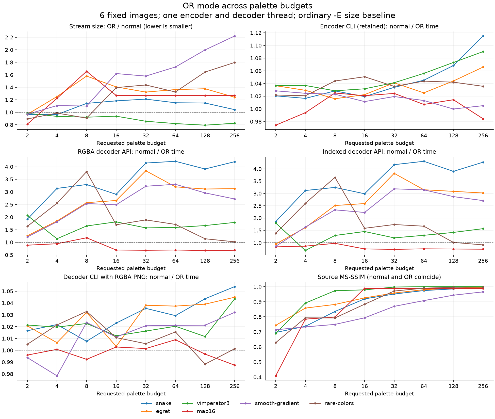
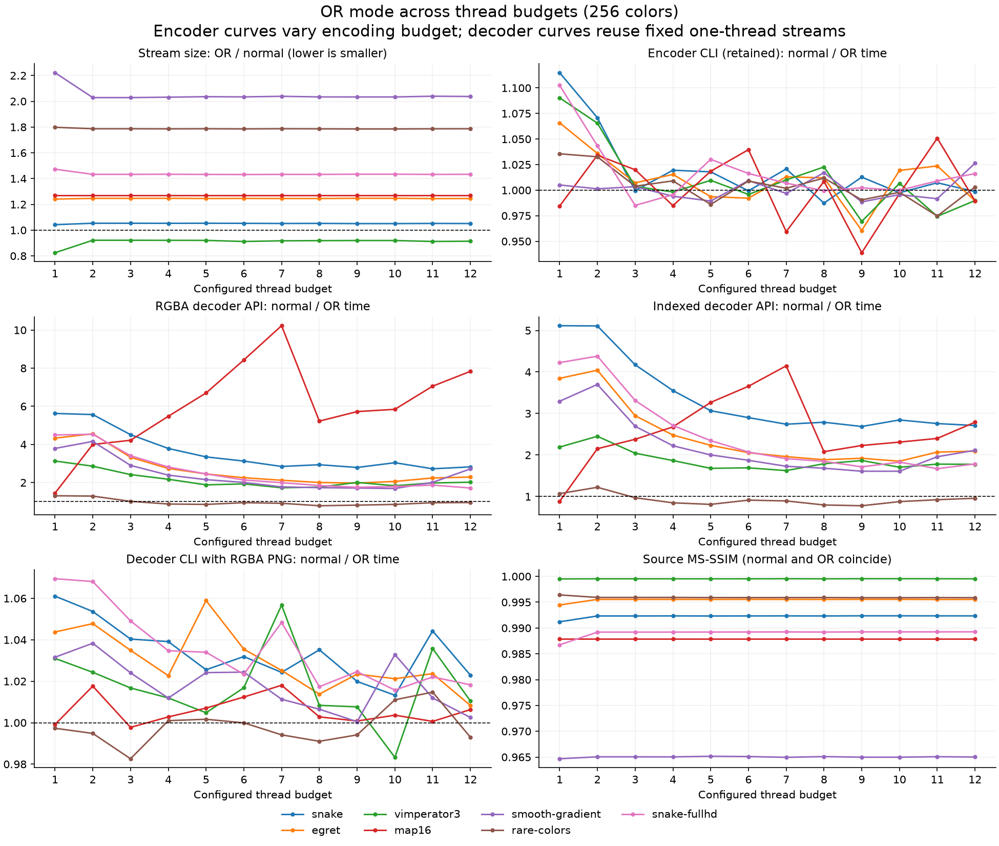
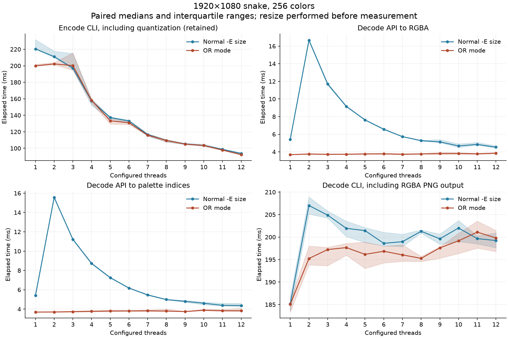
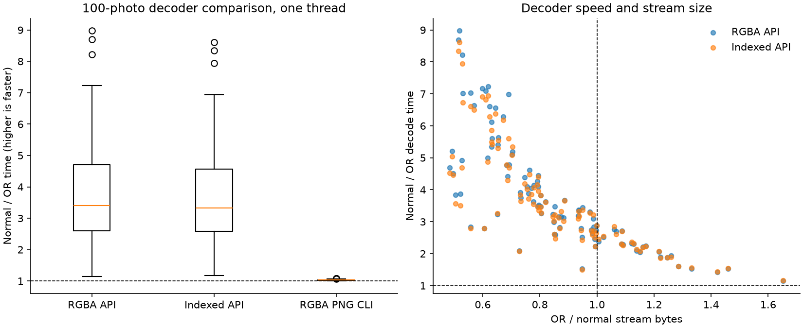

# OR-mode color, thread, and decoder comparisons

OR-mode size and speed depend on the palette budget, image structure, worker budget, and output representation. The following curves extend the [100-photo comparison](README.md#measured-comparison) with independent color and thread sweeps and explicit decoder timings. Normal and OR use the same decoder build at each measured point. Encoder measurements and immutable input streams retain their original pinned revision; decoder timings are measured separately with the band-plane implementation.

## Experimental controls

The distributed study contains only the controls listed in its records. Their values are those of the recorded run, and figures and corpus totals cover exactly these controls.

The encoder measurements and stream bytes come from the clean tracked checkout at `cf4cb3439aedec252b68bbc3674b10aa2bf0145f`, built with `-O3` on Apple M3 Max/macOS 26.5.1. The [original build metadata](measurements/metadata.json) records that compiler and configuration. Decoder measurements use Apple M3 Max/macOS 27.0.1 and the band-plane implementation based on develop `551e9bb65`, with `-O3`; [decoder metadata](sweeps/metadata.json) records its exact source hashes, compiler, configuration, and binary hashes, plus the retained encoder metadata. The encoder columns are retained historical measurements, while each normal/OR decoder pair uses the same pinned build and fixed original streams. PNG writing uses the builtin implementation.

These normal/OR curves retain the pinned band-plane study. The [ordinary decoder API scaling measurements](../../../threading/decoder.md#in-process-api-scaling) record the subsequent prefix-scan optimization with a matched before/after comparison; use that experiment for the current ordinary parallel path.

The color sweep uses the same six retained repository controls as the original comparison, with requested palette budgets **2, 4, 8, 16, 32, 64, 128, 256** and one encoder/decoder thread. The thread sweep uses **1 through 12** workers at 256 colors, for those six controls plus a Full HD snake. Snake is converted to RGB and resized to exactly 1920×1080 with Pillow Lanczos before measurement; that preprocessing is excluded from timing. See the [input manifest](sweeps/inputs.json).

The encoder controls remain `--precision=8bit --loaders=builtin! --gpu-policy=off --palette-type=rgb -Esize`, plus the requested `-p` and `--threads` values. The OR member adds only `-O`. Other encoder choices retain the measured revision's defaults. A requested palette budget is not necessarily the number of distinct colors emitted: the palette-map fixture saturates before 256 colors. The [axis summary](sweeps/axes.csv) includes the actual number of palette definitions. In the palette-map fixture, requested budgets from 16 through 256 all emit 16 colors. Its small 598×42 raster also makes CLI ratios sensitive to process-startup noise.

Two different uses of the thread axis must be distinguished:

- **Encoder sweep:** change encoder `--threads`, then measure the resulting bytes, quality, and complete conversion time. Scheduling can change the dithered raster across thread counts, so this is a controlled CLI comparison, not an immutable-index microbenchmark.
- **Decoder sweep:** encode each normal/OR input once with one encoder thread, then hold both streams byte-for-byte fixed while changing only the decoder budget. Thus, a decoder curve is not confounded by a different dither pattern or compressed stream at each point.

A configured thread budget is not a reservation of physical cores or proof that every decoder request uses every worker. Payload limits and serial fallback remain part of the implementation. Timing is performed sequentially on an unisolated desktop, with mode order alternating within each pair. Color and thread traversal direction alternates between images to reduce one-direction collection bias. Small deviations around a ratio of 1.00 are not strong evidence of improvement.

## Color-count axis



Each line follows one image. The horizontal axis is logarithmic in base two; markers are the measured budgets, and connecting lines do not represent measurements at intermediate counts. Size is OR bytes divided by normal bytes, so lower is better. Speed ratios are normal time divided by OR time, so higher is better. The dashed reference is equality. The quality panel compares each encoded result with its prepared source; normal and OR coincide at every measured point.

Size does not move monotonically in OR's favor as the palette budget rises. For example, snake changes from an OR/normal size ratio of about 0.96 at two colors to 1.21 at 32 colors and 1.04 at 256 colors. Egret is about 0.97 at two colors, 1.58 at eight, and 1.24 at 256. The gradient reaches about 2.22 at 256 colors. Plane count alone does not predict compression: ordinary size-policy overpainting, repeat runs, and spatial index patterns all contribute.

Decoder speed does not follow stream size. RGBA decoding favors OR at every measured point, between 1.31× and 6.47× at one thread, including budgets where the OR stream is larger. Indexed decoding of the small palette-map fixture stays between 0.87× and 1.17×: on its 598×42 raster, fixed per-call work outweighs the difference in accumulation. The two decoder API panels distinguish expanding to RGBA from returning palette indices; neither includes PNG writing.

## Thread-count axis



The size, encoder, and quality panels vary the encoder budget. The decoder panels reuse the fixed one-thread streams. In particular, changes in source MS-SSIM along the thread axis are changes in the encoder's scheduling/dithering path; they are not a normal-versus-OR quality difference and are not caused by decoder thread count.

The Full HD detail below shows absolute times. Lines are medians and shaded regions are the interquartile ranges of repeated samples. Unlike the per-image ratio overview, these ribbons represent run-to-run variability for each individual configuration.



The Full HD medians below make the different boundaries explicit. Times are normal / OR in milliseconds.

| Threads | Encode CLI (retained) | RGBA decoder API | Indexed decoder API | RGBA PNG decoder CLI |
| --- | ---: | ---: | ---: | ---: |
| 1 | 220.47 / 199.98 | 16.61 / 3.69 | 15.71 / 3.72 | 193.68 / 181.09 |
| 2 | 211.04 / 202.27 | 16.66 / 3.67 | 16.52 / 3.77 | 194.02 / 181.64 |
| 4 | 157.49 / 158.19 | 10.35 / 3.68 | 10.04 / 3.70 | 187.61 / 181.31 |
| 8 | 109.36 / 109.42 | 7.00 / 3.80 | 6.85 / 3.71 | 184.50 / 181.35 |
| 12 | 93.75 / 92.26 | 6.36 / 3.71 | 6.79 / 3.81 | 185.53 / 182.20 |

At one worker, OR RGBA decoding is 4.50× faster than normal decoding. OR streams always decode serially, so their medians stay between 3.67 ms and 3.80 ms at every budget. Ordinary decoding uses workers; its fastest observed RGBA median is 6.36 ms at 12 workers, still slower than the one-thread OR decode. These are workload/host observations, not universal recommended budgets. The encoder column retains the original study's measurements and is not a before/after decoder comparison.

Untimed [worker observations](sweeps/thread-observations.json) confirm serial execution at one worker. At four and twelve workers, each ordinary Full HD call starts four or twelve scan workers plus the same number of paint workers, while each OR call starts none, in both indexed and RGBA paths. These counts were collected separately from performance samples.

## Decoder timing boundaries

| Measurement | API or command | Timed work | Work outside timing |
| --- | --- | --- | --- |
| RGBA decoder API | `sixel_decode_direct` | SIXEL parsing, validation, worker setup/join as applicable, output allocation, OR band-plane accumulation and final gather/palette expansion | File I/O, correctness comparison, output freeing, PNG encoding |
| Indexed decoder API | `sixel_decode_raw` | SIXEL parsing, validation, worker setup/join as applicable, output allocation, index/palette construction | File I/O, conversion to RGBA for checking, correctness comparison, freeing, PNG encoding |
| RGBA PNG CLI | `sixel2png --direct --threads=N -i stream.six -o /dev/null` | Process startup, cached input-file I/O, decoding, PNG generation and writes to `/dev/null` | Terminal rendering, network transport |

Each API configuration has 21 timed calls after two warmup pairs; each CLI configuration has 11 timed processes after two warmup pairs. Streams are loaded into memory before API timing. Every API result is compared outside the timed call with the baseline, including palette expansion for the indexed path. The timer includes allocation of a new result, but not releasing that result after validation. The CLI's PNG generation is deliberately retained in its own metric rather than being described as pure decoding.

### Photo-set decoder results

The same 100 photographs, 800×600 and 256 colors, give the following one-thread results. Each ratio first compares the normal and OR per-image timing medians, then the table takes the median across images. OR/normal time and normal/OR speed ratios use reciprocal conventions; both are included to avoid interpreting a speed ratio below one as a benefit.

| Output boundary | Median normal/OR speed ratio | Median OR/normal time ratio | Normal faster / OR faster |
| --- | ---: | ---: | ---: |
| RGBA API | 7.382× | 0.135× | 0 / 100 |
| Indexed API | 6.874× | 0.145× | 0 / 100 |
| RGBA PNG CLI | 1.079× | 0.927× | 0 / 100 |



These are per-image comparisons of the normal and OR members decoded by the same band-plane-capable library. PNG-inclusive CLI ratios are closer to equality because output generation consumes much of the process time. Small differences around equality do not establish a benefit beyond host noise. Box centers are medians across images, boxes are interquartile ranges, whiskers extend to 1.5 times the IQR, and points beyond them are outliers; these are not per-image confidence intervals.

The matched [before/after records](sweeps/before-after.json) compare this implementation with the unchanged develop base `551e9bb65`, using identical `-O3` build options, streams, output boundary, and host. OR RGBA decoding improves by a median **10.77×** across the 100 photos; the medians of the per-photo OR times are 9.14 ms before and 0.82 ms after. This comparison uses 21 timed calls after two warmup pairs for each build, alternates build order between photos, and excludes freeing and comparisons from timing. It measures an implementation change, not a universal advantage of the dialect.

### How the band-plane decoder works

Stream bytes do not determine the amount of CPU raster work. The OR decoder in [`fromsixel.c`](../../../../src/fromsixel.c) stores one 64-bit word for each column of a six-row band. Byte lane `p` holds that column's six vertical bits for palette-index bit `p`. Spreading the selected register's bits to the low bit of each byte lane makes `word |= sixel_bits * spread(register)` accumulate a received pattern in one word operation. Composite registers such as `#3` use the same operation as power-of-two registers. Adjacent unrepeated data characters are consumed together up to a command or allocation boundary; repeat counts, raster growth, and clipping retain the checked parser path.

After parsing and final sizing, a gather pass extracts one index from each row's plane bits. It writes byte or 16-bit indices, or resolves RGBA through the final palette. Palette redefinition and HLS conversion therefore retain their existing semantics. The pass also finds the maximum composed index; the returned color count includes that index plus one and retains the existing default/defined-palette floor. Index zero is opaque, and a requested paint mask is filled once over the complete output raster. There is no per-pixel index side buffer for RGBA and no per-character pixel-mask or maximum-index update.

Registers above 255 allocate a second array of eight-plane words only when needed, preserving all sixteen index bits. Raster growth copies band words, and the final gather visits only valid rows in a short final band. These are internal buffers: public decoder results retain their existing pixel formats and ownership. No planar-output or GPU API is introduced.

OR streams always decode serially. [`sixel_decoder_parallel_request_start()`](../../../../src/decoder-parallel.c) declines an OR request before it shares any buffer, and the caller continues on the serial path. The parallel decoder would run a validation pass and a paint pass over each worker's span, launch and join its workers twice, and still leave the gather serial; its workers also paint row by row rather than consuming runs of data characters as plane words. With that structure, every budget from 2 to 12 workers was slower than one worker on both the photos and the Full HD stream. A configured decoder budget therefore applies to ordinary streams only. The [decoder threading guide](../../../threading/decoder.md) describes the parallel path that ordinary streams use.

The baseline decoder performs read-modify-write work for each affected raster sample and uses an additional index buffer before RGBA expansion. The matched before/after photo measurements isolate the effect of replacing that decoder implementation on fixed streams, rather than attributing every difference to the SIXEL dialect. Stream structure, repeat runs, palette budget, validation, allocation, and output representation still matter. The planar-display motivation discussed in [arakiken's article](https://qiita.com/arakiken/items/26f6c67da5a9f9f907ac) does not establish a terminal-rendering speedup from these CPU measurements. The band-plane layout follows the receiver that OR mode was designed for: [OR mode on the X68030 console](x68k.md) describes its planar text VRAM, the column-word band buffer it used from 2016, and the history of how that buffer reached libsixel.

## Correctness and scope

All 126 retained normal/OR encoder pairs in the sweep have identical decoded RGBA pixels, and repeated encoded streams match within every mode/configuration. Equality is checked at each color/thread point; it does not imply equality between different palette budgets or between different encoder thread counts. Source MS-SSIM therefore measures ordinary quantization/dithering loss shared by both modes, not additional OR loss.

All 226 retained decoder pairs pass the exact pixel checks. The separate [before/after compatibility manifest](sweeps/verification.json) also verifies all 957 saved streams, including the extra identical-index streams, in RGBA, byte-index, and sixteen-bit-index form at every decoder budget from 1 through 12. It records the baseline decoder's output and palette SHA-256 values, dimensions, and color counts, and [`tools/ormode/verify_decoder.py`](../../../../tools/ormode/verify_decoder.py) requires a build to reproduce every one of them at every budget, which also checks thread-count invariance; identical input hashes share a checked result. The decoder harness checks every repeated API output, and CLI RGBA results are checked both against the other mode and against the canonical one-thread encoder decode. This also tests decoder-thread invariance for the fixed inputs. The measurements concern opaque rasters and do not replace the [transparency limitation](README.md#is-the-quality-impact-exactly-zero) of the original study. No terminal or planar-VRAM rendering time is included.

The complete [encoder records](sweeps/encode.json) and [decoder records](sweeps/decode.json) retain individual timing samples, medians, quartiles, exact stream hashes, commands, and correctness observations. The photo-only decoder sample uses the same 100 fixed-ID photos as the earlier size study, rather than a newly selected set.

## Reproduction

First complete the [original study setup](README.md#reproduce-and-inspect), retaining its original inputs, encoder checkout, result streams, and `sweeps/encode/` directory. Use a fresh output directory for a changed decoder. The decoder-only runner verifies the retained stream hashes and canonical pixels and does not rerun the encoder:

```sh
py="$OR_MODE_STUDY_DIR/venv/bin/python"
decoder_source=/path/to/band-plane-libsixel
baseline_source=/path/to/libsixel-at-551e9bb65
reference_sweeps=/path/to/retained-sweep-records
output="$OR_MODE_STUDY_DIR/planar-sweeps"
cc -O3 -std=c99 -I "$decoder_source/include" \
  tools/ormode/decode-bench.c -L "$decoder_source/src/.libs" \
  -Wl,-rpath,"$decoder_source/src/.libs" -lsixel \
  -o "$OR_MODE_STUDY_DIR/decode-bench"
cc -O3 -std=c99 -I "$baseline_source/include" \
  tools/ormode/decode-bench.c -L "$baseline_source/src/.libs" \
  -Wl,-rpath,"$baseline_source/src/.libs" -lsixel \
  -o "$OR_MODE_STUDY_DIR/decode-bench-before"
"$py" tools/ormode/sweeps.py --decoder-source "$decoder_source" \
  --reference-sweeps "$reference_sweeps" --output "$output" \
  --baseline-source "$baseline_source"
OR_MODE_SWEEP_DIR="$output" "$py" tools/ormode/render_sweeps.py
cc -O2 -std=c99 -I "$decoder_source/include" \
  tools/ormode/verify-decoder.c -L "$decoder_source/src/.libs" -lsixel \
  -o "$OR_MODE_STUDY_DIR/verify-decoder"
(cd tools/ormode && "$py" verify_decoder.py "$decoder_source" \
  ../../docs/encoder/output/or-mode/sweeps/verification.json \
  "$output/verification.json")
```

Build both decoder checkouts with the identical options recorded in the [metadata](sweeps/metadata.json), placing their `.local/bin` first on `PATH`. `--baseline-source` is optional and adds the matched 100-photo RGBA comparison; it requires the separately linked `decode-bench-before`. Without `--decoder-source`, the runner retains the original complete encoder/decoder workflow. The decoder-only runner resumes completed decoder configurations only after checking metadata and stream hashes. Plotting validates the expected matrix and pixel comparisons, then reads saved measurements without rerunning benchmarks. Downloaded photos and large SIXEL streams remain outside the repository. On macOS a built `libsixel.1.dylib` records its configured install directory (`/usr/local/lib` by default) as an absolute install name, so `-rpath` alone can silently load an installed libsixel instead of the build under test; the runners therefore set `DYLD_LIBRARY_PATH` to each build's `src/.libs` explicitly. Run the measurements without other CPU-intensive work on the host.
