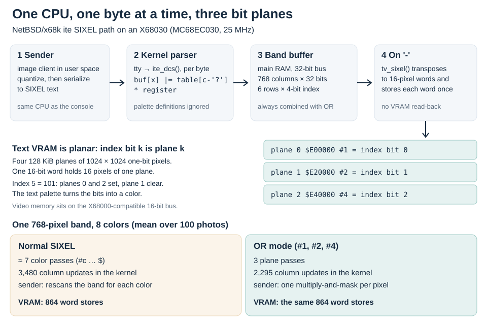
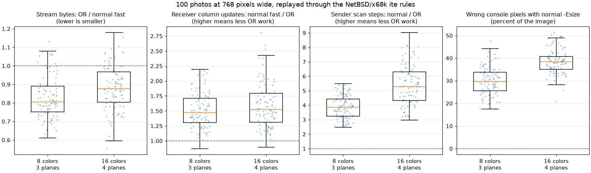

# OR mode on the X68030 console

OR mode was designed for one receiver, the NetBSD/x68k `ite` console running on a 25 MHz X68030, and on that machine it made image display measurably faster. This page explains the hardware and software that the dialect was designed around and models the work it removed there. It also records how libsixel came to decode OR streams on the principle that the console's band buffer had used since 2016, one word per column holding a whole six-row band, and why that took ten years.

## History

Tetsuya Isaki wrote a SIXEL patch for the NetBSD/x68k console in October 2014 and demonstrated it each year at Open Source Conference Hiroshima, using an X68030 to follow a Twitter stream with the `sayaka` client. The NetBSD [commit that imported the support](https://github.com/NetBSD/src/commit/74778555fbda1d2eef2b09509aefd6c5aec26e84) credits Y. Sugahara with proposing OR mode and calls it advantageous for multi-plane color VRAM. The dates below come from the [patch history](https://github.com/isaki68k/misc/commits/master/NetBSD/patch/x68k-ite-sixel.diff), the talks, and the libsixel and NetBSD repositories.

| Date | Event |
| --- | --- |
| 2014-10-18 | The [first patch](https://github.com/isaki68k/misc/blob/38acb04/NetBSD/patch/x68k-ite-sixel.diff) adds SIXEL to the console. It already collects one six-row band in main memory, one byte per pixel in six row arrays, and writes each text VRAM word once when the band ends. |
| 2015-09-17 | The [patch](https://github.com/isaki68k/misc/commit/7d656bf) adds an optional sixteen-color mode using the fourth text plane. |
| 2016-11-01 | The [patch](https://github.com/isaki68k/misc/blob/f5c3aca/NetBSD/patch/x68k-ite-sixel.diff) replaces the six row arrays with one 32-bit word per column holding six 4-bit color numbers, updates that word with one table lookup, one multiplication, and one OR, and parses the `P2=5` OR-mode flag. |
| 2016-11-27 | The OSC 2016 Hiroshima talk reports the effect on display time (below). |
| 2020-03-25 | Araki Ken adds `img2sixel -O` to libsixel in [commit `e44d854f8`](https://github.com/saitoha/libsixel/commit/e44d854f8). The commit message cites the talk's slide about the OR mode and the new kernel buffer. |
| 2020-04-12 | [arakiken's article](https://qiita.com/arakiken/items/26f6c67da5a9f9f907ac) explains the dialect, relates it to planar VRAM, and links to the multiplication and the OR store in the 2016 patch. |
| 2024-10-05 | The console support enters the NetBSD source tree. |
| 2026-06-21 | libsixel's decoder gains OR-mode support in [commit `68214059e`](https://github.com/saitoha/libsixel/commit/68214059e). It accumulates each received bit into a packed per-pixel index raster. |
| 2026-09 | The [scaling and decoding study](scaling.md) finds that most OR streams decode more slowly than the corresponding ordinary streams, although they are smaller. |
| 2026-10 | libsixel's OR decoder adopts six-row column words and decodes OR streams serially; see [the next section](#ten-years-between-the-hint-and-the-decoder). |

The [OSC 2016 Hiroshima talk](https://www.pastel-flower.jp/~isaki/NetBSD/osc16hi/page40.html) gives the only published timing. A 400×565 JPEG took 78 seconds to display before the change and 31.5 seconds after it, measured on the XM6i emulator in its high-speed mode. The [preceding slide](https://www.pastel-flower.jp/~isaki/NetBSD/osc16hi/page39.html) states that the client had stopped spawning `img2sixel` to save memory and serialized SIXEL itself. The 2.5× improvement combines three changes: OR-mode serialization in the client, OR-mode-capable parsing in the kernel, and a new kernel buffer that expands six pixels with one multiplication. The talk does not separate their contributions, and the next slide reduces the same image to 13.4 seconds by rewriting the client's image processing in C. The result therefore establishes that the combined design was much faster on that target. It is not a measurement of OR mode alone.

## The machine

The X68030 (1993) uses a 25 MHz MC68EC030. Its main memory is on a 32-bit bus, but the video circuitry is carried over from the X68000 and sits on the older 16-bit bus. The talk's configuration used 12 MB of memory, and the SIXEL client ran on the same CPU as the kernel that displayed its output.

The console draws into **text VRAM**, not graphic VRAM. Text VRAM is 512 KiB divided into four **planes** of 128 KiB. Each plane is a 1024×1024 bitmap with one bit per pixel, and one 16-bit word holds 16 horizontally adjacent pixels of one plane. A pixel's color number is not stored in one place: bit 0 of the number is in plane 0, bit 1 in plane 1, and so on, and a text palette turns the combined bits into a displayed color. The NetBSD console uses three planes, giving a fixed eight-color palette; the 2015 patch optionally used all four for sixteen colors. Graphic VRAM is different: it stores one 16-bit word per pixel and is not used by this console.

| Plane | Address | OR-mode selector | Index bit |
| --- | --- | --- | --- |
| 0 | `$E00000` | `#1` | 0 |
| 1 | `$E20000` | `#2` | 1 |
| 2 | `$E40000` | `#4` | 2 |
| 3 | `$E60000` | `#8` (sixteen-color patch) | 3 |

The console already treats a color as a set of planes when it draws text. [`tv_putc()`](https://nxr.netbsd.org/xref/src/sys/arch/x68k/dev/ite_tv.c?r=1.21#268) uses the CRTC's simultaneous plane access to store a glyph once into every plane whose color bit is 1, then clears the glyph from the remaining planes. OR mode makes a SIXEL stream follow the same arrangement: each OR selector is one plane, and each OR data character is six vertical bits of that plane.

<picture>
  
</picture>

*The per-band counts at the bottom are means from the model described [below](#modeled-work-on-the-console). Every stage above the VRAM runs on the 25 MHz CPU.*

## What the console receiver does

The receiver is in [`ite_dcs()`](https://nxr.netbsd.org/xref/src/sys/arch/x68k/dev/ite.c?r=1.73#2404) and [`tv_sixel()`](https://nxr.netbsd.org/xref/src/sys/arch/x68k/dev/ite_tv.c?r=1.21#764). Its design explains where OR mode can and cannot save time.

1. **Every byte is handled by the kernel.** The client writes SIXEL text to the terminal device; the kernel passes it to the console parser one character at a time. On a 25 MHz CPU, the fixed cost of each received byte is significant.
2. **One column word per pixel column.** The band buffer holds one 32-bit word for each of up to 768 columns, with a 4-bit color number for each of the six rows. A data character is converted with a 64-entry table that spreads its six bits into six 4-bit positions, multiplied by the selected register, and combined with `|=`. One table load, one multiplication, and one OR replace up to six separate pixel stores.
3. **Palette definitions are ignored and registers are masked.** `#n;2;r;g;b` is parsed and discarded; `#n` selects `n & 7`. The eight colors are those of the text palette.
4. **VRAM is written once per band.** At `-`, `tv_sixel()` transposes the buffer into 16-pixel words and stores each word of each plane once. It does not read VRAM back and does not depend on the number of colors or the dialect. A 768-pixel band always costs 6 rows × 48 words × 3 planes = 864 word stores on the 16-bit bus.
5. **Both dialects use the same code.** `P2=5` is parsed into `decsixel_ormode`, but no later code reads it. The buffer always accumulates with OR. An ordinary stream displays correctly only when it paints each pixel at most once, which is true of the console's own client and of libsixel's `-E fast` path.

The band buffer is older than OR mode. From the first patch in 2014 through 2015, it held one byte per pixel in six row arrays, and each data character tested six bits and stored up to six bytes into different rows; the band was still written to VRAM only once. That design already removed the planar read-modify-write that direct VRAM painting would need. What the 2016 revision changed was the CPU work per received character. The 2016 buffer and OR mode fit together: OR accumulation into packed column words is what makes the single multiply-and-OR update possible, and power-of-two selectors are exactly the plane bits that the final transposition writes. The receiver does not write received plane rows directly into VRAM. arakiken's article identifies that as possible, but unimplemented in this console and in mlterm.

Consequently, on this receiver OR mode does not reduce VRAM traffic. It reduces the number of bytes the kernel must parse and the number of column updates it performs. Every one of those operations is CPU work on the same processor that is also decoding the JPEG, scaling, quantizing, and serializing the image.

## What the sender does

The client's two serializers in [`image_sixel.c`](https://github.com/isaki68k/sayaka/blob/master/src/image_sixel.c) show the sender-side difference. In its current C version, ordinary mode first scans each six-row band to find the leftmost and rightmost column of every color. It then emits one pass for each color present, and each pass examines all six rows of every column in that color's span to build the mask. A band containing k colors is therefore examined roughly k + 1 times. OR mode examines each pixel once: a multiply-and-mask step distributes the color-number bits of a six-pixel column into one byte per plane. It then run-length-encodes ⌈log₂ n⌉ plane rows for an n-color palette. The talk summarizes this as an improvement of up to O(log n) according to the number of colors.

On a dithered photograph, nearly every palette color occurs in nearly every band. With the console's eight colors, ordinary serialization makes about seven passes per band where OR mode makes three. Lowering the number of passes also lowers the number of selectors, carriage returns, and repeat introducers that the kernel must parse.

## Modeled work on the console

The 25 MHz CPU cannot be timed on a modern host, and the original image and client are not available. The repository instead counts the operations that the two programs perform. [`tools/ormode/ite-model.c`](../../../../tools/ormode/ite-model.c) replays a stream through the console rules above and records the bytes, data characters, column updates, selectors, carriage returns, and VRAM word stores. [`tools/ormode/x68k_model.py`](../../../../tools/ormode/x68k_model.py) counts the client's two scan structures on the same index raster. Counts are proportional to the work of each loop, but they do not assign cycle costs, include tty-layer overhead, or reproduce the 2016 timing.

The inputs are the same 100 photographs and pinned build as the [measured comparison](README.md#measured-comparison), scaled with `img2sixel -w768` to the console's 768-pixel limit. Both the eight-color console and the sixteen-color patch are modeled with an adaptive palette and default dithering. Three libsixel streams are compared: `-E fast`, `-E size`, and OR mode. Every OR stream reconstructs exactly the same console pixels as `-E fast`.



*Each point is one photograph. Boxes span the interquartile range with the median marked; whiskers extend to 1.5 times that range. Sender scan steps count ordinary span examinations against OR transpositions plus plane-run steps.*

| 768 px wide, 100 photos | 8 colors, 3 planes | 16 colors, 4 planes |
| --- | ---: | ---: |
| OR smaller than `-E fast` | 89 / 100 | 83 / 100 |
| Total bytes, OR vs `-E fast` | −18.3% | −14.0% |
| Median receiver column updates, `-E fast` / OR | 1.47× | 1.52× |
| Selectors parsed, `-E fast` / OR (totals) | 10.1× | 17.4× |
| Mean ordinary color passes per band | 6.97 | 13.03 |
| Median sender scan steps, normal / OR | 3.87× | 5.30× |
| VRAM word stores per image | identical | identical |
| Console pixels wrong with `-E size` (median, range) | 29.7% (17.5–47.5%) | 38.3% (20.9–51.4%) |

`-E size` is the smallest stream in most cases, but the console cannot display it. Its fill-and-repaint optimization relies on a later paint replacing an earlier one, whereas the console ORs the second color number into the first. On this receiver, the valid ordinary baseline is a stream that paints every pixel once, and OR mode is smaller than that baseline for most photographs. The [policy comparison](README.md#output-size-and-encoding-speed) observes the same reversal for `snake.png`: OR is smaller than `-E fast` and larger than `-E size`.

The largest modeled reduction is on the sender. The sender and receiver share the CPU, so a several-fold reduction in serialization scans is time made available directly to the rest of the display pipeline. The receiver's savings are smaller but apply to every byte the kernel handles. Neither count changes the VRAM writes, which were already minimized by the band buffer.

## Ten years between the hint and the decoder

The part of the design that made the console's receiver fast was published in plain view. The 2016 talk states it in one line beside the OR mode: the kernel buffer was reworked so that six pixels are expanded with a single multiplication. libsixel's own `-O` commit of March 2020 cites that slide, and arakiken's article of April 2020 links to the exact lines of the patch that perform the multiplication and the OR store. libsixel nevertheless took the slide to be about the dialect.

The dialect was the visible and portable part: a new `P2` value, power-of-two selectors, and a wire format that an encoder could produce. libsixel implemented that part in its encoder in 2020. The receiver buffer looked like a detail of one kernel driving one display, and the usual explanation of OR mode, planar VRAM, directed attention to the display hardware rather than to a buffer in main memory. When libsixel's decoder gained OR support in June 2026, it implemented the semantics in the most direct way: for every set bit, OR the selected register into that pixel's index. That is the per-pixel work that the console had replaced in November 2016. The ordinary decoder initially used the same per-bit structure, storing one pixel for each set bit of each data character.

The measurements of September 2026 exposed the gap: OR streams were smaller but decoded more slowly. Explaining that result meant reading the console's receiver instead of the description of the dialect. The receiver showed that the console writes exactly the same VRAM words in both dialects, and that its advantage came from the CPU side: a received six-row pattern stays vertical, in one word per column, until the band ends, so one character costs one word update instead of up to six scattered pixel stores.

libsixel's OR decoder now follows the same principle. [`decoder-ormode.h`](../../../../src/decoder-ormode.h) keeps one 64-bit word per band column, in which byte `p` holds the six vertical bits received for palette-index bit `p`. Spreading the selected register's bits into those byte lanes lets one multiplication accumulate a data character for any register, including composite registers such as `#3`, and a final gather turns each row of bits into an index or an RGBA pixel. On the [retained photo streams](scaling.md#photo-set-decoder-results), the current normal/OR RGBA speed ratio is a median 3.40×. Both serial decoders now use column words, so this comparison includes their stream structures and different word updates. The [decoder study](scaling.md#how-the-band-plane-decoder-works) describes the representation and its limits.

The historical attribution remains open. The 2016 measurement does not separate the column-word buffer from the dialect. Inside the kernel, the buffer reduced the work per data character from six bit tests and up to six byte stores to one word update, whereas the dialect reduced the number of column updates by a median 1.47× in the model above; on the sender, only the dialect removed the per-color rescans. A cycle-level replay of the 2015 and 2016 receivers and of both serializers on a 68030 core could apportion the 2.5×. The layout is not specific to OR mode. libsixel's ordinary serial decoder keeps six row indexes in one word and replaces masked bytes with one update, retaining a separate coverage byte for unpainted samples. The [ordinary-mode pipeline](../../../decoder/pipeline/README.md#ordinary-mode-band-columns) describes palette-history and wide-register materialization. Its parallel workers parse disjoint bands into the same column-word format and gather pixels only after prefix resolution and raster validation.

## Why the modern measurements differ

| Condition | NetBSD/x68k console | libsixel study on a current desktop |
| --- | --- | --- |
| Palette budget | Fixed 8 or 16 colors: 3 or 4 planes against about 7 or 13 colors per band | Usually 256 colors: 8 planes; the color count per band and the byte savings vary widely |
| Ordinary baseline | Single-paint only; `-E size` repair is invalid | `-E size`, which is already smaller than OR for many images |
| Receiver storage | One 32-bit word per band column, six 4-bit color numbers, then a fixed planar flush | One 64-bit word per band column, eight 6-bit plane rows, then a gather to indices or RGBA |
| Cost of a byte | Parsed by the kernel on the same 25 MHz CPU | Small beside image loading, quantization, dithering, and PNG generation |
| Sender's share of time | Large; SIXEL serialization competed with every other step on one slow CPU | Small; serialization of an identical index raster is still a median 6.32× faster in OR mode, but the complete conversion changes far less |

The modern measurements are valid for their boundary: a 256-color libsixel encode and a CPU decoder that returns a packed raster. Stream size and encoding time do not reproduce the conditions under which OR mode helped the console, namely few colors, a single-paint baseline, and a single slow CPU parsing every byte. Decoding time does now reflect the console's receiver design, because both decoders accumulate a band in column words before producing pixels.

## Scope

This page describes the NetBSD sources at `ite.c` revision 1.73, `ite_tv.c` revision 1.21, and `itevar.h` revision 1.18, and the 2014–2016 patches that preceded them. The modeled streams come from libsixel's encoder, not the original client; their palettes and dithering differ from those used in 2016. The counts compare workloads and should not be converted to seconds. The [OR-mode reference](README.md) remains the owner of the libsixel encoding contract, and the [specification layers document](../../../sixel-format/specification-layers.md#or-mode) explains why the dialect is not recommended for new receivers.

## Reproduction

First complete the [original study setup](README.md#reproduce-and-inspect), retaining its inputs, source checkout, and build. With `OR_MODE_STUDY_DIR` pointing to that study directory, run:

```sh
py="$OR_MODE_STUDY_DIR/venv/bin/python"
cc -std=c99 -O2 tools/ormode/ite-model.c -o "$OR_MODE_STUDY_DIR/ite-model"
(cd tools/ormode && "$py" x68k_model.py && "$py" render_x68k.py)
```

The runner writes streams, console rasters, [results](x68k-model/results.json), and [metadata](x68k-model/metadata.json) to `x68k/` in the study directory. Each result row records the exact command, stream hash, model counts, and the number of console pixels that differ from the single-paint reference.
