# Lookup policy measurements

This page holds the evidence behind the measured claims of the [lookup policy](../README.md) reference: color error, MS-SSIM, and end-to-end speed of each policy across palette sizes, with and without error diffusion. It is written for contributors who evaluate or change a lookup policy. The lookup policy reference states the contracts; this page only measures them.

## Questions

The historical RGB555 path reduces each byte-valued color axis from 256 values to 32 histogram and cache addresses. This section asks seven user-visible questions:

1. How do current policies compare when palette construction is controlled by `-Qkmeans:Gw -Xoklab`?
2. How does the current Heckbert compatibility mapping expose the legacy RGB555 limitation alongside policies that were added later?
3. What end-to-end speed does each policy deliver under the same modern CLI configuration?
4. Does sharing the `5bit`, `6bit`, or `certlut` instance between workers materially change end-to-end latency?
5. What latency change does the Metal PaletteApply path produce for its supported `none` and `eytzinger` policies?
6. How do the ten policies change when Floyd--Steinberg error diffusion is enabled instead of disabling dithering?
7. How does `delaunay` compare with `vptree`, `5bit`, and `6bit` across byte and native-float lookup, three images, and both diffusion settings?

The ten-policy sweeps answer questions one, two, three, and six for one fixture. Separate shared-instance and Metal studies answer questions four and five; the four-policy Delaunay study answers question seven for three fixtures. These studies have different revisions and protocols and do not establish a universal ranking.

Unless a subsection explicitly says otherwise, every quality and speed result below uses `--diffusion=none`. This isolates palette construction and lookup more clearly by removing spatial error feedback. It is not representative of the default experience when a user enables dithering; the dedicated Floyd--Steinberg control below measures that case separately.

The ten-policy sweeps resolve to planner `work=rgb888`, but their actual lookup classes differ: controlled OKLab K-means uses `lookup/POLICY.float32`, while Heckbert uses `lookup/POLICY.8bit`. The retained native palette explains this distinction; [Encoder Working Precision](../../../precision/README.md#requested-precision-and-effective-format) owns that contract. Neither the planner field nor `--precision-policy=auto` alone establishes the lookup representation. The separate Delaunay study also records the actual consumer classes.

## Conditions

The ten-policy quality and single-thread speed sweeps were measured on 2026-10-22 JST from tracked-clean revision `26a31afef67dbbdd9b45d2b0f115ba099b51bdb6`. The host was an Apple M3 Max with 36 GiB RAM, macOS 27.0.1 arm64, and Apple Clang 21.0.0. Autotools used `CFLAGS=-O3`, libpng, and LCMS2; the manifests retain the complete configuration and executable hashes. The input was [`images/snake.png`](../../../../../images/snake.png), at 600 by 450 pixels. The broad curves use `K = 8, 16, 32, 64, 128, 256`; both focused curves use steps of 16 from 128 through 256.

The shared-instance and Metal artifacts retain their 2026-09-06 revision `f2c138d8f` and macOS 26.5.1 conditions. Their sections describe the historical evidence and its limits. The four-policy Delaunay study has its own snapshot and protocol below. Compare times within each study; do not splice their samples into the ten-policy curves.

The controlled K-means quality and speed comparisons use this normal CLI path, with `SIXEL_LOADER_CMS_ENGINE=none` in the cleaned environment:

```text
img2sixel \
  --threading-policy=greedy:global_budget=1 --precision-policy=auto --quality=full \
  --loaders=libpng! \
  --quantize-model=kmeans:seed=1 --merge-policy=ward -Xoklab -Wgamma \
  --diffusion=none --gpu-policy=off \
  --lookup-policy=POLICY -p K \
  images/snake.png
```

The Floyd--Steinberg control changes only the diffusion option:

```text
img2sixel \
  --threading-policy=greedy:global_budget=1 --precision-policy=auto --quality=full \
  --loaders=libpng! \
  --quantize-model=kmeans:seed=1 --merge-policy=ward -Xoklab -Wgamma \
  --diffusion=fs --gpu-policy=off \
  --lookup-policy=POLICY -p K \
  images/snake.png
```

The current Heckbert compatibility comparison instead uses:

```text
img2sixel \
  --threading-policy=greedy:global_budget=1 --precision-policy=auto --quality=full \
  --loaders=libpng! \
  --quantize-model=heckbert --cover-policy=off --merge-policy=none \
  --diffusion=none --gpu-policy=off \
  --lookup-policy=POLICY -p K \
  images/snake.png
```

The shared-instance speed comparison uses controlled K-means, eight total pipeline threads, and explicit private or shared instances:

```text
img2sixel \
  --threading-policy=greedy:global_budget=8 --precision-policy=auto --quality=full \
  --loaders=libpng! \
  --quantize-model=kmeans:seed=1 --merge-policy=ward -Xoklab -Wgamma \
  --diffusion=none:band_overwrap=0 --gpu-policy=off \
  --lookup-policy=POLICY:shared_instance=0|1 -p K \
  images/snake.png
```

The Metal comparison uses one CPU thread and forces the GPU PaletteApply path:

```text
img2sixel \
  --threading-policy=greedy:global_budget=1 --precision-policy=auto --quality=full \
  --loaders=libpng! \
  --quantize-model=heckbert --cover-policy=off --merge-policy=none \
  --diffusion=none:band_overwrap=0 --gpu-policy=off|force \
  --lookup-policy=none|eytzinger -p K \
  images/snake.png
```

`lsqa` compares each SIXEL stream with the original image and reports its existing `Δ E00_mean`, `Δ Chroma_mean`, and MS-SSIM metrics. The runner removes inherited `SIXEL_*` variables from both programs, then sets `SIXEL_LOADER_CMS_ENGINE=none` for both. Encoder input is pinned to `libpng`; assessment settings stay identical across policies. The K-means seed is one, and the diffusion control changes only `none` to `fs`.

The recorded build leaves `FLOAT_LOOKUP_CFLAGS` empty. Delaunay's byte cold batches use NEON, while its native-float K-means sweep retains scalar misses under the [float SIMD gate](../delaunay.md#method); this sweep does not measure the optional float batch kernel.

Untimed probes at `K = 256` check all ten consumer classes for K-means with both diffusion settings and for Heckbert without diffusion. The manifests retain these probes. In this build, the K-means `5bit` and `6bit` measurements exercise their native-float exhaustive fallbacks; only the Heckbert quality curves exercise their byte-addressed caches. `-Wgamma` selects gamma-RGB application coordinates without forcing a byte palette.

## Results

### Controlled K-means result

The color-error curves below overlap for nine policies, including `delaunay`; the table distinguishes those equal measurements from the small `fhedt` difference.

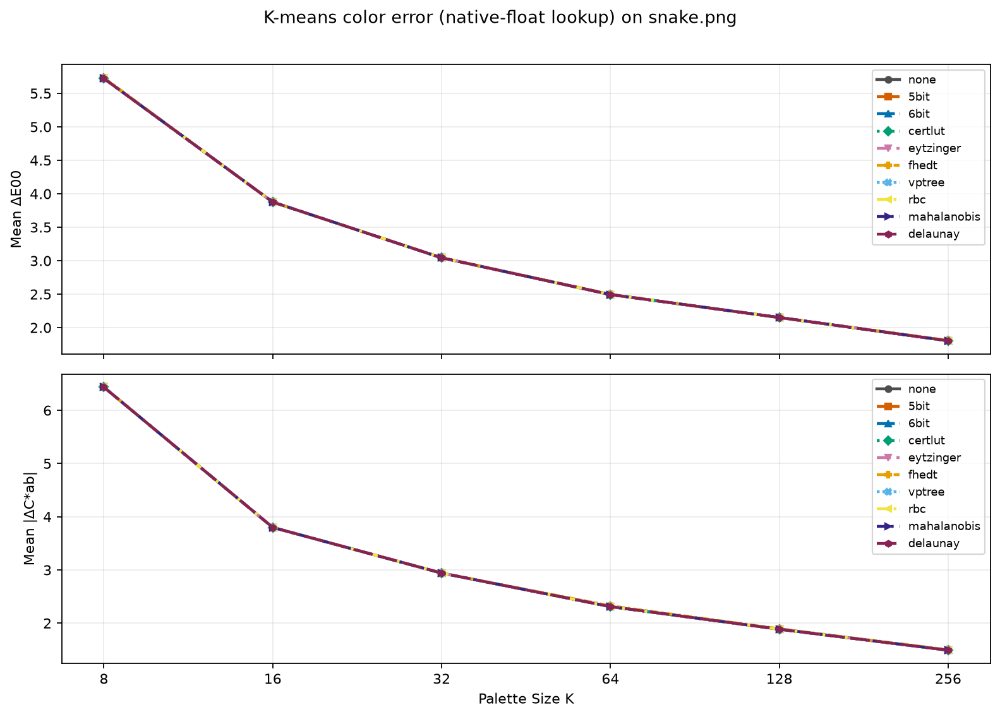

Lower values are better on both panels. The complete measurements are in [`lookup-policy-kmeans-color-error.csv`](lookup-policy-kmeans-color-error.csv). The corresponding spatially pooled view is [MS-SSIM](lookup-policy-kmeans-ms-ssim.png), with values in [`lookup-policy-kmeans-ms-ssim.csv`](lookup-policy-kmeans-ms-ssim.csv).

At `K = 256`, the measured values are:

| Policy | Mean Delta E00 | Mean absolute chroma error | MS-SSIM |
| --- | ---: | ---: | ---: |
| `none` | 1.803334 | 1.491011 | 0.991444 |
| `5bit` | 1.803334 | 1.491011 | 0.991444 |
| `6bit` | 1.803334 | 1.491011 | 0.991444 |
| `certlut` | 1.803334 | 1.491011 | 0.991444 |
| `eytzinger` | 1.803334 | 1.491011 | 0.991444 |
| `fhedt` | 1.811546 | 1.499045 | 0.991376 |
| `vptree` | 1.803334 | 1.491011 | 0.991444 |
| `rbc` | 1.803334 | 1.491011 | 0.991444 |
| `mahalanobis` | 1.803334 | 1.491011 | 0.991444 |
| `delaunay` | 1.803334 | 1.491011 | 0.991444 |

`-Qkmeans:Gw` selects K-means with Ward final merging, while `-Xoklab` places its clustering objective in OKLab. K-means still finds a local solution rather than a guaranteed global optimum. Its retained float palette makes this a native-float lookup comparison even though the input and planner work format are RGB888.

Across the broad sweep, the nine non-`fhedt` policies have identical reported six-decimal color errors and MS-SSIM. In particular, this experiment does not show the RGB555/RGB666 bucket approximation: `5bit` and `6bit` use their float fallbacks. `fhedt` has a small error difference at `K = 256`. Equal aggregate metrics alone do not establish byte-identical outputs or a general exactness guarantee; the [policy reference](../README.md#contract) owns those guarantees.

This section has no fixed-palette comparison. Such a comparison must apply each explicit lookup policy to the supplied `-m` palette, which the CLI does, and has not been measured.

### Legacy RGB555 context in current Heckbert mode

The Heckbert comparison exposes the palette construction coupling associated with preserving the legacy RGB555 path. It is not a reconstruction of a historical user choice: through the 1.8.7 era, the RGB555 route was fixed and users could not select a lookup policy. These curves exercise byte lookup and show differences absent from the native-float K-means curves.

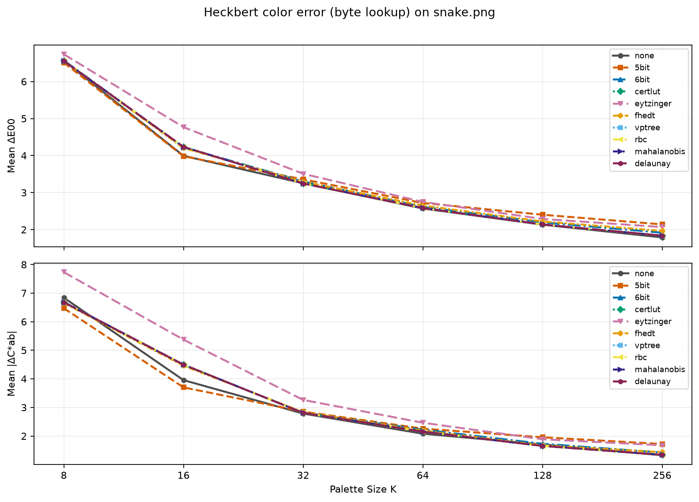

At `K = 8`, `none` reports mean absolute chroma error 6.840117, compared with 6.469421 for `5bit`, 6.690632 for `6bit`, and 6.677878 for both `vptree` and `delaunay`. The values and command templates are in [`lookup-policy-color-error.csv`](lookup-policy-color-error.csv).

The [Heckbert histogram compatibility mapping](../README.md#precedence-and-interactions) changes palette construction before lookup begins. Its effect and byte lookup approximation are therefore combined in these curves. A lower perceptual error for another policy does not imply a more exact search over the same palette.

The companion MS-SSIM figure shows a different aspect of the same outputs; higher values are better.

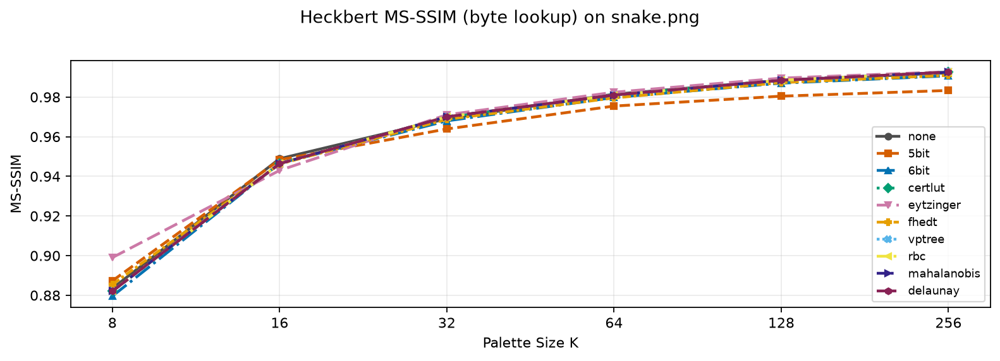

At `K = 256`, `5bit` reaches 0.983335, `none` reaches 0.992192, and `delaunay` reaches 0.992580. The underlying values are in [`lookup-policy-ms-ssim.csv`](lookup-policy-ms-ssim.csv).

### Controlled K-means high-palette-size detail

The focused figure enlarges the 128--256 region under the same native-float K-means condition; the nine non-`fhedt` curves remain coincident at the reported precision.

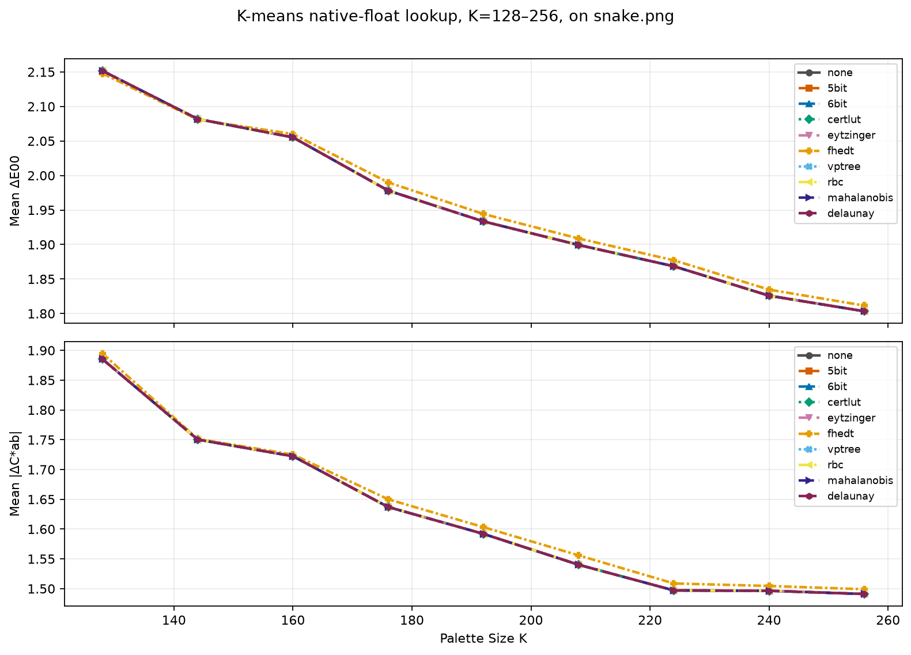

The focused source data are in [`lookup-policy-kmeans-high-k.csv`](lookup-policy-kmeans-high-k.csv). At `K = 256`, the measured values are:

| Policy | Mean Delta E00 | Mean absolute chroma error |
| --- | ---: | ---: |
| `none` | 1.803334 | 1.491011 |
| `5bit` | 1.803334 | 1.491011 |
| `6bit` | 1.803334 | 1.491011 |
| `certlut` | 1.803334 | 1.491011 |
| `eytzinger` | 1.803334 | 1.491011 |
| `fhedt` | 1.811546 | 1.499045 |
| `vptree` | 1.803334 | 1.491011 |
| `rbc` | 1.803334 | 1.491011 |
| `mahalanobis` | 1.803334 | 1.491011 |
| `delaunay` | 1.803334 | 1.491011 |

The matching broad and focused endpoints provide a consistency check on the repeated quality runs. The separate speed figure distinguishes their end-to-end cost; overlapping quality curves do not imply equal runtime.

### Palette-geometry sensitivity under Heckbert

The Heckbert high-`K` figure shows larger policy differences. Comparing it with K-means changes both palette construction and lookup representation, so the difference cannot be assigned solely to palette geometry.

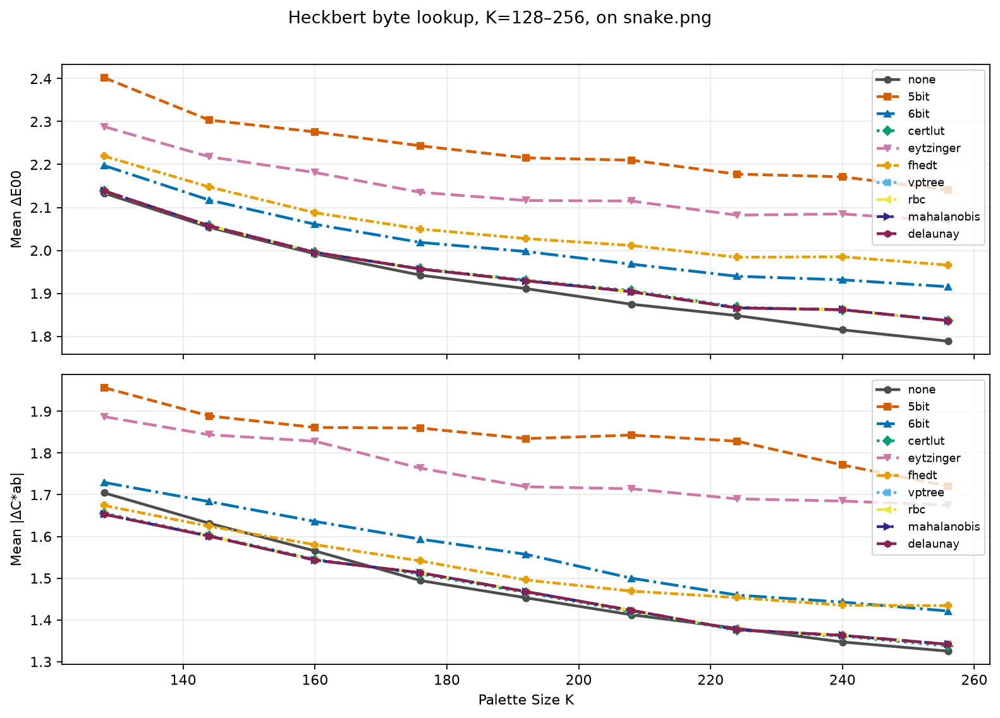

The focused source data are in [`lookup-policy-heckbert-high-k.csv`](lookup-policy-heckbert-high-k.csv). At `K = 256`, the measured values are:

| Policy | Mean Delta E00 | Mean absolute chroma error |
| --- | ---: | ---: |
| `none` | 1.788589 | 1.325273 |
| `5bit` | 2.140509 | 1.720508 |
| `6bit` | 1.915410 | 1.421429 |
| `certlut` | 1.836495 | 1.337875 |
| `eytzinger` | 2.068099 | 1.675120 |
| `fhedt` | 1.965712 | 1.434240 |
| `vptree` | 1.836473 | 1.341678 |
| `rbc` | 1.836473 | 1.341678 |
| `mahalanobis` | 1.836473 | 1.341678 |
| `delaunay` | 1.836473 | 1.341678 |

#### Why some Heckbert configurations beat `none`

The ordering depends on palette size and metric. At `K = 8`, `5bit` has lower mean Delta E00 than `none` (6.512108 versus 6.562847). At `K = 256`, `none` has the lowest mean Delta E00 in this comparison, but Eytzinger has higher MS-SSIM (0.992792 versus 0.992192). No policy leads every metric at every palette size.

The histogram mapping changes Heckbert's splits and representative colors. Moreover, the lookup metric differs from Delta E00, chroma error, and MS-SSIM. These results cannot establish that a coarser histogram inherently improves perceptual quality, or that another policy is more exact than an exhaustive scan. A fixed-palette component benchmark is needed to isolate lookup error.

At `K = 256`, `eytzinger` and `vptree` have mean Delta E00 values of 2.068099 and 1.836473 under Heckbert, whereas both reach 1.803334 under K-means. [Eytzinger's byte and float search methods](../eytzinger.md#guarantee) differ, so this pair is not a controlled test of geometry alone. It motivates evaluating multiple palettes while keeping the lookup representation fixed. The present single-image study does not establish a generally easier quantizer to search.

### End-to-end speed

The speed figure compares native-float K-means lookup, including palette construction and SIXEL encoding. Delaunay and VP-tree are compared under the same conditions at each palette size.

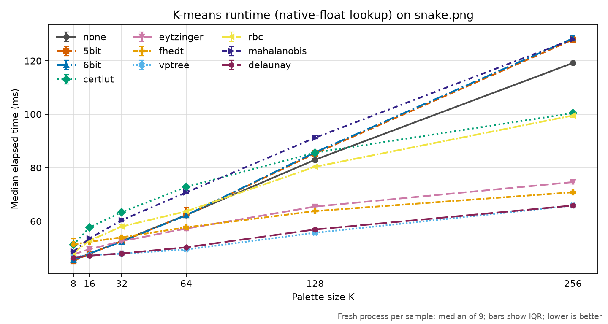

Each point is the median of nine fresh processes after two warm-up rounds; policy order rotates each round, and error bars show the interquartile range. Lower is better. The source data and complete command template are in [`lookup-policy-speed.csv`](lookup-policy-speed.csv).

At `K = 256`, the result is:

| Policy | Median time | Speedup over `none` |
| --- | ---: | ---: |
| `none` | 122.0 ms | 1.00x |
| `5bit` | 131.3 ms | 0.93x |
| `6bit` | 131.8 ms | 0.93x |
| `certlut` | 102.9 ms | 1.19x |
| `eytzinger` | 77.3 ms | 1.58x |
| `fhedt` | 74.0 ms | 1.65x |
| `vptree` | 68.7 ms | 1.77x |
| `rbc` | 102.7 ms | 1.19x |
| `mahalanobis` | 131.4 ms | 0.93x |
| `delaunay` | 68.7 ms | 1.78x |

Delaunay takes 68.7 ms and VP-tree 68.7 ms, compared with 122.0 ms for `none`. Native-float `5bit` and `6bit` take 131.3 and 131.8 ms and do not show a byte-cache speed advantage. The error bars describe variation within this run; the table does not establish a stable ordering of close medians.

In this run, `fhedt` takes 74.0 ms. VP-tree and Delaunay match the direct quality scores; their elapsed times are listed separately above. This does not establish a portable ranking. Preparation, queries, palette construction, loading, and SIXEL output all contribute to elapsed time; a component benchmark is needed to assign the differences to a particular stage.

### Shared-instance performance

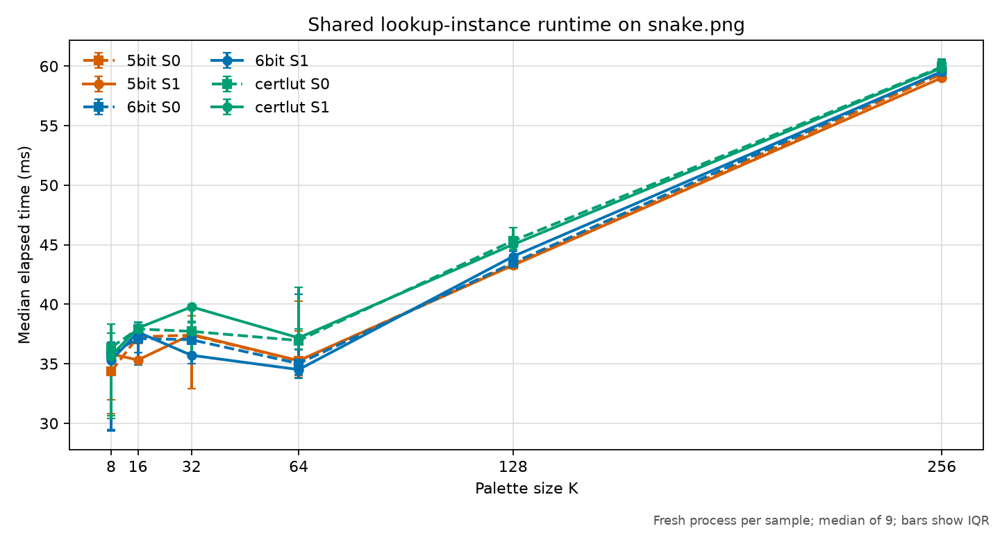

This focused comparison holds the process thread limit at eight and compares `shared_instance=0` (`S0`, one lookup instance per dither worker) with `shared_instance=1` (`S1`, one instance shared by the workers). It covers only the three policies that expose this switch. The source data are in [`lookup-policy-shared-speed.csv`](lookup-policy-shared-speed.csv).

At `K = 256`, the result is:

| Policy | `S0` median | `S1` median | `S1` change from `S0` |
| --- | ---: | ---: | ---: |
| `5bit` | 59.3 ms | TODO(remeasure) | TODO(remeasure) |
| `6bit` | 59.6 ms | TODO(remeasure) | TODO(remeasure) |
| `certlut` | 59.9 ms | 59.9 ms | -0.1% |

These checked artifacts were recorded at source revision `f2c138d8f6aa0a90c89d019f85eaf9bb3efa5edb`, before worker-local `5bit` and `6bit` instances populated their dense tables during parallel mapping. At that revision, the private and shared curves were mostly within each other's interquartile ranges, so the run did not establish a material end-to-end latency benefit for either setting.

The shared `5bit` and `6bit` values are `TODO(remeasure)`. Shared instances populate their dense tables with relaxed atomic accesses since commit `30820aa9b`; the checked graph and CSV describe the read-only shared cache of the recorded revision and must not be used to characterize the current shared path.

The runner that recorded these artifacts also required `S0` and `S1` to produce byte-identical SIXEL at `K = 256` for all three policies. At that revision the equality was a consequence of a defect in worker-local cache writes, not a contract. The current reproduction runner requires `S0` and `S1` to differ for `5bit` and `6bit`, while `certlut` remains byte-identical. Diffusion is disabled and band overlap is fixed at zero. Regenerate these artifacts before using the recorded table to characterize current dense-cache performance. Shared `5bit` and `6bit` output can also vary between runs because competing first writers can memoize different valid representatives. This is intentionally not a thread-scaling benchmark and does not measure the quality effect of parallel-band error diffusion.

### Metal PaletteApply performance

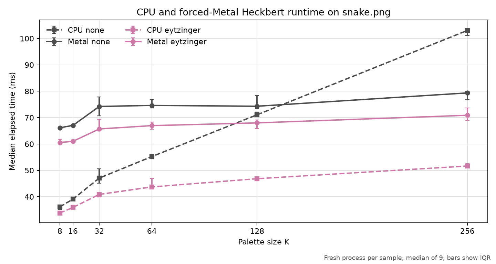

The Metal comparison covers the two implemented GPU lookup modes, `none` and `eytzinger`. CPU points use `--gpu-policy=off`; Metal points use `--gpu-policy=force`, so an unsupported request, missing Metal device, or GPU failure makes the run fail instead of silently falling back. The source data are in [`lookup-policy-metal-speed.csv`](lookup-policy-metal-speed.csv).

At `K = 256`, the result is:

| Policy | CPU median | Metal median | CPU / Metal |
| --- | ---: | ---: | ---: |
| `none` | 103.0 ms | 79.4 ms | 1.30x |
| `eytzinger` | 51.7 ms | 70.9 ms | 0.73x |

On this 600-by-450, 270,000-pixel input, Metal `none` first overtakes CPU `none` near the high end of the measured palette range: at `K = 128` the medians are 71.1 and 74.3 ms, while at `K = 256` Metal is 23.0 percent faster. For `eytzinger`, forced Metal is slower at every measured `K`; at `K = 256` it is 37.2 percent slower. Direct `none` retains an `O(P K)` palette scan whose larger `K` can amortize Metal setup and transfer costs. The CPU Eytzinger query already reduces lookup work enough that this one-shot 270,000-pixel run does not amortize those costs.

This does not establish that CPU Eytzinger is faster for larger images or a long-lived process that reuses Metal state. Each sample starts a fresh `img2sixel` process, so process startup, Metal initialization, palette construction, transfers, and SIXEL encoding all remain in the measurement. It does show that pixel count alone is insufficient to predict a profitable GPU dispatch: palette size and CPU lookup policy matter too. The current `--gpu-policy=auto` threshold is based on pixel count, not `K`.

The controlled K-means path used by the other speed figures currently completes palette application outside this Metal dispatch. The GPU comparison therefore uses `-Q heckbert -a off -F none` so it exercises PaletteApply. Each CPU/Metal pair uses the same policy and generated palette. Comparisons between the `none` and `eytzinger` pairs still include Heckbert's policy-dependent histogram resolution and must not be read as an isolated lookup microbenchmark.

At `K = 256`, CPU and Metal output was byte-identical within each policy. The manifest records the output sizes and SHA-256 digests, as well as the detected 30-core Apple M3 Max and Metal inventory.

### Floyd--Steinberg control

This control repeats the broad native-float K-means comparison with only diffusion changed from `none` to `fs`. The figure shows coincident color-error curves for nine policies, including Delaunay.

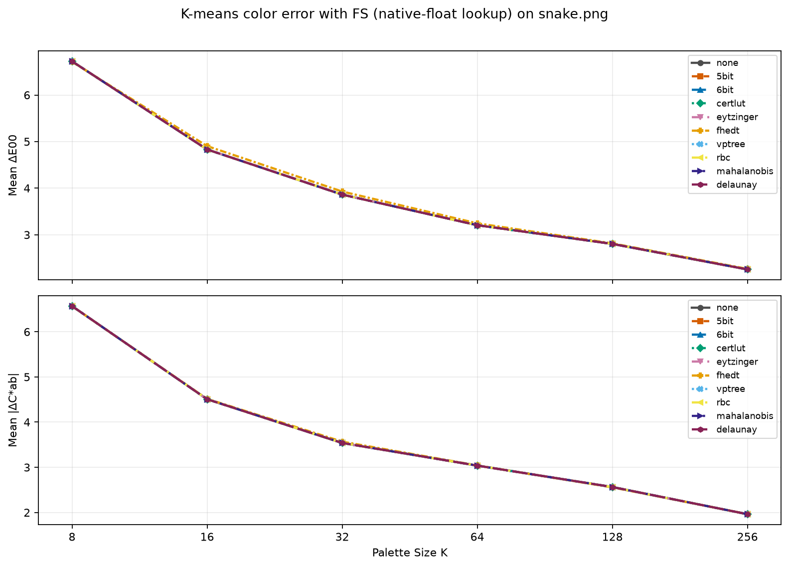

The complete color-error values are in [`lookup-policy-kmeans-fs-color-error.csv`](lookup-policy-kmeans-fs-color-error.csv). The corresponding spatially pooled view is [MS-SSIM](lookup-policy-kmeans-fs-ms-ssim.png), with values in [`lookup-policy-kmeans-fs-ms-ssim.csv`](lookup-policy-kmeans-fs-ms-ssim.csv).

At `K = 256`, changing only `--diffusion=none` to `--diffusion=fs` produced:

| Policy | Mean Delta E00 (`none` -> `fs`) | Mean absolute chroma error (`none` -> `fs`) | MS-SSIM (`none` -> `fs`) |
| --- | ---: | ---: | ---: |
| `none` | 1.803334 -> 2.255713 | 1.491011 -> 1.961572 | 0.991444 -> 0.992427 |
| `5bit` | 1.803334 -> 2.255713 | 1.491011 -> 1.961572 | 0.991444 -> 0.992427 |
| `6bit` | 1.803334 -> 2.255713 | 1.491011 -> 1.961572 | 0.991444 -> 0.992427 |
| `certlut` | 1.803334 -> 2.255713 | 1.491011 -> 1.961572 | 0.991444 -> 0.992427 |
| `eytzinger` | 1.803334 -> 2.255713 | 1.491011 -> 1.961572 | 0.991444 -> 0.992427 |
| `fhedt` | 1.811546 -> 2.267398 | 1.499045 -> 1.963902 | 0.991376 -> 0.992180 |
| `vptree` | 1.803334 -> 2.255713 | 1.491011 -> 1.961572 | 0.991444 -> 0.992427 |
| `rbc` | 1.803334 -> 2.255713 | 1.491011 -> 1.961572 | 0.991444 -> 0.992427 |
| `mahalanobis` | 1.803334 -> 2.255713 | 1.491011 -> 1.961572 | 0.991444 -> 0.992427 |
| `delaunay` | 1.803334 -> 2.255713 | 1.491011 -> 1.961572 | 0.991444 -> 0.992427 |

Mean per-pixel Delta E00 and chroma error increase for every policy, while MS-SSIM improves. Floyd--Steinberg redistributes quantization error spatially rather than minimizing each pixel's independent error. Similar six-decimal aggregate values do not by themselves establish identical outputs.

The speed figure measures the full command with diffusion enabled; the following table compares the medians within the same ten-policy study.

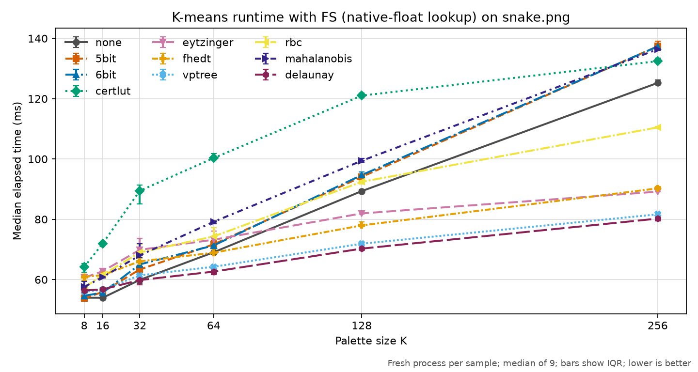

The timing data are in [`lookup-policy-fs-speed.csv`](lookup-policy-fs-speed.csv). At `K = 256`, the comparison is:

| Policy | No-diffusion median | FS median | FS median change |
| --- | ---: | ---: | ---: |
| `none` | 122.0 ms | 128.7 ms | +5.5% |
| `5bit` | 131.3 ms | 139.8 ms | +6.5% |
| `6bit` | 131.8 ms | 139.8 ms | +6.1% |
| `certlut` | 102.9 ms | 137.7 ms | +33.7% |
| `eytzinger` | 77.3 ms | 92.8 ms | +20.0% |
| `fhedt` | 74.0 ms | 91.4 ms | +23.6% |
| `vptree` | 68.7 ms | 83.9 ms | +22.0% |
| `rbc` | 102.7 ms | 113.8 ms | +10.8% |
| `mahalanobis` | 131.4 ms | 140.5 ms | +6.9% |
| `delaunay` | 68.7 ms | 81.7 ms | +19.0% |

Delaunay takes 81.7 ms and VP-tree 83.9 ms at this point, with matching reported quality scores. These results include diffusion arithmetic, changed query colors, and SIXEL encoding. They do not isolate nearest-neighbor query cost or establish a constant additive diffusion overhead. The median percentage increase is largest for `certlut` in this run, but the table cannot attribute it to one component.

### Delaunay: byte and native-float comparison

This study compares [`delaunay`](../delaunay.md), `vptree`, `5bit`, and `6bit` at `K = 32, 64, 128, 256`, with both `fs` and `none` diffusion. It uses [`snake.png`](../../../../../images/snake.png) and [`egret.jpg`](../../../../../images/egret.jpg) at 600 by 450 pixels, plus [`vimperator3.png`](../../../../../images/vimperator3.png) at 582 by 746 pixels. Egret is converted once to an 8-bit RGB PNG before timing so every input uses the same `libpng` loader. There are 192 timed configurations and 48 paired Delaunay/VP-tree output checks.

The run was recorded on 2026-10-22 JST on an Apple M3 Max with 36 GiB RAM, macOS 27.0.1 arm64, and Apple Clang 21.0.0. The implementation is identified by clean local measurement snapshot `d1acd91280d9e97247aaf6f2f96abe7b8e60345b`, based on repository revision `50bcca8f391b71bea52a7cf85d5174432720a104`. The snapshot contains the Delaunay implementation under evaluation; its ID identifies a local measurement commit, not a published release or branch. The [manifest](lookup-policy-delaunay-run.json) records its tree ID, compiler and configure arguments, input and executable/library hashes, effective lookup classes, all timing samples, and paired output hashes.

This snapshot predates eight-query cold-miss batching in Delaunay, so its timings characterize the earlier point-walk miss path. Autotools used `CFLAGS=-O3` with the project's C99 flag. Byte lookup used NEON; `FLOAT_LOOKUP_CFLAGS` was empty, so float lookup retained native scalar arithmetic under the existing [SIMD gate](../delaunay.md#method).

Every command uses `--threading-policy=greedy:global_budget=1 --precision-policy=auto --quality=full --loaders=libpng! --quantize-model=kmeans:seed=1 --merge-policy=ward -Wgamma --gpu-policy=off`. The byte matrix adds `--cms-engine=none`; the float matrix keeps default CMS and adds `-Xoklab`. All inherited `SIXEL_*` variables are removed. An untimed `LSXLUT2|phase=palette-apply` trace confirms `lookup/POLICY.8bit` or `lookup/POLICY.float32` for each configuration. CMS and clustering differ between the two matrices, so comparisons are within each representation, not an estimate of the cost of changing representation alone.

Hyperfine runs each configuration with `-N`, two warmups and seven measured fresh processes. The plots show arithmetic mean elapsed time with sample-standard-deviation error bars; the [CSV](lookup-policy-delaunay-speed.csv) also retains medians and extrema, and the [JSON](lookup-policy-delaunay-run.json) retains every sample. Output goes to the null device during timing. Policy order is fixed as `vptree`, `delaunay`, `5bit`, `6bit`, without round-by-round rotation. Process startup, loading, palette construction, lookup preparation, mapping, and SIXEL encoding are all included.

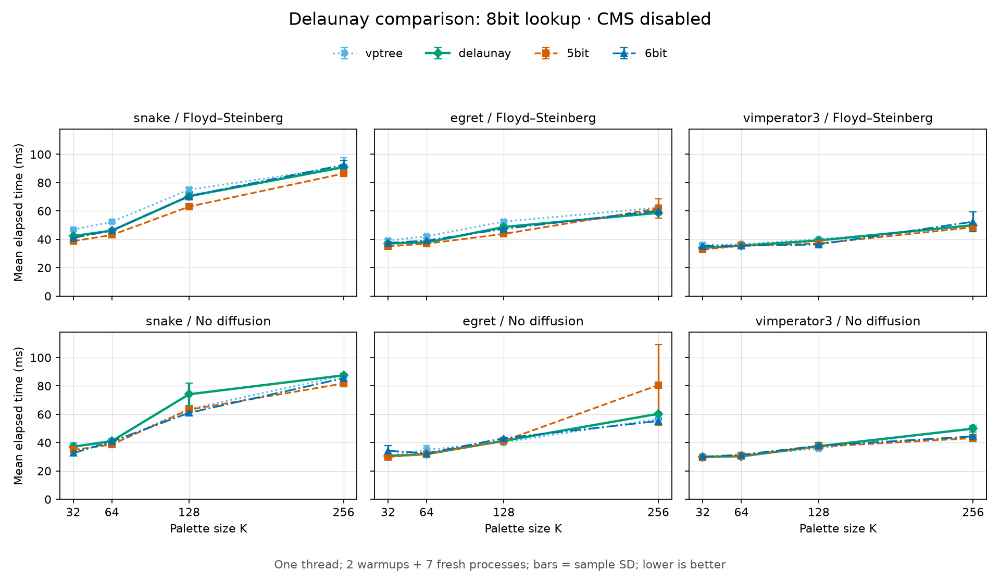

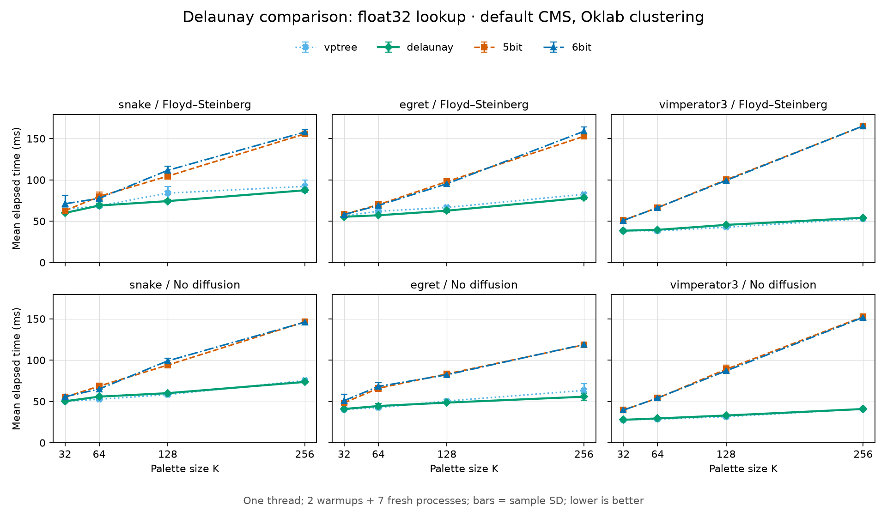

The following ratios divide each Delaunay mean by its matched VP-tree mean. Each geometric mean gives equal weight to 12 configurations, comprising three images and four palette sizes; a ratio below one means less elapsed time.

| Lookup representation | Diffusion | Geometric mean ratio | Range of individual ratios |
| --- | --- | ---: | ---: |
| Byte | Floyd--Steinberg | 0.946 | 0.882--1.028 |
| Byte | None | 1.014 | 0.913--1.163 |
| Native float | Floyd--Steinberg | 0.972 | 0.885--1.067 |
| Native float | None | 1.003 | 0.880--1.060 |

Delaunay has lower aggregate elapsed time with Floyd--Steinberg in this run, while the no-diffusion aggregate is close to VP-tree. It is not faster in every configuration. Native-float `5bit` and `6bit` are exhaustive fallbacks rather than byte-addressed caches, which explains why their high-`K` curves differ substantially from their byte counterparts. These end-to-end measurements cannot assign the difference to graph walking, SIMD, or any other individual stage.

Variation is material at several points. For example, byte `egret` without diffusion at `K = 256` takes `80.58 ± 28.51 ms` for `5bit`, with a `71.41 ms` median and one `133.02 ms` sample; byte `snake` without diffusion at `K = 128` takes `74.10 ± 7.76 ms` for Delaunay. Every sample is retained, including these slow observations. Seven sequential samples and a fixed policy order do not establish statistical significance or a stable universal ranking.

The separate output probes produced byte-identical SIXEL for Delaunay and VP-tree in all 48 matched cases. This establishes equality for these fixtures and commands, including diffusion; it does not replace the [native-coordinate correctness tests](../delaunay.md#test-coverage). This four-policy study does not add perceptual quality scores, multithreaded or shared-instance results, or measurements of the float SIMD build. The ten-policy quality sweeps above include Delaunay under their own common protocol; their CMS and palette conditions differ from this study.

## Interpretation

- The ten-policy quality study uses one natural image, and the separate four-policy Delaunay timing study adds a second photo and one screenshot. Neither characterizes every color distribution. Add gradients, saturated synthetic colors, alpha cases, and a broader image set before using the result to change a default.
- Mean Delta E00 includes lightness, chroma, and hue contributions but hides worst-case pixels. Mean chroma error omits hue and lightness.
- The native-float K-means and byte Heckbert curves differ in both palette construction and lookup representation; they do not isolate representation or geometry alone.
- The quality test does not measure memory use, output size, or palette-index stability. Those require separate curves.
- The speed curve is end-to-end single-image latency, not an isolated lookup microbenchmark. Loader, palette construction, and SIXEL encoding add common work, while policy-dependent preparation remains part of the measurement.
- The Floyd--Steinberg control demonstrates one diffusion method. It does not predict ordered, arithmetic, or other error-diffusion methods.
- The focused shared-instance run fixes the thread limit rather than sweeping it. It does not characterize scaling, worker affinity, memory use, or parallel-band seam quality.
- The Metal run is specific to one GPU, input size, one-shot process model, and supported request shape. GPU/CPU crossover points can move with all four.

## Reproduction

Configure an Autotools build with libpng and the assessment tools, install Python Matplotlib, commit the implementation being measured, and run from a tracked-clean worktree:

```sh
tools/reproduce_lookup_policy_measurements.sh
```

This one command rebuilds `img2sixel` and `lsqa`, regenerates all eight quality sweeps and both speed sweeps, writes the plots, records provenance in [`lookup-policy-run.json`](lookup-policy-run.json) and [`lookup-policy-fs-run.json`](lookup-policy-fs-run.json), and validates the complete Cartesian set of ten policies and configured palette sizes: 540 quality points and 120 speed points. It refuses tracked source changes so the recorded Git revision identifies the implementation that produced the results. Untracked files do not affect this check.

Before timing, the speed runner probes all ten policies at the largest requested palette size. It requires native-float K-means consumers for that diffusion setting and additionally byte Heckbert consumers for the no-diffusion quality path. The manifests record the actual classes as well as `work=rgb888`; the validator rejects a missing or mismatched class record. These probes are untimed.

The driver uses [`tools/plot_quality_curve.py`](../../../../../tools/plot_quality_curve.py) for command execution, `lsqa` parsing, CSV output, and plotting. The default input is `images/snake.png`; the default performance budget is two warm-up rounds followed by nine measured rounds. `BUILD_DIR`, `PYTHON`, `MAKE`, `IMG2SIXEL_PATH`, `LSQA_PATH`, `LOOKUP_POLICY_WARMUPS`, and `LOOKUP_POLICY_RUNS` are explicit overrides. Supplying an output directory and input as the first two arguments supports exploratory runs without changing the checked-in artifacts.

On a macOS Metal host, reproduce the focused execution-mode comparisons with:

```sh
PYTHON=.venv/bin/python tools/reproduce_lookup_policy_acceleration.sh
```

The Python override is only an example; use an interpreter with Matplotlib. The runner rebuilds the project, measures both fixed matrices, forces Metal, checks CPU/Metal output equivalence, checks the required `S0`/`S1` output relation, writes [`lookup-policy-acceleration-run.json`](lookup-policy-acceleration-run.json), and invokes the common artifact validator. The default shared-instance thread limit is eight and can be changed with `LOOKUP_POLICY_SHARED_THREADS`; such a run is a different protocol and should not overwrite the checked-in results without updating their interpretation.

The Delaunay study uses a separate runner because its fixture set, representations, and seven-sample protocol differ from the ten-policy study. Configure and finish an Autotools build with libpng and LCMS2 in an out-of-tree directory, using `CFLAGS=-O3` to match the recorded build. Install Hyperfine, ImageMagick, and Python Matplotlib, and run the following from a clean source checkout containing Delaunay; `BUILD_DIR` must identify that checkout's completed build. Keep raw logs outside the source checkout, and run without other build or test jobs:

```sh
python3 tools/plot_lookup_policy_delaunay.py measure \
  docs/encoder/palette-application/lookup-policy/measurements \
  --source-dir "$PWD" --build-dir "$BUILD_DIR" \
  --raw-dir /tmp/lookup-policy-delaunay-raw
```

The runner refuses tracked or untracked source changes, verifies the source and executable/library hashes again after timing, requires every consumer class and paired SIXEL output to match, and then writes the JSON, CSV, and two figures. `--snapshot-kind=local-measurement` explicitly labels an isolated local snapshot, as used for the checked artifacts. A clean Git snapshot must already exist; the runner does not create commits. Timing JSON and trace files remain in the raw directory for inspection.

To regenerate only the Delaunay CSV and figures from the retained samples, then validate all checked artifacts without running benchmarks:

```sh
python3 tools/plot_lookup_policy_delaunay.py plot \
  docs/encoder/palette-application/lookup-policy/measurements
python3 tools/check_lookup_policy_measurements.py --require-delaunay \
  docs/encoder/palette-application/lookup-policy/measurements
```

The Delaunay validator requires the full 192-configuration matrix, seven successful samples per point, matching sample-derived statistics and CSV rows, the expected consumer classes, and all 48 equal output digests and lengths. The common validator also detects the Delaunay files automatically; `--require-delaunay` additionally rejects their complete absence. Plot regeneration requires Matplotlib; validation alone uses Python's standard library.

The quality wrapper regenerates the broad and focused controlled K-means comparisons and the broad and focused current-Heckbert compatibility comparisons. The CSV files store the full command template for every point. A manifest stores the source state and revision, input and executable SHA-256 digests, libtool payload digests, configure arguments, compiler flags, Python and Matplotlib versions, platform, and timing protocol. A quality rerun is comparable when those inputs and commands match. Compare speed only on the same otherwise-idle host with the same power and thermal conditions; the manifest makes host or build changes visible but cannot normalize them.

Rerun the complete command after changes to palette construction, lookup, working colorspaces, loading, SIXEL decoding, `lsqa`, compiler optimization, or the benchmark scripts. Review every CSV and plot diff together, then update the numeric tables and interpretation in this document in the same commit. Do not combine quality artifacts from one revision with speed artifacts from another revision.
