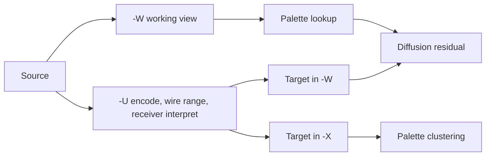

# Target color policy

`-Y` / `--target-color-policy` chooses the color that error diffusion and palette clustering try to reproduce. This reference is for CLI users and library integrators who select an output with `-U`, especially a wide-gamut, named or ICC destination, and want the encoder to aim at what that receiver will actually show. It owns the option, its stages, the LUT method and their costs. The [output color space](../output/output-colorspace.md) owns `-U` itself, [output gamut mapping](../output/gamut-mapping.md) owns the replacement chosen for an out-of-gamut color, the [working color space](working-colorspace/README.md) owns `-W`, the [clustering color space](../palette-construction/clustering-colorspace/README.md) owns `-X`, and the [dither clamp policy](clamp-policy.md) owns the bound on accumulated feedback.

## Pipeline position

Without this policy, the source converted to `-W` is both the lookup input and the target of diffusion, and the clustering samples are the source converted to `-X`. The receiver, however, reproduces a color only after the `-U` encoding: an out-of-gamut color is replaced or clipped, and an encode/interpret pair that is not an exact inverse returns a slightly different color. The target color policy keeps the lookup input as it is and gives diffusion and clustering a second view: the source taken through `-U` and back.

The figure shows the two branches. Lookup always reads the working view, so the nearest-color search is unchanged. The residual sent to later pixels is measured against the target, and clustering samples are replaced by their targets, so the palette is spent on colors the receiver can show. When `-U` has the same definition as `-W` or `-X`, the round trip is the identity and nothing is converted.

## Options

| Policy | Target | Corrects |
| --- | --- | --- |
| `source` | The source in `-W` or `-X`. This is the default. | Nothing; output is identical to omitting `-Y`. |
| `gamut` | Colors outside the `-U` gamut become their `-U` reproduction; representable colors stay exactly the source. | Gamut and wire-range deviation. |
| `full` | Every color becomes its `-U` reproduction. | Gamut deviation and encode/interpret pairs that are not exact inverses, such as ICC A2B/B2A asymmetry or approximated TRC inverses. |
| `auto` | Measures the encode/interpret mismatch and selects `gamut` when it stays within `tolerance`, otherwise `full`. | As selected. |

`method` (`M`) selects how targets are evaluated: `exact` (default) transforms every pixel; `lut` builds a verified 3D LUT; `auto` uses the LUT when visible pixels outnumber four times its nodes. `lut_size` (`S`) sets 5 through 65 points per axis, default 33. `tolerance` (`T`) sets the bound in Delta E OK from 0 through 0.1, default 0.001; it governs both `auto` and LUT cell verification. `-Y full:method=lut:lut_size=17` and `-Y full:Mlut:S17` are equivalent.

`SIXEL_TARGET_COLOR_POLICY`, `SIXEL_TARGET_COLOR_METHOD`, `SIXEL_TARGET_COLOR_LUT_SIZE` and `SIXEL_TARGET_COLOR_TOLERANCE` provide defaults; explicit arguments win. Repeating `-Y` resets the previous suboptions before reapplying the environment and the new argument. Invalid explicit values are errors. The library option is `SIXEL_OPTFLAG_TARGET_COLOR_POLICY` (`'Y'`) through `sixel_encoder_setopt`.

## Contract

`source` keeps the encoder output byte-identical to an encode without `-Y`.

A target is computed in double precision as `interpret(clamp01(encode(map(s))))`, returned to the coordinate space of the view it replaces. `encode` and `interpret` are the transforms the palette owner uses for the same `-U`: the builtin encoders for `srgb`, `srgb-linear` and `smpte-c`, and relative-colorimetric transforms through XYZ for named and ICC destinations. `map` is the selected `-U gamut=` mapper for colors outside the gamut, or the identity when the policy is `clip`, in which case the wire-range clamp bounds the color. Wire quantization to RGB101 is not part of the target.

Under `gamut`, a color whose `-U` codes lie inside `[0, 1]` within `2e-7` keeps its source value bit for bit. Under every policy, a component offset below `1e-6` in magnitude is round-off of the conversion pair and is treated as zero; an image whose offsets are all zero diffuses exactly as `source` does.

Diffusion adds the offset `target - source` to the residual of each visible pixel: the candidate passed to lookup is the source plus accumulated error, and the residual sent onward is that candidate minus the chosen palette color plus the offset. The offset plane is computed once per frame, is read-only, and is independent of band geometry. Transparent pixels have zero offset. When `-W` is an ICC profile, targets are computed in linear sRGB and expressed through the same profile as the source, so the profile's own A2B/B2A asymmetry does not enter the offset.

Clustering replaces each visible sample by its target before palette construction. A fixed mapfile palette has no samples and is unchanged. The generated palette is still checked by the output gamut mapper after construction, as the [gamut mapping pipeline](../output/gamut-mapping.md#pipeline-and-policy-boundaries) describes.

A target other than `source` requires CPU float32 error diffusion with FS, Atkinson, Jarvis--Judice--Ninke, Stucki, Burkes, a Sierra kernel or LSO2. `--precision-policy=8bit` with one of these kernels and a non-identity target is an error naming the policy, and so is `--gpu-policy=force`; `auto` GPU selection keeps the CPU path. Positional and no-dither methods have no residual and keep only the clustering target. Byte gamma sRGB input with an sRGB `-U` is its own target, so its byte path is kept.

## Precedence and interactions

| Option | Interaction |
| --- | --- |
| `-U gamut=` | Selects `map`. Under `gamut`, `full` and `auto`, the application frame is no longer gamut-mapped before lookup; the mapper acts on the target instead, so lookup still sees the original color while diffusion aims at its replacement. |
| `-0` | Bounds the combined correction before lookup. The offset is added to the residual after lookup and is not itself limited. |
| `-W`, `-X` | Choose the coordinates of the two target views. Neither choice changes the target color, only its representation. |
| `--precision-policy` | `float32` or automatic float work is required for diffusion targets, as stated in the contract. |
| `-m` | A fixed palette receives no clustering target; diffusion still uses targets. |

## Stage selection by `auto`

`auto` evaluates the `full` target on two probes of nine values per axis and takes the largest Delta E OK between a probe color and its target. The first probe interprets `-U` codes, which exposes pairs that do not round-trip inside the gamut. The second converts an sRGB grid and keeps only colors whose codes stay inside `[0, 1]`; it exposes encoders that clip or collapse colors inside the device transform, where the code range cannot reveal it. Colors whose codes leave `[0, 1]` are corrected by both stages and do not vote. A maximum at or below `tolerance` selects `gamut`; otherwise `auto` selects `full`. An identical builtin definition selects `gamut` without probing, and a pair that cannot evaluate its probes selects `full`.

## LUT method

The LUT covers the bounding box of the visible pixels in the coordinates of the view. Each node stores its target offset. A cell is interpolated only when all eight corners and the cell center lie inside the `-U` gamut and the trilinear offset at the center agrees with the exact target within `tolerance`. Every other cell, and therefore every gamut boundary, is evaluated exactly per pixel. Under `gamut` every usable node has a zero offset, so the LUT becomes a verified membership cache.

The center check is a sampled verification, not a bound on the whole cell: a transform with structure finer than one cell can still exceed `tolerance` between the corners and the center. Use `exact` when that guarantee matters.

## Cost

| Item | `exact` | `lut` |
| --- | --- | --- |
| Per visible pixel | One `-U` encode, one interpret for each corrected color, and a mapper call with a second encode for each out-of-gamut color under a mapper | One trilinear interpolation, or the exact path in rejected cells |
| Setup | None | `lut_size^3` node evaluations and `(lut_size - 1)^3` center evaluations |
| Memory | One offset plane, 12 bytes per pixel for RGB float32 | The offset plane plus `13 * lut_size^3 + (lut_size - 1)^3` bytes |

`auto` adds at most `2 * 9^3` evaluations per frame and coordinate space. Named and ICC destinations evaluate through XYZ and cost more per pixel than builtin ones. The offset plane is allocated only for the duration of one palette application and is dropped when every offset is zero. Clustering targets transform the samples in place, with a temporary float copy for byte RGBA alpha-key samples.

## Limitations

Targets never change the lookup input, so a target policy does not reproduce the output of `-U gamut=` mapping applied before lookup. The quality effect depends on the image and palette size: correcting the residual usually reduces the largest color errors of out-of-gamut regions, while the mean error can rise for some palette sizes. Evaluate with the [measurement policy](../../quality/measurement-policy.md) rather than assuming a gain. High-color output and GPU diffusion do not consume targets.

## Implementation map

| Entry | Responsibility |
| --- | --- |
| [`src/target-color.c`](../../../src/target-color.c) | Owns the evaluator: encode/interpret, stage resolution, LUT build and verification, offset and in-place target computation. |
| [`sixel_dither_apply_palette`](../../../src/dither.c) | Decides whether a target is needed, rejects byte or forced-GPU diffusion, and publishes the frame offset plane. |
| [`sixel_dither_target_offset_at`](../../../src/dither.h) | Returns the offset of one pixel to the diffusion kernels. |
| [`sixel_encoder_map_target_samples`](../../../src/encoder.c) | Replaces clustering samples by their targets, including byte alpha-key samples. |

## Test coverage

<!-- test-coverage: enforced -->

### Behavioral contract tests

| ID | Contract | Owning test |
| --- | --- | --- |
| TC-01 | `source` keeps the output of an encode without `-Y`. | [tests/cli/dither-options/0044_source_policy_default_output.t](../../../tests/cli/dither-options/0044_source_policy_default_output.t) |
| TC-02 | `gamut` builds a nonzero offset for out-of-gamut colors and changes diffusion. | [tests/cli/dither-options/0045_gamut_policy_target_offset.t](../../../tests/cli/dither-options/0045_gamut_policy_target_offset.t) |
| TC-03 | A gamut-stage LUT produces the same output as exact evaluation. | [tests/cli/dither-options/0046_gamut_lut_matches_exact.t](../../../tests/cli/dither-options/0046_gamut_lut_matches_exact.t) |
| TC-04 | An identity `-U` keeps byte sRGB output unchanged under `full`. | [tests/cli/dither-options/0047_target_identity_byte_output.t](../../../tests/cli/dither-options/0047_target_identity_byte_output.t) |
| TC-05 | `auto` resolves a non-inverse LUT profile to `full`, which differs from `gamut`. | [tests/cli/dither-options/0048_target_auto_noninverse_lut.t](../../../tests/cli/dither-options/0048_target_auto_noninverse_lut.t) |
| TC-06 | Byte error diffusion rejects a target with a diagnostic naming the policy. | [tests/cli/dither-options/0049_target_rejects_byte_diffusion.t](../../../tests/cli/dither-options/0049_target_rejects_byte_diffusion.t) |
| TC-07 | Byte RGBA alpha-key clustering samples take targets. | [tests/cli/dither-options/0050_target_alpha_key_samples.t](../../../tests/cli/dither-options/0050_target_alpha_key_samples.t) |
| TC-08 | Short and environment `method` values reach the dither and produce identical output. | [tests/cli/option-syntax/0092_target_color_method_image_regression.t](../../../tests/cli/option-syntax/0092_target_color_method_image_regression.t) |
| TC-09 | Short and environment `lut_size` values reach the dither and produce identical output. | [tests/cli/option-syntax/0093_target_color_lut_size_image_regression.t](../../../tests/cli/option-syntax/0093_target_color_lut_size_image_regression.t) |
| TC-10 | Short and environment `tolerance` values reach the dither and produce identical output. | [tests/cli/option-syntax/0094_target_color_tolerance_image_regression.t](../../../tests/cli/option-syntax/0094_target_color_tolerance_image_regression.t) |

### Coverage boundary

The tests observe routing, stage selection and exact output equivalence. They do not establish a quality gain, the accuracy of a `full` LUT against exact evaluation for every profile, or the residual arithmetic of each kernel separately; all kernels share the single offset addition after their residual.
