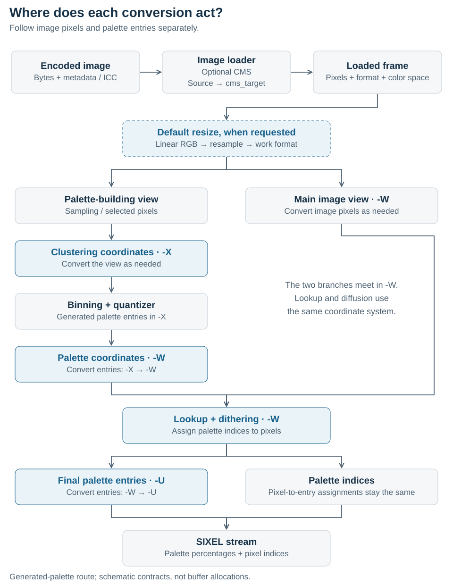
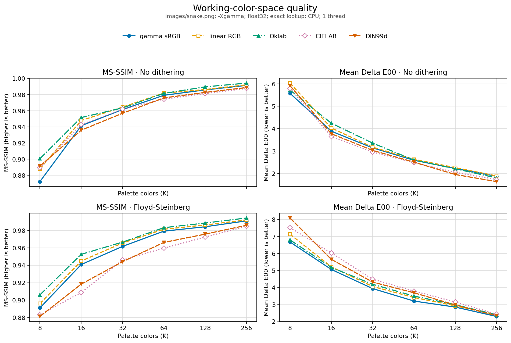
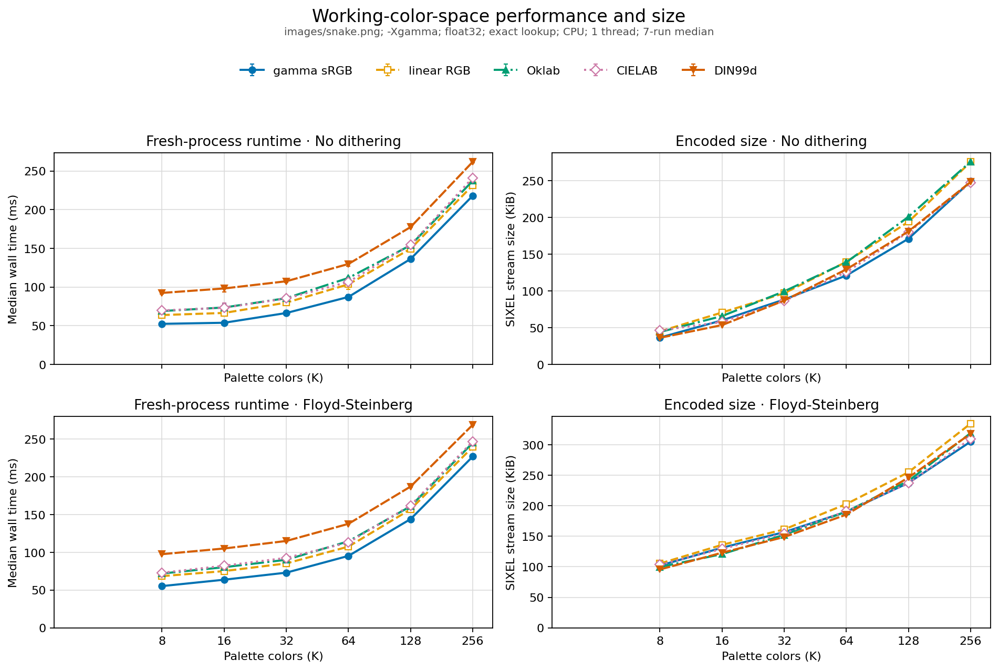

# Working Color Space

## Purpose

`img2sixel` uses `-W` to choose the coordinate system in which it applies a palette to an image:

```text
-W COLORSPACE
--working-colorspace=COLORSPACE
```

The accepted values are `auto`, `srgb`, `srgb-linear`, `oklab`, `lab-d65`, `din99d`, and `icc:FILE`. The default is `auto`.

`-W icc:FILE` uses the encoded RGB axes of a matrix/TRC RGB ICC profile for nearest-color lookup and diffusion residuals. Input pixels and palette entries are converted to float32 profile coordinates, including values outside the nominal unit interval. `-X auto` uses the same profile for clustering. `-U` still controls the emitted colors, and `-M` exports sRGB8. Progressive repair currently requires a builtin working space.

The working color space changes the geometry used by palette lookup and the components in which dithering error is calculated and propagated. It can therefore change visible structure, pointwise color error, runtime, memory use, and SIXEL stream size even when palette construction returns exactly the same palette colors.

`-W` does not describe the source image profile and does not select the RGB coordinates serialized into the SIXEL palette. Loader color management and the complete `-X` / `-W` / `-U` model are described in [Color-space handling](../../colorspace-handling/README.md).

[Dither clamp policy](../clamp-policy.md) governs added error feedback in these coordinates. Its limits do not apply to working-space conversion itself.

## Pipeline boundary

For a generated palette, the relevant path is:

<picture>
  <source media="(max-width: 640px)" srcset="../../colorspace-handling/figures/encoding-pipeline-mobile.svg">
  
</picture>

The three encoder color-space controls own different boundaries:

| Option | Boundary | Observable effect |
| --- | --- | --- |
| `-X`, `--clustering-colorspace` | palette construction | Changes the samples, distances, partitions, and representatives seen by a generated-palette algorithm. |
| `-W`, `--working-colorspace` | palette application | Changes nearest-color geometry and the components in which dither error is propagated. |
| `-U`, `--output-colorspace` | palette serialization | Converts the final palette before writing SIXEL color definitions; it does not repeat lookup. |

Fixed palettes bypass `-X`, but they do not bypass `-W`: the supplied palette and the main image must still meet in one working representation before lookup. `-U` remains a later output conversion in either case. [Output color space](../../output/output-colorspace.md) details its values, receiver interpretation, and the current preparation difference between structured byte palettes and image mapfiles.

`-M` converts the prepared working palette to sRGB8 independently of `-U`; it does not serialize internal Oklab, CIELAB, DIN99d or linear coordinates. See [External palette input and output](../../palette-construction/external-palettes.md) for the owning interchange contract and its precision/gamut boundary.

## Default and option coupling

`-Wauto` follows the input frame coordinates: gamma RGB stays gamma, while linear RGB, Oklab, CIELAB and DIN99d keep their typed float32 coordinates. SMPTE-C input and float32 RGB frames with an explicit color definition use linear sRGB. The encoder converts profiled samples using the frame’s definition before clustering and palette lookup. An explicit `--precision-policy=8bit` makes auto select gamma, the only supported byte-application space. Forced GPU palette application also selects gamma RGB888 when the working space and precision can be resolved to bytes. Explicit non-gamma `-W` retains its conflict with byte application, and explicit float requests retain their precision. `-Xauto`, including omission, follows the resolved working space. Thus `-Woklab` uses Oklab for both construction and application unless `-X` selects another space.

The encoder uses the same builtin color definitions for `-W` and `-X` and carries the resolved coordinates separately from pixel storage at the conversion boundaries. Gamma and linear RGB use the sRGB primaries and D65 white. Palette construction converts its samples to the resolved clustering coordinates and converts the resulting entries to the working coordinates for lookup and diffusion. Float32 storage can represent each of these coordinate systems.

An explicit non-auto `-X` is authoritative regardless of option order. Repeating either option with `auto` restores its automatic policy. AUTO resolves independently for each input frame; it does not keep the previous frame's space. A workspace change invalidates palette application state while preserving a fixed source palette that may have come from a non-rewindable stream. These commands therefore have the same split geometry:

```sh
img2sixel -Xsrgb -Woklab image.png
img2sixel -Woklab -Xsrgb image.png
```

This coupling matters when evaluating `-W`. A comparison that changes only `-W` must set `-X` explicitly; otherwise it also changes palette construction and cannot attribute the result to palette application alone.

## Mathematical role

Let `phi_W(c)` be a color represented in the three coordinates selected by `-W`, and let `P` be the palette after conversion into that same space. The exact `none` lookup policy assigns a pixel `c` to:

```text
q(c) = arg min_i ||phi_W(c) - phi_W(P[i])||^2
```

The implementation evaluates an ordinary squared Euclidean distance across all three stored components. Approximate lookup policies build different search structures or quantize the address space, but the selected `-W` coordinates still define their input geometry. Their exactness and cost are documented separately in [Lookup policy](../lookup-policy/README.md).

For an error-diffusion method, the value presented to lookup also contains error accumulated from earlier pixels. After choosing palette entry `q`, a representative recurrence is:

```text
s_t = phi_W(c_t)
y_t = limit_policy(s_t, s_t + accumulated_error_t)
e_t = y_t - phi_W(P[q])
accumulated_error_j += a_j * e_t
```

The coefficients `a_j` and scan order are properties of `-d`. The components of `e_t` and their nominal ranges depend on `-W` and the effective pixel format. [Clamp policy](../clamp-policy.md) determines the correction limit: float soft/hard bounds include the original source `s_t`, so extended source coordinates are not cut off. `none` retains the correction without limiting it. The eight fixed byte spatial kernels accumulate integer carry and apply hard clipping once per candidate, with no per-tap rounding or saturation. Thus `-W` and `-d` are not independent quality decisions. The detailed kernels and their spatial behavior are covered by [Dithering](../dithering/README.md).

The Lab-family formats use libsixel's normalized component ranges. Consequently, Euclidean lookup in `lab-d65` is not literally Delta E76 in unscaled CIELAB units, and none of these lookup distances is CIEDE2000. The Delta E00 values in this document are evaluation metrics computed by `lsqa` after decoding, not the encoder's lookup objective.

The extended frame-conversion API preserves finite out-of-range coordinates. The [selected CPU float palette path](../../output/output-colorspace.md#selected-ordinary-srgb-float-path) now retains those coordinates through palette construction, `-X` to `-W` conversion and lookup in all five spaces, with an independent RGB101 output cache. [Standalone low-level palette initialization](../../output/output-colorspace.md#library-entry-points) also retains all five typed float domains under its documented CPU/default-builder conditions. Paths outside these selections can still use bounded converters or rebuild a float view from byte entries. Those earlier boundaries are independent of the diffusion clamp policy; selecting `-0none` does not remove them. See [pixel-format precision](../../../concepts/pixelformat-precision/README.md) for the representation contract.

## Cost model

For `N` image pixels, `K` palette entries, and fixed depth `d = 3`, converting the main image to `-W` is `O(N)` and converting a generated palette from `-X` to `-W` is `O(K)`. Exact exhaustive lookup is `O(N K d)`, while a fixed-neighborhood diffusion kernel adds `O(N d)` work. Selecting a different working color space does not change these asymptotic orders, but it changes conversion cost, pixel representation, per-channel clamping, and memory traffic.

For image storage, `-Wsrgb` can retain `RGB888`, which uses three bytes per pixel, or use `RGBFLOAT32` when `--precision-policy=float32` is requested. Byte spatial diffusion keeps integer carry rows and projects candidates to byte lookup coordinates; the [clamp policy](../clamp-policy.md) applies to these candidates and to float feedback without promoting the working buffer. Every non-gamma `-W` requires a typed float32 representation with three four-byte components, so it uses twelve bytes per RGB pixel before additional pipeline buffers. The resulting precision and implicit-promotion rules are described in [Pixel-format precision](../../../concepts/pixelformat-precision/README.md) and [Encoder working precision](../../precision/README.md).

The formal comparison below forces float32 for all spaces. It therefore measures color geometry and its implementation constants without giving `srgb` the separate advantage of an 8-bit path. Real commands that leave precision at its default can show a larger or differently distributed runtime and memory gap.

## `srgb`: gamma-encoded sRGB coordinates

`-Wsrgb` compares and diffuses the displayed sRGB code values. Its normalized vector is `(R_srgb, G_srgb, B_srgb)`, with nominal components in `[0, 1]` on the float32 path or `[0, 255]` on the byte path. Extended float paths can retain values outside the nominal range.

This space is inexpensive when image and palette data are already gamma-encoded sRGB, and preserves the historical gamma working geometry. Its geometry is not perceptually uniform and arithmetic differences do not represent additive light, but the nonlinear transfer devotes more code-value resolution to dark linear-light values. That can be beneficial for some pointwise errors even when a perceptual space produces better spatial structure.

The sRGB transfer function is defined in the [W3C CSS Color 4 sRGB definitions](https://www.w3.org/TR/css-color-4/#predefined-sRGB).

## `srgb-linear`: linear-light sRGB coordinates

`-Wsrgb-linear` removes the sRGB transfer function and performs lookup and error propagation in `(R_linear, G_linear, B_linear)`. Vector addition in this space follows additive light, which makes it a natural choice when the arithmetic itself should conserve radiometric energy.

Unweighted Euclidean distance in linear RGB is not perceptually uniform. A numerically similar error can have very different visibility at different luminances, and bright linear-light differences can dominate a distance calculation. This option requires `LINEARRGBFLOAT32` working storage.

## `oklab`: approximately perceptual opponent coordinates

`-Woklab` converts linear sRGB through the published Oklab matrices and cube-root nonlinearity, then compares and diffuses `(L, a, b)` coordinates. The nominal normalized range is `[0, 1]` for `L` and `[-0.5, 0.5]` for the opponent components. These are coordinate conventions, not limits of float storage.

Oklab was designed so that Euclidean geometry behaves more consistently with perceived lightness, chroma, and hue than ordinary RGB coordinates. It is still an approximation rather than a promise to minimize CIEDE2000 or an image-wide structural metric. The definition and motivation are in Bjorn Ottosson's [A perceptual color space for image processing](https://bottosson.github.io/posts/oklab/).

The checked-in fixture shows the distinction clearly: with Floyd--Steinberg dithering, Oklab has the highest MS-SSIM at every measured palette size, while gamma has the lowest mean Delta E00 at every size. One metric rewards retained spatial structure and the other averages pointwise perceptual color difference; neither result invalidates the other.

## `lab-d65`: normalized CIE 1976 L*a*b*

`-Wlab-d65` uses CIELAB derived through D65 XYZ. libsixel normalizes `L*` by `100`, normalizes `a*` and `b*` by `128`, with a nominal range of `[-1.5, 1.5]` for the opponent coordinates.

This normalization is part of the working metric because lookup applies equal Euclidean weights to the stored coordinates. It must not be confused with running a CIEDE2000 calculation for every palette candidate. CIELAB reduces several distortions of RGB geometry, but it is not uniformly perceptual across its full gamut and its conversions cost more than staying in gamma sRGB.

The CIELAB equations and D50/D65 adaptation context are summarized in [CSS Color Module Level 4](https://www.w3.org/TR/css-color-4/#lab-colors).

## `din99d`: DIN99d opponent coordinates

`-Wdin99d` applies `X′ = 1.12X − 0.12Z` to the sample and D65 reference white before calculating Lab-like coordinates and the DIN99d lightness, chroma, and hue transformations. The inverse undoes that XYZ correction before returning to RGB. libsixel stores `(L99d, a99d, b99d) / 100`, with nominal lightness range `[0, 1]` and opponent range `[-1, 1]`. The extended float conversion preserves finite coordinates beyond these ranges; bounded storage converters and byte representations retain their limits. One common scale preserves the native Euclidean distance ratios; scaling the opponent axes by a different divisor would change palette lookup decisions.

DIN99d was designed to improve the uniformity of Euclidean color differences relative to CIELAB. With the common scale, exact lookup uses its Euclidean geometry, subject to numeric approximation and the representation limits of the selected path. This differs from evaluating Delta E00 for each candidate. The transformation follows Cui et al., [Uniform colour spaces based on the DIN99 colour-difference formula](https://onlinelibrary.wiley.com/doi/abs/10.1002/col.10066).

Its runtime cost includes conversion, typed-format handling, lookup, and optional diffusion. The working-space comparison below measures those operations together; it is not an isolated benchmark of the DIN99d equations.

## Measurement design

The checked-in comparison asks one narrow question: how does `-W` change decoded quality, wall time, and stream size when palette construction and numeric precision are held fixed?

The fixture is the 600-by-450 RGB [`images/snake.png`](../../../../images/snake.png). The sweep covers `K = 8, 16, 32, 64, 128, 256`, with both `--diffusion=none` and Floyd--Steinberg `--diffusion=fs`. Every row fixes `--precision-policy=float32`, `-Xsrgb`, `-Usrgb`, exact `--lookup-policy=none`, one CPU thread, GPU off, the builtin loader, loader CMS disabled (`SIXEL_LOADER_CMS_ENGINE=none`), full-frame sampling, hard binning, `kmeans:seed=1:binbits=6`, no merge, cover off, RGB palette output, full quality, and fast encoding.

The preflight validates the exact typed working format, explicit `-X` and `-W` state, K-means model, hard binning, exact lookup, and zero quantizer retries. Quality and size come from one deterministic SIXEL stream: `lsqa` compares its decoded image with the source, and the stream byte length is recorded exactly. Runtime uses a fresh process with output discarded, two warmups, seven measured runs, rotated and reversed configuration order, and the median with an interquartile interval.

This protocol deliberately does not measure the implicit `-X` coupling of a lone `-W`, an 8-bit-versus-float32 transition, approximate lookup, multiple threads, GPU paths, animation, other image content, or other dither policies. Those are separate axes and should not be inferred from these figures.

## Quality results



Figure: `img2sixel` working-color-space quality on `images/snake.png`; `-Xsrgb`, float32, exact lookup, CPU, and one thread. Higher MS-SSIM is better; lower mean Delta E00 is better.

Without dithering, Oklab has the highest MS-SSIM at `K = 8, 16, 128, 256`, while linear RGB leads at `K = 32, 64`. Mean Delta E00 instead favors gamma at `K = 8`, CIELAB from `K = 16` through `64`, and DIN99d at `K = 128, 256`. With Floyd--Steinberg, Oklab leads MS-SSIM and gamma leads mean Delta E00 at every measured `K`.

The `K = 256` endpoint makes the metric disagreement concrete:

| Dither | Working space | MS-SSIM | Mean Delta E00 | Mean Delta Chroma |
| --- | --- | ---: | ---: | ---: |
| none | gamma | 0.991358 | 1.871517 | 1.342110 |
| none | linear | 0.992071 | 1.888680 | 1.902482 |
| none | oklab | 0.994156 | 1.799481 | 1.657200 |
| none | cielab | 0.987537 | 1.731550 | 1.181970 |
| none | din99d | 0.988698 | 1.635661 | 1.458599 |
| fs | gamma | 0.990880 | 2.281684 | 1.825853 |
| fs | linear | 0.991998 | 2.384097 | 2.620727 |
| fs | oklab | 0.994171 | 2.378958 | 2.258366 |
| fs | cielab | 0.984748 | 2.420114 | 1.760536 |
| fs | din99d | 0.985794 | 2.327304 | 2.127198 |

There is no single quality ordering. A working space changes both the nearest palette index and, under error diffusion, the future spatial error field. Choosing solely from one average metric would hide that interaction. Oklab is a strong choice when structural similarity is the priority on this fixture; gamma, CIELAB, or DIN99d can report lower pointwise color error under particular dither and palette-size conditions.

## Runtime and stream-size results



Figure: `img2sixel` fresh-process runtime and encoded size on `images/snake.png`; `-Xsrgb`, float32, exact lookup, CPU, one thread, two warmups, and a seven-run median. Runtime whiskers show the interquartile range; stream size is measured from the quality-pass SIXEL bytes.

Gamma has the shortest median runtime in 12 of the 12 measured palette-size/dither conditions, even though the experiment forces its float32 path. Relative to gamma, the observed median runtime ranges are:

| Working space | No dither | Floyd--Steinberg |
| --- | ---: | ---: |
| linear | 1.06x to 1.24x | 1.06x to 1.24x |
| oklab | 1.09x to 1.37x | 1.08x to 1.30x |
| cielab | 1.11x to 1.36x | 1.09x to 1.32x |
| din99d | 1.20x to 1.83x | 1.19x to 1.77x |

These are end-to-end timings, not conversion-only microbenchmarks. Exact lookup remains `O(NK)` for every row; the growing curves primarily reflect the common exhaustive search, while color conversion and working-format operations alter the constant cost.

Stream size also changes because different working geometry selects different palette indices and therefore changes SIXEL plane occupancy and run structure. Relative to gamma, measured size ranges are 1.097x--1.231x for linear, 1.097x--1.209x for Oklab, 0.962x--1.270x for CIELAB, and 0.892x--1.069x for DIN99d without dithering. With Floyd--Steinberg the ranges are 1.029x--1.097x for linear, 0.920x--1.046x for Oklab, 0.985x--1.015x for CIELAB, and 0.938x--1.043x for DIN99d. A perceptual working space is therefore not inherently larger or smaller on the wire.

## Choosing a working space

- Start with `srgb` when compatibility, lower memory, and speed are more important than changing the palette-application geometry.
- Evaluate `oklab` when spatial structure and smooth perceived transitions are important; on this fixture it provides the strongest MS-SSIM results, especially with Floyd--Steinberg.
- Use `srgb-linear` when the arithmetic should follow additive light, but do not assume linear Euclidean distance is perceptually uniform.
- Evaluate `lab-d65` or `din99d` when pointwise perceptual color error is the primary concern, while accounting for the documented coordinate scales and measured runtime cost. DIN99d uses one common scale that preserves its native Euclidean geometry; see the [DIN99d guide](../../../concepts/din99d/README.md).
- Match `-X` and `-W` when one coherent geometry is desired. Set both explicitly when benchmarking, or when intentionally using different palette-construction and palette-application spaces.
- Re-measure representative content. The checked-in run is evidence for one image and one controlled pipeline, not a universal default-selection study.

## Reproduction and validation

The one-command entry point rebuilds the current clean revision, records the complete sweep, regenerates both figures, and validates provenance and the full 60-point grid:

```sh
tools/reproduce_working_colorspace_measurements.sh
```

The plotter requires Python 3 and Matplotlib. `img2sixel` and `lsqa` must be enabled in the selected build. Set `PYTHON`, `BUILD_DIR`, `IMG2SIXEL_PATH`, or `LSQA_PATH` when they are not at their defaults. The wrapper refuses a dirty tracked worktree so that durable measurements identify one reproducible source revision.

The checked-in run was recorded on 2026-09-12 UTC from clean revision `85a2674e5` on macOS arm64. The full configure arguments, compiler identity, binary hashes, input hash, command controls, and timing protocol are recorded in [`working-colorspace-run.json`](measurements/working-colorspace-run.json). The complete numeric data are in [`working-colorspace-comparison.csv`](measurements/working-colorspace-comparison.csv).

Validate existing artifacts without rerunning the benchmark:

```sh
python3 tools/check_working_colorspace_measurements.py \
    docs/encoder/palette-application/working-colorspace/measurements
```

## Implementation references

- [`src/encoder.c`](../../../../src/encoder.c) parses `-W`, resolves its relationship with `-X` and precision, creates the effective frame format, and converts generated palette entries from `-X` to `-W`.
- [`src/colorspace.c`](../../../../src/colorspace.c) defines the transfer functions, matrices, Lab-family transforms, normalization ranges, clamping, and typed conversions.
- [`src/lookup-policy-none.c`](../../../../src/lookup-policy-none.c) shows the exact squared-Euclidean lookup used to isolate this measurement.
- [`src/dither-policy-fs.c`](../../../../src/dither-policy-fs.c) applies Floyd--Steinberg error diffusion to float32 working components.
- [`tools/plot_working_colorspace_measurements.py`](../../../../tools/plot_working_colorspace_measurements.py) owns the controlled commands, measurements, and figures.
- [`tools/check_working_colorspace_measurements.py`](../../../../tools/check_working_colorspace_measurements.py) validates provenance, the command contract, numeric fields, hashes, and the complete grid.

## Test coverage

<!-- test-coverage: enforced -->

| ID | Contract | Owning test |
| --- | --- | --- |
| WC-10 | Default auto preserves typed input coordinates and avoids coordinate conversion across repeated inputs. | [tests/encoder/planning/0118_default_colorspace_auto.t](../../../../tests/encoder/planning/0118_default_colorspace_auto.t) |
| WC-11 | Returning both options to auto restores input/working tracking in either option order. | [tests/encoder/planning/0119_reset_colorspace_auto.t](../../../../tests/encoder/planning/0119_reset_colorspace_auto.t) |
| WC-12 | An explicit clustering space remains fixed while auto working space follows the input. | [tests/encoder/planning/0120_explicit_clustering_auto_working.t](../../../../tests/encoder/planning/0120_explicit_clustering_auto_working.t) |
| WC-13 | Explicit byte application constrains auto to gamma, including encoder reuse. Forced Metal application with default precision also resolves to gamma RGB888. Incompatible explicit working spaces and native clustering palettes fail before output. | [tests/encoder/planning/0121_byte_precision_auto.t](../../../../tests/encoder/planning/0121_byte_precision_auto.t), [tests/encoder/planning/0194_gpu_force_auto_precision.t](../../../../tests/encoder/planning/0194_gpu_force_auto_precision.t), [tests/encoder/planning/0195_gpu_force_explicit_working_no_dcs.t](../../../../tests/encoder/planning/0195_gpu_force_explicit_working_no_dcs.t), [tests/encoder/planning/0196_gpu_force_native_clustering_no_dcs.t](../../../../tests/encoder/planning/0196_gpu_force_native_clustering_no_dcs.t) |
| WC-14 | Auto clustering follows each explicit working space after resetting an explicit clustering choice. An unsupported working selector preserves the previous choice. | [tests/encoder/planning/0122_explicit_working_auto_clustering.t](../../../../tests/encoder/planning/0122_explicit_working_auto_clustering.t) |
| WC-15 | Mixed input spaces retain serial/playback output equivalence across capacities and delta modes. | [tests/encoder/planning/0096_playback_auto_spaces_t1_d0_q1.t](../../../../tests/encoder/planning/0096_playback_auto_spaces_t1_d0_q1.t), [tests/encoder/planning/0134_playback_auto_spaces_t1_d0_q2.t](../../../../tests/encoder/planning/0134_playback_auto_spaces_t1_d0_q2.t), [tests/encoder/planning/0135_playback_auto_spaces_t1_d0_q4.t](../../../../tests/encoder/planning/0135_playback_auto_spaces_t1_d0_q4.t), [tests/encoder/planning/0136_playback_auto_spaces_t1_d1_q1.t](../../../../tests/encoder/planning/0136_playback_auto_spaces_t1_d1_q1.t), [tests/encoder/planning/0137_playback_auto_spaces_t1_d1_q2.t](../../../../tests/encoder/planning/0137_playback_auto_spaces_t1_d1_q2.t), [tests/encoder/planning/0138_playback_auto_spaces_t1_d1_q4.t](../../../../tests/encoder/planning/0138_playback_auto_spaces_t1_d1_q4.t), [tests/encoder/planning/0139_playback_auto_spaces_t8_d0_q1.t](../../../../tests/encoder/planning/0139_playback_auto_spaces_t8_d0_q1.t), [tests/encoder/planning/0140_playback_auto_spaces_t8_d0_q2.t](../../../../tests/encoder/planning/0140_playback_auto_spaces_t8_d0_q2.t), [tests/encoder/planning/0141_playback_auto_spaces_t8_d0_q4.t](../../../../tests/encoder/planning/0141_playback_auto_spaces_t8_d0_q4.t), [tests/encoder/planning/0142_playback_auto_spaces_t8_d1_q1.t](../../../../tests/encoder/planning/0142_playback_auto_spaces_t8_d1_q1.t), [tests/encoder/planning/0143_playback_auto_spaces_t8_d1_q2.t](../../../../tests/encoder/planning/0143_playback_auto_spaces_t8_d1_q2.t), [tests/encoder/planning/0144_playback_auto_spaces_t8_d1_q4.t](../../../../tests/encoder/planning/0144_playback_auto_spaces_t8_d1_q4.t), [tests/encoder/planning/0172_playback_auto_spaces_callbacks_t1_d0_q1.t](../../../../tests/encoder/planning/0172_playback_auto_spaces_callbacks_t1_d0_q1.t), [tests/encoder/planning/0173_playback_auto_spaces_callbacks_t1_d0_q2.t](../../../../tests/encoder/planning/0173_playback_auto_spaces_callbacks_t1_d0_q2.t), [tests/encoder/planning/0174_playback_auto_spaces_callbacks_t1_d0_q4.t](../../../../tests/encoder/planning/0174_playback_auto_spaces_callbacks_t1_d0_q4.t), [tests/encoder/planning/0175_playback_auto_spaces_callbacks_t1_d1_q1.t](../../../../tests/encoder/planning/0175_playback_auto_spaces_callbacks_t1_d1_q1.t), [tests/encoder/planning/0176_playback_auto_spaces_callbacks_t1_d1_q2.t](../../../../tests/encoder/planning/0176_playback_auto_spaces_callbacks_t1_d1_q2.t), [tests/encoder/planning/0177_playback_auto_spaces_callbacks_t1_d1_q4.t](../../../../tests/encoder/planning/0177_playback_auto_spaces_callbacks_t1_d1_q4.t), [tests/encoder/planning/0178_playback_auto_spaces_callbacks_t8_d0_q1.t](../../../../tests/encoder/planning/0178_playback_auto_spaces_callbacks_t8_d0_q1.t), [tests/encoder/planning/0179_playback_auto_spaces_callbacks_t8_d0_q2.t](../../../../tests/encoder/planning/0179_playback_auto_spaces_callbacks_t8_d0_q2.t), [tests/encoder/planning/0180_playback_auto_spaces_callbacks_t8_d0_q4.t](../../../../tests/encoder/planning/0180_playback_auto_spaces_callbacks_t8_d0_q4.t), [tests/encoder/planning/0181_playback_auto_spaces_callbacks_t8_d1_q1.t](../../../../tests/encoder/planning/0181_playback_auto_spaces_callbacks_t8_d1_q1.t), [tests/encoder/planning/0182_playback_auto_spaces_callbacks_t8_d1_q2.t](../../../../tests/encoder/planning/0182_playback_auto_spaces_callbacks_t8_d1_q2.t), [tests/encoder/planning/0183_playback_auto_spaces_callbacks_t8_d1_q4.t](../../../../tests/encoder/planning/0183_playback_auto_spaces_callbacks_t8_d1_q4.t) |
| WC-01 | Returning to `-Wsrgb` preserves an explicit 8-bit precision request regardless of option order. | [tests/cli/option-syntax/0037_option_matching_precision_8bit_working_gamma_order.t](../../../../tests/cli/option-syntax/0037_option_matching_precision_8bit_working_gamma_order.t) |
| WC-02 | `--precision-policy=8bit` rejects `-Wsrgb-linear`, because a byte palette application has no linear-light byte coordinates. | [tests/cli/option-syntax/0038_option_matching_precision_8bit_working_linear_rejected.t](../../../../tests/cli/option-syntax/0038_option_matching_precision_8bit_working_linear_rejected.t) |
| WC-03 | `-Wsrgb` preserves an explicit float32 precision request. | [tests/cli/option-syntax/0039_option_matching_precision_float32_working_gamma.t](../../../../tests/cli/option-syntax/0039_option_matching_precision_float32_working_gamma.t) |
| WC-04 | Explicit `-Xsrgb -Wsrgb` produces a decoded result above the project MS-SSIM floor. | [tests/palette/working-space/0094_clustering_gamma_working_gamma_lsqa.t](../../../../tests/palette/working-space/0094_clustering_gamma_working_gamma_lsqa.t) |
| WC-05 | Explicit `-Xsrgb -Wsrgb-linear` produces a decoded result above the project MS-SSIM floor. | [tests/palette/working-space/0095_clustering_gamma_working_linear_lsqa.t](../../../../tests/palette/working-space/0095_clustering_gamma_working_linear_lsqa.t) |
| WC-06 | Explicit `-Xsrgb -Woklab` produces a decoded result above the project MS-SSIM floor. | [tests/palette/working-space/0096_clustering_gamma_working_oklab_lsqa.t](../../../../tests/palette/working-space/0096_clustering_gamma_working_oklab_lsqa.t) |
| WC-07 | Explicit `-Xsrgb -Wlab-d65` produces a decoded result above the project MS-SSIM floor. | [tests/palette/working-space/0097_clustering_gamma_working_cielab_lsqa.t](../../../../tests/palette/working-space/0097_clustering_gamma_working_cielab_lsqa.t) |
| WC-08 | Explicit `-Xsrgb -Wdin99d` produces a decoded result above the project MS-SSIM floor. | [tests/palette/working-space/0098_clustering_gamma_working_din99d_lsqa.t](../../../../tests/palette/working-space/0098_clustering_gamma_working_din99d_lsqa.t) |
| WC-09 | A generated float CIELAB palette exports neutral black and white as exact sRGB8 endpoints through `-M gpl:-`, without a biased byte a/b round trip; solver entry order is not fixed. | [tests/palette/mapfile-io/0141_mapfile_output_converts_cielab_to_gamma.t](../../../../tests/palette/mapfile-io/0141_mapfile_output_converts_cielab_to_gamma.t) |
| WC-16 | Explicit gamma clustering emits the warm sample mean calculated in encoded sRGB with a gamma working space. | [tests/palette/working-space/0146_cli_cluster_gamma_centroid.t](../../../../tests/palette/working-space/0146_cli_cluster_gamma_centroid.t) |
| WC-17 | Explicit linear clustering emits the warm sample mean calculated in linear light with the same gamma working space. | [tests/palette/working-space/0147_cli_cluster_linear_centroid.t](../../../../tests/palette/working-space/0147_cli_cluster_linear_centroid.t) |
| WC-18 | Explicit gamma working space selects the nearest fixed xterm16 colors by encoded sRGB distance. | [tests/palette/working-space/0148_cli_work_gamma_lookup.t](../../../../tests/palette/working-space/0148_cli_work_gamma_lookup.t) |
| WC-19 | Explicit linear working space selects the nearest colors in the same xterm16 palette by linear RGB distance. | [tests/palette/working-space/0149_cli_work_linear_lookup.t](../../../../tests/palette/working-space/0149_cli_work_linear_lookup.t) |
| WC-20 | Raster Floyd–Steinberg feedback in gamma coordinates changes the second pixel's selected fixed-palette color. | [tests/palette/working-space/0150_cli_work_gamma_fs.t](../../../../tests/palette/working-space/0150_cli_work_gamma_fs.t) |
| WC-21 | Raster Floyd–Steinberg feedback in linear coordinates changes the second pixel's selected fixed-palette color. | [tests/palette/working-space/0151_cli_work_linear_fs.t](../../../../tests/palette/working-space/0151_cli_work_linear_fs.t) |
| WC-22 | With both working-space options omitted, encoding a Display P3 float32 frame reproduces the expected sRGB colors at every decoded pixel. | [tests/encoder/planning/0197_default_display_p3_pixels.t](../../../../tests/encoder/planning/0197_default_display_p3_pixels.t) |
| WC-23 | Gamma working space keeps both Display P3 colors distinct after decoding. | [tests/encoder/planning/0198_gamma_display_p3_pixels.t](../../../../tests/encoder/planning/0198_gamma_display_p3_pixels.t) |
| WC-24 | A preserve resize resolves Display P3 coordinates before gamma palette lookup. | [tests/encoder/planning/0199_gamma_display_p3_preserve_resize.t](../../../../tests/encoder/planning/0199_gamma_display_p3_preserve_resize.t) |
| WC-25 | With `-X oklab -W srgb-linear`, the generated palette follows Oklab centroids and raster Floyd–Steinberg uses linear RGB. Equivalent RGB and LogLuv XYZ inputs yield the same independently predicted paint colors in serial and adaptive-grid worker builds. The worker cases require the collected worker palette (`LSXPJOB1`). | [tests/palette/working-space/0152_oklab_cluster_linear_fs_rgb.t](../../../../tests/palette/working-space/0152_oklab_cluster_linear_fs_rgb.t), [tests/palette/working-space/0153_oklab_cluster_linear_fs_xyz.t](../../../../tests/palette/working-space/0153_oklab_cluster_linear_fs_xyz.t), [tests/palette/working-space/0154_worker_oklab_linear_fs_rgb.t](../../../../tests/palette/working-space/0154_worker_oklab_linear_fs_rgb.t), [tests/palette/working-space/0155_worker_oklab_linear_fs_xyz.t](../../../../tests/palette/working-space/0155_worker_oklab_linear_fs_xyz.t) |
| WC-26 | The matrix/TRC RGB profile in `-X icc:FILE` supplies encoded device coordinates for clustering. Its centroids return to the resolved working space for lookup. The serial linear and worker Oklab cases check decoded pixels; a paired LUT profile is rejected. | [tests/palette/working-space/0156_matrix_icc_cluster_linear.t](../../../../tests/palette/working-space/0156_matrix_icc_cluster_linear.t), [tests/palette/working-space/0157_worker_matrix_icc_cluster_oklab.t](../../../../tests/palette/working-space/0157_worker_matrix_icc_cluster_oklab.t), [tests/palette/working-space/0158_cluster_rejects_lut_icc.t](../../../../tests/palette/working-space/0158_cluster_rejects_lut_icc.t) |
| WC-27 | Matching ICC clustering and destination profiles select the independently predicted RGB101 registers. The unsnapped case distinguishes ICC distance from linear sRGB distance, and the reversible case checks destination snapping. | [tests/palette/working-space/0159_cluster_icc_wire_unsnapped.t](../../../../tests/palette/working-space/0159_cluster_icc_wire_unsnapped.t), [tests/palette/working-space/0160_cluster_icc_wire_reversible.t](../../../../tests/palette/working-space/0160_cluster_icc_wire_reversible.t) |
| WC-28 | Automatic binning triggers safe-tone range recovery and preserves the expected ICC centroids on three near-white samples. Resetting `-X` to `auto` restores the encoded sRGB centroid with `-W srgb`. | [tests/palette/working-space/0161_matrix_icc_auto_binning.t](../../../../tests/palette/working-space/0161_matrix_icc_auto_binning.t), [tests/palette/working-space/0162_matrix_icc_reset_auto.t](../../../../tests/palette/working-space/0162_matrix_icc_reset_auto.t) |
| WC-29 | Display P3 ICC clustering with K-center, K-medoids and Heckbert returns the expected representatives to linear sRGB for undithered lookup. | [tests/palette/working-space/0163_icc_center_linear_lookup.t](../../../../tests/palette/working-space/0163_icc_center_linear_lookup.t), [tests/palette/working-space/0164_icc_medoids_linear_lookup.t](../../../../tests/palette/working-space/0164_icc_medoids_linear_lookup.t), [tests/palette/working-space/0165_icc_heckbert_linear_lookup.t](../../../../tests/palette/working-space/0165_icc_heckbert_linear_lookup.t) |
| WC-30 | Raster Floyd–Steinberg uses the unrounded linear sRGB values of the ICC Heckbert representatives, including feedback into the second row. Substituting RGB101 or sRGB8 palette values for the unrounded representatives changes the expected pixel assignments. | [tests/palette/working-space/0166_icc_heckbert_linear_fs.t](../../../../tests/palette/working-space/0166_icc_heckbert_linear_fs.t) |
| WC-31 | PAL export writes both ICC Heckbert representatives as sRGB8 with a Display P3 output destination. | [tests/palette/export/0007_matrix_icc_heckbert_srgb8.t](../../../../tests/palette/export/0007_matrix_icc_heckbert_srgb8.t) |
| WC-32 | ICC clustering ignores hidden PNG samples and preserves both painted colors and omitted pixels during serial and worker palette construction. | [tests/palette/working-space/0167_icc_alpha_serial.t](../../../../tests/palette/working-space/0167_icc_alpha_serial.t), [tests/palette/working-space/0168_icc_alpha_worker.t](../../../../tests/palette/working-space/0168_icc_alpha_worker.t) |
| WC-33 | ICC clustering preserves sRGB primaries outside the clustering gamut and exports the original colors after returning the representatives to linear RGB. | [tests/palette/working-space/0169_icc_extended_roundtrip.t](../../../../tests/palette/working-space/0169_icc_extended_roundtrip.t) |
| WC-34 | A fixed xterm16 palette uses encoded ICC coordinates for nearest fixed-palette colors. | [tests/palette/working-space/0170_icc_work_lookup.t](../../../../tests/palette/working-space/0170_icc_work_lookup.t) |
| WC-35 | A fixed xterm16 palette uses encoded ICC coordinates for fixed-palette raster FS feedback. | [tests/palette/working-space/0171_icc_work_fs.t](../../../../tests/palette/working-space/0171_icc_work_fs.t) |
| WC-36 | Automatic clustering follows the working ICC profile in a worker palette job. | [tests/palette/working-space/0172_icc_work_auto_cluster.t](../../../../tests/palette/working-space/0172_icc_work_auto_cluster.t) |
| WC-37 | Resetting the working profile restores automatic source geometry. | [tests/palette/working-space/0173_icc_work_reset_auto.t](../../../../tests/palette/working-space/0173_icc_work_reset_auto.t) |
| WC-38 | LUT profiles without a separable matrix/TRC model are rejected at option preparation. | [tests/palette/working-space/0174_icc_work_rejects_lut.t](../../../../tests/palette/working-space/0174_icc_work_rejects_lut.t) |
| WC-39 | Palette export recovers both out-of-gamut primaries from an ICC workspace. | [tests/palette/working-space/0175_icc_work_export.t](../../../../tests/palette/working-space/0175_icc_work_export.t) |
| WC-40 | Negative and above-one ICC coordinates select the expected xterm colors. | [tests/palette/working-space/0176_icc_work_extended_lookup.t](../../../../tests/palette/working-space/0176_icc_work_extended_lookup.t) |
| WC-41 | Delta frames preserve the emitted surface across repaint, keep and invalidation with ICC lookup. | [tests/palette/working-space/0177_icc_work_delta_frames.t](../../../../tests/palette/working-space/0177_icc_work_delta_frames.t) |
| WC-42 | The VP-tree indexes the palette in ICC working coordinates. | [tests/palette/working-space/0178_icc_work_vptree.t](../../../../tests/palette/working-space/0178_icc_work_vptree.t) |
| WC-43 | The Eytzinger search indexes the palette in ICC working coordinates. | [tests/palette/working-space/0179_icc_work_eytzinger.t](../../../../tests/palette/working-space/0179_icc_work_eytzinger.t) |
| WC-44 | Fixed-palette frames reuse the ICC FHEDT grid while the profile and lookup settings match. Changing the working ICC rebuilds the grid. | [tests/palette/working-space/0180_icc_work_fhedt_reuse.t](../../../../tests/palette/working-space/0180_icc_work_fhedt_reuse.t) |
| WC-45 | Parallel raster Floyd–Steinberg propagates ICC residuals within each independent band. | [tests/palette/working-space/0181_icc_work_parallel_fs.t](../../../../tests/palette/working-space/0181_icc_work_parallel_fs.t) |
| WC-46 | Delta Floyd–Steinberg converts the retained color back to ICC before diffuse mode, while skip mode omits the first residual. | [tests/palette/working-space/0182_icc_work_delta_fs.t](../../../../tests/palette/working-space/0182_icc_work_delta_fs.t) |
| WC-47 | Parallel fixed-palette frames share one ICC FHEDT grid across bands and frames when the palette has an omission-only slot. | [tests/palette/working-space/0183_icc_work_fhedt_reserved_key.t](../../../../tests/palette/working-space/0183_icc_work_fhedt_reserved_key.t) |
| WC-48 | Two independently diffused ICC bands supply the encoded rows through the pipeline. | [tests/palette/working-space/0184_icc_work_pipeline_fs.t](../../../../tests/palette/working-space/0184_icc_work_pipeline_fs.t) |
| WC-49 | Delta compares the emitted candidate and history in ICC working coordinates outside the output threshold. | [tests/palette/working-space/0185_icc_work_delta_threshold.t](../../../../tests/palette/working-space/0185_icc_work_delta_threshold.t) |
| WC-50 | Switching to an ICC profile with identical working coordinates rebuilds the fixed-palette FHEDT grid. | [tests/palette/working-space/0186_icc_work_fhedt_equivalent_profile.t](../../../../tests/palette/working-space/0186_icc_work_fhedt_equivalent_profile.t) |
| WC-51 | Distinct clustering and working ICC profiles produce the same independently verified colors in either option order. | [tests/palette/working-space/0187_icc_cluster_work_option_order.t](../../../../tests/palette/working-space/0187_icc_cluster_work_option_order.t) |

### Coverage boundary

The automated tests lock the effective precision transition, a minimum decoded-quality contract for every accepted working space under explicit gamma clustering, and the CIELAB-to-gamma palette-export boundary. They do not freeze exact metric rankings, timings, stream sizes, repeated-option resolution, invalid-value diagnostics, approximate lookup interactions, other dither policies, threaded execution, GPU execution, or animation. The measurement checker protects the recorded protocol and artifacts, but the benchmark is intentionally not a timing-sensitive CI regression test.

The CIELAB export witness protects neutral float endpoints; see the [external-palette coverage boundary](../../palette-construction/external-palettes.md#coverage-audit-boundary) for its scope.

The CLI numeric tests compare observed SIXEL colors with independent calculations from the PNM sample values. The generated-palette fixture isolates the effect of `-X` on the warm cluster mean while keeping `-Wsrgb` fixed. The fixed-palette fixture holds `-Xsrgb` and changes `-W`. Its first pixel selects the same entry in both working spaces. Its second pixel has different nearest colors, and the single `7/16` right tap changes the choice in both spaces. The generator checks a squared-distance gap above `0.009` in normalized RGB coordinates and a margin above `0.01` RGB101 percentage points to the nearest rounding boundary. The cases use decoded paint-time colors, so solver register ordering is free. [Fixture generator](../../../../tools/generate_cli_color_fixtures.py)

Standalone typed-palette precision and byte compatibility are covered separately by [output color space](../../output/output-colorspace.md#library-entry-points). Natural-image clustering and decoded-output quality remain covered by WC-04 through WC-08, including CIELAB with the documented MS-SSIM floor.
