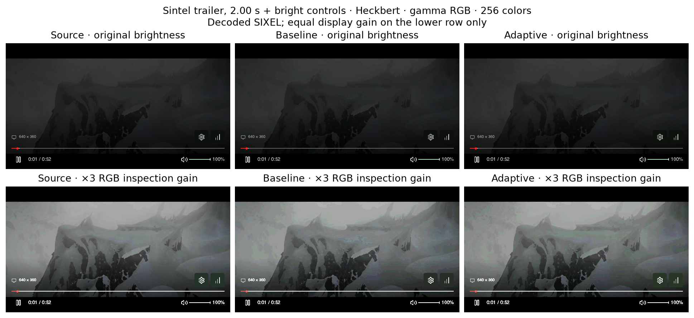
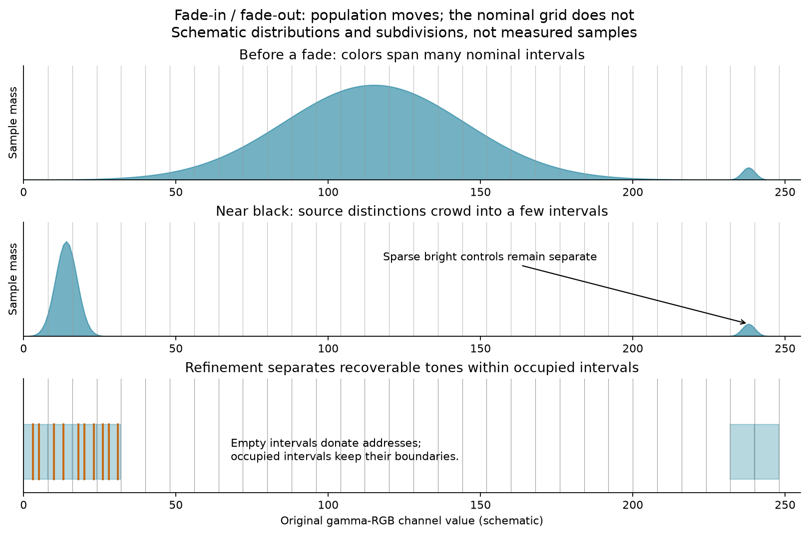
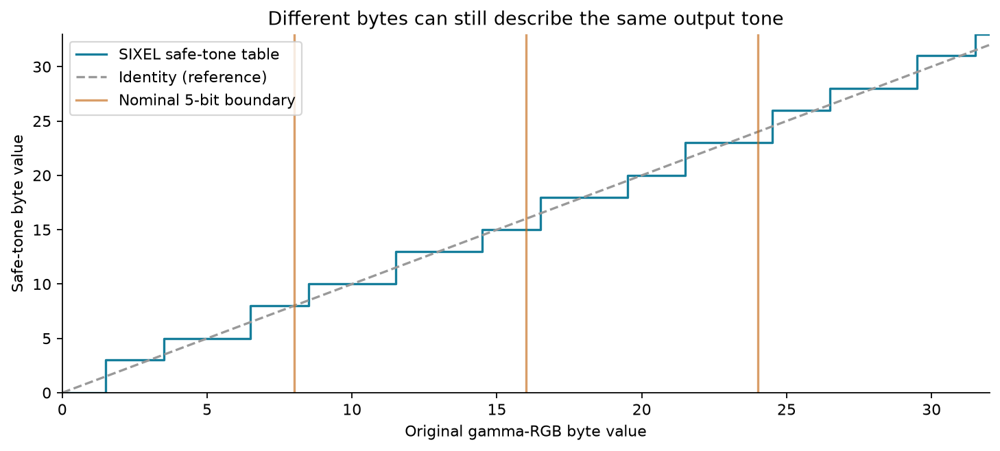
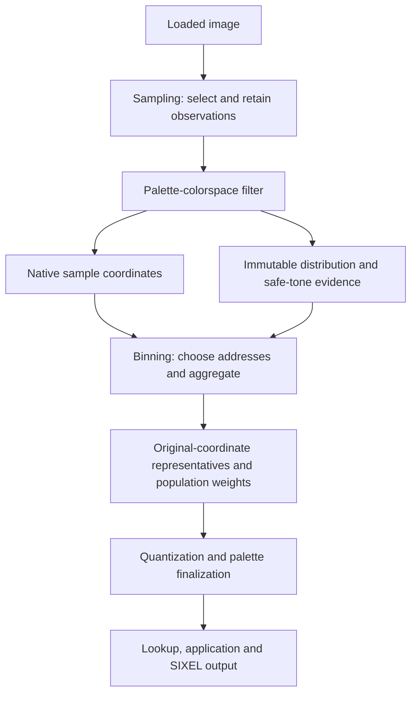

# Preserving tones through a fade

This explanation is for users and contributors who want to understand why a dark video frame can lose its gradients before palette selection, and how range-adaptive binning can help. The [palette construction pipeline](README.md#range-adaptation-at-a-fixed-depth) owns the implementation contract; the [measurement companion](range-measurements/README.md) contains the data, costs, counterexamples and reproduction commands.

**Key ideas in one minute:**

- A palette with room for 256 colors is little help if an earlier histogram has already collapsed the samples into a few dozen candidates.
- Refinement spends unused bin addresses where distinguishable source tones have been crowded together. It preserves the colors and their population weights supplied to the quantizer.
- SIXEL output resolution and the requested palette size limit useful refinement. More candidates can improve quality, increase cost, or change which errors remain visible.

## A fade can exhaust the histogram before the palette

Consider a mountain scene fading in from black. At the start, most RGB values occupy a small region near zero. A fixed grid divides the entire color space evenly, so many different source tones fall into the same cell. The histogram then passes one representative of that cell to palette selection. Switching between k-means, k-medoids and k-center cannot recover distinctions already lost at this boundary.

The following measured example uses Heckbert, an important fast path for video. At 2.00 seconds, with bright controls composited into the frame, nominal binning yields 97 occupied cells and only 91 colors actually used by decoded SIXEL. Adaptive binning supplies 239 candidates and the decoded image uses 161 colors. All four reported quality metrics improve in this example; the encoded stream grows from 91,324 to 133,105 bytes.

The lower row multiplies every displayed RGB channel by three, with clipping, to make dark contours easier to inspect. It is a diagnostic view, not the intended playback brightness. All metrics use the unamplified images. [Original PNGs and measurements](range-measurements/README.md#opening-fade) permit closer inspection. Sintel imagery: © copyright Blender Foundation | durian.blender.org, [CC BY 3.0](https://creativecommons.org/licenses/by/3.0/).

The same geometric problem can occur during fade-out as the distribution contracts toward black, or during a fade toward white or a primary color. Contraction alone does not establish a benefit: there must be distinguishable output tones to recover. The measured video sequence here is an opening fade-in; it is not a temporal-quality measurement of a separate fade-out.

## Move the bin boundaries, keep the color coordinates

The schematic below separates two things that are easy to confuse: a color's original coordinate and the histogram address assigned to it. Bright controls remain at the bright end of the axis even while most of the scene is dark.

A uniform grid is useful because it spreads a bounded number of representatives through the space. Refinement should recover distinctions without abandoning that structure. In libsixel, empty nominal intervals can donate addresses to occupied intervals. Existing occupied intervals remain separate; they are not merged to concentrate everything on the darkest region.

This is an addressing map. It does not apply a gamma correction, stretch the image contrast, clip a percentile tail, or replace the solver's distance metric. An implementation can use a table to map colors to histogram addresses, but that table is not an output-color LUT. The histogram still accumulates the original sample coordinates and mass.

For example, if one nominal bin containing 100 samples splits into children with populations 70 and 30, their total weight is still 100. Neither child receives an extra importance multiplier merely because the region was refined. Running quantization in a warped coordinate space, or increasing these weights, would be a separate quality policy.

## Stop at distinctions the output can represent

Two distinct input bytes need not produce two distinct SIXEL output tones. The following plot uses the library's actual safe-tone table near black; the orange lines show nominal five-bit boundaries for comparison.

Within the nominal interval from byte 8 through 15, the safe-tone results are 8, 10, 13 and 15. Splitting all eight input values into eight independent candidates would overstate the recoverable output resolution. In multiple dimensions the evidence concerns complete RGB triplets, not three independent color counts.

For a perceptual clustering space, the evidence is projected through the gamma-RGB output model and back into the native clustering coordinates. This permits binning in Lab-family spaces while bounding refinement by output distinctions. It does not characterize a particular terminal, monitor or destination ICC profile. The [contract](README.md#range-adaptation-at-a-fixed-depth) specifies the projection and saturation bounds.

A smooth-looking source is not sufficient evidence for activation either. A source may already contain banding, or its differences may all collapse to the same safe tone. Refinement cannot manufacture missing source information. Spatial gradient collection remains outside the active decision path; the current decision uses color shortage and recoverable tones.

## Separate shortage, budget, candidates and final colors

Four counts answer different questions. The measured Heckbert example above gives a concrete way to read them:

| Quantity | Example | Meaning |
| --- | ---: | --- |
| Requested palette size | 256 | The maximum requested number of palette entries. |
| Occupied nominal cells | 97 | How many representatives nominal binning could supply. |
| Adaptive candidates | 239 | How many occupied cells reach palette construction after refinement. |
| Used output colors | 161 | How many distinct RGB colors actually appear after SIXEL decoding. |

The activation probe also finds 169 distinct sampled safe RGB tones. This is evidence of recoverable distinctions beyond 97 nominal cells, not a promise to reproduce all 169. The candidate recovery bound is 262 `(nominal cell, safe color)` pairs: a safe color can occur on both sides of an existing nominal boundary, so this bound can exceed the distinct-safe-color count.

The candidate budget in this example is 256. A requested strength of 50 would allow a budget of 176; strength 100 allows 256. These are calculated budgets, not measured candidate counts at those intermediate strengths. Actual occupancy depends on the subdivisions and their joint three-dimensional distribution.

The planner checks proposed maps before aggregation. Occupancy need not vary monotonically as boundaries move, so bounded search selects a tested feasible map rather than proving a global optimum. “Two pass” describes collecting statistics and replaying the retained samples for aggregation; the intervening occupancy probes also read those samples.

If candidates exceed the palette request, the quantizer still has to choose representatives. If candidates fit, a direct palette path can avoid further clustering, but rounding, palette finalization and lookup can still reduce the number of used colors. Neither candidate count nor used-color count alone establishes perceptual improvement.

## In libsixel

[Filter and artifact boundaries](README.md#filter-and-artifact-boundaries) explain the ownership of the retained sample stream and its statistics. The diagram shows why binning does not need to inspect image neighborhoods or perform its own color conversion.

When conversion is unnecessary but statistics are needed, the palette-colorspace filter can collect them without changing the coordinates. An explicit `hard` request skips adaptive statistics; a needed color conversion still has its own role. See the owner for exact bypass rules and supported collectors.

The public quality knob is [`-5` / `--binning-policy`](README.md#binning-policy), including `auto:strength=N`. The resolved `-Q` model participates in bounding the candidate population. The [measurements](range-measurements/README.md#interpretation) explain why the bounded policy keeps the original weights and distance scales instead of adding an importance boost, a uniform L-axis preference, or a solver-space warp.

Preserving a sparse bright interval at the binning stage does not guarantee identical UI pixels after quantization. Likewise, maps constructed independently for each palette do not guarantee temporal stability between frames. The [behavioral coverage ledger](README.md#test-coverage) and the measurement companion distinguish these boundaries.

## Reproduction

The [measurement reproduction instructions](range-measurements/README.md#reproduction) regenerate every figure from committed data and verify the hashes of the source and decoded images. They also provide a C encoder helper for fresh measurements of the bundled examples. Scientific plots are supplied as PNG and, where applicable, SVG.

## References

- [Sintel sharing and attribution](https://durian.blender.org/sharing/): the source of the opening-fade imagery.
- [Image-quality measurement policy](../../../quality/measurement-policy.md): how metrics, semantic evidence and performance claims are evaluated.
