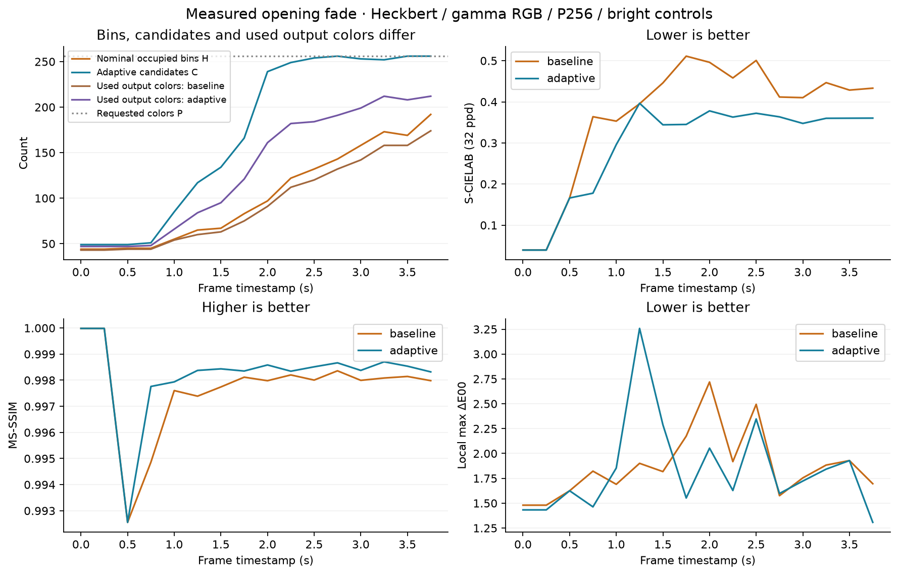
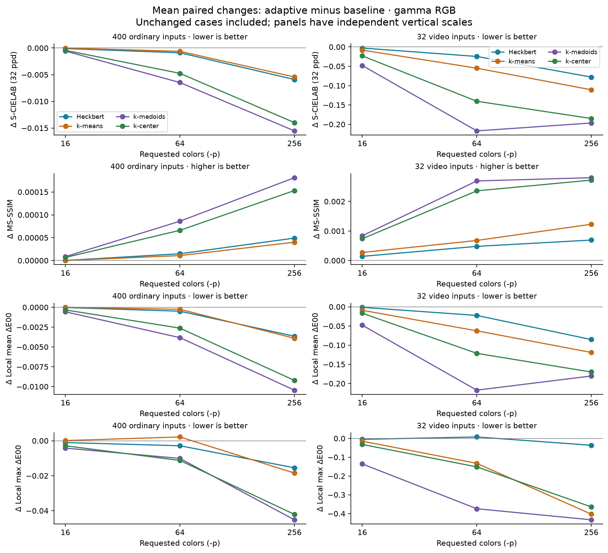
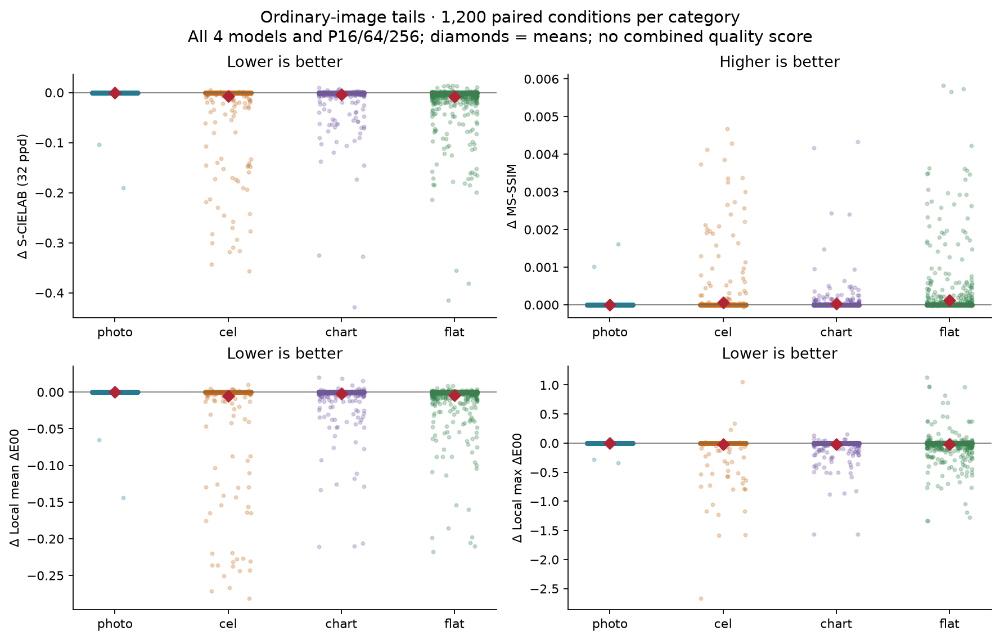
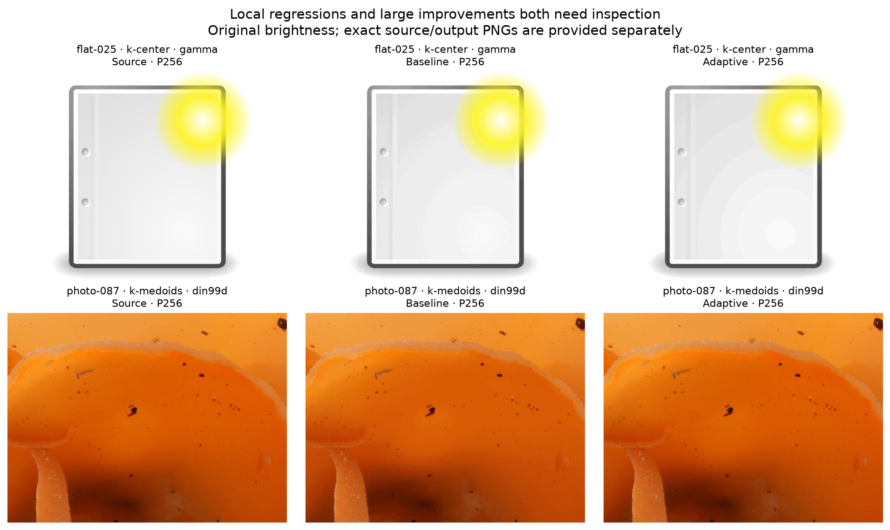
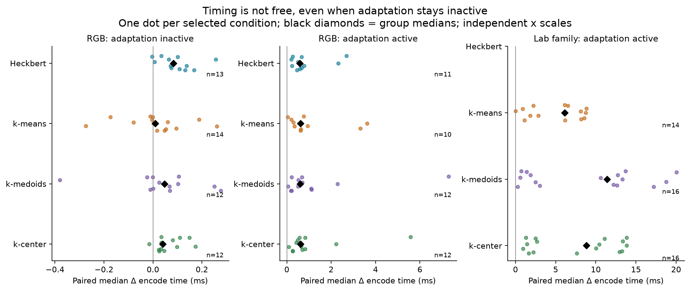

# Range-adaptive binning measurements

This reference is for users and contributors evaluating the quality and cost of bounded range adaptation. It supports [Preserving tones through a fade](../range-adaptation.md); the [pipeline contract](../README.md#range-adaptation-at-a-fixed-depth) owns activation, strength, supported collectors and candidate bounds. These measurements compare decoded SIXEL with the source, not an intermediate palette alone.

## Questions

1. Can refinement recover tones during an opening fade without sacrificing sparse bright content?
2. What changes on ordinary photo, cel, chart and flat images, across quantizers and palette sizes?
3. How much does encoding slow down when adaptation runs, and when it stays inactive?
4. Which local regressions or structural changes are hidden by an average color-difference score?

## Conditions

The archive contains **5,634 paired quality conditions** and **150 selected timing conditions**. [provenance.json](provenance.json) records configuration, source hashes and commands. The measured implementation corresponds to commit `d3f5a53abd3106a995e8423099aa8a1b29eef1fc`; integration commit `a2c0127f55424e4d652b6d18493280a1342108b0` adds editor modelines only. The 29 recorded source-file hashes match the implementation commit. Results from exploratory unbounded policies or solver-weight/distance corrections are not mixed into this archive.

| Dimension | Conditions |
| --- | --- |
| Ordinary images | 100 each from photo, cel, chart and flat, at 640 × 480; [input manifest](inputs.json) records original sources, attribution, prepared RGB hashes and dataset paths. |
| Video | 16 Sintel trailer frames, 0.00–3.75 seconds at 0.25-second spacing, resized to 640 × 360; each with and without baked-in bright player controls. |
| RGB matrix | 432 inputs × Heckbert, k-means, k-medoids, k-center × `-p 16,64,256` = 5,184 pairs. |
| Lab matrix | 25 selected inputs × k-means, k-medoids, k-center × OKLab, CIELAB, DIN99d × `-p 64,256` = 450 pairs. No adaptive native-float Heckbert claim. |
| Arms | `-5 auto:strength=0` versus `-5 auto:strength=100`, using the bounded model-aware policy. The baseline is zero-strength auto, not a different quantizer or an explicit hard-bin mode. |
| Encoder | CPU, Apple M3 Max, macOS 27.0.1, optimized `-O3` build; one encoder thread (`greedy:B1`); seed 1 for iterative models; other controls at automatic defaults. |
| Quality | MS-SSIM; S-CIELAB at **32 pixels per degree**; local mean and maximum ΔE00 over **16 × 16** regions. Metrics use float32 gamma working configuration. |
| Time | Three rounds per condition; each arm has one warmup and five timed encodes per round. Rotated arm order; no concurrent quality workload. |

The 25 Lab inputs include stratified ordinary examples, known risks and four video inputs. This is a focused stress subset, not a second 400-image survey. Inputs were used to select the policy, so labels retained from an earlier train/holdout split do not make this an independent validation set. Six photographic inputs with Adobe RGB profiles were converted once during input preparation; their prepared hashes distinguish them from the original dataset PNGs.

S-CIELAB measures spatially filtered color difference; it is not a structural score. MS-SSIM supplies complementary structural evidence, and regional ΔE00 exposes errors hidden by a global mean. Regional ΔE00 compares the mean XYZ colors of tiles, rather than averaging per-pixel ΔE00. Their definitions live in [image-quality metrics](../../../../quality/metrics.md). A positive change is better only for MS-SSIM. No combined quality score is used.

Timing covers `sixel_encoder_encode_frame`, including palette work, lookup, application and memory-buffered SIXEL generation. It excludes input loading, frame construction, UI composition, decoding, metrics, terminal IO and presentation. Each reported paired change is the median of three within-round differences of five-encode medians. Differences between separately aggregated arm medians need not equal this value. The round extrema in the data are observed spread, not confidence intervals. The archived rounds also interleaved a third candidate-limit variant, excluded from this comparison; `original_arm_order` retains the positions of the two reported arms. The fresh two-arm reproduction can have different timings.

## Results

### Opening fade

At 2.00 seconds with bright controls, Heckbert in gamma RGB at P256 recovers visibly finer dark detail. The same source and both decoded images are shown in the [explanation](../range-adaptation.md#a-fade-can-exhaust-the-histogram-before-the-palette); all numbers below use original brightness.

| Measure | Zero strength | Bounded adaptation |
| --- | ---: | ---: |
| Used decoded RGB colors | 91 | 161 |
| S-CIELAB, 32 ppd ↓ | 0.496079 | 0.377950 |
| MS-SSIM ↑ | 0.997981 | 0.998584 |
| Local mean ΔE00 ↓ | 0.478301 | 0.337784 |
| Local maximum ΔE00 ↓ | 2.718926 | 2.053646 |
| SIXEL bytes | 91,324 | 133,105 |

The timeline shows that extra candidates do not translate one for one into output colors. It also shows nonuniform benefits through the fade: a better average over the sequence does not mean every frame or metric improves.



Sintel imagery: © copyright Blender Foundation | durian.blender.org, [CC BY 3.0](https://creativecommons.org/licenses/by/3.0/), under the [Sintel sharing terms](https://durian.blender.org/sharing/). Frames are resized and the `ui1` fixtures add raster controls. The measured timestamps identify source frames; the decorative time label in those controls is not the timestamp authority.

### Quantizer and palette-size effects

Heckbert is included alongside all three clustering models. These plots average paired differences within each requested palette size. Unchanged conditions stay in the denominator. The ordinary-image and video panels have separate scales because their effect sizes differ substantially.



For the 96 RGB video conditions per model, the means across P16/64/256 are:

| Model | Adaptation active | Output changed | ΔS-CIELAB ↓ | ΔMS-SSIM ↑ | Δlocal mean ↓ | Δlocal max ↓ |
| --- | ---: | ---: | ---: | ---: | ---: | ---: |
| Heckbert | 42 | 40 | −0.035129 | +0.000438 | −0.036407 | −0.011214 |
| k-means | 45 | 45 | −0.057968 | +0.000726 | −0.063558 | −0.183503 |
| k-medoids | 65 | 65 | −0.153886 | +0.002112 | −0.148574 | −0.314371 |
| k-center | 65 | 62 | −0.116159 | +0.001939 | −0.102693 | −0.182628 |

The [derived summary table](figures/quality-summary.csv) also contains the 1,200 ordinary-image conditions per model. “Active” means the adaptive planner ran; it does not imply a changed decoded image. The traces distinguish these outcomes from the early shortage gate.

### Ordinary images and adverse tails

Across 1,200 RGB conditions per category, the planner runs in 2 photo, 103 cel, 331 chart and 616 flat conditions. Decoded pixels change in 2, 93, 265 and 585 conditions, respectively. The photographs usually already fill enough nominal bins; the flat-image group contains many small color populations and broad ramps.



The means improve in all four categories, but these clouds are not uniformly on the favorable side of zero. [Top-five tables](figures/top-k.csv) rank improvement and degradation separately for each metric over all 5,634 conditions. They retain every other metric beside the ranking value; differences near the six-decimal measurement resolution should not be interpreted as significant.

| Selected case | ΔS-CIELAB ↓ | ΔMS-SSIM ↑ | Δlocal mean ↓ | Δlocal max ↓ | Reading |
| --- | ---: | ---: | ---: | ---: | --- |
| video-04-ui1 / k-means / RGB / P256 | +0.044359 | +0.004413 | +0.165462 | +0.255770 | Highest S-CIELAB and local-mean degradation, while structure improves. |
| video-16-ui1 / k-medoids / RGB / P64 | −0.127392 | −0.000156 | −0.193833 | 0 | Largest MS-SSIM decrease; color metrics improve. |
| flat-025 / k-center / RGB / P256 | −0.040689 | +0.001640 | −0.007574 | +1.132705 | Local maximum worsens despite three favorable metrics. |
| photo-087 / k-medoids / DIN99d / P256 | −1.070663 | +0.010983 | −0.328724 | −0.572920 | Strong improvement across the four metrics, with substantial runtime cost. |

The two ordinary examples below illustrate why a global average cannot settle the decision. A white paper region can acquire differently placed contours even when the total image uses more colors; the fungus photograph can recover many useful distinctions from an underfilled perceptual histogram. This does not identify binning or the solver as the sole cause of every contour.



`flat-025`: [Document-new.svg](https://commons.wikimedia.org/wiki/File:Document-new.svg), The people from the Tango! project, public domain; rasterized and centered on white. `photo-087`: [Aleuria aurantia fungus orange peel (second view)](https://commons.wikimedia.org/wiki/File:Aleuria_aurantia_fungus_orange_peel_(second_view).jpg), Holger Krisp, [CC BY 3.0](https://creativecommons.org/licenses/by/3.0/); center crop. Source and quantized derivatives, including the adverse early-fade example, are linked by [examples.json](examples.json). Full attribution and modifications are retained in [inputs.json](inputs.json).

### Active cost and inactive overhead

The following timing plot uses selected conditions, not the full quality matrix. A dot is one condition's paired median change; a diamond is the median across the displayed conditions. The two RGB panels separate planner execution from the cost of checking and declining adaptation. Lab-family active cases occupy a separate scale.



| RGB model | Inactive: n / median Δms | Active: n / median Δms | Largest active Δms |
| --- | ---: | ---: | ---: |
| Heckbert | 13 / +0.084 | 11 / +0.580 | +2.689 |
| k-means | 14 / +0.009 | 10 / +0.621 | +3.614 |
| k-medoids | 12 / +0.047 | 12 / +0.596 | +7.297 |
| k-center | 12 / +0.040 | 12 / +0.612 | +5.586 |

These inactive overheads are milliseconds, not seconds, and do **not** mean refinement ran. Negative observations within the inactive spread should not be read as a guaranteed speedup. The eight inactive Lab conditions, omitted from the plot for space, still cost +0.312 to +1.612 ms in paired medians; they are retained in [timing-pairs.csv](figures/timing-pairs.csv).

The largest measured increase is `photo-087 / k-medoids / DIN99d / P256`: **+20.043 ms**, with round differences from +19.493 to +20.267 ms. Its candidates grow from 80 nominal cells to 512, and used colors from 80 to 256. The strong quality improvement above makes this a real trade-off, but not a cost-free improvement. This run's median arm times are 19.974 and 40.241 ms. Lab projection/statistics, candidate processing and downstream lookup/application can all contribute; this end-to-end measurement does not assign the entire increase to k-medoids.

## Interpretation

Bounded refinement addresses a specific loss of information before palette selection. The strongest evidence is the opening fade and selected underfilled perceptual histograms. Most photographic RGB conditions remain unchanged; cel, chart and flat inputs contain more opportunities and more small mixed outcomes. This supports a shortage-and-recoverability gate, not a blanket statement that adaptation improves all images.

Candidate limits preserve much of the original grid's economy. The adopted policy allows more candidates for k-means and k-medoids than for Heckbert and k-center; the exact budget belongs to the [pipeline contract](../README.md#range-adaptation-at-a-fixed-depth). This archive evaluates that fixed policy. It does not claim to prove an optimal multiplier, a universally correct L-axis preference, or an optimal gradient-based activation rule. Additional importance weights and warped solver distances are not enabled.

A global color score, a structural score, local color differences, output-color counts and bytes answer different questions. Read them together with the images. Bright occupied intervals remain separate during binning, but the measured full-frame scores do not prove pixel-exact preservation of controls after final quantization. More colors can also produce more SIXEL bytes, increasing an unmeasured terminal transport cost.

These are independent still-frame encodes at 640 × 360 or 640 × 480. The evidence does not measure real-time FHD playback, palette reuse across a stream, frame-to-frame flicker, a separate closing fade-out, destination ICC behavior, or physical terminal presentation. Timing uses a small targeted sample on one CPU; quality uses one iterative seed and inputs consulted during policy selection. Generalization and a per-frame latency budget require a separate workload-specific check.

## Reproduction

The archive is self-contained for plots and the four illustrated examples. Python is used for documentation figures and orchestration; the timed encoder helper is C. No Python regression test is introduced.

```sh
python3 -m venv /tmp/libsixel-range-plots
/tmp/libsixel-range-plots/bin/pip install matplotlib pillow
/tmp/libsixel-range-plots/bin/python tools/plot_range_adaptation.py
```

The generator checks pair uniqueness, finite metrics, activation/budget consistency and all 12 source/output RGB hashes. It regenerates eight figures, SVG counterparts for the six vector plots, and three derived tables. Use `--output /tmp/range-figures` to compare regenerated artifacts without touching the archive.

To re-encode the four bundled inputs against a configured build, choose a new output directory and build the helper. Both loader-path variables are shown so that the intended library is selected on macOS or ELF systems; a system-installed library with the same name can otherwise be loaded accidentally.

```sh
export PATH="$PWD/.local/bin:$PATH"
make -j8 all
cc -O2 -Wall -Wextra -I include tools/measure_range_adaptation.c \
  -L src/.libs -Wl,-rpath,"$PWD/src/.libs" -lsixel -o /tmp/measure-range
DYLD_LIBRARY_PATH="$PWD/src/.libs" LD_LIBRARY_PATH="$PWD/src/.libs" \
  /tmp/libsixel-range-plots/bin/python tools/reproduce_range_adaptation.py \
  --measure /tmp/measure-range --lsqa assessment/lsqa \
  --output /tmp/range-fresh
```

This runs both strengths in three alternating rounds, records commands and the new build state, and checks decoded hashes against the archive. It refuses to overwrite an existing output directory. Its observations are a fresh run, not replacements for archived timings. It requires a build with `lsqa`; the repository [build instructions](../../../../build/autotools.md) describe native build setup.

For the full matrix, [quality.csv](quality.csv) enumerates every `(input, model, space, p)` pair. [inputs.json](inputs.json) identifies external dataset files and their prepared RGB hashes. Use those exact prepared inputs, including the recorded profile conversions, with the same helper and metric command in [provenance.json](provenance.json). Only the four illustrated inputs are bundled, so full re-encoding requires the external dataset and remaining prepared video fixtures. Plot reproduction does not require them.

| File | Grain and interpretation |
| --- | --- |
| [quality.csv](quality.csv) | One paired condition; absolute metrics, decoded colors/bytes/hashes and adaptive trace evidence. `hard` is exact only when `complete=1`; otherwise it is an early-stop lower bound. Blank planner fields mean no planner trace. `safe` and `recoverable` saturate at 1024. |
| [timing.csv](timing.csv) | One arm and round; five-encode median and maximum, warmup count, active flag, original arm order, bytes and colors. 900 rows for 150 paired conditions. |
| [quality-summary.csv](figures/quality-summary.csv) | Mean paired RGB differences by ordinary/video cohort and model, including unchanged cases. |
| [timing-pairs.csv](figures/timing-pairs.csv) | One condition's paired median and minimum/maximum round difference. |
| [top-k.csv](figures/top-k.csv) | Five improvement and five degradation cases for each metric, ranked independently across both color-space cohorts. |
| [inputs.json](inputs.json), [examples.json](examples.json) | Source identity, attribution, modifications and exact bundled-image paths. |
| [provenance.json](provenance.json) | Measured implementation identity, configuration, metric command, original artifact hashes and timing boundary. |
