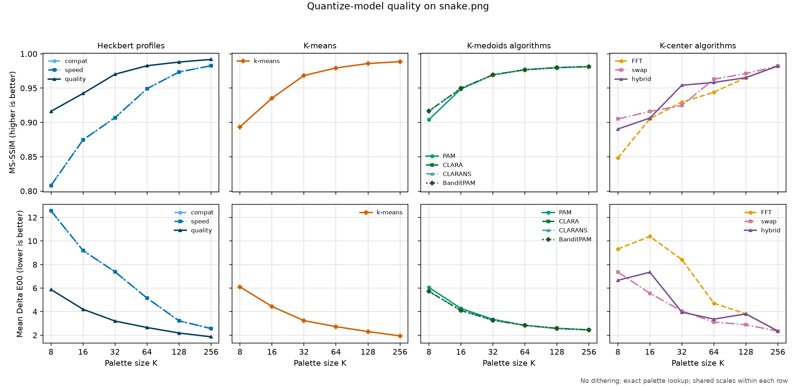
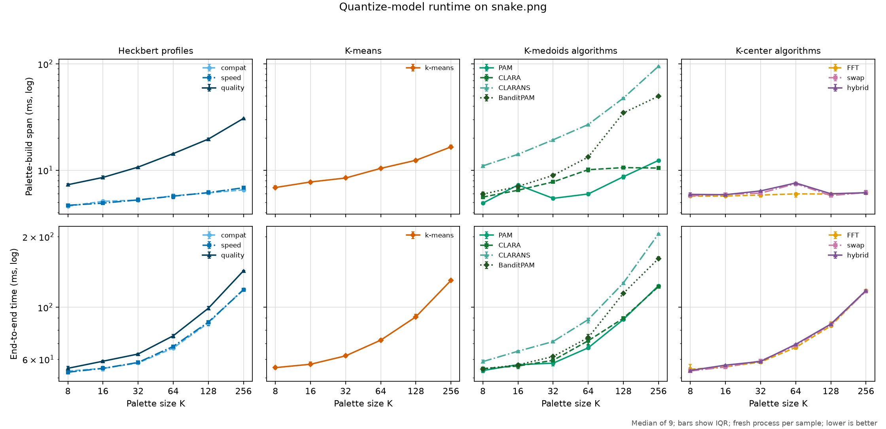
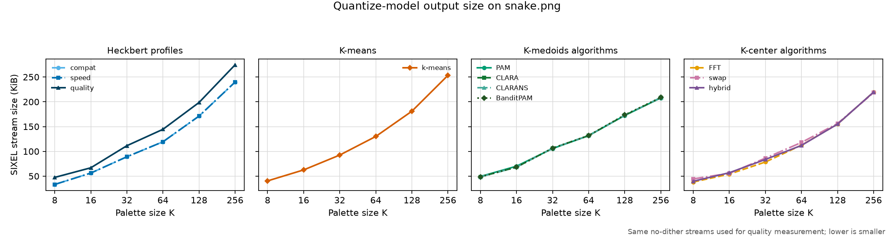

# Palette Quantization

The [selected float output path](../../output/output-colorspace.md#k-center-and-k-medoids-representatives) describes extended-coordinate preservation, representative contracts and supported binning for K-means, K-center, K-medoids and Heckbert, including resolved auto requests. It does not change the objectives described here.

## Purpose

Palette quantization constructs a small set of colors that represents a much
larger input color population. In the encoding pipeline it runs after loading
and normalization and before palette application:

```text
normalized pixels -> quantization -> palette entries
```

It answers **which colors are available to the encoder**. It does not assign a
palette index to every pixel; dithering and lookup perform that later step.

## CLI surface

`img2sixel` selects the palette solver with:

```text
-Q MODEL
--quantize-model=MODEL
```

`MODEL` may include model-specific suboptions. Use `img2sixel -H` or the
[`img2sixel(1)` manual](../../../../converters/img2sixel.1) for the current accepted
suboptions. `-p COLORS` sets the requested palette size and normally defaults
to 256 colors.

All models accept `sample_target=COUNT`. The independent `-4`/`--sampling-policy=POLICY` option chooses how source pixels are sampled, while `COUNT` bounds the adaptive sample population. In the notation below, `N` is the number of pixels after that sampling step and `S` is the number of weighted samples or occupied histogram bins retained by preprocessing.

`-5`/`--binning-policy=POLICY` independently chooses how sampled colors become the weighted point set consumed by the solver. The two policies and their staged resolution are described in the
[Palette Construction Pipeline Architecture](../pipeline/README.md). Quantizer
suboptions may parameterize a supported binning implementation, but they do
not select the binning policy.

Let `x[i]` be a retained color sample with non-negative weight `w[i]`, and let
`C` contain at most `K` palette colors. Colors are three-dimensional in the
space selected with `-X`. The norm below is Euclidean in that space. The
[Palette Clustering Color Space](../clustering-colorspace/README.md) reference defines
the exact coordinates and normalization. Changing the color space, channel
normalization, histogram precision, or candidate collector changes the
geometry or data set before optimization begins.

The five base models are described separately below. Their objectives are not
interchangeable: a model that minimizes average squared error need not best
preserve an isolated color, while a model that protects the worst represented
color may spend palette capacity where it changes the image-wide average very
little.

## `auto`: compatibility selection

```text
-Q auto
```

`auto` is the default staged solver choice, not an image-quality contest between algorithms. With omitted, `auto` or `none` binning it selects Heckbert. Explicit `exact`, `hard` or `soft` binning selects K-means, which can consume the required weighted point representation. The requested policy remains `auto`; each frame resolves its actual consumer independently.

On the [selected CPU float path](../../output/output-colorspace.md#selected-ordinary-srgb-float-path), the resolved Heckbert or K-means solver preserves native coordinates just as an explicit request does. This includes `-Q` omission, explicit `-Qauto` and the selected Display P3 path. The existing byte-eligibility rules still apply; automatic solver selection alone does not promote a byte image. Admission checks model-specific restrictions, such as K-means feedback, against the resolved consumer. [Selected image mapfiles](../external-palettes.md#selected-ordinary-srgb-output) use the same resolver and native solver families. Structured mapfiles bypass palette construction, so they do not execute a quantizer.

Only the common `sample_target` suboption belongs to `auto`. A Heckbert preset must
be requested explicitly, for example:

```text
-Q heckbert:profile=quality
```

A failed selected native build returns an error without narrowing the data or silently choosing another solver. All ordinary generators also retain this failure contract for typed float input, as described below. True byte paths retain their historical fallback behavior outside the selected native path. Record effective palette-build telemetry when distinguishing the requested policy, resolved consumer and fallback.

The time and space costs of `auto` follow its resolved [Heckbert](#heckbert-recursive-median-cut) or [K-means](#kmeans-centroid-optimization) consumer. `auto` reserves selection policy while an explicit solver names the algorithm directly.

## Ordinary float iterative solvers

K-means, K-center and K-medoids use one float implementation for both ordinary `generate()` and the selected native output path. The actual input pixel format selects the arithmetic; an internal byte preference cannot reinterpret or narrow an already typed float buffer. True byte inputs continue to use byte storage. This does not change encoder admission, automatic precision selection, or the separate restrictions on Display P3 output.

Without an active snap policy, finite negative and above-nominal source coordinates survive candidate collection and representative export in gamma RGB, linear RGB, Oklab, CIELAB and DIN99d. K-means hard/soft bins, K-center hard bins and the K-medoids candidate grid expand their addressing bounds to include the source population. This changes which grid cells hold candidates, not the fixed nominal channel scales used by solver distances or Ward merging. Bin addressing never clips the stored sample coordinates. Ward retains fractional means rather than projecting them through bytes. K-means counts distinct float coordinates directly when deciding whether Ward reduction is needed, preserves fractional soft-bin populations, and retains signed donor moments during empty-cluster repair.

An explicitly requested final snap remains effective and follows the [snap policy](../snap-policy/README.md); coordinate preservation does not disable it. K-means retains its initialization and iteration snap hooks, including the iteration hook on feedback replacements. Its residual histogram expands addressing bounds around extended samples, so distinct negative or above-nominal residual colors do not collapse into an endpoint bin. K-center and K-medoids still have no consumers for the early initialization/iteration timing hooks. Float allocation or input-validation failure returns the original error without a byte-engine or alternate-solver retry. A subsequent build can reuse the same palette object after the failed attempt finishes.

## `heckbert`: recursive median cut

```text
-Q heckbert[:profile=compat|speed|quality][:cut=median|sse][:order=population|sse][:weights=auto|L/A/B]
```

Heckbert quantization is a top-down partitioning heuristic. The implementation
first accumulates a finite color histogram. One box initially covers all
occupied cells. Until enough leaves exist, it chooses a box, chooses a split
direction, and divides the box at the selected cut:

```text
occupied histogram cells
          |
          v
       one box
          |
   split at minimum child SSE
       /          \
  left box     right box
       \          /
        repeat to K leaves
               |
               v
    one representative per leaf
```

On the byte path, each occupied histogram cell retains the mean of the actual input samples assigned to that cell. Exact 64-bit counts and channel sums are stored only for occupied cells, in first-occurrence order; the mean uses the unsaturated count independently of the capped histogram weight. Fractional means survive box bounds, axis ordering, representative selection and Ward statistics until final byte rounding. `--lookup-policy=none` gives every distinct byte color its own cell. Reversible input mapping precedes binning and accumulation, and each resulting mean is projected back onto the reversible tone grid.

The byte RGB/RGBA collector's automatic lookup path uses [range adaptation at a fixed depth](../pipeline/README.md#range-adaptation-at-a-fixed-depth) before accumulating those moments. That reference defines its activation conditions and bright-interval preservation; native float histograms continue to aggregate identical source triples.

The traditional split direction is a channel with a large range. libsixel can
also choose a luminance-oriented direction or estimate a principal component
from the weighted covariance matrix. The representative of a leaf may be its
geometric center, unweighted color mean, or frequency-weighted mean. These choices
control the partition and representative; they do not turn median cut into an
optimizer for the K-means or K-center objectives.

The `compat`, `speed`, and `quality` profiles fill only unspecified solver settings. `compat` uses the ordinary axis and merge policies; its name does not promise historical byte output. `speed` uses norm splitting and no final merge. `quality` uses PCA-oriented splitting and may create more than `K` intermediate leaves before Ward merging them. All three use the common SSE cut/order and dither-dependent representative defaults. Explicit split, representative, and final-merge options override the corresponding profile defaults.

The independent [`-F` final merge policy](../merge-policy/README.md) explains the oversplit size, Ward reduction criterion, optional Lloyd polishing, quantizer interactions, and measured cost and quality. It is a post-solver policy even when a `-Q` profile supplies its defaults.

If splits remain reasonably balanced, each occupied histogram cell participates in approximately `log K` partition levels, giving usual `O(S log K)` splitting work. Repeatedly peeling off a very small box can reach `O(S K)`. Histogram clearing and ingestion add `Theta(N + B)`, where `B` is the number of addressable histogram cells. PCA median selection is normally linear per box, but a fallback may sort. SSE cuts fully sort PCA/native-float ranges in `O(S log S)` per box before their linear scan, while byte channel sorts first use integer buckets and then sort fractional means within each bucket. The balanced bound is therefore not a hard bound for every path.

Median cut is deterministic for fixed inputs and settings, but it has no general guarantee of minimizing squared error or maximum radius. Its appeal is bounded work, balanced coverage of occupied regions, and compatibility with the quantizer descended from Netpbm. The original algorithm and design tradeoff are described by Heckbert in [Color Image Quantization for Frame Buffer Display](https://publications.ri.cmu.edu/color-image-quantization-for-frame-buffer-display).

### Explicit split and representative controls: `-f` and `-s`

`-f` / `--find-largest` selects the Heckbert box-splitting method. `norm` compares channel ranges, `lum` uses luminance-oriented weighting, and `pca` estimates the first principal direction; the `cut` suboption selects its split position. `auto` defers to automatic/default resolution; it is not a fourth mathematical split method. An explicit split setting is retained when a Heckbert profile supplies defaults. Degenerate partitions can trigger the implementation's fallback directions, so selecting PCA does not guarantee that every individual split uses a principal axis.

`-s` / `--select-color` selects the representative of each final Heckbert cluster, including after Ward and Lloyd: `center` is the midpoint of its member extrema, `average` is the unweighted mean of its distinct retained histogram colors, and `histogram` is the occurrence-weighted mean. Histogram binning and sampling determine which colors are retained. Byte representatives round to nearest, with exact halves rounded up; native float representatives retain fractions and extended coordinates. Reversible mapping and explicit snapping remain separate subsequent policies.

Explicit `-s center|average|histogram` is rejected when the resolved CLI solver is K-means, K-medoids or K-center: changing their final representatives would change their centroid, observed-member or radius objective. Use `-s auto` with those solvers. Structured external palettes, builtin palettes, preserved PAL8 inputs and reused palettes bypass construction and ignore `-s`. Image mapfiles that construct a palette obey the solver contract. These controls work with the default palette size; explicit `-p` is unnecessary. Repeating a selector replaces its earlier value.

### Dither-dependent defaults

| Diffusion at palette construction | `-s auto` | Cut | Box order |
| --- | --- | --- | --- |
| Any enabled dither | `average` | `sse` | `sse` |
| `none` | `histogram` | `sse` | `sse` |

Only unspecified controls use this table. Explicit representatives, Heckbert suboptions and their environment values retain ordinary CLI-over-environment precedence. `weights=auto` selects the native ratios below independently of diffusion.

The encoder passes its diffusion request through `sixel_dither_set_diffusion_type()` before construction. That same setter resolves `auto` to FS above 16 palette entries and Atkinson otherwise, and runs again for application when the final palette size is known. Both outcomes are dithered. Error diffusion (including FS, Atkinson, Jajuni, Stucki, Burkes, Sierra and LSO), and positional arithmetic/XOR/blue-noise dithering all use `average`: each modulates the available colors, and unmeasured methods conservatively share the enabled-dither policy. If every retained color already fits, the exact-palette shortcut can disable diffusion afterward; singleton representatives are identical under all three selectors, so this does not change their colors.

The public dither API uses the diffusion set before `sixel_dither_initialize()`. A newly created object starts with FS, so initialization before a diffusion setter uses `average`; changing diffusion afterward does not retroactively rebuild the palette. Direct palette generation without a dither object also treats `auto` as `average`. Reinitialization uses the object's current diffusion state. Fixed palettes and reuse bypass this resolution.

Ward and Lloyd retain weighted centroids for their optimization, then export the representative from this table using final membership statistics. Dithered Ward therefore exports `average`; undithered Ward exports `histogram`. Explicit `-s` always wins, including when no merge actually occurs.

A box-extrema midpoint can shift a broad neutral region toward a sparse outlying color. The distinct-color average reduces this sensitivity while retaining more color range than a frequency-weighted mean. With diffusion it balances per-pixel color error and MS-SSIM against spatial color fidelity: a 20-photo/20-chart VGA comparison found roughly 1–4% higher photo S-CIELAB error than center and a small chart ΔE00 cost, despite improved photo ΔE00 and MS-SSIM. After Ward, average also preserves better spatial color fidelity than histogram on the photo corpus, at a per-pixel error cost. Without diffusion the frequency-weighted representative favors pixel color error and MS-SSIM. These are measured tradeoffs, not per-image quality guarantees; the [measurement policy](../../../quality/measurement-policy.md) requires reporting viewing geometry and individual outliers.

### Cut, box order and native axis ratios

| Key | Compact | Default | Environment |
| --- | --- | --- | --- |
| `cut=median|sse` | `Tmedian`, `Tsse` | `sse` | `SIXEL_PALETTE_HECKBERT_CUT` |
| `order=population|sse` | `Opopulation`, `Osse` | `sse` | `SIXEL_PALETTE_HECKBERT_ORDER` |
| `weights=auto|L/A/B` | `Wauto`, `W2/1/1` | `auto` | `SIXEL_PALETTE_HECKBERT_WEIGHTS` |

These settings belong only to `heckbert`, coexist with `profile`, and retain ordinary CLI-over-environment precedence. `T` denotes the cut threshold; `C` is already the common sample-count key. All profiles inherit SSE cuts and SSE ordering unless explicitly overridden.

| Clustering coordinates | Norm native ratios | Lum native ratios |
| --- | --- | --- |
| Gamma or linear RGB | 1:1:1 | 0.2989:0.5866:0.1145 |
| CIELAB | 2:1:1 | 4:1:1 |
| DIN99d | 2:1:1 | 4:1:1 |
| OKLab | 1:1:1 | 2:1:1 |

Ratios multiply channel ranges in native color-space units; compensation for the histogram's nominal normalization is explicit. CIELAB norm gives lightness twice the chromatic-axis emphasis; DIN99d, OKLab and RGB keep their own native ratios. Lum doubles the norm lightness emphasis in perceptual spaces; RGB retains BT.601. Custom ratios replace either rule, require three positive finite values and cancel a common multiplier. `auto` restores the format-specific rule. A median norm/PCA split that falls back to luminosity keeps the legacy BT.601 fallback multipliers on top of the norm ratios; it does not become an explicit perceptual `-f lum` request. Thus specifying the norm default ratios explicitly also preserves the default partitions.

`cut=sse` completely sorts the selected axis, including PCA and native float norm/lum paths, then scans cumulative weighted sums and squared sums to minimize the sum of child errors. The objective squares the same effective coordinate weights used for axis selection. PCA retains its established nominal-coordinate projection; custom ratios affect its SSE evaluation, not its covariance. Ties choose the first cut. A singleton outlier is valid: only empty or out-of-range partitions are rejected. `order=sse` caches each box's error, reuses cut moments, and selects the largest error with deterministic position/count tie breaks. Accumulation is serial in fixed table order; worker count does not change it. This does not promise identical floating-point arithmetic on compilers using incompatible contraction or fast-math rules.

```sh
img2sixel -Q heckbert:cut=sse:order=sse:weights=2/1/1 -Xc -s histogram image.png
```

### Deprecated complexion score

`-C` / `--complexion-score` remains accepted for compatibility, but the current encoder ignores its argument. It does not apply a skin-tone preference, affect palette distance, or replace a color-space policy. The setter does not numerically validate the ignored value. New commands should express their actual palette, color-space, and lookup choices instead.

### Native float Heckbert

For every typed float generation request, including ordinary library entry points outside the [selected CPU float output path](../../output/output-colorspace.md#heckbert-representatives), `-Qheckbert` and `auto` resolved to Heckbert build a histogram of identical finite source triples without an 8bit projection or bounded grid. The tuple coordinates use double arithmetic and a fixed per-axis scale derived from the nominal `-X` channel span. Signed axes are not translated, so very small coordinates are not lost by adding and subtracting a nominal minimum. Negative and above-range values remain available to splitting and representative construction. Distinct native colors also determine whether a palette is large enough to omit diffusion: colors that merely share a byte/bin projection must not trigger that optimization. Nonfinite input fails; a failed float build cannot retry the bounded byte histogram. The actual input format selects arithmetic even when the caller supplies a byte preference hint.

The three `-s` choices retain their distinct meanings: `center` is the midpoint of each box's extrema, `average` is the mean of its distinct colors, and `histogram` is the occurrence-weighted mean. None rounds its float representative to a byte or a SIXEL percentage. Native axis splits use the selected SSE or weighted-median partition rule; the byte histogram retains its counting-sort implementation. PCA uses centered covariance to avoid cancellation between large second moments. Optional Ward reduction and Lloyd refinement retain signed and fractional coordinates; the final representative uses the resolved `-s` rule after the last membership assignment.

This exact native histogram may contain more entries than the legacy 5bit/6bit histogram. Its initial deterministic sort costs `O(N log N)` time after upstream sampling. It sorts borrowed source references using `N * sizeof(float *)` bytes, then allocates double tuple storage for the `U` distinct triples, preserving exact occurrence counts. On a typical 64-bit host that tuple pool costs `40 * U` bytes; it is not allocated for all `N` samples before deduplication. The references and tuple pool coexist during construction; when nearly every sample is distinct, their combined peak can exceed a per-pixel table. The temporary references are freed before median cut. Existing allocator limits still apply to each allocation: a sufficiently large distinct-color set can exceed the tuple-pool limit and reports an allocation error without lossy fallback. The legacy byte path keeps its bounded histogram and integer representative rounding. The `speed` profile's lookup preference applies to palette application but does not coarsen the native histogram. `-Qauto` uses this arithmetic when it resolves to Heckbert with typed float input. Default/AUTO cover admits the native path with repair off. Output caching and cover follow the [current output admission rules](../../output/output-colorspace.md#selected-ordinary-srgb-float-path). Ordinary sRGB representative and final snap use typed coordinates and their requested timing/rate; histogram collection itself does not snap float inputs. The separately documented [byte histogram and early merge snap defects](../snap-policy/README.md#known-contract-violations) remain scoped to their consumers.

## `kmeans`: centroid optimization

```text
-Q kmeans[:key=value...]
```

`backend=cpu|gpu` selects the primary iteration implementation, with CPU as the default. The opt-in [GPU K-means backend](../gpu-kmeans.md) also requires `--gpu-policy=auto|force`; that reference defines Metal requirements, fallback/error behavior and numerical differences. The pruning policies and bound-storage costs below describe CPU execution.

K-means minimizes weighted within-cluster squared error:

```text
SSE(C) = sum_i w[i] * min_c-in-C ||x[i] - c||^2
```

Lloyd iteration alternates between two steps:

1. assign each sample to its nearest centroid;
2. replace each centroid by the weighted mean of its assigned samples.

For a fixed data set and exact assignments, each step cannot increase `SSE`.
Iteration nevertheless reaches only a local optimum; finding the globally
best K-means partition is not what the implementation promises. Initialization
and independent restarts therefore matter even when all other options are
fixed. Lloyd's original formulation is documented in
[Least Squares Quantization in PCM](https://doi.org/10.1109/TIT.1982.1056489).

The current `inittype=auto` resolves to `none`, meaning that it does not use the
PCA-specific seed path. The resulting legacy initializer is still structured:
it selects the first sample by weight and later samples in proportion to their
weighted squared distance from the nearest chosen center. This is the idea
usually called D-squared or k-means++ seeding, introduced in
[k-means++: The Advantages of Careful Seeding](https://theory.stanford.edu/~sergei/papers/kMeansPP-soda.pdf).
`inittype=pca` projects samples onto the dominant weighted covariance axis,
sorts them, and initializes centers from equal-weight intervals on that axis;
it falls back to the legacy initializer if PCA seeding cannot complete.

`--binning-policy=hard` aggregates each color into one nominal histogram cell, while `--binning-policy=soft` distributes a color over as many as eight neighboring cells with trilinear weights. `--binning-policy=auto` selects hard binning with the [range adaptation](../pipeline/README.md#range-adaptation-at-a-fixed-depth) defined by the pipeline reference. The K-means `binbits` suboption controls the axis address budget, and `mapping=uniform|srgb` controls the nominal coordinate mapping. `softdist` selects the distribution kernel for soft binning.

None of these options replaces `-X`, which defines the clustering colorspace. Binning changes the weighted data set and can therefore change the optimum. It is an approximation or preconditioning choice, not merely an acceleration of the same Lloyd iterations.

The pruning policies skip distance calculations by maintaining bounds:

- `none` performs the direct assignment search;
- `hamerly` keeps one upper and one lower bound per sample;
- `elkan` keeps bounds against individual centers;
- `yinyang` groups centers and keeps group lower bounds;
- `auto` currently resolves to `hamerly`.

These policies are intended to preserve the exact nearest-center assignments
for the same samples and center state, apart from normal floating-point and tie
effects. They change how much work is needed, not the K-means loss being
optimized. The implementation ideas are described in
[Elkan's triangle-inequality method](https://cdn.aaai.org/ICML/2003/ICML03-022.pdf),
[Hamerly's single-bound method](https://doi.org/10.1137/1.9781611972801.12),
and [Yinyang K-Means](https://proceedings.mlr.press/v37/ding15.html).

`threshold`, `iter`, `iter_max`, `miniter`, and `polish_iter` bound or stop
refinement. `feedback` may relocate weak clusters using residual histogram
error, so enabling it can lead to a different local solution rather than just
reaching the same solution faster. Pin `seed`, `restarts`, sampling, binning,
feedback, stopping, and pruning settings for reproducible comparisons.

One restart has worst-case assignment and bound-maintenance work
`O(I * (S K + K^2))`; `A` restarts multiply it by `A`. D-squared seeding costs
`O(S K)`. PCA seeding adds covariance work and an `O(S log S)` projection sort.
Plain and Hamerly assignment need `O(S + K)` auxiliary storage, while
per-center bounds can require up to `O(S K + K^2)`. Bound pruning can save most
distance calculations on well-separated data, but its worst case remains a
full sample-center scan.

## `medoids`: sample-anchored clustering

```text
-Q medoids[:algo=auto|pam|sample|random|bandit][:key=value...]
```

K-medoids minimizes a nearest-center cost while requiring each center to be a
retained sample:

```text
cost(M) = sum_i w[i] * min_m-in-M ||x[i] - m||^2
M is a subset of the retained samples, and |M| <= K
```

The sample constraint makes a raw medoid palette directly representative of
observed colors and less sensitive to a distant sample than a mean can be. It
also replaces the inexpensive K-means mean update with a discrete search over
possible sample swaps. The constraint describes the solver output before
optional final merging: Ward merging may replace medoids by weighted means.

The `algo` values select distinct search strategies within one policy:

### `pam`: exhaustive swap evaluation

`pam` uses a FastPAM-style organization of Partitioning Around Medoids. It
maintains nearest and second-nearest assignments so that many proposed swaps
can reuse work. It still examines the discrete swap neighborhood broadly and
therefore has quadratic dependence on `S`: approximately
`O(I * (S^2 + S K))` for `I` search iterations. A dense `S`-by-`S` distance
cache may be used for small and medium problems.

### `sample`: CLARA subsampling

`sample` runs PAM on several samples of size `M`, then scores the resulting
medoids against all `S` points. With `A` trials its controlling order is
`O(A * (I M^2 + S K))`. It reduces the quadratic term by accepting the risk
that a useful medoid never appears in a sampled subset.

### `random`: CLARANS neighborhood search

`random` first obtains a sampled candidate solution, then probes randomized
medoid/non-medoid replacements. With `A` local searches and `C` neighbor
probes, cached assignment evaluation is approximately `O(A C S + S K)`.
Unlike exhaustive PAM, a finite random-neighbor budget does not establish that
no improving unexamined swap remains. The strategy originates in
[CLARANS](https://doi.org/10.1109/TKDE.2002.1033770).

### `bandit`: progressive candidate pruning

`bandit` first obtains a sampled candidate solution, then evaluates promising
swaps on progressively larger point batches. Confidence bounds discard
candidates that appear unable to beat the current best. Its work is therefore
data- and budget-dependent. Helpful pruning can avoid most candidate-point
pairs; unhelpful confidence separation can approach PAM-class work.

libsixel uses a bounded engineering adaptation, so theoretical guarantees of
the research algorithm must not be transferred to it without checking the
implementation's candidate and batch limits. The source of the idea is
[BanditPAM](https://proceedings.neurips.cc/paper/2020/hash/73b817090081cef1bca77232f4532c5d-Abstract.html).

`algo=auto` estimates the work of PAM, CLARA, and the bandit path from `S`,
`K`, iteration limits, trials, and candidate budgets, then selects the lowest
estimated cost. It is therefore a real size-and-budget-dependent selector,
unlike the top-level `-Q auto` compatibility alias.

`histbits`, `point_budget`, `sample`, `prune_mass`, and `rare_keep` construct
or reduce the candidate set before medoid search. They can remove possible
medoids and thus approximate the problem on the original pixels. `seed` fixes
randomized choices. The optional `auction` phase performs capacity-aware
reassignment after solver selection; it can change cluster weights and later
merge behavior, but it does not turn the medoid search into a different
continuous-center objective. FastPAM and the practical relationship among PAM
and CLARA are discussed in
[Faster k-Medoids Clustering](https://arxiv.org/abs/1810.05691).

Candidate collection uses the shared [range-adaptation map](../pipeline/README.md#range-adaptation-at-a-fixed-depth) within its `histbits` budget. The observed-representative scan uses the same map as aggregation, so a refined cell's representative still comes from that cell's samples. The pipeline reference owns the reversible-path exception and distinguishes this private collector from supported top-level binning modes.

## `center`: worst-case radius control

```text
-Q center[:algo=auto|fft|swap|hybrid][:key=value...]
```

Discrete K-center minimizes the largest nearest-center distance:

```text
radius(C) = max_i min_c-in-C ||x[i] - c||
C is a subset of the retained samples, and |C| <= K
```

Unlike K-means and K-medoids, this objective does not sum over pixels. A rare
color can therefore control the result even when improving it has little
effect on mean error. Sample weights are still useful for candidate collection
and tie-breaking, but multiplying a point's frequency does not directly
change a maximum-distance objective.

The `algo` values are:

### `fft`: farthest-first traversal

Here `fft` means *farthest-first traversal*, not a Fourier transform. Starting
with one retained sample, it repeatedly chooses the sample whose distance to
its nearest chosen center is largest. Updating the nearest-distance cache for
each new center costs `Theta(S K)` time and `Theta(S + K)` extra space.

For metric distances and the discrete K-center problem, farthest-first gives a
radius no worse than twice the optimum on the same retained candidate set. The
classic result is due to Gonzalez,
[Clustering to Minimize the Maximum Intercluster Distance](https://doi.org/10.1016/0304-3975(85)90224-5).
Histogram reduction and candidate pruning mean this guarantee does not
automatically extend to every original input pixel.

### `swap`: local replacement search

`swap` starts from seeded sample centers and tests replacements, concentrating
on candidates associated with the current farthest errors. Nearest and
second-nearest caches make a tested replacement linear in `S`, so examining
`C` candidates for `I` iterations costs `O(I C S)` after initialization. It is
a local search and carries no guarantee of the global optimum.

### `hybrid`: guaranteed seed, local repair

`hybrid` begins with farthest-first centers and then applies guarded swaps. It
retains the strong starting radius while allowing local improvement. libsixel
compares solutions lexicographically: radius is primary and weighted squared
error is a tie-breaker. Optional SSE polishing is accepted only when it does
not worsen the protected radius.

`algo=auto` chooses between the farthest-first and hybrid paths using the
selected profile, retained point count, quality setting, budget threshold, and
colorspace policy. `legacy`, `speed`, `balance`, and `quality` profiles bundle
candidate collection, point budgets, initialization trials, swap limits, and
stopping patience. Explicit suboptions override their corresponding preset
values.

`candidate_policy`, `histbits`, `point_budget`, `prune_mass`, and `rare_keep`
define which points the solver can select. They are approximation controls:
protecting radius on a reduced candidate set is not the same promise as
protecting it on every decoded pixel. Multiple `restarts` and `init_seeds`
multiply work but can improve seeded or local-search results. As with medoids,
Ward final merging can move centers away from observed samples and alter the
solver's objective; use `-F none` when measuring the unmodified K-center
result.

Hard-bin candidate collection follows the pipeline's [range-adaptation activation rules](../pipeline/README.md#range-adaptation-at-a-fixed-depth): automatic/default collection can refine intervals within the `histbits` budget, while explicit `hard` retains the nominal grid. This affects the candidate population, not the radius objective or its distance metric.

## GD and Netpbm lineage

kmiya's original `sixel` encoder used GD for image handling and quantization.
libsixel removed that dependency on 2014-03-20 in
[`b25e179b9`](https://github.com/saitoha/libsixel/commit/b25e179b9878ac8c4ddf675e44f57b86710500b4).
Four days later it imported Netpbm's median-cut implementation in
[`80d5636cc`](https://github.com/saitoha/libsixel/commit/80d5636ccffcbd6387b524d2626388174cd4122e).
The commit subject names `pnmquant.c`, while the imported source header
specifically attributes the implementation to `pnmcolormap.c`. Netpbm was
therefore not just a convenient comparison: it supplied the median-cut
foundation for libsixel's independent quantization path. This attribution does
not establish that libsixel imported Netpbm's separate palette-application
loop.

Modern Netpbm separates the old operation into
[`pnmcolormap`](https://netpbm.sourceforge.net/doc/pnmcolormap.html), which
constructs a palette with Heckbert median cut, and
[`pnmremap`](https://netpbm.sourceforge.net/doc/pnmremap.html), which maps the
source image to a supplied palette. The
[`pnmquant`](https://netpbm.sourceforge.net/doc/pnmquant.html) command composes
those two stages. The
[`pnmquant` source at SVN r4306](https://sourceforge.net/p/netpbm/code/4306/tree/trunk/editor/pnmquant#l267)
shows those two program invocations, and the
[`pnmcolormap` source at SVN r4859](https://sourceforge.net/p/netpbm/code/4859/tree/trunk/other/pnmcolormap.c#l364)
identifies its generator as Heckbert median cut. This is a useful conceptual
reference for libsixel's own separation between palette construction and
palette application, although the current libsixel implementation has diverged
substantially in data structures, colorspaces, model choices, and lookup
backends. Netpbm's actual remapping search, including its exact-tuple cache and
full palette scan on a miss, is analyzed in [Lookup Policy](../../palette-application/lookup-policy/README.md).

The historical RGB555 implementation also used the same five-bit address for
the median-cut histogram and for lazy palette application. That coupling made
the apparent lookup choice affect palette quality as well. See
[Lookup Policy](../../palette-application/lookup-policy/README.md) and the
[measured comparison](../../palette-application/lookup-policy/README.md#measured-trade-offs) for
the current compatibility behavior and its measured effect.

## Cost model and asymptotic order

Use these variables when discussing cost:

- `N`: pixels supplied to palette construction after the encoder's sampling;
- `S`: weighted samples or occupied bins retained by the selected solver;
- `K`: requested palette size;
- `B`: addressable cells in a preprocessing histogram;
- `I`: solver iteration limit;
- `A`: restart or trial count;
- `M`: sample size used by CLARA, where `M <= S`;
- `C`: swap candidates or random neighbors examined per iteration;
- `Q`: number of oversplit clusters supplied to optional final merging.

RGB dimensionality is fixed at three and is omitted from the formulas. These
are bounds for the current implementation structure, not claims that the
underlying NP-hard clustering problems are solved exactly.

| Model or phase | Dominant current work | Time order | Extra space |
| --- | --- | --- | --- |
| Histogram preprocessing | Clear bins, ingest pixels, collect occupied bins | `Theta(N + B)` | `Theta(B + S)` |
| Heckbert splitting | Partition occupied bins through up to `log K` balanced levels | usual `O(S log K)`; imbalanced worst case `O(S K)` | `O(S + K)` beyond the histogram |
| K-means, one restart | Lloyd assignments plus center-bound maintenance | worst case `O(I * (S K + K^2))` | `O(S + K)` for plain/Hamerly; up to `O(S K + K^2)` for Elkan-style bounds |
| K-center `fft` | Farthest sample scan and distance-cache update for each center | `Theta(S K)` | `Theta(S + K)` |
| K-center swaps | Test `C` replacements using nearest/second-nearest caches | `O(I C S)` after initialization | `O(S + K + C)` |

For K-means, `A` independent restarts multiply the one-restart time in the
table by `A`. Bounds can make Hamerly, Elkan, and Yinyang substantially faster
on separated data, but their worst case still evaluates every sample-center
pair.

The PCA median-cut path normally uses linear-time weighted selection, but an
allocation or convergence fallback may sort a box. Consequently, `O(S log K)`
describes the balanced normal path, not a universal hard bound for every
profile and fallback.

K-medoids deserves a separate breakdown because its sub-algorithms expose
different controlling variables:

| Medoids algorithm | Time order |
| --- | --- |
| `pam` | FastPAM-style iteration is `O(S^2 + S K)`; with `I` accepted-search iterations, `O(I * (S^2 + S K))` |
| `sample` | With `A` CLARA trials of `M` samples, `O(A * (I M^2 + S K))` |
| `random` | With `A` local searches and `C` neighbor probes, `O(A C S + S K)` using cached assignments |
| `bandit` | Data- and budget-dependent; batches and confidence pruning reduce evaluated point/candidate pairs, while an unhelpful-pruning worst case remains PAM-class |

For small and medium medoids problems the implementation may allocate an
`S`-by-`S` distance cache, changing extra space from linear to `Theta(S^2)` in
exchange for avoiding repeated distance arithmetic.

Optional final processing has its own cost. Ward merging starts with `Q`
oversplit clusters, stores a dense `Q`-by-`Q` cost matrix, and therefore uses
`Theta(Q^2)` space. Row-minimum invalidation makes `O(Q^3)` a conservative
worst-case time bound, although normal runs reuse most pair costs. Additional
Lloyd refinement contributes `O(I S K)`.

Every model must inspect its input, so palette construction is at least
linear in `N`. A run may look linear when `K`, iteration limits, and table
sizes are capped, but those fixed CLI limits must not be mistaken for a
generally logarithmic algorithm. Likewise, the word "squared" in the K-means
objective describes the loss function; it does not by itself imply quadratic
running time.

## Common controls and post-processing

The selected model is only one part of palette construction:

- `-X` selects the [clustering color space](../clustering-colorspace/README.md) and
  therefore changes the distance geometry used by K-means, K-medoids, and
  K-center;
- arithmetic precision, histogram bits, sampling, and candidate policies can
  change the population presented to a solver;
- `-F` independently selects final palette merging and may merge an oversplit
  intermediate palette;
- `-a` independently adds a palette-cover repair after the solver; and
- `-W`, `-d`, and `--lookup-policy` belong to later palette application and do
  not change the solver's mathematical objective.

Ward merging and cover repair are valuable production stages, but they can
move or add palette entries after the named `-Q` algorithm finishes. A palette
cannot therefore be attributed solely to K-means, medoids, or K-center unless
those stages are either disabled or reported. Output conversion is also a
later concern and must not be confused with the space in which samples were
clustered.

Tests for a quantizer change should state the colorspace, precision, palette
size, seed, sampling, histogram/candidate settings, merge policy, cover policy,
and other non-default inputs needed to reproduce the result. When exact
palette bytes are not the contract, assess the decoded result with the
[Quality Measurement Policy](../../../quality/measurement-policy.md).

## Comparing quantize models

A useful comparison contains two distinct experiments:

1. compare the complete documented defaults, because that is the behavior a
   user receives from a short `-Q MODEL` command;
2. compare the solver cores with common preprocessing and post-processing,
   because preset, merge, or cover differences can otherwise be mistaken for
   differences in the mathematical model.

For the second experiment, pin the input and its hash, `K`, `sample_target`,
precision, `-X`, seed, restart/iteration budgets, histogram or candidate
budgets, `-F none`, and `-a off`. Apply every resulting palette with the same
`-W`, `-d none`, exact `--lookup-policy=none`, thread count, and GPU policy.
Record the executable revision and build configuration. Randomized models need
multiple seeds; timing needs warm-up runs and repeated samples.

No single quality metric is aligned with all four algorithms:

- MSE in the clustering space directly reflects the K-means squared-error
  objective, but may be hard to interpret perceptually;
- mean Delta E00 reports average perceptual color error, while high percentiles
  and the maximum expose rare colors hidden by an average;
- the maximum nearest-color distance is the direct K-center diagnostic;
- MS-SSIM measures spatially pooled decoded-image structure rather than the
  solver's pointwise objective; and
- encoded SIXEL size is a downstream result of palette assignment and run
  structure, not a palette-quality metric.

Report palette-build time separately from end-to-end time. K-means pruning,
medoid sampling, and K-center candidate reduction can trade preparation work
against solver work, while palette application can dominate at large image
sizes. A result from one natural image or one `K` is evidence for that fixture,
not a general ranking; include gradients, broad-gamut colors, flat artwork,
rare saturated colors, and several palette sizes before proposing a default.

## Measured complete CLI comparison

The following figures compare eleven explicit `-Q` configurations at
`K = 8, 16, 32, 64, 128, 256`. This is the first experiment described above:
it measures the complete behavior exposed by each short CLI configuration,
including that configuration's default merge and cover decisions. It does not
isolate the mathematical solver core. Top-level `auto` is omitted because it
currently selects Heckbert compatibility behavior;
`heckbert:profile=compat` is the measured reference.

The controlled command shape is:

```text
img2sixel --threading-policy=greedy:global_budget=1 --precision-policy=auto --quality=full \
  --loaders=libpng! --quantize-model=CONFIG -Xoklab -Wgamma \
  --diffusion=none --gpu-policy=off --lookup-policy=none \
  -p K images/snake.png
```

The configurations are the three Heckbert profiles, `kmeans:seed=1`, the
`pam`, `sample`, `random`, and `bandit` medoids algorithms, and the `fft`,
`swap`, and `hybrid` center algorithms. Randomized configurations use seed 1.
The SIXEL environment is removed. Dithering, GPU assistance, and approximate
palette lookup are disabled so that they do not hide differences in the
constructed palettes. The input is the 600-by-450 RGB
[`images/snake.png`](../../../../images/snake.png) fixture. The manifest records its
hash, source revision, executable hashes, compiler, build flags, host, and all
other controls.

Working precision is an independent control, not an incidental property of
`-Q`. This sweep is the true `rgb888` baseline. The matched `rgb888`/`rgb-f32`
cross-section at `K=64`, including every configuration below, is documented in
[Encoder Working Precision](../../precision/README.md#quantize-models).

### Quality



MS-SSIM reports spatially pooled similarity; mean Delta E00 reports average
perceptual color error. Their rankings need not agree because neither is the
objective of every quantizer. On this fixture, sampled K-medoids is strongest
at `K=8` and `K=16`; the Heckbert `quality` profile is strongest from `K=32`
through `K=256`. At `K=64`, Heckbert `quality` reaches MS-SSIM 0.982641 and
mean Delta E00 2.6519, compared with 0.949159 and 5.1516 for Heckbert
`compat`.

Heckbert `compat` and `speed` still coincide in quality and size at every
measured `K`, but true 8-bit K-means does not coincide with them. At `K=64`,
K-means reaches 0.979406 MS-SSIM and mean Delta E00 2.7298. The medoids
variants converge to nearly the same aggregate metrics while their running
times differ substantially. K-center shows a different tradeoff: it is weaker
at small `K`, but at `K=256` its variants are close to the compatibility
MS-SSIM and have lower mean Delta E00.

### Palette-build and end-to-end speed



Each point is the median of nine fresh-process samples after two warm-ups;
error bars show the interquartile range. Configuration order rotates each
round. The lower row is uninstrumented monotonic wall time for the complete
command. The upper row is a separate instrumented measurement: it sums every
complete top-level `palette/build`, `role=palette` timeline span in the
command, including multiple engine attempts or fallbacks. Timeline logging
adds some overhead, so the upper row describes instrumented palette work and
must not be subtracted from the lower row as though both came from one run.

At `K=64`, Heckbert `quality` spends 14.320 ms in the measured palette spans
and 75.56 ms end to end, versus 5.736 ms and 66.99 ms for `compat`. K-center
`fft` uses 5.987 ms of palette spans and 67.39 ms end to end at the same `K`;
the complete 8-bit pipeline has substantially less common palette-application
cost than the earlier float-promoted run.

The medoids algorithms demonstrate why the two timing domains are useful. At
`K=256`, CLARA (`sample`) uses 10.471 ms of palette spans, PAM 12.353 ms,
BanditPAM 49.696 ms, and CLARANS (`random`) 94.954 ms, even though their
quality measurements remain very close. Corresponding end-to-end medians are
122.39, 123.53, 161.19, and 205.66 ms. The result reflects the current default
budgets on this fixture; it does not overturn their asymptotic or
data-dependent cost models.

### Encoded size



Size is the exact byte length of the same no-dither SIXEL stream assessed for
quality. It is a downstream consequence of palette selection, index layout,
and SIXEL run structure rather than a quantizer objective. Better quality may
therefore increase size. At `K=64`, Heckbert `quality` produces 144.5 KiB,
compared with 119.3 KiB for `compat`. At `K=256`, medoids produces about
208 KiB and K-center about 219 KiB, while `compat` produces 239.8 KiB and
Heckbert `quality` 274.6 KiB.

### Interpretation limits and reproduction

These figures are evidence for one natural image, one host, one build, and one
seed. They do not cover solver-core isolation, gradients, broad-gamut or rare
colors, multiple randomized seeds, dithering, parallel execution, or GPU
assistance. In particular, the result is not sufficient by itself to choose a
project default. A solver-core comparison should add `-F none -a off` and pin
candidate and iteration budgets as described in the preceding chapter.

The exact tables are
[`quantize-model-quality.csv`](measurements/quantize-model-quality.csv),
[`quantize-model-speed.csv`](measurements/quantize-model-speed.csv),
and
[`quantize-model-size.csv`](measurements/quantize-model-size.csv).
The full provenance is in
[`quantize-model-run.json`](measurements/quantize-model-run.json).
Rebuild the binaries, regenerate every CSV and figure, and validate the sweep
with one command:

```sh
tools/reproduce_quantize_model_measurements.sh
```

`QUANTIZE_MODEL_WARMUPS` and `QUANTIZE_MODEL_RUNS` may shorten exploratory
runs. Durable replacement results should retain the documented 2/9 protocol
and must pass `tools/check_quantize_model_measurements.py`.

## Bypassing construction

See [built-in palettes and monochrome output](../fixed-palettes.md) for the palette families, `-e`/`-i` foreground-mask semantics, and controls that still act after construction is bypassed.

Monochrome, built-in palette, and palette-map modes supply palette entries
instead of deriving them from the source image. They therefore bypass or
replace normal `-Q` processing. The supplied palette is still applied to each
pixel by the dithering and lookup stage.

High-color mode is different again: it can redefine palette registers during
encoding and is not a fixed-palette quantizer model.

## Design rules

- Keep the quantizer responsible for palette entries and build telemetry, not
  final indexed pixels or SIXEL byte ordering.
- Keep accepted model and suboption names synchronized through the option
  registry rather than duplicating parser-only lists.
- Make fallback behavior explicit. The palette dispatcher currently falls
  back to the Heckbert path when a requested newer solver cannot complete.
- Evaluate both aggregate quality and failure cases such as rare saturated
  colors; one metric does not describe every palette defect.
- Separate palette-build cost from palette-application cost in benchmarks.

## Implementation and tests

Palette orchestration is in [`palette.c`](../../../../src/palette.c). The individual
models are implemented by [`palette-heckbert.c`](../../../../src/palette-heckbert.c),
[`palette-kmeans.c`](../../../../src/palette-kmeans.c),
[`palette-kmedoids.c`](../../../../src/palette-kmedoids.c), and
[`palette-kcenter.c`](../../../../src/palette-kcenter.c). Focused solver tests and CLI
quality cases are under [`tests/quant/palette/`](../../../../tests/quant/palette/).

For the surrounding data flow, start with
[Encoding Pipeline](../../pipeline/README.md).

## Test coverage

<!-- test-coverage: enforced -->

### Behavioral contract tests

| ID | Contract | Owning test |
| --- | --- | --- |
| HQ-01 | Native Heckbert center. | [tests/quant/palette/heckbert_float/0001_heckbert_center.t](../../../../tests/quant/palette/heckbert_float/0001_heckbert_center.t) |
| HQ-02 | Native Heckbert average. | [tests/quant/palette/heckbert_float/0002_heckbert_average.t](../../../../tests/quant/palette/heckbert_float/0002_heckbert_average.t) |
| HQ-03 | Native Heckbert histogram. | [tests/quant/palette/heckbert_float/0003_heckbert_histogram.t](../../../../tests/quant/palette/heckbert_float/0003_heckbert_histogram.t) |
| HQ-04 | Native Heckbert gamma extended. | [tests/quant/palette/heckbert_float/0004_heckbert_gamma_extended.t](../../../../tests/quant/palette/heckbert_float/0004_heckbert_gamma_extended.t) |
| HQ-05 | Native Heckbert linear extended. | [tests/quant/palette/heckbert_float/0005_heckbert_linear_extended.t](../../../../tests/quant/palette/heckbert_float/0005_heckbert_linear_extended.t) |
| HQ-06 | Native Heckbert oklab extended. | [tests/quant/palette/heckbert_float/0006_heckbert_oklab_extended.t](../../../../tests/quant/palette/heckbert_float/0006_heckbert_oklab_extended.t) |
| HQ-07 | Native Heckbert cielab extended. | [tests/quant/palette/heckbert_float/0007_heckbert_cielab_extended.t](../../../../tests/quant/palette/heckbert_float/0007_heckbert_cielab_extended.t) |
| HQ-08 | Native Heckbert din99d extended. | [tests/quant/palette/heckbert_float/0008_heckbert_din99d_extended.t](../../../../tests/quant/palette/heckbert_float/0008_heckbert_din99d_extended.t) |
| HQ-09 | Native Heckbert subbyte. | [tests/quant/palette/heckbert_float/0009_heckbert_subbyte.t](../../../../tests/quant/palette/heckbert_float/0009_heckbert_subbyte.t) |
| HQ-10 | Native Heckbert tiny signed. | [tests/quant/palette/heckbert_float/0010_heckbert_tiny_signed.t](../../../../tests/quant/palette/heckbert_float/0010_heckbert_tiny_signed.t) |
| HQ-11 | Native Heckbert finite extrema. | [tests/quant/palette/heckbert_float/0011_heckbert_finite_extrema.t](../../../../tests/quant/palette/heckbert_float/0011_heckbert_finite_extrema.t) |
| HQ-12 | Native Heckbert range axis. | [tests/quant/palette/heckbert_float/0012_heckbert_range_axis.t](../../../../tests/quant/palette/heckbert_float/0012_heckbert_range_axis.t) |
| HQ-13 | Native Heckbert luminance axis. | [tests/quant/palette/heckbert_float/0013_heckbert_luminance_axis.t](../../../../tests/quant/palette/heckbert_float/0013_heckbert_luminance_axis.t) |
| HQ-14 | Native Heckbert pca split. | [tests/quant/palette/heckbert_float/0014_heckbert_pca_split.t](../../../../tests/quant/palette/heckbert_float/0014_heckbert_pca_split.t) |
| HQ-15 | Native Heckbert ward. | [tests/quant/palette/heckbert_float/0015_heckbert_ward.t](../../../../tests/quant/palette/heckbert_float/0015_heckbert_ward.t) |
| HQ-16 | Ward refinement preserves signed stable centroids; this fixture does not exercise empty-cluster repair. | [tests/quant/palette/heckbert_float/0016_heckbert_ward_refine.t](../../../../tests/quant/palette/heckbert_float/0016_heckbert_ward_refine.t) |
| HQ-17 | Native Heckbert nan. | [tests/quant/palette/heckbert_float/0017_heckbert_nan.t](../../../../tests/quant/palette/heckbert_float/0017_heckbert_nan.t) |
| HQ-18 | Native Heckbert infinity. | [tests/quant/palette/heckbert_float/0018_heckbert_infinity.t](../../../../tests/quant/palette/heckbert_float/0018_heckbert_infinity.t) |
| HQ-19 | Native Heckbert ward linear. | [tests/quant/palette/heckbert_float/0019_heckbert_ward_linear.t](../../../../tests/quant/palette/heckbert_float/0019_heckbert_ward_linear.t) |
| HQ-20 | Native Heckbert ward oklab. | [tests/quant/palette/heckbert_float/0020_heckbert_ward_oklab.t](../../../../tests/quant/palette/heckbert_float/0020_heckbert_ward_oklab.t) |
| HQ-21 | Native Heckbert ward cielab. | [tests/quant/palette/heckbert_float/0021_heckbert_ward_cielab.t](../../../../tests/quant/palette/heckbert_float/0021_heckbert_ward_cielab.t) |
| HQ-22 | Native Heckbert ward din99d. | [tests/quant/palette/heckbert_float/0022_heckbert_ward_din99d.t](../../../../tests/quant/palette/heckbert_float/0022_heckbert_ward_din99d.t) |
| HQ-23 | Native Heckbert gamma wire. | [tests/quant/palette/heckbert_float/0023_heckbert_gamma_wire.t](../../../../tests/quant/palette/heckbert_float/0023_heckbert_gamma_wire.t) |
| HQ-24 | Native Heckbert linear wire. | [tests/quant/palette/heckbert_float/0024_heckbert_linear_wire.t](../../../../tests/quant/palette/heckbert_float/0024_heckbert_linear_wire.t) |
| HQ-25 | Native Heckbert oklab wire. | [tests/quant/palette/heckbert_float/0025_heckbert_oklab_wire.t](../../../../tests/quant/palette/heckbert_float/0025_heckbert_oklab_wire.t) |
| HQ-26 | Native Heckbert cielab wire. | [tests/quant/palette/heckbert_float/0026_heckbert_cielab_wire.t](../../../../tests/quant/palette/heckbert_float/0026_heckbert_cielab_wire.t) |
| HQ-27 | Native Heckbert din99d wire. | [tests/quant/palette/heckbert_float/0027_heckbert_din99d_wire.t](../../../../tests/quant/palette/heckbert_float/0027_heckbert_din99d_wire.t) |
| HQ-28 | Native Heckbert p3 wire. | [tests/quant/palette/heckbert_float/0028_heckbert_p3_wire.t](../../../../tests/quant/palette/heckbert_float/0028_heckbert_p3_wire.t) |
| HQ-29 | Native Heckbert byte. | [tests/quant/palette/heckbert_float/0029_heckbert_byte.t](../../../../tests/quant/palette/heckbert_float/0029_heckbert_byte.t) |
| HQ-30 | Native histogram allocation failure is reported without a lossy retry. | [tests/quant/palette/heckbert_float/0030_heckbert_histogram_allocation.t](../../../../tests/quant/palette/heckbert_float/0030_heckbert_histogram_allocation.t) |
| HQ-31 | Native representative allocation failure is reported without a lossy retry. | [tests/quant/palette/heckbert_float/0031_heckbert_representative_allocation.t](../../../../tests/quant/palette/heckbert_float/0031_heckbert_representative_allocation.t) |
| HQ-32 | Three sub-byte source colors reduced to two entries keep requested FS diffusion active. | [tests/quant/palette/heckbert_float/0032_heckbert_subbyte_diffusion.t](../../../../tests/quant/palette/heckbert_float/0032_heckbert_subbyte_diffusion.t) |
| HQ-33 | Repeated colors retain their population-weighted mean and leave source bytes unchanged within a compact allocation budget. | [tests/quant/palette/heckbert_float/0033_heckbert_repeated_population.t](../../../../tests/quant/palette/heckbert_float/0033_heckbert_repeated_population.t) |
| HQ-34 | Repeated sub-byte colors remain distinct, signed zeros share one histogram color, and borrowed source bytes stay unchanged. | [tests/quant/palette/heckbert_float/0034_heckbert_repeated_subbyte.t](../../../../tests/quant/palette/heckbert_float/0034_heckbert_repeated_subbyte.t) |
| HQ-35 | Uniform byte gray 0 emits 0 percent with lookup auto. | [tests/quant/palette/heckbert_float/0035_heckbert_byte_gray_000_auto.t](../../../../tests/quant/palette/heckbert_float/0035_heckbert_byte_gray_000_auto.t) |
| HQ-36 | Uniform byte gray 51 emits 20 percent with lookup auto. | [tests/quant/palette/heckbert_float/0036_heckbert_byte_gray_051_auto.t](../../../../tests/quant/palette/heckbert_float/0036_heckbert_byte_gray_051_auto.t) |
| HQ-37 | Uniform byte gray 90 emits 35 percent with lookup auto. | [tests/quant/palette/heckbert_float/0037_heckbert_byte_gray_090_auto.t](../../../../tests/quant/palette/heckbert_float/0037_heckbert_byte_gray_090_auto.t) |
| HQ-38 | Uniform byte gray 128 emits 50 percent with lookup auto. | [tests/quant/palette/heckbert_float/0038_heckbert_byte_gray_128_auto.t](../../../../tests/quant/palette/heckbert_float/0038_heckbert_byte_gray_128_auto.t) |
| HQ-39 | Uniform byte gray 204 emits 80 percent with lookup auto. | [tests/quant/palette/heckbert_float/0039_heckbert_byte_gray_204_auto.t](../../../../tests/quant/palette/heckbert_float/0039_heckbert_byte_gray_204_auto.t) |
| HQ-40 | Uniform byte gray 255 emits 100 percent with lookup auto. | [tests/quant/palette/heckbert_float/0040_heckbert_byte_gray_255_auto.t](../../../../tests/quant/palette/heckbert_float/0040_heckbert_byte_gray_255_auto.t) |
| HQ-41 | Uniform byte gray 0 emits 0 percent with lookup 5bit. | [tests/quant/palette/heckbert_float/0041_heckbert_byte_gray_000_5bit.t](../../../../tests/quant/palette/heckbert_float/0041_heckbert_byte_gray_000_5bit.t) |
| HQ-42 | Uniform byte gray 51 emits 20 percent with lookup 5bit. | [tests/quant/palette/heckbert_float/0042_heckbert_byte_gray_051_5bit.t](../../../../tests/quant/palette/heckbert_float/0042_heckbert_byte_gray_051_5bit.t) |
| HQ-43 | Uniform byte gray 90 emits 35 percent with lookup 5bit. | [tests/quant/palette/heckbert_float/0043_heckbert_byte_gray_090_5bit.t](../../../../tests/quant/palette/heckbert_float/0043_heckbert_byte_gray_090_5bit.t) |
| HQ-44 | Uniform byte gray 128 emits 50 percent with lookup 5bit. | [tests/quant/palette/heckbert_float/0044_heckbert_byte_gray_128_5bit.t](../../../../tests/quant/palette/heckbert_float/0044_heckbert_byte_gray_128_5bit.t) |
| HQ-45 | Uniform byte gray 204 emits 80 percent with lookup 5bit. | [tests/quant/palette/heckbert_float/0045_heckbert_byte_gray_204_5bit.t](../../../../tests/quant/palette/heckbert_float/0045_heckbert_byte_gray_204_5bit.t) |
| HQ-46 | Uniform byte gray 255 emits 100 percent with lookup 5bit. | [tests/quant/palette/heckbert_float/0046_heckbert_byte_gray_255_5bit.t](../../../../tests/quant/palette/heckbert_float/0046_heckbert_byte_gray_255_5bit.t) |
| HQ-47 | Uniform byte gray 0 emits 0 percent with lookup 6bit. | [tests/quant/palette/heckbert_float/0047_heckbert_byte_gray_000_6bit.t](../../../../tests/quant/palette/heckbert_float/0047_heckbert_byte_gray_000_6bit.t) |
| HQ-48 | Uniform byte gray 51 emits 20 percent with lookup 6bit. | [tests/quant/palette/heckbert_float/0048_heckbert_byte_gray_051_6bit.t](../../../../tests/quant/palette/heckbert_float/0048_heckbert_byte_gray_051_6bit.t) |
| HQ-49 | Uniform byte gray 90 emits 35 percent with lookup 6bit. | [tests/quant/palette/heckbert_float/0049_heckbert_byte_gray_090_6bit.t](../../../../tests/quant/palette/heckbert_float/0049_heckbert_byte_gray_090_6bit.t) |
| HQ-50 | Uniform byte gray 128 emits 50 percent with lookup 6bit. | [tests/quant/palette/heckbert_float/0050_heckbert_byte_gray_128_6bit.t](../../../../tests/quant/palette/heckbert_float/0050_heckbert_byte_gray_128_6bit.t) |
| HQ-51 | Uniform byte gray 204 emits 80 percent with lookup 6bit. | [tests/quant/palette/heckbert_float/0051_heckbert_byte_gray_204_6bit.t](../../../../tests/quant/palette/heckbert_float/0051_heckbert_byte_gray_204_6bit.t) |
| HQ-52 | Uniform byte gray 255 emits 100 percent with lookup 6bit. | [tests/quant/palette/heckbert_float/0052_heckbert_byte_gray_255_6bit.t](../../../../tests/quant/palette/heckbert_float/0052_heckbert_byte_gray_255_6bit.t) |
| HQ-53 | RGB buckets retain fractional population means. | [tests/quant/palette/heckbert_policy/0068_heckbert_bucket_rgb_mean.t](../../../../tests/quant/palette/heckbert_policy/0068_heckbert_bucket_rgb_mean.t) |
| HQ-54 | Four-channel 5bit buckets retain fractional channel means. | [tests/quant/palette/heckbert_policy/0069_heckbert_bucket_rgba_mean.t](../../../../tests/quant/palette/heckbert_policy/0069_heckbert_bucket_rgba_mean.t) |
| HQ-55 | The generic one-channel path retains fractional means. | [tests/quant/palette/heckbert_policy/0070_heckbert_bucket_gray_mean.t](../../../../tests/quant/palette/heckbert_policy/0070_heckbert_bucket_gray_mean.t) |
| HQ-56 | Lookup none retains exact source colors and populations. | [tests/quant/palette/heckbert_policy/0071_heckbert_bucket_none_exact.t](../../../../tests/quant/palette/heckbert_policy/0071_heckbert_bucket_none_exact.t) |
| HQ-57 | Reversible bucket means retain the reversible tone grid. | [tests/quant/palette/heckbert_policy/0072_heckbert_bucket_reversible_mean.t](../../../../tests/quant/palette/heckbert_policy/0072_heckbert_bucket_reversible_mean.t) |
| HQ-58 | Axis splits order fractional means inside integer buckets. | [tests/quant/palette/heckbert_policy/0073_heckbert_bucket_fractional_axis.t](../../../../tests/quant/palette/heckbert_policy/0073_heckbert_bucket_fractional_axis.t) |
| HQ-59 | Sparse four-channel 5bit statistics stay within a 5 MiB allocation budget. | [tests/quant/palette/heckbert_policy/0074_heckbert_bucket_sparse_rgba.t](../../../../tests/quant/palette/heckbert_policy/0074_heckbert_bucket_sparse_rgba.t) |

### Automatic native-path selection

These observations check two-color native coordinates with a small binary32 error budget, actual solver/lookup state, independent wire values, frame-local resolution and rejection before output. The sub-byte case separately observes effective FS. The feedback cases inject private pending state at the admission boundary; they do not add a feedback suboption to `-Qauto`. This suite is behavioral evidence, not a photograph-quality benchmark.

| ID | Contract | Owning test |
| --- | --- | --- |
| AQ-01 | Omitted quantizer/binning preserves native gamma coordinates and resolves to Heckbert. | [tests/quant/palette/auto_float/0001_auto_default_gamma.t](../../../../tests/quant/palette/auto_float/0001_auto_default_gamma.t) |
| AQ-02 | Explicit auto preserves native gamma coordinates. | [tests/quant/palette/auto_float/0002_auto_explicit_gamma.t](../../../../tests/quant/palette/auto_float/0002_auto_explicit_gamma.t) |
| AQ-03 | Omitted auto reaches the Display P3 wire path. | [tests/quant/palette/auto_float/0003_auto_default_p3.t](../../../../tests/quant/palette/auto_float/0003_auto_default_p3.t) |
| AQ-04 | Default auto retains native linear coordinates. | [tests/quant/palette/auto_float/0004_auto_default_linear.t](../../../../tests/quant/palette/auto_float/0004_auto_default_linear.t) |
| AQ-05 | Default auto retains native Oklab coordinates. | [tests/quant/palette/auto_float/0005_auto_default_oklab.t](../../../../tests/quant/palette/auto_float/0005_auto_default_oklab.t) |
| AQ-06 | Default auto retains native CIELAB coordinates. | [tests/quant/palette/auto_float/0006_auto_default_cielab.t](../../../../tests/quant/palette/auto_float/0006_auto_default_cielab.t) |
| AQ-07 | Default auto retains native DIN99d coordinates. | [tests/quant/palette/auto_float/0007_auto_default_din99d.t](../../../../tests/quant/palette/auto_float/0007_auto_default_din99d.t) |
| AQ-08 | Under `--precision-policy=auto`, automatic selection builds from the float source, then rounds the work samples and palette to the gamma byte cube before application. | [tests/quant/palette/auto_float/0008_auto_retain_float.t](../../../../tests/quant/palette/auto_float/0008_auto_retain_float.t) |
| AQ-09 | Eligible gamma bytes retain the byte consumer and literal wire levels. | [tests/quant/palette/auto_float/0009_auto_byte_fastpath.t](../../../../tests/quant/palette/auto_float/0009_auto_byte_fastpath.t) |
| AQ-10 | Explicit float preference promotes otherwise eligible bytes. | [tests/quant/palette/auto_float/0010_auto_byte_promote.t](../../../../tests/quant/palette/auto_float/0010_auto_byte_promote.t) |
| AQ-11 | Auto with exact binning resolves to native K-means. | [tests/quant/palette/auto_float/0011_auto_exact_kmeans.t](../../../../tests/quant/palette/auto_float/0011_auto_exact_kmeans.t) |
| AQ-12 | Auto with soft binning resolves to native K-means. | [tests/quant/palette/auto_float/0012_auto_soft_kmeans.t](../../../../tests/quant/palette/auto_float/0012_auto_soft_kmeans.t) |
| AQ-13 | Zero-rate snap remains inactive for auto. | [tests/quant/palette/auto_float/0013_auto_zero_snap.t](../../../../tests/quant/palette/auto_float/0013_auto_zero_snap.t) |
| AQ-14 | Reusing one auto encoder resolves none/hard/none binning per frame. | [tests/quant/palette/auto_float/0014_auto_binning_reuse.t](../../../../tests/quant/palette/auto_float/0014_auto_binning_reuse.t) |
| AQ-15 | P3 AUTO accepts an active corners budget with the default soft mode and preserves extended palette coordinates. | [tests/quant/palette/auto_float/0015_auto_implicit_cover.t](../../../../tests/quant/palette/auto_float/0015_auto_implicit_cover.t) |
| AQ-16 | P3 automatic quantizer selection preserves partial destination snap in native coordinates. | [tests/quant/palette/auto_float/0016_auto_p3_snap.t](../../../../tests/quant/palette/auto_float/0016_auto_p3_snap.t) |
| AQ-17 | Distinct sub-byte colors keep requested FS active under auto. | [tests/quant/palette/auto_float/0017_auto_subbyte_diffusion.t](../../../../tests/quant/palette/auto_float/0017_auto_subbyte_diffusion.t) |
| AQ-18 | Explicit auto binning retains native Heckbert selection. | [tests/quant/palette/auto_float/0018_auto_explicit_auto_binning.t](../../../../tests/quant/palette/auto_float/0018_auto_explicit_auto_binning.t) |
| AQ-19 | Auto with hard binning preserves eligible byte application. | [tests/quant/palette/auto_float/0019_auto_byte_hard_kmeans.t](../../../../tests/quant/palette/auto_float/0019_auto_byte_hard_kmeans.t) |
| AQ-20 | P3 auto with hard binning resolves to native K-means. | [tests/quant/palette/auto_float/0020_auto_hard_kmeans_p3.t](../../../../tests/quant/palette/auto_float/0020_auto_hard_kmeans_p3.t) |
| AQ-21 | Explicit auto reaches the Display P3 wire path. | [tests/quant/palette/auto_float/0021_auto_explicit_p3.t](../../../../tests/quant/palette/auto_float/0021_auto_explicit_p3.t) |
| AQ-22 | P3 admission rejects pending feedback on the resolved K-means consumer. | [tests/quant/palette/auto_float/0022_auto_reject_kmeans_feedback.t](../../../../tests/quant/palette/auto_float/0022_auto_reject_kmeans_feedback.t) |
| AQ-23 | Pending K-means feedback does not reject auto resolved to Heckbert. | [tests/quant/palette/auto_float/0023_auto_irrelevant_heckbert_feedback.t](../../../../tests/quant/palette/auto_float/0023_auto_irrelevant_heckbert_feedback.t) |

### Ordinary typed float generators

These value observations call ordinary `generate()` directly, so native output admission cannot hide a bounded compatibility branch. Literal source representatives and independently specified Ward means allow `2e-6` absolute error for affine scaling and binary32 export; this tolerance cannot hide nominal-range clipping or byte quantization. Explicit snap, allocation failure, invalid input, reuse, typed-input selection and true byte storage have separate observations. Photograph quality is measured separately from these contracts.

| ID | Contract | Owning test |
| --- | --- | --- |
| OF-01 | Ordinary center retains extended source representatives in five spaces. | [tests/quant/palette/ordinary_float/0001_center_sources.t](../../../../tests/quant/palette/ordinary_float/0001_center_sources.t) |
| OF-02 | Ordinary medoids retains extended source representatives in five spaces. | [tests/quant/palette/ordinary_float/0002_medoids_sources.t](../../../../tests/quant/palette/ordinary_float/0002_medoids_sources.t) |
| OF-03 | K-center hard bins expand addresses without clipping source coordinates. | [tests/quant/palette/ordinary_float/0003_center_hard.t](../../../../tests/quant/palette/ordinary_float/0003_center_hard.t) |
| OF-04 | K-center exact bins distinguish extended coordinates. | [tests/quant/palette/ordinary_float/0004_center_exact.t](../../../../tests/quant/palette/ordinary_float/0004_center_exact.t) |
| OF-05 | Ward merge retains signed independent means. | [tests/quant/palette/ordinary_float/0005_center_ward.t](../../../../tests/quant/palette/ordinary_float/0005_center_ward.t) |
| OF-06 | Ward merge retains signed independent means. | [tests/quant/palette/ordinary_float/0006_medoids_ward.t](../../../../tests/quant/palette/ordinary_float/0006_medoids_ward.t) |
| OF-07 | Preservation retains the explicitly requested final partial snap. | [tests/quant/palette/ordinary_float/0007_center_snap.t](../../../../tests/quant/palette/ordinary_float/0007_center_snap.t) |
| OF-08 | Preservation retains the explicitly requested final partial snap. | [tests/quant/palette/ordinary_float/0008_medoids_snap.t](../../../../tests/quant/palette/ordinary_float/0008_medoids_snap.t) |
| OF-09 | Float allocation failure cannot retry byte or another solver. | [tests/quant/palette/ordinary_float/0009_center_fault.t](../../../../tests/quant/palette/ordinary_float/0009_center_fault.t) |
| OF-10 | Float allocation failure cannot retry byte or another solver. | [tests/quant/palette/ordinary_float/0010_medoids_fault.t](../../../../tests/quant/palette/ordinary_float/0010_medoids_fault.t) |
| OF-11 | Invalid float coordinates fail without a lossy retry. | [tests/quant/palette/ordinary_float/0011_center_nonfinite.t](../../../../tests/quant/palette/ordinary_float/0011_center_nonfinite.t) |
| OF-12 | Invalid float coordinates fail without a lossy retry. | [tests/quant/palette/ordinary_float/0012_medoids_nonfinite.t](../../../../tests/quant/palette/ordinary_float/0012_medoids_nonfinite.t) |
| OF-13 | Typed float input determines arithmetic despite a byte preference. | [tests/quant/palette/ordinary_float/0013_center_hint.t](../../../../tests/quant/palette/ordinary_float/0013_center_hint.t) |
| OF-14 | Typed float input determines arithmetic despite a byte preference. | [tests/quant/palette/ordinary_float/0014_medoids_hint.t](../../../../tests/quant/palette/ordinary_float/0014_medoids_hint.t) |
| OF-15 | True byte inputs retain byte storage and exact representatives. | [tests/quant/palette/ordinary_float/0015_center_byte.t](../../../../tests/quant/palette/ordinary_float/0015_center_byte.t) |
| OF-16 | True byte inputs retain byte storage and exact representatives. | [tests/quant/palette/ordinary_float/0016_medoids_byte.t](../../../../tests/quant/palette/ordinary_float/0016_medoids_byte.t) |
| OF-17 | A failed ordinary float build permits a clean subsequent attempt. | [tests/quant/palette/ordinary_float/0017_center_reuse.t](../../../../tests/quant/palette/ordinary_float/0017_center_reuse.t) |
| OF-18 | A failed ordinary float build permits a clean subsequent attempt. | [tests/quant/palette/ordinary_float/0018_medoids_reuse.t](../../../../tests/quant/palette/ordinary_float/0018_medoids_reuse.t) |
| OF-19 | Reduced ordinary palettes select extended source candidates. | [tests/quant/palette/ordinary_float/0019_center_reduce.t](../../../../tests/quant/palette/ordinary_float/0019_center_reduce.t) |
| OF-20 | Reduced ordinary palettes select extended source candidates. | [tests/quant/palette/ordinary_float/0020_medoids_reduce.t](../../../../tests/quant/palette/ordinary_float/0020_medoids_reduce.t) |
| OF-21 | A post-build ordinary float K-center fault reaches the CLI as failure, with zero retries and no committed quantizer/binning state. | [tests/cli/options/matching/0233_option_matching_palette_kcenter_float_failure.t](../../../../tests/cli/options/matching/0233_option_matching_palette_kcenter_float_failure.t) |
| OF-22 | Ordinary K-means preserves extended coordinates in all float spaces. | [tests/quant/palette/ordinary_float/0021_kmeans_sources.t](../../../../tests/quant/palette/ordinary_float/0021_kmeans_sources.t) |
| OF-23 | Ordinary K-means hard bins distinguish extended samples. | [tests/quant/palette/ordinary_float/0022_kmeans_hard.t](../../../../tests/quant/palette/ordinary_float/0022_kmeans_hard.t) |
| OF-24 | Ordinary K-means exact bins retain source coordinates. | [tests/quant/palette/ordinary_float/0023_kmeans_exact.t](../../../../tests/quant/palette/ordinary_float/0023_kmeans_exact.t) |
| OF-25 | Ordinary K-means Ward preserves signed means. | [tests/quant/palette/ordinary_float/0024_kmeans_ward.t](../../../../tests/quant/palette/ordinary_float/0024_kmeans_ward.t) |
| OF-26 | Ordinary K-means honors partial iteration and final snap. | [tests/quant/palette/ordinary_float/0025_kmeans_snap.t](../../../../tests/quant/palette/ordinary_float/0025_kmeans_snap.t) |
| OF-27 | Failed float K-means allocation is not retried as byte. | [tests/quant/palette/ordinary_float/0026_kmeans_fault.t](../../../../tests/quant/palette/ordinary_float/0026_kmeans_fault.t) |
| OF-28 | Float K-means rejects nonfinite samples without retry. | [tests/quant/palette/ordinary_float/0027_kmeans_nonfinite.t](../../../../tests/quant/palette/ordinary_float/0027_kmeans_nonfinite.t) |
| OF-29 | Typed K-means input overrides a byte preference hint. | [tests/quant/palette/ordinary_float/0028_kmeans_hint.t](../../../../tests/quant/palette/ordinary_float/0028_kmeans_hint.t) |
| OF-30 | Byte K-means keeps byte-only palette storage. | [tests/quant/palette/ordinary_float/0029_kmeans_byte.t](../../../../tests/quant/palette/ordinary_float/0029_kmeans_byte.t) |
| OF-31 | K-means can rebuild after float allocation failure. | [tests/quant/palette/ordinary_float/0030_kmeans_reuse.t](../../../../tests/quant/palette/ordinary_float/0030_kmeans_reuse.t) |
| OF-32 | Ordinary K-means Ward retains fractional soft-bin populations. | [tests/quant/palette/ordinary_float/0031_kmeans_fractional.t](../../../../tests/quant/palette/ordinary_float/0031_kmeans_fractional.t) |
| OF-33 | Ordinary K-means Ward polishing retains the signed mean. | [tests/quant/palette/ordinary_float/0032_kmeans_polish.t](../../../../tests/quant/palette/ordinary_float/0032_kmeans_polish.t) |
| OF-34 | K-means empty-cluster repair retains signed donor moments. | [tests/quant/palette/ordinary_float/0033_kmeans_empty.t](../../../../tests/quant/palette/ordinary_float/0033_kmeans_empty.t) |
| OF-35 | K-means residual feedback distinguishes extended samples. | [tests/quant/palette/ordinary_float/0034_kmeans_feedback.t](../../../../tests/quant/palette/ordinary_float/0034_kmeans_feedback.t) |
| OF-36 | K-means feedback retains requested partial snap stages. | [tests/quant/palette/ordinary_float/0035_kmeans_feedback_snap.t](../../../../tests/quant/palette/ordinary_float/0035_kmeans_feedback_snap.t) |
| OF-37 | K-means feedback respects its iteration interval. | [tests/quant/palette/ordinary_float/0036_kmeans_feedback_interval.t](../../../../tests/quant/palette/ordinary_float/0036_kmeans_feedback_interval.t) |
| OF-38 | K-means Ward counts subbyte float colors independently. | [tests/quant/palette/ordinary_float/0037_kmeans_unique.t](../../../../tests/quant/palette/ordinary_float/0037_kmeans_unique.t) |
| OF-39 | A post-build ordinary float K-means fault reaches the CLI as failure, with zero retries and no committed quantizer/binning state. | [tests/cli/options/matching/0229_option_matching_palette_kmeans_float_failure.t](../../../../tests/cli/options/matching/0229_option_matching_palette_kmeans_float_failure.t) |
| OF-40 | Preserve extended Heckbert sources in five spaces. | [tests/quant/palette/ordinary_float/0038_heckbert_sources.t](../../../../tests/quant/palette/ordinary_float/0038_heckbert_sources.t) |
| OF-41 | Heckbert Ward retains signed pair means. | [tests/quant/palette/ordinary_float/0039_heckbert_ward.t](../../../../tests/quant/palette/ordinary_float/0039_heckbert_ward.t) |
| OF-42 | Heckbert retains partial iteration and final snap. | [tests/quant/palette/ordinary_float/0040_heckbert_snap.t](../../../../tests/quant/palette/ordinary_float/0040_heckbert_snap.t) |
| OF-43 | Heckbert allocation failure cannot retry byte storage. | [tests/quant/palette/ordinary_float/0041_heckbert_fault.t](../../../../tests/quant/palette/ordinary_float/0041_heckbert_fault.t) |
| OF-44 | Heckbert nonfinite input fails without retry. | [tests/quant/palette/ordinary_float/0042_heckbert_nonfinite.t](../../../../tests/quant/palette/ordinary_float/0042_heckbert_nonfinite.t) |
| OF-45 | Typed Heckbert input overrides the byte preference. | [tests/quant/palette/ordinary_float/0043_heckbert_hint.t](../../../../tests/quant/palette/ordinary_float/0043_heckbert_hint.t) |
| OF-46 | Byte Heckbert preserves its bounded histogram. | [tests/quant/palette/ordinary_float/0044_heckbert_byte.t](../../../../tests/quant/palette/ordinary_float/0044_heckbert_byte.t) |
| OF-47 | Heckbert rebuilds after a float allocation failure. | [tests/quant/palette/ordinary_float/0045_heckbert_reuse.t](../../../../tests/quant/palette/ordinary_float/0045_heckbert_reuse.t) |
| OF-48 | Heckbert box center retains float extrema. | [tests/quant/palette/ordinary_float/0046_heckbert_center.t](../../../../tests/quant/palette/ordinary_float/0046_heckbert_center.t) |
| OF-49 | Heckbert distinct-color mean retains float values. | [tests/quant/palette/ordinary_float/0047_heckbert_average.t](../../../../tests/quant/palette/ordinary_float/0047_heckbert_average.t) |
| OF-50 | Heckbert occurrence mean retains float values. | [tests/quant/palette/ordinary_float/0048_heckbert_histogram.t](../../../../tests/quant/palette/ordinary_float/0048_heckbert_histogram.t) |
| OF-51 | Heckbert AUTO retains signed distinct-color means after Ward refinement. | [tests/quant/palette/ordinary_float/0049_heckbert_polish_auto_average.t](../../../../tests/quant/palette/ordinary_float/0049_heckbert_polish_auto_average.t) |
| OF-52 | Heckbert once snap runs only on the final palette. | [tests/quant/palette/ordinary_float/0050_heckbert_once.t](../../../../tests/quant/palette/ordinary_float/0050_heckbert_once.t) |
| OF-53 | Heckbert distinguishes subbyte float colors. | [tests/quant/palette/ordinary_float/0051_heckbert_unique.t](../../../../tests/quant/palette/ordinary_float/0051_heckbert_unique.t) |
| OF-54 | A failed ordinary float Heckbert build reaches the CLI without retry or published success state. | [tests/cli/options/matching/0250_option_matching_palette_heckbert_float_failure.t](../../../../tests/cli/options/matching/0250_option_matching_palette_heckbert_float_failure.t) |

### Heckbert policy numerical contracts

| ID | Contract | Owning test |
| --- | --- | --- |
| HP-01 | center half numerical contract. | [tests/quant/palette/heckbert_policy/0001_heckbert_center_half.t](../../../../tests/quant/palette/heckbert_policy/0001_heckbert_center_half.t) |
| HP-02 | average half numerical contract. | [tests/quant/palette/heckbert_policy/0002_heckbert_average_half.t](../../../../tests/quant/palette/heckbert_policy/0002_heckbert_average_half.t) |
| HP-03 | histogram half numerical contract. | [tests/quant/palette/heckbert_policy/0003_heckbert_histogram_half.t](../../../../tests/quant/palette/heckbert_policy/0003_heckbert_histogram_half.t) |
| HP-04 | ward center numerical contract. | [tests/quant/palette/heckbert_policy/0004_heckbert_ward_center.t](../../../../tests/quant/palette/heckbert_policy/0004_heckbert_ward_center.t) |
| HP-05 | ward average numerical contract. | [tests/quant/palette/heckbert_policy/0005_heckbert_ward_average.t](../../../../tests/quant/palette/heckbert_policy/0005_heckbert_ward_average.t) |
| HP-06 | ward histogram numerical contract. | [tests/quant/palette/heckbert_policy/0006_heckbert_ward_histogram.t](../../../../tests/quant/palette/heckbert_policy/0006_heckbert_ward_histogram.t) |
| HP-07 | lloyd center numerical contract. | [tests/quant/palette/heckbert_policy/0007_heckbert_lloyd_center.t](../../../../tests/quant/palette/heckbert_policy/0007_heckbert_lloyd_center.t) |
| HP-08 | lloyd average numerical contract. | [tests/quant/palette/heckbert_policy/0008_heckbert_lloyd_average.t](../../../../tests/quant/palette/heckbert_policy/0008_heckbert_lloyd_average.t) |
| HP-09 | lloyd histogram numerical contract. | [tests/quant/palette/heckbert_policy/0009_heckbert_lloyd_histogram.t](../../../../tests/quant/palette/heckbert_policy/0009_heckbert_lloyd_histogram.t) |
| HP-10 | rgb norm/lum native ratios and explicit axis-weight precedence. | [tests/quant/palette/heckbert_policy/0010_heckbert_axis_rgb.t](../../../../tests/quant/palette/heckbert_policy/0010_heckbert_axis_rgb.t) |
| HP-11 | cielab norm/lum native ratios and explicit axis-weight precedence. | [tests/quant/palette/heckbert_policy/0011_heckbert_axis_cielab.t](../../../../tests/quant/palette/heckbert_policy/0011_heckbert_axis_cielab.t) |
| HP-12 | din99d norm/lum native ratios and explicit axis-weight precedence. | [tests/quant/palette/heckbert_policy/0012_heckbert_axis_din99d.t](../../../../tests/quant/palette/heckbert_policy/0012_heckbert_axis_din99d.t) |
| HP-13 | oklab norm/lum native ratios and explicit axis-weight precedence. | [tests/quant/palette/heckbert_policy/0013_heckbert_axis_oklab.t](../../../../tests/quant/palette/heckbert_policy/0013_heckbert_axis_oklab.t) |
| HP-14 | sse norm numerical contract. | [tests/quant/palette/heckbert_policy/0014_heckbert_sse_norm.t](../../../../tests/quant/palette/heckbert_policy/0014_heckbert_sse_norm.t) |
| HP-15 | sse pca numerical contract. | [tests/quant/palette/heckbert_policy/0015_heckbert_sse_pca.t](../../../../tests/quant/palette/heckbert_policy/0015_heckbert_sse_pca.t) |
| HP-16 | sse float norm numerical contract. | [tests/quant/palette/heckbert_policy/0016_heckbert_sse_float_norm.t](../../../../tests/quant/palette/heckbert_policy/0016_heckbert_sse_float_norm.t) |
| HP-17 | sse float pca numerical contract. | [tests/quant/palette/heckbert_policy/0017_heckbert_sse_float_pca.t](../../../../tests/quant/palette/heckbert_policy/0017_heckbert_sse_float_pca.t) |
| HP-18 | order sse numerical contract. | [tests/quant/palette/heckbert_policy/0018_heckbert_order_sse.t](../../../../tests/quant/palette/heckbert_policy/0018_heckbert_order_sse.t) |
| HP-19 | kmeans rejects explicit CLI representatives. | [tests/quant/palette/heckbert_policy/0019_heckbert_reject_kmeans.t](../../../../tests/quant/palette/heckbert_policy/0019_heckbert_reject_kmeans.t) |
| HP-20 | medoids rejects explicit CLI representatives. | [tests/quant/palette/heckbert_policy/0020_heckbert_reject_medoids.t](../../../../tests/quant/palette/heckbert_policy/0020_heckbert_reject_medoids.t) |
| HP-21 | center rejects explicit CLI representatives. | [tests/quant/palette/heckbert_policy/0021_heckbert_reject_center.t](../../../../tests/quant/palette/heckbert_policy/0021_heckbert_reject_center.t) |
| HP-22 | Explicit partition defaults preserve output. | [tests/quant/palette/heckbert_policy/0022_heckbert_explicit_defaults.t](../../../../tests/quant/palette/heckbert_policy/0022_heckbert_explicit_defaults.t) |
| HP-23 | Common ratio scaling cancels and explicit weights override environment. | [tests/quant/palette/heckbert_policy/0023_heckbert_weight_scale.t](../../../../tests/quant/palette/heckbert_policy/0023_heckbert_weight_scale.t) |
| HP-24 | gamma norm SSE palettes agree at one and eight workers. | [tests/quant/palette/heckbert_policy/0024_heckbert_gamma_norm_threads.t](../../../../tests/quant/palette/heckbert_policy/0024_heckbert_gamma_norm_threads.t) |
| HP-25 | gamma pca SSE palettes agree at one and eight workers. | [tests/quant/palette/heckbert_policy/0025_heckbert_gamma_pca_threads.t](../../../../tests/quant/palette/heckbert_policy/0025_heckbert_gamma_pca_threads.t) |
| HP-26 | cielab norm SSE palettes agree at one and eight workers. | [tests/quant/palette/heckbert_policy/0026_heckbert_cielab_norm_threads.t](../../../../tests/quant/palette/heckbert_policy/0026_heckbert_cielab_norm_threads.t) |
| HP-27 | cielab pca SSE palettes agree at one and eight workers. | [tests/quant/palette/heckbert_policy/0027_heckbert_cielab_pca_threads.t](../../../../tests/quant/palette/heckbert_policy/0027_heckbert_cielab_pca_threads.t) |
| HP-28 | Reject invalid ratio `0/1/1` with a diagnostic. | [tests/quant/palette/heckbert_policy/0028_heckbert_invalid_weights_1.t](../../../../tests/quant/palette/heckbert_policy/0028_heckbert_invalid_weights_1.t) |
| HP-29 | Reject invalid ratio `nan/1/1` with a diagnostic. | [tests/quant/palette/heckbert_policy/0029_heckbert_invalid_weights_2.t](../../../../tests/quant/palette/heckbert_policy/0029_heckbert_invalid_weights_2.t) |
| HP-30 | Reject invalid ratio `1/1` with a diagnostic. | [tests/quant/palette/heckbert_policy/0030_heckbert_invalid_weights_3.t](../../../../tests/quant/palette/heckbert_policy/0030_heckbert_invalid_weights_3.t) |
| HP-31 | Reject invalid ratio `1/1/inf` with a diagnostic. | [tests/quant/palette/heckbert_policy/0031_heckbert_invalid_weights_4.t](../../../../tests/quant/palette/heckbert_policy/0031_heckbert_invalid_weights_4.t) |
| HP-32 | Lloyd rebuilds statistics after membership changes. | [tests/quant/palette/heckbert_policy/0032_heckbert_lloyd_reassignment.t](../../../../tests/quant/palette/heckbert_policy/0032_heckbert_lloyd_reassignment.t) |
| HP-33 | Public dither API api initial uses its resolved representative and preserves fractional colors. | [tests/quant/palette/heckbert_policy/0033_heckbert_api_initial.t](../../../../tests/quant/palette/heckbert_policy/0033_heckbert_api_initial.t) |
| HP-34 | Public dither API api none uses its resolved representative and preserves fractional colors. | [tests/quant/palette/heckbert_policy/0034_heckbert_api_none.t](../../../../tests/quant/palette/heckbert_policy/0034_heckbert_api_none.t) |
| HP-35 | Public dither API api auto uses its resolved representative and preserves fractional colors. | [tests/quant/palette/heckbert_policy/0035_heckbert_api_auto.t](../../../../tests/quant/palette/heckbert_policy/0035_heckbert_api_auto.t) |
| HP-36 | Public dither API api explicit center uses its resolved representative and preserves fractional colors. | [tests/quant/palette/heckbert_policy/0036_heckbert_api_explicit_center.t](../../../../tests/quant/palette/heckbert_policy/0036_heckbert_api_explicit_center.t) |
| HP-37 | Public dither API api ward average uses its resolved representative and preserves fractional colors. | [tests/quant/palette/heckbert_policy/0037_heckbert_api_ward_average.t](../../../../tests/quant/palette/heckbert_policy/0037_heckbert_api_ward_average.t) |
| HP-38 | Public dither API api ward histogram uses its resolved representative and preserves fractional colors. | [tests/quant/palette/heckbert_policy/0038_heckbert_api_ward_histogram.t](../../../../tests/quant/palette/heckbert_policy/0038_heckbert_api_ward_histogram.t) |
| HP-39 | default auto resolves to representative 2, cut sse, order sse, weights 0/0/0. | [tests/quant/palette/heckbert_policy/0039_heckbert_default_auto.t](../../../../tests/quant/palette/heckbert_policy/0039_heckbert_default_auto.t) |
| HP-40 | default fs resolves to representative 2, cut sse, order sse, weights 0/0/0. | [tests/quant/palette/heckbert_policy/0040_heckbert_default_fs.t](../../../../tests/quant/palette/heckbert_policy/0040_heckbert_default_fs.t) |
| HP-41 | default atkinson resolves to representative 2, cut sse, order sse, weights 0/0/0. | [tests/quant/palette/heckbert_policy/0041_heckbert_default_atkinson.t](../../../../tests/quant/palette/heckbert_policy/0041_heckbert_default_atkinson.t) |
| HP-42 | default ordered resolves to representative 2, cut sse, order sse, weights 0/0/0. | [tests/quant/palette/heckbert_policy/0042_heckbert_default_ordered.t](../../../../tests/quant/palette/heckbert_policy/0042_heckbert_default_ordered.t) |
| HP-43 | default xor resolves to representative 2, cut sse, order sse, weights 0/0/0. | [tests/quant/palette/heckbert_policy/0043_heckbert_default_xor.t](../../../../tests/quant/palette/heckbert_policy/0043_heckbert_default_xor.t) |
| HP-44 | default bluenoise resolves to representative 2, cut sse, order sse, weights 0/0/0. | [tests/quant/palette/heckbert_policy/0044_heckbert_default_bluenoise.t](../../../../tests/quant/palette/heckbert_policy/0044_heckbert_default_bluenoise.t) |
| HP-46 | default none resolves to representative 3, cut sse, order sse, weights 0/0/0. | [tests/quant/palette/heckbert_policy/0045_heckbert_default_none.t](../../../../tests/quant/palette/heckbert_policy/0045_heckbert_default_none.t) |
| HP-47 | default auto16 resolves to representative 2, cut sse, order sse, weights 0/0/0. | [tests/quant/palette/heckbert_policy/0046_heckbert_default_auto16.t](../../../../tests/quant/palette/heckbert_policy/0046_heckbert_default_auto16.t) |
| HP-48 | explicit center resolves to representative 1, cut sse, order sse, weights 0/0/0. | [tests/quant/palette/heckbert_policy/0047_heckbert_explicit_center.t](../../../../tests/quant/palette/heckbert_policy/0047_heckbert_explicit_center.t) |
| HP-49 | explicit histogram resolves to representative 3, cut sse, order sse, weights 0/0/0. | [tests/quant/palette/heckbert_policy/0048_heckbert_explicit_histogram.t](../../../../tests/quant/palette/heckbert_policy/0048_heckbert_explicit_histogram.t) |
| HP-50 | explicit average resolves to representative 2, cut sse, order sse, weights 0/0/0. | [tests/quant/palette/heckbert_policy/0049_heckbert_explicit_average.t](../../../../tests/quant/palette/heckbert_policy/0049_heckbert_explicit_average.t) |
| HP-51 | explicit cut resolves to representative 2, cut median, order sse, weights 0/0/0. | [tests/quant/palette/heckbert_policy/0050_heckbert_explicit_cut.t](../../../../tests/quant/palette/heckbert_policy/0050_heckbert_explicit_cut.t) |
| HP-52 | explicit order resolves to representative 2, cut sse, order population, weights 0/0/0. | [tests/quant/palette/heckbert_policy/0051_heckbert_explicit_order.t](../../../../tests/quant/palette/heckbert_policy/0051_heckbert_explicit_order.t) |
| HP-53 | explicit weights resolves to representative 2, cut sse, order sse, weights 3/1/1. | [tests/quant/palette/heckbert_policy/0052_heckbert_explicit_weights.t](../../../../tests/quant/palette/heckbert_policy/0052_heckbert_explicit_weights.t) |
| HP-54 | env cut resolves to representative 2, cut median, order sse, weights 0/0/0. | [tests/quant/palette/heckbert_policy/0053_heckbert_env_cut.t](../../../../tests/quant/palette/heckbert_policy/0053_heckbert_env_cut.t) |
| HP-55 | env order resolves to representative 2, cut sse, order population, weights 0/0/0. | [tests/quant/palette/heckbert_policy/0054_heckbert_env_order.t](../../../../tests/quant/palette/heckbert_policy/0054_heckbert_env_order.t) |
| HP-56 | env weights resolves to representative 2, cut sse, order sse, weights 3/1/1. | [tests/quant/palette/heckbert_policy/0055_heckbert_env_weights.t](../../../../tests/quant/palette/heckbert_policy/0055_heckbert_env_weights.t) |
| HP-57 | cli cut precedence resolves to representative 2, cut median, order sse, weights 0/0/0. | [tests/quant/palette/heckbert_policy/0056_heckbert_cli_cut_precedence.t](../../../../tests/quant/palette/heckbert_policy/0056_heckbert_cli_cut_precedence.t) |
| HP-58 | cli order precedence resolves to representative 2, cut sse, order population, weights 0/0/0. | [tests/quant/palette/heckbert_policy/0057_heckbert_cli_order_precedence.t](../../../../tests/quant/palette/heckbert_policy/0057_heckbert_cli_order_precedence.t) |
| HP-59 | cli weights precedence resolves to representative 2, cut sse, order sse, weights 0/0/0. | [tests/quant/palette/heckbert_policy/0058_heckbert_cli_weights_precedence.t](../../../../tests/quant/palette/heckbert_policy/0058_heckbert_cli_weights_precedence.t) |
| HP-60 | profile compat resolves to representative 2, cut sse, order sse, weights 0/0/0. | [tests/quant/palette/heckbert_policy/0059_heckbert_profile_compat.t](../../../../tests/quant/palette/heckbert_policy/0059_heckbert_profile_compat.t) |
| HP-61 | profile compat none resolves to representative 3, cut sse, order sse, weights 0/0/0. | [tests/quant/palette/heckbert_policy/0060_heckbert_profile_compat_none.t](../../../../tests/quant/palette/heckbert_policy/0060_heckbert_profile_compat_none.t) |
| HP-62 | profile compat explicit resolves to representative 1, cut median, order population, weights 1/2/3. | [tests/quant/palette/heckbert_policy/0061_heckbert_profile_compat_explicit.t](../../../../tests/quant/palette/heckbert_policy/0061_heckbert_profile_compat_explicit.t) |
| HP-63 | profile speed resolves to representative 2, cut sse, order sse, weights 0/0/0. | [tests/quant/palette/heckbert_policy/0062_heckbert_profile_speed.t](../../../../tests/quant/palette/heckbert_policy/0062_heckbert_profile_speed.t) |
| HP-64 | profile speed none resolves to representative 3, cut sse, order sse, weights 0/0/0. | [tests/quant/palette/heckbert_policy/0063_heckbert_profile_speed_none.t](../../../../tests/quant/palette/heckbert_policy/0063_heckbert_profile_speed_none.t) |
| HP-65 | profile speed explicit resolves to representative 1, cut median, order population, weights 1/2/3. | [tests/quant/palette/heckbert_policy/0064_heckbert_profile_speed_explicit.t](../../../../tests/quant/palette/heckbert_policy/0064_heckbert_profile_speed_explicit.t) |
| HP-66 | profile quality resolves to representative 2, cut sse, order sse, weights 0/0/0. | [tests/quant/palette/heckbert_policy/0065_heckbert_profile_quality.t](../../../../tests/quant/palette/heckbert_policy/0065_heckbert_profile_quality.t) |
| HP-67 | profile quality none resolves to representative 3, cut sse, order sse, weights 0/0/0. | [tests/quant/palette/heckbert_policy/0066_heckbert_profile_quality_none.t](../../../../tests/quant/palette/heckbert_policy/0066_heckbert_profile_quality_none.t) |
| HP-68 | profile quality explicit resolves to representative 1, cut median, order population, weights 1/2/3. | [tests/quant/palette/heckbert_policy/0067_heckbert_profile_quality_explicit.t](../../../../tests/quant/palette/heckbert_policy/0067_heckbert_profile_quality_explicit.t) |
