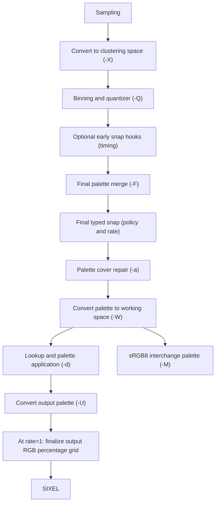
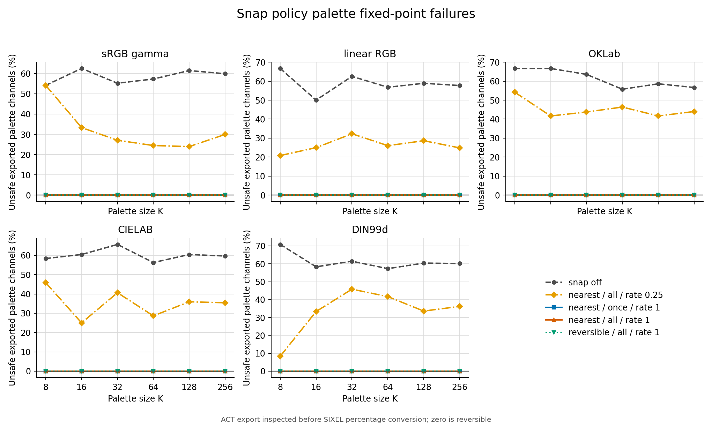
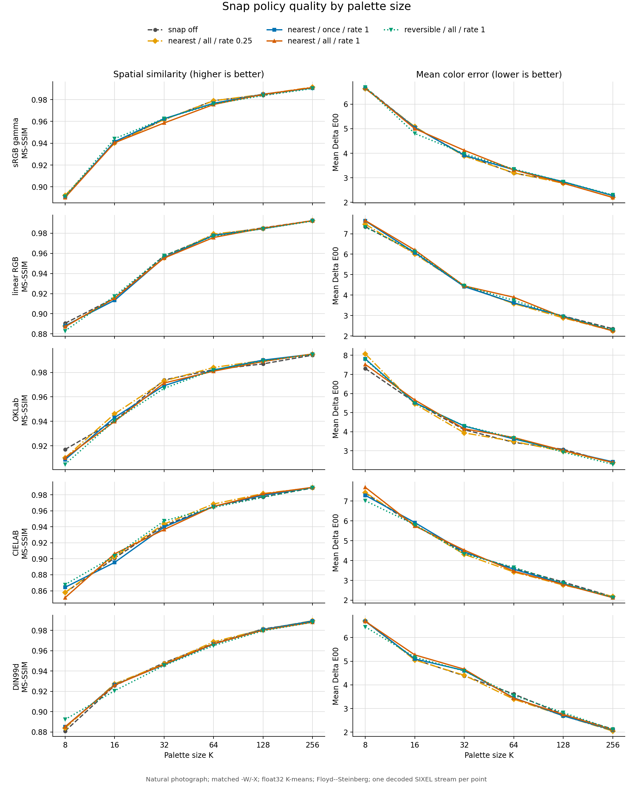
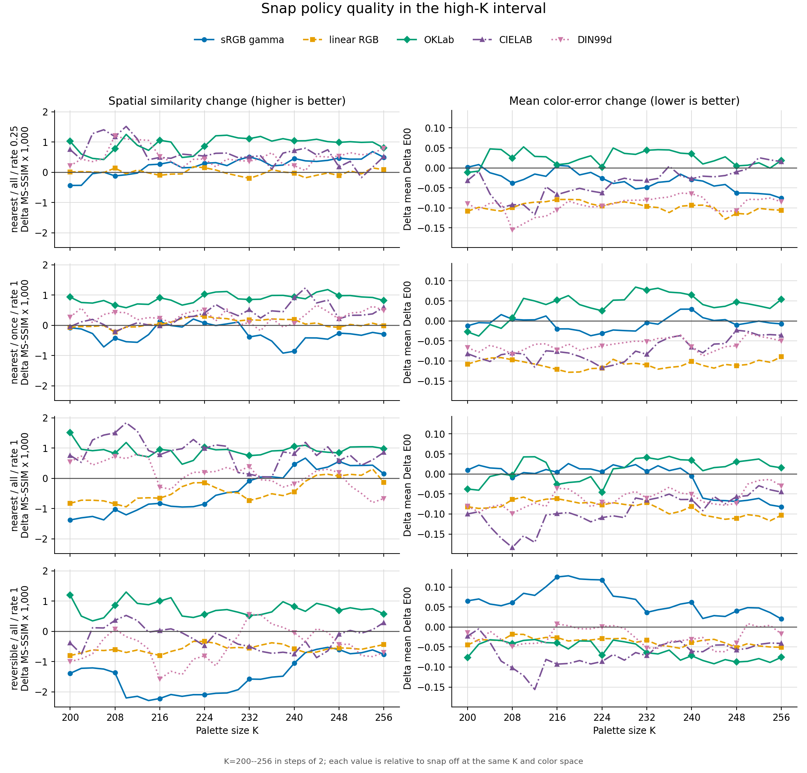
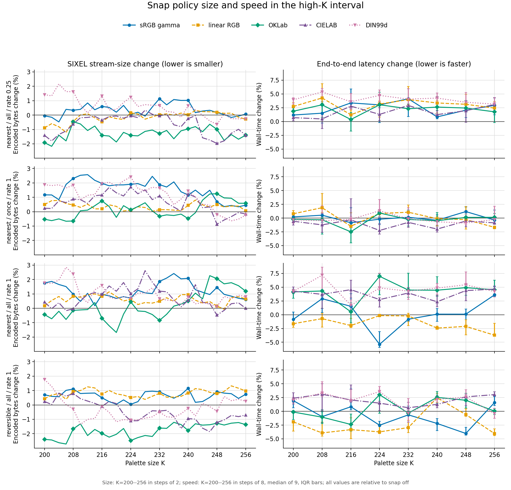
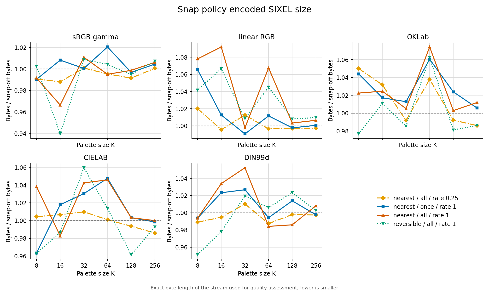
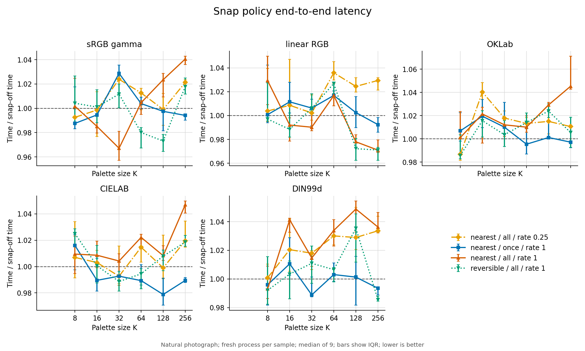
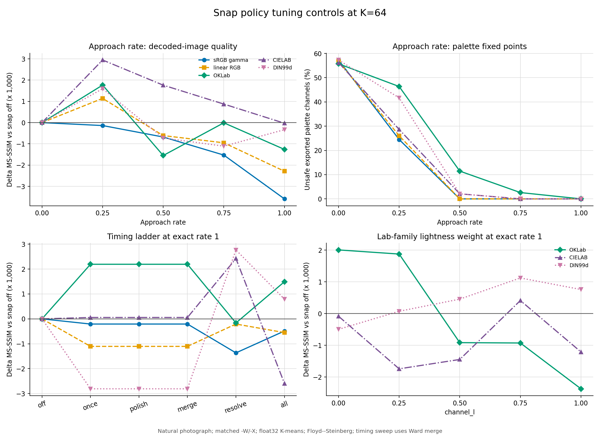
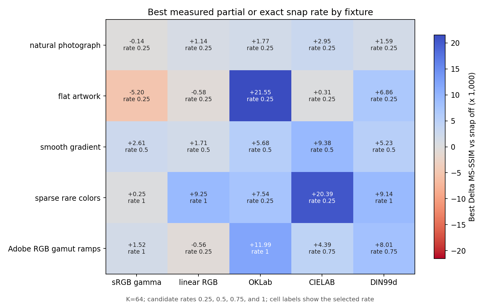

# Palette Snap Policy

`-_ POLICY` and `--snap-policy=POLICY` control whether and how the encoder maps palette channels onto the 101 RGB percentages that SIXEL can represent reversibly. This is a numeric stabilization transform, not gamut coverage repair: [`--cover-policy`](../cover-policy/README.md) chooses or inserts palette anchors, while `--snap-policy` enables snapping and chooses its reversible target.

`none` disables the transform. `auto`, `nearest`, and `reversible` enable it. There is no separate enable switch.

## Why there are 101 safe tones

SIXEL RGB palette definitions carry integer percentages from 0 through 100. The decoder reconstructs an 8-bit channel from percentage $q$ as

$$
s_q = \left\lfloor\frac{255q + 50}{100}\right\rfloor, \qquad q \in \lbrace 0,\ldots,100 \rbrace.
$$

The resulting set $S=\lbrace s_0,\ldots,s_{100} \rbrace$ has 101 distinct byte values. The encoder converts a byte channel $x$ back to a SIXEL percentage as

$$
q(x) = \left\lfloor\frac{100x + 127}{255}\right\rfloor.
$$

For every $s_q \in S$, decoding the emitted percentage returns the same byte value. Arbitrary bytes outside $S$ generally move to a neighboring member of $S$ after one encode/decode cycle. Snapping the palette to $S^3$ before emission therefore removes that palette drift.

The concrete 8-bit tone set is:

```c
static unsigned char const sixel_reversible_tones[101] = {
      0,   3,   5,   8,  10,  13,  15,  18,  20,  23,
     26,  28,  31,  33,  36,  38,  41,  43,  46,  48,
     51,  54,  56,  59,  61,  64,  66,  69,  71,  74,
     77,  79,  82,  84,  87,  89,  92,  94,  97,  99,
    102, 105, 107, 110, 112, 115, 117, 120, 122, 125,
    128, 130, 133, 135, 138, 140, 143, 145, 148, 150,
    153, 156, 158, 161, 163, 166, 168, 171, 173, 176,
    179, 181, 184, 186, 189, 191, 194, 196, 199, 201,
    204, 207, 209, 212, 214, 217, 219, 222, 224, 227,
    230, 232, 235, 237, 240, 242, 245, 247, 250, 252,
    255
};
```

The 101 levels are per channel. This mechanism does not limit the palette to 101 colors; a palette entry is an RGB triplet whose three channels independently belong to the safe set.

## Pipeline position

The generated-palette construction path is:



For a generated palette, the final snap runs whenever the policy is not `none`. The timing policy adds earlier solver hooks; Display P3 `timing=apply` instead places the single final pass after cover repair. The fixed-palette selectors `-m`, `-b`, and `-e` currently accept snap options but bypass every snap consumer, preserving the supplied palette unchanged. This accepted no-op is retained for compatibility.

The generated palette keeps its snapped float32 coordinates through clustering-to-working conversion. At `rate=1`, output finalization resolves any conversion rounding onto the output RGB percentage grid for the SIXEL definition. Palette export follows the independent [sRGB interchange boundary](../external-palettes.md#exporting-a-palette-with-m), before this wire-only finalization. This final grid check also follows cover repair; partial rates do not perform it, so their approach rate is not applied a second time. Fixed palettes bypass this generated-palette state.

## Policy values

The default is `none`, preserving the unconstrained palette pipeline unless snapping is requested explicitly. Integer RGB101 rounding is still required when serializing SIXEL, but that output-only rounding must not replace the working palette used by lookup and diffusion. Preparing an output cache early does not authorize early snapping; see the [selected float output boundary](../../output/output-colorspace.md#display-p3-selected-cpu-float-path).

### `none`

`none` disables all snap stages. Snap suboptions may still be parsed, but they have no effect until an enabling policy is selected.

### `auto`

`auto` selects `nearest`. Its default timing remains `once`; explicit timing and rate overrides are honored. For named wide-gamut output, `grid=auto` selects the small contribution table. This bounds setup/storage while retaining the decoded-color target, without an image-analysis pass or speculative early solver constraints. The measured tradeoffs below do not justify making sample/iteration snap or the complete lattice the default.

### `nearest`

For ordinary sRGB output, a float or perceptual solver hook using `nearest` finds the lower and upper safe sRGB tone around each channel, forms at most $2^3=8$ RGB candidates, transforms each candidate into the active clustering color space, and chooses the candidate with minimum distance there. This avoids choosing three independently nearest sRGB channels when a different corner of the local safe-tone cell is closer in the actual clustering geometry.

For gamma and linear RGB, the candidate distance is ordinary squared Euclidean distance in the active coordinates. For Oklab, CIELAB, and DIN99d, `channel_l` supplies the lightness weight $\lambda$:

$$
d^2 = \lambda (\Delta L)^2 + \frac{1-\lambda}{2}(\Delta a)^2 + \frac{1-\lambda}{2}(\Delta b)^2.
$$

With the [common DIN99d coordinate scale](../../../concepts/din99d/README.md#coordinates-and-normalization), `channel_l=1/3` preserves its native relative axis weights. Other values intentionally change the candidate metric; the default `0.85` is a snap-policy choice, not part of the DIN99d transform.

The final palette pass uses the typed coordinates when available and repacks the resulting byte view. Byte-only palettes use the precomputed per-channel safe-tone table. After working-to-output conversion, exact-rate finalization resolves percentage rounding; it does not repeat the geometric candidate search or apply the approach rate again.

### `reversible`

`reversible` selects the legacy independent-channel mapping. Each 8-bit sRGB channel is replaced by its precomputed fixed point without comparing the other corners of the surrounding safe-tone cell in the working color space. It is cheaper and historically direct, but it can be a worse geometric choice for a palette represented in a Lab-family space.

For named wide-gamut output, both policies use the destination interpretation described [below](#output-conversion-and-destination-aware-snap), instead of a safe sRGB cube. Both `nearest` and `reversible` target the same 101-level set. Their difference is how a target RGB triplet is selected, not whether the result is SIXEL-representable.

## Timing policy

The `timing` suboption retains the following additive ladder. Some existing consumers do not implement the full contract; see [Known contract violations](#known-contract-violations).

| Value | Snap stages |
| --- | --- |
| `once` | final output only |
| `polish` | `once` plus the pre-final-merge polish stage |
| `merge` | `polish` plus final-merge iterations |
| `resolve` | `merge` plus quantizer iterations |
| `all` | `resolve` plus initial seeds |

Named wide-gamut output also provides isolated comparisons against `once`:

| Value | Additional stage, or replacement final stage |
| --- | --- |
| `sample` | Snap a private training-sample copy before quantization; the image sent to diffusion stays unchanged. |
| `seed` | Snap K-means initial centroids. |
| `iteration` | Snap K-means centroid updates, before movement-bound updates. |
| `premerge` | Snap weighted representatives immediately before Ward reduction. |
| `merge-iteration` | Snap each joined Ward representative and each subsequent Lloyd refinement update. |
| `apply` | Replace the pre-cover final snap by one post-cover palette pass before working-space conversion and lookup construction. It does not snap individual input pixels during diffusion. |

`sample`, `seed`, `iteration`, `premerge`, and `merge-iteration` include the final pre-cover pass. `all` retains its cumulative meaning and does not implicitly enable the new sample or post-cover stages. This makes comparisons with existing commands reproducible.

K-means owns continuous centroid seed/update stages. K-center and K-medoids choose indices into the candidate set, and median cut splits sample boxes; they have no corresponding movable centroid stage. These solvers support the common sample, merge, final and application preparation stages. Projecting their candidate coordinates is the explicit `sample` experiment, not an implicit rewrite of their seed or swap algorithms. With no Ward reduction there are no merge iterations. A timing value does not manufacture an algorithmic stage that the chosen solver does not have.

Earlier snapping constrains more of the solver trajectory to the reversible lattice. It can reduce the amount of movement at final output, but it can also prevent a continuous-space solver from reaching a better unconstrained local optimum. `once` is therefore the default.

## Approach rate

The `rate` suboption applies

$$
x' = x + \rho(s-x), \qquad 0 \le \rho \le 1,
$$

where $x$ is the current component in the active representation, $s$ is the selected safe-tone target, and `rate` is $\rho$. `rate=1` reaches the target and preserves exact safe-tone membership. `rate=0` leaves the input unchanged. Intermediate rates intentionally relax the fixed-point guarantee and are quality-tuning controls rather than reversible output settings.

## Configuration and precedence

The top-level environment variable is `SIXEL_PALETTE_SNAP_POLICY`; explicit `-_` or `--snap-policy` wins over it. Snap suboptions similarly override their environment defaults.

| Long suboption | Short form | Environment default | Built-in default |
| --- | --- | --- | --- |
| `timing=once\|polish\|merge\|resolve\|all\|sample\|seed\|iteration\|premerge\|merge-iteration\|apply` | `Ivalue` | `SIXEL_PALETTE_SNAP_TIMING_POLICY` | `once` |
| `rate=FACTOR` | `AFACTOR` | `SIXEL_PALETTE_SNAP_APPROACH_RATE` | `1.0` |
| `channel_l=FACTOR` | `LFACTOR` | `SIXEL_PALETTE_SNAP_CHANNEL_FACTOR_L` | `0.85` |
| `grid=auto\|direct\|table\|cache\|full` | `Gvalue` | `SIXEL_PALETTE_SNAP_GRID` | `auto` |

Examples:

```sh
# Use the nearest-target policy and snap only final output.
img2sixel --snap-policy=nearest image.png

# Constrain every eligible Oklab solver stage to exact safe tones.
img2sixel -Woklab -_nearest:Iall:A1:L0.85 image.png

# Use the legacy independent-channel mapping and disable cover mutation.
img2sixel --snap-policy=reversible --cover-policy=off image.png
```

## Cost and measurement policy

The safe-tone table has 256 entries and fixed construction cost. A final byte-palette snap is $O(K)$ for $K \le 256$ palette entries. A `nearest` float/perceptual hook evaluates at most eight candidates per palette entry, so it is also $O(K)$ with a larger colorspace-conversion constant. Earlier timing levels multiply that bounded work by the number of solver and merge iterations at which the hook runs; the explicit P3 sample stage scales with the supplied training sample count. Application preparation remains a palette-only pass.

Snap quality is not monotonic. Exact snapping removes palette round-trip drift but perturbs solver output, and an intermediate `rate` can improve a one-generation metric while losing reversibility. A reproducible comparison should report palette fixed-point failures after encode/decode/re-encode, Delta E or MSE for channel perturbation, MS-SSIM for spatial impact, palette-build and end-to-end time, and exact SIXEL byte size. It should hold `-Q`, `-F`, `-a`, `-X`, precision, lookup, diffusion, and thread count fixed while sweeping policy, timing, rate, and palette size.

## Native float final snap for sRGB output

The selected opaque static CPU float path supports active snap for the legacy `-Ugamma`, `-Ulinear` and `-Usmpte-c` representations, `timing=once` and cover default/AUTO, off or soft/hard cover. It retains the existing safe sRGB byte targets and the `nearest`/`reversible` distinction. All five typed clustering spaces and the already-admitted solvers are supported. The common final pass follows quantization and final merge; it does not snap source samples, histogram bins, seeds or intermediate representatives. An explicit active budget with omitted mode also uses this path, resolving to the soft default or the selected environment mode. Earlier timing levels retain their existing paths. This expansion does not promote a genuinely byte-eligible job to float.

Cover repair follows the native final snap, just as it follows the legacy pass. Source-supported soft anchors, fixed hard anchors and funded pair midpoints are retained in float precision; they are not snapped again. In particular, a soft anchor may restore an extended source color that full snap moved into the nominal sRGB range. A partial snap rate applies only to the pre-cover palette. RGB101 preparation bounds and rounds a separate wire view after repair, without changing these working coordinates. The combined migration is for generated palettes; fixed-map bypass behavior is unchanged.

The same generated working palette is used for all three legacy output representations, so `-M` export does not depend on `-U`. Only the independent wire cache applies the output conversion. In particular, linear and SMPTE-C output do not reinterpret the snap targets as destination-space targets.

The original typed palette coordinates remain unbounded until the requested snap. Target selection uses sign-preserving conversions and double arithmetic. Candidates are ranked by the difference of their squared distances, cancelling the common source-square term so a very large unchanged component cannot erase a smaller component's choice. A partial rate interpolates between the original coordinates and the selected target in the clustering space, without clipping either the original coordinates or the blended result. A full rate reaches the bounded sRGB safe-tone target. Entries left unchanged by cover retain the snap result through conversion to `-W`; the separate RGB101 wire cache does not apply the rate again. Nonfinite inputs fail before the snap pass publishes any entries.

The numeric fixtures use independently derived transfer, matrix and opponent-space equations starting from stored float32 inputs. Native comparisons allow `2e-5` absolute coordinate units for matrix/TRC round trips and final float storage. The original snap-target RGB101 expectations have at least `0.02` percentage-code margin (`0.0002` in normalized RGB) from a rounding boundary. The combined soft-cover source anchor has a minimum `0.019` percentage-code margin, still larger than its conversion/storage error budget. Copied inactive values and failed-pass rollback are byte-exact. These tests establish arithmetic and dispatch, not a universal image-quality improvement.

## Shared float snap arithmetic

Final typed palette passes and existing K-means seed/iteration hooks use one safe-tone target search. An inactive typed hook (disabled by its caller or policy, excluded by timing, or given `rate=0`) preserves the solver's original double coordinates exactly. An active hook uses sign-preserving double colorspace conversion and blends from the original coordinates. Negative and above-nominal components are bounded only when selecting a safe target, not before interpolation; partial rates can therefore leave them outside the nominal range. Solver hooks retain double precision until the generator stores the palette as float32. The byte hook retains its bounded integer-coordinate contract.

The ordinary final float pass uses the same `nearest` versus `reversible` distinction in gamma RGB as in the other four typed spaces. It stages the complete palette before publication; a nonfinite entry leaves that float palette unchanged. The sRGB native builder retains its final-only admission restriction; the destination-aware stages below have their own consumers. Generator-specific histogram bounds, export bounds and precision-losing retries remain separate limitations; the common snap helper cannot repair a value already narrowed by those boundaries.

Early-hook and ordinary-final numerical fixtures use the same independent source/target equations and `2e-5` typed-coordinate budget as the native final tests. Gamma-only double interpolation uses `1e-14`, with no matrix or nonlinear transform. Reduced-color K-means fixtures use `2e-7` for the means of stored float inputs and subsequent palette stores, far below the separation between one and two quarter-rate applications. They assert actual float entries, the requested quantizer and zero retries. These checks establish stage behavior, not image-quality improvement.

<a id="output-conversion-and-the-display-p3-boundary"></a>

## Output conversion and destination-aware snap

The generated-palette `display-p3`, `adobe-rgb` and `dci-p3` paths accept active snap and promote input to float when required, including an explicit `-.8bit` preference. Each destination lattice consists of `floor((255*q + 50)/100)/255` interpreted in the selected destination, converted back to the canonical typed clustering space without intermediate gamut clipping. It models the decoder's RGB8 reconstruction, rather than a receiver retaining exact `q/100` values. Output negotiation selecting Display P3 uses the same contract.

The grid consumes an owned copy of the shared RGB definition. Primaries, white adaptation and channel transfer functions come from that definition, rather than a Display P3 flag. Adobe RGB therefore uses its power transfer and DCI-P3 uses both its DCI white and power transfer. Analytic definitions with different decoding exponents per channel also satisfy the grid contract. Matrix/TRC ICC definitions also satisfy this separability requirement. ICC definitions with LUTs are not admitted to the additive-table implementation: an arbitrary LUT need not decompose into three independent channel contributions. The [ICC file endpoint contract](../../output/output-colorspace.md#icc-file-endpoints) owns file syntax and admission.

`nearest` brackets each encoded destination component on that 101-level set and compares up to eight inverse-mapped corners using the metric above. It is a local-cell search, not a global nearest-neighbor guarantee in a skewed or nonlinear lattice. `reversible` first rounds the encoded destination value to RGB8, then chooses its reversible percentage code. Partial rates interpolate from the original typed source; only full-rate targets are exact lattice points. Neither policy first narrows the source to sRGB8.

All five clustering spaces are supported. The selected target is retained as float32 through conversion to `-W`, used by lookup and diffusion, and converted to the destination only for emission. Full-rate RGB output retains the independently selected percentage codes across this round trip. Partial rates emit their blended values rather than forcing the full-rate target. HLS serialization has its own additional rounding and does not promise RGB101 fixed-point identity. Fixed-palette inputs retain their accepted no-op snap contract. The separate high-color path still excludes active snap because it bypasses ordinary palette construction.

The grid strategy is private to each palette build; concurrent encoder objects do not share mutable caches. `direct` evaluates the common inverse destination transform for each candidate. `table` precomputes 101 decoded levels for each channel and three primary contributions per level, then evaluates the selected working transform. `cache` adds 8192 direct-mapped, lazily populated typed entries (256 KiB) to that table. `full` precomputes all 1,030,301 typed triplets (about 23.6 MiB). The level and contribution tables occupy less than 12 KiB, independently of the definition objects. A cache changes computation and storage only, not the candidate definition or distance metric. Allocation or transformation failure is returned; it must not silently select another precision or grid strategy.

The independent oracle generator derives RGB primary matrices from chromaticities and evaluates the working transforms without invoking libsixel. Grid and pipeline comparisons use `2e-5` typed units; paired gray-stage witnesses use `2e-7` and exclude nearest-target ties. Wire expectations are checked separately against half-bin boundaries. Grid cache isolation, invalid-input recovery, source preservation, partial rates and actual float dispatch have value tests for the named destinations. P3 witnesses exercise individual solver stage consumers; Adobe RGB/DCI-P3 witnesses separately check the selected definition at all seven shared hooks. An unnamed model with three different channel exponents guards against assuming a single common transfer curve. These establish numerical behavior; quality and speed require the measurements described above.

## Display P3 auto measurements

An arm64 macOS comparison uses 100 standard 640×480 photos, plus separate snake and saturated-P3 fixtures, builtin CMS with linear loader output, P3 emission, seeded K-means, Ward O1.8/C0.9, FHEDT lookup, LSO2 diffusion, two workers, default sampling/binning, and matched clustering/working spaces. Assessment uses decoded RGB8 interpreted as P3 through `lsqa -Tdisplay-p3 -Pfloat32 -Wlinear`. The photo-only means below compare nearest final snap against none; positive MS-SSIM changes and negative regional DE00 changes improve the respective measures.

| Space | Colors | Mean ΔMS-SSIM | Wins/losses | Worst ΔMS-SSIM | Mean Δregional DE00 | Mean Δpixel DE00 | Mean size change |
| --- | ---: | ---: | ---: | ---: | ---: | ---: | ---: |
| gamma | 64 | -0.0000352 | 52/48 | -0.001355 | -0.07204 | -0.04469 | +0.40% |
| gamma | 256 | +0.0000268 | 67/33 | -0.002013 | -0.10571 | -0.08429 | +0.38% |
| linear | 64 | -0.0000264 | 49/51 | -0.002051 | -0.07650 | -0.05249 | +0.40% |
| linear | 256 | +0.0001260 | 83/17 | -0.001111 | -0.09642 | -0.07674 | -0.19% |
| oklab | 64 | +0.0002677 | 99/1 | -0.000047 | +0.04604 | +0.10892 | +0.09% |
| oklab | 256 | +0.0003934 | 99/1 | -0.000008 | +0.02934 | +0.13498 | +2.04% |
| cielab | 64 | +0.0002716 | 88/12 | -0.000462 | +0.00825 | +0.00969 | -0.01% |
| cielab | 256 | +0.0003844 | 100/0 | +0.000015 | +0.02019 | +0.04624 | +1.45% |
| din99d | 64 | +0.0002186 | 85/15 | -0.001140 | -0.02833 | -0.04896 | -0.05% |
| din99d | 256 | +0.0003489 | 99/1 | -0.000146 | -0.03608 | -0.06795 | +0.72% |

The two metrics do not always agree: gamma/linear at 64 colors lose a little mean MS-SSIM while reducing color error, whereas Oklab improves MS-SSIM while increasing color error. Snap remains opt-in. Automatic selection uses the inexpensive final pass without image-specific color-count rules; it is not a promise of improved quality for every image.

An additional 810-observation screen covers eight photos and the two fixtures at 16/64/256 colors with the individual stages, while 240 further observations cover automatic/center/medoids quantization and explicit soft/hard cover. Earlier stages have no consistent advantage: sample projection has the largest mean MS-SSIM gain in the stage screen but also a larger worst loss; repeated centroid projection has the largest worst loss. Application preparation has the same output as final snap when cover is off.

A further 90 comparisons against `reversible` give higher mean MS-SSIM for `nearest` in linear/Oklab/CIELAB, while `reversible` reduces regional color error in the latter two spaces. Neither policy dominates every metric. Automatic selection retains nearest candidate ranking; reversible remains an explicit alternative.

Five randomized runtime repetitions on four images and three spaces at 256 colors give a median paired wall-time change of +0.85% for nearest/once/table, +3.3% for the cumulative `all` timing, +169% for sample projection, and +18.6% for once/full. Individual final-table ratios range from -3.06% to +2.02%, so small timing differences are within run noise. Full-grid peak RSS adds about 23.6 MiB. A process-CPU microbenchmark across five spaces measures cold setup plus 256 projections at 0.124–0.254 ms for the contribution table, versus 7.823–52.931 ms for the full lattice. Lazy caching helps repeated early queries but adds 256 KiB; it does not improve the cold final-palette case. These measurements support `grid=auto` choosing `table` and leaving repeated-stage/cache/full experiments explicit. They do not establish universal optimal timing, rate, weighting or performance across platforms.

## Measured snapshot

The checked-in snapshot was produced on 2026-09-12 UTC from clean revision `85a2674e53a2d7b75c6944b5a87b04ee9ea182b1` on arm64 macOS with Apple clang, `-O3`, and one encoder thread. The main comparison uses the builtin loader with `SIXEL_LOADER_CMS_ENGINE=none`, `images/snake.png`, palette sizes 8 through 256, matched clustering and working spaces (`-X` equals `-W`), the float32 pipeline, full-frame sampling, hard binning, seeded K-means, no final merge, cover off, exact lookup, GPU off, and Floyd--Steinberg dithering with raster scan. Holding these controls fixed isolates snap behavior but does not describe every possible encoder configuration.

The raw tables contain the complete command template for every point. [`snap-policy-run.json`](measurements/snap-policy-run.json) records compiler, build, fixture hashes, executable hashes, environment cleanup, and timing protocol.

### Palette fixed points



Historical measurement (before the independent sRGB export boundary): percentage of ACT-exported palette channels that change after conversion to a SIXEL integer percentage and back. Lower is better; zero meant every exported channel was a fixed point. Current `-M` exports before wire finalization; use the SIXEL definitions to measure the wire grid. Cover is disabled so a later cover mutation cannot invalidate the result.

With snap disabled, 50.0% to 70.8% of exported channels were outside the safe set. Every measured `rate=1` configuration reached zero failures for every palette size and color space. `rate=0.25` did not: its median unsafe-channel rate was 33.5%, and the observed range was 8.3% to 54.2%. An intermediate approach can accidentally converge to safe tones in a particular run, but only `rate=1` is the configuration-level guarantee.

### One-generation quality



Figure: Decoded-image quality for the natural fixture. MS-SSIM is the primary spatial metric; mean Delta E00 is a supporting color-error metric. Each point is one deterministic encode and decode with Floyd--Steinberg dithering enabled.

The following summary pools the 30 combinations of six palette sizes and five matched color spaces. Delta values compare each row with snap disabled at the same palette size and color space; time is the median of nine fresh processes after two warm-ups per point.

| Configuration | Exact palette fixed point | Median MS-SSIM change | MS-SSIM improvements | Median mean Delta E00 change | Median size change | Median time change |
| --- | --- | ---: | ---: | ---: | ---: | ---: |
| `nearest:timing=all:rate=0.25` | No | +0.000604 | 20 / 30 | -0.0420 | -0.29% | +1.40% |
| `nearest:timing=once:rate=1` | Yes | -0.000242 | 12 / 30 | -0.0089 | +0.99% | -0.09% |
| `nearest:timing=all:rate=1` | Yes | -0.000443 | 9 / 30 | -0.0083 | +0.63% | +1.10% |
| `reversible:timing=all:rate=1` | Yes | -0.000454 | 13 / 30 | +0.0014 | +0.51% | +0.38% |

Exact snapping guarantees palette stability, while one-generation quality changes depend on the image, palette size, color space, and candidate metric. Both improvements and regressions occur in this sweep. The partial `rate=0.25` setting does not preserve palette fixed points even when a quality metric improves. These observations do not justify silently enabling snapping by default.

### High-palette-count focus

The six-point overview above is useful for detecting broad failures, but it is not the right scale for judging the subtle effect near a full 256-color palette. At low palette counts, the error introduced by representing an image with only $K$ colors dominates the much smaller perturbation made by snap. Snap still has exactly the same fixed-point purpose there; its practical contribution to one-generation image quality is simply difficult to distinguish from the much larger quantization loss.

The focused sweep therefore measures every even palette size from K=200 through K=256. It keeps every other quality control unchanged and subtracts the snap-disabled result at the same K and in the same color space. Speed uses the representative subset K=200, 208, ..., 256 with the same two-warm-up, nine-run protocol.



Figure: Change in MS-SSIM and mean Delta E00 relative to snap disabled at the same K and in the same matched clustering and working color space. The quality and size sweep uses K=200 through K=256 in steps of two. One deterministic `img2sixel` encode and decode is measured per quality point, with seeded K-means and Floyd--Steinberg dithering enabled.



Figure: Exact SIXEL byte-size change for every even K from 200 through 256, and end-to-end `img2sixel` wall-time change for K=200 through K=256 in steps of eight. Time markers are nine-run medians and bars are interquartile ranges. Every value uses snap disabled at the same K and color space as its zero baseline.

The following summary pools the 145 quality and size comparisons for each enabled configuration: 29 palette sizes times five matched color spaces. Time pools 40 comparisons: eight palette sizes times five spaces.

| Configuration | Exact palette fixed point | Median MS-SSIM change | MS-SSIM improvements | Median mean Delta E00 change | Median size change | Median time change |
| --- | --- | ---: | ---: | ---: | ---: | ---: |
| `nearest:timing=all:rate=0.25` | No | +0.000436 | 122 / 145 | -0.0525 | -0.11% | +2.92% |
| `nearest:timing=once:rate=1` | Yes | +0.000211 | 103 / 145 | -0.0502 | +0.61% | -0.29% |
| `nearest:timing=all:rate=1` | Yes | +0.000301 | 93 / 145 | -0.0600 | +0.73% | +3.65% |
| `reversible:timing=all:rate=1` | Yes | -0.000497 | 45 / 145 | -0.0352 | +0.09% | +0.74% |

The focused result makes the tradeoff visible near a full palette. Nearest exact snap improves MS-SSIM at most measured points in this interval and lowers pooled median color error; reversible candidate selection has a negative median MS-SSIM change despite lower median color error. All three exact settings have a small positive pooled median size change. The partial-rate configuration has a median unsafe-channel rate of 33.8%, so it is not an alternative way to obtain reversibility.

The curves are intentionally not fitted or interpolated. Changing K changes the seeded K-means solution and its local optimum, so neighboring points can move non-monotonically even though the comparison within each point remains controlled. The wall-time shifts are also small relative to several IQR bars; they describe this host and protocol, not a portable speed ranking.

### Size and speed



Figure: Exact byte length of the same SIXEL stream assessed for quality, divided by the snap-disabled length. A ratio below one is smaller. For exact settings, pooled median size changes ranged from +0.51% to +0.99%; individual points can move in either direction.



Figure: End-to-end `img2sixel` wall time, including load, palette construction, palette application, dithering, and encoding. Each marker is a nine-run median, bars are the interquartile range, and each run starts a fresh process. Pooled median ratios ranged from 0.999 to 1.014; the largest observed ratio was 1.049. These measurements include process-level variation and do not establish a portable speed ranking.

### Rate, timing, color-space, and fixture dependence



Figure: K=64 control sweeps. The rate and `channel_l` panels use the natural fixture with no final merge. The timing panel enables Ward merge so merge-stage hooks are eligible. All quality deltas are relative to snap disabled under the same controls.

On the natural fixture, `rate=0.25` changed MS-SSIM by -0.000138 to +0.002946 and improved it in 4 of five tested spaces. The effect is content-dependent: the multi-fixture sweep below contains negative cells, and exact snapping can reverse a partial-rate improvement.

The timing ladder has no uniformly best early-hook level. The K=64 Ward sweep compares each timing level under the same merge controls; additional solver hooks change the result in space-dependent directions. The `channel_l` sweep maximized MS-SSIM at 0 for Oklab, 0.75 for CIELAB, 0.75 for DIN99d. This is evidence against selecting a universal tuning value from one image, not evidence for changing the defaults to those values.



Figure: Best MS-SSIM change among rates 0.25, 0.5, 0.75, and 1 at K=64. A negative cell means every measured nonzero rate was worse than snap disabled. 21 of 25 fixture/space cells were positive, but the selected rate and benefit varied substantially. These are the best observed rates within this sweep, not settings independently validated on new images.

### Reproduction and validation

From a clean tracked worktree with Matplotlib available to the selected Python interpreter, one command rebuilds the programs, verifies generated fixtures, removes inherited `SIXEL_*` variables, fixes `SIXEL_LOADER_CMS_ENGINE=none`, records the data, draws every figure, and validates row coverage and provenance:

```sh
tools/reproduce_snap_policy_measurements.sh
```

Use `PYTHON=/path/to/python` to select an interpreter with Matplotlib. Durable output requires exactly two warm-ups and nine recorded timing runs and refuses a dirty tracked worktree. An explicitly named non-documentation output directory can be used for a shorter exploratory run:

```sh
SNAP_POLICY_EXPLORATORY=1 SNAP_POLICY_WARMUPS=0 SNAP_POLICY_RUNS=1 \
    tools/reproduce_snap_policy_measurements.sh /tmp/libsixel-snap-policy
```

The checked-in raw data are [`snap-policy-quality.csv`](measurements/snap-policy-quality.csv), [`snap-policy-speed.csv`](measurements/snap-policy-speed.csv), [`snap-policy-controls.csv`](measurements/snap-policy-controls.csv), [`snap-policy-high-k.csv`](measurements/snap-policy-high-k.csv), and [`snap-policy-high-k-speed.csv`](measurements/snap-policy-high-k-speed.csv). Run `tools/check_snap_policy_measurements.py docs/encoder/palette-construction/snap-policy/measurements` to audit an existing durable snapshot without remeasuring it.

This historical schema-2 snapshot measures one machine, one thread count, one quantizer family, and one dithering policy. Schema-3 runs measure ACT values at the independent pre-wire sRGB8 export boundary; exact-rate exports may now have nonzero drift even though the final wire palette uses the RGB101 grid. The checker keeps the original fixed-point assertions for schema 2 and does not apply them to schema 3. These two measurements must not be merged as the same metric. It measures palette fixed-point membership directly but does not yet measure repeated full-image encode/decode cycles, animation flicker, cover-after-snap interaction, or statistical significance across hosts. Re-run the suite after changing snap, quantizer, colorspace, palette export, or percentage-conversion code; do not carry these numerical conclusions across such changes without refreshing the artifacts.

## Implementation references

The top-level schema and environment bindings are declared in [`options-registry.c`](../../../../src/options-registry.c). [`palette-common-snap.c`](../../../../src/palette-common-snap.c) owns safe-tone selection, working-space candidate comparison, timing, and approach rate; [`palette-common-snap.h`](../../../../src/palette-common-snap.h) owns the precomputed table and internal policy types. Quantizers call the shared snap hooks on typed coordinates and refresh their packed byte views. [`dither.c`](../../../../src/dither.c) retains snapped float palettes, while [`palette.c`](../../../../src/palette.c) owns their composition with cover repair. [`encoder-core-encode.c`](../../../../src/encoder-core-encode.c) and [`encoder.c`](../../../../src/encoder.c) finalize exact output-grid values for SIXEL; palette export uses its separate interchange boundary.

For neighboring stages, see [Palette Construction Pipeline](../pipeline/README.md), [Palette Quantization](../quantization/README.md), [Palette Cover Policy](../cover-policy/README.md), [Encoder Working Precision](../../precision/README.md), [Dithering](../../palette-application/dithering/README.md), and [Lookup Policy](../../palette-application/lookup-policy/README.md).

## Known contract violations

The following are implementation defects, not alternative semantics for the options above. The selected extended float path bypasses these legacy consumers; its sRGB once-only snap is described above, while P3 uses the destination-aware stages above. Its admitted solvers, merge modes and binning policies are maintained in [Output color space](../../output/output-colorspace.md#display-p3-selected-cpu-float-path); those restrictions must not be inferred from the older snap consumers below.

| Location | Remaining defect |
| --- | --- |
| Byte Heckbert histogram construction in [`palette-heckbert.c`](../../../../src/palette-heckbert.c) | Enabling snap changes histogram input and reconstructed bin values before the final pass, without consulting `timing` or `rate`. Thus `once` does not confine snapping to the final palette on byte input. Typed float histograms preserve source coordinates, including through ordinary generation entry points. |
| Legacy sRGB early timing stages | The destination-aware merge hooks apply to P3. Legacy sRGB merge stages remain outside this implementation; parsing the timing values alone does not establish their execution. |
| Legacy image-map construction in [`encoder.c`](../../../../src/encoder.c) | Unlike structured palette import, the ordinary image-map builder can consult snap environment settings without the encoder's explicit override. In that path, `SIXEL_PALETTE_SNAP_POLICY=nearest` can change the map palette even with explicit `-_none`. |

## Test coverage

<!-- test-coverage: enforced -->

Each automated contract has a stable ID and an owning test. The reciprocal `Policy:` reference in each test is checked by `staticcheck-doc-test-links`.

| ID | Contract | Owning test |
| --- | --- | --- |
| SP-01 | `reversible` has equivalent top-level short-option and environment behavior, materially enables snapping relative to `none`, and reaches the snap consumer independently of cover policy. | [tests/cli/options/regression/0024_snap_policy_reversible_image_regression.t](../../../../tests/cli/options/regression/0024_snap_policy_reversible_image_regression.t) |
| SP-02 | `timing=all` has equivalent short-suboption and environment behavior and reaches the snap consumer. | [tests/cli/options/regression/0137_snap_policy_timing_image_regression.t](../../../../tests/cli/options/regression/0137_snap_policy_timing_image_regression.t) |
| SP-03 | `rate` has equivalent short-suboption and environment behavior, reaches the snap consumer, clamps the environment value at the upper bound, and preserves the image-quality floor. | [tests/cli/options/regression/0138_snap_policy_rate_image_regression.t](../../../../tests/cli/options/regression/0138_snap_policy_rate_image_regression.t) |
| SP-04 | `channel_l` has equivalent short-suboption and environment behavior, reaches the snap consumer, clamps the environment value at the lower bound, and preserves the image-quality floor. | [tests/cli/options/regression/0139_snap_policy_channel_l_image_regression.t](../../../../tests/cli/options/regression/0139_snap_policy_channel_l_image_regression.t) |
| SP-05 | `--cover-policy` rejects the removed snap suboption namespace. | [tests/cli/options/matching/0279_option_matching_cover_snap_suboption_rejected.t](../../../../tests/cli/options/matching/0279_option_matching_cover_snap_suboption_rejected.t) |
| SP-06 | A PAL mapfile accepts an explicit snap policy but bypasses the snap consumer. | [tests/quant/palette/usage/0194_mapfile_pal_snap_policy_bypassed.t](../../../../tests/quant/palette/usage/0194_mapfile_pal_snap_policy_bypassed.t) |
| SP-07 | A built-in palette accepts an explicit snap policy but bypasses the snap consumer. | [tests/quant/palette/usage/0195_builtin_snap_policy_bypassed.t](../../../../tests/quant/palette/usage/0195_builtin_snap_policy_bypassed.t) |
| SP-08 | Monochrome accepts an explicit snap policy but bypasses the snap consumer. | [tests/quant/palette/usage/0196_monochrome_snap_policy_bypassed.t](../../../../tests/quant/palette/usage/0196_monochrome_snap_policy_bypassed.t) |
| SP-09 | DIN99d exact snap exports fixed-point ACT values equal to emitted SIXEL RGB entries. | [tests/quant/palette/0045_snap_output_grid.t](../../../../tests/quant/palette/0045_snap_output_grid.t) |
| SP-10 | A snapped working palette exports independently of the selected wire output space. | [tests/quant/palette/0046_snap_export_output_independent.t](../../../../tests/quant/palette/0046_snap_export_output_independent.t) |
| SP-11 | Exact snap resolves the output grid after conversion to SMPTE-C. | [tests/quant/palette/0047_snap_smptec_grid.t](../../../../tests/quant/palette/0047_snap_smptec_grid.t) |
| SP-12 | A partial final snap blends once in float precision without enabling exact output-grid enforcement. | [tests/quant/palette/0048_snap_partial_once.t](../../../../tests/quant/palette/0048_snap_partial_once.t) |
| SP-13 | Zero approach rate preserves byte-identical output with snapping disabled, including mixed perceptual spaces. | [tests/quant/palette/0049_snap_zero_identity.t](../../../../tests/quant/palette/0049_snap_zero_identity.t) |
| SP-14 | Preparing RGB101 output codes leaves the snap-disabled working palette and nearest-color decisions unchanged for P3 and gamma/linear sRGB. | [tests/quant/palette/0052_p3_unsnapped_palette_lookup.t](../../../../tests/quant/palette/0052_p3_unsnapped_palette_lookup.t), [tests/quant/palette/0065_srgb_gamma_unsnapped_lookup.t](../../../../tests/quant/palette/0065_srgb_gamma_unsnapped_lookup.t), [tests/quant/palette/0066_srgb_linear_unsnapped_lookup.t](../../../../tests/quant/palette/0066_srgb_linear_unsnapped_lookup.t) |
| SP-15 | Native partial snap retains extended coordinates in each typed space. | [tests/quant/palette/snap_float/0002_extended_gamma_nearest_partial.t](../../../../tests/quant/palette/snap_float/0002_extended_gamma_nearest_partial.t), [tests/quant/palette/snap_float/0006_extended_linear_nearest_partial.t](../../../../tests/quant/palette/snap_float/0006_extended_linear_nearest_partial.t), [tests/quant/palette/snap_float/0010_extended_oklab_nearest_partial.t](../../../../tests/quant/palette/snap_float/0010_extended_oklab_nearest_partial.t), [tests/quant/palette/snap_float/0014_extended_cielab_nearest_partial.t](../../../../tests/quant/palette/snap_float/0014_extended_cielab_nearest_partial.t), [tests/quant/palette/snap_float/0018_extended_din99d_nearest_partial.t](../../../../tests/quant/palette/snap_float/0018_extended_din99d_nearest_partial.t) |
| SP-16 | Inactive native snap is exact identity; a full rate reaches the target even from very large finite RGB values. | [tests/quant/palette/snap_float/0041_none_identity.t](../../../../tests/quant/palette/snap_float/0041_none_identity.t), [tests/quant/palette/snap_float/0042_zero_identity.t](../../../../tests/quant/palette/snap_float/0042_zero_identity.t), [tests/quant/palette/snap_float/0046_huge_full_target.t](../../../../tests/quant/palette/snap_float/0046_huge_full_target.t) |
| SP-17 | Selected sRGB generation preserves the typed snap result and emits independent RGB101 values. | [tests/quant/palette/snap_float/0047_kmeans_gamma_partial.t](../../../../tests/quant/palette/snap_float/0047_kmeans_gamma_partial.t), [tests/quant/palette/snap_float/0055_kcenter_oklab_partial.t](../../../../tests/quant/palette/snap_float/0055_kcenter_oklab_partial.t), [tests/quant/palette/snap_float/0063_kmedoids_din99d_partial.t](../../../../tests/quant/palette/snap_float/0063_kmedoids_din99d_partial.t), [tests/quant/palette/snap_float/0065_heckbert_gamma_partial.t](../../../../tests/quant/palette/snap_float/0065_heckbert_gamma_partial.t), [tests/quant/palette/snap_float/0086_kmeans_din99d_reversible_full.t](../../../../tests/quant/palette/snap_float/0086_kmeans_din99d_reversible_full.t) |
| SP-18 | Genuinely byte-eligible generated palettes retain their existing path with active snap. | [tests/quant/palette/snap_float/0052_kmeans_byte_eligible.t](../../../../tests/quant/palette/snap_float/0052_kmeans_byte_eligible.t), [tests/quant/palette/snap_float/0070_heckbert_byte_eligible.t](../../../../tests/quant/palette/snap_float/0070_heckbert_byte_eligible.t) |
| SP-19 | P3 nearest and reversible snap retain independent typed/wire targets; the same encoder can subsequently use sRGB. | [tests/quant/palette/snap_float/0087_p3_nearest.t](../../../../tests/quant/palette/snap_float/0087_p3_nearest.t), [tests/quant/palette/snap_float/0088_p3_reversible.t](../../../../tests/quant/palette/snap_float/0088_p3_reversible.t), [tests/quant/palette/snap_float/0089_p3_srgb_reuse.t](../../../../tests/quant/palette/snap_float/0089_p3_srgb_reuse.t) |
| SP-20 | Two live encoders retain distinct snap targets/rates across alternating operations. | [tests/quant/palette/snap_float/0090_two_live_encoders.t](../../../../tests/quant/palette/snap_float/0090_two_live_encoders.t) |
| SP-21 | Legacy output conversion preserves native snapped working coordinates while emitting independent linear/SMPTE-C wire values. | [tests/quant/palette/snap_float/0091_gamma_linear_partial.t](../../../../tests/quant/palette/snap_float/0091_gamma_linear_partial.t), [tests/quant/palette/snap_float/0092_gamma_smptec_partial.t](../../../../tests/quant/palette/snap_float/0092_gamma_smptec_partial.t), [tests/quant/palette/snap_float/0093_linear_linear_partial.t](../../../../tests/quant/palette/snap_float/0093_linear_linear_partial.t), [tests/quant/palette/snap_float/0094_linear_smptec_partial.t](../../../../tests/quant/palette/snap_float/0094_linear_smptec_partial.t), [tests/quant/palette/snap_float/0095_oklab_linear_partial.t](../../../../tests/quant/palette/snap_float/0095_oklab_linear_partial.t), [tests/quant/palette/snap_float/0096_oklab_smptec_partial.t](../../../../tests/quant/palette/snap_float/0096_oklab_smptec_partial.t), [tests/quant/palette/snap_float/0097_cielab_linear_partial.t](../../../../tests/quant/palette/snap_float/0097_cielab_linear_partial.t), [tests/quant/palette/snap_float/0098_cielab_smptec_partial.t](../../../../tests/quant/palette/snap_float/0098_cielab_smptec_partial.t), [tests/quant/palette/snap_float/0099_din99d_linear_partial.t](../../../../tests/quant/palette/snap_float/0099_din99d_linear_partial.t), [tests/quant/palette/snap_float/0100_din99d_smptec_partial.t](../../../../tests/quant/palette/snap_float/0100_din99d_smptec_partial.t), [tests/quant/palette/snap_float/0101_linear_nearest_full.t](../../../../tests/quant/palette/snap_float/0101_linear_nearest_full.t), [tests/quant/palette/snap_float/0102_linear_reversible_full.t](../../../../tests/quant/palette/snap_float/0102_linear_reversible_full.t), [tests/quant/palette/snap_float/0103_smptec_nearest_full.t](../../../../tests/quant/palette/snap_float/0103_smptec_nearest_full.t), [tests/quant/palette/snap_float/0104_smptec_reversible_full.t](../../../../tests/quant/palette/snap_float/0104_smptec_reversible_full.t) |
| SP-22 | SMPTE-C output leaves the exported snapped sRGB palette unchanged. | [tests/quant/palette/snap_float/0105_smptec_export_independent.t](../../../../tests/quant/palette/snap_float/0105_smptec_export_independent.t) |
| SP-23 | Native soft cover follows full or partial snap and restores the original extended source anchor without a second snap. | [tests/quant/palette/snap_float/0106_cover_soft_gamma_partial.t](../../../../tests/quant/palette/snap_float/0106_cover_soft_gamma_partial.t), [tests/quant/palette/snap_float/0108_cover_soft_linear_partial.t](../../../../tests/quant/palette/snap_float/0108_cover_soft_linear_partial.t), [tests/quant/palette/snap_float/0110_cover_soft_oklab_partial.t](../../../../tests/quant/palette/snap_float/0110_cover_soft_oklab_partial.t), [tests/quant/palette/snap_float/0112_cover_soft_cielab_partial.t](../../../../tests/quant/palette/snap_float/0112_cover_soft_cielab_partial.t), [tests/quant/palette/snap_float/0114_cover_soft_din99d_partial.t](../../../../tests/quant/palette/snap_float/0114_cover_soft_din99d_partial.t), [tests/quant/palette/snap_float/0116_cover_soft_gamma_full.t](../../../../tests/quant/palette/snap_float/0116_cover_soft_gamma_full.t), [tests/quant/palette/snap_float/0118_cover_soft_reversible_partial.t](../../../../tests/quant/palette/snap_float/0118_cover_soft_reversible_partial.t) |
| SP-24 | Native hard cover preserves the snapped representative and then appends the eight fixed anchors in each typed space. | [tests/quant/palette/snap_float/0107_cover_hard_gamma_full.t](../../../../tests/quant/palette/snap_float/0107_cover_hard_gamma_full.t), [tests/quant/palette/snap_float/0109_cover_hard_linear_full.t](../../../../tests/quant/palette/snap_float/0109_cover_hard_linear_full.t), [tests/quant/palette/snap_float/0111_cover_hard_oklab_full.t](../../../../tests/quant/palette/snap_float/0111_cover_hard_oklab_full.t), [tests/quant/palette/snap_float/0113_cover_hard_cielab_full.t](../../../../tests/quant/palette/snap_float/0113_cover_hard_cielab_full.t), [tests/quant/palette/snap_float/0115_cover_hard_din99d_full.t](../../../../tests/quant/palette/snap_float/0115_cover_hard_din99d_full.t), [tests/quant/palette/snap_float/0117_cover_hard_gamma_partial.t](../../../../tests/quant/palette/snap_float/0117_cover_hard_gamma_partial.t), [tests/quant/palette/snap_float/0119_cover_hard_reversible_full.t](../../../../tests/quant/palette/snap_float/0119_cover_hard_reversible_full.t) |
| SP-25 | Without growth, coincident snapped entries fund a midpoint and the original source cell mean. | [tests/quant/palette/snap_float/0129_cover_funded_midpoint.t](../../../../tests/quant/palette/snap_float/0129_cover_funded_midpoint.t) |
| SP-26 | The palette worker retains snap-before-cover order; P3 and subsequent combined sRGB encoding on the same object retain their own output definitions. | [tests/quant/palette/snap_float/0130_cover_worker_order.t](../../../../tests/quant/palette/snap_float/0130_cover_worker_order.t), [tests/quant/palette/snap_float/0133_cover_p3_srgb_reuse.t](../../../../tests/quant/palette/snap_float/0133_cover_p3_srgb_reuse.t) |
| SP-27 | Combined snap and cover exports independently of linear or SMPTE-C wire conversion. | [tests/quant/palette/snap_float/0134_cover_soft_export_independent.t](../../../../tests/quant/palette/snap_float/0134_cover_soft_export_independent.t), [tests/quant/palette/snap_float/0135_cover_hard_export_independent.t](../../../../tests/quant/palette/snap_float/0135_cover_hard_export_independent.t) |
| SP-28 | Omitting the active cover mode retains native snap-before-soft-repair order and independently checked palette coordinates. | [tests/quant/palette/snap_float/0131_cover_implicit_native.t](../../../../tests/quant/palette/snap_float/0131_cover_implicit_native.t) |
| SP-29 | All four grid strategies retain independently derived P3 targets in all five spaces. | [tests/quant/palette/p3_snap/0001_direct_gamma.t](../../../../tests/quant/palette/p3_snap/0001_direct_gamma.t), [tests/quant/palette/p3_snap/0002_direct_linear.t](../../../../tests/quant/palette/p3_snap/0002_direct_linear.t), [tests/quant/palette/p3_snap/0003_direct_oklab.t](../../../../tests/quant/palette/p3_snap/0003_direct_oklab.t), [tests/quant/palette/p3_snap/0004_direct_cielab.t](../../../../tests/quant/palette/p3_snap/0004_direct_cielab.t), [tests/quant/palette/p3_snap/0005_direct_din99d.t](../../../../tests/quant/palette/p3_snap/0005_direct_din99d.t), [tests/quant/palette/p3_snap/0006_table_gamma.t](../../../../tests/quant/palette/p3_snap/0006_table_gamma.t), [tests/quant/palette/p3_snap/0007_table_linear.t](../../../../tests/quant/palette/p3_snap/0007_table_linear.t), [tests/quant/palette/p3_snap/0008_table_oklab.t](../../../../tests/quant/palette/p3_snap/0008_table_oklab.t), [tests/quant/palette/p3_snap/0009_table_cielab.t](../../../../tests/quant/palette/p3_snap/0009_table_cielab.t), [tests/quant/palette/p3_snap/0010_table_din99d.t](../../../../tests/quant/palette/p3_snap/0010_table_din99d.t), [tests/quant/palette/p3_snap/0011_cache_gamma.t](../../../../tests/quant/palette/p3_snap/0011_cache_gamma.t), [tests/quant/palette/p3_snap/0012_cache_linear.t](../../../../tests/quant/palette/p3_snap/0012_cache_linear.t), [tests/quant/palette/p3_snap/0013_cache_oklab.t](../../../../tests/quant/palette/p3_snap/0013_cache_oklab.t), [tests/quant/palette/p3_snap/0014_cache_cielab.t](../../../../tests/quant/palette/p3_snap/0014_cache_cielab.t), [tests/quant/palette/p3_snap/0015_cache_din99d.t](../../../../tests/quant/palette/p3_snap/0015_cache_din99d.t), [tests/quant/palette/p3_snap/0016_full_gamma.t](../../../../tests/quant/palette/p3_snap/0016_full_gamma.t), [tests/quant/palette/p3_snap/0017_full_linear.t](../../../../tests/quant/palette/p3_snap/0017_full_linear.t), [tests/quant/palette/p3_snap/0018_full_oklab.t](../../../../tests/quant/palette/p3_snap/0018_full_oklab.t), [tests/quant/palette/p3_snap/0019_full_cielab.t](../../../../tests/quant/palette/p3_snap/0019_full_cielab.t), [tests/quant/palette/p3_snap/0020_full_din99d.t](../../../../tests/quant/palette/p3_snap/0020_full_din99d.t) |
| SP-30 | Lazy grid caches are isolated between simultaneous objects and survive destruction of another object. | [tests/quant/palette/p3_snap/0021_cache_isolation.t](../../../../tests/quant/palette/p3_snap/0021_cache_isolation.t) |
| SP-31 | Invalid grid inputs leave results unchanged and allow a subsequent valid projection. | [tests/quant/palette/p3_snap/0022_invalid_recovery.t](../../../../tests/quant/palette/p3_snap/0022_invalid_recovery.t) |
| SP-32 | Generated P3 palettes retain full/partial targets and exact wire codes across all solvers and spaces; a byte preference cannot narrow the palette. | [tests/quant/palette/p3_snap/0023_pipeline_gamma_nearest_full.t](../../../../tests/quant/palette/p3_snap/0023_pipeline_gamma_nearest_full.t), [tests/quant/palette/p3_snap/0024_pipeline_gamma_nearest_partial.t](../../../../tests/quant/palette/p3_snap/0024_pipeline_gamma_nearest_partial.t), [tests/quant/palette/p3_snap/0025_pipeline_gamma_reversible_full.t](../../../../tests/quant/palette/p3_snap/0025_pipeline_gamma_reversible_full.t), [tests/quant/palette/p3_snap/0026_pipeline_gamma_reversible_partial.t](../../../../tests/quant/palette/p3_snap/0026_pipeline_gamma_reversible_partial.t), [tests/quant/palette/p3_snap/0027_pipeline_linear_nearest_full.t](../../../../tests/quant/palette/p3_snap/0027_pipeline_linear_nearest_full.t), [tests/quant/palette/p3_snap/0028_pipeline_linear_nearest_partial.t](../../../../tests/quant/palette/p3_snap/0028_pipeline_linear_nearest_partial.t), [tests/quant/palette/p3_snap/0029_pipeline_linear_reversible_full.t](../../../../tests/quant/palette/p3_snap/0029_pipeline_linear_reversible_full.t), [tests/quant/palette/p3_snap/0030_pipeline_linear_reversible_partial.t](../../../../tests/quant/palette/p3_snap/0030_pipeline_linear_reversible_partial.t), [tests/quant/palette/p3_snap/0031_pipeline_oklab_nearest_full.t](../../../../tests/quant/palette/p3_snap/0031_pipeline_oklab_nearest_full.t), [tests/quant/palette/p3_snap/0032_pipeline_oklab_nearest_partial.t](../../../../tests/quant/palette/p3_snap/0032_pipeline_oklab_nearest_partial.t), [tests/quant/palette/p3_snap/0033_pipeline_oklab_reversible_full.t](../../../../tests/quant/palette/p3_snap/0033_pipeline_oklab_reversible_full.t), [tests/quant/palette/p3_snap/0034_pipeline_oklab_reversible_partial.t](../../../../tests/quant/palette/p3_snap/0034_pipeline_oklab_reversible_partial.t), [tests/quant/palette/p3_snap/0035_pipeline_cielab_nearest_full.t](../../../../tests/quant/palette/p3_snap/0035_pipeline_cielab_nearest_full.t), [tests/quant/palette/p3_snap/0036_pipeline_cielab_nearest_partial.t](../../../../tests/quant/palette/p3_snap/0036_pipeline_cielab_nearest_partial.t), [tests/quant/palette/p3_snap/0037_pipeline_cielab_reversible_full.t](../../../../tests/quant/palette/p3_snap/0037_pipeline_cielab_reversible_full.t), [tests/quant/palette/p3_snap/0038_pipeline_cielab_reversible_partial.t](../../../../tests/quant/palette/p3_snap/0038_pipeline_cielab_reversible_partial.t), [tests/quant/palette/p3_snap/0039_pipeline_din99d_nearest_full.t](../../../../tests/quant/palette/p3_snap/0039_pipeline_din99d_nearest_full.t), [tests/quant/palette/p3_snap/0040_pipeline_din99d_nearest_partial.t](../../../../tests/quant/palette/p3_snap/0040_pipeline_din99d_nearest_partial.t), [tests/quant/palette/p3_snap/0041_pipeline_din99d_reversible_full.t](../../../../tests/quant/palette/p3_snap/0041_pipeline_din99d_reversible_full.t), [tests/quant/palette/p3_snap/0042_pipeline_din99d_reversible_partial.t](../../../../tests/quant/palette/p3_snap/0042_pipeline_din99d_reversible_partial.t), [tests/quant/palette/p3_snap/0043_pipeline_center_full.t](../../../../tests/quant/palette/p3_snap/0043_pipeline_center_full.t), [tests/quant/palette/p3_snap/0044_pipeline_center_partial.t](../../../../tests/quant/palette/p3_snap/0044_pipeline_center_partial.t), [tests/quant/palette/p3_snap/0045_pipeline_medoids_full.t](../../../../tests/quant/palette/p3_snap/0045_pipeline_medoids_full.t), [tests/quant/palette/p3_snap/0046_pipeline_medoids_partial.t](../../../../tests/quant/palette/p3_snap/0046_pipeline_medoids_partial.t), [tests/quant/palette/p3_snap/0047_pipeline_heckbert_full.t](../../../../tests/quant/palette/p3_snap/0047_pipeline_heckbert_full.t), [tests/quant/palette/p3_snap/0048_pipeline_heckbert_partial.t](../../../../tests/quant/palette/p3_snap/0048_pipeline_heckbert_partial.t) |
| SP-33 | Application preparation retains one full/partial projection without repeating the final rate; newly grown hard-cover corners are projected before the distinct working-space conversion. | [tests/quant/palette/p3_snap/0049_apply_full.t](../../../../tests/quant/palette/p3_snap/0049_apply_full.t), [tests/quant/palette/p3_snap/0050_apply_partial.t](../../../../tests/quant/palette/p3_snap/0050_apply_partial.t), [tests/quant/palette/p3_snap/0070_cover_apply_full.t](../../../../tests/quant/palette/p3_snap/0070_cover_apply_full.t), [tests/quant/palette/p3_snap/0071_cover_apply_partial.t](../../../../tests/quant/palette/p3_snap/0071_cover_apply_partial.t) |
| SP-34 | Actual sample, seed, centroid, pre-merge, Ward and application preparation hooks execute; independent paired-gray values distinguish repeated quarter-rate effects. | [tests/quant/palette/p3_snap/0051_stage_once_kmeans.t](../../../../tests/quant/palette/p3_snap/0051_stage_once_kmeans.t), [tests/quant/palette/p3_snap/0052_stage_sample_kmeans.t](../../../../tests/quant/palette/p3_snap/0052_stage_sample_kmeans.t), [tests/quant/palette/p3_snap/0053_stage_seed_kmeans.t](../../../../tests/quant/palette/p3_snap/0053_stage_seed_kmeans.t), [tests/quant/palette/p3_snap/0054_stage_iteration_kmeans.t](../../../../tests/quant/palette/p3_snap/0054_stage_iteration_kmeans.t), [tests/quant/palette/p3_snap/0055_stage_premerge_kmeans.t](../../../../tests/quant/palette/p3_snap/0055_stage_premerge_kmeans.t), [tests/quant/palette/p3_snap/0056_stage_merge_iteration_kmeans.t](../../../../tests/quant/palette/p3_snap/0056_stage_merge_iteration_kmeans.t), [tests/quant/palette/p3_snap/0057_stage_apply_kmeans.t](../../../../tests/quant/palette/p3_snap/0057_stage_apply_kmeans.t), [tests/quant/palette/p3_snap/0058_stage_premerge_center.t](../../../../tests/quant/palette/p3_snap/0058_stage_premerge_center.t), [tests/quant/palette/p3_snap/0059_stage_merge_iteration_center.t](../../../../tests/quant/palette/p3_snap/0059_stage_merge_iteration_center.t), [tests/quant/palette/p3_snap/0060_stage_premerge_medoids.t](../../../../tests/quant/palette/p3_snap/0060_stage_premerge_medoids.t), [tests/quant/palette/p3_snap/0061_stage_merge_iteration_medoids.t](../../../../tests/quant/palette/p3_snap/0061_stage_merge_iteration_medoids.t), [tests/quant/palette/p3_snap/0062_stage_premerge_heckbert.t](../../../../tests/quant/palette/p3_snap/0062_stage_premerge_heckbert.t), [tests/quant/palette/p3_snap/0063_stage_merge_iteration_heckbert.t](../../../../tests/quant/palette/p3_snap/0063_stage_merge_iteration_heckbert.t) |
| SP-35 | The short grid suboption and environment binding reach the destination consumer and preserve identical image output. | [tests/cli/options/regression/0170_snap_policy_grid_image_regression.t](../../../../tests/cli/options/regression/0170_snap_policy_grid_image_regression.t) |
| SP-36 | Legacy K-means seed values use the selected P3 lattice. | [tests/quant/palette/p3_snap/0064_seed_legacy_values.t](../../../../tests/quant/palette/p3_snap/0064_seed_legacy_values.t) |
| SP-37 | PCA seed values use the selected P3 lattice. | [tests/quant/palette/p3_snap/0065_seed_pca_values.t](../../../../tests/quant/palette/p3_snap/0065_seed_pca_values.t) |
| SP-38 | Lazy-cache allocation failure is explicit and cleans up before reuse. | [tests/quant/palette/p3_snap/0066_cache_allocation_recovery.t](../../../../tests/quant/palette/p3_snap/0066_cache_allocation_recovery.t) |
| SP-39 | Full-grid allocation failure is explicit and cleans up before reuse. | [tests/quant/palette/p3_snap/0067_full_allocation_recovery.t](../../../../tests/quant/palette/p3_snap/0067_full_allocation_recovery.t) |
| SP-40 | Automatic grid selection and automatic snap preserve the measured table/nearest contracts. | [tests/quant/palette/p3_snap/0068_auto_grid_table.t](../../../../tests/quant/palette/p3_snap/0068_auto_grid_table.t), [tests/quant/palette/p3_snap/0069_auto_policy_nearest.t](../../../../tests/quant/palette/p3_snap/0069_auto_policy_nearest.t) |
| SP-41 | Post-Ward Lloyd updates retain independent projected means in K-means and native Heckbert, with both joined-cluster and refinement hooks observed. | [tests/quant/palette/p3_snap/0072_merge_refinement_kmeans.t](../../../../tests/quant/palette/p3_snap/0072_merge_refinement_kmeans.t), [tests/quant/palette/p3_snap/0073_merge_refinement_heckbert.t](../../../../tests/quant/palette/p3_snap/0073_merge_refinement_heckbert.t) |
| SP-42 | Merge projection preserves CIELAB affine scale/origin, including Heckbert's zero-origin coordinates. | [tests/quant/palette/p3_snap/0074_scaled_affine_values.t](../../../../tests/quant/palette/p3_snap/0074_scaled_affine_values.t), [tests/quant/palette/p3_snap/0075_scaled_zero_origin_values.t](../../../../tests/quant/palette/p3_snap/0075_scaled_zero_origin_values.t) |

The [native snap suite](../../../../tests/quant/palette/snap_float/) also covers both target policies, full and partial rates, local candidate geometry, late nonfinite rollback, unsupported early-stage rejection and the other admitted solvers. Combined snap/cover cases also check the other solvers, byte eligibility and the retained legacy dispatch for early timing. The dedicated [P3 snap suite](../../../../tests/quant/palette/p3_snap/) owns destination-aware values and stage consumers.

### Coverage audit boundary

The focused suite covers top-level enablement, registered option binding, final typed snapping, and the structured-mapfile, built-in and monochrome bypasses. Suboption trace messages establish configuration delivery, not execution of every solver stage. The existing timing quality test does not detect the missing merge hooks, and the fixed-palette tests do not cover the image-map environment defect above. It does not yet directly test every policy spelling, invalid or empty top-level values, repeated-option last-wins behavior, multi-frame state, exact membership of all 101 tones, byte-for-byte re-encoding, or image-quality effects of the ordering interaction with cover repair. The image tests enforce a broad MS-SSIM floor on one small fixture but do not replace the reproducible measurement suite described above.

### Shared hook contracts

| ID | Contract | Owning test |
| --- | --- | --- |
| SH-01 | Inactive typed snap preserves original double coordinates. | [tests/quant/palette/snap_hooks/0001_hook_disabled.t](../../../../tests/quant/palette/snap_hooks/0001_hook_disabled.t) |
| SH-02 | Inactive typed snap preserves original double coordinates. | [tests/quant/palette/snap_hooks/0002_policy_disabled.t](../../../../tests/quant/palette/snap_hooks/0002_policy_disabled.t) |
| SH-03 | Inactive typed snap preserves original double coordinates. | [tests/quant/palette/snap_hooks/0003_stage_excluded.t](../../../../tests/quant/palette/snap_hooks/0003_stage_excluded.t) |
| SH-04 | Inactive typed snap preserves original double coordinates. | [tests/quant/palette/snap_hooks/0004_rate_zero.t](../../../../tests/quant/palette/snap_hooks/0004_rate_zero.t) |
| SH-05 | Typed partial snap blends extended coordinates toward independent targets. | [tests/quant/palette/snap_hooks/0005_early_nearest.t](../../../../tests/quant/palette/snap_hooks/0005_early_nearest.t) |
| SH-06 | Typed partial snap blends extended coordinates toward independent targets. | [tests/quant/palette/snap_hooks/0006_early_reversible.t](../../../../tests/quant/palette/snap_hooks/0006_early_reversible.t) |
| SH-07 | Typed partial snap blends extended coordinates toward independent targets. | [tests/quant/palette/snap_hooks/0007_final_nearest.t](../../../../tests/quant/palette/snap_hooks/0007_final_nearest.t) |
| SH-08 | Typed partial snap blends extended coordinates toward independent targets. | [tests/quant/palette/snap_hooks/0008_final_reversible.t](../../../../tests/quant/palette/snap_hooks/0008_final_reversible.t) |
| SH-09 | Full snap preserves target selection beside a huge source component. | [tests/quant/palette/snap_hooks/0009_large_source.t](../../../../tests/quant/palette/snap_hooks/0009_large_source.t) |
| SH-10 | Active solver snap blends in double precision before palette storage. | [tests/quant/palette/snap_hooks/0010_double_blend.t](../../../../tests/quant/palette/snap_hooks/0010_double_blend.t) |
| SH-11 | A later invalid coordinate leaves the complete float palette unchanged. | [tests/quant/palette/snap_hooks/0011_final_rollback.t](../../../../tests/quant/palette/snap_hooks/0011_final_rollback.t) |
| SH-12 | Byte hooks retain bounded integer safe-tone output. | [tests/quant/palette/snap_hooks/0012_byte_grid.t](../../../../tests/quant/palette/snap_hooks/0012_byte_grid.t) |
| SH-13 | Each timing value enables only its additive solver stages. | [tests/quant/palette/snap_hooks/0013_stage_ladder.t](../../../../tests/quant/palette/snap_hooks/0013_stage_ladder.t) |
| SH-14 | Reduced K-means palette executes the requested snap stages exactly once. | [tests/quant/palette/snap_hooks/0014_kmeans_once.t](../../../../tests/quant/palette/snap_hooks/0014_kmeans_once.t) |
| SH-15 | Reduced K-means palette executes the requested snap stages exactly once. | [tests/quant/palette/snap_hooks/0015_kmeans_all.t](../../../../tests/quant/palette/snap_hooks/0015_kmeans_all.t) |
### Destination definition contract tests

| ID | Contract | Owning test |
| --- | --- | --- |
| DS-01 | adobe direct grid in gamma: independent nearest/reversible values. | [tests/quant/palette/destination_snap/0001_adobe_direct_gamma.t](../../../../tests/quant/palette/destination_snap/0001_adobe_direct_gamma.t) |
| DS-02 | adobe direct grid in linear: independent nearest/reversible values. | [tests/quant/palette/destination_snap/0002_adobe_direct_linear.t](../../../../tests/quant/palette/destination_snap/0002_adobe_direct_linear.t) |
| DS-03 | adobe direct grid in oklab: independent nearest/reversible values. | [tests/quant/palette/destination_snap/0003_adobe_direct_oklab.t](../../../../tests/quant/palette/destination_snap/0003_adobe_direct_oklab.t) |
| DS-04 | adobe direct grid in cielab: independent nearest/reversible values. | [tests/quant/palette/destination_snap/0004_adobe_direct_cielab.t](../../../../tests/quant/palette/destination_snap/0004_adobe_direct_cielab.t) |
| DS-05 | adobe direct grid in din99d: independent nearest/reversible values. | [tests/quant/palette/destination_snap/0005_adobe_direct_din99d.t](../../../../tests/quant/palette/destination_snap/0005_adobe_direct_din99d.t) |
| DS-06 | adobe table grid in gamma: independent nearest/reversible values. | [tests/quant/palette/destination_snap/0006_adobe_table_gamma.t](../../../../tests/quant/palette/destination_snap/0006_adobe_table_gamma.t) |
| DS-07 | adobe table grid in linear: independent nearest/reversible values. | [tests/quant/palette/destination_snap/0007_adobe_table_linear.t](../../../../tests/quant/palette/destination_snap/0007_adobe_table_linear.t) |
| DS-08 | adobe table grid in oklab: independent nearest/reversible values. | [tests/quant/palette/destination_snap/0008_adobe_table_oklab.t](../../../../tests/quant/palette/destination_snap/0008_adobe_table_oklab.t) |
| DS-09 | adobe table grid in cielab: independent nearest/reversible values. | [tests/quant/palette/destination_snap/0009_adobe_table_cielab.t](../../../../tests/quant/palette/destination_snap/0009_adobe_table_cielab.t) |
| DS-10 | adobe table grid in din99d: independent nearest/reversible values. | [tests/quant/palette/destination_snap/0010_adobe_table_din99d.t](../../../../tests/quant/palette/destination_snap/0010_adobe_table_din99d.t) |
| DS-11 | adobe cache grid in gamma: independent nearest/reversible values. | [tests/quant/palette/destination_snap/0011_adobe_cache_gamma.t](../../../../tests/quant/palette/destination_snap/0011_adobe_cache_gamma.t) |
| DS-12 | adobe cache grid in linear: independent nearest/reversible values. | [tests/quant/palette/destination_snap/0012_adobe_cache_linear.t](../../../../tests/quant/palette/destination_snap/0012_adobe_cache_linear.t) |
| DS-13 | adobe cache grid in oklab: independent nearest/reversible values. | [tests/quant/palette/destination_snap/0013_adobe_cache_oklab.t](../../../../tests/quant/palette/destination_snap/0013_adobe_cache_oklab.t) |
| DS-14 | adobe cache grid in cielab: independent nearest/reversible values. | [tests/quant/palette/destination_snap/0014_adobe_cache_cielab.t](../../../../tests/quant/palette/destination_snap/0014_adobe_cache_cielab.t) |
| DS-15 | adobe cache grid in din99d: independent nearest/reversible values. | [tests/quant/palette/destination_snap/0015_adobe_cache_din99d.t](../../../../tests/quant/palette/destination_snap/0015_adobe_cache_din99d.t) |
| DS-16 | adobe full grid in linear coordinates. | [tests/quant/palette/destination_snap/0016_adobe_full_linear.t](../../../../tests/quant/palette/destination_snap/0016_adobe_full_linear.t) |
| DS-17 | adobe nearest pipeline in gamma: float entries and exact wire codes. | [tests/quant/palette/destination_snap/0017_adobe_pipeline_gamma.t](../../../../tests/quant/palette/destination_snap/0017_adobe_pipeline_gamma.t) |
| DS-18 | adobe nearest pipeline in linear: float entries and exact wire codes. | [tests/quant/palette/destination_snap/0018_adobe_pipeline_linear.t](../../../../tests/quant/palette/destination_snap/0018_adobe_pipeline_linear.t) |
| DS-19 | adobe nearest pipeline in oklab: float entries and exact wire codes. | [tests/quant/palette/destination_snap/0019_adobe_pipeline_oklab.t](../../../../tests/quant/palette/destination_snap/0019_adobe_pipeline_oklab.t) |
| DS-20 | adobe nearest pipeline in cielab: float entries and exact wire codes. | [tests/quant/palette/destination_snap/0020_adobe_pipeline_cielab.t](../../../../tests/quant/palette/destination_snap/0020_adobe_pipeline_cielab.t) |
| DS-21 | adobe nearest pipeline in din99d: float entries and exact wire codes. | [tests/quant/palette/destination_snap/0021_adobe_pipeline_din99d.t](../../../../tests/quant/palette/destination_snap/0021_adobe_pipeline_din99d.t) |
| DS-22 | adobe reversible snap pipeline values. | [tests/quant/palette/destination_snap/0022_adobe_reversible.t](../../../../tests/quant/palette/destination_snap/0022_adobe_reversible.t) |
| DS-23 | adobe partial snap pipeline values. | [tests/quant/palette/destination_snap/0023_adobe_partial.t](../../../../tests/quant/palette/destination_snap/0023_adobe_partial.t) |
| DS-24 | adobe center snap pipeline values. | [tests/quant/palette/destination_snap/0024_adobe_center.t](../../../../tests/quant/palette/destination_snap/0024_adobe_center.t) |
| DS-25 | adobe medoids snap pipeline values. | [tests/quant/palette/destination_snap/0025_adobe_medoids.t](../../../../tests/quant/palette/destination_snap/0025_adobe_medoids.t) |
| DS-26 | adobe heckbert snap pipeline values. | [tests/quant/palette/destination_snap/0026_adobe_heckbert.t](../../../../tests/quant/palette/destination_snap/0026_adobe_heckbert.t) |
| DS-27 | adobe apply snap pipeline values. | [tests/quant/palette/destination_snap/0027_adobe_apply.t](../../../../tests/quant/palette/destination_snap/0027_adobe_apply.t) |
| DS-28 | adobe auto snap pipeline values. | [tests/quant/palette/destination_snap/0028_adobe_auto.t](../../../../tests/quant/palette/destination_snap/0028_adobe_auto.t) |
| DS-29 | adobe all seven destination hook values at quarter rate. | [tests/quant/palette/destination_snap/0029_adobe_stages.t](../../../../tests/quant/palette/destination_snap/0029_adobe_stages.t) |
| DS-30 | dci direct grid in gamma: independent nearest/reversible values. | [tests/quant/palette/destination_snap/0030_dci_direct_gamma.t](../../../../tests/quant/palette/destination_snap/0030_dci_direct_gamma.t) |
| DS-31 | dci direct grid in linear: independent nearest/reversible values. | [tests/quant/palette/destination_snap/0031_dci_direct_linear.t](../../../../tests/quant/palette/destination_snap/0031_dci_direct_linear.t) |
| DS-32 | dci direct grid in oklab: independent nearest/reversible values. | [tests/quant/palette/destination_snap/0032_dci_direct_oklab.t](../../../../tests/quant/palette/destination_snap/0032_dci_direct_oklab.t) |
| DS-33 | dci direct grid in cielab: independent nearest/reversible values. | [tests/quant/palette/destination_snap/0033_dci_direct_cielab.t](../../../../tests/quant/palette/destination_snap/0033_dci_direct_cielab.t) |
| DS-34 | dci direct grid in din99d: independent nearest/reversible values. | [tests/quant/palette/destination_snap/0034_dci_direct_din99d.t](../../../../tests/quant/palette/destination_snap/0034_dci_direct_din99d.t) |
| DS-35 | dci table grid in gamma: independent nearest/reversible values. | [tests/quant/palette/destination_snap/0035_dci_table_gamma.t](../../../../tests/quant/palette/destination_snap/0035_dci_table_gamma.t) |
| DS-36 | dci table grid in linear: independent nearest/reversible values. | [tests/quant/palette/destination_snap/0036_dci_table_linear.t](../../../../tests/quant/palette/destination_snap/0036_dci_table_linear.t) |
| DS-37 | dci table grid in oklab: independent nearest/reversible values. | [tests/quant/palette/destination_snap/0037_dci_table_oklab.t](../../../../tests/quant/palette/destination_snap/0037_dci_table_oklab.t) |
| DS-38 | dci table grid in cielab: independent nearest/reversible values. | [tests/quant/palette/destination_snap/0038_dci_table_cielab.t](../../../../tests/quant/palette/destination_snap/0038_dci_table_cielab.t) |
| DS-39 | dci table grid in din99d: independent nearest/reversible values. | [tests/quant/palette/destination_snap/0039_dci_table_din99d.t](../../../../tests/quant/palette/destination_snap/0039_dci_table_din99d.t) |
| DS-40 | dci cache grid in gamma: independent nearest/reversible values. | [tests/quant/palette/destination_snap/0040_dci_cache_gamma.t](../../../../tests/quant/palette/destination_snap/0040_dci_cache_gamma.t) |
| DS-41 | dci cache grid in linear: independent nearest/reversible values. | [tests/quant/palette/destination_snap/0041_dci_cache_linear.t](../../../../tests/quant/palette/destination_snap/0041_dci_cache_linear.t) |
| DS-42 | dci cache grid in oklab: independent nearest/reversible values. | [tests/quant/palette/destination_snap/0042_dci_cache_oklab.t](../../../../tests/quant/palette/destination_snap/0042_dci_cache_oklab.t) |
| DS-43 | dci cache grid in cielab: independent nearest/reversible values. | [tests/quant/palette/destination_snap/0043_dci_cache_cielab.t](../../../../tests/quant/palette/destination_snap/0043_dci_cache_cielab.t) |
| DS-44 | dci cache grid in din99d: independent nearest/reversible values. | [tests/quant/palette/destination_snap/0044_dci_cache_din99d.t](../../../../tests/quant/palette/destination_snap/0044_dci_cache_din99d.t) |
| DS-45 | dci full grid in linear coordinates. | [tests/quant/palette/destination_snap/0045_dci_full_linear.t](../../../../tests/quant/palette/destination_snap/0045_dci_full_linear.t) |
| DS-46 | dci nearest pipeline in gamma: float entries and exact wire codes. | [tests/quant/palette/destination_snap/0046_dci_pipeline_gamma.t](../../../../tests/quant/palette/destination_snap/0046_dci_pipeline_gamma.t) |
| DS-47 | dci nearest pipeline in linear: float entries and exact wire codes. | [tests/quant/palette/destination_snap/0047_dci_pipeline_linear.t](../../../../tests/quant/palette/destination_snap/0047_dci_pipeline_linear.t) |
| DS-48 | dci nearest pipeline in oklab: float entries and exact wire codes. | [tests/quant/palette/destination_snap/0048_dci_pipeline_oklab.t](../../../../tests/quant/palette/destination_snap/0048_dci_pipeline_oklab.t) |
| DS-49 | dci nearest pipeline in cielab: float entries and exact wire codes. | [tests/quant/palette/destination_snap/0049_dci_pipeline_cielab.t](../../../../tests/quant/palette/destination_snap/0049_dci_pipeline_cielab.t) |
| DS-50 | dci nearest pipeline in din99d: float entries and exact wire codes. | [tests/quant/palette/destination_snap/0050_dci_pipeline_din99d.t](../../../../tests/quant/palette/destination_snap/0050_dci_pipeline_din99d.t) |
| DS-51 | dci reversible snap pipeline values. | [tests/quant/palette/destination_snap/0051_dci_reversible.t](../../../../tests/quant/palette/destination_snap/0051_dci_reversible.t) |
| DS-52 | dci partial snap pipeline values. | [tests/quant/palette/destination_snap/0052_dci_partial.t](../../../../tests/quant/palette/destination_snap/0052_dci_partial.t) |
| DS-53 | dci center snap pipeline values. | [tests/quant/palette/destination_snap/0053_dci_center.t](../../../../tests/quant/palette/destination_snap/0053_dci_center.t) |
| DS-54 | dci medoids snap pipeline values. | [tests/quant/palette/destination_snap/0054_dci_medoids.t](../../../../tests/quant/palette/destination_snap/0054_dci_medoids.t) |
| DS-55 | dci heckbert snap pipeline values. | [tests/quant/palette/destination_snap/0055_dci_heckbert.t](../../../../tests/quant/palette/destination_snap/0055_dci_heckbert.t) |
| DS-56 | dci apply snap pipeline values. | [tests/quant/palette/destination_snap/0056_dci_apply.t](../../../../tests/quant/palette/destination_snap/0056_dci_apply.t) |
| DS-57 | dci auto snap pipeline values. | [tests/quant/palette/destination_snap/0057_dci_auto.t](../../../../tests/quant/palette/destination_snap/0057_dci_auto.t) |
| DS-58 | dci all seven destination hook values at quarter rate. | [tests/quant/palette/destination_snap/0058_dci_stages.t](../../../../tests/quant/palette/destination_snap/0058_dci_stages.t) |
| DS-59 | Unnamed per-channel gamma model in gamma. | [tests/quant/palette/destination_snap/0059_custom_trc_gamma.t](../../../../tests/quant/palette/destination_snap/0059_custom_trc_gamma.t) |
| DS-60 | Unnamed per-channel gamma model in linear. | [tests/quant/palette/destination_snap/0060_custom_trc_linear.t](../../../../tests/quant/palette/destination_snap/0060_custom_trc_linear.t) |
| DS-61 | Unnamed per-channel gamma model in oklab. | [tests/quant/palette/destination_snap/0061_custom_trc_oklab.t](../../../../tests/quant/palette/destination_snap/0061_custom_trc_oklab.t) |
| DS-62 | Unnamed per-channel gamma model in cielab. | [tests/quant/palette/destination_snap/0062_custom_trc_cielab.t](../../../../tests/quant/palette/destination_snap/0062_custom_trc_cielab.t) |
| DS-63 | Unnamed per-channel gamma model in din99d. | [tests/quant/palette/destination_snap/0063_custom_trc_din99d.t](../../../../tests/quant/palette/destination_snap/0063_custom_trc_din99d.t) |
| DS-64 | Live destination caches own distinct transforms. | [tests/quant/palette/destination_snap/0064_cache_isolation.t](../../../../tests/quant/palette/destination_snap/0064_cache_isolation.t) |
| DS-65 | Nonanalytic grid rejection and atomic transfer failure with recovery. | [tests/quant/palette/destination_snap/0065_invalid_recovery.t](../../../../tests/quant/palette/destination_snap/0065_invalid_recovery.t) |
| DS-66 | Active snap rebuilds its definition across adobe encoder reuse. | [tests/quant/palette/destination_snap/0066_adobe_reuse.t](../../../../tests/quant/palette/destination_snap/0066_adobe_reuse.t) |
| DS-67 | Active snap rebuilds its definition across dci encoder reuse. | [tests/quant/palette/destination_snap/0067_dci_reuse.t](../../../../tests/quant/palette/destination_snap/0067_dci_reuse.t) |
