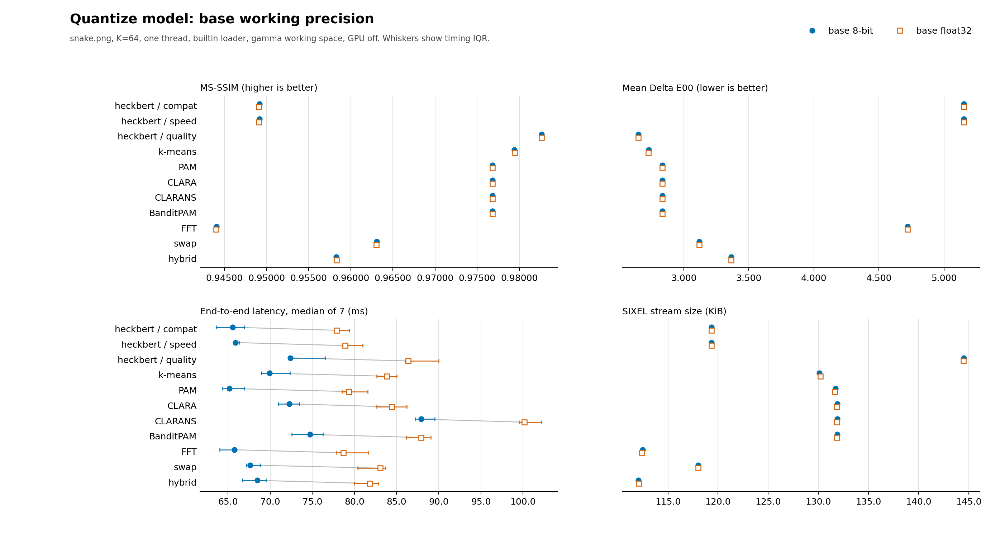
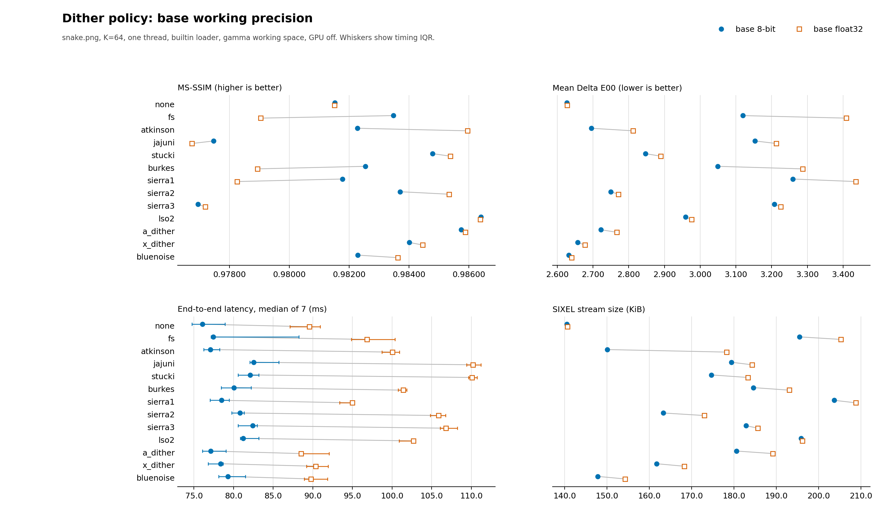
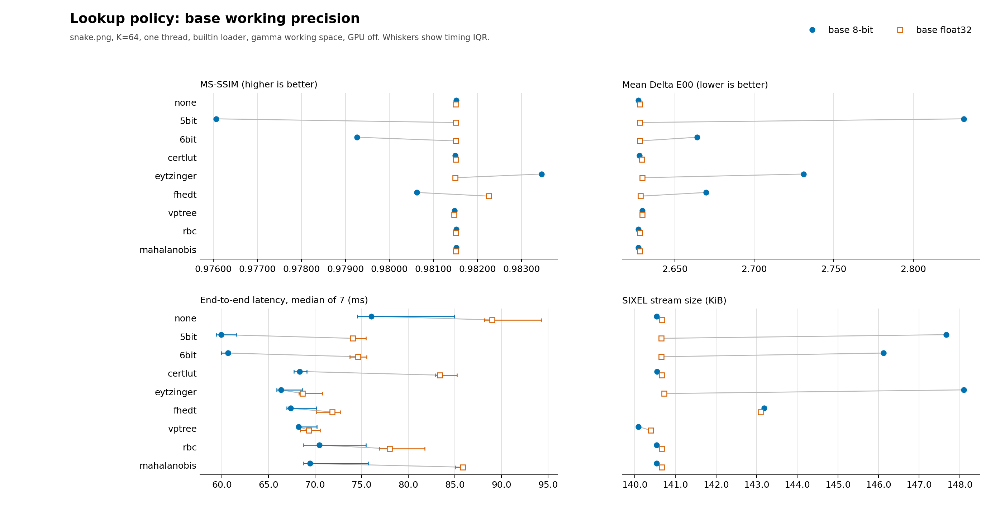
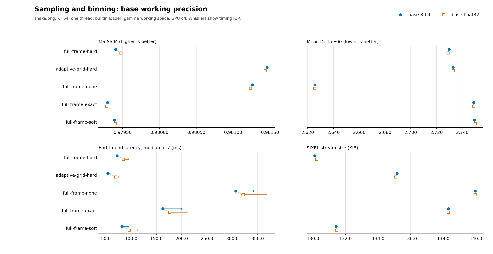
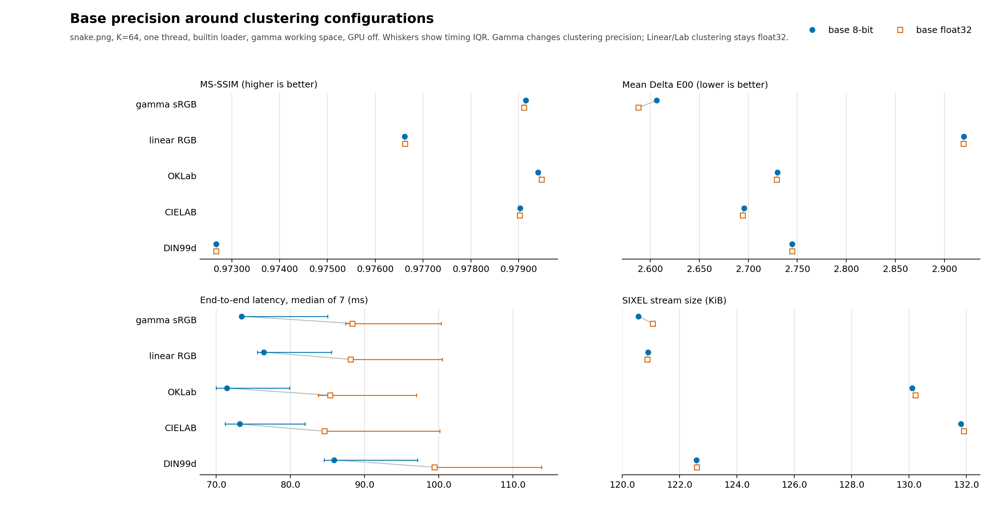

# Encoder Working Precision

## Scope

`img2sixel --precision=8bit|float32` selects the base representation used by
the shared encoder pipeline. This is not only a loader or resize setting. The
chosen representation can change the samples presented to palette
construction, arithmetic inside palette application, lookup-policy backends,
dither error state, selected palette indices, and the resulting SIXEL stream.
It also changes memory traffic and the amount of work available to threaded or
GPU execution paths.

The underlying `RGB888` and typed float32 storage contracts, implicit promotion by resize and CMS, and an isolated linear-light resize quality measurement are documented in [Pixel-format precision](../../concepts/pixelformat-precision/README.md).

Precision is therefore a cross-cutting measurement axis. Results for
[palette quantization](../palette-construction/quantization/README.md), [dithering](../palette-application/dithering/README.md),
[lookup policy](../palette-application/lookup-policy/README.md),
[sampling and binning](../palette-construction/pipeline/README.md), and
[clustering color space](../palette-construction/clustering-colorspace/README.md) must state both the requested
precision and the effective working format.

## Requested precision and effective format

[Loader precision, gamut, and fast paths](../../loader/precision-policy.md) defines which decoded representations may remain byte-based and which operations must preserve higher precision before this shared pipeline.

`-.` (or `--precision`) expresses a base preference. `-.8bit` uses byte storage when eight bits are sufficient; it does not force CMS output, high-depth source samples, or color-space calculations through a byte boundary. `-.float32` additionally selects float work when the byte path would otherwise be sufficient. `auto` does not request that extra promotion.

| Input and required work | `-.auto` / `-.8bit` | `-.float32` |
| --- | --- | --- |
| Byte input, no applied CMS, gamma working coordinates, no independent float requirement | byte path | float path |
| Float loader input, including CMS or high-depth source samples | retain float | retain float |
| Working color-space conversion or Display P3 output | float as required | float |
| Byte source with an image map retaining float samples, within the selected CPU float map path | retain source bytes; native palette and float application | float path |
| Soft or open error-diffusion feedback | float dither buffer; byte loading and palette construction remain eligible | float dither buffer |
| Resize | the resize policy controls its workspace; source float precision is retained | retain float work |

An enabled CMS engine alone is not a reason to promote an image: when no applicable source definition is present, supported byte decoders retain byte samples. The loader preference reaches the selectable JPEG and WebP decoding paths as well as the builtin and CoreGraphics loaders. Lossless byte decoders may leave explicit float promotion to the shared planner. Linear-light background composition, profile conversion and high-depth source decoding retain their precision requirements. The CMS suboption `prefer_8bit` remains a separate explicit post-CMS representation boundary.

For the [selected Display P3 output path](../output/output-colorspace.md#display-p3-selected-cpu-float-path), the output requirement takes precedence over `-.8bit`, including with `-Wgamma`. Leaving P3 removes only the output requirement and retains the selected precision, source and working-space requirements. `resize_precision=preserve` preserves the resize input representation; it does not authorize narrowing an existing float source. Explicit `float32` is retained with `preserve` or `linear` resize.

Repeated precision options replace the base request for all output spaces. `--precision=float --precision=auto -Wgamma` clears the explicit float request; automatic precision still retains a float source, while byte input can use byte work for ordinary output. A non-gamma working space or P3 output can independently require effective float. `auto` clears an earlier explicit request even when P3 is never selected. Revisions before commit `dafd2ddfb` left the earlier request unchanged.

A non-gamma working color space such as `-Wlinear` or `-Woklab` requires floating-point samples. It promotes the effective shared path to the matching typed format, such as `linear-f32` or `oklab-f32`, even when the base request is `--precision=8bit`. Such a command is useful, but it is not an 8-bit-versus-float32 experiment.

`-X` has a different role. It selects the coordinates used to construct the
palette. Gamma RGB can be clustered in either 8-bit or float32 coordinates, so
the `-Xgamma` pair includes a real clustering-precision comparison. Linear RGB
and the Lab-family clustering spaces are float32-only; there is no 8-bit
Linear RGB, OKLab, CIELAB, or DIN99d clustering mode to compare. Those
selections create a float32 palette-building view without necessarily
promoting an otherwise gamma `rgb888` main path. Their matched `--precision`
pairs compare the shared pipeline before and after the same float32 clustering
stage, not two numeric representations of that stage.

Within the [selected CPU native palette path](../output/output-colorspace.md#selected-ordinary-srgb-float-path), a non-gamma `-X` also requires preserving the generated float palette when it returns to gamma working coordinates. The main image may still report `work=rgb888`; lookup converts its byte queries to float to use that authoritative palette. This is required clustering precision, not an implicit rewrite of the `-.` request. Fixed built-in tables bypass clustering, so their unused `-X` setting does not impose this requirement.

An [image map](../palette-construction/external-palettes.md#selected-ordinary-srgb-output) can independently require float palette application even when the source is byte-eligible. Its loader result and any non-gamma `-X` construction requirement are examined before workspace conversion, without rewriting the base precision preference. This also applies to byte map images with gamma working coordinates; structured palettes bypass construction and keep their independent byte eligibility. Static encoder reuse re-evaluates the map under current loader settings. As with clamp-driven promotion, an initial planner field `work=rgb888` alone does not describe the eventual lookup precision.

[Dither clamp policy](../palette-application/clamp-policy.md) can promote the palette-application buffer separately from the planner's image representation. Its signed-headroom requirement does not promote the loader. A planner trace such as `work=rgb888` describes the image representation before that promotion. Check the palette-application lookup trace for the effective byte/float path and the clamp trace for `clamp_requested`, `clamp_effective`, and `clamp_threshold`.

Once CPU palette application selects float arithmetic, failure to allocate its RGB888-to-float working buffer is an error. It must not retry byte arithmetic: an authoritative float palette, an explicit float preference and a feedback-headroom requirement each retain their precision contract under memory pressure. This also applies to no-dither and hard-clamp application. Failed setup publishes no index result, leaves borrowed index storage untouched, and permits a later retry with the same palette. A genuine byte palette with no float requirement remains eligible for byte application; explicit byte palette assignment remains a deliberate precision boundary.

Within the [selected CPU native palette path](../output/output-colorspace.md#selected-ordinary-srgb-float-path), omitted cover and plain `-aauto` admit qualifying float work by default. AUTO has no native repair budget. The source/map precision requirements and explicit `-.` preference still decide byte eligibility; this admission rule does not make every encode float.

Use verbose planner output to audit the effective path. A controlled 8-bit image-storage run must report this working field; the loader and resize formats can independently be float:

```text
work=rgb888
```

The corresponding float32 run must report `work=rgb-f32`. Measurement scripts
must validate this field rather than infer the image path from the command line. To claim byte diffusion too, verify a byte lookup/application path and a compatible clamp policy; the planner field alone is insufficient.

Low-level `sixel_dither_initialize()` selects palette-construction precision from the supplied pixel format. Reinitializing a dither object with RGB888 replaces its previous float input setting and permits byte construction; initializing it with a typed float format retains those coordinates. Encoder-level precision requests are resolved before this boundary.

## Resize precision and memory

Normal filtered resizing converts integer gamma RGB input to linear RGB
float32, resamples in linear light, and converts to the requested working
representation afterward. This avoids the dark interpolation produced by
averaging gamma-encoded channel values. The planner must not silently replace
that path with an integer resize when a float32 allocation is large or fails.
If the conversion or resampler cannot allocate its required buffer, encoding
stops with `SIXEL_BAD_ALLOCATION`.

On a memory-constrained system, the user can explicitly select the smaller
integer path:

```sh
img2sixel -j auto:resize_precision=preserve -w50% input.png
```

`preserve` keeps integer input in an RGB888 resize path and delays any required
float32 working-colorspace conversion until after scaling. It can substantially
reduce peak memory for downscaling, but interpolation then operates on
gamma-encoded 8-bit values and can reduce resampling accuracy. `linear` uses a
temporary linear RGB float32 resize workspace, while `float` also retains the
requested float32 working representation after resizing. The allocation error
message names the `preserve` command as an explicit recovery option and states
this accuracy trade-off.

## Where precision can affect the pipeline

The same precision request reaches several independently interesting stages:

1. Loading and normalization decide whether decoded integer samples can remain
   byte-valued or need conversion to float.
2. Sampling and binning observe the normalized colors. Rounding can change bin
   occupancy, accumulated weights, and representative coordinates.
3. The quantizer operates on that point set. A different point population can
   change initial centers, assignments, convergence, and the final palette.
4. Palette conversion produces the representation used for palette
   application.
5. Lookup policies use precision-specific indexes, table coordinates, distance
   calculations, or caches. Their quality and cost can change independently.
6. Dither policies calculate and propagate representation error. Integer
   rounding changes both the current decision and later error state.
7. SIXEL encoding consumes the selected indices. Even a small index change can
   alter plane occupancy, runs, and stream size.

Consequently, an isolated observation such as "float32 made K-means slower"
is incomplete unless the experiment shows whether the palette, lookup, dither,
and output stream also changed.

## Cross-cutting measurement

The checked-in comparison uses one controlled cross-section to reveal where
precision sensitivity exists. It evaluates 43 configurations:

- eleven explicit quantize-model configurations;
- thirteen static-image dither policies;
- nine lookup policies;
- five sampling/binning configurations; and
- gamma clustering in both precisions, plus four float32-only clustering-space
  selections whose pairs measure the surrounding base pipeline precision.

Each configuration is measured once with a true `rgb888` path and once with a
true `rgb-f32` path. The figures keep four user-visible outcomes together:
MS-SSIM, mean Delta E00, end-to-end latency, and exact SIXEL byte size.

The controlled fixture is the 600-by-450 RGB [`images/snake.png`](../../../images/snake.png) at `K=64`. Commands use the builtin loader with loader CMS disabled (`SIXEL_LOADER_CMS_ENGINE=none`), one thread, full quality, gamma working coordinates, and no GPU assistance. Each domain reuses the command builder owned by its detailed measurement document, then changes only `--precision` within a matched pair. Thus a pair is a valid precision comparison, while absolute values from two different domains need not share every other policy.

The plots use paired markers rather than bars from zero. This makes small
precision changes visible without implying that a narrow quality-axis range is
an absolute magnitude comparison. Blue filled circles represent 8-bit;
orange open squares represent float32, so the distinction also survives
grayscale reproduction. Timing whiskers show the interquartile range.

## Measured results

The checked-in run was recorded on 2026-09-12 UTC from clean revision `85a2674e5` on macOS arm64, including the corrected DIN99d transform and common coordinate scale. The table summarizes float32 relative to the matching 8-bit row. Counts report the direction of the metric, not its statistical or practical significance.

| Domain | Configurations | Median float32 / 8-bit time | Float32 has higher MS-SSIM | Float32 has lower mean Delta E00 | Stream-size range |
| --- | ---: | ---: | ---: | ---: | ---: |
| quantize model | 11 | 1.20x | 2 / 11 | 3 / 11 | -0.07% to +0.09% |
| dither policy | 13 | 1.26x | 7 / 13 | 0 / 13 | +0.09% to +18.80% |
| lookup policy | 9 | 1.17x | 4 / 9 | 5 / 9 | -4.98% to +0.22% |
| sampling and binning | 5 | 1.18x | 2 / 5 | 3 / 5 | -0.06% to +0.09% |
| clustering configuration | 5 | 1.16x | 2 / 5 | 5 / 5 | -0.02% to +0.41% |

The quantizer rows change MS-SSIM by at most `0.000080`, mean Delta E00 by at most `0.0009`, and size by at most `0.09%` on this fixture. Their float32 time ratios range from 1.14x to 1.23x. The controlled solvers are relatively insensitive to base precision here, while conversion and float palette application still have a measurable cost. Sampling/binning configurations also show small output changes, with time ratios from 1.05x to 1.28x.

Dithering changes the tradeoff. Float32 increases mean Delta E00 for 13 of 13 methods, while MS-SSIM improves for 7. Delta E00 averages pointwise perceptual color error, whereas MS-SSIM rewards spatial structure created by redistributed error. All measured dither rows increase stream size; precision is part of their observable behavior.

The lookup comparison shows larger output changes for address-quantized or approximate policies such as `5bit`, `eytzinger`, and `fhedt`. Exact `none`, `certlut`, and the tree-like policies change much less on this input. Runtime is measured end to end; small differences should be read alongside the interquartile ranges rather than treated as portable speed rankings.

Across the five clustering configurations, float32 lowers mean Delta E00 in 5 pairs, while MS-SSIM moves in both directions and size stays within 0.41%. Only the gamma pair changes clustering-coordinate precision. Linear RGB, OKLab, CIELAB, and [DIN99d](../../concepts/din99d/README.md) clustering calculations remain float32 in both rows; their differences come from samples entering that stage and palette application afterward. Those four rows are not 8-bit-versus-float32 comparisons of the named spaces.

Selected output movements are shown below. Positive deltas mean that float32 reports a larger value or produces a larger stream.

| Domain and configuration | Time ratio | MS-SSIM delta | Mean Delta E00 delta | Size delta |
| --- | ---: | ---: | ---: | ---: |
| dither `fs` | 1.25x | -0.004429 | +0.2892 | +4.98% |
| dither `atkinson` | 1.30x | +0.003680 | +0.1170 | +18.80% |
| lookup `5bit` | 1.24x | +0.005444 | -0.2039 | -4.75% |
| lookup `eytzinger` | 1.03x | -0.001964 | -0.1016 | -4.98% |
| lookup `fhedt` | 1.07x | +0.001638 | -0.0413 | -0.06% |

### Quantize models



### Dither policies



### Lookup policies



### Sampling and binning



### Precision around clustering configurations



## Reproduction and validation

Commit the implementation being measured, build the assessment tools, install
Python Matplotlib, and run from a tracked-clean worktree:

```sh
PYTHON=.venv/bin/python tools/reproduce_precision_measurements.sh
```

The runner rebuilds `img2sixel` and `lsqa`, removes inherited `SIXEL_*`
variables, measures both precisions in alternating adjacent order, rotates and
reverses configuration order between rounds, generates all figures and the
combined CSV, and validates the result. The default timing budget is two
warm-ups followed by seven measured rounds. `PRECISION_WARMUPS` and
`PRECISION_RUNS` may shorten an exploratory run, but such data is a different
protocol and must not silently replace the checked-in baseline.

Before measuring a row, the script enables stable planner and palette
diagnostics. It rejects the run unless 8-bit reports `rgb888`, float32 reports
`rgb-f32`, and palette construction reports `quantizer_retries=0`. These checks
prevent a command label, implicit working-space promotion, or solver fallback
from misidentifying the implementation that was measured.

The complete per-row data, exact command templates, effective work formats,
quality deltas, size and timing ratios, and timing quartiles are in
[`precision-comparison.csv`](measurements/precision-comparison.csv).
Source revision, input and executable hashes, build configuration, host, and
the configuration manifest are in
[`precision-run.json`](measurements/precision-run.json). Validate a
regenerated directory directly with:

```sh
python3 tools/check_precision_measurements.py \
  docs/encoder/precision/measurements
```

## Interpretation limits

This comparison deliberately fixes one image, one palette size, one thread,
one working color space, and CPU execution. It answers whether precision can
materially affect a policy and shows the direction on this fixture. It does not
replace each topic's palette-size sweep, multi-fixture study, dither spectrum,
thread-scaling experiment, or GPU comparison.

In particular, do not generalize a small `K=64` difference to all palettes.
Integer quantization boundaries, lookup grids, dither feedback, and SIXEL run
structure can create non-monotonic results as `K` changes. If a precision
difference influences a default or an optimization, repeat the owning topic's
full protocol at both precisions and retain the effective-format preflight.

Rerun the cross-cutting suite after changes to loading, normalization,
colorspace conversion, sampling, binning, quantization, palette conversion,
lookup, dithering, SIXEL encoding, decoding used by `lsqa`, or the measurement
tools themselves.

## Implementation and tests

Precision option state and effective-format resolution are owned by
[`encoder.c`](../../../src/encoder.c) and [`encoder.h`](../../../src/encoder.h).
The planner exposes the resolved source, work, and scale-output formats through
its verbose DAG diagnostic. Focused option-order and promotion tests are under
[`tests/cli/options/matching/`](../../../tests/cli/options/matching/).

The measurement driver is
[`tools/plot_precision_measurements.py`](../../../tools/plot_precision_measurements.py),
the one-command wrapper is
[`tools/reproduce_precision_measurements.sh`](../../../tools/reproduce_precision_measurements.sh),
and the artifact contract is enforced by
[`tools/check_precision_measurements.py`](../../../tools/check_precision_measurements.py).

## Test coverage

<!-- test-coverage: enforced -->

| ID | Contract | Owning test |
| --- | --- | --- |
| EP-01 | A byte preference preserves exact stored gamma float samples. | [tests/processing/precision/0001_byte_request_float_source.t](../../../tests/processing/precision/0001_byte_request_float_source.t) |
| EP-02 | A byte preference converts linear float input to extended gamma float without clipping. | [tests/processing/precision/0002_byte_request_linear_source.t](../../../tests/processing/precision/0002_byte_request_linear_source.t) |
| EP-03 | Automatic precision retains the float source representation. | [tests/processing/precision/0003_auto_float_source.t](../../../tests/processing/precision/0003_auto_float_source.t) |
| EP-04 | A non-gamma working space retains its float requirement over an explicit byte request. | [tests/processing/precision/0004_non_gamma_float_work.t](../../../tests/processing/precision/0004_non_gamma_float_work.t) |
| EP-05 | Explicit float resize retains gamma float working storage after resampling. | [tests/processing/precision/0005_resize_float_override.t](../../../tests/processing/precision/0005_resize_float_override.t) |
| EP-06 | Temporary linear resize retains float source precision despite a byte preference. | [tests/processing/precision/0006_resize_linear_float_source.t](../../../tests/processing/precision/0006_resize_linear_float_source.t) |
| EP-07 | Preserve resize retains source precision through the subsequent float coordinate conversion. | [tests/processing/precision/0007_resize_preserve_float_source.t](../../../tests/processing/precision/0007_resize_preserve_float_source.t) |
| EP-08 | An explicit float request survives preserve resize. | [tests/processing/precision/0008_explicit_float_preserve.t](../../../tests/processing/precision/0008_explicit_float_preserve.t) |
| EP-09 | Eligible unmanaged loader output stays byte-valued; image-sized float allocation guards cover TIFF, JPEG, PNG and WebP. | [tests/loader/unit/0285_libtiff_none_byte_storage.t](../../../tests/loader/unit/0285_libtiff_none_byte_storage.t), [tests/loader/unit/0286_libtiff_builtin_byte_storage.t](../../../tests/loader/unit/0286_libtiff_builtin_byte_storage.t), [tests/loader/unit/0287_libjpeg_none_byte_storage.t](../../../tests/loader/unit/0287_libjpeg_none_byte_storage.t), [tests/loader/unit/0288_libjpeg_builtin_byte_storage.t](../../../tests/loader/unit/0288_libjpeg_builtin_byte_storage.t), [tests/loader/unit/0290_libwebp_none_byte_storage.t](../../../tests/loader/unit/0290_libwebp_none_byte_storage.t), [tests/loader/unit/0291_libwebp_builtin_byte_storage.t](../../../tests/loader/unit/0291_libwebp_builtin_byte_storage.t), [tests/loader/unit/0293_builtin_builtin_byte_storage.t](../../../tests/loader/unit/0293_builtin_builtin_byte_storage.t), [tests/loader/unit/0294_libpng_none_byte_storage.t](../../../tests/loader/unit/0294_libpng_none_byte_storage.t), [tests/loader/unit/0295_libpng_none_alpha_byte_storage.t](../../../tests/loader/unit/0295_libpng_none_alpha_byte_storage.t), [tests/loader/unit/0296_builtin_none_alpha_byte_storage.t](../../../tests/loader/unit/0296_builtin_none_alpha_byte_storage.t), [tests/loader/unit/0297_libpng_builtin_untagged_byte_storage.t](../../../tests/loader/unit/0297_libpng_builtin_untagged_byte_storage.t), [tests/loader/unit/0298_libwebp_none_lossless_byte_storage.t](../../../tests/loader/unit/0298_libwebp_none_lossless_byte_storage.t) |
| EP-10 | Explicit loader float preference retains the JPEG and lossy WebP float paths. | [tests/loader/unit/0289_libjpeg_none_float_preference.t](../../../tests/loader/unit/0289_libjpeg_none_float_preference.t), [tests/loader/unit/0292_libwebp_none_float_preference.t](../../../tests/loader/unit/0292_libwebp_none_float_preference.t) |
| EP-11 | The short precision option reaches JPEG and WebP loading and selects byte or float working storage. | [tests/loader/unit/0299_libjpeg_cli_precision_auto.t](../../../tests/loader/unit/0299_libjpeg_cli_precision_auto.t), [tests/loader/unit/0300_libjpeg_cli_precision_8bit.t](../../../tests/loader/unit/0300_libjpeg_cli_precision_8bit.t), [tests/loader/unit/0301_libjpeg_cli_precision_float32.t](../../../tests/loader/unit/0301_libjpeg_cli_precision_float32.t), [tests/loader/unit/0302_libwebp_cli_precision_auto.t](../../../tests/loader/unit/0302_libwebp_cli_precision_auto.t), [tests/loader/unit/0303_libwebp_cli_precision_8bit.t](../../../tests/loader/unit/0303_libwebp_cli_precision_8bit.t), [tests/loader/unit/0304_libwebp_cli_precision_float32.t](../../../tests/loader/unit/0304_libwebp_cli_precision_float32.t) |
| EP-12 | Explicit preserve resizing keeps eligible JPEG and WebP byte decoding instead of requesting a float source merely because scaling is active. | [tests/loader/unit/0305_libjpeg_cli_precision_preserve_resize.t](../../../tests/loader/unit/0305_libjpeg_cli_precision_preserve_resize.t), [tests/loader/unit/0306_libwebp_cli_precision_preserve_resize.t](../../../tests/loader/unit/0306_libwebp_cli_precision_preserve_resize.t) |
| EP-13 | An authoritative float palette rejects failed image promotion with no diffusion. | [tests/processing/precision/0009_palette_promotion_none.t](../../../tests/processing/precision/0009_palette_promotion_none.t) |
| EP-14 | An authoritative float palette rejects failed image promotion with hard FS. | [tests/processing/precision/0010_palette_promotion_hard.t](../../../tests/processing/precision/0010_palette_promotion_hard.t) |
| EP-15 | An explicit float request rejects failed image promotion with no diffusion. | [tests/processing/precision/0011_requested_promotion_none.t](../../../tests/processing/precision/0011_requested_promotion_none.t) |
| EP-16 | An explicit float request rejects failed image promotion with hard FS. | [tests/processing/precision/0012_requested_promotion_hard.t](../../../tests/processing/precision/0012_requested_promotion_hard.t) |
| EP-17 | Explicit byte palette assignment restores byte eligibility with no diffusion or hard FS and allocates no float image. | [tests/processing/precision/0013_byte_application_eligible.t](../../../tests/processing/precision/0013_byte_application_eligible.t) |
| EP-18 | After promotion failure, a separate byte object remains usable and the original object retries with unchanged float entries and independently specified indices. | [tests/processing/precision/0014_promotion_failure_reuse.t](../../../tests/processing/precision/0014_promotion_failure_reuse.t) |
| EP-19 | Promotion failure neither writes nor frees borrowed index storage; retry reuses it and produces independently specified float-lookup indices. | [tests/processing/precision/0015_promotion_borrowed_buffer.t](../../../tests/processing/precision/0015_promotion_borrowed_buffer.t) |
| EP-20 | Soft and open FS feedback reject failed image promotion even without a float palette or explicit float request. | [tests/processing/precision/0016_clamp_promotion_failure.t](../../../tests/processing/precision/0016_clamp_promotion_failure.t) |
| EP-21 | Reinitialization follows the actual input type: float source levels are retained, and subsequent RGB888 input replaces the old float setting without allocating a float image. | [tests/processing/precision/0017_generation_input_precision.t](../../../tests/processing/precision/0017_generation_input_precision.t) |

EP-01 through EP-08 pass prepared float frames through the public encoder, inspect the resulting frame storage and samples, and use the independent [frame byte fixtures](../../../tests/data/color-numeric/frame-byte.json). Constant nearest-neighbor footprints isolate the resize storage boundary from interpolation weights. Existing [option-order tests](../../../tests/cli/options/matching/) cover repeated precision and working-space requests; the P3 precision override remains covered by the [output-color contract](../output/output-colorspace.md#test-coverage).

EP-13 through EP-20 arm a single image-sized allocation failure through the allocator API; the byte-eligible control must never reach that allocation. They check the actual application status, index-buffer ownership, unchanged source and palette storage, and literal nearest-color indices. Their seven-pixel fixtures isolate promotion and recovery; they do not measure image quality, throughput or all later allocation failures.
