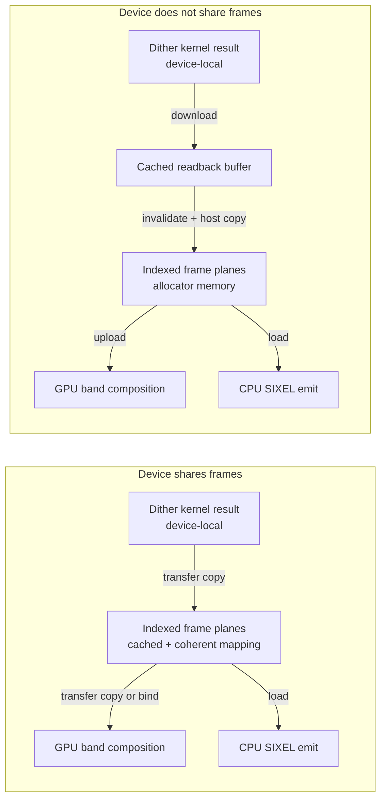

# GPU Host Memory and Frame Sharing

This explanation is for contributors who change a Metal or Vulkan stage of the encoder and need to decide where its buffers live and how the CPU and the GPU hand data to each other. It covers the kinds of host-visible memory a GPU offers, why a buffer the CPU reads must be cached, how indexed frames are shared so that no stage copies them through the CPU, and the conditions under which libsixel falls back to separate copies. It does not describe any one GPU stage; the [encoder threading](../threading/encoder.md#gpu-band-composition) page owns the scheduling of GPU band composition, [delta encoding](../encoder/output/delta-encoding.md) owns the retained plane, and the palette-application pages own each dither kernel.

**Key ideas in one minute:**

- A CPU read from write-combined memory bypasses the cache and is an order of magnitude slower than an ordinary load, so a buffer the CPU reads in place must be cached.
- Coherent memory needs no flush or invalidate; cached memory that is not coherent needs both, around every GPU submission that touches it.
- An indexed frame can live in one buffer that the GPU writes and the CPU encoder reads, but only when the device offers memory that is both coherent and cached; otherwise the frame stays in ordinary allocator memory and the GPU result is downloaded.
- On a discrete GPU, host-visible memory is system RAM behind PCIe, so shaders work on device-local copies and transfer commands move data between the two.

## Memory a GPU can offer the host

A Vulkan device lists memory types, each a combination of property flags. Three flags decide how the CPU sees a buffer:

| Flag | Meaning for the CPU | Cost when it is missing |
| --- | --- | --- |
| `HOST_VISIBLE` | The buffer can be mapped into the process. | The CPU cannot touch it; only transfer commands can. |
| `HOST_COHERENT` | Writes by either side become visible to the other once the GPU submission is synchronized. | The CPU must flush its writes before a submission and invalidate the range after waiting for one. |
| `HOST_CACHED` | CPU loads go through the cache hierarchy. | The mapping is write-combined: sequential stores are fast, but every load goes to memory. |

`DEVICE_LOCAL` adds where the memory is. On a discrete GPU, device-local memory is VRAM; a type that is both device-local and host-visible is a window into VRAM across the PCIe bus, fast for sequential CPU writes and slow for CPU reads. On an integrated GPU every type is system RAM, and the flags differ only in caching and coherence.

Devices combine these flags differently, and the combination decides which strategy works:

| Device class | Cached and coherent type | Typical consequence |
| --- | --- | --- |
| Apple silicon (Metal) | Shared storage is always both | Frames and results are shared without copies. |
| Discrete GPU, for example NVIDIA | System RAM that is coherent and cached | Frames are shared in system RAM; shaders work on VRAM copies made by transfer commands. |
| Integrated GPU whose coherent memory is write-combined, for example Intel Xe | Not offered; cached memory is non-coherent | Results the CPU reads use cached memory with explicit invalidation; frames are not shared. |

## Reading GPU results on the CPU

A buffer the CPU reads in place, such as dither indexes, skip masks, band-composition nodes, or retained-plane statistics, asks for `HOST_CACHED` first and only prefers `HOST_COHERENT`. Requiring coherence instead would select write-combined memory on an integrated GPU of the last class above. There the CPU reads the result byte by byte from uncached memory: reading back a 4 MB LSO2 result took about 14 ms from write-combined memory and about 0.7 ms from cached memory on one Intel Xe device.

When the chosen type is not coherent, the runtime records this and the owner invalidates the range it is about to read after each wait, and flushes a range it wrote before the GPU reads it. On a coherent type both calls return immediately, so callers issue them unconditionally rather than testing the device.

Buffers the CPU only writes, such as uploaded pixels or palettes, take the opposite choice. They prefer a device-local, host-visible window into VRAM where one exists, so that one sequential CPU write replaces a write into staging plus a device copy.

## Staging on a discrete GPU

A shader that reads system RAM on a discrete GPU crosses PCIe on every access. When a buffer's host-visible memory is not device-local, the runtime keeps that memory as a staging copy and gives the shader a separate device-local buffer. Uploads and downloads are transfer commands recorded in the same submission as the compute work. If the device runs out of VRAM, the shader binds the host buffer directly, which is slow but still correct. A device without separate VRAM keeps one buffer.

## Sharing indexed frames

Palette application produces an indexed frame: one index byte and one skip byte per pixel. The CPU encoder then reads both planes to emit SIXEL, and GPU stages such as band composition read them again. Copying the planes between private GPU buffers and the frame would cost two full-frame copies per stage.

When the device can share frames, the indexed frame allocates both planes as GPU buffers and points its CPU `indexes` and `skip` pointers into their mappings. A GPU stage recognizes such a frame by checking that the mapping it is given is exactly the buffer's mapping and that the buffer has no separate staging copy. A Vulkan stage then records transfer copies between the frame buffer and its own device-local buffers in the same submission as its compute work; a Metal stage binds the frame buffer itself. In both cases the CPU sees the data after the wait with no host copy. A stage that receives an ordinary frame downloads its result and copies it on the CPU instead, so every stage keeps both paths.

Metal shares frames on every device because shared storage is both coherent and cached. Vulkan shares them only when the device offers a memory type with `HOST_VISIBLE`, `HOST_COHERENT` and `HOST_CACHED` together. On a device without one, sharing would mean a flush or invalidate of every frame plane on each hand-off, and the frame planes stay in allocator memory.

Creating a shared buffer costs a kernel allocation and first-touch page faults on both processors, which exceeds the copies it replaces. Released frame storage is therefore kept in a small set of idle slots and reused by the next frame of the same size on the same device.

## The retained plane

The retained plane of delta encoding owns coherent RGB and validity buffers for the committed canvas. A GPU palette application, including LSO2, binds those buffers instead of uploading the baseline each frame. When a consumer asks for host access to a device-local buffer, the runtime moves its contents into host-visible coherent memory once and keeps that buffer from then on. Candidate paint masks and statistics that the CPU reads after an update use cached readback memory, as described above. The [delta encoding](../encoder/output/delta-encoding.md) page owns the plane's lifetime, leases and failure rules.

## In libsixel

- Every Vulkan stage chooses one of four allocation kinds from the runtime: host-written, readback, host-shared and device-only. Buffers that Metal stages share with the CPU use shared storage, which is always cached and coherent, so they need no such choice.
- Indexed frames are shared through the GPU device interface. The encoder asks the device whether it shares frames before allocating one, and the frame falls back to allocator memory on any failure.
- GPU band composition, the error-diffusion dither kernels and GPU palette application all accept both shared and ordinary frames. Their CPU fallbacks do not depend on the memory kind.

## Implementation map

- [src/gpu-runtime-vulkan.c](../../src/gpu-runtime-vulkan.c): memory-type selection, the host-written, readback, host-shared and device-only reservations, staging on discrete GPUs, flush and invalidate, and the one-time move to shared memory.
- [src/gpu-palette-vulkan.c](../../src/gpu-palette-vulkan.c): the Vulkan GPU device, its decision whether to share frames, frame-buffer creation, and recognition of a shared frame by a consumer.
- [src/gpu-palette-program.inc.h](../../src/gpu-palette-program.inc.h): the Metal GPU device, whose buffers use shared storage.
- [src/encode-result.c](../../src/encode-result.c): indexed frames on a device, their fallback to allocator memory, and the idle slots that reuse frame storage.
- [src/encoder-body-gpu-vulkan.c](../../src/encoder-body-gpu-vulkan.c) and [src/encoder-body-gpu-metal.m](../../src/encoder-body-gpu-metal.m): band composition reading shared frames and writing nodes the CPU emits from.
- [src/retained-plane-vulkan.c](../../src/retained-plane-vulkan.c): retained-plane staging and cached readback of its paint and statistics.
