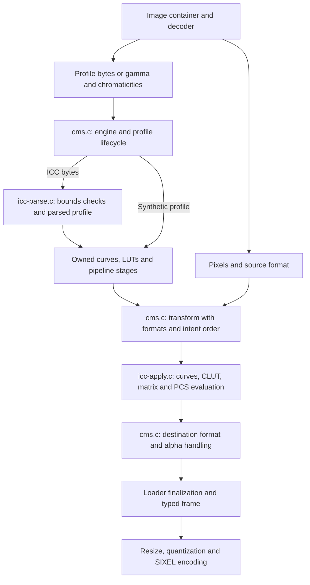

# Builtin CMS: Specification Scope and Implementation Architecture

## Purpose and boundary

Builtin CMS is a color-management subsystem: it parses profile data, constructs reusable representations of color transforms, selects rendering paths, evaluates those paths, and converts between source and destination representations. Its complexity is closer to a small color-management library than to a gamma correction helper. It lives inside libsixel because loader normalization must remain available on supported builds without an external CMS. The [user guide](color-management/README.md) explains that availability decision, the additional attack surface, engine selection, and visual examples.

The principal loader use is to interpret source colors before reducing them to the default sRGB SIXEL output. Builtin CMS does not enlarge terminal gamut, manage monitor profiles, or calibrate displays. Its internal transform API also contains device-to-device paths; their existence does not imply that every loader exposes every source/destination combination. The builtin image decoder and builtin CMS are separate components. A library decoder can use this CMS, and the builtin decoder can use Little CMS.

This document describes the implemented subset and its limitations. It is not a claim of complete ICC v2/v4 conformance or equivalence to Little CMS. A format signature accepted by the parser is weaker evidence than a correctly evaluated transform, and neither establishes that a particular loader actually applied it.

The [static builtin PNG entrance](builtin/png-source-precision.md) sends original normalized float RGB to the selected engine and a linear-sRGB destination, including when Little CMS is not compiled. Its image and file-background results are published together only after successful conversion; optional-metadata fallback restores both original inputs. Palette/APNG adapters keep their separate contracts.

## Specification model

ICC separates a tag's role from its payload representation. A2B0 identifies a device-to-PCS rendering path; mAB identifies a way of encoding a transformation. PCS, the profile connection space, connects source and destination profiles. ICC v4 defines XYZ and Lab PCS representations and multiple rendering intents. D2B/B2D use the floating-point mpet representation, including an explicit absolute-intent slot. These definitions are in [ICC.1:2022, sections 6, 9, and 10](https://www.color.org/specification/ICC.1-2022-05.pdf). The [ICC introduction](https://www.color.org/getting-started/) gives the broader profile model.

The parser accepts ICC v2 and v4 headers with Input (`scnr`), Display (`mntr`), Output (`prtr`), or ColorSpace (`spac`) class. ColorSpace needs an executable LUT or multi-process path. A v2 Lab-to-Lab ColorSpace profile with such a path can still use the legacy D50 Lab fallback for other intents. The other accepted classes use the supported device paths below. Zero-filled signature, version, or class fields retain legacy embedded-profile compatibility independently. A nonzero signature must be `acsp`, and a declared version uses decimal digits and zero reserved bytes. The parser requires a usable conversion path within the declared extent. Full conformance checks for required and descriptive tags, timestamps, profile IDs, and optional header metadata belong to profile validators.

### Implemented representation and support envelope

The authoritative definitions are in [`icc-parse.h`](../../src/icc-parse.h), with readers in [`icc-parse.c`](../../src/icc-parse.c) and evaluators in [`icc-apply.c`](../../src/icc-apply.c).

| Area | Current representation and behavior | Boundary |
| --- | --- | --- |
| Source domains | RGB, gray, CMYK, and Lab profile kinds. | A 16-channel scratch array is not support for arbitrary multichannel device profiles; the public internal CMS formats and profile-kind dispatch are narrower. |
| PCS | XYZ and Lab, with XYZ D50 used to connect internal paths. | Other PCS signatures are rejected; this is not an iccMAX spectral or appearance-space engine. |
| RGB matrix/TRC | Three XYZ columns and three channel curves. | Used when no accepted forward slot supplies the RGB path. It does not imply support for every auxiliary adaptation or calibration tag. |
| Gray | Tone curve and D50 white-point representation, plus supported LUT paths. | Gray has its own parser and evaluator branches; RGB support does not establish gray parity automatically. |
| `curv` | Identity, scalar gamma, or a copied 16-bit sampled table. | Runtime interpolation and endpoint handling define the effective behavior. |
| `para` | Function types 0–4 sampled into a 4096-entry 16-bit table. | Evaluation is approximated by the sampled representation, not retained as a general analytic program. |
| Segmented curves | Selected `segm` parsing and sampled representation. | Do not infer support for an arbitrary mpet curve-set element or every segmented-curve encoding from this parser. |
| `mft1` / `mft2` | Matrix, input tables, CLUT, and output tables. Reverse LUTs apply the matrix to PCS XYZ before the input tables. Byte table values are expanded into 16-bit storage. | The matrix stage is limited to reverse XYZ paths, including the compatibility route for legacy B2D payloads. |
| `mAB` / `mBA` | Optional A/M/B curves, CLUT, and a three-channel matrix with offsets. | A fixed pipeline representation, not a general graph of processing elements. Channel counts and stage compatibility constrain execution. |
| A2B / B2A | Three slots, numbered 0–2, with separate forward and reverse storage. | A forward table does not automatically provide its inverse. |
| D2B / B2D | Slots 0–3 execute standard `mpet` element lists. Slots 0–2 also accept legacy mAB/mBA and mft compatibility payloads. | Standard `mpet` takes precedence over the corresponding A2B/B2A legacy slot. |
| Auxiliary and private tags | Only the specific data used by the parser is consumed. | DeviceLink, Abstract, and NamedColor profiles require other processing models. Preview and gamut tags are outside the supported paths. |

The `mpet` reader retains the position table's element order, channel counts, and a shared copy of the tag bytes. The pipeline evaluates `cvst`, `matf`, and `clut` in position-table order, with pass-through `bACS` and `eACS` placeholders. Each stage supports up to 16 channels. Coefficients and samples enter the evaluators at their encoded precision, and arithmetic uses double precision. CLUT interpolation limits each input to the unit interval. Tables with up to four input axes use multilinear interpolation. Larger tables use simplex interpolation and read at most one more vertex than the number of input axes. Matrix inputs and all element results retain their float coordinates. At a floating-point PCS boundary, the coordinates are XYZ or L*, a*, b* directly.

## Architecture and data flow

The parser owns the transition from untrusted bytes to typed structures. The evaluator consumes those structures rather than rereading arbitrary offsets from the original file for each pixel. The CMS facade owns backend selection, pixel layouts, profile/transform lifetimes, and the bridge to loader callers. Container extraction and the decision about which metadata takes precedence remain with the decoder/loader integration.

| Layer | Owning code | Responsibilities |
| --- | --- | --- |
| Loader policy and handoff | [`loader-manager.c`](../../src/loader-manager.c), [`loader-common.c`](../../src/loader-common.c), format-specific loaders | Enablement, engine and target settings, metadata precedence, decoded source domain, frame precision, background and alpha finalization. |
| Backend facade | [`cms.h`](../../src/cms.h), [`cms.c`](../../src/cms.c) | Opaque profile/transform API; builtin, lcms2, and ColorSync dispatch; format adaptation; intent ordering; synthetic profiles. |
| Profile reader | [`icc-parse.h`](../../src/icc-parse.h), [`icc-parse.c`](../../src/icc-parse.c) | Read tag tables and payloads; allocate curves/LUTs; record available slots; destroy incomplete representations after failure. |
| Transform evaluation | [`icc-apply.h`](../../src/icc-apply.h), [`icc-apply.c`](../../src/icc-apply.c) | Curve/table interpolation, matrix and CLUT evaluation, PCS encoding/decoding, source and reverse paths. |
| Observability | Parser trace and CMS intent trace | Explain ignored tags and rejected paths through `loader`; expose intent ordering through `loader_contract`. Neither is a universal proof of conversion. |

### Profile construction and ownership

The facade profile stores a backend identity, color domain, special destination flags, a builtin parsed profile, and optional external backend handles. `sixel_cms_open_profile_from_mem()` dispatches to the selected backend. Builtin parsing builds a temporary profile and transfers its owned tables to the output on success; failure destroys that temporary representation. The parsed tables are copies, not borrowed spans into the original file buffer.

Profiles can also be synthesized from gamma and chromaticities. The builtin path builds an RGB-to-XYZ matrix and channel gamma curves rather than serializing a new ICC file and parsing it again. Its gamma/chromaticity constructor uses reciprocal supplied gamma values for the stored decoding curves; callers must follow that API convention. Special sRGB and D50 Lab destinations avoid requiring embedded destination profile files.

A builtin transform records source/destination formats, flags, borrowed profile pointers, and the selected slot order. It does not clone or retain the profiles. Keep both profiles alive until the transform has been deleted; deleting the transform does not close those profiles. Curves, LUT tables, and `mpet` element lists and tag copies belong to the profiles and are released by profile destruction. These APIs are internal interfaces, not a separately installed stable CMS library ABI.

Source and destination backend identities must agree. A builtin source profile and an lcms2 destination profile cannot be combined into one transform by the facade. Also, successful builtin transform construction mainly establishes an execution descriptor: some incompatible format/domain combinations are rejected during `sixel_cms_do_transform()`. Callers must check execution success as well as construction success, and must not assume failure leaves an output buffer untouched.

### Rendering paths and fallback

There are several distinct forms of fallback. Engine resolution selects a compiled implementation. Profile parsing selects usable structures. Transform evaluation selects available intent slots. The loader may then choose another metadata interpretation or an unmanaged result when a profile cannot be used. These are separate decisions and should not be described as a single universal fallback chain.

The CMS facade provides call-local diagnostics through `sixel_cms_open_profile_from_mem_ex()`, `sixel_cms_create_transform_ex()`, and `sixel_cms_do_transform_ex()`. Profile opening reports its final status, the first and actual engines, a native rejection that led to a retry, and a rejected builtin path bypassed by a usable profile. The builtin parser distinguishes unsupported payloads, malformed data, missing usable paths, resource limits, and failed allocations. Transform diagnostics identify known format and backend mismatches and allocation failures, with evaluation or backend failure for other rejections. The original entry points retain their pointer or boolean result. The `loader` trace records profile fallback and separates a transform failure reason from the existing apply outcome. Loader fallback remains governed by the format's own contract.

`auto` resolves to lcms2, then ColorSync, then builtin according to build availability. An explicitly unavailable external engine resolves through `auto`. Profile opening and standard profile factories also retry builtin after a selected external backend fails, including an explicit external selection. Transform creation requires matching profile backends and does not retry a failed external transform through builtin. Loader-level unmanaged or alternative-metadata fallback is another decision. See the [selection guide](color-management/README.md#decoder-and-cms-are-independent-choices).

Builtin derives a slot order from the CMS intent policy. Perceptual maps to 0, relative to 1, and saturation to 2. For absolute, dedicated D2B3/B2D3 paths produce or consume absolute PCS directly. The fallback uses slot 1, slot 0, or an analytic path. When a configured intent can use an `mpet` path or either profile requires an explicit LUT, the facade evaluates both endpoints for each pixel before advancing to the next configured intent. If a ColorSpace endpoint has no usable table for the requested slot, its legacy A2B0 or B2A0 table can supply that direction. At an endpoint using fallback, the PCS bridge scales each XYZ component by source `wtpt` over D50 or D50 over destination `wtpt`. Missing or unusable media white uses D50. Colorants and LUTs already carry PCS adaptation, so the bridge uses the existing PCS coordinates.

The parser and evaluator have domain-specific branches for available forward, reverse, and matrix/TRC paths. Some branches try one tag family only when another did not succeed; do not assume every alternative tag has been parsed just because it is present. RGB matrix/TRC data supplies the no-forward-slot case. Reverse transforms require a usable reverse representation or a supported analytic path; the implementation does not numerically invert an arbitrary CLUT to invent missing B2A data.

The facade has an additional compatibility rule: an RGB/gray dynamic LUT profile with only the narrow primary-path shape and a zero PCS illuminant is rejected to match an established ColorSync fallback case. This is a deliberate implementation exception in `sixel_cms_profile_open_builtin()`, not a general ICC rule. It illustrates why parser success alone is insufficient to establish that a source profile became usable.

## Pixel execution and numerical behavior

An ordinary source-to-sRGB conversion evaluates source device values into the internal PCS bridge, adapts/converts toward sRGB coordinates, and encodes or stores the requested destination representation. The code contains fixed D50/D65 conversion matrices and the sRGB transfer function. Device-to-device execution instead evaluates the source into XYZ D50 and then evaluates the destination's reverse path. The pixel-format facade performs byte, 16-bit CMYK, or float input/output handling around those calculations; alpha copying is format/flag dependent, while final compositing remains a loader concern.

The mAB evaluator runs A curves, CLUT, M curves, matrix plus offset, and B curves when those stages are present. The mBA evaluator runs B curves, matrix plus offset, M curves, CLUT, and A curves. Two fixed scratch arrays carry values between stages. Missing CLUT stages cannot change channel count, and a matrix stage requires three channels. Keeping these checks near execution prevents a loosely accepted structure from being treated as an executable pipeline without validating its shape.

CLUT evaluation interpolates surrounding grid corners. For N input dimensions, this involves up to 2^N corners per sample; for the actual RGB and CMYK source paths that means 8 and 16 respectively. Storage grows as the product of the grid dimensions times the output channel count. The structure's 16-channel capacity must not be used to imply that high-dimensional processing is cheap or exposed as a supported loader feature.

The implementation mixes precision deliberately: curves and CLUT samples are usually owned as 16-bit integers, many arithmetic intermediates are double, and frame storage may be byte or float32. Parametric/segmented curve sampling introduces approximation before the final frame is written. Parametric type 4 stores parameters in `g, a, b, c, d, e, f` order: its threshold is `d`, its upper branch is `(aX+b)^g+e`, and its lower branch is `cX+f` (ICC.1:2022 Table 68). A float32 result does not remove earlier table quantization. Matrix/TRC RGB conversion through the float facade and owned definition API instead evaluates retained `para` coefficients directly; its bounded inverse searches the retained formula after the existing monotonicity check. This preserves sixteen-bit source distinctions without changing the legacy table evaluation used by byte/CLUT paths. The legacy curve and LUT evaluators use bounded coordinates. The `mpet` pipeline carries floating-point coordinates between its stages.

The separate [extended-coordinate interfaces](../encoder/colorspace-handling/README.md#internal-extended-coordinate-foundation) reuse this parser/evaluator with owned RGB definitions and explicit PCS boundaries. Their transform copies its endpoints and preserves extended analytic RGB intermediates. The `sixel_cms_*` facade also uses owned analytic RGB definitions inside its synthetic builtin profiles for float RGB destinations. It connects source ICC PCS or analytic RGB through XYZ D50 to extended destination RGB, while retaining borrowed profile pointers in transforms. Its byte and ICC output-device paths retain bounded device semantics. The new descriptor lifetime and failure guarantees must not be inferred for the facade.

Quality comparisons must isolate source decoding, profile interpretation, interpolation, clipping, target encoding, and subsequent palette reduction. Use independent expected colors or independently converted images to establish correctness; comparing two runs through the same builtin path establishes repeatability, not ICC accuracy. Little CMS comparison is useful differential evidence, but differences still need to be attributed to intent, supported stages, clipping, or approximation rather than automatically labeled bugs in either engine.

### Cost and concurrency

Parsing and table allocation are profile setup costs. Pixel conversion scales with image size and the selected curve/LUT stages. In this implementation, intent attempts can remain in execution helpers; the transform is not a globally optimized or fused program. There is no general profile-transform cache in these objects. Benchmarks should separate profile open/create time from repeated execution and then measure the real loader pipeline with the same source and target precision.

Engine selection uses compiler TLS where supported. Builds without TLS use a guarded process-global selector when threading is enabled. That lock protects individual selector reads/writes; it does not provide independent per-thread policy semantics equivalent to TLS. Transform objects capture their backend and slot order, and callers remain responsible for profile lifetimes and buffer ownership. The CMS pixel loop itself is not an independent worker-pool scheduler; loader/encoder concurrency belongs to the surrounding pipeline.

## Trust boundary and defensive model

Profile data is untrusted executable *description*, even though the current implementation is not a general bytecode interpreter. Offsets, table sizes, curve parameters, channel counts, and grid dimensions influence memory use, arithmetic, and control flow. The parser checks declared bounds and uses checked size addition/multiplication/powers before table allocation. Evaluators check channel compatibility and available representations. Destruction paths release partially constructed tables.

Parametric evaluation rejects a non-finite result before unit-interval clamping. Finite fixed-point coefficients can produce NaN through a fractional power of a negative base, or infinity through power overflow. Both `para` and the supported `segm` table builders reject that curve and release partially allocated tables before any float-to-integer conversion; a failed profile parse does not publish a partial output object. Finite results retain the existing curve-domain clamping and table-rounding rules. This check is not an image-sample clamp and does not discard valid extended RGB after matrix conversion. A loader retains its own policy for an unusable profile: for example, the native BMP adapter rejects a selected malformed matching profile without delivering a frame, whereas optional PNG metadata can follow its documented fallback.

Builtin ICC parsing accepts up to 256 tag entries and 16 MiB of cumulative dynamic allocations per profile. The tag limit is checked before walking the table. The allocation limit is checked before each allocation and covers curve tables, LUT input/output tables, expanded CLUT samples, temporary curve storage, and `mpet` element lists and tag copies. Copies of shared tag data and storage discarded during parsing still count toward the same limit. Exceeding a limit reports `resource-limit`, frees partial data, and leaves the caller's profile untouched. Each new parse starts with a fresh budget. The limits cover builtin ICC parsing. Container extraction and decompression, native CMS engines, and pixel conversion retain their own resource policies.

The [ignored-feature trace](color-management/README.md#diagnosing-ignored-icc-features) audits tag-level decisions with escaped signatures and bounded detailed output. Fields and stages inside recognized payloads are outside the scope of this tag audit. Absence of an ignored-tag record therefore does not establish full interpretation of the profile.

## Extending the subsystem

Treat additions as changes to a specification interpreter. For each new feature, define its exact tag/payload grammar, allowed numeric domains, PCS encoding, evaluation order, ownership, failure behavior, and interactions with existing paths before adding a parser branch. Preserve a distinction between unsupported data, malformed data, resource failure, and a valid alternate rendering path wherever the API can express it.

iccMAX and its broader element repertoire remain outside the supported subset.

## Test coverage

<!-- test-coverage: enforced -->

### Behavioral contract tests

These tests establish selected implementation paths. They are not a complete conformance suite for the specification envelope above.

| ID | Observation | Owning test |
| --- | --- | --- |
| BCMS-01 | Selected RGB/gray curve and profile evaluation paths. | [tests/color/icc/0001_icc_builtin_rgb_gray_v4_paths.t](../../tests/color/icc/0001_icc_builtin_rgb_gray_v4_paths.t) |
| BCMS-02 | Selected mAB/mBA paths for supported source domains. | [tests/color/icc/0002_icc_builtin_mab_mba_a2b0_paths.t](../../tests/color/icc/0002_icc_builtin_mab_mba_a2b0_paths.t) |
| BCMS-03 | A2B intent-slot ordering and the tested fallback paths. | [tests/color/icc/0003_icc_builtin_a2b_intent_paths.t](../../tests/color/icc/0003_icc_builtin_a2b_intent_paths.t) |
| BCMS-04 | Selected reverse B2A slot paths, including the legacy PCS XYZ matrix before the input tables in B2A and compatibility B2D. | [tests/color/icc/0004_icc_builtin_b2a_slot_paths.t](../../tests/color/icc/0004_icc_builtin_b2a_slot_paths.t), [tests/color/icc/0018_mft1_b2a_xyz_matrix.t](../../tests/color/icc/0018_mft1_b2a_xyz_matrix.t), [tests/color/icc/0019_mft2_b2a_xyz_matrix.t](../../tests/color/icc/0019_mft2_b2a_xyz_matrix.t), [tests/color/icc/0020_mft2_b2d_xyz_matrix.t](../../tests/color/icc/0020_mft2_b2d_xyz_matrix.t), [tests/color/icc/0079_mft1_b2d_xyz_matrix.t](../../tests/color/icc/0079_mft1_b2d_xyz_matrix.t) |
| BCMS-05 | Selected source-to-destination intent paths write representative RGB8, CMYK8, CMYK16, and CMYK float32 channel results. | [tests/color/icc/0005_icc_builtin_device_to_device_intent_paths.t](../../tests/color/icc/0005_icc_builtin_device_to_device_intent_paths.t) |
| BCMS-06 | Builtin PNG parametric ICC conversion matches independent curve and PCS equations within 0.004 byte levels before palette quantization. | [tests/loader-png/profile/0002_loader_builtin_png_rgb_parametric_012_builtin_cms_samples.t](../../tests/loader-png/profile/0002_loader_builtin_png_rgb_parametric_012_builtin_cms_samples.t) |
| BCMS-07 | The loader trace omits a usable standard D2B3 path from ignored and rejected records. | [tests/color/cms/0001_supported_mpet_trace.t](../../tests/color/cms/0001_supported_mpet_trace.t) |
| BCMS-08 | The builtin facade accepts representative Gray8, RGB8, RGB float32, and RGBA8 source/destination combinations, expands gray to equal RGB components, and preserves copied alpha. | [tests/color/icc/0006_icc_builtin_pixel_format_matrix.t](../../tests/color/icc/0006_icc_builtin_pixel_format_matrix.t) |
| BCMS-09 | NaN and positive/negative infinity in representative RGB float input, plus NaN in Lab input, are clamped to the same results as zero or one before profile math. | [tests/color/icc/0007_icc_builtin_float_special_values.t](../../tests/color/icc/0007_icc_builtin_float_special_values.t) |
| BCMS-10 | D2B0/B2D0 slot routing accepts the documented nonstandard legacy `mft2` payload and produces the exact identity round trip. | [tests/color/icc/0008_icc_builtin_d2b_b2d_legacy_lut.t](../../tests/color/icc/0008_icc_builtin_d2b_b2d_legacy_lut.t) |
| BCMS-11 | PNG cHRM/gAMA synthesis produces fixed linear float samples through the builtin CMS. | [tests/loader-png/profile/0011_loader_builtin_png_chrm_gama_float_numeric.t](../../tests/loader-png/profile/0011_loader_builtin_png_chrm_gama_float_numeric.t) |
| BCMS-12 | A singular PNG cHRM matrix is rejected while the independently usable gAMA interpretation remains active. | [tests/loader-png/profile/0012_loader_builtin_png_singular_chrm_fallback_numeric.t](../../tests/loader-png/profile/0012_loader_builtin_png_singular_chrm_fallback_numeric.t) |
| BCMS-13 | Allocation failures while opening optional PNG ICC metadata release all allocations and may follow the documented unmanaged fallback. | [tests/loader-png/profile/0010_loader_builtin_png_icc_allocation_failures.t](../../tests/loader-png/profile/0010_loader_builtin_png_icc_allocation_failures.t) |
| BCMS-14 | Parametric type 4 uses the ICC threshold and upper-branch offset ordering, checked with independent Display P3 XYZ samples. | [tests/color/icc/0009_parametric_type4.t](../../tests/color/icc/0009_parametric_type4.t) |
| BCMS-15 | `para` sampling rejects NaN and power overflow without publishing a partial profile; a later valid parse succeeds. | [tests/color/icc/0010_para_nan.t](../../tests/color/icc/0010_para_nan.t), [tests/color/icc/0011_para_overflow.t](../../tests/color/icc/0011_para_overflow.t) |
| BCMS-16 | `segm` sampling rejects NaN and power overflow after the valid first segment; a later valid parse succeeds. | [tests/color/icc/0012_segm_nan.t](../../tests/color/icc/0012_segm_nan.t), [tests/color/icc/0013_segm_overflow.t](../../tests/color/icc/0013_segm_overflow.t) |
| BCMS-17 | Finite `para` and `segm` values retain exact bounded-table rounding against an integer-rational oracle, including values below zero and above one. | [tests/color/icc/0014_para_finite_table.t](../../tests/color/icc/0014_para_finite_table.t), [tests/color/icc/0015_segm_finite_table.t](../../tests/color/icc/0015_segm_finite_table.t) |
| BCMS-18 | The builtin BMP loader with builtin CMS rejects a NaN-producing selected profile without a callback, then accepts a valid P3 profile on the same component and preserves negative and above-one linear RGB. | [tests/color/icc/0016_para_loader_recovery.t](../../tests/color/icc/0016_para_loader_recovery.t), [tests/color/icc/0017_segm_loader_recovery.t](../../tests/color/icc/0017_segm_loader_recovery.t) |
| BCMS-19 | Absolute applies the media-white ratio once between adapted XYZ endpoints. Matrix, LUT, and owned RGB definition paths agree with independent expectations for the respective transforms. | [tests/color/icc/0021_absolute_matrix_xyz.t](../../tests/color/icc/0021_absolute_matrix_xyz.t), [tests/color/icc/0022_absolute_lut_xyz.t](../../tests/color/icc/0022_absolute_lut_xyz.t), [tests/color/icc/0023_absolute_definition_xyz.t](../../tests/color/icc/0023_absolute_definition_xyz.t) |
| BCMS-20 | If absolute has no colorimetric basis, an explicitly requested saturation fallback remains usable. | [tests/color/icc/0024_absolute_lut_fallback.t](../../tests/color/icc/0024_absolute_lut_fallback.t) |
| BCMS-21 | Profile open distinguishes unsupported and malformed payloads and reports allocation failure separately. | [tests/color/icc/0025_status_unsupported_profile.t](../../tests/color/icc/0025_status_unsupported_profile.t), [tests/color/icc/0026_status_malformed_profile.t](../../tests/color/icc/0026_status_malformed_profile.t), [tests/color/icc/0030_status_profile_allocation.t](../../tests/color/icc/0030_status_profile_allocation.t) |
| BCMS-22 | Profile open reports recovered builtin and native paths separately from the successful final outcome. | [tests/color/icc/0027_status_optional_pipeline.t](../../tests/color/icc/0027_status_optional_pipeline.t), [tests/color/icc/0028_status_native_fallback.t](../../tests/color/icc/0028_status_native_fallback.t) |
| BCMS-23 | Apply reports a source format mismatch before writes and reports success for a later compatible call. | [tests/color/icc/0029_status_incompatible_format.t](../../tests/color/icc/0029_status_incompatible_format.t) |
| BCMS-24 | A profile can contain 256 tag entries. A 257th entry reports a resource limit. | [tests/color/icc/0031_resource_tag_boundary.t](../../tests/color/icc/0031_resource_tag_boundary.t), [tests/color/icc/0032_resource_tag_limit.t](../../tests/color/icc/0032_resource_tag_limit.t) |
| BCMS-25 | Copies of shared curve and CLUT data count toward the cumulative limit. Parsing accepts exactly 16 MiB. Excess leaves the destination untouched and permits an immediate retry. | [tests/color/icc/0033_resource_alloc_boundary.t](../../tests/color/icc/0033_resource_alloc_boundary.t), [tests/color/icc/0034_resource_alloc_recovery.t](../../tests/color/icc/0034_resource_alloc_recovery.t) |

### Defensive and malformed-input tests

The [builtin loader suite](../testing/builtin-loader-coverage.md) contains container/profile boundary and malformed-input cases alongside format behavior tests. The [structured PNG ICC/gamma fuzz target](../../fuzz/fuzz-loader-builtin-struct-png-icc-gamma-libfuzzer.c) and [structured JPEG ICC fuzz target](../../fuzz/fuzz-loader-builtin-struct-jpeg-icc-libfuzzer.c) exercise relevant loader integration paths. The [raw ICC target](../../fuzz/fuzz-cms-builtin-libfuzzer.c) also evaluates parsed profiles in both directions with [legacy and multi-process seeds](../../fuzz/corpus/cms-builtin/). Run `make -C fuzz run-cms-builtin FUZZ_CMS_ARGS=-runs=10000` or `FUZZ_CMS_ARGS=-runs=10000 meson compile -C BUILD fuzz-run-cms-builtin` in a Clang fuzz build. These targets exercise selected grammar and evaluation paths.

The [trace suite](../../tests/color/cms/) covers diagnostic reasons, escaped signatures, disabled-trace silence, and unchanged output through a usable alternate path. The [user guide's coverage table](color-management/README.md#test-coverage) owns those detailed diagnostic contracts and the lsqa option behavior.

### Coverage boundary

The current tests do not establish complete ICC v2/v4 conformance, arbitrary profile-class support, limits for container extraction or pixel conversion, every float-bearing device/Lab path, or performance/quality equivalence across CMS engines. Representative gray reads, CMYK stores, loader-integrated synthesis, and optional-profile allocation failures now have direct owners, but complete header validation, every object lifetime path, and the full source/destination format product still require more than the selected tests listed here. Those limits remain visible engineering work rather than being inferred away from a passing test suite.
