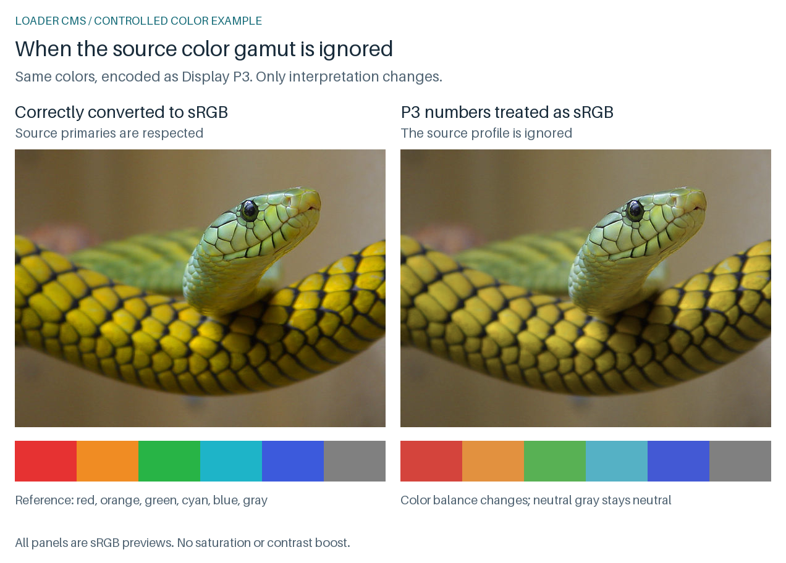
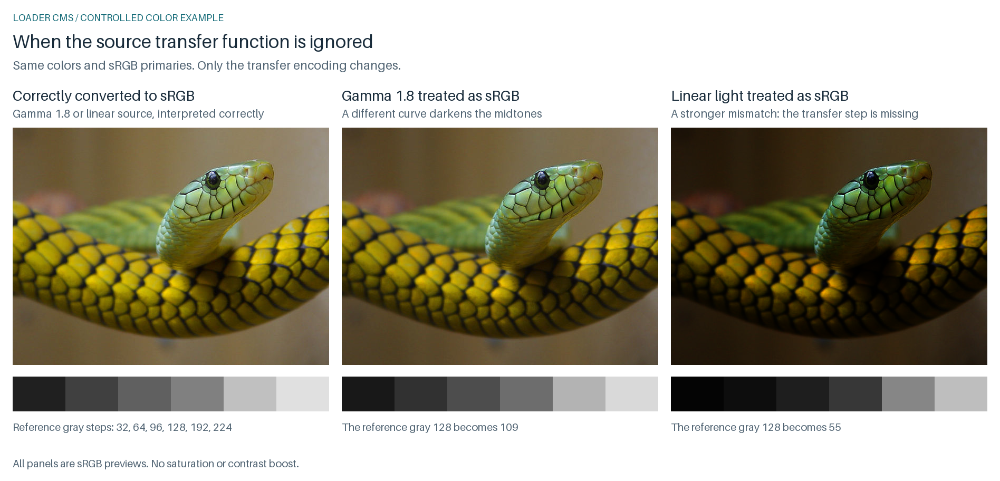

# Loader Color Management: builtin and Little CMS

For the implementation model and exact support boundaries, see [Builtin CMS specification and architecture](builtin-cms.md).

For the foundations, start with [primaries, white point, and transfer function](../concepts/colorspace.md#primaries-white-point-and-transfer-function), followed by [PCS: the connection between color profiles](../concepts/colorspace.md#pcs-the-connection-between-color-profiles). These explain why source normalization can require transfer decoding, primary conversion, and D50/D65 chromatic adaptation, and how the ICC connection differs from the encoder's working color space.

The [libpng adapter](libpng.md#color-management-and-precision) shares color interpretation between static images and animation rectangles. Its internal gray-float CMS format packs one gray sample per pixel without truncating sixteen-bit source values; alpha remains outside the transform. A profile rejected by libpng is not re-read from raw iCCP bytes to bypass that validation.

The builtin gray TRC fallback scales the PCS D50 white, rather than treating the profile's `wtpt` media white as PCS coordinates. This keeps valid gray profiles neutral when they carry a D65 media white. The libpng float-gray regression probes exercise this conversion with and without Little CMS; the [Little CMS gray input pipeline](https://github.com/mm2/Little-CMS/blob/master/src/cmsio1.c) uses the same PCS-illuminant interpretation.

## Why loader CMS matters

Loader CMS primarily protects the intended color interpretation of input images. Files authored for wider RGB gamuts or different transfer functions cannot safely be treated as ordinary sRGB just because they decode to three channels. Interpreting those samples directly as sRGB can change hue, saturation, brightness, and the balance between colors. CMS uses an applicable source profile or supported color metadata to normalize those samples into libsixel's known sRGB basis before the encoder makes palette and dithering decisions. Its purpose here is faithful normalization, not increasing saturation or extending the display gamut.

For example, Display P3 and sRGB have different primaries: the same RGB triplet need not describe the same color. Similarly, a source with a different gamma needs the appropriate transfer conversion even if its primaries match the destination. Correct conversion changes the numbers to preserve the intended colors where the destination can represent them. Colors outside sRGB must be mapped or clipped according to the available profile, intent, and implementation; CMS cannot preserve every wide-gamut source color in an sRGB result.

The default output contract is gamma-encoded sRGB palette values (`-Ugamma`), subject to palette reduction and SIXEL component quantization. An internal `cms_target=linear` or a perceptual working space changes the calculation representation, not that output contract or the display gamut. The explicit alternative `-U` modes are described in the [color-space guide](../concepts/colorspace.md); they do not provide an ICC-tagged wide-gamut display protocol. CMS establishes the input interpretation needed to honor the default output contract, but it cannot guarantee normalization when metadata is missing, unsupported, or skipped.

The receiving terminal and display stack own the mapping from those output values to the physical display. On a wide-gamut device, faithful rendering of sRGB and an optional enhancement that expands sRGB colors into a larger gamut are different policies: the former preserves the requested colors, while the latter deliberately changes them. Such display enhancement belongs to the terminal/device side and is not enabled by libsixel's loader CMS. SIXEL carries no source ICC profile or explicit color-space tag with which to negotiate it, so libsixel also cannot guarantee how every terminal will render its palette values.

## This already affects ordinary web images

You do not need to create wide-gamut artwork yourself to encounter this problem. A browser may already be interpreting an image's color metadata for you. Downloading that image and passing it through a different decoding API does not automatically preserve that behavior. The visible symptom can be “the downloaded image has different colors from the browser,” even when both programs successfully decode the file.

### Published prevalence, with a defined denominator

The [2024 Web Almanac media chapter](https://almanac.httparchive.org/en/2024/media#image-color-spaces) reports the following for its mobile image sample:

| Observation | Reported share or derivation |
| --- | --- |
| No ICC profile | 87.7% |
| ICC profile present | Approximately **12.3%**, calculated as `100 - 87.7` |
| Wide-gamut ICC profile | Approximately **1 in 80 images** (1.25%) |
| Adobe RGB (1998) profile | 0.7% |
| Display P3 profile | 0.4% |

These categories overlap: Adobe RGB and Display P3 are examples within wide-gamut ICC usage, which is itself within ICC usage. Most profiled images in this report use sRGB or an sRGB-like profile. **12.3% is not the percentage of images that visibly fail without CMS.** The report places CICP-only images in the no-ICC category, so its wide-gamut count does not cover every signaling method.

This is a historical June 2024 crawl, not a census of all Internet images or a current 2026 estimate. The [published SQL](https://github.com/HTTPArchive/almanac.httparchive.org/blob/main/sql/2024/media/color_spaces_and_depth.sql) counts image request records with ImageMagick colorspace metadata and more than one pixel, grouped by client and ICC description; it does not deduplicate all copies into unique image artworks. The [crawl methodology](https://almanac.httparchive.org/en/2024/methodology#websites) describes the selected public pages and logged-out lab conditions. Do not turn these percentages into the probability that a particular user's photo collection needs conversion.

No representative web-wide prevalence estimate for PNG `gAMA` alone, or for the union of ICC, `gAMA`, `sRGB`, `cHRM`, and CICP declarations, was established by the sources reviewed for this guide. An image contains color metadata, not a CMS: the CMS is the software interpreting it. An ICC-only statistic therefore cannot answer “how many images have gamma information?” Conversely, a `gAMA` declaration can describe an ordinary sRGB-like transfer and does not by itself establish a visible mismatch. The [PNG specification](https://www.w3.org/TR/png-3/#11gAMA) defines it separately from ICC and other color declarations.

### Familiar tools: decoding and color conversion are different operations

The table describes specific paths, not a blanket correct/incorrect ranking of applications. “Automatic” means the stated rendering path interprets supported source information; it does not promise identical rendering intents, full profile compatibility, or accurate physical displays. API support means the caller must connect it correctly. External documentation was checked on 2026-09-11; named browser versions below are the published test snapshot, not a new local browser test.

| Tool or API path | What happens to source color information? | Practical consequence and evidence |
| --- | --- | --- |
| Chrome/Edge image display | The W3C PNG report records passing ICC v2/v4, Display P3, and ICC gamma-1.8 examples for Chrome 137 and Edge 137. | Browser display is a managed path for these examples. This is not a blanket result for every PNG `gAMA`-only or HDR case. [W3C implementation report](https://w3c.github.io/png/Implementation_Report_3e/#ICC) |
| Firefox image display, normal settings | Applies color management to tagged media and assumes sRGB for untagged media; settings can disable or change this. | Users can benefit without selecting a CMS themselves. [Mozilla settings documentation](https://developer.mozilla.org/en-US/docs/Mozilla/Add-ons/WebExtensions/API/browserSettings/colorManagement) |
| Safari/WebKit image rendering, including drawing an image to Canvas | Honors an image's profile when drawing it into the destination color space. | A downloaded image decoded elsewhere may differ from its browser appearance. [WebKit Canvas color documentation](https://webkit.org/blog/12058/wide-gamut-2d-graphics-using-html-canvas/) |
| macOS Quartz/Core Graphics with a calibrated source color space | Uses the supplied white point and gamma to convert source colors into the output space. | Supply the correct source space; merely putting bytes into a device-RGB buffer does not identify their original profile. [Apple Quartz color-space guide](https://developer.apple.com/library/archive/documentation/GraphicsImaging/Conceptual/drawingwithquartz2d/dq_color/dq_color.html) |
| Windows WIC with `IWICColorTransform` | Converts a bitmap between supplied source and destination color contexts. | Color contexts and an explicit transform are separate from simply decoding/copying bitmap pixels. [Microsoft WIC color management](https://learn.microsoft.com/en-us/windows/win32/wic/-wic-colormanagement) |
| Pillow `Image.open(...).convert("RGB")` | Decodes samples and converts their pixel mode. PNG gamma/chromaticity are exposed as metadata; this path does not apply a source ICC transform or normalize PNG gamma to sRGB. | `RGB` is a storage mode, not proof of sRGB normalization. [PNG metadata documentation](https://pillow.readthedocs.io/en/stable/handbook/image-file-formats.html#png), [conversion implementation](https://pillow.readthedocs.io/en/stable/_modules/PIL/Image.html#Image.convert) |
| Pillow `ImageCms.profileToProfile(...)` | Explicit ICC conversion using Little CMS with source and destination profiles. | This is the profile-aware path. A standalone `gAMA` value is not an ICC profile supplied to this function. [Pillow ImageCms](https://pillow.readthedocs.io/en/stable/reference/ImageCms.html#PIL.ImageCms.profileToProfile) |
| ImageMagick `magick input -profile sRGB.icc output` | Performs profile conversion when an input profile is already present; without one, the source interpretation must first be established. | `-strip` removes metadata; it does not perform this normalization. Convert before removing the source description. [Profile operator](https://imagemagick.org/command-line-options/#profile), [profile examples](https://usage.imagemagick.org/formats/#profiles) |
| libpng 1.6 traditional read API | Provides `png_set_gamma` / `png_set_alpha_mode` for requested transfer handling; general ICC conversion remains application work. | Linking libpng alone does not establish full CMS. The simplified API has its own output contract and is not covered by this row. [libpng manual](https://github.com/pnggroup/libpng/blob/libpng16/libpng-manual.txt) |
| Upstream stb_image `stbi_load` for ordinary PNG | Its PNG parser skips unhandled ancillary color chunks; it does not provide ICC or `gAMA` normalization on this path. | The application needs an additional interpretation step. This is upstream stb_image, not libsixel's current builtin loader and its separate CMS implementation. [Upstream source](https://github.com/nothings/stb/blob/master/stb_image.h) |
| libsixel participating CLI loaders, default `cms_engine=auto` | The default requests conversion for supported metadata and paths; `--cms-engine=none` restores unmanaged interpretation. | CMS carries source color interpretation into the sRGB output contract. Loader limitations and fallback still apply; see the engine comparison below. |

A small local check with Pillow 12.2.0 confirmed the distinction: a PNG sample `(128,128,128)` with `gAMA=1.0` still decoded to `(128,128,128)` through `convert("RGB")`; reading the gamma value did not convert that linear sample to sRGB. Separately, the repository's Adobe-RGB [profiled fixture](../../images/measurements/palette-pipeline/a98-gamut-600x450.png) produced different pixels with explicit `ImageCms.profileToProfile(..., sRGB)` than with plain RGB mode conversion. These are narrow checks, not a complete tool conformance suite.

The everyday lesson is to preserve source color interpretation across tool boundaries. A browser can make profile handling invisible to its user, while a script receiving only RGB bytes can lose it. CMS is what connects those two workflows without unintentionally changing the image's colors.

## See what happens when the source is misinterpreted

These examples show the same intended image with correct conversion and with source numbers incorrectly treated as sRGB. Look at the colored scales in the first comparison and the dark scales in the second. CMS is restoring the reference appearance; the correct panels have no added saturation or contrast enhancement.

### Different color gamut: Display P3 interpreted as sRGB

<picture>
  <source media="(max-width: 640px)" srcset="cms-examples/gamut-mobile.png">
  
</picture>

*The source primaries change, but the transfer function stays the same. Ignoring that distinction alters the color balance even though the image still loads and its detail remains recognizable. The reference colors all fit inside sRGB: the correct panel does not require a wide-gamut monitor.*

### Different gamma: midtones and shadows change

<picture>
  <source media="(max-width: 1000px)" srcset="cms-examples/gamma-mobile.png">
  
</picture>

*Here the primaries stay sRGB. The middle panel illustrates a gamma 1.8 source; the last panel illustrates the stronger error of treating linear-light samples as gamma-encoded values. These are two separate source encodings of the same intended colors, not successive edits to the photograph.*

| Intended sRGB gray (0–255) | Correct conversion | Gamma 1.8 source misread as sRGB | Linear source misread as sRGB |
| --- | --- | --- | --- |
| 32 | 32 | 24 | 4 |
| 64 | 64 | 49 | 13 |
| 128 | 128 | 109 | 55 |
| 192 | 192 | 179 | 134 |

This is why changing a palette algorithm cannot fix the underlying problem: it would optimize an already misinterpreted image. These particular errors darken or reduce saturation; other source encodings and incorrect interpretations can cause different shifts, including brightening. The figures illustrate a mechanism, not a typical error magnitude for every image.

### How the examples are made

The generator explicitly treats the RGB bytes of the repository's [snake fixture](../../images/snake.png) as an sRGB reference, independently of its approximate PNG gamma declaration. It converts that reference to floating-point source samples and then takes two paths: apply the inverse source interpretation to recover sRGB, or use those source samples directly as sRGB preview values. All figure PNGs carry an sRGB chunk, including the deliberately wrong panels, so the viewer does not correct the illustrated mistake a second time.

For Display P3, the calculation decodes the sRGB transfer function, converts linear sRGB through D65 XYZ to P3 primaries, and re-encodes with the same transfer function. The correct path reverses this conversion. The primaries and transfer definition follow [CSS Color 4](https://www.w3.org/TR/css-color-4/#predefined-display-p3). Starting from sRGB colors avoids out-of-gamut clipping and isolates misinterpretation from gamut mapping. For gamma 1.8, source values are `linear_sRGB ** (1 / 1.8)`; for linear light they are simply `linear_sRGB`. Correct interpretation decodes that source representation and applies sRGB encoding. Values are rounded to bytes only when producing the previews.

These are analytical illustrations before palette reduction, not screenshots, measurements of `img2sixel --cms-engine=none`, or a comparison of builtin and lcms2 accuracy. Actual loader fallback can interpret other metadata instead of treating samples as sRGB. The examples do not test ICC parsing, rendering intents, terminal gamut mapping, or SIXEL quantization. Their purpose is to make the cost of a wrong source interpretation visible on an ordinary sRGB display.

The [generator](../../tools/plot_loader_cms_examples.py) creates wide and stacked mobile layouts and checks that correct conversions recover the reference within `1e-12` before byte rounding. The [numerical record](cms-examples/examples.json) contains source and output hashes, chromaticities, and patch values. Regenerate or verify with Python, NumPy, and Pillow (the committed figures use NumPy 2.3.5 and Pillow 12.2.0 with its bundled font):

```sh
python3 tools/plot_loader_cms_examples.py
python3 tools/plot_loader_cms_examples.py --check
```

## Why ship a builtin CMS despite the additional attack surface?

Successful decoding does not prove correct color interpretation. Without an available CMS, a profiled image can still look plausible: its objects and detail remain recognizable, while its brightness or color balance is slightly wrong. A user can reasonably mistake that result for a correctly loaded image and attribute the difference to the source, quantizer, terminal, or quality metric. A silent interpretation error is therefore a practical correctness problem, even when it does not prevent opening the file.

Little CMS cannot be assumed to be installed in every supported environment. Making it mandatory would turn a missing color-management dependency into an inability to build or use libsixel at all. That tradeoff is particularly costly on platforms with limited package availability and in cross-compilation or WebAssembly builds, where a usable host installation is not enough: dependencies also need compatible target binaries, headers, and build/link configuration. WebAssembly does not make Little CMS impossible to use; it makes an additional dependency something that the target build must provision and maintain. The project supports [Emscripten targets](../platform-support.md), and both [Autotools](../../configure.ac) and [Meson](../../meson.build) allow builds without lcms2.

| Design choice | Benefit | Cost |
| --- | --- | --- |
| Require Little CMS | Ensure the external CMS dependency is present. | Exclude otherwise usable builds when that dependency cannot be provisioned; presence alone still does not guarantee every loader/profile combination is supported. |
| Keep Little CMS optional without a builtin CMS | Avoid maintaining an additional in-project profile interpreter. | When no external CMS is available, lose that normalization path and risk plausible-looking, incorrectly interpreted images. |
| Keep Little CMS optional and provide builtin CMS | Preserve build availability while retaining normalization for supported profiles without the external dependency. | Add profile-parsing and transform code, security exposure, maintenance, and a smaller compatibility envelope than Little CMS. |

The builtin engine deliberately accepts the third tradeoff. It supplies a useful baseline of color interpretation across dependency-constrained builds; it is not a claim that a smaller CMS is inherently safer, or that it replaces Little CMS's broader support. ICC metadata is untrusted input, and adding an interpreter increases libsixel's attack surface. Bounds and size checks, malformed-profile tests, fuzzing, and continued maintenance are necessary costs of this choice, not proof that the implementation is free of vulnerabilities. See the support limits and defensive coverage below.

This rationale also does not turn a successful load into a certification of color accuracy. Builtin CMS must be enabled to help, unsupported profiles remain possible, and fallback can still produce an image without applying the intended profile. The `img2sixel` and `lsqa` defaults are `auto`; library API loader defaults remain disabled. Documentation and reproducible measurements must distinguish the selected engine, the profiles it can interpret, and whether normalization actually occurred.

## CMS in quality measurements

`lsqa -# ENGINE` and `lsqa --cms-engine=ENGINE` select the process-wide loader CMS default for **both the reference and the target**, including a target read from standard input. Accepted engines are `none`, `auto`, `builtin`, `lcms2`, and `colorsync`; `off` and `disabled` alias `none`, `lcms` aliases `lcms2`, and `color-sync` aliases `colorsync`. Repeated selections use the last value. Omitting the option selects `auto` unless an explicit environment setting overrides it. Library API loader defaults are unchanged.

An explicit option overrides `SIXEL_LOADER_CMS_ENGINE`, including assignments through `--env`, regardless of argument order. Loader-specific environment settings and `-L` suboptions retain their normal higher priority. Engine availability and fallback follow the same loader rules as `img2sixel`. Use matching settings in both programs when measuring profile-aware encoding:

```sh
img2sixel --cms-engine=builtin source.png | lsqa --cms-engine=builtin source.png -
```

Use `--cms-engine=none` in both commands when deliberately measuring the legacy interpretation. Record the selected engine and loader-specific overrides alongside the metric. CMS interprets source metadata during loading; `lsqa -W` and `-P` choose the comparison colorspace and precision after loading. Those comparison options cannot repair source values that were already interpreted incorrectly. SIXEL input has no embedded ICC profile to recover: its decoded palette is compared with the normalized reference.

## Diagnosing ignored ICC features

Enable `SIXEL_TRACE_TOPIC=loader` to record builtin ICC parser decisions on stderr:

```sh
SIXEL_TRACE_TOPIC=loader img2sixel --cms-engine=builtin image.png > image.six
```

Records use `LSXCMS1|engine=builtin`. `event=ignored-tag` includes `tag`, payload `type`, and a `reason`: `unsupported-pipeline-type` (including `mpet`), `unsupported-intent-slot` (including D2B3/B2D3), `tag-not-consumed`, or `invalid-tag-bounds`. Tag and type signatures are eight hexadecimal digits, not raw untrusted text: D2B0 is `44324230` and mpet is `6d706574`. Descriptive `desc`, `cprt`, `dmnd`, and `dmdd` tags are omitted from this audit. `tag-not-consumed` means this parser does not read that tag; it does not assert that the tag is invalid or that ignoring it changes the image.

A present transformation slot that fails parsing or channel validation emits `event=pipeline-rejected` with its tag and `reason=invalid-or-unsupported-pipeline`. The parser may still accept another path. `event=profile-rejected` identifies an unsupported PCS or the absence of a usable profile path; an invalid tag table emits `event=invalid-table`. These messages do not distinguish every malformed nested element from every unsupported feature, and a successfully parsed profile is not proof that a loader ultimately applied it. They describe the builtin parser, not decisions inside Little CMS or ColorSync. Profiles that do not reach the parser, including CMS-disabled loads, are outside this diagnostic boundary.

The facade separately emits `LSXCMS2|event=apply` after a transform executes. Its `engine` comes from the transform backend, including profile-open fallback, rather than the requested global selector. `path=extended-rgb` identifies builtin analytic float RGB, `bounded-device` identifies the legacy builtin device path, and `external` identifies an external CMS call. `src` and `dst` are internal CMS pixel-format enum values; `ok=1` records apply success. This proves that invocation executed, not that later loader/frame stages preserved its output. With the loader topic disabled, the apply record is also silent.

The tag audit checks offsets and lengths before reading payload signatures, limits detailed records to 64 per parse, and then emits `event=tag-audit-truncated`. Repeated parsing can produce repeated records. With the loader trace topic disabled, this audit is skipped and no new diagnostics are emitted. Trace selection does not change profile acceptance, fallback, or output pixels.

The diagnostic fixture `tests/data/colormgmt/input/custom/rgb_trace_ignored_tags.png` preserves the PNG pixels and original profile tags from `rgb_parametric_012.png`. Its iCCP profile adds D2B0 and D2B3 mpet payloads containing a three-channel identity matrix element, plus a private tag whose signature contains ESC. Profile size, tag offsets, compressed iCCP data, and PNG CRC are updated. It exercises unsupported paths and escaped logging while retaining the original usable normalization path; it is not an mpet conformance fixture.

## Default-on migration and measurements

`img2sixel` and `lsqa` set the global loader CMS default to `auto` when its environment value is absent or empty. Explicit `none`, backend-specific settings, and CLI choices retain their precedence. This is a CLI behavior change; direct library loader defaults remain disabled. Existing scripts requiring byte-identical legacy interpretation should specify `--cms-engine=none` in both tools. Profile-aware checks should select the same CMS engine on encoding and assessment, and test the unmanaged path only as an intentional control.

The migration keeps fixed unmanaged palette/background fixture tests explicit about `none`; it does not regenerate their expected values from the new implementation. Separate default tests omit the engine option and verify an observable difference from `none`. Historical quantization/precision figures describe controlled experiments at their recorded revisions, not the new CLI defaults. The shared environments in `plot_lookup_policy_speed.py` and `plot_quality_curve.py` now explicitly retain `SIXEL_LOADER_CMS_ENGINE=none` for those policy sweeps unless overridden. For other historical reproduction scripts, inspect their recorded commands and supply the corresponding CMS setting rather than inheriting today's default. The [PNG loader comparison](builtin/png.md#reproduce-the-measurements) already specifies `cms_engine` per case and is unaffected by the CLI default.

The default change itself was remeasured with the builtin decoder, one thread, raster Floyd–Steinberg diffusion, seven interleaved samples after warmup, and the same binary with explicit `none` versus `auto`. On this build `auto` uses builtin CMS. Times include fresh process startup, decoding, quantization, SIXEL encoding, and stdout capture; they are not isolated CMS costs. All quality values use an `auto`-managed reference in lsqa, including the unmanaged encoding control. The [raw record](cms-default-measurements.json) contains commands, versions, input/source/output hashes and every sample.

| Input | CMS none, median ms | CMS auto, median ms | Managed-reference MS-SSIM, none | Managed-reference MS-SSIM, auto |
| --- | ---: | ---: | ---: | ---: |
| Snake PNG | 71.15 | 85.96 | 0.988798 | 0.990314 |
| Snake JPEG | 73.53 | 109.19 | 0.990440 | 0.990493 |
| Embedded extended-sRGB JPEG, 64 px fixture | 26.49 | 26.37 | 0.778410 | 0.997297 |
| Parametric ICC PNG fixture | 25.74 | 25.64 | 0.989310 | 0.996289 |

These samples demonstrate both the correction benefit and the cost. The profiled JPEG control is visibly outside the normal quality gate; that low control score is not a lowered acceptance threshold. The ordinary JPEG also becomes slower: builtin CMS enablement selects float decoding even without an applicable ICC conversion. Small-fixture times are dominated by startup and are not evidence that conversion itself is free. These are local measurements, not cross-platform speed guarantees or an independent validation of builtin ICC accuracy.

Reproduce the migration experiment with the current build:

```sh
python3 tools/measure_cms_default.py --samples 7 --output cms-default-measurements.json
```

## Choosing an engine

Enable loader CMS when the source profile matters: `img2sixel --cms-engine=auto image.png`. CMS defaults to `auto` in `img2sixel` and `lsqa` for participating loaders. For varied third-party ICC profiles, prefer a build with Little CMS (`lcms2`) and verify that the selected loader supplies the original source color model to it. Choose `builtin` when avoiding an external CMS dependency matters and the actual profile corpus has been validated against the supported subset below. Neither engine can repair an incorrect source profile or recover source channels already discarded by a decoder.

**Successful image loading is not proof of successful color management.** Unsupported or unusable metadata can lead to a format-specific fallback and a displayable image with different colors. Also, requesting `lcms2` does not require that dependency to be present: an unavailable engine resolves through `auto`. Reproducible color output requires checking the build and loader as well as the command line.

This guide compares libsixel's integration, not every feature of the underlying libraries. [Little CMS documents broad ICC v2/v4 support](https://www.littlecms.com/color-engine/), including features beyond libsixel's loader interface. The [color-space guide](../concepts/colorspace.md) explains source interpretation, `cms_target`, `-X`, `-W`, and `-U`; those encoder options do not substitute for reading an embedded profile.

## Decoder and CMS are independent choices

`builtin` names both an image-loader component and a CMS engine. They are independent. The builtin PNG decoder can use lcms2; the libpng decoder can use builtin CMS. The global CMS selection participates in the builtin, libpng, libjpeg, libwebp, and libtiff components. Other frameworks can have their own color behavior.

```sh
# Same decoder, different requested CMS engines.
img2sixel -Lbuiltin:cms_engine=builtin:cms_target=linear:prefer_8bit=0! image.png
img2sixel -Lbuiltin:cms_engine=lcms2:cms_target=linear:prefer_8bit=0! image.png
```

The final `!` closes the loader chain. It does not require a successful ICC conversion or make an unavailable CMS engine an error. Loader-specific `cms_engine` settings override the process-wide `--cms-engine` default. `auto` chooses lcms2 when compiled in, otherwise ColorSync when available on macOS, otherwise builtin. Profile opening and the standard profile factories also try builtin when the selected external backend fails, including an explicitly selected external engine. This is not a retry through every engine: a failed lcms2 profile open does not next try ColorSync. Transform creation requires matching source/destination profile backends and does not retry a failed external transform through builtin. A loader can separately fall back to another metadata interpretation or unmanaged pixels. An explicit engine name therefore does not currently guarantee actual execution by that backend.

Autotools detects lcms2 by default and accepts `--with-lcms2` / `--without-lcms2`; Meson exposes the `lcms2` feature option. Inspect the configuration result and, for Autotools builds, `HAVE_LCMS2` in `config.h`. Pin the build, dependency version, loader, CMS settings, and encoder settings when exact reproducibility matters. See [platform support](../platform-support.md).

## Format-specific CMS regression matrices

Color-management regression testing spans CMS-aware formats; PNG is one container-specific matrix within that larger policy. The axes follow each format's declarations and source models. A PNG chunk-presence table must not be applied to JPEG, TIFF, WebP, BMP, or PSD merely because they also carry an ICC profile.

| Format | Existing verification axes | Maintained entry points |
| --- | --- | --- |
| PNG/APNG | iCCP/sRGB/cHRM/gAMA presence × grayscale/indexed/RGB, shared by builtin and libpng; separate exact static/APNG source-choice probes. | [Shared PNG matrix](png-color-metadata.md), [builtin PNG](builtin/png.md#test-coverage), [libpng](libpng.md#test-coverage). |
| TIFF | ICC/WhitePoint/PrimaryChromaticities/TransferFunction presence × RGB/Lab/grayscale/palette × CMS enabled/disabled: 128 matrix tests, with additional cases outside that product. | [TIFF test category](../../tests/loader/libtiff), [input matrices](../../tests/data/colormgmt/input/tiff), [reference matrices](../../tests/data/colormgmt/reference/tiff), [fixture generator](../../tools/generate_tiff_colormgmt_matrix.py). |
| JPEG | Embedded ICC, RGB/CMYK/YCCK input, source precision, CMS enabled/disabled, and lcms2 availability, subject to each decoder's retained source domain. | [libjpeg tests](../../tests/loader/libjpeg), [builtin JPEG contracts](builtin/jpeg.md#test-coverage), [builtin test inventory](../testing/builtin-loader-coverage.md). |
| WebP | ICCP presence/validity/size, ICCP versus XMP fallback, CMS selection, static/animated and lossy/lossless paths. | [libwebp tests](../../tests/loader/libwebp), [builtin WebP contracts](builtin/webp.md#test-coverage), [builtin test inventory](../testing/builtin-loader-coverage.md). |
| BMP/DIB | Calibrated endpoints/gamma versus embedded ICC, RGB/CMYK domain compatibility, CMS enabled/disabled, alpha preservation, and nested PNG/JPEG color handling. | [BMP contracts](builtin/bmp.md#test-coverage), [BMP/DIB test inventory](../testing/builtin-loader-coverage.md#bmp-and-dib). |
| PSD/PSB | Embedded ICC validity and source-domain compatibility, color model, depth, compression, and composite/layer reconstruction paths. | [PSD/PSB contracts](builtin/psd.md#test-coverage), [builtin test inventory](../testing/builtin-loader-coverage.md). |
| Radiance HDR | GAMMA/PRIMARIES, exposure, tone mapping, target colorspace, CMS selection, and fallback, with numerical and LSQA matrices. | [HDR contracts](builtin/hdr.md#test-coverage), [builtin test inventory](../testing/builtin-loader-coverage.md). |

These are coverage dimensions and navigation, not a claim that every cross-product is complete or every reference originated from Apple. Keep expected values, provenance, and coverage limits with the format's policy. The builtin inventory distinguishes numerical assertions, complete-buffer comparisons, perceptual floors, and trace-only observations; successful decoding alone does not prove color interpretation.

## PNG metadata precedence and ColorSync compatibility

The shared [PNG color metadata and ColorSync compatibility](png-color-metadata.md) document owns the source-selection rules, the grayscale/indexed/RGB 16-case tables derived from existing reference tests, their provenance, and exact source-choice probes. The policy applies across PNG decoders, including builtin; it is independent of selecting `cms_engine=colorsync`.

## Supported profile structures and practical differences

The builtin parser and evaluator are in [`icc-parse.c`](../../src/icc-parse.c) and [`icc-apply.c`](../../src/icc-apply.c). Acceptance depends on the actual tags, channel counts, direction, and available conversion path; an ICC version number or a familiar profile name alone is insufficient.

| Area | builtin CMS | lcms2 through libsixel |
| --- | --- | --- |
| RGB and grayscale | RGB colorant matrix plus channel tone response curves (TRCs), grayscale white point/TRC, and supported LUT paths. | Delegates compatible input profiles and transforms to Little CMS. |
| CMYK and Lab | Supported profile paths exist; CMYK LUT conversion includes byte, 16-bit, and float source interfaces. These work only where the loader retains and passes the corresponding samples. | The wrapper maps CMYK byte/16-bit/float and Lab float formats, subject to the same loader boundary. |
| Profile connection space (PCS) | XYZ or Lab. The conversion code connects through D50 XYZ and the project's sRGB basis. | Little CMS owns profile connection and intent processing. |
| Curves | `curv`, `para` function types 0–4, and the implemented `segm` subset. | Little CMS parses and evaluates its supported curve representations. |
| LUT payloads | `mft1`, `mft2`, and implemented `mAB`/`mBA` curve, matrix, and CLUT stages. Forward A2B and reverse B2A slots 0–2 are represented. | Little CMS handles its supported ICC pipelines and optimization. |
| D2B/B2D | Looks up slots 0–2 but only parses the same supported LUT payloads. This is not general ICC floating-point multi-process-element support. | Broader ICC pipeline support depends on the linked Little CMS version and transform compatibility. |
| Dependency | In-tree implementation with no external CMS library dependency. This says nothing about the selected image decoder's dependencies. | Requires a build linked with lcms2. |

Builtin CMS is therefore more capable than a gamma-only correction or an RGB matrix-only converter. Conversely, accepting some LUT profiles does not make it a full ICC implementation.

## Cases builtin does not fully support

- **Other input color models:** the profile parser dispatches RGB, GRAY, CMYK, and Lab. XYZ as a device input, CMY, YCbCr, and multicolor input signatures such as five- or six-ink profiles are outside that dispatch. XYZ as a PCS is supported and is a different role.
- **Arbitrary multi-process elements:** there is no `mpet` payload parser. A D2B tag name alone does not establish support for a standard floating-point processing pipeline. D2B3/B2D3 are not in the slot inventory. A profile requiring those paths needs another supported path or cannot be applied by builtin.
- **Unimplemented curves or stages:** parametric function types outside 0–4 and payloads outside the implemented curve/LUT grammar cannot be evaluated merely because the enclosing file is ICC. A usable alternate path can still be selected.
- **Distinct absolute-colorimetric intent:** builtin maps both `relative` and `absolute` to slot 1. It does not implement a separate intent-dependent media-white adaptation step. Selecting `absolute` therefore must not be interpreted as an lcms2-equivalent paper-white simulation.
- **Full device-link, named-color, spectral, or iccMAX workflows:** the builtin API is not a general implementation of these workflows. Nor does selecting lcms2 expose all of them through `img2sixel`; the loader wrapper has a fixed set of pixel formats and targets.
- **Unbounded scene-referred ICC processing:** ICC device curves and CLUT stages retain their bounded domains. The builtin facade preserves extended values when its float destination is analytic sRGB or a synthetic RGB definition; this does not make arbitrary ICC pipelines unbounded. HDR metadata interpretation and tone mapping remain loader-specific.

There is no loader option here for an arbitrary output/printer ICC profile, a proofing profile, gamut warnings, or black-preserving separation. Little CMS offers additional facilities, but this wrapper creates ordinary transforms and does not enable `cmsFLAGS_BLACKPOINTCOMPENSATION`. Do not infer black-point compensation or soft proofing from `cms_engine=lcms2`.

## Rendering intent and fallback

`cms_intent=perceptual|relative|saturation|absolute` can be expressed as an ordered `+` list. The default attempt order is perceptual, relative, saturation, absolute. An inner `!` suppresses appending omitted intents; see the [loader grammar](README.md) for how this combines with the loader-chain terminator.

Builtin turns intents into deduplicated LUT slots: perceptual → 0, relative/absolute → 1, saturation → 2. RGB/gray-to-sRGB paths can subsequently fall back to matrix/TRC conversion when those slots cannot be applied. Thus an exclusive intent list is not a guarantee that conversion fails unless the profile contains that exact LUT, and a matrix profile need not produce different results for every intent. Builtin does not synthesize a new perceptual gamut map just because `perceptual` was requested.

The lcms2 wrapper tries creating a transform with each allowed intent using normal flags. If all fail, it retries with `cmsFLAGS_NOOPTIMIZE`. Intent support and any internal profile fallback then belong to Little CMS. These are different mechanisms from builtin's slot evaluation; a matching intent name does not imply identical output.

## Loader-specific limits and failure behavior

| Loader path | Consequence for CMS users |
| --- | --- |
| [Builtin PNG/APNG](builtin/png.md) and [libpng](libpng.md) | Follow the [common PNG source-choice policy](png-color-metadata.md), including the three-chunk exception. Profile acceptance and rejected-profile fallback remain path-specific; libpng never revives ICC bytes rejected by its decoder. Current builtin PNG HDR chunks such as `cICP` do not acquire semantics by selecting lcms2. |
| [Builtin JPEG](builtin/jpeg.md) | The ICC stage receives RGB after JPEG component conversion and applies RGB-domain profiles. It cannot retroactively apply a CMYK profile to the original CMYK planes. Choosing lcms2 with this decoder does not remove that limitation. |
| [Builtin PSD/PSB](builtin/psd.md) | Applicable RGB, CMYK, and Lab profiles are applied to matching source domains; failed or inapplicable profiles leave format-specific fallback conversion. |
| [Builtin WebP](builtin/webp.md) | ICCP/XMP handling normalizes an RGBA8 boundary. Requesting a float target does not restore precision lost at this boundary. Metadata precedence, bounds, and best-effort handling belong to the WebP path. |

Metadata presence, profile parsing, source-domain compatibility, and actual transform application are separate checks. Failure can mean fallback metadata, device conversion, unchanged samples, or loader failure depending on the path; there is no universal strict-CMS failure policy or guaranteed warning for every skipped profile. When investigating a mismatch, inspect the selected format path and available loader-contract diagnostics, then compare against an independently converted reference. A zero exit status or an intent-order trace alone is insufficient evidence.

## Quality: what can change visibly

For a supported matrix/TRC RGB profile, builtin can perform meaningful profile-aware conversion, including sources whose primaries differ from sRGB. Little CMS is not automatically visibly better for every such image. For less common profiles and intent-dependent conversions, its broader implementation is a reason to prefer it, while still validating the specific loader and profile combination.

Builtin samples parametric and segmented curves into 4096-entry, 16-bit tables and interpolates table values. Its CLUT evaluator interpolates the surrounding grid corners; its conversion stages also clamp values. Little CMS can use a different evaluation and optimization path. Differences can therefore appear in dark gradients, saturated patches, LUT transitions, and wide-gamut colors even when both engines successfully apply a profile. Equality of ICC tag support is not bitwise equivalence or proof of equal colorimetric accuracy.

The largest error may instead be a skipped profile: decoding Display P3 or another source RGB space as ordinary sRGB can change color interpretation before quantization starts. More palette colors, float precision, or Oklab dithering cannot correct that interpretation error. Conversely, a valid conversion still ends at the output gamut and SIXEL palette quantization; SIXEL carries no ICC profile for the terminal to recover the original colors.

For float-capable loader paths, `prefer_8bit=0` preserves the selected typed CMS target; `prefer_8bit=1` requests an 8-bit gamma RGB boundary. Float storage reduces additional rounding but cannot recover source precision, clipped colors, or the builtin curve tables' sampling precision. Keep this setting and the actual output frame format fixed when attributing differences to an engine.

## Speed and memory: workload-dependent tradeoffs

No controlled builtin-versus-lcms2 timing result is established by the coverage listed below. It would be misleading to promise that builtin is faster because it has fewer dependencies, or that lcms2 is always faster because it optimizes transforms. The following are implementation-based expectations to test, not measured rankings:

| Cost | Expected influence |
| --- | --- |
| Profile parsing and transform setup | Builtin allocates curve/LUT storage and samples parametric curves. lcms2 creates and may optimize a transform. Setup can dominate many small images. |
| Per-pixel evaluation | Builtin matrix/TRC paths and multi-stage CLUT paths have different costs. A CLUT with three inputs visits up to 8 corners; four inputs up to 16. Large images can favor an optimized reusable transform, but require measurement. |
| Precision and frame buffers | RGB float32 payload uses 12 bytes/pixel versus 3 for RGB888, before alpha, temporary buffers, and metadata. Extra conversions and memory traffic can dominate the engine difference. |
| Decoder and encoder | Enabling CMS can change decoder fast-path eligibility; resize, quantization, dithering, and output serialization can hide CMS costs in end-to-end time. |
| Animation and batching | Profile/transform reuse depends on the loader path. Measure actual frame handling rather than assuming reuse across files or frames. |

The wrapper uses `cmsDoTransform`; it does not by itself install Little CMS acceleration plugins. Do not transfer published plugin speedups to this integration without verifying the build and execution path.

A useful comparison holds the decoder fixed, uses explicit builtin/lcms2 selection on a build verified to contain lcms2, and measures both setup plus conversion and the complete `img2sixel` pipeline. Use the same profile bytes, intent, target, precision, dimensions, alpha policy, resize, palette, dithering, and thread settings. Redirect SIXEL to a sink when timing so terminal rendering is excluded; capture it separately for output-size and quality comparison. Report repeated-run medians and variation, dependency/compiler versions, host, and whether caches are warm.

Compare decoded managed pixels against an independently prepared color-managed reference before palette reduction, including neutral ramps, near-black gradients, saturated colors, RGB matrix profiles, and CMYK/LUT profiles where the loader supports them. Report color error in a stated common color space, including worst cases; supplement with final SIXEL MS-SSIM and stream size. A high MS-SSIM score against a baseline made by the same engine proves regression stability, not independent ICC correctness. Skipped profiles must be reported as unsupported/fallback cases, not counted as fast successful conversions.

### Original ColorSync gamma representation

`SIXEL_LOADER_CMS_COLORSYNC_NATIVE_GAMMA=1` selects the original pure-gamma curve representation for the ColorSync input-to-linear helpers above. The default is `0`: keep the equivalent `para3` workaround enabled. Unset and empty values use the same default. This environment-only compatibility setting is registered with a strict boolean type and no assigned short option or public `setopt` flag. It is also accepted through the existing `--env NAME=VALUE` mechanism; there is no dedicated CLI flag or loader suboption.

With value `1`, eligible RGB `curv` and pure-power `para` payloads retain their original bytes. The independent identity-blue protection still exchanges original source sample bits and their corresponding TRC/XYZ payloads together when required; compatibility mode does not disable that protection. Eligible gray `curv` and type-0 `kTRC` payloads use the unprepared native profile. The borrowed profile and the caller's original ICC bytes remain unchanged. Both generic direct-linear and strict ColorSync RGB entry points honor this setting; gray uses the generic direct-linear entry. The normalized range limits equivalent curve spelling; the original-curve component permutation is also eligible for finite extended RGB triplets. Profile-version, matrix, whitepoint and forward-LUT eligibility limits remain in force.

The setting is read once during each ColorSync source preparation, not cached when the source profile is opened. Reusing a borrowed profile with `0`, then `1`, then `0` therefore restores the initial conversion behavior. Only exact `0` and `1` are accepted. An invalid nonempty value makes this CMS helper return failure with a diagnostic before publishing changed source samples. A loader may retain its existing unmanaged fallback after a CMS failure; this setting does not turn every loader's fallback into a fatal CLI error. Other CMS engines do not consume the setting, and ordinary `create_transform`/`do_transform` calls do not invoke this preparation. In particular, conversion from the canonical linear representation to a P3 output definition is outside its scope.

Compatibility tests compare against a direct native transform on the same OS, using the original ICC or an independently permuted original-tag/sample reference when identity-blue protection applies. They do not freeze the current OS's dark-toe values or require normal and compatibility outputs to differ. If Apple later evaluates both curve representations identically, equality to the contemporaneous native reference and comparisons of the actual prepared TRC/XYZ/whitepoint payloads and source sample bits remain the contracts. Mixed-domain comparisons treat positive and negative output zero as the same color value; source and rollback bits remain exact. Normal mode retains the independent gamma/matrix numeric tests above. The observed curve-representation difference does not establish Apple's internal intent or a perceptual-rendering policy.


### TIFF original byte RGB and Gray input

Eligible opaque UINT8/VOID RGB, MINISBLACK and MINISWHITE now use original scanlines under the [libtiff direct-byte contract](libtiff.md#original-byte-samples-and-final-publication). ICC success establishes extended canonical linear float before final target conversion. Absent, disabled, inapplicable or failed ICC retains exact original RGB888/GAMMA bytes; unmanaged float publication is not this branch's contract. Source/profile compatibility is checked before the shared helper, including builds without Little CMS. Optional CMS failure preserves the entire caller float source before exact byte reconstruction, while mandatory decode failure terminates without RGBA retry.

The [literal specimens and oracle tables](../../tests/data/color-numeric/tiff-byte.json) are generated from original integers and raw ICC tags using rational normalization, independent matrix/Bradford calculations and Decimal power evaluation. The float and native relative allowances remain the existing declared test budgets, with exact black and no absolute floor for analytic dark samples. The data cover all byte levels for fallback, independent orientation mapping, actual engine application, qualified partial work and nonfinite-result rejection. A resolved background leaves eligible opaque source samples unchanged, intentionally avoiding the convenience reader's former alpha-255 one-level attenuation. The float allocation still occupies 12 bytes per pixel when its fallback payload is compacted to 3 bytes per pixel.

Final image differences depend on downstream operations. Retained extended P3 values can affect interpolation before palette reduction; explicit byte preference intentionally restores that byte boundary. Unmanaged fallback retains its prior byte representation because changing the representation alone can select a different existing precision/lookup path and change final pixel assignment. Numeric source accuracy, intermediate gamut retention and final perceptual quality are separate observations. No universal visible improvement, new perceptual reference, relaxed threshold, or downstream lookup-policy change is implied.

### TIFF original integer alpha

The [original integer alpha contract](libtiff.md#original-integer-alpha-and-composition) reads associated/unassociated RGB and Gray samples before libtiff's RGBA convenience conversion. MINISWHITE reverses storage polarity before unassociation. Original integer ratios round once to binary32; the adapter retains above-one source values while each CMM keeps its existing device-domain behavior. CMS establishes finite canonical linear RGB before external-background composition and target conversion. Alpha remains separate during optional CMS work, and only complete results are published.

The [independent source, ICC and composition tables](../../tests/data/color-numeric/tiff-alpha.json) distinguish original-ratio rounding from stored-F32 composition. Canonical values use the existing triplet-relative budgets with exact black and no absolute floor. Composition checks first qualify actual no-background canonical F32 against that independent ICC oracle, then isolate the background operation. Gamma/final-byte targets follow composition; other working-target tests are controls against the existing converter rather than independent mathematical proofs of that converter. Fault tests execute real native work before rejection, qualify the changed scratch prefix, preserve original color and alpha, reject partial publication, and require complete same-input recovery. Their finite-result postcondition is distinct from whether a native void/boolean API reported apply success.

Unmanaged 8-bit all-255 alpha keeps exact RGB888/GAMMA, including with a background. Every unmanaged UINT16 alpha input retains RGBFLOAT32/GAMMA, including all-65535 alpha, without first reducing color or coverage to bytes. Original UINT16 alpha 1/65535 stays nonzero; only zero becomes an omission mask. Other unmanaged 8-bit source fractions and actual composition retain gamma float storage; this marker does not establish calibrated device primaries. A source/device profile never transforms the separately encoded external background. The adapter's ratio operation requires no new high-precision runtime library. The bounded original integer ratio (numerator and denominator at most 65535) is divided in binary64 and rounded once to binary32; independently rounded normalized operands are not equivalent. Tests include 128/257 as a distinguishing witness. Canonical Gray boundary cases verify both successful ColorSync source groups by their complete original float words and exact apply count, distinguishing partitioning from retry or backend fallback. Early byte clipping and downstream precision selection remain separate possible causes of final image differences.

### TIFF IEEE floating-point samples

For format, CMS connection and precision coverage, see the [TIFF loader support table](libtiff.md).

For the existing eligible TIFF scanline path, finite 32-bit IEEE floating-point samples retain their stored range before color management. With no applicable ICC conversion, this includes CMS disabled/`none` even if the file contains an ICC profile. Eligibility remains limited to contiguous strips, orientation 1–4, exactly three RGB samples or one MINISBLACK/MINISWHITE sample, and no extra samples. RGB preserves every source word; MINISBLACK copies the source word into all three channels. Negative zero, subnormals, negative values and values above one are preserved. Orientation changes coordinates, not sample values.

MINISWHITE continues libsixel's existing unit-relative polarity convention, `1-x`, extended to finite stored values outside `[0,1]`. It computes in double and rounds the result to float32. Under binary32/binary64 round-to-nearest/ties-to-even, this gives the correctly rounded value of exact `1-x`: the middle exponent range fits double exactly; values very close to zero still round to one; for very large magnitudes the unit displacement cannot change the float32 result. Both signed zeros map to one, and one maps to positive zero. This narrow operation needs no new high-precision arithmetic library. Other rounding modes and flush-to-zero execution environments are not newly guaranteed.

Without a successful applicable ICC conversion, the published representation is `RGBFLOAT32` with the existing `GAMMA` marker. IEEE floating-point storage alone does not establish linear light, sRGB primaries, calibrated colorimetry or normalization to `[0,1]`. [TIFF 6.0, Section 19, pages 80–81](https://image-js.github.io/tiff/media/TIFF6.pdf#page=80) defines sample type separately from bit depth and defaults SMin/SMax to the data type's full range; Section 20 describes RGB without additional colorimetry as device-specific. The `GAMMA` fallback and MINISWHITE `1-x` convention are libsixel policies, not universal colorimetric interpretations of floating-point TIFF. This path does not newly interpret SMin/SMax, WhitePoint, PrimaryChromaticities or TransferFunction, rescale exposure, or change target negotiation. Explicit `cms_target` and byte preference retain this path's existing unmanaged float publication behavior.

NaN or either infinity in either managed or unmanaged input produces a TIFF error before frame delivery, with no partial callback and no RGBA retry. This intentionally replaces the earlier NaN publication and infinity endpoint clamp. A scanline failure after a decoded prefix likewise publishes no callback and does not retry RGBA. Temporary allocations are released, and the same loader component can decode a subsequent valid image. This is a loader publication/recovery contract, not failure atomicity inside external libtiff or a general memory-exhaustion recovery guarantee.

An applicable embedded RGB or Gray ICC profile is converted directly to canonical linear sRGB through the shared transactional helper. Success publishes `LINEARRGBFLOAT32`/`LINEAR`, including finite negative and above-one output. There is no adapter input clamp or bounded gamma-sRGB intermediate. The selected engine still owns its ICC device-domain rules: retaining source words does not require every TRC/LUT to accept or identically extend negative or above-one device coordinates.

Invalid/mismatched profiles and failed direct-linear conversions publish every original device sample as `RGBFLOAT32`/`GAMMA`; MINISWHITE retains the existing polarity-adjusted samples. This intentionally replaces the former bounded managed-failure fallback. The adapter does not retry the legacy ICC apply on partially converted input. The helper's existing scratch publication and finite-result checks protect original samples; shared profile-factory and explicit-engine fallback rules are unchanged. This is not a new promise of low-level CMS failure atomicity or a universally color-correct fallback.

ColorSync classifies original source pixels before pure-gamma preparation: the Gray component, or the complete RGB triplet, must lie in `[0,1]` for default equivalent `para3` spelling. An outside neighbor no longer suppresses preparation of normalized dark pixels. A triplet with any component outside that interval retains all its original curves, including those for its in-range components. The independent identity-blue component permutation remains eligible for finite extended RGB values and in compatibility mode. Its reference is a low-level native transform with the original TRC/XYZ payloads and source components exchanged together, independently of production preparation; unpermuted native output can itself be batch-dependent for an affected profile. Gray compatibility and profiles needing no preparation use the original whole batch.

The Gray16 integer contract is described separately below. Target negotiation, alpha/extra samples, new layouts, other loaders and the separate Lab/LogLuv contracts are unchanged. The [literal raw record](../../tests/data/color-numeric/tiff-float.json) supplies exact source/polarity expectations. The [managed fixture record](../../tests/data/color-numeric/tiff-managed.json), [serializer](../../tools/generate_tiff_managed_fixtures.py) and [separate byte-reader oracle](../../tools/tiff_managed_reference.py) derive normalized/extended matrix and TRC references without a CMM. Fixtures and references are generated offline.

Managed numerical tests retain the per-triplet relative allowance `64 * 2^-24`. The ColorSync allowance composes it with the destination inverse's infinity-norm fixed-point perturbation allowance `norm * 4q / (1 - norm * 3q)`, where `q=1/65536`. Tabulated LittleCMS TRCs have a separate declared `norm/65535` absolute quantization allowance. Analytic dark samples have no absolute floor and black is exact zero. These budgets derive from representation/operation assumptions, not the largest observed error; they are test allowances, not proofs of opaque native arithmetic. Failure probes qualify real processed samples, unchanged remainder, result-scratch release, zero legacy retries, independent original values and normal recovery. Builtin in-place RGB traverses from the end, so partial output is not universally a prefix.

Retaining values protects later processing, including interpolation before a bounded display output. Direct rendering may hide the difference because a later output boundary clips the same values. This contract does not assert a universal perceptual improvement, select a physical rendering for every unmanaged TIFF, or guarantee that huge finite samples remain representable through every later nonlinear operation.

### TIFF Gray16 samples

Eligible UINT16 MINISBLACK/MINISWHITE TIFFs use the existing contiguous-strip path: one channel, no extra samples, and orientation 1–4. The loader normalizes the original unsigned word by 65535 in double, applies `1-x` for MINISWHITE, then stores the result in all three float32 channels. `SAMPLEFORMAT_VOID` retains its existing UINT interpretation. This integer normalization is distinct from preserving raw IEEE floating-point samples.

With an applicable embedded ICC, Gray16 passes these original normalized samples to the shared direct-linear helper. Only a complete finite result is published as `LINEARRGBFLOAT32`/`LINEAR`; it is not converted through an intermediate sRGB gamma buffer or decoded a second time. The shared ColorSync gray source preparation and native-gamma compatibility setting apply under their existing eligibility rules.

If that helper fails, the TIFF adapter preserves the complete normalized, polarity-adjusted source as `RGBFLOAT32`/`GAMMA`. It does not retry the legacy ICC parser/apply. This includes failure after a native transform writes a prefix or reports success with a nonfinite result. Compared with the former Gray16 gamma path, a successful legacy retry is deliberately no longer used. Shared profile-factory and engine fallback policies are unchanged. No ICC, an invalid/incompatible profile, or disabled CMS retains the existing normalized-source fallback.

The existing managed-TIFF [serializer](../../tools/generate_tiff_managed_fixtures.py) also emits two small Gray16 fixtures. Its [separate byte reader](../../tools/tiff_managed_reference.py) derives original words, exact rational normalization/polarity, nearest binary32 source words and stored-ICC values independently of a TIFF library or CMM. Tests check every component and frame metadata, use the relative allowances above with exact black and no absolute floor for analytic dark samples, and qualify partial work and recovery separately from the fallback values. Retaining these values is not a guarantee of visible improvement after final palette quantization. Other bit depths, layouts, alpha handling, profile support and target negotiation are unchanged by this Gray16 connection.

### TIFF unsigned RGB16 input

The libtiff loader converts eligible unsigned 16-bit RGB samples directly from their embedded ICC definition to the shared linear-sRGB destination. Eligibility remains limited to three RGB components in contiguous strips, orientations 1–4, and no extra samples. `SAMPLEFORMAT_VOID` retains its existing interpretation as unsigned integer. Original words are normalized by 65535 and stored as float32 before CMS; orientation changes only their coordinates. A successful conversion publishes `LINEARRGBFLOAT32` with `LINEAR` coordinates, preserving the CMS result's negative and above-one components. The adapter does not round-trip this result through gamma-sRGB or apply the old bounded gamma-to-linear helper.

With CMS disabled, no embedded ICC, an unusable profile or a failed shared conversion, this branch publishes the original normalized source bits as `RGBFLOAT32` with the existing `GAMMA` marker. These unmanaged device values are not a color-correct replacement for an unavailable ICC conversion. A failed direct-linear conversion does not retry the adapter's legacy ICC helper. Existing shared profile-factory behavior is unchanged; this is not a general guarantee that every native profile-construction failure is fatal or prevents all common-layer fallbacks. The ColorSync preparation failure caused by an invalid native-gamma setting retains its diagnostic while the TIFF loader keeps its existing successful unmanaged-frame fallback.

The direct-linear RGB16 path does not expand TIFF gray, IEEE float, Lab, byte, alpha, planar, tiled or orientation 5–8 support. TIFF CIELAB16 has the separate signed-word contract below. Eligible IEEEFP32 has the separate source-preservation and direct-linear contract above; the libtiff RGBA8 fallback remains a distinct precision boundary. TIFF WhitePoint/PrimaryChromaticities/TransferFunction metadata is not newly interpreted by the RGB16 path, and multi-directory handling is not added.

The [literal fixtures and independent values](../../tests/data/color-numeric/tiff-rgb16.json) come from an [offline serializer and oracle](../../tools/generate_tiff_fixtures.py) that does not call libtiff, libsixel or another CMM. It evaluates the original ICC fixed-point TRC/XYZ tags and the first binary32 normalization of each integer with 80-digit Decimal arithmetic and a cofactor inverse, then rounds the expected linear result to binary32. The original six-pixel P3 fixture and its 18 expected components are retained; separate dark/knee and ordinary sRGB fixtures supplement it. Runtime tests require the public frame, coordinates, exact unmanaged source bits, actual libtiff selection and actual requested CMS application, rather than deriving expected values from a production CMS roundtrip.

Numeric tests reuse the existing per-triplet magnitude policy. The builtin/LCMS2 relative allowance is `64 * 2^-24` (`3.814697265625e-6`), matching `color_gray_float_relative`; the ColorSync allowance matches `color_rgb_power_relative` (`0.00032384445817172029`) and its fixed-point matrix/float composition. Each component's error is bounded by the maximum absolute expected component in that pixel times the allowance. There is no absolute floor for dark pixels, and black must be exactly zero. These are declared test allowances, not proven error bounds for opaque native CMS arithmetic. A preparation-failure test requires the ColorSync-specific diagnostic as well as original bits and the unmanaged frame type, so merely disabling CMS cannot satisfy it. Partial-write native-apply failures are a separate shared-helper atomicity concern.

Canonical frame accuracy and final displayed SIXEL quality are separate measurements. Retaining an out-of-range linear component does not by itself prove an improvement after display-gamut handling, palette reduction and dithering.

### TIFF CIELAB16 signed input contract

For eligible high-precision TIFF input with `PhotometricInterpretation=8` (CIELAB), L is an unsigned 16-bit value, normalized internally as `L/65535`. The a/b words are two's-complement signed 16-bit values: physical a/b is `signed_word/256`, and the shared `LAB_F32` representation is `signed_word/32768`, equivalent to physical a/b divided by 128. This is the storage convention documented by [libtiff's TIFFCIELab16ToXYZ](https://gitlab.com/libtiff/libtiff/-/raw/v4.7.2/libtiff/tif_color.c). The container type and the interpretation are separate: retaining the decoded bit pattern in `uint16_t` is valid, provided a/b is subsequently interpreted with this signed rule. The loader widens the word to `int32_t` and subtracts 65536 at or above 32768, avoiding an implementation-defined narrowing cast. File byte order does not change the decoded values.

| Component and stored word | Physical Lab value | Internal normalized value |
| --- | --- | --- |
| L `0x0000` / `0xffff` | 0 / 100 | 0 / 1 |
| a/b `0x0000` | 0 | 0 |
| a/b `0x0100` / `0xff00` | +1 / -1 | +1/128 / -1/128 |
| a/b `0x0001` / `0xffff` | +1/256 / -1/256 | +1/32768 / -1/32768 |
| a/b `0x7fff` | 127.99609375 | 32767/32768 |
| a/b `0x8000` | -128 | -1 |

The loader applies this storage contract before handing samples to a CMS or the existing no-ICC fallback. A successful ICC conversion follows the direct-linear publication contract below; an untagged input uses the existing D65 Lab fallback and publishes `RGBFLOAT32`/`GAMMA`. These output policies are separate from signed-word decoding. The contract does not add ICCLAB (`PhotometricInterpretation=9`), change float32 Lab heuristics, or expand the existing strip/orientation/extra-sample eligibility. It requires no new high-precision arithmetic dependency.

The contract, decoder, fixtures, oracle and public-frame tests must agree. The [offline generator](../../tools/generate_tiff_lab16_tests.py) fixes literal raw words and their physical values from this storage contract, then derives expected RGB with independent Lab/XYZ/matrix/transfer formulas. Expected values are independent of the implementation under test, not independent of the storage contract; they are never obtained by reversing the decoder or measuring another CMM. The [fixture/value record](../../tests/data/color-numeric/tiff-lab16.json) retains source words, normalized values, profile hash, endian fixture hashes and numeric intervals. `python3 tools/generate_color_fixtures.py --check` verifies deterministic regeneration together with the other color fixtures.

Public-frame tests protect a/b zero, sign boundaries, one storage LSB, unsigned L endpoints, both byte orders, metadata and actual requested CMS execution. Four untagged tests cover all signed extrema and additional +/-64 physical chroma values that distinguish division by 32768 from division by 32767. Six ICC tests cover the three engines in both byte orders, checking eleven interior/neutral/L-endpoint pixels numerically and all fifteen pixels for finiteness. Their existing path-specific allowances remain unchanged: builtin relative 64-binary32-unit roundoff, LCMS one encoded Lab bin plus the relative allowance, and ColorSync the existing canonical/stored-linear-profile interval. Extreme-chroma equivalence across all native engines is not asserted by these ICC tests. The stricter untagged public values protect one-LSB preservation even where an ICC quantization interval could accept its loss. These are value and route contracts; final palette quantization and perceptual image quality are separate measurements.

### TIFF Lab direct-linear publication and recovery

Eligible TIFF CIELAB16 and float32 CIELAB inputs retain their established storage-to-facade interpretation. The facade carries `L/100`, `a/128` and `b/128`. When an applicable embedded Lab profile converts successfully, the loader publishes the complete finite result directly as linear sRGB in `LINEARRGBFLOAT32`/`LINEAR`. Finite negative components and components above one are retained without adapter clipping or an intervening gamma RGB representation. The selected CMS still owns profile evaluation and its own device-domain rules.

The shared linear helper publishes output only after the entire transform succeeds and every output component is finite. Source/profile mismatch, failure to allocate the CMS result buffer, failed transform creation or application, and a successful native call producing non-finite output leave every original normalized source sample unchanged. No second CMS transform is attempted by this helper. A recoverable failed Lab conversion therefore enters the existing D65 Lab-to-gamma-RGB fallback using those original Lab samples and publishes `RGBFLOAT32`/`GAMMA`. The same fallback applies when no applicable profile is available. This does not promise recovery from allocation failures that prevent TIFF decoding or frame construction itself.

This publication guarantee belongs to the linear helper and this TIFF caller. Low-level CMS operations and the older sRGB helper retain their own failure contracts. The change does not expand alpha/extra-sample, strip, orientation, ICCLAB or float-input eligibility. The CIELAB16 two's-complement storage table, literal raw inputs and untagged conversion contract remain unchanged. The result buffer costs twelve bytes per pixel (94.92 MiB at 3840 by 2160), in addition to existing decoder and native buffers; it requires no new arithmetic library.

Normal numerical and metadata tests invoke the ordinary library through the public loader. Failure tests compile the actual CMS and TIFF source under test-only names and replace selected dependency calls locally. They demonstrate publication and recovery after a deliberately injected failure; they do not claim a naturally failing finite profile or failure atomicity in the external CMS. Neither runtime options nor environment-controlled fault switches are added. Injection qualification (a real converted prefix or the identified result allocation) and source/frame preservation are asserted separately. A successful native call containing NaN or infinity separately protects the helper's finite scan.

The independent linear expectations start from prescribed physical Lab values and D50 Lab-to-XYZ equations. Builtin uses the canonical inverse RGB matrix with its existing triplet-relative 64-binary32-unit allowance. LCMS propagates the existing one encoded Lab bin through monotone XYZ intervals and signed inverse-matrix rows, then adds that same relative allowance. ColorSync retains canonical, independently serialized matrix and D50-row-normalized matrix interpretations with its existing `max(1, triplet magnitude) * 64 * 2^-24` allowance. These are scoped test intervals, not a universal native-CMM error bound. No gamma encode/decode or unit-range clamp participates in these linear expectations.

Retaining extended linear values protects intermediate processing. This contract does not guarantee a perceptual improvement after final palette quantization, equality between CMS engines, or a corpus-wide image-quality improvement.

### Normalized float input units at the LCMS boundary

The common `CMYK_F32` representation stores ink amounts in `[0,1]`; `LAB_F32` stores `L/100`, `a/128`, and `b/128`. For an LCMS transform into `RGB_F32`, the adapter converts these to the native formatter units: ink percentages, or physical `L`, `a`, and `b`. Linear and gamma RGB destinations use the same input adapter. This is a representation conversion, not an additional color transform.

A bounded 256-pixel stack buffer copies and scales a complete input batch before native conversion. Separate inputs remain byte-identical. Exact aliases are supported for these two source layouts because CMYK-to-RGB contracts storage and Lab-to-RGB preserves it; bytes outside the RGB output span remain unchanged. Source and destination byte-count overflow is rejected before any output write. This does not establish support for partial overlaps or other expanding aliases.

The adapter adds no device-domain or intermediate RGB clamp. Native handling of out-of-domain and non-finite device inputs is retained. The native sRGB parametric inverse uses a linear extension for negative values; this change does not replace that extension with the builtin endpoint's sign-symmetric transfer function. Other CMS engines and Lab/CMYK destination-unit contracts are outside this adapter.

[`tools/generate_lcms_input_tests.py`](../../tools/generate_lcms_input_tests.py) independently reads the original identity Lab LUT8 and the existing synthetic affine CMYK LUT16. The numerical tests compare against intervals propagated from one encoded input grid bin, two u1.15 PCS bins for the CMYK LUT, and the existing 64-binary32-unit-roundoff triplet allowance. Lab intervals pass through the physical Lab-to-XYZ equations; signed inverse-matrix rows propagate XYZ intervals to RGB. Gamma intervals use the native sRGB inverse's mathematical definition. These intervals include the unquantized ideal, so a future engine with less quantization error also passes. They are scoped test allowances for these profiles, not a universal native-CMM error proof. The verified LCMS table quantization residual is not treated as an input-unit defect.

Each source/target/alias condition checks 521 pixels, with different sample sequences across batch boundaries, actual LCMS application, complete separate-input immutability and output/alias-tail guards. Independent public-frame tests cover profiled PSD32 main composites, one-layer missing composites, two-layer normal composition, and the original float Lab TIFF. The PSD fixtures retain inverted binary32 ink planes and exercise half-opacity linear composition in the two-layer case. The TIFF test follows the direct-linear publication contract and retains finite extended RGB values. These value contracts are separate from perceptual image-quality measurements.

### LCMS expanding exact aliases

For an LCMS destination of `RGB_F32`, the source formats `GRAY_8`, `RGB_8`, `RGBA_8`, `CMYK_8`, `CMYK_16` and `GRAY_F32` require separate input and output buffers. A call with identical starting pointers is rejected before native conversion and before any buffer write. This applies to every positive pixel count, including one pixel: the previous incidental one-pixel success is now rejected consistently with larger images. Transform creation and separate-buffer conversion remain supported.

The native [LCMS 2.19 tutorial](https://github.com/mm2/Little-CMS/blob/lcms2.19/doc/LittleCMS2.19%20tutorial.pdf), page 14, guarantees shared buffers only for matching input/output formats. Passing these expanding layouts directly to its forward conversion can overwrite unread input while the facade reports success. The preflight emits `LSXCMS2|event=reject|engine=lcms2|reason=expanding-alias|src=...|dst=4`, followed by the normal apply trace with `ok=0`. The existing null/zero-count behavior, other backends, same-format transforms and the adapted `CMYK_F32`/`LAB_F32` exact aliases keep their own contracts. This rule does not define partial-overlap behavior, other destination formats or general failure atomicity.

The twelve format/destination tests first require successful separate conversion with independent values and intact source/output guards, then require whole-arena preservation for rejected aliases at 1, 2 and 521 pixels. [`tools/generate_lcms_alias_tests.py`](../../tools/generate_lcms_alias_tests.py) reuses the existing P3, affine CMYK and gamma-2 gray specimens. Linear allowances retain the existing RGB/CMYK absolute float budget, the two-bin PCS allowance for interpolated CMYK samples, and the gray relative budget with exact black. Gamma intervals propagate those linear bounds through the native sRGB inverse, including its linear negative extension, with a triplet float-operation allowance. They are declared fixture-specific allowances, not values learned from the production transform. This low-level rejection does not establish a current CLI image-quality improvement.

### Normalized Lab float input at the ColorSync boundary

The common `LAB_F32` contract is `L/100`, `a/128`, and `b/128`. A ColorSync transform into `RGB_F32` copies L and maps each opponent component to `value * (128 / 255) + 0.5` before native conversion. Native float Lab has a neutral opponent coordinate of 0.5 in this path. This mapping differs from both LCMS physical Lab units and ICC LUT unsigned coordinates with an offset of 128. Linear and gamma RGB destinations share this representation adapter.

A 256-pixel stack batch retains all source components before writing its RGB result, preserving separate inputs and same-start exact aliases. Existing byte-count overflow checks run before conversion. The adapter adds no clipping, alternate CMS or device-domain rejection. Native non-finite rejection still returns failure; a later batch failure can leave earlier batches converted, so this low-level operation does not promise atomic output on failure. Other source/destination formats, partial overlaps, factory definitions, rendering-intent selection and the existing ColorSync gamma compatibility option keep their separate contracts.

[`tools/generate_colorsync_lab_tests.py`](../../tools/generate_colorsync_lab_tests.py) defines fixed independent linear and parametric-sRGB target ICCs for four numerical input/alias conditions. Neither the targets nor their expected values come from the production profile factories. Original Lab samples, neutral endpoints, lightness-knee neighbors and opponent-axis samples exercise 521 pixels with different sequences across the 256-pixel boundaries. Independent Decimal Lab/XYZ, serialized matrix and signed parametric-inverse equations supply value intervals. Those intervals retain both ideal and legitimate stored-profile interpretations, with a scoped binary32 arithmetic allowance; they are not a universal ColorSync error bound or a native-output golden.

The separate TIFF public-frame test exercises the real linear-sRGB factory and direct-linear publication. Its expectation uses the original samples, independently derived ideal sRGB and the fixed linear target's serialized matrix interpretations. It never learns an expected matrix or output from the factory during the test. Native profile differences on another OS require a scoped review rather than automatic reference replacement. The existing generated-linear-primary test separately checks the linear factory against fixed independent P3-to-sRGB values. Direct-native passthrough comparisons protect compatibility behavior, not independent factory color accuracy.

### Normalized Lab float input to builtin RGB endpoints

The CMS facade represents `LAB_F32` as `L/100`, `a/128`, and `b/128`. Before the builtin float RGB endpoint evaluates an ICC device table, it maps each normalized a/b component with `(value * 128 + 128) / 255` and bounds that device coordinate to `[0,1]`. The signed facade representation is not itself a LUT coordinate. This boundary applies to both linear and analytic gamma RGB destinations, including aliased input/output buffers. Legacy device transforms retain their existing input normalization; they must not receive a second mapping.

The [original float Lab TIFF](../../tests/data/colormgmt/input/custom/lab_high_precision_icc.tiff) contains a v2 Lab-to-Lab profile with identity `mft1` tables. Its numeric tests distinguish the original normalized samples, encoded LUT inputs, physical XYZ under PCS D50, signed float RGB endpoints, and the direct-linear TIFF frame. The loader-independent CMS tests run even when libtiff is disabled. They do not establish a general TIFF float Lab encoding rule, expand TIFF Lab input eligibility, or add absolute-intent/media-white processing. LUT8 PCS encoding is defined in [ICC.1:2001-04, section 6.5.8 and Annex A](https://www.color.org/specification/ICC.1-2001-04.pdf).

### Independent TIFF ICC references

[`tools/generate_tiff_icc_tests.py`](../../tools/generate_tiff_icc_tests.py) reads the original TIFF raster/profile bytes without libtiff or a CMM. Curve expectations follow [ICC.1:2022 Table 68](https://www.color.org/specifications/ICC.1-2022-05.pdf#page=85), including clipping to the specified curve range. The original RGB type-3/type-4 fixture has zero version/class fields and remains a permissively accepted builtin parser specimen; it is not a conforming-profile or cross-engine acceptance test. Its historical generating program is unknown. Numeric expectations use independent Decimal/cofactor math, and the Lab oracle verifies the stored LUT's exact identity instead of copying production interpolation code.

Double curve/PCS comparisons use a relative allowance of `64 * 2^-53`; float endpoints use `64 * 2^-24`. Vector comparisons scale to the largest expected component magnitude, while scalar curves scale to their expected magnitude. Black is exact and there is no absolute dark floor. These value tests are separate from the `0.98` MS-SSIM quality floors. The RGB quality reference is an independently computed, sRGB-tagged PNG, generated from the original source values and ICC equations without the current loader or encoder. The Lab quality test retains its separate existing SIXEL reference. Both quality tests require an actual builtin CMS apply through libtiff, so a similar-looking unmanaged or alternate-engine image cannot satisfy the route assertion.

## LogLuv stored-coordinate and exposure policy

For TIFF LogLuv (`PhotometricInterpretation=32845`) with SGILOG or SGILOG24 compression, three contiguous channels, strips, no extra samples and orientation 1–4, the libtiff loader requests `SGILOGDATAFMT_FLOAT` and converts the decoded numerical XYZ coordinates directly into the canonical linear-sRGB destination basis. It preserves the stored exposure scale and finite negative or above-one RGB components. The published default is LINEARRGBFLOAT32/LINEAR. `cms_target` selects a subsequent float frame representation; `prefer_8bit` is an explicit final byte boundary. Disabling ICC/CMS does not disable native XYZ interpretation.

This is a stored-coordinate loader policy, not an assertion that every file contains unadapted absolute scene colorimetry. The D65 white in the destination matrix specifies the output RGB basis, not the source illuminant. The loader performs no chromatic adaptation, WHITEPOINT reconstruction, normalization by luminance, StoNits multiplication, ICC reinterpretation or tone mapping. In particular, an optional E-normalized authoring convention can encode intended white as XYZ=(1,1,1); preserving those coordinates will not render that vector as neutral sRGB white. This can visibly differ from libtiff's former approximate E-neutral, gamma-2.0 display path. The policy does not establish perceptual superiority for arbitrary input images.

The codec's FLOAT pseudo-tag selects the application interface; it does not mean that float XYZ triples are stored in the file. SGILOG and SGILOG24 quantize log luminance and chromaticity differently, and the loader preserves the decoded cell centers rather than undoing that loss. The float decoder also maps nonpositive encoded luminance to black; the loader cannot recover it. This differs from retaining negative RGB coordinates derived from positive decoded XYZ. StoNits, when present, calibrates decoded Y=1 to cd/m². The relative RGB frame has no corresponding absolute display-luminance contract, so the tag does not rescale its pixels. WHITEPOINT and embedded ICC similarly do not alter this native-coordinate mapping; no profile is applied to XYZ as if it were RGB or to the already converted RGB a second time.

Unsupported tile, planar, extra-sample or orientation layouts retain existing fallback behavior and its limits; fallback does not imply support for every malformed or rotated layout. Eligibility is checked before the FLOAT pseudo-tag changes decoder state. Once that request begins, failed interface validation, size checks, allocation, scanline reads, finite-value checks or final target conversion fail the load without a callback. The loader does not retry the RGBA decoder after a partially changed or consumed LogLuv decode. Only this native LogLuv route applies the new post-initialization target step; other TIFF routes retain their contracts.

The regression oracle separates codec quantization from loader arithmetic: prescribed XYZ values and actual packed words determine decoded centers independently, then a matrix derived from sRGB primaries and destination white determines expected linear coordinates. Encoding error is not absorbed by widening the existing floating-point arithmetic budget. The [libtiff codec source](https://gitlab.com/libtiff/libtiff/-/raw/v4.7.2/libtiff/tif_luv.c) and [original LogLuv description](https://www.anyhere.com/gward/pixformat/tiffluv.html) describe the storage and calibration conventions.

## Test coverage

<!-- test-coverage: enforced -->

### Behavioral contract tests

Generated ColorSync RGB profiles preserve the requested primary matrix: each primary's XYZ column is supplied in the CoreGraphics calibrated-RGB layout. The linear-sRGB output probe checks actual P3 ICC transformation against independent 8/16-bit source oracles, including negative and above-one components, with an absolute 0.0001 linear-component bound for the generated profile's rounding. This CMS-only probe does not establish that a PNG loader preserves those components.

Builtin float transforms into analytic sRGB or a synthetic RGB definition connect through physical XYZ D50. Original parametric RGB TRC coefficients are evaluated without the legacy 16-bit table approximation, native RGB white points are adapted once, and finite negative/above-one intermediate RGB is preserved. ICC device curves and LUT domains remain bounded; byte export and arbitrary ICC output-device endpoints retain their existing bounded contract. The independent 8/16-bit P3 sample tests use an absolute 0.0000005 linear-component bound, including float input/storage rounding. These CMS-only guarantees do not imply that every loader, alpha compositor, or frame conversion already preserves the result.

The floating-point `sixel_cms_convert_profile_to_linearrgb()` helper requests linear sRGB directly from the selected profile backend. It accepts RGB or replicated gray source samples, packs gray into the CMS's one-channel float format, and publishes only a complete finite RGB result. ColorSync may apply two disjoint groups when normalized and extended pixels need different preparation. A failed group leaves the caller's original samples intact for the loader's existing metadata-fallback policy; failure never starts another group or retries converted pixels.

The gray oracle is a complete D50 input profile with the independent kTRC definition `y = x^2`. Gray tests include black, the smallest positive 16-bit samples, dark values, adjacent samples around the native gamma-2 toe at 1/16, midtones, and white for six stored exponents from 0.5 through 4. Black must be exactly zero. Positive values use a relative error budget without an absolute floor: 64 binary32 unit roundoffs for normalization, curve/matrix evaluation, and storage; ColorSync additionally allows the independently propagated gain error from one s15Fixed16 bin per PCS-white and output-matrix coefficient.

The matrix term assumes each coefficient error is at most one bin. The float budget is a test-design allowance, not a proven error bound for ColorSync's private `pow` or matrix implementation. The two relative terms combine as `(1 + matrix_budget) * (1 + float_budget) - 1`, including their product. The budget and inverse-matrix norm are recorded in [gray-samples.json](../../tests/data/color-numeric/gray-samples.json). This neutral-gray contract scales with brightness and therefore detects complete loss of even the smallest sample; it does not reuse the absolute P3 RGB tolerance.

By default, for a ColorSync gray source with a valid ICC v4 pure-gamma `kTRC` (`para` type 0 or a positive one-entry `curv`) and no device-to-PCS LUT, this helper uses a private native profile copy with the equivalent type-3 parameters `[g, 1, 0, 0, 0]`. This spelling preserves `x^g` for the normalized nonnegative PNG samples; it does not define a general negative-domain extension. ColorSync otherwise inserts a linear toe into this tag form, changing dark samples even with best conversion quality. The adapter validates the exact tag length, reserved fields, positive exponent, profile version, and source range, then applies the normalized group natively and releases the copy. A mixed call can also apply a separate original-curve extended group. Single-gamma `curv` accepts a 14-byte payload or a 16-byte payload with two zero alignment bytes. The u8Fixed8 exponent is mapped exactly to s15Fixed16 by integer scaling; no floating-point library or source-sample recalculation is involved. RGB pure-power preparation accepts the same `curv` forms, including mixed parametric/curv channels, and serializes the decoded exponent after any sample/matrix channel permutation. Fifteen-byte tags and nonzero padding retain unprepared native behavior. It does not change the caller's profile or rewrite v2, table, segmented, LUT, or already-piecewise curves.


The generic direct-linear entry and the strict native entry share RGB source preparation for ICC v4 Input/Display profiles with XYZ PCS, complete matrix/white tags and no A2B0–A2B2 or D2B0–D2B3 forward LUT. By default, for a triplet entirely in `[0,1]`, exact positive pure-power curves in parametric forms 0, 3 (`[g,1,0,0,0]`), and 4 (`[g,1,0,0,0,0,0]`), or the single-gamma `curv` forms above, use equivalent type 3 parameters. This prevents the native pure-gamma toe from changing the declared power. When blue is exactly identity and another channel is not, preparation also exchanges blue with red (or green if red is identity), moving both the original float bits and the corresponding XYZ/TRC payloads together. This permutation also applies to finite triplets outside the normalized domain, but those triplets retain their original curve bytes in every channel. All-identity profiles and profiles with nonidentity blue need no sample exchange; an already-type-3 profile with no exchange uses the original source directly.

Preparation retains the caller's profile and its ID. An owned native copy has its ID cleared, and all other tags and header fields except serialized size are preserved. The copy outlives its borrowed transform. Sample exchange allocates a buffer only when needed and uses bit copies, without a transfer decode, coefficient recalculation, clamp, or intermediate byte quantization. Missing or ineligible tags keep their original native interpretation; failure to copy an existing required tag, create or verify a replacement, allocate needed storage, or finish a finite native result fails atomically. The strict entry preserves global engine state and uses ColorSync; the generic entry still requires a compatible destination backend. Neither entry retries through another CMM.

The [RGB power fixture record](../../tests/data/color-numeric/rgb-power.json) fixes the original binary32 samples, serialized s15Fixed16 exponents and XYZ columns, and independent linear-sRGB expectations. It covers all eight identity placements in three pure forms, exponents adjacent to one, uniform fractional/integer exponents, and a different source white with wide primaries. Black is exact; other triplets use maximum component error divided by maximum absolute expected component, with the same independently derived native relative allowance as the gray tests. The bound applies to these matrices and original 16-bit sample vectors, including their smallest positive samples. It is not a guarantee for arbitrary floating-point ICC inputs: native ColorSync can still lose subnormal results or accumulate substantial error under large matrix coefficients and cancellation, even when its input bits are preserved. Named sRGB/ordinary Display P3 piecewise curves, gray, v2, forward-LUT and nonpure curves are outside this RGB preparation. Out-of-range RGB triplets are excluded from curve rewriting, while the equivalent permutation retains their original curves.

For a component permutation `P`, exchanging both the curve results and their matrix columns preserves `(M P^-1)(P f(x)) = M f(x)`. Each original curve still receives its own original component. This equivalence does not define a new negative power or change the native curve extension. The serialized source ICC, borrowed profile and source sample words remain unchanged; only a private profile and bit-preserving sample order are used at native entry. These controls address a specific native identity-blue failure and do not guarantee arbitrary native profiles or arithmetic.

A mixed eligible call stable-packs at most two groups and scatters their completed results back to original pixel positions. Normalized-group failure or nonfinite output prevents the extended group from starting. Extended preparation, allocation, creation or apply failure likewise discards the entire result. The first transform is deleted before its prepared profile and sample buffer are freed; the second profile is prepared only afterward. There is no per-pixel transform creation or retry after failure. Native profile/factory selection rules otherwise remain unchanged.

Grouping has a real cost. For four-byte samples, mixed adapted RGB adds `24*N` bytes for source packing and grouped output, plus up to `12*max(U,N-U)` for a needed permutation, where `U` is the normalized pixel count. Mixed Gray adds `16*N` bytes. Pure extended RGB requiring permutation adds `12*N` bytes and a private native profile. A mixed non-target RGB profile still incurs `12*N` bytes of packing before eligibility is known (Gray: `4*N`), including that allocation-failure boundary, although it uses one native apply. Classification, packing, scattering and additional native setup are not free. Improved linear values may disappear at final palette quantization; these contracts do not assert universal perceptual improvement.

The independent [curv fixture record](../../tests/data/color-numeric/curv-samples.json) reads stored exponents and XYZ values back before calculating expected colors. Native numeric coverage is limited to the listed normalized samples, matrices, and gamma values up to four, using the existing relative matrix/float budget with exact black. Exhaustive integer exponent encoding covers all positive u8Fixed8 words, but does not imply native numeric accuracy for every such gamma.


| ID | Tested boundary | Owning test |
| --- | --- | --- |
| CMS-01 | Builtin RGB/gray segmented-curve and selected A2B0 paths are evaluated. | [tests/diagnostics/icc/0001_icc_builtin_rgb_gray_v4_paths.t](../../tests/diagnostics/icc/0001_icc_builtin_rgb_gray_v4_paths.t) |
| CMS-02 | Selected RGB, gray, and CMYK mAB/mBA paths are evaluated. | [tests/diagnostics/icc/0002_icc_builtin_mab_mba_a2b0_paths.t](../../tests/diagnostics/icc/0002_icc_builtin_mab_mba_a2b0_paths.t) |
| CMS-03 | Builtin rendering-intent selection reaches the expected A2B slots, including relative/absolute slot sharing. | [tests/diagnostics/icc/0003_icc_builtin_a2b_intent_paths.t](../../tests/diagnostics/icc/0003_icc_builtin_a2b_intent_paths.t) |
| CMS-04 | A builtin PNG with parametric ICC curves retains quality against its stored builtin reference. This is a regression check, not lcms2 parity. | [tests/loader/builtin/1199_loader_builtin_png_rgb_parametric_012_builtin_cms_lsqa.t](../../tests/loader/builtin/1199_loader_builtin_png_rgb_parametric_012_builtin_cms_lsqa.t) |
| CMS-05 | Explicit CMS changes reference interpretation and matches component selection. | [tests/quality_gate/cms/0001_lsqa_cms_reference_selection.t](../../tests/quality_gate/cms/0001_lsqa_cms_reference_selection.t) |
| CMS-06 | CMS also reaches the target read from standard input. | [tests/quality_gate/cms/0002_lsqa_cms_target_stdin.t](../../tests/quality_gate/cms/0002_lsqa_cms_target_stdin.t) |
| CMS-07 | Explicit selection overrides a later global environment assignment. | [tests/quality_gate/cms/0003_lsqa_cms_cli_over_env.t](../../tests/quality_gate/cms/0003_lsqa_cms_cli_over_env.t) |
| CMS-08 | Loader component selection overrides the global CMS option. | [tests/quality_gate/cms/0004_lsqa_cms_component_override.t](../../tests/quality_gate/cms/0004_lsqa_cms_component_override.t) |
| CMS-09 | Invalid engines are rejected with an argument diagnostic. | [tests/quality_gate/cms/0005_lsqa_cms_invalid_engine.t](../../tests/quality_gate/cms/0005_lsqa_cms_invalid_engine.t) |
| CMS-10 | Missing engines are rejected with an argument diagnostic. | [tests/quality_gate/cms/0006_lsqa_cms_missing_engine.t](../../tests/quality_gate/cms/0006_lsqa_cms_missing_engine.t) |
| CMS-11 | Repeated selection uses the last value, including the off alias. | [tests/quality_gate/cms/0007_lsqa_cms_repeated_alias.t](../../tests/quality_gate/cms/0007_lsqa_cms_repeated_alias.t) |
| CMS-12 | Omitting the option retains the environment-selected CMS default. | [tests/quality_gate/cms/0008_lsqa_cms_omitted_uses_env.t](../../tests/quality_gate/cms/0008_lsqa_cms_omitted_uses_env.t) |
| CMS-13 | mpet payload reason. | [tests/diagnostics/cms_trace/0001_mpet_payload_reason.t](../../tests/diagnostics/cms_trace/0001_mpet_payload_reason.t) |
| CMS-14 | absolute slot reason. | [tests/diagnostics/cms_trace/0002_absolute_slot_reason.t](../../tests/diagnostics/cms_trace/0002_absolute_slot_reason.t) |
| CMS-15 | unknown tag escaped. | [tests/diagnostics/cms_trace/0003_unknown_tag_escaped.t](../../tests/diagnostics/cms_trace/0003_unknown_tag_escaped.t) |
| CMS-16 | pipeline rejection reason. | [tests/diagnostics/cms_trace/0004_pipeline_rejection_reason.t](../../tests/diagnostics/cms_trace/0004_pipeline_rejection_reason.t) |
| CMS-17 | trace disabled quiet. | [tests/diagnostics/cms_trace/0005_trace_disabled_quiet.t](../../tests/diagnostics/cms_trace/0005_trace_disabled_quiet.t) |
| CMS-18 | ignored tags preserve pixels. | [tests/diagnostics/cms_trace/0006_ignored_tags_preserve_pixels.t](../../tests/diagnostics/cms_trace/0006_ignored_tags_preserve_pixels.t) |
| CMS-19 | lsqa defaults to auto and normalizes a profiled image differently from none. | [tests/quality_gate/cms/0009_lsqa_cms_default_auto.t](../../tests/quality_gate/cms/0009_lsqa_cms_default_auto.t) |
| CMS-20 | img2sixel defaults to auto and normalizes a profiled image differently from none. | [tests/quality_gate/cms/0010_img2sixel_cms_default_auto.t](../../tests/quality_gate/cms/0010_img2sixel_cms_default_auto.t) |
| CMS-21 | ColorSync's generated linear-sRGB profile preserves declared primaries and actual extended P3 samples. | [tests/processing/cms/0014_colorsync_linear_primaries.t](../../tests/processing/cms/0014_colorsync_linear_primaries.t) |
| CMS-22 | Builtin float ICC normalization preserves independent 8/16-bit P3 samples without clipping. | [tests/processing/cms/0015_builtin_float_samples.t](../../tests/processing/cms/0015_builtin_float_samples.t) |
| CMS-23 | Analytic float RGB source and destination retain the signed sRGB transfer function and correct white adaptation. | [tests/processing/cms/0016_builtin_extended_transfer.t](../../tests/processing/cms/0016_builtin_extended_transfer.t) |
| CMS-24 | Original RGB8 ICC samples convert directly to extended linear float RGB. | [tests/processing/cms/0017_builtin_byte_to_float.t](../../tests/processing/cms/0017_builtin_byte_to_float.t) |
| CMS-25 | In-place gamma decoding preserves finite extended RGB. | [tests/processing/cms/0018_gamma_decode_extended.t](../../tests/processing/cms/0018_gamma_decode_extended.t) |
| CMS-26 | Builtin float RGB decodes the selected LUT PCS into physical XYZ before conversion. | [tests/processing/cms/0020_builtin_lut_physical_pcs.t](../../tests/processing/cms/0020_builtin_lut_physical_pcs.t) |
| CMS-27 | In-place RGB8-to-float expansion preserves every original sample. | [tests/processing/cms/0021_builtin_inplace_expansion.t](../../tests/processing/cms/0021_builtin_inplace_expansion.t) |
| CMS-28 | The apply trace reports the actual builtin backend, extended RGB path, pixel layouts, and successful execution. | [tests/processing/cms/0022_actual_apply_trace.t](../../tests/processing/cms/0022_actual_apply_trace.t) |
| CMS-29 | CMS apply tracing is silent when the loader trace topic is disabled. | [tests/processing/cms/0023_apply_trace_quiet.t](../../tests/processing/cms/0023_apply_trace_quiet.t) |
| CMS-30 | Historical incomplete M0 ICC envelopes remain builtin acceptance probes, separately from conforming-profile numeric oracles. | [tests/processing/cms/0024_minimal_icc_acceptance.t](../../tests/processing/cms/0024_minimal_icc_acceptance.t) |
| CMS-31 | Original colorsync rgb8 float with actual backend, 521 pixels, and buffer guards. | [tests/processing/cms/0025_colorsync_rgb8_float.t](../../tests/processing/cms/0025_colorsync_rgb8_float.t) |
| CMS-32 | Original colorsync rgba8 float with actual backend, 521 pixels, and buffer guards. | [tests/processing/cms/0026_colorsync_rgba8_float.t](../../tests/processing/cms/0026_colorsync_rgba8_float.t) |
| CMS-33 | Original colorsync rgb8 inplace float with actual backend, 521 pixels, and buffer guards. | [tests/processing/cms/0027_colorsync_rgb8_inplace_float.t](../../tests/processing/cms/0027_colorsync_rgb8_inplace_float.t) |
| CMS-34 | Original colorsync rgba8 inplace float with actual backend, 521 pixels, and buffer guards. | [tests/processing/cms/0028_colorsync_rgba8_inplace_float.t](../../tests/processing/cms/0028_colorsync_rgba8_inplace_float.t) |
| CMS-35 | Original lcms2 rgb8 float with actual backend, 521 pixels, and buffer guards. | [tests/processing/cms/0029_lcms2_rgb8_float.t](../../tests/processing/cms/0029_lcms2_rgb8_float.t) |
| CMS-36 | Original lcms2 rgba8 float with actual backend, 521 pixels, and buffer guards. | [tests/processing/cms/0030_lcms2_rgba8_float.t](../../tests/processing/cms/0030_lcms2_rgba8_float.t) |
| CMS-37 | Original builtin rgba8 float with actual backend, 521 pixels, and buffer guards. | [tests/processing/cms/0031_builtin_rgba8_float.t](../../tests/processing/cms/0031_builtin_rgba8_float.t) |
| CMS-38 | Trace distinguishes integer source promotion from actual ColorSync apply. | [tests/processing/cms/0032_colorsync_promotion_trace.t](../../tests/processing/cms/0032_colorsync_promotion_trace.t) |
| CMS-39 | Original builtin cmyk8 float with actual backend, 521 pixels, and buffer guards. | [tests/processing/cms/0033_builtin_cmyk8_float.t](../../tests/processing/cms/0033_builtin_cmyk8_float.t) |
| CMS-40 | Original builtin cmyk16 float with actual backend, 521 pixels, and buffer guards. | [tests/processing/cms/0034_builtin_cmyk16_float.t](../../tests/processing/cms/0034_builtin_cmyk16_float.t) |
| CMS-41 | Original colorsync cmyk8 float with actual backend, 521 pixels, and buffer guards. | [tests/processing/cms/0035_colorsync_cmyk8_float.t](../../tests/processing/cms/0035_colorsync_cmyk8_float.t) |
| CMS-42 | Original colorsync cmyk16 float with actual backend, 521 pixels, and buffer guards. | [tests/processing/cms/0036_colorsync_cmyk16_float.t](../../tests/processing/cms/0036_colorsync_cmyk16_float.t) |
| CMS-43 | Original lcms2 cmyk8 float with actual backend, 521 pixels, and buffer guards. | [tests/processing/cms/0037_lcms2_cmyk8_float.t](../../tests/processing/cms/0037_lcms2_cmyk8_float.t) |
| CMS-44 | Original lcms2 cmyk16 float with actual backend, 521 pixels, and buffer guards. | [tests/processing/cms/0038_lcms2_cmyk16_float.t](../../tests/processing/cms/0038_lcms2_cmyk16_float.t) |
| CMS-45 | Original colorsync cmyk16 inplace float with actual backend, 521 pixels, and buffer guards. | [tests/processing/cms/0039_colorsync_cmyk16_inplace_float.t](../../tests/processing/cms/0039_colorsync_cmyk16_inplace_float.t) |
| CMS-46 | Original colorsync cmyk8 inplace float with actual backend, 521 pixels, and buffer guards. | [tests/processing/cms/0040_colorsync_cmyk8_inplace_float.t](../../tests/processing/cms/0040_colorsync_cmyk8_inplace_float.t) |
| CMS-47 | Original builtin CMYK16 input crosses an independent curve knee and rejects normalization by 65536. | [tests/processing/cms/0041_builtin_cmyk16_input_knee.t](../../tests/processing/cms/0041_builtin_cmyk16_input_knee.t) |
| CMS-48 | Original lcms2 CMYK16 input crosses an independent curve knee and rejects normalization by 65536. | [tests/processing/cms/0042_lcms2_cmyk16_input_knee.t](../../tests/processing/cms/0042_lcms2_cmyk16_input_knee.t) |
| CMS-49 | Original colorsync CMYK16 input crosses an independent curve knee and rejects normalization by 65536. | [tests/processing/cms/0043_colorsync_cmyk16_input_knee.t](../../tests/processing/cms/0043_colorsync_cmyk16_input_knee.t) |
| CMS-64 | A late failed linear CMS apply leaves every original source sample unchanged. | [tests/processing/cms/0044_linear_failure_atomic.t](../../tests/processing/cms/0044_linear_failure_atomic.t) |
| CMS-65 | builtin converts replicated original gray samples to linear RGB through the actual gray-float source format. | [tests/processing/cms/0045_builtin_linear_gray_samples.t](../../tests/processing/cms/0045_builtin_linear_gray_samples.t) |
| CMS-66 | lcms2 converts replicated original gray samples to linear RGB through the actual gray-float source format. | [tests/processing/cms/0046_lcms2_linear_gray_samples.t](../../tests/processing/cms/0046_lcms2_linear_gray_samples.t) |
| CMS-67 | colorsync converts replicated original gray samples to linear RGB through the actual gray-float source format. | [tests/processing/cms/0047_colorsync_linear_gray_samples.t](../../tests/processing/cms/0047_colorsync_linear_gray_samples.t) |
| CMS-68 | ColorSync preserves the original gray gamma half curve in normalized float input. | [tests/processing/cms/0048_colorsync_gray_gamma_half.t](../../tests/processing/cms/0048_colorsync_gray_gamma_half.t) |
| CMS-69 | ColorSync preserves the original gray gamma identity curve in normalized float input. | [tests/processing/cms/0049_colorsync_gray_gamma_identity.t](../../tests/processing/cms/0049_colorsync_gray_gamma_identity.t) |
| CMS-70 | ColorSync preserves the original gray gamma one point eight curve in normalized float input. | [tests/processing/cms/0050_colorsync_gray_gamma_one_point_eight.t](../../tests/processing/cms/0050_colorsync_gray_gamma_one_point_eight.t) |
| CMS-71 | ColorSync preserves the original gray gamma two point four curve in normalized float input. | [tests/processing/cms/0051_colorsync_gray_gamma_two_point_four.t](../../tests/processing/cms/0051_colorsync_gray_gamma_two_point_four.t) |
| CMS-72 | ColorSync preserves the original gray gamma four curve in normalized float input. | [tests/processing/cms/0052_colorsync_gray_gamma_four.t](../../tests/processing/cms/0052_colorsync_gray_gamma_four.t) |
| CMS-73 | ColorSync mask0-para0: generic and strict original binary32 RGB follow the stored ICC power and matrix, with exact black and a relative dark bound. | [tests/processing/cms/0053_colorsync_rgb_mask0_para0_generic.t](../../tests/processing/cms/0053_colorsync_rgb_mask0_para0_generic.t) [tests/processing/cms/0054_colorsync_rgb_mask0_para0_strict.t](../../tests/processing/cms/0054_colorsync_rgb_mask0_para0_strict.t) |
| CMS-74 | ColorSync mask0-para3: generic and strict original binary32 RGB follow the stored ICC power and matrix, with exact black and a relative dark bound. | [tests/processing/cms/0055_colorsync_rgb_mask0_para3_generic.t](../../tests/processing/cms/0055_colorsync_rgb_mask0_para3_generic.t) [tests/processing/cms/0056_colorsync_rgb_mask0_para3_strict.t](../../tests/processing/cms/0056_colorsync_rgb_mask0_para3_strict.t) |
| CMS-75 | ColorSync mask0-para4: generic and strict original binary32 RGB follow the stored ICC power and matrix, with exact black and a relative dark bound. | [tests/processing/cms/0057_colorsync_rgb_mask0_para4_generic.t](../../tests/processing/cms/0057_colorsync_rgb_mask0_para4_generic.t) [tests/processing/cms/0058_colorsync_rgb_mask0_para4_strict.t](../../tests/processing/cms/0058_colorsync_rgb_mask0_para4_strict.t) |
| CMS-76 | ColorSync mask1-para0: generic and strict original binary32 RGB follow the stored ICC power and matrix, with exact black and a relative dark bound. | [tests/processing/cms/0059_colorsync_rgb_mask1_para0_generic.t](../../tests/processing/cms/0059_colorsync_rgb_mask1_para0_generic.t) [tests/processing/cms/0060_colorsync_rgb_mask1_para0_strict.t](../../tests/processing/cms/0060_colorsync_rgb_mask1_para0_strict.t) |
| CMS-77 | ColorSync mask1-para3: generic and strict original binary32 RGB follow the stored ICC power and matrix, with exact black and a relative dark bound. | [tests/processing/cms/0061_colorsync_rgb_mask1_para3_generic.t](../../tests/processing/cms/0061_colorsync_rgb_mask1_para3_generic.t) [tests/processing/cms/0062_colorsync_rgb_mask1_para3_strict.t](../../tests/processing/cms/0062_colorsync_rgb_mask1_para3_strict.t) |
| CMS-78 | ColorSync mask1-para4: generic and strict original binary32 RGB follow the stored ICC power and matrix, with exact black and a relative dark bound. | [tests/processing/cms/0063_colorsync_rgb_mask1_para4_generic.t](../../tests/processing/cms/0063_colorsync_rgb_mask1_para4_generic.t) [tests/processing/cms/0064_colorsync_rgb_mask1_para4_strict.t](../../tests/processing/cms/0064_colorsync_rgb_mask1_para4_strict.t) |
| CMS-79 | ColorSync mask2-para0: generic and strict original binary32 RGB follow the stored ICC power and matrix, with exact black and a relative dark bound. | [tests/processing/cms/0065_colorsync_rgb_mask2_para0_generic.t](../../tests/processing/cms/0065_colorsync_rgb_mask2_para0_generic.t) [tests/processing/cms/0066_colorsync_rgb_mask2_para0_strict.t](../../tests/processing/cms/0066_colorsync_rgb_mask2_para0_strict.t) |
| CMS-80 | ColorSync mask2-para3: generic and strict original binary32 RGB follow the stored ICC power and matrix, with exact black and a relative dark bound. | [tests/processing/cms/0067_colorsync_rgb_mask2_para3_generic.t](../../tests/processing/cms/0067_colorsync_rgb_mask2_para3_generic.t) [tests/processing/cms/0068_colorsync_rgb_mask2_para3_strict.t](../../tests/processing/cms/0068_colorsync_rgb_mask2_para3_strict.t) |
| CMS-81 | ColorSync mask2-para4: generic and strict original binary32 RGB follow the stored ICC power and matrix, with exact black and a relative dark bound. | [tests/processing/cms/0069_colorsync_rgb_mask2_para4_generic.t](../../tests/processing/cms/0069_colorsync_rgb_mask2_para4_generic.t) [tests/processing/cms/0070_colorsync_rgb_mask2_para4_strict.t](../../tests/processing/cms/0070_colorsync_rgb_mask2_para4_strict.t) |
| CMS-82 | ColorSync mask3-para0: generic and strict original binary32 RGB follow the stored ICC power and matrix, with exact black and a relative dark bound. | [tests/processing/cms/0071_colorsync_rgb_mask3_para0_generic.t](../../tests/processing/cms/0071_colorsync_rgb_mask3_para0_generic.t) [tests/processing/cms/0072_colorsync_rgb_mask3_para0_strict.t](../../tests/processing/cms/0072_colorsync_rgb_mask3_para0_strict.t) |
| CMS-83 | ColorSync mask3-para3: generic and strict original binary32 RGB follow the stored ICC power and matrix, with exact black and a relative dark bound. | [tests/processing/cms/0073_colorsync_rgb_mask3_para3_generic.t](../../tests/processing/cms/0073_colorsync_rgb_mask3_para3_generic.t) [tests/processing/cms/0074_colorsync_rgb_mask3_para3_strict.t](../../tests/processing/cms/0074_colorsync_rgb_mask3_para3_strict.t) |
| CMS-84 | ColorSync mask3-para4: generic and strict original binary32 RGB follow the stored ICC power and matrix, with exact black and a relative dark bound. | [tests/processing/cms/0075_colorsync_rgb_mask3_para4_generic.t](../../tests/processing/cms/0075_colorsync_rgb_mask3_para4_generic.t) [tests/processing/cms/0076_colorsync_rgb_mask3_para4_strict.t](../../tests/processing/cms/0076_colorsync_rgb_mask3_para4_strict.t) |
| CMS-85 | ColorSync mask4-para0: generic and strict original binary32 RGB follow the stored ICC power and matrix, with exact black and a relative dark bound. | [tests/processing/cms/0077_colorsync_rgb_mask4_para0_generic.t](../../tests/processing/cms/0077_colorsync_rgb_mask4_para0_generic.t) [tests/processing/cms/0078_colorsync_rgb_mask4_para0_strict.t](../../tests/processing/cms/0078_colorsync_rgb_mask4_para0_strict.t) |
| CMS-86 | ColorSync mask4-para3: generic and strict original binary32 RGB follow the stored ICC power and matrix, with exact black and a relative dark bound. | [tests/processing/cms/0079_colorsync_rgb_mask4_para3_generic.t](../../tests/processing/cms/0079_colorsync_rgb_mask4_para3_generic.t) [tests/processing/cms/0080_colorsync_rgb_mask4_para3_strict.t](../../tests/processing/cms/0080_colorsync_rgb_mask4_para3_strict.t) |
| CMS-87 | ColorSync mask4-para4: generic and strict original binary32 RGB follow the stored ICC power and matrix, with exact black and a relative dark bound. | [tests/processing/cms/0081_colorsync_rgb_mask4_para4_generic.t](../../tests/processing/cms/0081_colorsync_rgb_mask4_para4_generic.t) [tests/processing/cms/0082_colorsync_rgb_mask4_para4_strict.t](../../tests/processing/cms/0082_colorsync_rgb_mask4_para4_strict.t) |
| CMS-88 | ColorSync mask5-para0: generic and strict original binary32 RGB follow the stored ICC power and matrix, with exact black and a relative dark bound. | [tests/processing/cms/0083_colorsync_rgb_mask5_para0_generic.t](../../tests/processing/cms/0083_colorsync_rgb_mask5_para0_generic.t) [tests/processing/cms/0084_colorsync_rgb_mask5_para0_strict.t](../../tests/processing/cms/0084_colorsync_rgb_mask5_para0_strict.t) |
| CMS-89 | ColorSync mask5-para3: generic and strict original binary32 RGB follow the stored ICC power and matrix, with exact black and a relative dark bound. | [tests/processing/cms/0085_colorsync_rgb_mask5_para3_generic.t](../../tests/processing/cms/0085_colorsync_rgb_mask5_para3_generic.t) [tests/processing/cms/0086_colorsync_rgb_mask5_para3_strict.t](../../tests/processing/cms/0086_colorsync_rgb_mask5_para3_strict.t) |
| CMS-90 | ColorSync mask5-para4: generic and strict original binary32 RGB follow the stored ICC power and matrix, with exact black and a relative dark bound. | [tests/processing/cms/0087_colorsync_rgb_mask5_para4_generic.t](../../tests/processing/cms/0087_colorsync_rgb_mask5_para4_generic.t) [tests/processing/cms/0088_colorsync_rgb_mask5_para4_strict.t](../../tests/processing/cms/0088_colorsync_rgb_mask5_para4_strict.t) |
| CMS-91 | ColorSync mask6-para0: generic and strict original binary32 RGB follow the stored ICC power and matrix, with exact black and a relative dark bound. | [tests/processing/cms/0089_colorsync_rgb_mask6_para0_generic.t](../../tests/processing/cms/0089_colorsync_rgb_mask6_para0_generic.t) [tests/processing/cms/0090_colorsync_rgb_mask6_para0_strict.t](../../tests/processing/cms/0090_colorsync_rgb_mask6_para0_strict.t) |
| CMS-92 | ColorSync mask6-para3: generic and strict original binary32 RGB follow the stored ICC power and matrix, with exact black and a relative dark bound. | [tests/processing/cms/0091_colorsync_rgb_mask6_para3_generic.t](../../tests/processing/cms/0091_colorsync_rgb_mask6_para3_generic.t) [tests/processing/cms/0092_colorsync_rgb_mask6_para3_strict.t](../../tests/processing/cms/0092_colorsync_rgb_mask6_para3_strict.t) |
| CMS-93 | ColorSync mask6-para4: generic and strict original binary32 RGB follow the stored ICC power and matrix, with exact black and a relative dark bound. | [tests/processing/cms/0093_colorsync_rgb_mask6_para4_generic.t](../../tests/processing/cms/0093_colorsync_rgb_mask6_para4_generic.t) [tests/processing/cms/0094_colorsync_rgb_mask6_para4_strict.t](../../tests/processing/cms/0094_colorsync_rgb_mask6_para4_strict.t) |
| CMS-94 | ColorSync mask7-para0: generic and strict original binary32 RGB follow the stored ICC power and matrix, with exact black and a relative dark bound. | [tests/processing/cms/0095_colorsync_rgb_mask7_para0_generic.t](../../tests/processing/cms/0095_colorsync_rgb_mask7_para0_generic.t) [tests/processing/cms/0096_colorsync_rgb_mask7_para0_strict.t](../../tests/processing/cms/0096_colorsync_rgb_mask7_para0_strict.t) |
| CMS-95 | ColorSync mask7-para3: generic and strict original binary32 RGB follow the stored ICC power and matrix, with exact black and a relative dark bound. | [tests/processing/cms/0097_colorsync_rgb_mask7_para3_generic.t](../../tests/processing/cms/0097_colorsync_rgb_mask7_para3_generic.t) [tests/processing/cms/0098_colorsync_rgb_mask7_para3_strict.t](../../tests/processing/cms/0098_colorsync_rgb_mask7_para3_strict.t) |
| CMS-96 | ColorSync mask7-para4: generic and strict original binary32 RGB follow the stored ICC power and matrix, with exact black and a relative dark bound. | [tests/processing/cms/0099_colorsync_rgb_mask7_para4_generic.t](../../tests/processing/cms/0099_colorsync_rgb_mask7_para4_generic.t) [tests/processing/cms/0100_colorsync_rgb_mask7_para4_strict.t](../../tests/processing/cms/0100_colorsync_rgb_mask7_para4_strict.t) |
| CMS-97 | ColorSync near0-65535: generic and strict original binary32 RGB follow the stored ICC power and matrix, with exact black and a relative dark bound. | [tests/processing/cms/0101_colorsync_rgb_near0_65535_generic.t](../../tests/processing/cms/0101_colorsync_rgb_near0_65535_generic.t) [tests/processing/cms/0102_colorsync_rgb_near0_65535_strict.t](../../tests/processing/cms/0102_colorsync_rgb_near0_65535_strict.t) |
| CMS-98 | ColorSync near0-65537: generic and strict original binary32 RGB follow the stored ICC power and matrix, with exact black and a relative dark bound. | [tests/processing/cms/0103_colorsync_rgb_near0_65537_generic.t](../../tests/processing/cms/0103_colorsync_rgb_near0_65537_generic.t) [tests/processing/cms/0104_colorsync_rgb_near0_65537_strict.t](../../tests/processing/cms/0104_colorsync_rgb_near0_65537_strict.t) |
| CMS-99 | ColorSync near1-65535: generic and strict original binary32 RGB follow the stored ICC power and matrix, with exact black and a relative dark bound. | [tests/processing/cms/0105_colorsync_rgb_near1_65535_generic.t](../../tests/processing/cms/0105_colorsync_rgb_near1_65535_generic.t) [tests/processing/cms/0106_colorsync_rgb_near1_65535_strict.t](../../tests/processing/cms/0106_colorsync_rgb_near1_65535_strict.t) |
| CMS-100 | ColorSync near1-65537: generic and strict original binary32 RGB follow the stored ICC power and matrix, with exact black and a relative dark bound. | [tests/processing/cms/0107_colorsync_rgb_near1_65537_generic.t](../../tests/processing/cms/0107_colorsync_rgb_near1_65537_generic.t) [tests/processing/cms/0108_colorsync_rgb_near1_65537_strict.t](../../tests/processing/cms/0108_colorsync_rgb_near1_65537_strict.t) |
| CMS-101 | ColorSync near2-65535: generic and strict original binary32 RGB follow the stored ICC power and matrix, with exact black and a relative dark bound. | [tests/processing/cms/0109_colorsync_rgb_near2_65535_generic.t](../../tests/processing/cms/0109_colorsync_rgb_near2_65535_generic.t) [tests/processing/cms/0110_colorsync_rgb_near2_65535_strict.t](../../tests/processing/cms/0110_colorsync_rgb_near2_65535_strict.t) |
| CMS-102 | ColorSync near2-65537: generic and strict original binary32 RGB follow the stored ICC power and matrix, with exact black and a relative dark bound. | [tests/processing/cms/0111_colorsync_rgb_near2_65537_generic.t](../../tests/processing/cms/0111_colorsync_rgb_near2_65537_generic.t) [tests/processing/cms/0112_colorsync_rgb_near2_65537_strict.t](../../tests/processing/cms/0112_colorsync_rgb_near2_65537_strict.t) |
| CMS-103 | ColorSync uniform.5: generic and strict original binary32 RGB follow the stored ICC power and matrix, with exact black and a relative dark bound. | [tests/processing/cms/0113_colorsync_rgb_uniformp5_generic.t](../../tests/processing/cms/0113_colorsync_rgb_uniformp5_generic.t) [tests/processing/cms/0114_colorsync_rgb_uniformp5_strict.t](../../tests/processing/cms/0114_colorsync_rgb_uniformp5_strict.t) |
| CMS-104 | ColorSync uniform1.8: generic and strict original binary32 RGB follow the stored ICC power and matrix, with exact black and a relative dark bound. | [tests/processing/cms/0115_colorsync_rgb_uniform1p8_generic.t](../../tests/processing/cms/0115_colorsync_rgb_uniform1p8_generic.t) [tests/processing/cms/0116_colorsync_rgb_uniform1p8_strict.t](../../tests/processing/cms/0116_colorsync_rgb_uniform1p8_strict.t) |
| CMS-105 | ColorSync uniform2.2: generic and strict original binary32 RGB follow the stored ICC power and matrix, with exact black and a relative dark bound. | [tests/processing/cms/0117_colorsync_rgb_uniform2p2_generic.t](../../tests/processing/cms/0117_colorsync_rgb_uniform2p2_generic.t) [tests/processing/cms/0118_colorsync_rgb_uniform2p2_strict.t](../../tests/processing/cms/0118_colorsync_rgb_uniform2p2_strict.t) |
| CMS-106 | ColorSync uniform2: generic and strict original binary32 RGB follow the stored ICC power and matrix, with exact black and a relative dark bound. | [tests/processing/cms/0119_colorsync_rgb_uniform2_generic.t](../../tests/processing/cms/0119_colorsync_rgb_uniform2_generic.t) [tests/processing/cms/0120_colorsync_rgb_uniform2_strict.t](../../tests/processing/cms/0120_colorsync_rgb_uniform2_strict.t) |
| CMS-107 | ColorSync uniform4: generic and strict original binary32 RGB follow the stored ICC power and matrix, with exact black and a relative dark bound. | [tests/processing/cms/0121_colorsync_rgb_uniform4_generic.t](../../tests/processing/cms/0121_colorsync_rgb_uniform4_generic.t) [tests/processing/cms/0122_colorsync_rgb_uniform4_strict.t](../../tests/processing/cms/0122_colorsync_rgb_uniform4_strict.t) |
| CMS-108 | ColorSync wide-white-gamma4: generic and strict original binary32 RGB follow the stored ICC power and matrix, with exact black and a relative dark bound. | [tests/processing/cms/0123_colorsync_rgb_wide_white_gamma4_generic.t](../../tests/processing/cms/0123_colorsync_rgb_wide_white_gamma4_generic.t) [tests/processing/cms/0124_colorsync_rgb_wide_white_gamma4_strict.t](../../tests/processing/cms/0124_colorsync_rgb_wide_white_gamma4_strict.t) |
| CMS-109 | Strict pure-gamma RGB applies ColorSync while preserving the requested none engine state. | [tests/processing/cms/0125_colorsync_rgb_strict_engine_none.t](../../tests/processing/cms/0125_colorsync_rgb_strict_engine_none.t) |
| CMS-110 | Strict pure-gamma RGB applies ColorSync while preserving the requested auto engine state. | [tests/processing/cms/0126_colorsync_rgb_strict_engine_auto.t](../../tests/processing/cms/0126_colorsync_rgb_strict_engine_auto.t) |
| CMS-111 | Strict pure-gamma RGB applies ColorSync while preserving the requested builtin engine state. | [tests/processing/cms/0127_colorsync_rgb_strict_engine_builtin.t](../../tests/processing/cms/0127_colorsync_rgb_strict_engine_builtin.t) |
| CMS-112 | Borrowed ColorSync RGB profiles remain reusable after each temporary transform is deleted. | [tests/processing/cms/0128_colorsync_rgb_profile_reuse.t](../../tests/processing/cms/0128_colorsync_rgb_profile_reuse.t) |
| CMS-113 | A prepared ColorSync source rejects a builtin destination without changing input or requested engine. | [tests/processing/cms/0129_colorsync_rgb_backend_mismatch.t](../../tests/processing/cms/0129_colorsync_rgb_backend_mismatch.t) |
| CMS-114 | ColorSync named sources retain the unprepared native transform result through generic and strict entries. | [tests/processing/cms/0130_colorsync_rgb_named_passthrough_generic.t](../../tests/processing/cms/0130_colorsync_rgb_named_passthrough_generic.t) [tests/processing/cms/0131_colorsync_rgb_named_passthrough_strict.t](../../tests/processing/cms/0131_colorsync_rgb_named_passthrough_strict.t) |
| CMS-115 | ColorSync p3 sources retain the unprepared native transform result through generic and strict entries. | [tests/processing/cms/0132_colorsync_rgb_p3_passthrough_generic.t](../../tests/processing/cms/0132_colorsync_rgb_p3_passthrough_generic.t) [tests/processing/cms/0133_colorsync_rgb_p3_passthrough_strict.t](../../tests/processing/cms/0133_colorsync_rgb_p3_passthrough_strict.t) |
| CMS-116 | ColorSync v2 sources retain the unprepared native transform result through generic and strict entries. | [tests/processing/cms/0134_colorsync_rgb_v2_passthrough_generic.t](../../tests/processing/cms/0134_colorsync_rgb_v2_passthrough_generic.t) [tests/processing/cms/0135_colorsync_rgb_v2_passthrough_strict.t](../../tests/processing/cms/0135_colorsync_rgb_v2_passthrough_strict.t) |
| CMS-117 | ColorSync forward lut sources retain the unprepared native transform result through generic and strict entries. | [tests/processing/cms/0136_colorsync_rgb_forward_lut_passthrough_generic.t](../../tests/processing/cms/0136_colorsync_rgb_forward_lut_passthrough_generic.t) [tests/processing/cms/0137_colorsync_rgb_forward_lut_passthrough_strict.t](../../tests/processing/cms/0137_colorsync_rgb_forward_lut_passthrough_strict.t) |
| CMS-118 | ColorSync nonpure para3 sources retain the unprepared native transform result through generic and strict entries. | [tests/processing/cms/0138_colorsync_rgb_nonpure_para3_passthrough_generic.t](../../tests/processing/cms/0138_colorsync_rgb_nonpure_para3_passthrough_generic.t) [tests/processing/cms/0139_colorsync_rgb_nonpure_para3_passthrough_strict.t](../../tests/processing/cms/0139_colorsync_rgb_nonpure_para3_passthrough_strict.t) |
| CMS-119 | ColorSync nonpure para4 sources retain the unprepared native transform result through generic and strict entries. | [tests/processing/cms/0140_colorsync_rgb_nonpure_para4_passthrough_generic.t](../../tests/processing/cms/0140_colorsync_rgb_nonpure_para4_passthrough_generic.t) [tests/processing/cms/0141_colorsync_rgb_nonpure_para4_passthrough_strict.t](../../tests/processing/cms/0141_colorsync_rgb_nonpure_para4_passthrough_strict.t) |
| CMS-120 | ColorSync uniform-gamma RGB with a negative component in every triplet retains the unprepared native transform result through generic and strict entries. | [tests/processing/cms/0142_colorsync_rgb_negative_passthrough_generic.t](../../tests/processing/cms/0142_colorsync_rgb_negative_passthrough_generic.t) [tests/processing/cms/0143_colorsync_rgb_negative_passthrough_strict.t](../../tests/processing/cms/0143_colorsync_rgb_negative_passthrough_strict.t) |
| CMS-121 | ColorSync uniform-gamma RGB with an above-one component in every triplet retains the unprepared native transform result through generic and strict entries. | [tests/processing/cms/0144_colorsync_rgb_above_one_passthrough_generic.t](../../tests/processing/cms/0144_colorsync_rgb_above_one_passthrough_generic.t) [tests/processing/cms/0145_colorsync_rgb_above_one_passthrough_strict.t](../../tests/processing/cms/0145_colorsync_rgb_above_one_passthrough_strict.t) |
| CMS-122 | Positive u8Fixed8 exponent words preserve their exact s15Fixed16 integer value and four bytes; invalid tag forms leave the output unchanged. | [tests/processing/cms/0146_curv_encoding.t](../../tests/processing/cms/0146_curv_encoding.t) |
| CMS-123 | ColorSync curv rgb word128 generic matches independent stored-ICC values and equivalent para3 bytes. | [tests/processing/cms/0147_colorsync_curv_rgb_word128_generic.t](../../tests/processing/cms/0147_colorsync_curv_rgb_word128_generic.t) |
| CMS-124 | ColorSync curv rgb word128 strict matches independent stored-ICC values and equivalent para3 bytes. | [tests/processing/cms/0148_colorsync_curv_rgb_word128_strict.t](../../tests/processing/cms/0148_colorsync_curv_rgb_word128_strict.t) |
| CMS-125 | ColorSync curv rgb word256 generic matches independent stored-ICC values and equivalent para3 bytes. | [tests/processing/cms/0149_colorsync_curv_rgb_word256_generic.t](../../tests/processing/cms/0149_colorsync_curv_rgb_word256_generic.t) |
| CMS-126 | ColorSync curv rgb word256 strict matches independent stored-ICC values and equivalent para3 bytes. | [tests/processing/cms/0150_colorsync_curv_rgb_word256_strict.t](../../tests/processing/cms/0150_colorsync_curv_rgb_word256_strict.t) |
| CMS-127 | ColorSync curv rgb word461 generic matches independent stored-ICC values and equivalent para3 bytes. | [tests/processing/cms/0151_colorsync_curv_rgb_word461_generic.t](../../tests/processing/cms/0151_colorsync_curv_rgb_word461_generic.t) |
| CMS-128 | ColorSync curv rgb word461 strict matches independent stored-ICC values and equivalent para3 bytes. | [tests/processing/cms/0152_colorsync_curv_rgb_word461_strict.t](../../tests/processing/cms/0152_colorsync_curv_rgb_word461_strict.t) |
| CMS-129 | ColorSync curv rgb word512 generic matches independent stored-ICC values and equivalent para3 bytes. | [tests/processing/cms/0153_colorsync_curv_rgb_word512_generic.t](../../tests/processing/cms/0153_colorsync_curv_rgb_word512_generic.t) |
| CMS-130 | ColorSync curv rgb word512 strict matches independent stored-ICC values and equivalent para3 bytes. | [tests/processing/cms/0154_colorsync_curv_rgb_word512_strict.t](../../tests/processing/cms/0154_colorsync_curv_rgb_word512_strict.t) |
| CMS-131 | ColorSync curv rgb word1024 generic matches independent stored-ICC values and equivalent para3 bytes. | [tests/processing/cms/0155_colorsync_curv_rgb_word1024_generic.t](../../tests/processing/cms/0155_colorsync_curv_rgb_word1024_generic.t) |
| CMS-132 | ColorSync curv rgb word1024 strict matches independent stored-ICC values and equivalent para3 bytes. | [tests/processing/cms/0156_colorsync_curv_rgb_word1024_strict.t](../../tests/processing/cms/0156_colorsync_curv_rgb_word1024_strict.t) |
| CMS-133 | ColorSync curv rgb padded generic matches independent stored-ICC values and equivalent para3 bytes. | [tests/processing/cms/0157_colorsync_curv_rgb_padded_generic.t](../../tests/processing/cms/0157_colorsync_curv_rgb_padded_generic.t) |
| CMS-134 | ColorSync curv rgb padded strict matches independent stored-ICC values and equivalent para3 bytes. | [tests/processing/cms/0158_colorsync_curv_rgb_padded_strict.t](../../tests/processing/cms/0158_colorsync_curv_rgb_padded_strict.t) |
| CMS-135 | ColorSync curv rgb mixed generic matches independent stored-ICC values and equivalent para3 bytes. | [tests/processing/cms/0159_colorsync_curv_rgb_mixed_generic.t](../../tests/processing/cms/0159_colorsync_curv_rgb_mixed_generic.t) |
| CMS-136 | ColorSync curv rgb mixed strict matches independent stored-ICC values and equivalent para3 bytes. | [tests/processing/cms/0160_colorsync_curv_rgb_mixed_strict.t](../../tests/processing/cms/0160_colorsync_curv_rgb_mixed_strict.t) |
| CMS-137 | ColorSync curv rgb mixed padded generic matches independent stored-ICC values and equivalent para3 bytes. | [tests/processing/cms/0161_colorsync_curv_rgb_mixed_padded_generic.t](../../tests/processing/cms/0161_colorsync_curv_rgb_mixed_padded_generic.t) |
| CMS-138 | ColorSync curv rgb mixed padded strict matches independent stored-ICC values and equivalent para3 bytes. | [tests/processing/cms/0162_colorsync_curv_rgb_mixed_padded_strict.t](../../tests/processing/cms/0162_colorsync_curv_rgb_mixed_padded_strict.t) |
| CMS-139 | ColorSync curv gray word128 generic matches independent stored-ICC values and equivalent para3 bytes. | [tests/processing/cms/0163_colorsync_curv_gray_word128_generic.t](../../tests/processing/cms/0163_colorsync_curv_gray_word128_generic.t) |
| CMS-140 | ColorSync curv gray word256 generic matches independent stored-ICC values and equivalent para3 bytes. | [tests/processing/cms/0164_colorsync_curv_gray_word256_generic.t](../../tests/processing/cms/0164_colorsync_curv_gray_word256_generic.t) |
| CMS-141 | ColorSync curv gray word461 generic matches independent stored-ICC values and equivalent para3 bytes. | [tests/processing/cms/0165_colorsync_curv_gray_word461_generic.t](../../tests/processing/cms/0165_colorsync_curv_gray_word461_generic.t) |
| CMS-142 | ColorSync curv gray word512 generic matches independent stored-ICC values and equivalent para3 bytes. | [tests/processing/cms/0166_colorsync_curv_gray_word512_generic.t](../../tests/processing/cms/0166_colorsync_curv_gray_word512_generic.t) |
| CMS-143 | ColorSync curv gray word1024 generic matches independent stored-ICC values and equivalent para3 bytes. | [tests/processing/cms/0167_colorsync_curv_gray_word1024_generic.t](../../tests/processing/cms/0167_colorsync_curv_gray_word1024_generic.t) |
| CMS-144 | ColorSync curv gray padded generic matches independent stored-ICC values and equivalent para3 bytes. | [tests/processing/cms/0168_colorsync_curv_gray_padded_generic.t](../../tests/processing/cms/0168_colorsync_curv_gray_padded_generic.t) |
| CMS-145 | ColorSync curv rgb profile reuse preserves the original profile, sample, and native routing boundary. | [tests/processing/cms/0169_colorsync_curv_rgb_profile_reuse.t](../../tests/processing/cms/0169_colorsync_curv_rgb_profile_reuse.t) |
| CMS-146 | ColorSync curv gray profile reuse preserves the original profile, sample, and native routing boundary. | [tests/processing/cms/0170_colorsync_curv_gray_profile_reuse.t](../../tests/processing/cms/0170_colorsync_curv_gray_profile_reuse.t) |
| CMS-147 | ColorSync curv rgb failure atomic preserves the original profile, sample, and native routing boundary. | [tests/processing/cms/0171_colorsync_curv_rgb_failure_atomic.t](../../tests/processing/cms/0171_colorsync_curv_rgb_failure_atomic.t) |
| CMS-148 | ColorSync curv gray failure atomic preserves the original profile, sample, and native routing boundary. | [tests/processing/cms/0172_colorsync_curv_gray_failure_atomic.t](../../tests/processing/cms/0172_colorsync_curv_gray_failure_atomic.t) |
| CMS-149 | ColorSync curv rgb length15 passthrough preserves the original profile, sample, and native routing boundary. | [tests/processing/cms/0173_colorsync_curv_rgb_length15_passthrough.t](../../tests/processing/cms/0173_colorsync_curv_rgb_length15_passthrough.t) |
| CMS-150 | ColorSync curv gray length15 passthrough preserves the original profile, sample, and native routing boundary. | [tests/processing/cms/0174_colorsync_curv_gray_length15_passthrough.t](../../tests/processing/cms/0174_colorsync_curv_gray_length15_passthrough.t) |
| CMS-151 | ColorSync curv rgb padding passthrough preserves the original profile, sample, and native routing boundary. | [tests/processing/cms/0175_colorsync_curv_rgb_padding_passthrough.t](../../tests/processing/cms/0175_colorsync_curv_rgb_padding_passthrough.t) |
| CMS-152 | ColorSync curv gray padding passthrough preserves the original profile, sample, and native routing boundary. | [tests/processing/cms/0176_colorsync_curv_gray_padding_passthrough.t](../../tests/processing/cms/0176_colorsync_curv_gray_padding_passthrough.t) |
| CMS-153 | ColorSync uniform-gamma curv rgb negative inputs with every pixel outside preserve the original profile, sample and native routing boundary. | [tests/processing/cms/0177_colorsync_curv_rgb_negative_passthrough.t](../../tests/processing/cms/0177_colorsync_curv_rgb_negative_passthrough.t) |
| CMS-154 | ColorSync uniform-gamma curv gray negative inputs with every pixel outside preserve the original profile, sample and native routing boundary. | [tests/processing/cms/0178_colorsync_curv_gray_negative_passthrough.t](../../tests/processing/cms/0178_colorsync_curv_gray_negative_passthrough.t) |
| CMS-155 | ColorSync uniform-gamma curv rgb above one inputs with every pixel outside preserve the original profile, sample and native routing boundary. | [tests/processing/cms/0179_colorsync_curv_rgb_above_one_passthrough.t](../../tests/processing/cms/0179_colorsync_curv_rgb_above_one_passthrough.t) |
| CMS-156 | ColorSync uniform-gamma curv gray above one inputs with every pixel outside preserve the original profile, sample and native routing boundary. | [tests/processing/cms/0180_colorsync_curv_gray_above_one_passthrough.t](../../tests/processing/cms/0180_colorsync_curv_gray_above_one_passthrough.t) |

The independent [color fixture generator](../../tools/generate_color_fixtures.py) supplies descriptive/copyright tags and the D50 media white for its normal ICC v4 fixtures. The Display P3 matrix profile also records its D65-to-D50 chromatic adaptation; the forward-only LUT uses Input (`scnr`) class, while the paired LUT retains Display (`mntr`) class. These structural corrections leave the encoded matrix, TRC, and LUT payloads and their independently computed numeric expectations unchanged. The `minimal-*.icc` files preserve the exact older M0 envelopes for permissive builtin acceptance only; neither their acceptance nor native profile verification substitutes for testing an actual color transform. The [fixture manifest](../../tests/data/color-numeric/manifest.json) records the separate roles and byte hashes.

ColorSync integer Gray8, RGB/RGBA8, and CMYK8/16 input to float RGB uses an explicit adapter path: normalize the original integer channels by 255 or 65535, retain the RGBA alpha layout without applying a color transfer to alpha, then apply ColorSync to homogeneous float buffers. This avoids the observed native mixed-depth conversion failure. The adapter processes bounded batches and reads aliased expansions from the end; it does not select another CMS or quantize through RGB8. Trace reports `event=source-promotion` separately from successful `event=apply` with the original API formats. Direct tests pass original byte/word arrays, use 521 pixels to cross batch boundaries, and verify backend identity and output guards. Gray8 tests separately retain a gamma2 byte26/253 pair and use an independent identity Gray profile for all 256 byte values, both fixed linear and gamma targets, and counts 1, 2, 255, 256, 257, and 521. Their [independent record](../../tests/data/color-numeric/colorsync-gray8.json) models ideal neutral D50 and stored target matrix/TRC interpretations with a relative triplet `64*2^-24` margin and exact black. This checks integer normalization and buffer handling; it does not assert raw native gamma2 dark-curve conformance or a CLI image-quality improvement.

ColorSync integer-promotion and Lab-unit scratch adapters require the native ICC source colorant count to match their input layout before any source or destination write. The count comes from the native profile data-space signature; RGBA alpha is not a colorant. XYZ and matching 3CLR/4CLR profiles remain native even though the common profile-domain enum reports UNKNOWN. Unavailable, short or unrecognized native headers cannot establish a safe scratch layout and are rejected by these adapters. Creation and the non-adapter paths keep their backend decisions. This check does not establish semantic equivalence between different color spaces with the same number of components. A rejected adapter call reports `reason=native-source-channels` with its native and expected counts and a failed apply result. [Independent numeric controls](../../tests/data/color-numeric/colorsync-channels.json) retain the existing precision intervals; [XYZ controls](../../tests/data/color-numeric/colorsync-channel-scope.json) derive values from stored ICC colorants. The [Apple header API](https://developer.apple.com/documentation/colorsync/colorsyncprofilecopyheader%28_%3A%29?language=objc) returns host-endian fields; the ICC data-space field is defined by [ICC.1](https://www.color.org/specification/ICC.1-2022-05.pdf).

For RGB_F32 output, recognized source pixel formats must match a known source-profile domain: Gray8/Gray_F32 require Gray, RGB8/RGBA8/RGB_F32 require RGB, CMYK8/CMYK16/CMYK_F32 require CMYK, and LabF32 requires Lab. A backend may reject transform creation; otherwise the shared apply preflight rejects a mismatch before any source or destination write, including exact aliases. Its `reason=source-profile-format` trace identifies the actual engine, source and destination formats, actual profile domain, and expected domain. UNKNOWN profile domains, unrecognized format enums, and other destinations retain their backend rules, including the ColorSync native-channel check above and the builtin byte convenience conversions. Matching profiles retain their existing numeric intervals and engine selection; no new transfer function, precision mode or clipping rule is introduced. [Independent matched controls](../../tests/data/color-numeric/profile-format.json) protect all three engines and nine formats for both RGB float targets.

Builtin PSD32 composite, missing-composite layer, and two-layer decoding retain original-input recovery after a rejected ICC transform. [Independent fallback values](../../tests/data/color-numeric/profile-format-caller.json) derive device RGB from the original stored CMYK inks, decode sRGB, and apply normal layer opacity in linear light. Correct-profile controls use the [existing ColorSync affine-PCS intervals](../../tests/data/color-numeric/profile-format-valid-caller.json). The public frames retain linear RGB_F32 values and their dimensions; an invalid ICC has no implied colorimetric ground truth.

The builtin PSD layer decoders retain their original-input fallback when the ICC transform fails: CMYK8 returns gamma RGB bytes with integer rounding, while CMYK16 returns linear RGB floats after the device fallback and sRGB decoding. [Independent typed expectations](../../tests/data/color-numeric/colorsync-channel-caller.json) check both this result and the public frame format for inconsistent ICC metadata. This fallback is a defined recovery behavior, not a colorimetric reference for an invalid profile.

The independent CMYK fixture is a synthetic D50-referred affine input model, not a real printer characterization. Its complete v4 Input profile contains A2B0/A2B1, identity mft2 matrix, D50 white, and descriptive/copyright tags. Explicit `relative!` selects A2B1 for comparison with the original integer samples and independently computed physical XYZ; perceptual processing has no numeric oracle here. Integer-affine CLUT vertices avoid depending on a particular multidimensional interpolation choice. Builtin float PCS and external vertex samples use a 0.0000005 RGB bound; ColorSync instead uses its existing 0.0001 generated-profile precision bound. Interpolated external LUT samples additionally allow two u1.15 PCS bins propagated through each absolute row sum of the independent XYZ-to-linear-sRGB inverse matrix. The [CMYK record](../../tests/data/color-numeric/cmyk.json) gives the calculation, source8/source16 integers, profile hash, and expected XYZ/RGB. A separate 256-entry input-curve knee retains an observable distinction between original word 32768 normalized by 65535 and an incorrect divisor of 65536; its expected values are derived from the explicit table interpolation formula. This bound is specific to fixed-point LUT interpolation and is not applied to matrix/TRC tests or MS-SSIM thresholds.

### CLI option resolution tests

Alias and precedence tests inspect the last complete `LSXSUB1` record for the named loader and `cms_engine` key. They require the exact stored binding and value; an earlier default record or another loader's record cannot satisfy the assertion. These tests own option resolution only. They neither require the named external dependency nor claim actual CMS execution, profile support, or color accuracy.

| ID | Tested boundary | Owning test |
| --- | --- | --- |
| CMS-50 | Global lcms option alias resolves to lcms2. | [tests/cli/options/matching/0046_option_matching_loader_cms_engine_option_alias_lcms_success.t](../../tests/cli/options/matching/0046_option_matching_loader_cms_engine_option_alias_lcms_success.t) |
| CMS-51 | Global color-sync option alias resolves to colorsync. | [tests/cli/options/matching/0055_option_matching_loader_cms_engine_option_alias_color_sync_success.t](../../tests/cli/options/matching/0055_option_matching_loader_cms_engine_option_alias_color_sync_success.t) |
| CMS-52 | Global lcms environment alias resolves to lcms2. | [tests/cli/options/matching/0064_option_matching_loader_cms_engine_global_env_lcms_alias_success.t](../../tests/cli/options/matching/0064_option_matching_loader_cms_engine_global_env_lcms_alias_success.t) |
| CMS-53 | Per-loader lcms environment selection overrides global none. | [tests/cli/options/matching/0065_option_matching_loader_cms_engine_per_loader_env_lcms_overrides_global_none_success.t](../../tests/cli/options/matching/0065_option_matching_loader_cms_engine_per_loader_env_lcms_overrides_global_none_success.t) |
| CMS-54 | The lcms suboption prefix resolves to lcms2. | [tests/cli/options/matching/0066_option_matching_loader_cms_engine_suboption_lcms_prefix_success.t](../../tests/cli/options/matching/0066_option_matching_loader_cms_engine_suboption_lcms_prefix_success.t) |
| CMS-55 | Per-loader color-sync environment alias overrides global none. | [tests/cli/options/matching/0076_option_matching_loader_cms_engine_per_loader_env_color_sync_alias_success.t](../../tests/cli/options/matching/0076_option_matching_loader_cms_engine_per_loader_env_color_sync_alias_success.t) |
| CMS-56 | Global color-sync environment alias resolves to colorsync. | [tests/cli/options/matching/0078_option_matching_loader_cms_engine_global_env_color_sync_alias_success.t](../../tests/cli/options/matching/0078_option_matching_loader_cms_engine_global_env_color_sync_alias_success.t) |

### Quality regression tests

The CLI image regressions below combine three observations: the final loader setting is builtin, a complete `LSXCMS2` record reports actual builtin apply success, and the final SIXEL meets the unchanged MS-SSIM 0.98 floor against an independent sRGB PNG. They test both short suboptions and environment settings. A successful call or matching option outputs alone is insufficient: the quality comparison must still reject replacing the final image with unmanaged pixels after a successful apply. The trace identifies an invocation; the independent output comparison tests that its color effect survives the subsequent pipeline.

The [CLI fixture record](../../tests/data/color-numeric/cli-rgb.json) defines 64 by 64 RGB patches, their exact original integers, the complete linear matrix/TRC ICC, physical D50 XYZ, independently calculated sRGB samples, and all byte hashes. The [generator](../../tools/generate_color_fixtures.py) writes PNG, direct-RGB JPEG, lossless WebP, and uncompressed TIFF itself; neither source encoding nor expected RGB uses libsixel or another CMS. JPEG constant blocks contain exact DC values without YCbCr conversion. WebP uses literal-only two-symbol channel trees. The [JPEG specification](https://www.w3.org/Graphics/JPEG/itu-t81.pdf) and [WebP lossless specification](https://developers.google.com/speed/webp/docs/webp_lossless_bitstream_specification) define those encodings. Optional independent decoder verification must compare every original RGB byte and embedded ICC byte before interpreting color. This fixture tests observable CMS integration, not exhaustive codec or wide-gamut conformance. Separate explicit lcms2 and ColorSync CLI owners require the actual external apply record and the same independent final reference. They skip only when the dependency or converter is not compiled; the corresponding required build must execute them. Builtin substitution cannot count as their successful execution.

| ID | Tested boundary | Owning test |
| --- | --- | --- |
| CMS-57 | libpng short/environment selection executes builtin CMS and preserves independent managed RGB at MS-SSIM >=0.98. | [tests/cli/options/regression/0085_loader_libpng_cms_engine_image_regression.t](../../tests/cli/options/regression/0085_loader_libpng_cms_engine_image_regression.t) |
| CMS-58 | libjpeg short/environment selection executes builtin CMS and preserves independent managed RGB at MS-SSIM >=0.98. | [tests/cli/options/regression/0087_loader_libjpeg_cms_engine_image_regression.t](../../tests/cli/options/regression/0087_loader_libjpeg_cms_engine_image_regression.t) |
| CMS-59 | libwebp short/environment selection executes builtin CMS and preserves independent managed RGB at MS-SSIM >=0.98. | [tests/cli/options/regression/0089_loader_libwebp_cms_engine_image_regression.t](../../tests/cli/options/regression/0089_loader_libwebp_cms_engine_image_regression.t) |
| CMS-60 | libtiff short/environment selection executes builtin CMS and preserves independent managed RGB at MS-SSIM >=0.98. | [tests/cli/options/regression/0092_loader_libtiff_cms_engine_image_regression.t](../../tests/cli/options/regression/0092_loader_libtiff_cms_engine_image_regression.t) |
| CMS-61 | builtin short/environment selection executes builtin CMS and preserves independent managed RGB at MS-SSIM >=0.98. | [tests/cli/options/regression/0093_loader_builtin_cms_engine_image_regression.t](../../tests/cli/options/regression/0093_loader_builtin_cms_engine_image_regression.t) |
| CMS-62 | Explicit lcms2 executes through the builtin JPEG decoder and matches the independent final RGB at MS-SSIM >=0.98; an unavailable build is explicitly skipped. | [tests/quality_gate/cms/0033_img2sixel_lcms2_independent_rgb.t](../../tests/quality_gate/cms/0033_img2sixel_lcms2_independent_rgb.t) |
| CMS-63 | Explicit colorsync executes through the builtin JPEG decoder and matches the independent final RGB at MS-SSIM >=0.98; an unavailable build is explicitly skipped. | [tests/quality_gate/cms/0034_img2sixel_colorsync_independent_rgb.t](../../tests/quality_gate/cms/0034_img2sixel_colorsync_independent_rgb.t) |

### Defensive and malformed-input tests

The [ICC diagnostic suite](../../tests/diagnostics/icc/) also probes invalid paths. Format metadata bounds, malformed profiles, and fallback cases are distributed through the [builtin loader inventory](../testing/builtin-loader-coverage.md) and the individual format policies linked above. These suite references do not establish exhaustive ICC conformance or every fallback outcome.

The unsupported-feature list above is an implementation audit, not a guarantee that every unsupported profile is rejected with a particular diagnostic. Cross-engine colorimetric accuracy, performance rankings, platform-specific ColorSync behavior, and final terminal appearance are not established by this coverage. Those require the controlled comparisons described above.

## Implementation references

- [`cms.c`](../../src/cms.c): availability resolution, backend profile opening, intent-to-slot mapping, transform creation, precision interfaces, and fixed sRGB/XYZ adaptation matrices.
- [`icc-parse.c`](../../src/icc-parse.c) and [`icc-parse.h`](../../src/icc-parse.h): accepted source signatures, curve/LUT payloads, slot inventory, and sampled curve representation.
- [`icc-apply.c`](../../src/icc-apply.c): interpolation, clamping, forward/reverse profile evaluation, and matrix/TRC fallback.
- [`loader-common.c`](../../src/loader-common.c): shared target, intent, and preferred byte-output settings.

### ColorSync gamma compatibility coverage

| ID | Contract | Owning test |
| --- | --- | --- |
| CMS-157 | An unset environment value returns UNSET without modifying the output; the registered boolean default remains 0. | [tests/processing/cms/0181_gamma_env_unset.t](../../tests/processing/cms/0181_gamma_env_unset.t) |
| CMS-158 | An empty environment value returns UNSET without modifying the output; the registered boolean default remains 0. | [tests/processing/cms/0182_gamma_env_empty.t](../../tests/processing/cms/0182_gamma_env_empty.t) |
| CMS-159 | Exact 0 is accepted as a boolean value; the schema has no CLI dispatch and rejects scalar arguments. | [tests/processing/cms/0183_gamma_env_zero.t](../../tests/processing/cms/0183_gamma_env_zero.t) |
| CMS-160 | Exact 1 is accepted as a boolean value; the schema has no CLI dispatch and rejects scalar arguments. | [tests/processing/cms/0184_gamma_env_one.t](../../tests/processing/cms/0184_gamma_env_one.t) |
| CMS-161 | The value `2` is rejected as INVALID with the declared diagnostic and unchanged output; assigned scalar options still parse normally. | [tests/processing/cms/0185_gamma_env_two.t](../../tests/processing/cms/0185_gamma_env_two.t) |
| CMS-162 | The value `-1` is rejected as INVALID with the declared diagnostic and unchanged output; assigned scalar options still parse normally. | [tests/processing/cms/0186_gamma_env_negative.t](../../tests/processing/cms/0186_gamma_env_negative.t) |
| CMS-163 | The value `true` is rejected as INVALID with the declared diagnostic and unchanged output; assigned scalar options still parse normally. | [tests/processing/cms/0187_gamma_env_true.t](../../tests/processing/cms/0187_gamma_env_true.t) |
| CMS-164 | The value `false` is rejected as INVALID with the declared diagnostic and unchanged output; assigned scalar options still parse normally. | [tests/processing/cms/0188_gamma_env_false.t](../../tests/processing/cms/0188_gamma_env_false.t) |
| CMS-165 | The value `01` is rejected as INVALID with the declared diagnostic and unchanged output; assigned scalar options still parse normally. | [tests/processing/cms/0189_gamma_env_leading_zero.t](../../tests/processing/cms/0189_gamma_env_leading_zero.t) |
| CMS-166 | The value `+1` is rejected as INVALID with the declared diagnostic and unchanged output; assigned scalar options still parse normally. | [tests/processing/cms/0190_gamma_env_plus.t](../../tests/processing/cms/0190_gamma_env_plus.t) |
| CMS-167 | The value ` 1` is rejected as INVALID with the declared diagnostic and unchanged output; assigned scalar options still parse normally. | [tests/processing/cms/0191_gamma_env_leading_space.t](../../tests/processing/cms/0191_gamma_env_leading_space.t) |
| CMS-168 | The value `1 ` is rejected as INVALID with the declared diagnostic and unchanged output; assigned scalar options still parse normally. | [tests/processing/cms/0192_gamma_env_trailing_space.t](../../tests/processing/cms/0192_gamma_env_trailing_space.t) |
| CMS-169 | The value `1x` is rejected as INVALID with the declared diagnostic and unchanged output; assigned scalar options still parse normally. | [tests/processing/cms/0193_gamma_env_suffix.t](../../tests/processing/cms/0193_gamma_env_suffix.t) |
| CMS-170 | The value `999999999999999999999` is rejected as INVALID with the declared diagnostic and unchanged output; assigned scalar options still parse normally. | [tests/processing/cms/0194_gamma_env_overflow.t](../../tests/processing/cms/0194_gamma_env_overflow.t) |
| CMS-171 | The generic ColorSync single-gamma curv compatibility conversion matches raw native output and original TRC/XYZ/white/sample bytes without sample exchange, using an independent ICC reference. | [tests/processing/cms/0195_native_gamma_curv_generic.t](../../tests/processing/cms/0195_native_gamma_curv_generic.t) |
| CMS-172 | The strict ColorSync single-gamma curv compatibility conversion matches raw native output and original TRC/XYZ/white/sample bytes without sample exchange, using an independent ICC reference. | [tests/processing/cms/0196_native_gamma_curv_strict.t](../../tests/processing/cms/0196_native_gamma_curv_strict.t) |
| CMS-173 | The generic ColorSync single-gamma curv compatibility conversion matches raw native output and original TRC/XYZ/white/sample bytes without sample exchange, using an independent ICC reference. | [tests/processing/cms/0197_native_gamma_curv_padded_generic.t](../../tests/processing/cms/0197_native_gamma_curv_padded_generic.t) |
| CMS-174 | The strict ColorSync single-gamma curv compatibility conversion matches raw native output and original TRC/XYZ/white/sample bytes without sample exchange, using an independent ICC reference. | [tests/processing/cms/0198_native_gamma_curv_padded_strict.t](../../tests/processing/cms/0198_native_gamma_curv_padded_strict.t) |
| CMS-175 | The generic ColorSync single-gamma curv compatibility conversion matches raw native output and original TRC/XYZ/white/sample bytes with red/blue exchange, using an independent ICC reference. | [tests/processing/cms/0199_native_gamma_curv_mixed_generic.t](../../tests/processing/cms/0199_native_gamma_curv_mixed_generic.t) |
| CMS-176 | The strict ColorSync single-gamma curv compatibility conversion matches raw native output and original TRC/XYZ/white/sample bytes with red/blue exchange, using an independent ICC reference. | [tests/processing/cms/0200_native_gamma_curv_mixed_strict.t](../../tests/processing/cms/0200_native_gamma_curv_mixed_strict.t) |
| CMS-177 | The generic ColorSync single-gamma curv compatibility conversion matches raw native output and original TRC/XYZ/white/sample bytes with red/blue exchange, using an independent ICC reference. | [tests/processing/cms/0201_native_gamma_curv_mixed_padded_generic.t](../../tests/processing/cms/0201_native_gamma_curv_mixed_padded_generic.t) |
| CMS-178 | The strict ColorSync single-gamma curv compatibility conversion matches raw native output and original TRC/XYZ/white/sample bytes with red/blue exchange, using an independent ICC reference. | [tests/processing/cms/0202_native_gamma_curv_mixed_padded_strict.t](../../tests/processing/cms/0202_native_gamma_curv_mixed_padded_strict.t) |
| CMS-179 | The generic ColorSync parametric pure-gamma compatibility conversion matches raw native output and original TRC/XYZ/white/sample bytes without sample exchange, using an independent ICC reference. | [tests/processing/cms/0203_native_gamma_para0_generic.t](../../tests/processing/cms/0203_native_gamma_para0_generic.t) |
| CMS-180 | The strict ColorSync parametric pure-gamma compatibility conversion matches raw native output and original TRC/XYZ/white/sample bytes without sample exchange, using an independent ICC reference. | [tests/processing/cms/0204_native_gamma_para0_strict.t](../../tests/processing/cms/0204_native_gamma_para0_strict.t) |
| CMS-181 | The generic ColorSync parametric pure-gamma compatibility conversion matches raw native output and original TRC/XYZ/white/sample bytes with red/blue exchange, using an independent ICC reference. | [tests/processing/cms/0205_native_gamma_para0_red_swap_generic.t](../../tests/processing/cms/0205_native_gamma_para0_red_swap_generic.t) |
| CMS-182 | The strict ColorSync parametric pure-gamma compatibility conversion matches raw native output and original TRC/XYZ/white/sample bytes with red/blue exchange, using an independent ICC reference. | [tests/processing/cms/0206_native_gamma_para0_red_swap_strict.t](../../tests/processing/cms/0206_native_gamma_para0_red_swap_strict.t) |
| CMS-183 | The generic ColorSync parametric pure-gamma compatibility conversion matches raw native output and original TRC/XYZ/white/sample bytes with green/blue exchange, using an independent ICC reference. | [tests/processing/cms/0207_native_gamma_para0_green_swap_generic.t](../../tests/processing/cms/0207_native_gamma_para0_green_swap_generic.t) |
| CMS-184 | The strict ColorSync parametric pure-gamma compatibility conversion matches raw native output and original TRC/XYZ/white/sample bytes with green/blue exchange, using an independent ICC reference. | [tests/processing/cms/0208_native_gamma_para0_green_swap_strict.t](../../tests/processing/cms/0208_native_gamma_para0_green_swap_strict.t) |
| CMS-185 | The generic ColorSync parametric pure-gamma compatibility conversion matches raw native output and original TRC/XYZ/white/sample bytes with red/blue exchange, using an independent ICC reference. | [tests/processing/cms/0209_native_gamma_para4_red_swap_generic.t](../../tests/processing/cms/0209_native_gamma_para4_red_swap_generic.t) |
| CMS-186 | The strict ColorSync parametric pure-gamma compatibility conversion matches raw native output and original TRC/XYZ/white/sample bytes with red/blue exchange, using an independent ICC reference. | [tests/processing/cms/0210_native_gamma_para4_red_swap_strict.t](../../tests/processing/cms/0210_native_gamma_para4_red_swap_strict.t) |
| CMS-187 | The generic ColorSync parametric pure-gamma compatibility conversion matches raw native output and original TRC/XYZ/white/sample bytes with red/blue exchange, using an independent ICC reference. | [tests/processing/cms/0211_native_gamma_para3_red_swap_generic.t](../../tests/processing/cms/0211_native_gamma_para3_red_swap_generic.t) |
| CMS-188 | The strict ColorSync parametric pure-gamma compatibility conversion matches raw native output and original TRC/XYZ/white/sample bytes with red/blue exchange, using an independent ICC reference. | [tests/processing/cms/0212_native_gamma_para3_red_swap_strict.t](../../tests/processing/cms/0212_native_gamma_para3_red_swap_strict.t) |
| CMS-189 | The generic ColorSync single-gamma curv compatibility conversion matches raw native output and original TRC/XYZ/white/sample bytes without sample exchange, using an independent ICC reference. | [tests/processing/cms/0213_native_gamma_gray_curv_generic.t](../../tests/processing/cms/0213_native_gamma_gray_curv_generic.t) |
| CMS-190 | The generic ColorSync single-gamma curv compatibility conversion matches raw native output and original TRC/XYZ/white/sample bytes without sample exchange, using an independent ICC reference. | [tests/processing/cms/0214_native_gamma_gray_curv_padded_generic.t](../../tests/processing/cms/0214_native_gamma_gray_curv_padded_generic.t) |
| CMS-191 | The generic ColorSync gray para0 compatibility conversion matches raw native output and original TRC/XYZ/white/sample bytes without sample exchange, using an independent ICC reference. | [tests/processing/cms/0215_native_gamma_gray_para0_generic.t](../../tests/processing/cms/0215_native_gamma_gray_para0_generic.t) |
| CMS-192 | The generic helper reads 0→1→0 during reuse, restores its first output, retains original-tag native values in compatibility mode, and does not mutate the borrowed source profile. | [tests/processing/cms/0216_native_gamma_curv_reuse_generic.t](../../tests/processing/cms/0216_native_gamma_curv_reuse_generic.t) |
| CMS-193 | The strict helper reads 0→1→0 during reuse, restores its first output, retains original-tag native values in compatibility mode, and does not mutate the borrowed source profile. | [tests/processing/cms/0217_native_gamma_curv_reuse_strict.t](../../tests/processing/cms/0217_native_gamma_curv_reuse_strict.t) |
| CMS-194 | The generic helper reads 0→1→0 during reuse, restores its first output, retains original-tag native values in compatibility mode, and does not mutate the borrowed source profile. | [tests/processing/cms/0218_native_gamma_gray_curv_reuse_generic.t](../../tests/processing/cms/0218_native_gamma_gray_curv_reuse_generic.t) |
| CMS-195 | The generic helper reads 0→1→0 during reuse, restores its first output, retains original-tag native values in compatibility mode, and does not mutate the borrowed source profile. | [tests/processing/cms/0219_native_gamma_gray_para0_reuse_generic.t](../../tests/processing/cms/0219_native_gamma_gray_para0_reuse_generic.t) |
| CMS-196 | Invalid configuration fails the generic ColorSync helper with the exact diagnostic, leaving source pixels and ICC bytes unchanged. | [tests/processing/cms/0220_native_gamma_curv_invalid_generic.t](../../tests/processing/cms/0220_native_gamma_curv_invalid_generic.t) |
| CMS-197 | Invalid configuration fails the strict ColorSync helper with the exact diagnostic, leaving source pixels and ICC bytes unchanged. | [tests/processing/cms/0221_native_gamma_curv_invalid_strict.t](../../tests/processing/cms/0221_native_gamma_curv_invalid_strict.t) |
| CMS-198 | Invalid configuration fails the generic ColorSync helper with the exact diagnostic, leaving source pixels and ICC bytes unchanged. | [tests/processing/cms/0222_native_gamma_gray_invalid_generic.t](../../tests/processing/cms/0222_native_gamma_gray_invalid_generic.t) |
| CMS-199 | builtin RGB conversion is bit-identical with the setting 1; no original-curve branch is consumed. | [tests/processing/cms/0223_native_gamma_builtin_rgb_one_generic.t](../../tests/processing/cms/0223_native_gamma_builtin_rgb_one_generic.t) |
| CMS-200 | builtin RGB conversion is bit-identical with the setting invalid; no original-curve branch is consumed. | [tests/processing/cms/0224_native_gamma_builtin_rgb_invalid_generic.t](../../tests/processing/cms/0224_native_gamma_builtin_rgb_invalid_generic.t) |
| CMS-201 | builtin gray conversion is bit-identical with the setting 1; no original-curve branch is consumed. | [tests/processing/cms/0225_native_gamma_builtin_gray_one_generic.t](../../tests/processing/cms/0225_native_gamma_builtin_gray_one_generic.t) |
| CMS-202 | builtin gray conversion is bit-identical with the setting invalid; no original-curve branch is consumed. | [tests/processing/cms/0226_native_gamma_builtin_gray_invalid_generic.t](../../tests/processing/cms/0226_native_gamma_builtin_gray_invalid_generic.t) |
| CMS-203 | lcms2 RGB conversion is bit-identical with the setting 1; no original-curve branch is consumed. | [tests/processing/cms/0227_native_gamma_lcms2_rgb_one_generic.t](../../tests/processing/cms/0227_native_gamma_lcms2_rgb_one_generic.t) |
| CMS-204 | lcms2 RGB conversion is bit-identical with the setting invalid; no original-curve branch is consumed. | [tests/processing/cms/0228_native_gamma_lcms2_rgb_invalid_generic.t](../../tests/processing/cms/0228_native_gamma_lcms2_rgb_invalid_generic.t) |
| CMS-205 | lcms2 gray conversion is bit-identical with the setting 1; no original-curve branch is consumed. | [tests/processing/cms/0229_native_gamma_lcms2_gray_one_generic.t](../../tests/processing/cms/0229_native_gamma_lcms2_gray_one_generic.t) |
| CMS-206 | lcms2 gray conversion is bit-identical with the setting invalid; no original-curve branch is consumed. | [tests/processing/cms/0230_native_gamma_lcms2_gray_invalid_generic.t](../../tests/processing/cms/0230_native_gamma_lcms2_gray_invalid_generic.t) |
| CMS-207 | LCMS lcms cmyk linear input units, independent values, 521 pixels and buffer integrity. | [tests/processing/cms/0238_lcms_cmyk_linear.t](../../tests/processing/cms/0238_lcms_cmyk_linear.t) |
| CMS-208 | LCMS lcms cmyk linear alias input units, independent values, 521 pixels and buffer integrity. | [tests/processing/cms/0239_lcms_cmyk_linear_alias.t](../../tests/processing/cms/0239_lcms_cmyk_linear_alias.t) |
| CMS-209 | LCMS lcms cmyk gamma input units, independent values, 521 pixels and buffer integrity. | [tests/processing/cms/0240_lcms_cmyk_gamma.t](../../tests/processing/cms/0240_lcms_cmyk_gamma.t) |
| CMS-210 | LCMS lcms cmyk gamma alias input units, independent values, 521 pixels and buffer integrity. | [tests/processing/cms/0241_lcms_cmyk_gamma_alias.t](../../tests/processing/cms/0241_lcms_cmyk_gamma_alias.t) |
| CMS-211 | LCMS lcms lab linear input units, independent values, 521 pixels and buffer integrity. | [tests/processing/cms/0242_lcms_lab_linear.t](../../tests/processing/cms/0242_lcms_lab_linear.t) |
| CMS-212 | LCMS lcms lab linear alias input units, independent values, 521 pixels and buffer integrity. | [tests/processing/cms/0243_lcms_lab_linear_alias.t](../../tests/processing/cms/0243_lcms_lab_linear_alias.t) |
| CMS-213 | LCMS lcms lab gamma input units, independent values, 521 pixels and buffer integrity. | [tests/processing/cms/0244_lcms_lab_gamma.t](../../tests/processing/cms/0244_lcms_lab_gamma.t) |
| CMS-214 | LCMS lcms lab gamma alias input units, independent values, 521 pixels and buffer integrity. | [tests/processing/cms/0245_lcms_lab_gamma_alias.t](../../tests/processing/cms/0245_lcms_lab_gamma_alias.t) |
| CMS-215 | Actual LCMS device-unit conversion and independent public frame values for main PSD32. | [tests/loader/builtin/2211_loader_builtin_lcms_cmyk32_main.t](../../tests/loader/builtin/2211_loader_builtin_lcms_cmyk32_main.t) |
| CMS-216 | Actual LCMS device-unit conversion and independent public frame values for missing PSD32. | [tests/loader/builtin/2212_loader_builtin_lcms_cmyk32_missing.t](../../tests/loader/builtin/2212_loader_builtin_lcms_cmyk32_missing.t) |
| CMS-217 | Actual LCMS device-unit conversion and independent public frame values for layers PSD32. | [tests/loader/builtin/2213_loader_builtin_lcms_cmyk32_layers.t](../../tests/loader/builtin/2213_loader_builtin_lcms_cmyk32_layers.t) |
| CMS-218 | Actual LCMS device-unit conversion and independent public frame values for TIFF Lab. | [tests/loader/libtiff/0172_lcms_lab_frame.t](../../tests/loader/libtiff/0172_lcms_lab_frame.t) |
| CMS-219 | ColorSync normalized Lab input into fixed independent linear RGB with separate buffers; 521 pixels, values and buffer integrity. | [tests/processing/cms/0246_colorsync_lab_linear.t](../../tests/processing/cms/0246_colorsync_lab_linear.t) |
| CMS-220 | ColorSync normalized Lab input into fixed independent linear RGB with exact aliases; 521 pixels, values and buffer integrity. | [tests/processing/cms/0247_colorsync_lab_linear_alias.t](../../tests/processing/cms/0247_colorsync_lab_linear_alias.t) |
| CMS-221 | ColorSync normalized Lab input into fixed independent parametric gamma RGB with separate buffers; 521 pixels, values and buffer integrity. | [tests/processing/cms/0248_colorsync_lab_gamma.t](../../tests/processing/cms/0248_colorsync_lab_gamma.t) |
| CMS-222 | ColorSync normalized Lab input into fixed independent parametric gamma RGB with exact aliases; 521 pixels, values and buffer integrity. | [tests/processing/cms/0249_colorsync_lab_gamma_alias.t](../../tests/processing/cms/0249_colorsync_lab_gamma_alias.t) |
| CMS-223 | Original TIFF Lab samples through the actual ColorSync linear-sRGB factory and direct-linear public frame, against fixed independent values. | [tests/loader/libtiff/0173_colorsync_lab_frame.t](../../tests/loader/libtiff/0173_colorsync_lab_frame.t) |
| CMS-224 | Builtin normalized CMYK float inputs produce independent analytic linear RGB_F32 values with separate buffers; source bytes and output guards survive. | [tests/processing/cms/0250_builtin_cmyk_float_linear.t](../../tests/processing/cms/0250_builtin_cmyk_float_linear.t) |
| CMS-225 | Builtin normalized CMYK float inputs produce independent analytic linear RGB_F32 values with same-start aliases; output bits equal separate conversion and unused tail/guards survive. | [tests/processing/cms/0251_builtin_cmyk_float_linear_alias.t](../../tests/processing/cms/0251_builtin_cmyk_float_linear_alias.t) |
| CMS-226 | Builtin normalized CMYK float inputs produce independent analytic gamma RGB_F32 values with separate buffers; source bytes and output guards survive. | [tests/processing/cms/0252_builtin_cmyk_float_gamma.t](../../tests/processing/cms/0252_builtin_cmyk_float_gamma.t) |
| CMS-227 | Builtin normalized CMYK float inputs produce independent analytic gamma RGB_F32 values with same-start aliases; output bits equal separate conversion and unused tail/guards survive. | [tests/processing/cms/0253_builtin_cmyk_float_gamma_alias.t](../../tests/processing/cms/0253_builtin_cmyk_float_gamma_alias.t) |
| CMS-228 | Builtin gray byte gamma-2 inputs produce independent analytic linear RGB_F32 values with separate buffers; source bytes and output guards survive. | [tests/processing/cms/0254_builtin_gray_byte_linear.t](../../tests/processing/cms/0254_builtin_gray_byte_linear.t) |
| CMS-229 | Builtin gray byte gamma-2 inputs produce independent analytic linear RGB_F32 values with same-start aliases; output bits equal separate conversion and unused tail/guards survive. | [tests/processing/cms/0255_builtin_gray_byte_linear_alias.t](../../tests/processing/cms/0255_builtin_gray_byte_linear_alias.t) |
| CMS-230 | Builtin gray byte gamma-2 inputs produce independent analytic gamma RGB_F32 values with separate buffers; source bytes and output guards survive. | [tests/processing/cms/0256_builtin_gray_byte_gamma.t](../../tests/processing/cms/0256_builtin_gray_byte_gamma.t) |
| CMS-231 | Builtin gray byte gamma-2 inputs produce independent analytic gamma RGB_F32 values with same-start aliases; output bits equal separate conversion and unused tail/guards survive. | [tests/processing/cms/0257_builtin_gray_byte_gamma_alias.t](../../tests/processing/cms/0257_builtin_gray_byte_gamma_alias.t) |
| CMS-232 | LCMS gray byte to linear RGB_F32 succeeds with independent separate-buffer values, but rejects same-start aliases before every write at 1, 2 and 521 pixels. | [tests/processing/cms/0258_lcms_gray_byte_linear_alias_reject.t](../../tests/processing/cms/0258_lcms_gray_byte_linear_alias_reject.t) |
| CMS-233 | LCMS gray byte to gamma RGB_F32 succeeds with independent separate-buffer values, but rejects same-start aliases before every write at 1, 2 and 521 pixels. | [tests/processing/cms/0259_lcms_gray_byte_gamma_alias_reject.t](../../tests/processing/cms/0259_lcms_gray_byte_gamma_alias_reject.t) |
| CMS-234 | LCMS rgb byte to linear RGB_F32 succeeds with independent separate-buffer values, but rejects same-start aliases before every write at 1, 2 and 521 pixels. | [tests/processing/cms/0260_lcms_rgb_byte_linear_alias_reject.t](../../tests/processing/cms/0260_lcms_rgb_byte_linear_alias_reject.t) |
| CMS-235 | LCMS rgb byte to gamma RGB_F32 succeeds with independent separate-buffer values, but rejects same-start aliases before every write at 1, 2 and 521 pixels. | [tests/processing/cms/0261_lcms_rgb_byte_gamma_alias_reject.t](../../tests/processing/cms/0261_lcms_rgb_byte_gamma_alias_reject.t) |
| CMS-236 | LCMS rgba byte to linear RGB_F32 succeeds with independent separate-buffer values, but rejects same-start aliases before every write at 1, 2 and 521 pixels. | [tests/processing/cms/0262_lcms_rgba_byte_linear_alias_reject.t](../../tests/processing/cms/0262_lcms_rgba_byte_linear_alias_reject.t) |
| CMS-237 | LCMS rgba byte to gamma RGB_F32 succeeds with independent separate-buffer values, but rejects same-start aliases before every write at 1, 2 and 521 pixels. | [tests/processing/cms/0263_lcms_rgba_byte_gamma_alias_reject.t](../../tests/processing/cms/0263_lcms_rgba_byte_gamma_alias_reject.t) |
| CMS-238 | LCMS cmyk byte to linear RGB_F32 succeeds with independent separate-buffer values, but rejects same-start aliases before every write at 1, 2 and 521 pixels. | [tests/processing/cms/0264_lcms_cmyk_byte_linear_alias_reject.t](../../tests/processing/cms/0264_lcms_cmyk_byte_linear_alias_reject.t) |
| CMS-239 | LCMS cmyk byte to gamma RGB_F32 succeeds with independent separate-buffer values, but rejects same-start aliases before every write at 1, 2 and 521 pixels. | [tests/processing/cms/0265_lcms_cmyk_byte_gamma_alias_reject.t](../../tests/processing/cms/0265_lcms_cmyk_byte_gamma_alias_reject.t) |
| CMS-240 | LCMS cmyk word to linear RGB_F32 succeeds with independent separate-buffer values, but rejects same-start aliases before every write at 1, 2 and 521 pixels. | [tests/processing/cms/0266_lcms_cmyk_word_linear_alias_reject.t](../../tests/processing/cms/0266_lcms_cmyk_word_linear_alias_reject.t) |
| CMS-241 | LCMS cmyk word to gamma RGB_F32 succeeds with independent separate-buffer values, but rejects same-start aliases before every write at 1, 2 and 521 pixels. | [tests/processing/cms/0267_lcms_cmyk_word_gamma_alias_reject.t](../../tests/processing/cms/0267_lcms_cmyk_word_gamma_alias_reject.t) |
| CMS-242 | LCMS gray float to linear RGB_F32 succeeds with independent separate-buffer values, but rejects same-start aliases before every write at 1, 2 and 521 pixels. | [tests/processing/cms/0268_lcms_gray_float_linear_alias_reject.t](../../tests/processing/cms/0268_lcms_gray_float_linear_alias_reject.t) |
| CMS-243 | LCMS gray float to gamma RGB_F32 succeeds with independent separate-buffer values, but rejects same-start aliases before every write at 1, 2 and 521 pixels. | [tests/processing/cms/0269_lcms_gray_float_gamma_alias_reject.t](../../tests/processing/cms/0269_lcms_gray_float_gamma_alias_reject.t) |
| CMS-244 | ColorSync Gray8 to linear RGB_F32 separate output preserves independently bounded values and output guards, including every original source byte across one-pixel and 256-pixel batch boundaries. | [tests/processing/cms/0270_colorsync_gray8_linear.t](../../tests/processing/cms/0270_colorsync_gray8_linear.t) |
| CMS-245 | ColorSync Gray8 to linear RGB_F32 same-start alias preserves independently bounded values and output guards across one-pixel and 256-pixel batch boundaries. | [tests/processing/cms/0271_colorsync_gray8_linear_alias.t](../../tests/processing/cms/0271_colorsync_gray8_linear_alias.t) |
| CMS-246 | ColorSync Gray8 to gamma RGB_F32 separate output preserves independently bounded values and output guards, including every original source byte across one-pixel and 256-pixel batch boundaries. | [tests/processing/cms/0272_colorsync_gray8_gamma.t](../../tests/processing/cms/0272_colorsync_gray8_gamma.t) |
| CMS-247 | ColorSync Gray8 to gamma RGB_F32 same-start alias preserves independently bounded values and output guards across one-pixel and 256-pixel batch boundaries. | [tests/processing/cms/0273_colorsync_gray8_gamma_alias.t](../../tests/processing/cms/0273_colorsync_gray8_gamma_alias.t) |
| CMS-248 | ColorSync gray8 channels linear retains independent matched-domain values and rejects unequal native colorant counts before source or output writes, including aliases and batch boundaries. | [tests/processing/cms/0274_colorsync_gray8_channels_linear.t](../../tests/processing/cms/0274_colorsync_gray8_channels_linear.t) |
| CMS-249 | ColorSync gray8 channels gamma retains independent matched-domain values and rejects unequal native colorant counts before source or output writes, including aliases and batch boundaries. | [tests/processing/cms/0275_colorsync_gray8_channels_gamma.t](../../tests/processing/cms/0275_colorsync_gray8_channels_gamma.t) |
| CMS-250 | ColorSync rgb8 channels linear retains independent matched-domain values and rejects unequal native colorant counts before source or output writes, including aliases and batch boundaries. | [tests/processing/cms/0276_colorsync_rgb8_channels_linear.t](../../tests/processing/cms/0276_colorsync_rgb8_channels_linear.t) |
| CMS-251 | ColorSync rgb8 channels gamma retains independent matched-domain values and rejects unequal native colorant counts before source or output writes, including aliases and batch boundaries. | [tests/processing/cms/0277_colorsync_rgb8_channels_gamma.t](../../tests/processing/cms/0277_colorsync_rgb8_channels_gamma.t) |
| CMS-252 | ColorSync rgba8 channels linear retains independent matched-domain values and rejects unequal native colorant counts before source or output writes, including aliases and batch boundaries. | [tests/processing/cms/0278_colorsync_rgba8_channels_linear.t](../../tests/processing/cms/0278_colorsync_rgba8_channels_linear.t) |
| CMS-253 | ColorSync rgba8 channels gamma retains independent matched-domain values and rejects unequal native colorant counts before source or output writes, including aliases and batch boundaries. | [tests/processing/cms/0279_colorsync_rgba8_channels_gamma.t](../../tests/processing/cms/0279_colorsync_rgba8_channels_gamma.t) |
| CMS-254 | ColorSync cmyk8 channels linear retains independent matched-domain values and rejects unequal native colorant counts before source or output writes, including aliases and batch boundaries. | [tests/processing/cms/0280_colorsync_cmyk8_channels_linear.t](../../tests/processing/cms/0280_colorsync_cmyk8_channels_linear.t) |
| CMS-255 | ColorSync cmyk8 channels gamma retains independent matched-domain values and rejects unequal native colorant counts before source or output writes, including aliases and batch boundaries. | [tests/processing/cms/0281_colorsync_cmyk8_channels_gamma.t](../../tests/processing/cms/0281_colorsync_cmyk8_channels_gamma.t) |
| CMS-256 | ColorSync cmyk16 channels linear retains independent matched-domain values and rejects unequal native colorant counts before source or output writes, including aliases and batch boundaries. | [tests/processing/cms/0282_colorsync_cmyk16_channels_linear.t](../../tests/processing/cms/0282_colorsync_cmyk16_channels_linear.t) |
| CMS-257 | ColorSync cmyk16 channels gamma retains independent matched-domain values and rejects unequal native colorant counts before source or output writes, including aliases and batch boundaries. | [tests/processing/cms/0283_colorsync_cmyk16_channels_gamma.t](../../tests/processing/cms/0283_colorsync_cmyk16_channels_gamma.t) |
| CMS-258 | ColorSync lab float channels linear retains independent matched-domain values and rejects unequal native colorant counts before source or output writes, including aliases and batch boundaries. | [tests/processing/cms/0284_colorsync_lab_float_channels_linear.t](../../tests/processing/cms/0284_colorsync_lab_float_channels_linear.t) |
| CMS-259 | ColorSync lab float channels gamma retains independent matched-domain values and rejects unequal native colorant counts before source or output writes, including aliases and batch boundaries. | [tests/processing/cms/0285_colorsync_lab_float_channels_gamma.t](../../tests/processing/cms/0285_colorsync_lab_float_channels_gamma.t) |
| CMS-260 | ColorSync linear RGB preserves independent UNKNOWN XYZ values and matched 3CLR/4CLR layouts; mismatched UNKNOWN layouts report the native channel rejection reason. | [tests/processing/cms/0286_colorsync_channels_scope_linear.t](../../tests/processing/cms/0286_colorsync_channels_scope_linear.t) |
| CMS-261 | ColorSync gamma RGB preserves independent UNKNOWN XYZ values and matched 3CLR/4CLR layouts; mismatched UNKNOWN layouts report the native channel rejection reason. | [tests/processing/cms/0287_colorsync_channels_scope_gamma.t](../../tests/processing/cms/0287_colorsync_channels_scope_gamma.t) |
| CMS-262 | Builtin PSD CMYK8 inconsistent-ICC conversion preserves the independently verified original-input fallback and its gamma RGB8 frame format. | [tests/loader/builtin/2214_loader_builtin_colorsync_cmyk8_channel_fallback.t](../../tests/loader/builtin/2214_loader_builtin_colorsync_cmyk8_channel_fallback.t) |
| CMS-263 | Builtin PSD CMYK16 inconsistent-ICC conversion preserves the independently verified original-input fallback and its linear RGB_F32 frame format. | [tests/loader/builtin/2215_loader_builtin_colorsync_cmyk16_channel_fallback.t](../../tests/loader/builtin/2215_loader_builtin_colorsync_cmyk16_channel_fallback.t) |
| CMS-264 | Builtin Gray8 to linear RGB_F32 preserves independent matched-profile values and rejects known source-domain mismatches without source/output writes, including aliases. | [tests/processing/cms/0288_builtin_gray8_profile_format_linear.t](../../tests/processing/cms/0288_builtin_gray8_profile_format_linear.t) |
| CMS-265 | Builtin Gray8 to gamma RGB_F32 preserves independent matched-profile values and rejects known source-domain mismatches without source/output writes, including aliases. | [tests/processing/cms/0289_builtin_gray8_profile_format_gamma.t](../../tests/processing/cms/0289_builtin_gray8_profile_format_gamma.t) |
| CMS-266 | Builtin RGB8 to linear RGB_F32 preserves independent matched-profile values and rejects known source-domain mismatches without source/output writes, including aliases. | [tests/processing/cms/0290_builtin_rgb8_profile_format_linear.t](../../tests/processing/cms/0290_builtin_rgb8_profile_format_linear.t) |
| CMS-267 | Builtin RGB8 to gamma RGB_F32 preserves independent matched-profile values and rejects known source-domain mismatches without source/output writes, including aliases. | [tests/processing/cms/0291_builtin_rgb8_profile_format_gamma.t](../../tests/processing/cms/0291_builtin_rgb8_profile_format_gamma.t) |
| CMS-268 | Builtin RGBA8 to linear RGB_F32 preserves independent matched-profile values and rejects known source-domain mismatches without source/output writes, including aliases. | [tests/processing/cms/0292_builtin_rgba8_profile_format_linear.t](../../tests/processing/cms/0292_builtin_rgba8_profile_format_linear.t) |
| CMS-269 | Builtin RGBA8 to gamma RGB_F32 preserves independent matched-profile values and rejects known source-domain mismatches without source/output writes, including aliases. | [tests/processing/cms/0293_builtin_rgba8_profile_format_gamma.t](../../tests/processing/cms/0293_builtin_rgba8_profile_format_gamma.t) |
| CMS-270 | Builtin RGB_F32 to linear RGB_F32 preserves independent matched-profile values and rejects known source-domain mismatches without source/output writes, including aliases. | [tests/processing/cms/0294_builtin_rgb_float_profile_format_linear.t](../../tests/processing/cms/0294_builtin_rgb_float_profile_format_linear.t) |
| CMS-271 | Builtin RGB_F32 to gamma RGB_F32 preserves independent matched-profile values and rejects known source-domain mismatches without source/output writes, including aliases. | [tests/processing/cms/0295_builtin_rgb_float_profile_format_gamma.t](../../tests/processing/cms/0295_builtin_rgb_float_profile_format_gamma.t) |
| CMS-272 | Builtin CMYK8 to linear RGB_F32 preserves independent matched-profile values and rejects known source-domain mismatches without source/output writes, including aliases. | [tests/processing/cms/0296_builtin_cmyk8_profile_format_linear.t](../../tests/processing/cms/0296_builtin_cmyk8_profile_format_linear.t) |
| CMS-273 | Builtin CMYK8 to gamma RGB_F32 preserves independent matched-profile values and rejects known source-domain mismatches without source/output writes, including aliases. | [tests/processing/cms/0297_builtin_cmyk8_profile_format_gamma.t](../../tests/processing/cms/0297_builtin_cmyk8_profile_format_gamma.t) |
| CMS-274 | Builtin CMYK16 to linear RGB_F32 preserves independent matched-profile values and rejects known source-domain mismatches without source/output writes, including aliases. | [tests/processing/cms/0298_builtin_cmyk16_profile_format_linear.t](../../tests/processing/cms/0298_builtin_cmyk16_profile_format_linear.t) |
| CMS-275 | Builtin CMYK16 to gamma RGB_F32 preserves independent matched-profile values and rejects known source-domain mismatches without source/output writes, including aliases. | [tests/processing/cms/0299_builtin_cmyk16_profile_format_gamma.t](../../tests/processing/cms/0299_builtin_cmyk16_profile_format_gamma.t) |
| CMS-276 | Builtin CMYK_F32 to linear RGB_F32 preserves independent matched-profile values and rejects known source-domain mismatches without source/output writes, including aliases. | [tests/processing/cms/0300_builtin_cmyk_float_profile_format_linear.t](../../tests/processing/cms/0300_builtin_cmyk_float_profile_format_linear.t) |
| CMS-277 | Builtin CMYK_F32 to gamma RGB_F32 preserves independent matched-profile values and rejects known source-domain mismatches without source/output writes, including aliases. | [tests/processing/cms/0301_builtin_cmyk_float_profile_format_gamma.t](../../tests/processing/cms/0301_builtin_cmyk_float_profile_format_gamma.t) |
| CMS-278 | Builtin LabF32 to linear RGB_F32 preserves independent matched-profile values and rejects known source-domain mismatches without source/output writes, including aliases. | [tests/processing/cms/0302_builtin_lab_float_profile_format_linear.t](../../tests/processing/cms/0302_builtin_lab_float_profile_format_linear.t) |
| CMS-279 | Builtin LabF32 to gamma RGB_F32 preserves independent matched-profile values and rejects known source-domain mismatches without source/output writes, including aliases. | [tests/processing/cms/0303_builtin_lab_float_profile_format_gamma.t](../../tests/processing/cms/0303_builtin_lab_float_profile_format_gamma.t) |
| CMS-280 | Builtin Gray_F32 to linear RGB_F32 preserves independent matched-profile values and rejects known source-domain mismatches without source/output writes, including aliases. | [tests/processing/cms/0304_builtin_gray_float_profile_format_linear.t](../../tests/processing/cms/0304_builtin_gray_float_profile_format_linear.t) |
| CMS-281 | Builtin Gray_F32 to gamma RGB_F32 preserves independent matched-profile values and rejects known source-domain mismatches without source/output writes, including aliases. | [tests/processing/cms/0305_builtin_gray_float_profile_format_gamma.t](../../tests/processing/cms/0305_builtin_gray_float_profile_format_gamma.t) |
| CMS-282 | LittleCMS Gray8 to linear RGB_F32 preserves independent matched-profile values and rejects known source-domain mismatches without source/output writes, including aliases. | [tests/processing/cms/0306_lcms2_gray8_profile_format_linear.t](../../tests/processing/cms/0306_lcms2_gray8_profile_format_linear.t) |
| CMS-283 | LittleCMS Gray8 to gamma RGB_F32 preserves independent matched-profile values and rejects known source-domain mismatches without source/output writes, including aliases. | [tests/processing/cms/0307_lcms2_gray8_profile_format_gamma.t](../../tests/processing/cms/0307_lcms2_gray8_profile_format_gamma.t) |
| CMS-284 | LittleCMS RGB8 to linear RGB_F32 preserves independent matched-profile values and rejects known source-domain mismatches without source/output writes, including aliases. | [tests/processing/cms/0308_lcms2_rgb8_profile_format_linear.t](../../tests/processing/cms/0308_lcms2_rgb8_profile_format_linear.t) |
| CMS-285 | LittleCMS RGB8 to gamma RGB_F32 preserves independent matched-profile values and rejects known source-domain mismatches without source/output writes, including aliases. | [tests/processing/cms/0309_lcms2_rgb8_profile_format_gamma.t](../../tests/processing/cms/0309_lcms2_rgb8_profile_format_gamma.t) |
| CMS-286 | LittleCMS RGBA8 to linear RGB_F32 preserves independent matched-profile values and rejects known source-domain mismatches without source/output writes, including aliases. | [tests/processing/cms/0310_lcms2_rgba8_profile_format_linear.t](../../tests/processing/cms/0310_lcms2_rgba8_profile_format_linear.t) |
| CMS-287 | LittleCMS RGBA8 to gamma RGB_F32 preserves independent matched-profile values and rejects known source-domain mismatches without source/output writes, including aliases. | [tests/processing/cms/0311_lcms2_rgba8_profile_format_gamma.t](../../tests/processing/cms/0311_lcms2_rgba8_profile_format_gamma.t) |
| CMS-288 | LittleCMS RGB_F32 to linear RGB_F32 preserves independent matched-profile values and rejects known source-domain mismatches without source/output writes, including aliases. | [tests/processing/cms/0312_lcms2_rgb_float_profile_format_linear.t](../../tests/processing/cms/0312_lcms2_rgb_float_profile_format_linear.t) |
| CMS-289 | LittleCMS RGB_F32 to gamma RGB_F32 preserves independent matched-profile values and rejects known source-domain mismatches without source/output writes, including aliases. | [tests/processing/cms/0313_lcms2_rgb_float_profile_format_gamma.t](../../tests/processing/cms/0313_lcms2_rgb_float_profile_format_gamma.t) |
| CMS-290 | LittleCMS CMYK8 to linear RGB_F32 preserves independent matched-profile values and rejects known source-domain mismatches without source/output writes, including aliases. | [tests/processing/cms/0314_lcms2_cmyk8_profile_format_linear.t](../../tests/processing/cms/0314_lcms2_cmyk8_profile_format_linear.t) |
| CMS-291 | LittleCMS CMYK8 to gamma RGB_F32 preserves independent matched-profile values and rejects known source-domain mismatches without source/output writes, including aliases. | [tests/processing/cms/0315_lcms2_cmyk8_profile_format_gamma.t](../../tests/processing/cms/0315_lcms2_cmyk8_profile_format_gamma.t) |
| CMS-292 | LittleCMS CMYK16 to linear RGB_F32 preserves independent matched-profile values and rejects known source-domain mismatches without source/output writes, including aliases. | [tests/processing/cms/0316_lcms2_cmyk16_profile_format_linear.t](../../tests/processing/cms/0316_lcms2_cmyk16_profile_format_linear.t) |
| CMS-293 | LittleCMS CMYK16 to gamma RGB_F32 preserves independent matched-profile values and rejects known source-domain mismatches without source/output writes, including aliases. | [tests/processing/cms/0317_lcms2_cmyk16_profile_format_gamma.t](../../tests/processing/cms/0317_lcms2_cmyk16_profile_format_gamma.t) |
| CMS-294 | LittleCMS CMYK_F32 to linear RGB_F32 preserves independent matched-profile values and rejects known source-domain mismatches without source/output writes, including aliases. | [tests/processing/cms/0318_lcms2_cmyk_float_profile_format_linear.t](../../tests/processing/cms/0318_lcms2_cmyk_float_profile_format_linear.t) |
| CMS-295 | LittleCMS CMYK_F32 to gamma RGB_F32 preserves independent matched-profile values and rejects known source-domain mismatches without source/output writes, including aliases. | [tests/processing/cms/0319_lcms2_cmyk_float_profile_format_gamma.t](../../tests/processing/cms/0319_lcms2_cmyk_float_profile_format_gamma.t) |
| CMS-296 | LittleCMS LabF32 to linear RGB_F32 preserves independent matched-profile values and rejects known source-domain mismatches without source/output writes, including aliases. | [tests/processing/cms/0320_lcms2_lab_float_profile_format_linear.t](../../tests/processing/cms/0320_lcms2_lab_float_profile_format_linear.t) |
| CMS-297 | LittleCMS LabF32 to gamma RGB_F32 preserves independent matched-profile values and rejects known source-domain mismatches without source/output writes, including aliases. | [tests/processing/cms/0321_lcms2_lab_float_profile_format_gamma.t](../../tests/processing/cms/0321_lcms2_lab_float_profile_format_gamma.t) |
| CMS-298 | LittleCMS Gray_F32 to linear RGB_F32 preserves independent matched-profile values and rejects known source-domain mismatches without source/output writes, including aliases. | [tests/processing/cms/0322_lcms2_gray_float_profile_format_linear.t](../../tests/processing/cms/0322_lcms2_gray_float_profile_format_linear.t) |
| CMS-299 | LittleCMS Gray_F32 to gamma RGB_F32 preserves independent matched-profile values and rejects known source-domain mismatches without source/output writes, including aliases. | [tests/processing/cms/0323_lcms2_gray_float_profile_format_gamma.t](../../tests/processing/cms/0323_lcms2_gray_float_profile_format_gamma.t) |
| CMS-300 | ColorSync Gray8 to linear RGB_F32 preserves independent matched-profile values and rejects known source-domain mismatches without source/output writes, including aliases. | [tests/processing/cms/0324_colorsync_gray8_profile_format_linear.t](../../tests/processing/cms/0324_colorsync_gray8_profile_format_linear.t) |
| CMS-301 | ColorSync Gray8 to gamma RGB_F32 preserves independent matched-profile values and rejects known source-domain mismatches without source/output writes, including aliases. | [tests/processing/cms/0325_colorsync_gray8_profile_format_gamma.t](../../tests/processing/cms/0325_colorsync_gray8_profile_format_gamma.t) |
| CMS-302 | ColorSync RGB8 to linear RGB_F32 preserves independent matched-profile values and rejects known source-domain mismatches without source/output writes, including aliases. | [tests/processing/cms/0326_colorsync_rgb8_profile_format_linear.t](../../tests/processing/cms/0326_colorsync_rgb8_profile_format_linear.t) |
| CMS-303 | ColorSync RGB8 to gamma RGB_F32 preserves independent matched-profile values and rejects known source-domain mismatches without source/output writes, including aliases. | [tests/processing/cms/0327_colorsync_rgb8_profile_format_gamma.t](../../tests/processing/cms/0327_colorsync_rgb8_profile_format_gamma.t) |
| CMS-304 | ColorSync RGBA8 to linear RGB_F32 preserves independent matched-profile values and rejects known source-domain mismatches without source/output writes, including aliases. | [tests/processing/cms/0328_colorsync_rgba8_profile_format_linear.t](../../tests/processing/cms/0328_colorsync_rgba8_profile_format_linear.t) |
| CMS-305 | ColorSync RGBA8 to gamma RGB_F32 preserves independent matched-profile values and rejects known source-domain mismatches without source/output writes, including aliases. | [tests/processing/cms/0329_colorsync_rgba8_profile_format_gamma.t](../../tests/processing/cms/0329_colorsync_rgba8_profile_format_gamma.t) |
| CMS-306 | ColorSync RGB_F32 to linear RGB_F32 preserves independent matched-profile values and rejects known source-domain mismatches without source/output writes, including aliases. | [tests/processing/cms/0330_colorsync_rgb_float_profile_format_linear.t](../../tests/processing/cms/0330_colorsync_rgb_float_profile_format_linear.t) |
| CMS-307 | ColorSync RGB_F32 to gamma RGB_F32 preserves independent matched-profile values and rejects known source-domain mismatches without source/output writes, including aliases. | [tests/processing/cms/0331_colorsync_rgb_float_profile_format_gamma.t](../../tests/processing/cms/0331_colorsync_rgb_float_profile_format_gamma.t) |
| CMS-308 | ColorSync CMYK8 to linear RGB_F32 preserves independent matched-profile values and rejects known source-domain mismatches without source/output writes, including aliases. | [tests/processing/cms/0332_colorsync_cmyk8_profile_format_linear.t](../../tests/processing/cms/0332_colorsync_cmyk8_profile_format_linear.t) |
| CMS-309 | ColorSync CMYK8 to gamma RGB_F32 preserves independent matched-profile values and rejects known source-domain mismatches without source/output writes, including aliases. | [tests/processing/cms/0333_colorsync_cmyk8_profile_format_gamma.t](../../tests/processing/cms/0333_colorsync_cmyk8_profile_format_gamma.t) |
| CMS-310 | ColorSync CMYK16 to linear RGB_F32 preserves independent matched-profile values and rejects known source-domain mismatches without source/output writes, including aliases. | [tests/processing/cms/0334_colorsync_cmyk16_profile_format_linear.t](../../tests/processing/cms/0334_colorsync_cmyk16_profile_format_linear.t) |
| CMS-311 | ColorSync CMYK16 to gamma RGB_F32 preserves independent matched-profile values and rejects known source-domain mismatches without source/output writes, including aliases. | [tests/processing/cms/0335_colorsync_cmyk16_profile_format_gamma.t](../../tests/processing/cms/0335_colorsync_cmyk16_profile_format_gamma.t) |
| CMS-312 | ColorSync CMYK_F32 to linear RGB_F32 preserves independent matched-profile values and rejects known source-domain mismatches without source/output writes, including aliases. | [tests/processing/cms/0336_colorsync_cmyk_float_profile_format_linear.t](../../tests/processing/cms/0336_colorsync_cmyk_float_profile_format_linear.t) |
| CMS-313 | ColorSync CMYK_F32 to gamma RGB_F32 preserves independent matched-profile values and rejects known source-domain mismatches without source/output writes, including aliases. | [tests/processing/cms/0337_colorsync_cmyk_float_profile_format_gamma.t](../../tests/processing/cms/0337_colorsync_cmyk_float_profile_format_gamma.t) |
| CMS-314 | ColorSync LabF32 to linear RGB_F32 preserves independent matched-profile values and rejects known source-domain mismatches without source/output writes, including aliases. | [tests/processing/cms/0338_colorsync_lab_float_profile_format_linear.t](../../tests/processing/cms/0338_colorsync_lab_float_profile_format_linear.t) |
| CMS-315 | ColorSync LabF32 to gamma RGB_F32 preserves independent matched-profile values and rejects known source-domain mismatches without source/output writes, including aliases. | [tests/processing/cms/0339_colorsync_lab_float_profile_format_gamma.t](../../tests/processing/cms/0339_colorsync_lab_float_profile_format_gamma.t) |
| CMS-316 | ColorSync Gray_F32 to linear RGB_F32 preserves independent matched-profile values and rejects known source-domain mismatches without source/output writes, including aliases. | [tests/processing/cms/0340_colorsync_gray_float_profile_format_linear.t](../../tests/processing/cms/0340_colorsync_gray_float_profile_format_linear.t) |
| CMS-317 | ColorSync Gray_F32 to gamma RGB_F32 preserves independent matched-profile values and rejects known source-domain mismatches without source/output writes, including aliases. | [tests/processing/cms/0341_colorsync_gray_float_profile_format_gamma.t](../../tests/processing/cms/0341_colorsync_gray_float_profile_format_gamma.t) |
| CMS-318 | Builtin known-format rejection reports the shared domain reason; matched values, invalid formats, and legacy byte destinations retain their existing backend rules. | [tests/processing/cms/0342_builtin_profile_format_scope.t](../../tests/processing/cms/0342_builtin_profile_format_scope.t) |
| CMS-319 | ColorSync known-format rejection reports the shared domain reason; matched values, UNKNOWN profiles, and invalid formats retain native decisions, including the native-channel rejection reason. | [tests/processing/cms/0343_colorsync_profile_format_scope.t](../../tests/processing/cms/0343_colorsync_profile_format_scope.t) |
| CMS-320 | Builtin PSD32 composite with ColorSync retains independent correct-profile values and the original-input linear-float fallback after inconsistent ICC rejection. | [tests/loader/builtin/2216_loader_builtin_colorsync_cmyk32_profile_main.t](../../tests/loader/builtin/2216_loader_builtin_colorsync_cmyk32_profile_main.t) |
| CMS-321 | Builtin PSD32 missing-composite layer with ColorSync retains independent correct-profile values and the original-input linear-float fallback after inconsistent ICC rejection. | [tests/loader/builtin/2217_loader_builtin_colorsync_cmyk32_profile_missing.t](../../tests/loader/builtin/2217_loader_builtin_colorsync_cmyk32_profile_missing.t) |
| CMS-322 | Builtin PSD32 two-layer with ColorSync retains independent correct-profile values and the original-input linear-float fallback after inconsistent ICC rejection. | [tests/loader/builtin/2218_loader_builtin_colorsync_cmyk32_profile_layers.t](../../tests/loader/builtin/2218_loader_builtin_colorsync_cmyk32_profile_layers.t) |

### Mixed-domain ColorSync contracts

These tests reuse existing profiles and independent normalized expectations. Extended identity-blue values use a separately paired original-curve native reference. Actual payload and arrangement comparisons belong to the same value contract; failure rows guarantee whole-buffer preservation and recovery rather than low-level native atomicity.

| ID | Contract | Owning test |
| --- | --- | --- |
| CMS-323 | Mixed Gray curv retains independent normalized values and original-curve extended values across order and splitting, with exact two-group payloads. | [tests/processing/cms/0352_mixed_gray_curv.t](../../tests/processing/cms/0352_mixed_gray_curv.t) |
| CMS-324 | Mixed Gray para0 retains independent normalized values and original-curve extended values across order and splitting. | [tests/processing/cms/0353_mixed_gray_para0.t](../../tests/processing/cms/0353_mixed_gray_para0.t) |
| CMS-325 | Mixed RGB curv applies normalized correction per complete triplet and preserves original curves for extended triplets across order and splitting. | [tests/processing/cms/0354_mixed_rgb_curv.t](../../tests/processing/cms/0354_mixed_rgb_curv.t) |
| CMS-326 | The strict RGB para0 entry retains mixed-domain values, preparation payloads and arrangement invariance. | [tests/processing/cms/0355_mixed_rgb_para0_strict.t](../../tests/processing/cms/0355_mixed_rgb_para0_strict.t) |
| CMS-327 | Borrowed identity-blue RGB reuse under 0, 1, then 0 retains normalized and equivalent original-curve extended values and leaves the original ICC/profile unchanged. | [tests/processing/cms/0356_mixed_rgb_reuse_generic.t](../../tests/processing/cms/0356_mixed_rgb_reuse_generic.t) |
| CMS-328 | The strict compatibility entry preserves original curve bytes while pairing RGB samples with the corresponding TRC/XYZ payloads in both groups. | [tests/processing/cms/0357_mixed_rgb_native_strict.t](../../tests/processing/cms/0357_mixed_rgb_native_strict.t) |
| CMS-329 | Borrowed Gray default/compatibility/invalid/default reuse restores values, applies one whole original compatibility group and rejects invalid mode atomically. | [tests/processing/cms/0358_mixed_gray_reuse.t](../../tests/processing/cms/0358_mixed_gray_reuse.t) |
| CMS-330 | Mixed Display P3 retains original whole-batch native values and exact source payloads with one native apply. | [tests/processing/cms/0359_mixed_display_p3.t](../../tests/processing/cms/0359_mixed_display_p3.t) |
| CMS-331 | Packed-source allocation failure preserves the entire caller buffer and allows subsequent same-profile recovery. | [tests/processing/cms/0360_mixed_pack_allocation.t](../../tests/processing/cms/0360_mixed_pack_allocation.t) |
| CMS-332 | Grouped-output allocation failure preserves the entire caller buffer and allows subsequent same-profile recovery. | [tests/processing/cms/0361_mixed_output_allocation.t](../../tests/processing/cms/0361_mixed_output_allocation.t) |
| CMS-333 | First native transform creation failure performs no apply and preserves all source samples for recovery. | [tests/processing/cms/0362_mixed_first_create.t](../../tests/processing/cms/0362_mixed_first_create.t) |
| CMS-334 | Second native transform creation failure discards actual first-group work and permits same-profile recovery. | [tests/processing/cms/0363_mixed_second_create.t](../../tests/processing/cms/0363_mixed_second_create.t) |
| CMS-335 | A qualified second-group partial native write is discarded entirely before same-profile recovery. | [tests/processing/cms/0364_mixed_late_apply.t](../../tests/processing/cms/0364_mixed_late_apply.t) |
| CMS-336 | Second-group native success with a nonfinite output preserves all original samples and permits recovery. | [tests/processing/cms/0365_mixed_second_nonfinite.t](../../tests/processing/cms/0365_mixed_second_nonfinite.t) |
| CMS-337 | First-group native success with a nonfinite output prevents the second group and permits recovery. | [tests/processing/cms/0366_mixed_first_nonfinite.t](../../tests/processing/cms/0366_mixed_first_nonfinite.t) |
| CMS-338 | Second-group permutation allocation failure discards actual first-group work and preserves the complete source and borrowed profile for recovery. | [tests/processing/cms/0367_mixed_second_permutation_allocation.t](../../tests/processing/cms/0367_mixed_second_permutation_allocation.t) |
| CMS-339 | RGB original bytes produce independently bounded canonical values through actual builtin, with exact frame metadata and no opaque-background attenuation. | [tests/loader/libtiff/0285_byte_rgb_builtin.t](../../tests/loader/libtiff/0285_byte_rgb_builtin.t) |
| CMS-340 | RGB original bytes produce independently bounded canonical values through actual LCMS, with exact frame metadata and no opaque-background attenuation. | [tests/loader/libtiff/0286_byte_rgb_lcms2.t](../../tests/loader/libtiff/0286_byte_rgb_lcms2.t) |
| CMS-341 | RGB original bytes produce independently bounded canonical values through actual ColorSync, with exact frame metadata and no opaque-background attenuation. | [tests/loader/libtiff/0287_byte_rgb_colorsync.t](../../tests/loader/libtiff/0287_byte_rgb_colorsync.t) |
| CMS-342 | MINISBLACK original bytes produce independently bounded canonical values through actual builtin, with exact frame metadata and no opaque-background attenuation. | [tests/loader/libtiff/0288_byte_black_builtin.t](../../tests/loader/libtiff/0288_byte_black_builtin.t) |
| CMS-343 | MINISBLACK original bytes produce independently bounded canonical values through actual LCMS, with exact frame metadata and no opaque-background attenuation. | [tests/loader/libtiff/0289_byte_black_lcms2.t](../../tests/loader/libtiff/0289_byte_black_lcms2.t) |
| CMS-344 | MINISBLACK original bytes produce independently bounded canonical values through actual ColorSync, with exact frame metadata and no opaque-background attenuation. | [tests/loader/libtiff/0290_byte_black_colorsync.t](../../tests/loader/libtiff/0290_byte_black_colorsync.t) |
| CMS-345 | MINISWHITE original bytes produce independently bounded canonical values through actual builtin, with exact frame metadata and no opaque-background attenuation. | [tests/loader/libtiff/0291_byte_white_builtin.t](../../tests/loader/libtiff/0291_byte_white_builtin.t) |
| CMS-346 | MINISWHITE original bytes produce independently bounded canonical values through actual LCMS, with exact frame metadata and no opaque-background attenuation. | [tests/loader/libtiff/0292_byte_white_lcms2.t](../../tests/loader/libtiff/0292_byte_white_lcms2.t) |
| CMS-347 | MINISWHITE original bytes produce independently bounded canonical values through actual ColorSync, with exact frame metadata and no opaque-background attenuation. | [tests/loader/libtiff/0293_byte_white_colorsync.t](../../tests/loader/libtiff/0293_byte_white_colorsync.t) |
| CMS-348 | RGB retains every original byte across all 256 levels for none/absent/invalid/mismatched ICC, without CMS apply or target negotiation. | [tests/loader/libtiff/0294_byte_rgb_fallback.t](../../tests/loader/libtiff/0294_byte_rgb_fallback.t) |
| CMS-349 | MINISBLACK retains every original byte across all 256 levels for none/absent/invalid/mismatched ICC, without CMS apply or target negotiation. | [tests/loader/libtiff/0295_byte_black_fallback.t](../../tests/loader/libtiff/0295_byte_black_fallback.t) |
| CMS-350 | MINISWHITE retains every original byte across all 256 levels for none/absent/invalid/mismatched ICC, without CMS apply or target negotiation. | [tests/loader/libtiff/0296_byte_white_fallback.t](../../tests/loader/libtiff/0296_byte_white_fallback.t) |
| CMS-351 | Orientations 1–4 map original RGB/Gray samples independently; UINT and VOID select the same direct route. | [tests/loader/libtiff/0297_byte_orientation_void.t](../../tests/loader/libtiff/0297_byte_orientation_void.t) |
| CMS-352 | Managed gamma float publication follows the independently encoded canonical values. | [tests/loader/libtiff/0298_byte_gamma_target.t](../../tests/loader/libtiff/0298_byte_gamma_target.t) |
| CMS-353 | Explicit final byte preference clamps and rounds only after successful canonical ICC interpretation. | [tests/loader/libtiff/0299_byte_final_byte_target.t](../../tests/loader/libtiff/0299_byte_final_byte_target.t) |
| CMS-354 | RGB discards qualified partial/nonfinite CMS output, preserves all caller source bits before compaction, restores exact source bytes, and permits recovery. | [tests/loader/libtiff/0300_byte_rgb_late_failure.t](../../tests/loader/libtiff/0300_byte_rgb_late_failure.t) |
| CMS-355 | MINISBLACK discards qualified partial/nonfinite CMS output, preserves all caller source bits before compaction, restores exact source bytes, and permits recovery. | [tests/loader/libtiff/0301_byte_black_late_failure.t](../../tests/loader/libtiff/0301_byte_black_late_failure.t) |
| CMS-356 | MINISWHITE discards qualified partial/nonfinite CMS output, preserves all caller source bits before compaction, restores exact source bytes, and permits recovery. | [tests/loader/libtiff/0302_byte_white_late_failure.t](../../tests/loader/libtiff/0302_byte_white_late_failure.t) |
| CMS-357 | Mandatory selected byte-image allocation failure has no callback or RGBA retry and releases decoder allocations. | [tests/loader/libtiff/0303_byte_decode_allocation_failure.t](../../tests/loader/libtiff/0303_byte_decode_allocation_failure.t) |
| CMS-358 | A real first scanline precedes the injected read failure; the selected decode has no callback or RGBA retry and releases allocations. | [tests/loader/libtiff/0304_byte_decode_read_failure.t](../../tests/loader/libtiff/0304_byte_decode_read_failure.t) |
| CMS-359 | alpha rgb builtin: Original source, exact mask, actual CMS, canonical numeric budget and isolated composition. | [tests/loader/libtiff/0305_alpha_rgb_builtin.t](../../tests/loader/libtiff/0305_alpha_rgb_builtin.t) |
| CMS-360 | alpha rgb lcms2: Original source, exact mask, actual CMS, canonical numeric budget and isolated composition. | [tests/loader/libtiff/0306_alpha_rgb_lcms2.t](../../tests/loader/libtiff/0306_alpha_rgb_lcms2.t) |
| CMS-361 | alpha rgb colorsync: Original source, exact mask, actual CMS, canonical numeric budget and isolated composition. | [tests/loader/libtiff/0307_alpha_rgb_colorsync.t](../../tests/loader/libtiff/0307_alpha_rgb_colorsync.t) |
| CMS-362 | alpha black builtin: Original source, exact mask, actual CMS, canonical numeric budget and isolated composition. | [tests/loader/libtiff/0308_alpha_black_builtin.t](../../tests/loader/libtiff/0308_alpha_black_builtin.t) |
| CMS-363 | alpha black lcms2: Original source, exact mask, actual CMS, canonical numeric budget and isolated composition. | [tests/loader/libtiff/0309_alpha_black_lcms2.t](../../tests/loader/libtiff/0309_alpha_black_lcms2.t) |
| CMS-364 | alpha black colorsync: Original source, exact mask, actual CMS, canonical numeric budget and isolated composition. | [tests/loader/libtiff/0310_alpha_black_colorsync.t](../../tests/loader/libtiff/0310_alpha_black_colorsync.t) |
| CMS-365 | alpha white builtin: Original source, exact mask, actual CMS, canonical numeric budget and isolated composition. | [tests/loader/libtiff/0311_alpha_white_builtin.t](../../tests/loader/libtiff/0311_alpha_white_builtin.t) |
| CMS-366 | alpha white lcms2: Original source, exact mask, actual CMS, canonical numeric budget and isolated composition. | [tests/loader/libtiff/0312_alpha_white_lcms2.t](../../tests/loader/libtiff/0312_alpha_white_lcms2.t) |
| CMS-367 | alpha white colorsync: Original source, exact mask, actual CMS, canonical numeric budget and isolated composition. | [tests/loader/libtiff/0313_alpha_white_colorsync.t](../../tests/loader/libtiff/0313_alpha_white_colorsync.t) |
| CMS-368 | alpha rgb fallback: Exact absent/invalid/mismatch/none fallback and all255 byte identity. | [tests/loader/libtiff/0314_alpha_rgb_fallback.t](../../tests/loader/libtiff/0314_alpha_rgb_fallback.t) |
| CMS-369 | alpha black fallback: Exact absent/invalid/mismatch/none fallback and all255 byte identity. | [tests/loader/libtiff/0315_alpha_black_fallback.t](../../tests/loader/libtiff/0315_alpha_black_fallback.t) |
| CMS-370 | alpha white fallback: Exact absent/invalid/mismatch/none fallback and all255 byte identity. | [tests/loader/libtiff/0316_alpha_white_fallback.t](../../tests/loader/libtiff/0316_alpha_white_fallback.t) |
| CMS-371 | alpha orientation void: Color and alpha-zero mask map together for orientations 1-4 and UINT/VOID. | [tests/loader/libtiff/0317_alpha_orientation_void.t](../../tests/loader/libtiff/0317_alpha_orientation_void.t) |
| CMS-372 | alpha policy: Default/auto/clear/keep/composite with absent or resolved background. | [tests/loader/libtiff/0318_alpha_policy.t](../../tests/loader/libtiff/0318_alpha_policy.t) |
| CMS-373 | alpha gamma target: Gamma conversion only after source interpretation and blend. | [tests/loader/libtiff/0319_alpha_gamma_target.t](../../tests/loader/libtiff/0319_alpha_gamma_target.t) |
| CMS-374 | alpha final byte target: Explicit final byte conversion only after composition, retaining mask. | [tests/loader/libtiff/0320_alpha_final_byte_target.t](../../tests/loader/libtiff/0320_alpha_final_byte_target.t) |
| CMS-375 | alpha working targets: Oklab/CIELAB/DIN99d metadata and values match the public converter. | [tests/loader/libtiff/0321_alpha_working_targets.t](../../tests/loader/libtiff/0321_alpha_working_targets.t) |
| CMS-376 | alpha rgb builtin failure: Actual native work, rollback of color and alpha, source identity and full recovery. | [tests/loader/libtiff/0322_alpha_rgb_builtin_failure.t](../../tests/loader/libtiff/0322_alpha_rgb_builtin_failure.t) |
| CMS-377 | alpha rgb lcms2 failure: Actual native work, rollback of color and alpha, source identity and full recovery. | [tests/loader/libtiff/0323_alpha_rgb_lcms2_failure.t](../../tests/loader/libtiff/0323_alpha_rgb_lcms2_failure.t) |
| CMS-378 | alpha rgb colorsync failure: Actual native work, rollback of color and alpha, source identity and full recovery. | [tests/loader/libtiff/0324_alpha_rgb_colorsync_failure.t](../../tests/loader/libtiff/0324_alpha_rgb_colorsync_failure.t) |
| CMS-379 | alpha black builtin failure: Actual native work, rollback of color and alpha, source identity and full recovery. | [tests/loader/libtiff/0325_alpha_black_builtin_failure.t](../../tests/loader/libtiff/0325_alpha_black_builtin_failure.t) |
| CMS-380 | alpha black lcms2 failure: Actual native work, rollback of color and alpha, source identity and full recovery. | [tests/loader/libtiff/0326_alpha_black_lcms2_failure.t](../../tests/loader/libtiff/0326_alpha_black_lcms2_failure.t) |
| CMS-381 | alpha black colorsync failure: Actual native work, rollback of color and alpha, source identity and full recovery. | [tests/loader/libtiff/0327_alpha_black_colorsync_failure.t](../../tests/loader/libtiff/0327_alpha_black_colorsync_failure.t) |
| CMS-382 | alpha white builtin failure: Actual native work, rollback of color and alpha, source identity and full recovery. | [tests/loader/libtiff/0328_alpha_white_builtin_failure.t](../../tests/loader/libtiff/0328_alpha_white_builtin_failure.t) |
| CMS-383 | alpha white lcms2 failure: Actual native work, rollback of color and alpha, source identity and full recovery. | [tests/loader/libtiff/0329_alpha_white_lcms2_failure.t](../../tests/loader/libtiff/0329_alpha_white_lcms2_failure.t) |
| CMS-384 | alpha white colorsync failure: Actual native work, rollback of color and alpha, source identity and full recovery. | [tests/loader/libtiff/0330_alpha_white_colorsync_failure.t](../../tests/loader/libtiff/0330_alpha_white_colorsync_failure.t) |
| CMS-385 | alpha row allocation failure: Terminal failure has no RGBA retry or callback; release and recovery. | [tests/loader/libtiff/0331_alpha_row_allocation_failure.t](../../tests/loader/libtiff/0331_alpha_row_allocation_failure.t) |
| CMS-386 | alpha color allocation failure: Terminal failure has no RGBA retry or callback; release and recovery. | [tests/loader/libtiff/0332_alpha_color_allocation_failure.t](../../tests/loader/libtiff/0332_alpha_color_allocation_failure.t) |
| CMS-387 | alpha plane allocation failure: Terminal failure has no RGBA retry or callback; release and recovery. | [tests/loader/libtiff/0333_alpha_plane_allocation_failure.t](../../tests/loader/libtiff/0333_alpha_plane_allocation_failure.t) |
| CMS-388 | alpha late scanline failure: Terminal failure has no RGBA retry or callback; release and recovery. | [tests/loader/libtiff/0334_alpha_late_scanline_failure.t](../../tests/loader/libtiff/0334_alpha_late_scanline_failure.t) |
| CMS-389 | alpha16 rgb builtin: Original UINT16 source words, nonzero alpha edges, exact mask, actual CMS/groups, exact black, canonical budget and isolated composition. | [tests/loader/libtiff/0335_alpha16_rgb_builtin.t](../../tests/loader/libtiff/0335_alpha16_rgb_builtin.t) |
| CMS-390 | alpha16 rgb lcms2: Original UINT16 source words, nonzero alpha edges, exact mask, actual CMS/groups, exact black, canonical budget and isolated composition. | [tests/loader/libtiff/0336_alpha16_rgb_lcms2.t](../../tests/loader/libtiff/0336_alpha16_rgb_lcms2.t) |
| CMS-391 | alpha16 rgb colorsync: Original UINT16 source words, nonzero alpha edges, exact mask, actual CMS/groups, exact black, canonical budget and isolated composition. | [tests/loader/libtiff/0337_alpha16_rgb_colorsync.t](../../tests/loader/libtiff/0337_alpha16_rgb_colorsync.t) |
| CMS-392 | alpha16 black builtin: Original UINT16 source words, nonzero alpha edges, exact mask, actual CMS/groups, exact black, canonical budget and isolated composition. | [tests/loader/libtiff/0338_alpha16_black_builtin.t](../../tests/loader/libtiff/0338_alpha16_black_builtin.t) |
| CMS-393 | alpha16 black lcms2: Original UINT16 source words, nonzero alpha edges, exact mask, actual CMS/groups, exact black, canonical budget and isolated composition. | [tests/loader/libtiff/0339_alpha16_black_lcms2.t](../../tests/loader/libtiff/0339_alpha16_black_lcms2.t) |
| CMS-394 | alpha16 black colorsync: Original UINT16 source words, nonzero alpha edges, exact mask, actual CMS/groups, exact black, canonical budget and isolated composition. | [tests/loader/libtiff/0340_alpha16_black_colorsync.t](../../tests/loader/libtiff/0340_alpha16_black_colorsync.t) |
| CMS-395 | alpha16 white builtin: Original UINT16 source words, nonzero alpha edges, exact mask, actual CMS/groups, exact black, canonical budget and isolated composition. | [tests/loader/libtiff/0341_alpha16_white_builtin.t](../../tests/loader/libtiff/0341_alpha16_white_builtin.t) |
| CMS-396 | alpha16 white lcms2: Original UINT16 source words, nonzero alpha edges, exact mask, actual CMS/groups, exact black, canonical budget and isolated composition. | [tests/loader/libtiff/0342_alpha16_white_lcms2.t](../../tests/loader/libtiff/0342_alpha16_white_lcms2.t) |
| CMS-397 | alpha16 white colorsync: Original UINT16 source words, nonzero alpha edges, exact mask, actual CMS/groups, exact black, canonical budget and isolated composition. | [tests/loader/libtiff/0343_alpha16_white_colorsync.t](../../tests/loader/libtiff/0343_alpha16_white_colorsync.t) |
| CMS-398 | alpha16 rgb fallback: Exact absent/invalid/mismatch/none fallback and all65535 float publication and no-alpha equivalence. | [tests/loader/libtiff/0344_alpha16_rgb_fallback.t](../../tests/loader/libtiff/0344_alpha16_rgb_fallback.t) |
| CMS-399 | alpha16 black fallback: Exact absent/invalid/mismatch/none fallback and all65535 float publication and no-alpha equivalence. | [tests/loader/libtiff/0345_alpha16_black_fallback.t](../../tests/loader/libtiff/0345_alpha16_black_fallback.t) |
| CMS-400 | alpha16 white fallback: Exact absent/invalid/mismatch/none fallback and all65535 float publication and no-alpha equivalence. | [tests/loader/libtiff/0346_alpha16_white_fallback.t](../../tests/loader/libtiff/0346_alpha16_white_fallback.t) |
| CMS-401 | alpha16 orientation void: Color and alpha-zero mask map together for representative orientations 1-4, UINT/VOID and file endianness. | [tests/loader/libtiff/0347_alpha16_orientation_void.t](../../tests/loader/libtiff/0347_alpha16_orientation_void.t) |
| CMS-402 | alpha16 policy: Default/auto/clear/keep/composite with absent or resolved background. | [tests/loader/libtiff/0348_alpha16_policy.t](../../tests/loader/libtiff/0348_alpha16_policy.t) |
| CMS-403 | alpha16 gamma target: Gamma conversion only after source interpretation and blend. | [tests/loader/libtiff/0349_alpha16_gamma_target.t](../../tests/loader/libtiff/0349_alpha16_gamma_target.t) |
| CMS-404 | alpha16 final byte target: Explicit final byte conversion only after composition, retaining mask. | [tests/loader/libtiff/0350_alpha16_final_byte_target.t](../../tests/loader/libtiff/0350_alpha16_final_byte_target.t) |
| CMS-405 | alpha16 working targets: Oklab/CIELAB/DIN99d metadata and values match the public converter. | [tests/loader/libtiff/0351_alpha16_working_targets.t](../../tests/loader/libtiff/0351_alpha16_working_targets.t) |
| CMS-406 | alpha16 rgb builtin failure: Actual native work, rollback of color and alpha, source identity and full recovery. | [tests/loader/libtiff/0352_alpha16_rgb_builtin_failure.t](../../tests/loader/libtiff/0352_alpha16_rgb_builtin_failure.t) |
| CMS-407 | alpha16 rgb lcms2 failure: Actual native work, rollback of color and alpha, source identity and full recovery. | [tests/loader/libtiff/0353_alpha16_rgb_lcms2_failure.t](../../tests/loader/libtiff/0353_alpha16_rgb_lcms2_failure.t) |
| CMS-408 | alpha16 rgb colorsync failure: Actual native work, rollback of color and alpha, source identity and full recovery. | [tests/loader/libtiff/0354_alpha16_rgb_colorsync_failure.t](../../tests/loader/libtiff/0354_alpha16_rgb_colorsync_failure.t) |
| CMS-409 | alpha16 black builtin failure: Actual native work, rollback of color and alpha, source identity and full recovery. | [tests/loader/libtiff/0355_alpha16_black_builtin_failure.t](../../tests/loader/libtiff/0355_alpha16_black_builtin_failure.t) |
| CMS-410 | alpha16 black lcms2 failure: Actual native work, rollback of color and alpha, source identity and full recovery. | [tests/loader/libtiff/0356_alpha16_black_lcms2_failure.t](../../tests/loader/libtiff/0356_alpha16_black_lcms2_failure.t) |
| CMS-411 | alpha16 black colorsync failure: Actual native work, rollback of color and alpha, source identity and full recovery. | [tests/loader/libtiff/0357_alpha16_black_colorsync_failure.t](../../tests/loader/libtiff/0357_alpha16_black_colorsync_failure.t) |
| CMS-412 | alpha16 white builtin failure: Actual native work, rollback of color and alpha, source identity and full recovery. | [tests/loader/libtiff/0358_alpha16_white_builtin_failure.t](../../tests/loader/libtiff/0358_alpha16_white_builtin_failure.t) |
| CMS-413 | alpha16 white lcms2 failure: Actual native work, rollback of color and alpha, source identity and full recovery. | [tests/loader/libtiff/0359_alpha16_white_lcms2_failure.t](../../tests/loader/libtiff/0359_alpha16_white_lcms2_failure.t) |
| CMS-414 | alpha16 white colorsync failure: Actual native work, rollback of color and alpha, source identity and full recovery. | [tests/loader/libtiff/0360_alpha16_white_colorsync_failure.t](../../tests/loader/libtiff/0360_alpha16_white_colorsync_failure.t) |
| CMS-415 | alpha16 row allocation failure: Terminal failure has no RGBA retry or callback; release and recovery. | [tests/loader/libtiff/0361_alpha16_row_allocation_failure.t](../../tests/loader/libtiff/0361_alpha16_row_allocation_failure.t) |
| CMS-416 | alpha16 color allocation failure: Terminal failure has no RGBA retry or callback; release and recovery. | [tests/loader/libtiff/0362_alpha16_color_allocation_failure.t](../../tests/loader/libtiff/0362_alpha16_color_allocation_failure.t) |
| CMS-417 | alpha16 plane allocation failure: Terminal failure has no RGBA retry or callback; release and recovery. | [tests/loader/libtiff/0363_alpha16_plane_allocation_failure.t](../../tests/loader/libtiff/0363_alpha16_plane_allocation_failure.t) |
| CMS-418 | alpha16 late scanline failure: Terminal failure has no RGBA retry or callback; release and recovery. | [tests/loader/libtiff/0364_alpha16_late_scanline_failure.t](../../tests/loader/libtiff/0364_alpha16_late_scanline_failure.t) |
| CMS-419 | The lcms suboption prefix resolves to lcms2. | [tests/loader/libtiff/0365_alpha_float32_rejected.t](../../tests/loader/libtiff/0365_alpha_float32_rejected.t) |

### TIFF RGB16 input contract tests

| ID | Contract | Owning test |
| --- | --- | --- |
| TIFF16-01 | Original P3 words through actual builtin match independent linear values and the LINEARRGBFLOAT32/LINEAR frame contract. | [tests/loader/libtiff/0142_rgb16_p3_builtin.t](../../tests/loader/libtiff/0142_rgb16_p3_builtin.t) |
| TIFF16-02 | Original P3 words through actual lcms2 match independent linear values and the LINEARRGBFLOAT32/LINEAR frame contract. | [tests/loader/libtiff/0143_rgb16_p3_lcms2.t](../../tests/loader/libtiff/0143_rgb16_p3_lcms2.t) |
| TIFF16-03 | Original P3 words through actual colorsync match independent linear values and the LINEARRGBFLOAT32/LINEAR frame contract. | [tests/loader/libtiff/0144_rgb16_p3_colorsync.t](../../tests/loader/libtiff/0144_rgb16_p3_colorsync.t) |
| TIFF16-04 | P3 orientation 2 through actual builtin match independent linear values and the LINEARRGBFLOAT32/LINEAR frame contract. | [tests/loader/libtiff/0145_rgb16_orientation_2_builtin.t](../../tests/loader/libtiff/0145_rgb16_orientation_2_builtin.t) |
| TIFF16-05 | P3 orientation 2 through actual lcms2 match independent linear values and the LINEARRGBFLOAT32/LINEAR frame contract. | [tests/loader/libtiff/0146_rgb16_orientation_2_lcms2.t](../../tests/loader/libtiff/0146_rgb16_orientation_2_lcms2.t) |
| TIFF16-06 | P3 orientation 2 through actual colorsync match independent linear values and the LINEARRGBFLOAT32/LINEAR frame contract. | [tests/loader/libtiff/0147_rgb16_orientation_2_colorsync.t](../../tests/loader/libtiff/0147_rgb16_orientation_2_colorsync.t) |
| TIFF16-07 | P3 orientation 3 through actual builtin match independent linear values and the LINEARRGBFLOAT32/LINEAR frame contract. | [tests/loader/libtiff/0148_rgb16_orientation_3_builtin.t](../../tests/loader/libtiff/0148_rgb16_orientation_3_builtin.t) |
| TIFF16-08 | P3 orientation 3 through actual lcms2 match independent linear values and the LINEARRGBFLOAT32/LINEAR frame contract. | [tests/loader/libtiff/0149_rgb16_orientation_3_lcms2.t](../../tests/loader/libtiff/0149_rgb16_orientation_3_lcms2.t) |
| TIFF16-09 | P3 orientation 3 through actual colorsync match independent linear values and the LINEARRGBFLOAT32/LINEAR frame contract. | [tests/loader/libtiff/0150_rgb16_orientation_3_colorsync.t](../../tests/loader/libtiff/0150_rgb16_orientation_3_colorsync.t) |
| TIFF16-10 | P3 orientation 4 through actual builtin match independent linear values and the LINEARRGBFLOAT32/LINEAR frame contract. | [tests/loader/libtiff/0151_rgb16_orientation_4_builtin.t](../../tests/loader/libtiff/0151_rgb16_orientation_4_builtin.t) |
| TIFF16-11 | P3 orientation 4 through actual lcms2 match independent linear values and the LINEARRGBFLOAT32/LINEAR frame contract. | [tests/loader/libtiff/0152_rgb16_orientation_4_lcms2.t](../../tests/loader/libtiff/0152_rgb16_orientation_4_lcms2.t) |
| TIFF16-12 | P3 orientation 4 through actual colorsync match independent linear values and the LINEARRGBFLOAT32/LINEAR frame contract. | [tests/loader/libtiff/0153_rgb16_orientation_4_colorsync.t](../../tests/loader/libtiff/0153_rgb16_orientation_4_colorsync.t) |
| TIFF16-13 | Separate dark and TRC-knee words through actual builtin match independent linear values and the LINEARRGBFLOAT32/LINEAR frame contract. | [tests/loader/libtiff/0154_rgb16_dark_knee_builtin.t](../../tests/loader/libtiff/0154_rgb16_dark_knee_builtin.t) |
| TIFF16-14 | Separate dark and TRC-knee words through actual lcms2 match independent linear values and the LINEARRGBFLOAT32/LINEAR frame contract. | [tests/loader/libtiff/0155_rgb16_dark_knee_lcms2.t](../../tests/loader/libtiff/0155_rgb16_dark_knee_lcms2.t) |
| TIFF16-15 | Separate dark and TRC-knee words through actual colorsync match independent linear values and the LINEARRGBFLOAT32/LINEAR frame contract. | [tests/loader/libtiff/0156_rgb16_dark_knee_colorsync.t](../../tests/loader/libtiff/0156_rgb16_dark_knee_colorsync.t) |
| TIFF16-16 | SAMPLEFORMAT_VOID interpreted as UINT16 through actual builtin match independent linear values and the LINEARRGBFLOAT32/LINEAR frame contract. | [tests/loader/libtiff/0157_rgb16_void_builtin.t](../../tests/loader/libtiff/0157_rgb16_void_builtin.t) |
| TIFF16-17 | SAMPLEFORMAT_VOID interpreted as UINT16 through actual lcms2 match independent linear values and the LINEARRGBFLOAT32/LINEAR frame contract. | [tests/loader/libtiff/0158_rgb16_void_lcms2.t](../../tests/loader/libtiff/0158_rgb16_void_lcms2.t) |
| TIFF16-18 | SAMPLEFORMAT_VOID interpreted as UINT16 through actual colorsync match independent linear values and the LINEARRGBFLOAT32/LINEAR frame contract. | [tests/loader/libtiff/0159_rgb16_void_colorsync.t](../../tests/loader/libtiff/0159_rgb16_void_colorsync.t) |
| TIFF16-19 | Ordinary sRGB ICC words through actual builtin match independent linear values and the LINEARRGBFLOAT32/LINEAR frame contract. | [tests/loader/libtiff/0160_rgb16_srgb_builtin.t](../../tests/loader/libtiff/0160_rgb16_srgb_builtin.t) |
| TIFF16-20 | Ordinary sRGB ICC words through actual lcms2 match independent linear values and the LINEARRGBFLOAT32/LINEAR frame contract. | [tests/loader/libtiff/0161_rgb16_srgb_lcms2.t](../../tests/loader/libtiff/0161_rgb16_srgb_lcms2.t) |
| TIFF16-21 | Ordinary sRGB ICC words through actual colorsync match independent linear values and the LINEARRGBFLOAT32/LINEAR frame contract. | [tests/loader/libtiff/0162_rgb16_srgb_colorsync.t](../../tests/loader/libtiff/0162_rgb16_srgb_colorsync.t) |
| TIFF16-22 | Explicit CMS none with requested none retains exact normalized RGB16 source bits and RGBFLOAT32/GAMMA without a CMS apply. | [tests/loader/libtiff/0163_rgb16_cms_none_none.t](../../tests/loader/libtiff/0163_rgb16_cms_none_none.t) |
| TIFF16-23 | Missing ICC with requested builtin retains exact normalized RGB16 source bits and RGBFLOAT32/GAMMA without a CMS apply. | [tests/loader/libtiff/0164_rgb16_untagged_builtin.t](../../tests/loader/libtiff/0164_rgb16_untagged_builtin.t) |
| TIFF16-24 | Missing ICC with requested lcms2 retains exact normalized RGB16 source bits and RGBFLOAT32/GAMMA without a CMS apply. | [tests/loader/libtiff/0165_rgb16_untagged_lcms2.t](../../tests/loader/libtiff/0165_rgb16_untagged_lcms2.t) |
| TIFF16-25 | Missing ICC with requested colorsync retains exact normalized RGB16 source bits and RGBFLOAT32/GAMMA without a CMS apply. | [tests/loader/libtiff/0166_rgb16_untagged_colorsync.t](../../tests/loader/libtiff/0166_rgb16_untagged_colorsync.t) |
| TIFF16-26 | Invalid ICC with requested builtin retains exact normalized RGB16 source bits and RGBFLOAT32/GAMMA without a CMS apply. | [tests/loader/libtiff/0167_rgb16_invalid_icc_builtin.t](../../tests/loader/libtiff/0167_rgb16_invalid_icc_builtin.t) |
| TIFF16-27 | Invalid ICC with requested lcms2 retains exact normalized RGB16 source bits and RGBFLOAT32/GAMMA without a CMS apply. | [tests/loader/libtiff/0168_rgb16_invalid_icc_lcms2.t](../../tests/loader/libtiff/0168_rgb16_invalid_icc_lcms2.t) |
| TIFF16-28 | Invalid ICC with requested colorsync retains exact normalized RGB16 source bits and RGBFLOAT32/GAMMA without a CMS apply. | [tests/loader/libtiff/0169_rgb16_invalid_icc_colorsync.t](../../tests/loader/libtiff/0169_rgb16_invalid_icc_colorsync.t) |
| TIFF16-29 | A real ColorSync preparation failure produces its specific diagnostic, preserves all original source bits as RGBFLOAT32/GAMMA, and performs no CMS apply. | [tests/loader/libtiff/0170_rgb16_prepare_failure_colorsync.t](../../tests/loader/libtiff/0170_rgb16_prepare_failure_colorsync.t) |

### TIFF floating-point source and fallback tests

Finite values use independent literal words and offline rational polarity expectations, including dimensions, layout and full frame metadata. Each public case qualifies trace observation with an actual successful CMS call before the case marker. Managed invalid/mismatched profiles intentionally protect original source fallback instead of the former bounded output. Failure cases separately qualify real read progress, callback/RGBA suppression, allocator balance and same-component recovery; the early-error control must not qualify as a late sample.

| ID | Contract | Owning test |
| --- | --- | --- |
| TFLOAT-01 | Little-endian RGB preserves every finite source word and frame dimensions. | [tests/loader/libtiff/0227_float_rgb_le.t](../../tests/loader/libtiff/0227_float_rgb_le.t) |
| TFLOAT-02 | Big-endian RGB preserves every finite source word. | [tests/loader/libtiff/0228_float_rgb_be.t](../../tests/loader/libtiff/0228_float_rgb_be.t) |
| TFLOAT-03 | Little-endian MINISBLACK replicates exact source words into three channels. | [tests/loader/libtiff/0229_float_black_le.t](../../tests/loader/libtiff/0229_float_black_le.t) |
| TFLOAT-04 | Big-endian MINISBLACK preserves signed zero and subnormal words. | [tests/loader/libtiff/0230_float_black_be.t](../../tests/loader/libtiff/0230_float_black_be.t) |
| TFLOAT-05 | MINISWHITE matches independently rounded 1-x, including range and ties. | [tests/loader/libtiff/0231_float_white_le.t](../../tests/loader/libtiff/0231_float_white_le.t) |
| TFLOAT-06 | Big-endian MINISWHITE and two-row strips match independent values. | [tests/loader/libtiff/0232_float_white_be.t](../../tests/loader/libtiff/0232_float_white_be.t) |
| TFLOAT-07 | Orientation 3 maps every RGB word to the expected coordinates. | [tests/loader/libtiff/0233_float_rgb_orientation3.t](../../tests/loader/libtiff/0233_float_rgb_orientation3.t) |
| TFLOAT-08 | Orientation 2 reverses Gray columns and preserves replication. | [tests/loader/libtiff/0234_float_black_orientation2.t](../../tests/loader/libtiff/0234_float_black_orientation2.t) |
| TFLOAT-09 | Orientation 4 reverses MINISWHITE rows after polarity conversion. | [tests/loader/libtiff/0235_float_white_orientation4.t](../../tests/loader/libtiff/0235_float_white_orientation4.t) |
| TFLOAT-10 | SMin/SMax and white/primary tags do not rescale unmanaged stored values. | [tests/loader/libtiff/0236_float_range_tags.t](../../tests/loader/libtiff/0236_float_range_tags.t) |
| TFLOAT-11 | CMS none with embedded ICC bytes remains eligible and performs no apply. | [tests/loader/libtiff/0237_float_none_with_icc.t](../../tests/loader/libtiff/0237_float_none_with_icc.t) |
| TFLOAT-12 | Invalid managed RGB ICC preserves every original finite source word. | [tests/loader/libtiff/0238_float_rgb_invalid_source.t](../../tests/loader/libtiff/0238_float_rgb_invalid_source.t) |
| TFLOAT-13 | Invalid managed Gray ICC preserves original words and three-channel replication. | [tests/loader/libtiff/0239_float_black_invalid_source.t](../../tests/loader/libtiff/0239_float_black_invalid_source.t) |
| TFLOAT-14 | A managed profile mismatch preserves independently rounded MINISWHITE values. | [tests/loader/libtiff/0240_float_white_mismatch_source.t](../../tests/loader/libtiff/0240_float_white_mismatch_source.t) |
| TFLOAT-15 | A wrong width/height with unchanged area is rejected by the value observer. | [tests/loader/libtiff/0241_float_dimensions_control.t](../../tests/loader/libtiff/0241_float_dimensions_control.t) |
| TFLOAT-16 | A gamma request retains unmanaged RGBFLOAT32/GAMMA and exact words. | [tests/loader/libtiff/0242_float_gamma_target.t](../../tests/loader/libtiff/0242_float_gamma_target.t) |
| TFLOAT-17 | Byte preference retains the existing path's unmanaged float publication. | [tests/loader/libtiff/0243_float_byte_preference.t](../../tests/loader/libtiff/0243_float_byte_preference.t) |
| TFLOAT-18 | An Oklab request does not expand unmanaged TIFF target negotiation. | [tests/loader/libtiff/0244_float_oklab_target.t](../../tests/loader/libtiff/0244_float_oklab_target.t) |
| TFLOAT-19 | A real final-row NaN rejects before callback, avoids RGBA retry and recovers. | [tests/loader/libtiff/0245_float_rgb_late_nan.t](../../tests/loader/libtiff/0245_float_rgb_late_nan.t) |
| TFLOAT-20 | A real final Gray infinity rejects atomically and normal decoding recovers. | [tests/loader/libtiff/0246_float_black_late_infinity.t](../../tests/loader/libtiff/0246_float_black_late_infinity.t) |
| TFLOAT-21 | A real final negative MINISWHITE infinity rejects before publication. | [tests/loader/libtiff/0247_float_white_late_infinity.t](../../tests/loader/libtiff/0247_float_white_late_infinity.t) |
| TFLOAT-22 | An early read failure is rejected as evidence of reaching a late nonfinite sample. | [tests/loader/libtiff/0248_float_early_failure_control.t](../../tests/loader/libtiff/0248_float_early_failure_control.t) |
| TFLOAT-23 | A read failure after a verified complete first row rejects without RGBA retry and recovers. | [tests/loader/libtiff/0249_float_late_read_failure.t](../../tests/loader/libtiff/0249_float_late_read_failure.t) |

### Managed TIFF floating-point conversion tests

Each test owns one value, preparation or recovery observation. Normal values use independent serialized ICC/TIFF expectations; ColorSync compatibility values and extended Gray pixels use a separately constructed original-profile native reference on the current OS; normalized default mixed-domain pixels retain their independent colorimetric expectations. Qualified failure tests exercise actual dependency work before rejection and independently check source recovery. Early rejection is a negative qualification control.

| ID | Contract | Owning test |
| --- | --- | --- |
| TMFLOAT-01 | managed rgb builtin: Independent full-frame values and actual engine. | [tests/loader/libtiff/0250_managed_rgb_builtin.t](../../tests/loader/libtiff/0250_managed_rgb_builtin.t) |
| TMFLOAT-02 | managed rgb lcms2: Independent full-frame values and actual engine. | [tests/loader/libtiff/0251_managed_rgb_lcms2.t](../../tests/loader/libtiff/0251_managed_rgb_lcms2.t) |
| TMFLOAT-03 | managed rgb colorsync: Independent full-frame values and actual engine. | [tests/loader/libtiff/0252_managed_rgb_colorsync.t](../../tests/loader/libtiff/0252_managed_rgb_colorsync.t) |
| TMFLOAT-04 | managed black builtin: Independent full-frame values and actual engine. | [tests/loader/libtiff/0253_managed_black_builtin.t](../../tests/loader/libtiff/0253_managed_black_builtin.t) |
| TMFLOAT-05 | managed black lcms2: Independent full-frame values and actual engine. | [tests/loader/libtiff/0254_managed_black_lcms2.t](../../tests/loader/libtiff/0254_managed_black_lcms2.t) |
| TMFLOAT-06 | managed black colorsync: Independent full-frame values and actual engine. | [tests/loader/libtiff/0255_managed_black_colorsync.t](../../tests/loader/libtiff/0255_managed_black_colorsync.t) |
| TMFLOAT-07 | managed white builtin: Independent full-frame values and actual engine. | [tests/loader/libtiff/0256_managed_white_builtin.t](../../tests/loader/libtiff/0256_managed_white_builtin.t) |
| TMFLOAT-08 | managed white lcms2: Independent full-frame values and actual engine. | [tests/loader/libtiff/0257_managed_white_lcms2.t](../../tests/loader/libtiff/0257_managed_white_lcms2.t) |
| TMFLOAT-09 | managed white colorsync: Independent full-frame values and actual engine. | [tests/loader/libtiff/0258_managed_white_colorsync.t](../../tests/loader/libtiff/0258_managed_white_colorsync.t) |
| TMFLOAT-10 | managed rgb be o3: Independent full-frame values and actual engine. | [tests/loader/libtiff/0259_managed_rgb_be_o3.t](../../tests/loader/libtiff/0259_managed_rgb_be_o3.t) |
| TMFLOAT-11 | managed white be o4: Independent full-frame values and actual engine. | [tests/loader/libtiff/0260_managed_white_be_o4.t](../../tests/loader/libtiff/0260_managed_white_be_o4.t) |
| TMFLOAT-12 | managed table builtin: Independent full-frame values and actual engine. | [tests/loader/libtiff/0261_managed_table_builtin.t](../../tests/loader/libtiff/0261_managed_table_builtin.t) |
| TMFLOAT-13 | managed table lcms2: Independent full-frame values and actual engine. | [tests/loader/libtiff/0262_managed_table_lcms2.t](../../tests/loader/libtiff/0262_managed_table_lcms2.t) |
| TMFLOAT-14 | managed rgb late builtin: Qualified failure and complete source recovery. | [tests/loader/libtiff/0263_managed_rgb_late_builtin.t](../../tests/loader/libtiff/0263_managed_rgb_late_builtin.t) |
| TMFLOAT-15 | managed black late builtin: Qualified failure and complete source recovery. | [tests/loader/libtiff/0264_managed_black_late_builtin.t](../../tests/loader/libtiff/0264_managed_black_late_builtin.t) |
| TMFLOAT-16 | managed white late colorsync: Qualified failure and complete source recovery. | [tests/loader/libtiff/0265_managed_white_late_colorsync.t](../../tests/loader/libtiff/0265_managed_white_late_colorsync.t) |
| TMFLOAT-17 | managed rgb late colorsync: Qualified failure and complete source recovery. | [tests/loader/libtiff/0266_managed_rgb_late_colorsync.t](../../tests/loader/libtiff/0266_managed_rgb_late_colorsync.t) |
| TMFLOAT-18 | managed rgb nan lcms2: Qualified failure and complete source recovery. | [tests/loader/libtiff/0267_managed_rgb_nan_lcms2.t](../../tests/loader/libtiff/0267_managed_rgb_nan_lcms2.t) |
| TMFLOAT-19 | managed black nan colorsync: Qualified failure and complete source recovery. | [tests/loader/libtiff/0268_managed_black_nan_colorsync.t](../../tests/loader/libtiff/0268_managed_black_nan_colorsync.t) |
| TMFLOAT-20 | managed early control: Negative control for dimensions or failure qualification. | [tests/loader/libtiff/0269_managed_early_control.t](../../tests/loader/libtiff/0269_managed_early_control.t) |
| TMFLOAT-21 | managed rgb input nan: Actual final nonfinite sample, zero CMS/callback/RGBA and recovery. | [tests/loader/libtiff/0270_managed_rgb_input_nan.t](../../tests/loader/libtiff/0270_managed_rgb_input_nan.t) |
| TMFLOAT-22 | managed black input infinity: Actual final nonfinite sample, zero CMS/callback/RGBA and recovery. | [tests/loader/libtiff/0271_managed_black_input_infinity.t](../../tests/loader/libtiff/0271_managed_black_input_infinity.t) |
| TMFLOAT-23 | managed white input infinity: Actual final nonfinite sample, zero CMS/callback/RGBA and recovery. | [tests/loader/libtiff/0272_managed_white_input_infinity.t](../../tests/loader/libtiff/0272_managed_white_input_infinity.t) |
| TMFLOAT-24 | managed gray native gamma: Original-profile native reference and preparation condition. | [tests/loader/libtiff/0273_managed_gray_native_gamma.t](../../tests/loader/libtiff/0273_managed_gray_native_gamma.t) |
| TMFLOAT-25 | Managed Gray mixed/default: independent normalized values, original-curve native extended values and exactly two native groups. | [tests/loader/libtiff/0274_managed_gray_mixed_default.t](../../tests/loader/libtiff/0274_managed_gray_mixed_default.t) |
| TMFLOAT-26 | Managed Gray mixed/compatibility: original-profile native values and exactly one native group. | [tests/loader/libtiff/0275_managed_gray_mixed_native.t](../../tests/loader/libtiff/0275_managed_gray_mixed_native.t) |
| TMFLOAT-27 | managed mixed builtin: Independent full-frame values and actual engine. | [tests/loader/libtiff/0276_managed_mixed_builtin.t](../../tests/loader/libtiff/0276_managed_mixed_builtin.t) |
| TMFLOAT-28 | managed mixed lcms2: Independent full-frame values and actual engine. | [tests/loader/libtiff/0277_managed_mixed_lcms2.t](../../tests/loader/libtiff/0277_managed_mixed_lcms2.t) |
| TMFLOAT-29 | managed extended lcms2: Independent full-frame values and actual engine. | [tests/loader/libtiff/0278_managed_extended_lcms2.t](../../tests/loader/libtiff/0278_managed_extended_lcms2.t) |
| TMFLOAT-30 | managed dimensions control: Negative control for dimensions or failure qualification. | [tests/loader/libtiff/0279_managed_dimensions_control.t](../../tests/loader/libtiff/0279_managed_dimensions_control.t) |

### TIFF LogLuv publication and recovery tests

Each numerical case observes the ordinary public loader and checks a successful CMS trace control before requiring zero CMS applies in the native route. Failure cases separately qualify the injection stage and observe zero callbacks, no RGBA retry, allocator cleanup, and subsequent recovery.

| ID | Contract | Owning test |
| --- | --- | --- |
| TLOG-01 | SGILOG32 publishes independent finite extended linear RGB with exact frame metadata. | [tests/loader/libtiff/0200_logluv32_linear.t](../../tests/loader/libtiff/0200_logluv32_linear.t) |
| TLOG-02 | SGILOG24 uses independent codebook cell values and linear RGB expectations. | [tests/loader/libtiff/0201_logluv24_linear.t](../../tests/loader/libtiff/0201_logluv24_linear.t) |
| TLOG-03 | Multiple rows per strip preserve every pixel in row order. | [tests/loader/libtiff/0202_logluv_rows2.t](../../tests/loader/libtiff/0202_logluv_rows2.t) |
| TLOG-04 | Top-right orientation reverses columns only. | [tests/loader/libtiff/0203_logluv_orientation2.t](../../tests/loader/libtiff/0203_logluv_orientation2.t) |
| TLOG-05 | Bottom-right orientation reverses both axes. | [tests/loader/libtiff/0204_logluv_orientation3.t](../../tests/loader/libtiff/0204_logluv_orientation3.t) |
| TLOG-06 | Bottom-left orientation reverses rows only. | [tests/loader/libtiff/0205_logluv_orientation4.t](../../tests/loader/libtiff/0205_logluv_orientation4.t) |
| TLOG-07 | Disabling CMS preserves the native stored-coordinate interpretation. | [tests/loader/libtiff/0206_logluv_cms_none.t](../../tests/loader/libtiff/0206_logluv_cms_none.t) |
| TLOG-08 | An embedded RGB ICC profile cannot reinterpret native XYZ. | [tests/loader/libtiff/0207_logluv_icc_ignored.t](../../tests/loader/libtiff/0207_logluv_icc_ignored.t) |
| TLOG-09 | WHITEPOINT does not introduce a guessed adaptation transform. | [tests/loader/libtiff/0208_logluv_whitepoint_ignored.t](../../tests/loader/libtiff/0208_logluv_whitepoint_ignored.t) |
| TLOG-10 | StoNits preserves stored relative exposure without scaling. | [tests/loader/libtiff/0209_logluv_stonits_scale.t](../../tests/loader/libtiff/0209_logluv_stonits_scale.t) |
| TLOG-11 | The gamma float target retains finite negative and extended values. | [tests/loader/libtiff/0210_logluv_gamma_target.t](../../tests/loader/libtiff/0210_logluv_gamma_target.t) |
| TLOG-12 | Explicit byte preference clamps and encodes only at final publication. | [tests/loader/libtiff/0211_logluv_byte_target.t](../../tests/loader/libtiff/0211_logluv_byte_target.t) |
| TLOG-13 | The CIELAB target uses the normal post-init frame conversion. | [tests/loader/libtiff/0212_logluv_cielab_target.t](../../tests/loader/libtiff/0212_logluv_cielab_target.t) |
| TLOG-14 | The Oklab target uses the normal post-init frame conversion. | [tests/loader/libtiff/0213_logluv_oklab_target.t](../../tests/loader/libtiff/0213_logluv_oklab_target.t) |
| TLOG-15 | The DIN99d target uses the normal post-init frame conversion. | [tests/loader/libtiff/0214_logluv_din99d_target.t](../../tests/loader/libtiff/0214_logluv_din99d_target.t) |
| TLOG-16 | Tiled LogLuv remains on the legacy RGBA fallback before FLOAT mutation. | [tests/loader/libtiff/0215_logluv_tile_fallback.t](../../tests/loader/libtiff/0215_logluv_tile_fallback.t) |
| TLOG-17 | Selecting LittleCMS cannot cause a second CMS apply to native XYZ. | [tests/loader/libtiff/0216_logluv_lcms_no_apply.t](../../tests/loader/libtiff/0216_logluv_lcms_no_apply.t) |
| TLOG-18 | Selecting ColorSync cannot cause a second CMS apply to native XYZ. | [tests/loader/libtiff/0217_logluv_colorsync_no_apply.t](../../tests/loader/libtiff/0217_logluv_colorsync_no_apply.t) |
| TLOG-19 | A FLOAT request failure after mutation publishes no callback and never retries RGBA. | [tests/loader/libtiff/0218_logluv_float_request_failure.t](../../tests/loader/libtiff/0218_logluv_float_request_failure.t) |
| TLOG-20 | An invalid interface after FLOAT mutation publishes no callback and never retries RGBA. | [tests/loader/libtiff/0219_logluv_interface_failure.t](../../tests/loader/libtiff/0219_logluv_interface_failure.t) |
| TLOG-21 | An invalid scanline size after FLOAT mutation publishes no callback and never retries RGBA. | [tests/loader/libtiff/0220_logluv_scanline_size_failure.t](../../tests/loader/libtiff/0220_logluv_scanline_size_failure.t) |
| TLOG-22 | A qualified scanline allocation failure publishes no callback and recovers on the next load. | [tests/loader/libtiff/0221_logluv_row_allocation_failure.t](../../tests/loader/libtiff/0221_logluv_row_allocation_failure.t) |
| TLOG-23 | A qualified output allocation failure publishes no callback and recovers on the next load. | [tests/loader/libtiff/0222_logluv_image_allocation_failure.t](../../tests/loader/libtiff/0222_logluv_image_allocation_failure.t) |
| TLOG-24 | A read failure after one valid row publishes no partial callback and never retries RGBA. | [tests/loader/libtiff/0223_logluv_late_read_failure.t](../../tests/loader/libtiff/0223_logluv_late_read_failure.t) |
| TLOG-25 | A NaN in the last decoded sample is rejected without publishing a callback. | [tests/loader/libtiff/0224_logluv_nan_rejected.t](../../tests/loader/libtiff/0224_logluv_nan_rejected.t) |
| TLOG-26 | An infinity in the last decoded sample is rejected without publishing a callback. | [tests/loader/libtiff/0225_logluv_infinity_rejected.t](../../tests/loader/libtiff/0225_logluv_infinity_rejected.t) |
| TLOG-27 | A target conversion failure after a fully valid native frame publishes no callback. | [tests/loader/libtiff/0226_logluv_target_failure.t](../../tests/loader/libtiff/0226_logluv_target_failure.t) |

### TIFF Lab direct-linear publication and recovery tests

These helper and loader observations protect the direct-linear contract above. Failure qualification and behavioral results are separate assertions; normal numerical tests use the ordinary library.

| ID | Contract | Owning test |
| --- | --- | --- |
| TLIN-01 | builtin Lab linear helper matches independent values and rejects mismatched source profiles before apply. | [tests/processing/cms/0344_lab_linear_profile_builtin.t](../../tests/processing/cms/0344_lab_linear_profile_builtin.t) |
| TLIN-02 | lcms2 Lab linear helper matches independent values and rejects mismatched source profiles before apply. | [tests/processing/cms/0345_lab_linear_profile_lcms2.t](../../tests/processing/cms/0345_lab_linear_profile_lcms2.t) |
| TLIN-03 | colorsync Lab linear helper matches independent values and rejects mismatched source profiles before apply. | [tests/processing/cms/0346_lab_linear_profile_colorsync.t](../../tests/processing/cms/0346_lab_linear_profile_colorsync.t) |
| TLIN-04 | Lab linear helper late builtin preserves all original input and guards, and recovers normal operation. | [tests/processing/cms/0347_lab_linear_late_builtin.t](../../tests/processing/cms/0347_lab_linear_late_builtin.t) |
| TLIN-05 | Lab linear helper late colorsync preserves all original input and guards, and recovers normal operation. | [tests/processing/cms/0348_lab_linear_late_colorsync.t](../../tests/processing/cms/0348_lab_linear_late_colorsync.t) |
| TLIN-06 | Lab linear helper allocation failure preserves all original input and guards, and recovers normal operation. | [tests/processing/cms/0349_lab_linear_allocation_failure.t](../../tests/processing/cms/0349_lab_linear_allocation_failure.t) |
| TLIN-07 | Lab linear helper nan result preserves all original input and guards, and recovers normal operation. | [tests/processing/cms/0350_lab_linear_nan_result.t](../../tests/processing/cms/0350_lab_linear_nan_result.t) |
| TLIN-08 | Lab linear helper infinite result preserves all original input and guards, and recovers normal operation. | [tests/processing/cms/0351_lab_linear_infinite_result.t](../../tests/processing/cms/0351_lab_linear_infinite_result.t) |
| TLIN-09 | builtin publishes float Lab TIFF as independent finite extended linear RGB with exact frame metadata. | [tests/loader/libtiff/0184_lab_float_linear_builtin.t](../../tests/loader/libtiff/0184_lab_float_linear_builtin.t) |
| TLIN-10 | lcms2 publishes float Lab TIFF as independent finite extended linear RGB with exact frame metadata. | [tests/loader/libtiff/0185_lab_float_linear_lcms2.t](../../tests/loader/libtiff/0185_lab_float_linear_lcms2.t) |
| TLIN-11 | colorsync publishes float Lab TIFF as independent finite extended linear RGB with exact frame metadata. | [tests/loader/libtiff/0186_lab_float_linear_colorsync.t](../../tests/loader/libtiff/0186_lab_float_linear_colorsync.t) |
| TLIN-12 | builtin publishes word Lab TIFF as independent finite extended linear RGB with exact frame metadata. | [tests/loader/libtiff/0187_lab_word_linear_builtin.t](../../tests/loader/libtiff/0187_lab_word_linear_builtin.t) |
| TLIN-13 | lcms2 publishes word Lab TIFF as independent finite extended linear RGB with exact frame metadata. | [tests/loader/libtiff/0188_lab_word_linear_lcms2.t](../../tests/loader/libtiff/0188_lab_word_linear_lcms2.t) |
| TLIN-14 | colorsync publishes word Lab TIFF as independent finite extended linear RGB with exact frame metadata. | [tests/loader/libtiff/0189_lab_word_linear_colorsync.t](../../tests/loader/libtiff/0189_lab_word_linear_colorsync.t) |
| TLIN-15 | float Lab TIFF late builtin publishes the complete original-input fallback and restores normal operation. | [tests/loader/libtiff/0190_lab_float_late_builtin.t](../../tests/loader/libtiff/0190_lab_float_late_builtin.t) |
| TLIN-16 | float Lab TIFF late colorsync publishes the complete original-input fallback and restores normal operation. | [tests/loader/libtiff/0191_lab_float_late_colorsync.t](../../tests/loader/libtiff/0191_lab_float_late_colorsync.t) |
| TLIN-17 | float Lab TIFF allocation failure publishes the complete original-input fallback and restores normal operation. | [tests/loader/libtiff/0192_lab_float_allocation_failure.t](../../tests/loader/libtiff/0192_lab_float_allocation_failure.t) |
| TLIN-18 | float Lab TIFF nan result publishes the complete original-input fallback and restores normal operation. | [tests/loader/libtiff/0193_lab_float_nan_result.t](../../tests/loader/libtiff/0193_lab_float_nan_result.t) |
| TLIN-19 | float Lab TIFF infinite result publishes the complete original-input fallback and restores normal operation. | [tests/loader/libtiff/0194_lab_float_infinite_result.t](../../tests/loader/libtiff/0194_lab_float_infinite_result.t) |
| TLIN-20 | word Lab TIFF late builtin publishes the complete original-input fallback and restores normal operation. | [tests/loader/libtiff/0195_lab_word_late_builtin.t](../../tests/loader/libtiff/0195_lab_word_late_builtin.t) |
| TLIN-21 | word Lab TIFF late colorsync publishes the complete original-input fallback and restores normal operation. | [tests/loader/libtiff/0196_lab_word_late_colorsync.t](../../tests/loader/libtiff/0196_lab_word_late_colorsync.t) |
| TLIN-22 | word Lab TIFF allocation failure publishes the complete original-input fallback and restores normal operation. | [tests/loader/libtiff/0197_lab_word_allocation_failure.t](../../tests/loader/libtiff/0197_lab_word_allocation_failure.t) |
| TLIN-23 | word Lab TIFF nan result publishes the complete original-input fallback and restores normal operation. | [tests/loader/libtiff/0198_lab_word_nan_result.t](../../tests/loader/libtiff/0198_lab_word_nan_result.t) |
| TLIN-24 | word Lab TIFF infinite result publishes the complete original-input fallback and restores normal operation. | [tests/loader/libtiff/0199_lab_word_infinite_result.t](../../tests/loader/libtiff/0199_lab_word_infinite_result.t) |

### TIFF CIELAB16 input contract tests

| ID | Contract | Owning test |
| --- | --- | --- |
| TL16-01 | Little-endian signed CIELAB16 boundaries and unsigned L endpoints produce independent untagged gamma frame values without CMS. | [tests/loader/libtiff/0174_lab16_untagged_le.t](../../tests/loader/libtiff/0174_lab16_untagged_le.t) |
| TL16-02 | Big-endian signed CIELAB16 boundaries and unsigned L endpoints produce the same untagged value contract. | [tests/loader/libtiff/0175_lab16_untagged_be.t](../../tests/loader/libtiff/0175_lab16_untagged_be.t) |
| TL16-03 | Little-endian CIELAB16 produces independent direct-linear values through actual builtin CMS. | [tests/loader/libtiff/0176_lab16_builtin_le.t](../../tests/loader/libtiff/0176_lab16_builtin_le.t) |
| TL16-04 | Big-endian CIELAB16 produces independent direct-linear values through actual builtin CMS. | [tests/loader/libtiff/0177_lab16_builtin_be.t](../../tests/loader/libtiff/0177_lab16_builtin_be.t) |
| TL16-05 | Little-endian CIELAB16 produces independent direct-linear values through actual LCMS. | [tests/loader/libtiff/0178_lab16_lcms2_le.t](../../tests/loader/libtiff/0178_lab16_lcms2_le.t) |
| TL16-06 | Big-endian CIELAB16 produces independent direct-linear values through actual LCMS. | [tests/loader/libtiff/0179_lab16_lcms2_be.t](../../tests/loader/libtiff/0179_lab16_lcms2_be.t) |
| TL16-07 | Little-endian CIELAB16 produces independent direct-linear values through actual ColorSync. | [tests/loader/libtiff/0180_lab16_colorsync_le.t](../../tests/loader/libtiff/0180_lab16_colorsync_le.t) |
| TL16-08 | Big-endian CIELAB16 produces independent direct-linear values through actual ColorSync. | [tests/loader/libtiff/0181_lab16_colorsync_be.t](../../tests/loader/libtiff/0181_lab16_colorsync_be.t) |
| TL16-09 | Little-endian +/-64 physical chroma protects the signed-word scale in nonclipped untagged frame components. | [tests/loader/libtiff/0182_lab16_midpoint_le.t](../../tests/loader/libtiff/0182_lab16_midpoint_le.t) |
| TL16-10 | Big-endian +/-64 physical chroma protects the same signed-word scale. | [tests/loader/libtiff/0183_lab16_midpoint_be.t](../../tests/loader/libtiff/0183_lab16_midpoint_be.t) |

### TIFF ICC numerical input contracts

| ID | Contract | Owning test |
| --- | --- | --- |
| TIC-01 | Original type-3/type-4 curves obey stored parameter order, threshold neighbors, and required curve-range clipping. | [tests/processing/cms/0231_tiff_para34_curves.t](../../tests/processing/cms/0231_tiff_para34_curves.t) |
| TIC-02 | Original RGB inputs produce independent signed linear RGB values. | [tests/processing/cms/0232_tiff_para34_linear.t](../../tests/processing/cms/0232_tiff_para34_linear.t) |
| TIC-03 | Explicitly encoded Lab device inputs produce independent physical XYZ D50 through the original identity LUT8. | [tests/processing/cms/0233_tiff_lab_pcs.t](../../tests/processing/cms/0233_tiff_lab_pcs.t) |
| TIC-04 | Normalized Lab input is mapped correctly for a separate linear RGB output buffer. | [tests/processing/cms/0234_tiff_lab_linear.t](../../tests/processing/cms/0234_tiff_lab_linear.t) |
| TIC-05 | Normalized Lab input is mapped correctly for aliased linear RGB output. | [tests/processing/cms/0235_tiff_lab_linear_alias.t](../../tests/processing/cms/0235_tiff_lab_linear_alias.t) |
| TIC-06 | Normalized Lab input is mapped correctly for a separate analytic gamma RGB output buffer. | [tests/processing/cms/0236_tiff_lab_gamma.t](../../tests/processing/cms/0236_tiff_lab_gamma.t) |
| TIC-07 | Normalized Lab input is mapped correctly for aliased analytic gamma RGB output. | [tests/processing/cms/0237_tiff_lab_gamma_alias.t](../../tests/processing/cms/0237_tiff_lab_gamma_alias.t) |
| TIC-08 | The actual libtiff/builtin route publishes the original Lab fixture as the expected direct-linear float frame. | [tests/loader/libtiff/0171_lab_icc_numeric.t](../../tests/loader/libtiff/0171_lab_icc_numeric.t) |

### TIFF ICC quality regressions

| ID | Quality floor and route | Owning test |
| --- | --- | --- |
| TIQ-0139 | Actual libtiff/builtin apply keeps the original RGB specimen above MS-SSIM 0.98 against an independent ICC-formula PNG. | [tests/loader/libtiff/0139_colormgmt_tiff_rgb_parametric_34_builtin_lsqa.t](../../tests/loader/libtiff/0139_colormgmt_tiff_rgb_parametric_34_builtin_lsqa.t) |
| TIQ-0141 | Actual libtiff/builtin apply keeps the original Lab specimen above MS-SSIM 0.98 against its existing SIXEL reference. | [tests/loader/libtiff/0141_colormgmt_tiff_lab_high_precision_icc_builtin_lsqa.t](../../tests/loader/libtiff/0141_colormgmt_tiff_lab_high_precision_icc_builtin_lsqa.t) |

### TIFF Gray16 direct-linear publication tests

| ID | Contract | Owning test |
| --- | --- | --- |
| TG16-01 | MINISWHITE UINT16 normalization and polarity reach builtin direct-linear output with independent values and full frame metadata. | [tests/loader/libtiff/0280_gray16_white_builtin.t](../../tests/loader/libtiff/0280_gray16_white_builtin.t) |
| TG16-02 | MINISBLACK UINT16 values reach actual LCMS direct-linear output without early byte rounding. | [tests/loader/libtiff/0281_gray16_black_lcms2.t](../../tests/loader/libtiff/0281_gray16_black_lcms2.t) |
| TG16-03 | MINISBLACK UINT16 dark values and exact black match the stored gamma2 profile through actual ColorSync and existing gray preparation. | [tests/loader/libtiff/0282_gray16_black_colorsync.t](../../tests/loader/libtiff/0282_gray16_black_colorsync.t) |
| TG16-04 | Qualified late builtin failure preserves all original normalized MINISWHITE samples, releases scratch, performs no legacy retry and recovers. | [tests/loader/libtiff/0283_gray16_white_late_builtin.t](../../tests/loader/libtiff/0283_gray16_white_late_builtin.t) |
| TG16-05 | Successful LCMS apply followed by a nonfinite result preserves all original normalized MINISBLACK samples and recovers without legacy retry. | [tests/loader/libtiff/0284_gray16_black_nan_lcms2.t](../../tests/loader/libtiff/0284_gray16_black_nan_lcms2.t) |
