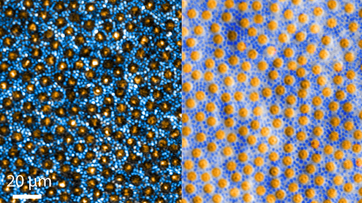
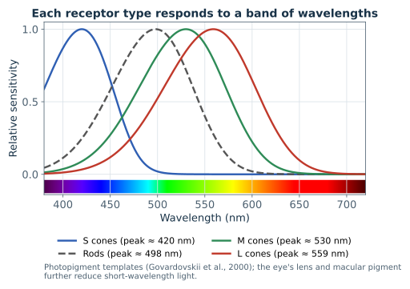
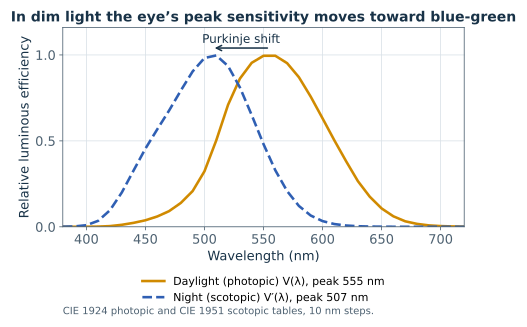
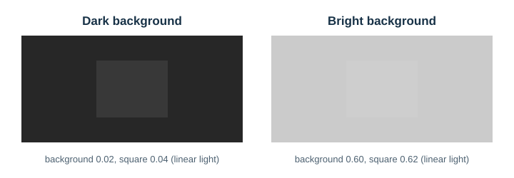
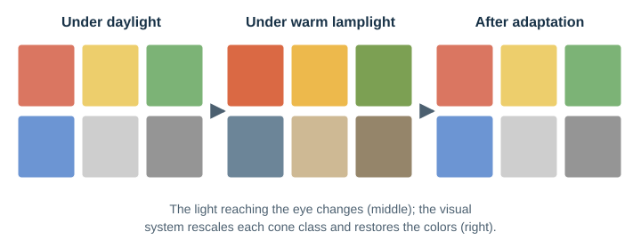
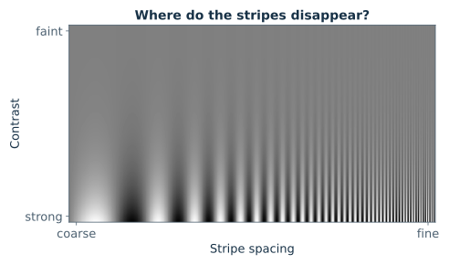
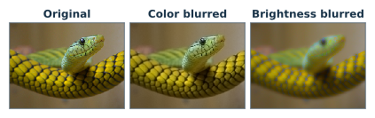

# Visual Perception for Image Quality

## Scope

This document explains how human vision works, as far as it matters for judging images: how light becomes a signal in the eye, how the eye adapts to bright and dim light, which details it can and cannot see, and why a dithered image with only a few colors can still look right. It is written to be read from start to finish, and most sections end with something to try on your own screen.

[Image-quality metrics](../metrics.md) defines the metrics `lsqa` reports and explains how they apply this background. [Color difference and color reproduction](../color-difference.md) applies it to color differences, including dark colors and viewing situations. The [image-quality measurement policy](../measurement-policy.md) owns thresholds and comparison conditions.

**Key ideas in one minute:**

- The eye has two kinds of light sensors: **cones** for daylight and color, **rods** for dim light.
- Three kinds of cones send signals that the retina turns into one **light–dark** channel and two **color** channels.
- The eye constantly **adapts**: it measures light relative to its surroundings, not in absolute terms.
- The eye sees **fine detail only in light and dark**, not in color, and it **averages away** detail finer than it can resolve.
- Dithering relies on that averaging: the pixels can be wrong as long as the image you *see* is right.

## Perceptual quality

Image *fidelity* is how closely a reproduction matches a reference. Image *quality* is how good an image is judged to be. They can diverge: a sharpened reproduction can be preferred to an exact one. The metrics in [image-quality metrics](../metrics.md) are *full-reference* fidelity metrics: they need the reference and estimate how visible or objectionable the departure from it is.

The ground truth for any such metric is human judgment collected under controlled conditions, for example by the methods in ITU-R Recommendation BT.500 for television pictures, summarized as mean opinion scores. A metric is "perceptual" to the extent that its predictions agree with those judgments across many images and distortion types. SSIM, MS-SSIM, GMSD, and CIEDE2000 were each validated against such data; the libsixel-specific descriptors were not.

libsixel aims at the fidelity of the image the viewer perceives, not of the stored pixels: within the limits of a palette image, the output should look like the reference. Pixel values may differ widely, as they do in any dithered image, as long as the perceived image does not. What a viewer perceives depends on conditions that a file does not record: the light level the viewer is adapted to, and the viewing distance and pixel size that set spatial frequency on the retina. The sections below explain how these conditions shape perception.

## Photoreceptors and opponent channels

### The eye as a camera

The eye works much like a camera. The cornea and the lens focus an image of the world onto the **retina**, a thin layer of light-sensitive tissue lining the back of the eye. The iris changes the size of the pupil, like a camera's aperture. The image on the retina is upside down; the brain sorts that out.


*Figure 1. Structure of the human eye. Light enters through the cornea and pupil (right) and is focused on the retina (left). The fovea centralis is the small central pit used for sharp vision. Where the optic nerve leaves the eye there are no light sensors: the blind spot. Image: OpenStax College, [Anatomy & Physiology](https://cnx.org/content/col11496/1.6/), [CC BY 3.0](https://creativecommons.org/licenses/by/3.0/), via [Wikimedia Commons](https://commons.wikimedia.org/wiki/File:1413_Structure_of_the_Eye.jpg); scaled.*

You can find your own blind spot with the figure below.


*Figure 2. Blind spot test.*

> **Try it.** Close your left eye and look steadily at the cross with your right eye. Starting with your face close to the screen, slowly move back. At some distance, about three to four times the gap between the cross and the dot, the dot vanishes: its image has landed on the optic disc. The brain fills the hole with the surrounding background, so you do not normally notice it.

### Rods and cones

The retina contains two kinds of light-sensitive cells, named for their shapes. **Cones** work in daylight and let us see color. **Rods** are far more sensitive and work in dim light, but they see no color. Curiously, light must pass through several layers of nerve cells before it reaches them: the rods and cones sit at the back of the retina, next to the pigment layer.


*Figure 3. The layers of the retina. Light (arrows) passes through the ganglion and bipolar cells before reaching the rods and cones. (a) Drawing; (b) stained microscope section. Image: OpenStax College, [Anatomy & Physiology](https://cnx.org/content/col11496/1.6/), [CC BY 3.0](https://creativecommons.org/licenses/by/3.0/), via [Wikimedia Commons](https://commons.wikimedia.org/wiki/File:1414_Rods_and_Cones.jpg); scaled.*

An average human retina has about 4.6 million cones and 92 million rods (Curcio et al., 1990). Seen from the front, they form a mosaic: large cones surrounded by many small rods.



*Figure 4. The photoreceptor mosaic: cones (orange) among many smaller rods (blue), the same cells imaged with two microscopic techniques. The colors are added to tell the cell types apart. Scale bar: 20 µm. Image: Johnny Tam, National Eye Institute, NIH ([public domain](https://commons.wikimedia.org/wiki/File:Rods_and_Cones_in_Retina_(51175951237).jpg)).*

The two kinds are not spread evenly. Cones are packed tightly in the fovea, where the center contains no rods at all, which is why you see sharpest where you look directly. Rods dominate everywhere else.


*Figure 5. Where the receptors are. Cones crowd the fovea; rods fill the periphery; neither exists at the blind spot.*

> **Try it.** On a dark night, a faint star can disappear when you look straight at it and reappear when you look slightly to one side. Looking away moves its image off the rod-free fovea and onto rods.

### Three kinds of cones

There are three kinds of cones, named for the part of the spectrum they respond to best: **L** (long wavelengths, toward red), **M** (medium, toward green), and **S** (short, toward blue). Their sensitivity curves overlap widely, so almost any light stimulates more than one kind. A color is the *pattern* of the three responses, not the response of a single cone; this is why three primaries on a display can reproduce so many colors.



*Figure 6. Sensitivity of the three cone types and of rods to wavelength. The L and M curves lie close together; the brain compares them to tell red from green.*

### Opponent channels

The retina does not send the three cone signals to the brain separately. It recombines them into three new channels: one **light–dark** channel, roughly L + M, and two **opponent color** channels, roughly L − M (red–green) and S − (L + M) (blue–yellow). This recoding was proposed in the opponent-process theory of Hering and quantified by Hurvich and Jameson (1957). It explains why nothing looks reddish-green or yellowish-blue: those pairs are the two ends of one channel.


*Figure 7. Cone signals are combined into one light–dark channel and two opponent color channels.*

CIELAB, the opponent coordinates OKLab and DIN99d, and YCbCr video all reflect this organization: one lightness axis and two opponent chroma axes. As later sections show, only the light–dark channel carries fine detail. S cones are also sparse and absent from the center of the fovea, which already limits blue–yellow resolution.

## Light level and adaptation

The visual system works over roughly ten orders of magnitude of luminance, from starlight to sunlit snow, but at any moment it uses a far narrower operating range set by *adaptation*. Rods and cones divide that span.

### Photopic, mesopic, and scotopic vision

Which receptors carry vision depends on how bright the surroundings are:


*Figure 8. Everyday light levels and the three regimes of vision. Each tick on the scale is a factor of 100.*

| Regime | Approximate luminance | Receptors | Consequences |
| --- | --- | --- | --- |
| Photopic | above about 5 cd/m² | cones | full color vision, highest acuity, spectral sensitivity `V(λ)` peaking near 555 nm |
| Mesopic | about 0.005 to 5 cd/m² | cones and rods together | color discrimination and acuity decline progressively; blue-green looks relatively brighter and red darker |
| Scotopic | below about 0.005 cd/m² | rods | no hue discrimination, low acuity, the fovea is nearly blind, spectral sensitivity `V'(λ)` peaking near 507 nm |

The mesopic limits are those of CIE 191:2010, which defines photometry for that range. In bright light rods are saturated and contribute little (Aguilar and Stiles, "Saturation of the rod mechanism of the retina at high levels of stimulation", Optica Acta 1(1), 1954).

Because rods and cones prefer different wavelengths, the eye's overall sensitivity shifts as light fades. This is the **Purkinje shift**:



*Figure 9. The eye's sensitivity in daylight and at night. At dusk, red flowers turn dark while blue-green leaves stay visible.*

Colorimetry, including CIELAB and CIEDE2000, assumes photopic vision throughout.

### How adaptation works

Several mechanisms adjust sensitivity to the prevailing light:

- the pupil changes diameter between about 2 and 8 mm, a factor of about 16 in light admitted, which covers only a small part of the full range;
- photopigment bleaching and regeneration reduce receptor sensitivity in bright light and restore it in darkness;
- neural gain control in the retina scales each receptor class's signal to the local mean, so that the response encodes *contrast*, the ratio to the adapted level, rather than absolute light.

The last mechanism is why vision follows **Weber's law** over much of the photopic range: the just-visible luminance step is a roughly constant fraction of the adapted luminance, not a constant amount.



*Figure 10. Each square adds the same amount of light, 0.02 of display white, to its background. On the dark background the step doubles the light and is obvious; on the bright one it adds about 3% and nearly disappears.*

At lower light levels photon noise dominates and the threshold grows more slowly than the luminance (the de Vries–Rose regime), so relative sensitivity falls. CIELAB's cube-root lightness and SSIM's ratio-based luminance term both encode the Weber-law idea.

### Time course

Light adaptation, from dark to bright, takes from seconds to a minute or two. Dark adaptation is slow, and it happens in two stages because cones and rods recover at different speeds.


*Figure 11. Dark adaptation. Cones adapt quickly but not far; rods take over after several minutes and keep improving for half an hour.*

> **Try it.** Walk from a bright room into a dark one. At first you see almost nothing; after a few minutes shapes appear; only after twenty minutes or more can you see the faintest stars. A single glance at a bright screen resets much of that progress within seconds.

### Chromatic adaptation

Gain control acts separately on the three cone classes, so the visual system also adapts to the *color* of the illumination: a white paper looks white under both daylight and incandescent light.



*Figure 12. Chromatic adaptation, simplified. Warm light changes the light that reaches the eye (middle), but the visual system rescales each cone class and restores the familiar colors (right).*

Von Kries ("Chromatic adaptation", 1902) modeled this as independent scaling of each cone response. CIELAB's division of `X`, `Y`, and `Z` by the white point is a simplified version of the same idea, applied to XYZ rather than to cone responses; color appearance models such as CIECAM02 and CAM16 use a proper cone-space adaptation transform and also take the absolute adapting luminance as a parameter.

### Global and local adaptation

The pupil and the balance between rods and cones follow the light of the whole visual field. Retinal gain control is partly local, and the eyes move constantly between regions, so the adapted state also varies across the scene and over time. A dark region inside a bright image therefore does not switch vision to rods: it is seen by light-adapted cones, whose signal is weak and whose contrast against the surrounding adaptation level is low. Vision becomes mesopic only when the overall field is dim, as with a dark room, a low display brightness, and content that is mostly dark. Image appearance models such as iCAM build local adaptation into their processing for this reason.

### Displays

An SDR display typically has a white of 80 to 300 cd/m² and a black of a few tenths of a cd/m² or less, before room reflections. With an 80 cd/m² white, CIELAB `L* = 30` corresponds to about 5 cd/m², the photopic boundary, and `L* = 10` to about 0.9 cd/m². Shadows in an image routinely fall below the photopic boundary in absolute terms, but whether the viewer is mesopic depends on the whole field, as described above. [Dark colors and luminance level](../color-difference.md#dark-colors-and-luminance-level) explains what this means for color differences.

**Display color filters.** Night-time display modes such as Night Shift and Night Light, and similar warm-tint utilities, lower the correlated color temperature of the display white by reducing its short-wavelength output. Their stated purpose concerns a third class of retinal photoreceptor, the intrinsically photosensitive retinal ganglion cells containing melanopsin (peak sensitivity near 480 nm). These cells feed a non-image-forming pathway that regulates the circadian clock and melatonin secretion; they are separate from the cone and rod adaptation described above, and the health benefit of display tinting is still debated. The filters still interact with vision through chromatic adaptation. After a few minutes the tinted white looks nearly white again, but adaptation to a self-luminous display is incomplete, and the room light competes with it, so a warm cast usually remains; CIECAM02 represents this with a degree of adaptation below one. Adaptation restores only the white reference. Because the filter removes part of the blue primary's output, the display gamut shrinks, and blues and violets that differed before remain harder to tell apart after adaptation. The filter acts on every image equally, so side-by-side comparisons of a reference and an output stay meaningful. Absolute judgments of color, such as whether a gray is neutral or a skin tone natural, are biased under a filter and should be made with it off. `lsqa` reads encoded values and is unaffected by any display filter.

**Dark terminals and dark rooms.** A full-screen terminal with a black background can lower the adaptation level, but only under some conditions. In a lit room, office lighting of a few hundred lux keeps the surrounding surfaces at tens of cd/m², and vision stays photopic. In a dark room, most of the field is the display black, roughly 0.05 to 0.5 cd/m² for an LCD and nearly zero for an OLED, which lies in the mesopic range. Several factors keep adaptation from going deep: text and images at tens to hundreds of cd/m² stay in view and pull adaptation upward, bright areas weigh more heavily than dark ones, reading fixates the rod-free fovea, a 27-inch display at 60 cm spans only about 53 degrees horizontally, many dark themes use a dark gray rather than black, and rod sensitivity needs tens of minutes of continuous darkness while one bright image restores light adaptation within seconds. The practical result of long dark-room work on a dark theme is adaptation near the photopic–mesopic boundary: steps between near-black levels become easier to see, color discrimination in dark areas declines slightly, and a suddenly displayed bright image causes glare. How this changes the visibility of near-black errors is described under [dark colors and luminance level](../color-difference.md#dark-colors-and-luminance-level).

## Contrast sensitivity

How fine a pattern can the eye see? The answer depends on the pattern's contrast as well as its size. Vision scientists measure this with stripes whose brightness varies smoothly, like a sine wave, and count how many stripes fit into one degree of visual angle: the **spatial frequency**, in cycles per degree (cpd). The figure below lets you measure your own eye.



*Figure 13. A Campbell–Robson chart. Contrast is the same along each row and fades from bottom to top; stripe spacing gets finer from left to right.*

> **Try it.** Follow the boundary where the stripes fade into uniform gray. It is not a straight line: the stripes reach highest somewhere in the middle and fall away at both ends, an arch-shaped curve. That arch is your own **contrast sensitivity function**. Step back from the screen and the arch moves to the left, because each stripe now covers a smaller angle.

The contrast sensitivity function (CSF) gives the reciprocal of the smallest visible contrast of such a grating as a function of spatial frequency. Its shape differs by channel:


*Figure 14. Contrast sensitivity for light–dark patterns and for color patterns. The eye resolves fine light–dark detail but sees color only in broad areas.*

- **Achromatic:** band-pass. Under photopic conditions sensitivity peaks at a few cycles per degree and falls steeply above roughly 10 cpd, reaching the resolution limit near 50 to 60 cpd. Lateral inhibition in center-surround receptive fields suppresses the lowest frequencies, and optical blur and the cone sampling mosaic limit the highest.
- **Chromatic:** low-pass, with a much lower cutoff. Mullen ("The contrast sensitivity of human colour vision to red-green and blue-yellow chromatic gratings", Journal of Physiology 359, 1985) measured isoluminant gratings whose sensitivity falls off several times earlier than luminance gratings; the limiting acuity was about 11 to 12 cpd for both red-green and blue-yellow gratings.

Campbell and Robson ("Application of Fourier analysis to the visibility of gratings", Journal of Physiology 197, 1968) showed that the visibility of complex gratings follows from the responses of separate channels tuned to bands of spatial frequency, which is the physiological motivation for multiscale models. Mannos and Sakrison (1974) gave an early analytic luminance CSF used in image coding.

Two further effects matter for quantization. Sensitivity depends on adaptation level: at low luminance the CSF drops and its peak shifts to lower frequencies, and near black the visibility of a fixed luminance step changes with the display's black level and surround. Chromatic discrimination likewise declines as adaptation moves from photopic toward mesopic light, as described under [light level and adaptation](#light-level-and-adaptation). Contrast masking reduces the visibility of an error placed on a busy texture compared with the same error on a flat area, so identical error energy is more visible in skies and gradients than in foliage.

## From pixels to cycles per degree

Spatial frequency on the retina depends on the size of a pixel and how far away it is:


*Figure 15. Viewing geometry. The farther away the screen, or the smaller its pixels, the more pixels fit into one degree.*

```text
pixels per degree = d · tan(1°) / p          d = viewing distance, p = pixel pitch (same unit)
Nyquist frequency  = pixels per degree / 2    cycles per degree
```

A 100 ppi display (`p = 0.254 mm`) viewed at 50 cm gives about 34 pixels per degree, so a one-pixel checkerboard is about 17 cpd. A 220 ppi display at 40 cm gives about 60 pixels per degree and 30 cpd. In the first case the finest luminance pattern is attenuated but still visible, and the finest chroma pattern is close to invisible. In the second, the finest pattern is near the luminance resolution limit. Terminal image viewing adds a complication: users often enlarge character cells, which lowers the pixels per degree and moves the same dither pattern into the visible band.

## Spatial integration and noise visibility

At normal viewing distance the eye integrates fine detail. The contrast sensitivity functions above act as low-pass filters on what is seen: luminance contrast is attenuated above roughly 10 cpd, and chromatic contrast already above a few cpd. A pattern whose energy lies above these frequencies is perceived mainly through its local average, so its average tone and color matter far more than its individual elements. The same pattern seen closer, or with larger pixels, moves to lower retinal frequencies and becomes visible as texture.

This is the perceptual basis of dithering and halftoning: an image can be reproduced with few colors when the error introduced by quantization is placed at frequencies the viewer does not resolve, while the local averages match the original.


*Figure 16. Two ways to draw a gradient with only black and white pixels. Up close both are noisy. From a distance the eye averages the dots: random dots leave blotches, while error diffusion, which places its error at fine scales, blurs into a smooth gradient.*

> **Try it.** Lean back from the screen, or squint, while looking at the left column of Figure 16. The dots melt into gray, and the bottom row becomes almost indistinguishable from the original gradient. This is what a dithered SIXEL image relies on.

Error energy at low frequencies is seen directly as blotches, contours, or color casts. Within the visible band, regular structure such as stripes and lattices tends to be more conspicuous than isotropic noise of the same energy, because the visual system is tuned to orientation and readily groups regular elements. [Dithering](../../concepts/dithering/README.md#noise-spectrum-where-the-error-goes) describes how dithers shape their error spectrum, and [image-quality metrics](../metrics.md#measuring-dither-noise) how it is measured.

## Luminance and chroma in spatial vision

The achromatic channel has the highest spatial resolution and contrast sensitivity, as described under [contrast sensitivity](#contrast-sensitivity). Structure, edges, and texture are perceived mainly through luminance contrast: an isoluminant image, whose regions differ only in chroma, looks blurry and its edges are hard to locate. The effect is easy to demonstrate by blurring only one part of an image:



*Figure 17. The same amount of blur applied to color only (middle) and to brightness only (right). Blurred color is hard to notice; blurred brightness makes the whole image look out of focus.*

Fine chromatic error is attenuated far more than fine luminance error, which is why image and video coding keep luma at full resolution while subsampling chroma, as in JPEG and 4:2:0 video, with little visible loss.

Chroma still matters at low spatial frequencies. Large areas are judged as colors, and color casts, banding in colored gradients, and tinted neutrals are visible even though fine chroma detail is not. Perception therefore favors luminance for *spatial structure* and chroma for *area color*, which is the division the metrics follow; see [why luminance is currently emphasized](../metrics.md#why-luminance-is-currently-emphasized).

## Character cells and mosaics

Programs that draw images with text, such as AAlib, libcaca, chafa and the half-block and Braille modes of terminal image viewers, use the character cell as their picture element. A cell can show one glyph in one foreground and one background color, so a character renderer behaves like a display device with a very coarse grid and a strongly restricted set of pixel patterns. Its history and the methods of these programs are described under [pictures made of characters](../../sixel-format/terminal-graphics-history/README.md#pictures-made-of-characters); this section looks at the cell from the side of the viewer.

### Where a character cell falls on the sensitivity curves

With the geometry of [the previous example](#from-pixels-to-cycles-per-degree), 100 ppi at 50 cm or about 34 pixels per degree, a cell of 8 × 16 pixels spans about a quarter of a degree in width and half a degree in height. A pattern that alternates from one cell to the next therefore has a frequency of only about 1 to 2 cpd:

| Picture element | Size in pixels | Horizontal cpd | Vertical cpd |
| --- | --- | ---: | ---: |
| Character cell | 8 × 16 | 2.15 | 1.07 |
| Half block (two per cell) | 8 × 8 | 2.15 | 2.15 |
| chafa 8 × 8 sub-cell bitmap | 1 × 2 | 17.18 | 8.59 |

*Table 1. Nyquist frequency of each picture element at 100 ppi and 50 cm. A larger font or a closer view moves every row to lower frequencies.*

The two sensitivity curves of [Figure 14](#contrast-sensitivity) weight these frequencies very differently:

| cpd | Luminance (relative) | Chroma (relative) | Luminance / chroma |
| ---: | ---: | ---: | ---: |
| 0.5 | 0.19 | 0.92 | 0.21 |
| 1 | 0.32 | 0.71 | 0.45 |
| 2 | 0.54 | 0.35 | 1.55 |
| 3 | 0.70 | 0.18 | 3.94 |
| 4 | 0.83 | 0.10 | 7.98 |
| 8 | 1.00 | 0.025 | 40.75 |
| 12 | 0.90 | 0.010 | 87.85 |
| 17 | 0.65 | 0.0048 | 137.23 |
| 30 | 0.19 | 0.0014 | 139.02 |

*Table 2. Relative contrast sensitivity of the luminance model (Mannos and Sakrison 1974) and the schematic chroma curve (after Mullen 1985), each scaled to its own peak. The ratio compares the two shapes, not absolute thresholds, and is reliable only in its order of magnitude, because the chroma curve is schematic.*

At the frequency of the cell grid, around 1 to 2 cpd, luminance and chroma are about equally effective, and below 1 cpd chroma is relatively the stronger of the two. At the frequency of the shapes inside a cell, around 8 to 17 cpd, luminance dominates by more than an order of magnitude and chroma detail is close to invisible. Seen this way the usual design of character renderers is well matched to vision: the glyph inside a cell is read mainly as a pattern of luminance coverage, and the colors of the cell are read mainly as area colors. It also follows that the color assigned to each cell carries as much weight as the choice of glyph. What the viewer judges about those colors, however, is not their distance from the original, as the next section explains.

### Research on coarse mosaics

The perception of block-quantized, or pixelated, images has been studied since the 1970s, mostly with faces:

- **Block edges mask the image.** Harmon and Julesz (1973) found that a portrait reduced to large uniform blocks is hard to recognize largely because the sharp block edges add spurious high-frequency energy close to the low frequencies that carry the face, and that removing that energy by blurring restores recognition. Morrone, Burr and Ross (1983) showed that adding noise can likewise restore the recognizability of coarsely quantized images.
- **A small number of elements suffices.** Bachmann (1991) found that faces remain identifiable down to about 16 blocks across the face, about 8 cycles per face. Costen, Parker and Craw (1994) placed the band most important for face recognition at about 8 to 16 cycles per face. Bachmann and Kahusk (1997) studied how the coarseness of quantization interacts with exposure time and attention. Bachmann (2016) reviews the field in a book-length treatment.
- **Size and distance decide between tiles and image.** Pelli (1999) studied the portraits of Chuck Close, which are built from tiles: whether the viewer sees a face or an array of tiles depends on the number of tiles per face and on the angular size of the picture.
- **Color helps when shape is degraded.** Yip and Sinha (2002) found that color contributes to face recognition mainly when shape information is degraded, for example by blur. Oliva and Schyns (2000) found that diagnostic colors speed scene recognition, especially at coarse scales. Schyns and Oliva (1994) and Oliva and Schyns (1997) showed that the spatial scale used for recognition depends on the task, rather than always proceeding from coarse to fine.
- **Glyphs as structure.** Xu, Zhang and Wong (2010) chose glyphs for line drawings by structural similarity rather than by tone, an approach that treats glyphs as small images, as later character renderers do.

### What the viewer compares

A viewer of a terminal image has no original to compare with. The judgment is *no-reference*: the viewer sees a defect when the picture contains structure that a natural image would not, not when a color differs from a reference that is not on the screen. Two consequences follow for character cells.

- **A smooth absolute error is tolerated.** An image that is slightly too warm or too dark everywhere, or whose colors drift slowly across a region, is accepted as the picture's own appearance, helped by [chromatic adaptation](#chromatic-adaptation). The comparison of Table 2 says how visible a pattern at a given frequency is; it does not say that the viewer can tell a cell's color from the original's.
- **A fluctuation between neighboring cells is seen.** When adjacent cells of a smooth region, such as skin or sky, change hue, brightness or texture without reason, the change forms a pattern at the frequency of the cell grid, 1 to 2 cpd in Table 1. Both luminance and chroma are seen well there, and natural images vary little in chroma within smooth regions, so a hue that jumps from cell to cell is judged unnatural even when its error against the original is small.

Harmon and Julesz point the same way: what defeated recognition was the spurious structure of the block edges, not the error of the block averages. Measures of blocking artifacts in compressed images likewise work without a reference by measuring discontinuities at block boundaries (Wang, Bovik and Evans 2000; Wang, Sheikh and Bovik 2002).

![Six panels in two rows. Top row, one color per pixel: a photograph of a green and yellow snake; the same photograph dithered with the xterm 256-color palette, which looks almost like the original; and the same palette without dithering, which shows flat bands of color. Bottom row, one color per 9 by 9 tile: the exact mean color of each tile, a blocky but smooth picture; the tiles dithered with the palette, a checkerboard of mismatched colors in which the snake is hard to see; and the tiles without dithering, blocky with broad flat areas but calm.](figures/tile-dithering.svg)

*Figure 18. The same palette and the same Floyd–Steinberg dithering on a fine grid and on coarse tiles. On the fine grid dithering is the better choice; on the tiles it breaks smooth areas into conspicuous tile-to-tile noise. ΔE tile is the mean CIELAB difference between each tile and the tile's mean in the original, ΔE 3 × 3 the same after averaging over 3 × 3 tiles, and jumps the share of neighboring tile pairs whose difference exceeds the original's by more than 6 ΔE. Dithering minimizes the averaged error but produces almost three times as many jumps, which is what the eye notices.*

This reverses a usual assumption about dithering. On a fine pixel grid, dithering moves quantization error to frequencies that the eye does not resolve. On a cell grid, error diffused from cell to cell lands at the cell frequency, where it is seen as exactly the neighbor-to-neighbor fluctuation described above. Figure 18 shows both cases with the same palette. For a character renderer, leaving cells undithered can therefore look better than dithering them, and the answer depends on the palette:

- **24-bit color.** The colors of a cell can match the local mean almost exactly, so the only remaining quantization is the shape of the glyph. There is little reason to dither color.
- **256 colors.** Steps between palette colors are moderate. Without dithering, smooth gradients show a few broad bands; with dithering, they show cell-scale fluctuation. Which is less visible depends on the image, and a dither, if used, is better placed inside cells.
- **16 colors or fewer.** Steps are large, and bands are strengthened by Mach bands into prominent contours, which are themselves a structure a natural image does not have. Some dithering is needed, but preferably at a sub-cell grain and with a pattern fixed in position, such as ordered or blue-noise dithering, rather than error diffusion between cells.

A pattern fixed in position also keeps its decision stable: error diffusion propagates each decision to the following cells, so a small change of input can flip a whole run of cells, which in animation is seen as shimmer.

### How character renderers handle it

The source code of three renderers shows choices that agree with this reasoning in the newest of them, and with the constraints of their time in the older two.

| Renderer | Colors | Default dithering | Where the error goes | Cell choice |
| --- | --- | --- | --- | --- |
| AAlib 1.4 | Brightness only, with text attributes | Floyd–Steinberg | Between cells: the difference between the mean of a cell's 2 × 2 samples and the brightness of the chosen glyph passes to the neighboring cells | Glyph from a table indexed by the 2 × 2 samples; flat cells, whose samples differ from their mean by less than 13 of 256 levels, use a glyph chosen by brightness alone |
| libcaca (`img2txt`) | 16 ANSI colors | Floyd–Steinberg | Between cells: the difference between the cell average and the mixture of the chosen colors and density glyph | Background is the nearest palette color in RGB, foreground the second nearest, and the glyph is chosen from a density ramp assuming linear mixing |
| chafa 1.18, symbols | 24-bit, 256, 240, 16, 8 or 2 colors | None. Ordered, Floyd–Steinberg or blue-noise dithering on request; always off with 24-bit color | Inside the 8 × 8 working image of the cells, in grains of 1/8 to 1 cell, by default half a cell | Glyph and foreground and background colors minimize the error within the cell, each color being the mean of the pixels it covers; palette colors are the nearest match |
| chafa 1.18, sixel | Dynamic palette | Blue noise | Pixels | Not applicable |

*Table 3. Default behavior of character renderers, from their source code: AAlib `src/aarender.c` (Debian packaging repository), libcaca `caca/dither.c` and `src/img2txt.c`, chafa `chafa/chafa-canvas.c`, `chafa/internal/chafa-pixops.c` and `chafa/internal/chafa-symbol-renderer.c`.*

chafa turns dithering off in 24-bit symbol mode with the comment that there is "no reason to dither in truecolor mode", and keeps it off by default in every other symbol mode, while it dithers SIXEL output, which is drawn with real pixels. In 24-bit mode each cell color is the mean of the pixels under the glyph, a continuous function of the image, so neighboring cells of a smooth region receive neighboring colors. In 16-color and fewer modes chafa instead preprocesses the image with a contrast boost, and for 16 colors a saturation boost, which accepts a flatter, stylized result rather than masking the steps with noise. When dithering is requested, its default grain of half a cell puts the pattern at about 2 to 4 cpd in the geometry of Table 1; a grain of one eighth of a cell moves it to the 8 to 17 cpd of the sub-cell row.

AAlib and libcaca both diffuse error between cells by default, which places it at the cell frequency. Both come from the era of monochrome and 16-color terminals, where the steps between available tones are so large that bands would dominate without dithering, which is the last case above. AAlib's special handling of flat cells keeps uniform areas uniform within the tone that diffusion delivers to them.

None of the three has an explicit term for consistency between neighboring cells: each cell is chosen independently, given the image and any diffused error. A nearest-color lookup is discontinuous, so in palette modes two neighboring cells with almost the same content can still fall on different sides of a decision boundary.

An informal check with chafa 1.18.2 agrees. A horizontal gradient, constant in the vertical direction, was rendered as 80 × 20 cells. Any difference between vertically adjacent cells is therefore structure that the image does not contain. Of the 1,520 vertically adjacent pairs, none differed without dithering in the 16-color, 256-color and 24-bit modes, while with dithering in the 16-color mode 721 differed with ordered dithering, 781 with blue noise and 1,285 with Floyd–Steinberg. The count records any change of glyph or color and not its visibility, so it shows where dithering creates cell-scale structure rather than how conspicuous that structure is.

### Practical consequences

These results suggest four rules for a character renderer:

- **Preserve coarse luminance structure.** It carries recognition at the few cycles per object that a cell grid can show.
- **Keep neighboring cells consistent.** In smooth regions, differences between adjacent cells should follow the image. A slowly varying absolute error is acceptable; a fluctuation from cell to cell is not.
- **Dither only as much as the palette requires, and inside cells.** With 24-bit color, do not dither color. With fewer colors, prefer patterns fixed in position at a sub-cell grain over error diffusion between cells.
- **Do not make the cell grid conspicuous.** Sharp, regular block edges mask the image.

The reasoning of this section is an argument from the sensitivity curves and the research above, checked against the implementations; it has not been tested in a controlled viewing experiment. The numbers in Tables 1 and 2 are computed by [`tools/plot_visual_perception_figures.py`](../../../tools/plot_visual_perception_figures.py) and recorded in [`figures/figures.json`](figures/figures.json).

## Figures and reproduction

Figures 2 and 5 to 18 are generated by [`tools/plot_visual_perception_figures.py`](../../../tools/plot_visual_perception_figures.py) with Matplotlib, NumPy and Pillow. Run it to regenerate them and with `--check` to verify that the committed files are current. Their data sources are recorded in [`figures/figures.json`](figures/figures.json): the cone and rod curves use the photopigment template of Govardovskii et al. (2000); the luminous efficiency curves are the CIE 1924 and 1951 tables; the receptor density, dark adaptation and chroma sensitivity curves are schematic; the luminance sensitivity curve is the Mannos and Sakrison (1974) model; and Figures 17 and 18 use the repository image `images/snake.png`. Figure 18 reproduces the processing of the interactive [tile perception lab](../../../tools/docs/tile-lab/index.html), a development tool used to choose how fine grids and tiles are presented: averages and dithering errors in linear light, nearest colors by DIN99d, the xterm 256-color palette, and Floyd–Steinberg diffusion in raster order. Its measures are recorded in `figures.json`. Figures 1, 3 and 4 are reproduced from Wikimedia Commons under the licenses stated in their captions and recorded in the same file.

## References

- Aguilar, M., and W. S. Stiles. "Saturation of the rod mechanism of the retina at high levels of stimulation." Optica Acta 1(1), 1954.
- Bachmann, T. "Identification of spatially quantised tachistoscopic images of faces: How many pixels does it take to carry identity?" European Journal of Cognitive Psychology 3(1):87–103, 1991. doi:[10.1080/09541449108406221](https://doi.org/10.1080/09541449108406221)
- Bachmann, T. *Perception of Pixelated Images*. Academic Press, 2016. Reviewed by V. Goffaux in Frontiers in Psychology 7:1151, 2016. doi:[10.3389/fpsyg.2016.01151](https://doi.org/10.3389/fpsyg.2016.01151)
- Bachmann, T., and N. Kahusk. "The effects of coarseness of quantisation, exposure duration, and selective spatial attention on the perception of spatially quantised ('blocked') visual images." Perception 26(9):1181–1196, 1997. doi:[10.1068/p261181](https://doi.org/10.1068/p261181)
- Campbell, F. W., and J. G. Robson. "Application of Fourier analysis to the visibility of gratings." Journal of Physiology 197, 1968.
- CIE Publication 191. Recommended system for mesopic photometry based on visual performance, 2010.
- Costen, N. P., D. M. Parker, and I. Craw. "Spatial content and spatial quantisation effects in face recognition." Perception 23(2):129–146, 1994. doi:[10.1068/p230129](https://doi.org/10.1068/p230129)
- Curcio, C. A., K. R. Sloan, R. E. Kalina, and A. E. Hendrickson. "Human photoreceptor topography." Journal of Comparative Neurology 292(4):497–523, 1990. doi:[10.1002/cne.902920402](https://doi.org/10.1002/cne.902920402)
- Fairchild, M. D., and G. M. Johnson. "iCAM framework for image appearance, differences, and quality." Journal of Electronic Imaging 13(1), 2004.
- Govardovskii, V. I., N. Fyhrquist, T. Reuter, D. G. Kuzmin, and K. Donner. "In search of the visual pigment template." Visual Neuroscience 17(4):509–528, 2000. doi:[10.1017/S0952523800174036](https://doi.org/10.1017/S0952523800174036)
- Harmon, L. D., and B. Julesz. "Masking in visual recognition: effects of two-dimensional filtered noise." Science 180(4091):1194–1197, 1973. doi:[10.1126/science.180.4091.1194](https://doi.org/10.1126/science.180.4091.1194)
- Hurvich, L. M., and D. Jameson. "An opponent-process theory of color vision." Psychological Review 64(6), 1957.
- ITU-R Recommendation BT.500. Methodologies for the subjective assessment of the quality of television images.
- Mannos, J. L., and D. J. Sakrison. "The effects of a visual fidelity criterion on the encoding of images." IEEE Transactions on Information Theory 20(4), 1974.
- Morrone, M. C., D. C. Burr, and J. Ross. "Added noise restores recognizability of coarse quantized images." Nature 305:226–228, 1983. doi:[10.1038/305226a0](https://doi.org/10.1038/305226a0)
- Mullen, K. T. "The contrast sensitivity of human colour vision to red-green and blue-yellow chromatic gratings." Journal of Physiology 359:381–400, 1985. doi:[10.1113/jphysiol.1985.sp015591](https://doi.org/10.1113/jphysiol.1985.sp015591)
- Oliva, A., and P. G. Schyns. "Coarse blobs or fine edges? Evidence that information diagnosticity changes the perception of complex visual stimuli." Cognitive Psychology 34(1):72–107, 1997. doi:[10.1006/cogp.1997.0667](https://doi.org/10.1006/cogp.1997.0667)
- Oliva, A., and P. G. Schyns. "Diagnostic colors mediate scene recognition." Cognitive Psychology 41(2):176–210, 2000. doi:[10.1006/cogp.1999.0728](https://doi.org/10.1006/cogp.1999.0728)
- OpenStax College. *Anatomy & Physiology*. Rice University, 2013. <https://cnx.org/content/col11496/1.6/>
- Pelli, D. G. "Close encounters: an artist shows that size affects shape." Science 285(5429):844–846, 1999. doi:[10.1126/science.285.5429.844](https://doi.org/10.1126/science.285.5429.844)
- Schyns, P. G., and A. Oliva. "From blobs to boundary edges: evidence for time- and spatial-scale-dependent scene recognition." Psychological Science 5(4):195–200, 1994. doi:[10.1111/j.1467-9280.1994.tb00500.x](https://doi.org/10.1111/j.1467-9280.1994.tb00500.x)
- von Kries, J. "Chromatic adaptation." Festschrift der Albrecht-Ludwigs-Universität, Freiburg, 1902. English translation in D. L. MacAdam, ed., *Sources of Color Science*, MIT Press, 1970.
- Wang, Z., A. C. Bovik, and B. L. Evans. "Blind measurement of blocking artifacts in images." Proceedings of the 2000 International Conference on Image Processing, vol. 3, 981–984, 2000. doi:[10.1109/ICIP.2000.899622](https://doi.org/10.1109/ICIP.2000.899622)
- Wang, Z., H. R. Sheikh, and A. C. Bovik. "No-reference perceptual quality assessment of JPEG compressed images." Proceedings of the 2002 International Conference on Image Processing, vol. 1, I-477–I-480, 2002. doi:[10.1109/ICIP.2002.1038064](https://doi.org/10.1109/ICIP.2002.1038064)
- Xu, X., L. Zhang, and T.-T. Wong. "Structure-based ASCII art." ACM Transactions on Graphics 29(4):52, 2010. doi:[10.1145/1778765.1778789](https://doi.org/10.1145/1778765.1778789)
- Yip, A. W., and P. Sinha. "Contribution of color to face recognition." Perception 31(8):995–1003, 2002. doi:[10.1068/p3376](https://doi.org/10.1068/p3376)
