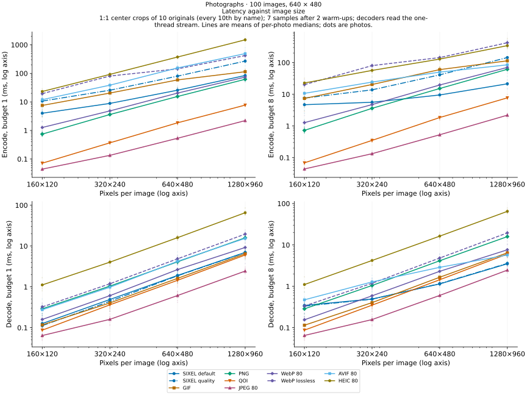

# SIXEL among contemporary image codecs

## Three independently useful ideas

SIXEL has an old wire syntax, but its ordinary image pipeline combines **color quantization**, **six-row color masks with run-length coding**, and **a terminal protocol that can be transmitted using only 7-bit bytes**. These are separate design choices. The terminal does not need to know whether the palette came from a classic median cut, a modern clustering solver, a perceptual color space, or a palette retained from an earlier frame.

Color quantization has continued to develop in the twenty-first century. For concrete examples, [Yinyang k-means (2015)](https://proceedings.mlr.press/v37/ding15.html) reduces redundant distance calculations in clustering, while [libimagequant's release history](https://github.com/ImageOptim/libimagequant/blob/main/CHANGELOG) records improvements to palette quality, fixed colors, remapping, dithering, and performance. The former is general clustering research, rather than a SIXEL benchmark; the latter is a production palette quantizer, rather than a new image syntax. Both illustrate why the age of a palette file format does not fix the quality or speed of its encoder. libsixel exposes these independently evolving stages through its [quantization models](../../encoder/palette-construction/quantization/README.md), [working color spaces](../../encoder/palette-application/working-colorspace/README.md), and [palette policies](../../overview.md).

The following comparison measures implementations and operating points, not a universal ranking of formats. It deliberately includes outcomes that favor the other codecs.

## Image formats and the terminal

Several of the formats compared on this page began close to terminals and telematic services. How each one relates to a terminal byte stream shows where SIXEL, the oldest of them, coincides with recent design directions and where it does not.

<picture>
  <source media="(max-width: 640px)" srcset="figures/codec-timeline-mobile.svg">
  
</picture>

| Format | Origin and intended use | How the end of an image is found | Bytes inside the image data |
| --- | --- | --- | --- |
| SIXEL | DEC printers, then graphics terminals such as the VT240 and VT340 | the ST control function that ends its DCS | printable 7-bit characters only |
| GIF (1987) | CompuServe's online service and its VIDTEX terminal software | a `;` trailer after length-prefixed data blocks | any byte |
| JPEG (1992) | photographic videotex, standardized in the telematic T series | the EOI marker; markers are recognizable without decoding | any byte except an unstuffed `0xFF` |
| PNG (1996) | a patent-free lossless replacement for GIF | the IEND chunk after length-prefixed chunks | any byte |
| JPEG 2000 (2000) | a successor to JPEG with scalable coding | the EOC marker in the codestream, but a JP2 box or last tile-part may extend to the end of the file or codestream | any byte, with marker values kept out of coded data |
| QOI (2021) | simple, fast lossless coding | a fixed eight-byte end marker; the header also gives the pixel count | any byte |

### Terminal control and SIXEL

[ECMA-35](https://ecma-international.org/publications-and-standards/standards/ecma-35/), which specifies the same code extension techniques as ISO/IEC 2022, was first published in December 1971, and [ECMA-48](https://ecma-international.org/publications-and-standards/standards/ecma-48/), which defines control functions such as DCS and ST, in March 1976. SIXEL is a Device Control String in that framework. Its image data consists of printable 7-bit characters, and ST ends it, so an ordinary ECMA-48 parser can carry it without a capture mode or a transport encoding. DEC used SIXEL for printers and then for screens, for example on the [VT240](https://terminals-wiki.org/wiki/index.php/DEC_VT240), introduced in January 1984, and the colour [VT340](https://terminals-wiki.org/wiki/index.php/DEC_VT340) of April 1987. See the [SIXEL format overview](../README.md) for the syntax.

### JPEG: born in telematic terminal standardization

The JPEG committee was created in November 1986 by experts linked to CCITT Study Group VIII, whose remit was terminal equipment for telematic services such as facsimile, Teletex and Videotex, and to ISO TC97 SC2/WG8, part of the committee for coded character sets whose scope also covered switching between character and graphic coding. Its motivating application was photographic videotex over ISDN, studied in the ESPRIT 563 PICA project. CCITT approved the result in 1992 as [T.81](https://www.w3.org/Graphics/JPEG/itu-t81.pdf), a recommendation in the T series for telematic terminals ([Sebestyén, 2020](https://www.itu.int/dms_pub/itu-s/opb/journal/S-JOURNAL-ICTS.V3I1-2020-13-PDF-E.pdf)).

T.81 assigns every marker the two bytes `0xFF` and a byte other than `0x00` or `0xFF`, and stuffs a `0x00` after any `0xFF` produced by entropy coding (clauses B.1.1.2 and B.1.1.5). A reader can therefore locate each part and the final EOI marker without decoding the image. The entropy-coded data can still contain every other byte value, including C0 and C1 control codes, so JPEG was not designed to pass through an ordinary terminal parser. A terminal must deliberately capture it. [Gate One](https://liftoff.github.io/GateOne/ReleaseNotes/index.html), a Python HTML5 terminal emulator whose 1.0 release in March 2012 displayed images written with `cat`, did this by carving a JPEG from its SOI marker to the next EOI, and a PNG through its IEND chunk ([`terminal.py`](https://github.com/liftoff/GateOne/blob/master/terminal/terminal.py)). A plain search for the first EOI ends too early when a marker segment embeds another JPEG, such as an EXIF thumbnail; the segments must be parsed by length.

### GIF: images for an online service's terminals

CompuServe published [GIF87a](https://www.w3.org/Graphics/GIF/spec-gif87.txt) on 15 June 1987 as an exchange and display mechanism for graphics on a variety of hardware, to be transferred with the B Protocol implemented in its VIDTEX terminal products. The [GIF89a specification](https://www.w3.org/Graphics/GIF/spec-gif89a.txt), dated 31 July 1990, adds an On-line Capabilities Dialogue: a host asks an interactive GIF decoder for its display capabilities with `ESC [ > 0 g`, a control sequence in the ECMA-48 form, and the decoder replies. A GIF stream consists of length-prefixed data sub-blocks and ends with a `;` trailer, while its LZW-compressed data are arbitrary bytes.

### PNG: lossless and patent-free

On 28 December 1994 CompuServe announced royalties for GIF software under Unisys's LZW patent; the first PNG draft followed on 4 January 1995, and PNG 1.0 became a W3C Recommendation on 1 October 1996 ([PNG history](http://www.libpng.org/pub/png/pnghist.html)). [RFC 2083](https://www.rfc-editor.org/rfc/rfc2083) describes PNG as a patent-free replacement for GIF that also covers truecolor and alpha, compressed losslessly with deflate, which combines LZ77 and Huffman coding. Its eight-byte signature is designed to detect damage by channels that are not 8-bit transparent: a non-ASCII first byte catches transfers that clear bit 7, CR-LF catches newline translation, and a control-Z stops display under MS-DOS. PNG treats text and terminal channels as hazards to detect rather than as a transport.

### JPEG 2000: markers remain, framing moves outward

[JPEG 2000](https://www.itu.int/rec/T-REC-T.800) keeps markers in its codestream, including an end-of-codestream marker, and keeps marker values out of coded data. Its framing, however, can defer to the surrounding structure: the last tile-part may declare a zero length and run until the end-of-codestream marker, and a box in the JP2 file format may declare a zero length meaning that it extends to the end of the file. A JP2 image therefore need not announce its own end within a longer byte stream, which makes it less suited than JPEG to being carved out of terminal output.

### QOI: speed from simplicity

Dominic Szablewski introduced [QOI](https://phoboslab.org/log/2021/11/qoi-fast-lossless-image-compression) on 24 November 2021 as a lossless format that uses neither Huffman coding nor a DCT; he reported sizes similar to PNG with 20 to 50 times faster compression and 3 to 4 times faster decompression, single-threaded and without SIMD. The [specification](https://qoiformat.org/qoi-specification.pdf) (version 1.0, 5 January 2022) encodes each pixel as a run, an index into a 64-entry array of previously seen colors, a difference from the previous pixel, or a literal value. Decoding therefore proceeds strictly in order; QOI's advantage is the absence of an entropy coder, not parallel structure.

### Where SIXEL fits

SIXEL has no entropy coding, but not as an optimization. It was first used to drive DEC dot-matrix printers, where each data character directly controlled six pins of the print head, and graphics terminals then interpreted it in their own hardware ([Sixel](https://en.wikipedia.org/wiki/Sixel)). A representation that such devices could act on character by character, over a 7-bit printable channel, is the likely reason it has no statistical coder. Its resemblance to QOI is a coincidence of simplicity, not a shared design goal.

That simplicity does not match every property of current processors. Repeat counts and color register numbers are variable-length decimal text after `!` and `#`, as described in the [format overview](../README.md#body-control-functions). Their parsing depends on each digit and on where a number ends, so decoding proceeds character by character with data-dependent branches that fixed-width SIMD lanes handle poorly, and encoding must format each number in decimal. Byte-aligned binary fields, such as QOI's chunks, avoid that work.

Band parallelism was not designed in either. The `-` control separates six-row bands, and a later technique uses it: libsixel's decoder splits a stream at arbitrary byte offsets, advances each part to the next `-`, and reconstructs the palette and cursor state needed there ([decoder threading](../../threading/decoder.md)). That scan is an extra cost before painting, and a register redefined after use or overlapping paint requires a sequential fallback, as the next section notes. On the encoder side, libsixel parallelizes palette application and band serialization as an implementation choice rather than because the format provides for it. The [threading overview](../../threading/overview.md) defines SIXEL bands, work bands and decoder byte spans; [encoder threading](../../threading/encoder.md) and [decoder threading](../../threading/decoder.md) describe the implementations, and the [threading documentation](../../threading/README.md) indexes their measurements.

What remains distinctive is the transport. SIXEL's bytes are printable characters inside a control string, so it travels over the terminal channel itself, whereas GIF relied on file transfer and JPEG on terminal-side capture. Its costs, a palette limit and larger streams, are measured in the rest of this page.

## Compression and concurrency are different properties

| Format / mode | Image representation and compression | Parallelism relevant to a single image | Native 7-bit terminal image protocol? |
| --- | --- | --- | --- |
| Ordinary SIXEL | Quantized palette, six-row color masks, decimal run lengths | Palette application and band serialization can run concurrently; decoder scans establish state before independent painting | Yes, with the 7-bit DCS/ST envelope and a SIXEL-capable terminal |
| GIF | Indexed palette and LZW dictionary coding | Palette construction can be parallelized; LZW decoding has dictionary dependencies | No |
| PNG | RGB/RGBA, grayscale, or indexed pixels; filtering and DEFLATE | Filtering and implementation-specific work can be parallelized; DEFLATE history and row-filter dependencies constrain straightforward splitting | No |
| QOI | RGB/RGBA runs, a 64-entry array of recent colors, differences and literals; no entropy coding | Sequential: every pixel depends on the previous pixel and the color array | No |
| Baseline JPEG used here | Chroma subsampling, block DCT, coefficient quantization and Huffman coding | Block transforms offer parallel work; restart intervals can provide independent entropy segments | No |
| Lossy WebP | Prediction, block transforms and entropy coding | libwebp provides encoder and decoder multithreading switches; the amount of parallel work depends on the path | No |
| Lossless WebP | Reversible transforms, backward references and entropy coding | Different dependencies from lossy WebP; enabling the switch does not promise the same speedup | No |
| AVIF (AV1 still image) | Chroma subsampling, intra prediction, block transforms, quantization, in-loop filters and adaptive multi-symbol arithmetic coding | The aom encoder and dav1d decoder split work across tiles, superblock rows and filter stages; the available parallelism grows with image size | No |
| HEIC (HEVC still image) | Chroma subsampling, intra prediction, block transforms, quantization, in-loop filters and CABAC arithmetic coding | x265 parallelizes encoder analysis; a decoder needs tiles or wavefront entry points in the stream, which a single-tile still image does not provide | No |

GIF uses [LZW](https://giflib.sourceforge.net/whatsinagif/lzw_image_data.html), not Huffman coding. PNG's [DEFLATE](https://www.w3.org/TR/PNG-Compression.html) combines LZ77 with Huffman coding. Huffman coding itself is not a proof that a format cannot be parallelized: JPEG [restart markers](https://datatracker.ietf.org/doc/html/rfc2435#section-4.4) provide resynchronization boundaries. Parallel performance depends on independently decodable partitions, state reconstruction, implementation, and memory traffic, as well as compression work.

SIXEL's simpler run-length expansion can therefore be faster than a more compact codec on an appropriate workload, particularly when independent bands are processed concurrently. It is a possibility to measure, not a general claim that entropy-coded formats are slow. SIXEL must still construct or reuse a palette, assign pixels, scan commands, establish palette/cursor state, and move its often larger byte stream. See [encoder threading](../../threading/encoder.md) and [decoder threading](../../threading/decoder.md) for the actual implementation. Arbitrary SIXEL streams are not independently decodable at every byte offset: register redefinition or overlapping paint can require fallback.

## What is measured

The photographs are the photo set of the [saitoha/libsixel-dataset](https://github.com/saitoha/libsixel-dataset) repository, measured at commit `fd6bcc838d10fbe673bcbb4953b4a641c9667d15`. The set holds 100 photographs from the Wikimedia Commons Featured pictures collection under CC0, public-domain, CC BY or CC BY-SA terms; the dataset's `photo/manifest.json` records each title, author, license and source revision. The photographic workload is its `photo/crop-640x480` directory: one 640 × 480 center crop of each original at 1:1, with no resampling, color transform or orientation change, so the measurement sees the camera and JPEG output rather than a scaling filter. Six crops carry an Adobe RGB (1998) profile; they are converted to sRGB with a relative colorimetric intent and the profile is dropped, so every codec and the quality reference receive the same untagged sRGB samples. The other 94 crops are untagged and treated as sRGB. A separate size sweep, described with its figure below, crops the dataset's `photo/original` files at four sizes. The photographs are not stored with the results: the [raw results](figures/results.json) record the SHA-256 of each source file and of each prepared input. A second workload is a deterministic 768 × 512 flat-color diagram with text, stored as [diagram.png](figures/diagram.png). No alpha, animation, metadata preservation, terminal painting, display upload, or hardware codec work is measured.

Each encode starts with pixels in memory and ends with complete image bytes in memory. Each decode starts with bytes in memory and ends with a loaded RGB image, except for the explicitly labeled retained-index generation path. Timings include the Python/native adapters, input/output copies, allocation and cleanup; they exclude disk I/O, process startup, LSQA, Base64 conversion and terminal rendering. They are application-call latencies, not isolated inner-loop throughput. Different wrapper overheads remain a limitation, especially for sub-millisecond JPEG calls. SIXEL decoding uses `sixel_decode_pixels` directly; no downstream PNG writer is included.

| Implementation | Settings |
| --- | --- |
| libsixel, default | Archived committed source; optimized C99 build; 256 colors; `--precision=8bit`, `--gpu-policy=off`, `-E fast`; default diffusion; borrowed RGB8 or PAL8 frame API |
| libsixel, quality | The same build and API with the equivalent of `img2sixel -Qk -Fw -Wc -Xc -dl`: K-means palette, Ward final merge, CIELAB clustering and working color spaces, LSO2 diffusion; `--gpu-policy=off` and library defaults otherwise. The thread budget follows the 1/2/4/8 axis rather than a fixed `-=` value |
| Pillow JPEG / libjpeg-turbo | Quality 60, 80 and 95; 4:2:0; no optimized Huffman table pass |
| Pillow GIF | 256-color median-cut quantization for RGB input; existing indices for retained-index input; `optimize=False` |
| Pillow PNG / zlib | RGB PNG; compression level 6 |
| QOI | The [`qoi`](https://pypi.org/project/qoi/) Python package, which wraps the reference C implementation; RGB arrays |
| libwebp | Quality 60, 80 and 95, method 4; separate lossless quality/effort 80, method 4; native API multithreading switch |
| Pillow AVIF / libavif | Quality 60 and 80, speed 6, 4:2:0; aom encoder and dav1d decoder; the encoder `max_threads` and the decoder thread count receive the budget |
| pillow-heif HEIC / libheif | Quality 60 and 80 on libheif's scale, 4:2:0; x265 encoder with its default preset and libde265 decoder; `x265:pools` and the decoder thread count receive the budget |

Seven samples follow two warm-ups per cell. For each photograph, the charts use the median of its seven samples; latency panels show the distribution of those per-photograph medians as box plots, and quality, size, scaling and generation panels show their means. The diagram charts use the median and interquartile range of the seven samples. Timed repetitions within a generation start from the same preceding-generation image; only the final result advances the chain. The generation experiment runs on every fifth photograph by name (20 photographs) and on the diagram. Quality is measured with the repository's `lsqa`, against the prepared input for every generation, using MS-SSIM and mean Delta E00; identical decoded pixels are evaluated once. PNG, QOI and lossless WebP are also checked for exact RGB equality; perceptual scores do not substitute for this check. Values below the project's usual 0.98/0.95 quality gates are reported as failed quality operating points, not accepted regression thresholds.

The 1/2/4/8 axis is a **configured worker budget**, not CPU affinity or reserved cores. SIXEL, AVIF and HEIC receive that count. The [WebP API](https://developers.google.com/speed/webp/docs/api) receives `thread_level=1` / `use_threads=1` for every budget above one, because these are Boolean controls rather than exact counts. The measured Pillow JPEG/GIF/PNG paths and QOI remain serial for a single image. Thus their additional-budget points do not imply use of 2/4/8 workers. All runs are sequential; there is no multi-image throughput benchmark. Other host activity and scheduling can affect the results.

Decoder scaling always uses the same bytes produced by the one-thread encoder. Encoder scaling also records quality and size at each budget: parallel palette/diffusion choices can change its result. These graphs must not present a changed-quality encoder as a pure same-output speedup. Equal numerical quality settings in JPEG, WebP, AVIF and HEIC likewise do not mean equal quality: libheif's scale in particular produces quality-80 HEIC files about 2.7 times the size of quality-80 JPEG files here. Consult the measured quality/size points.

## Why these implementations

Each format is represented by one implementation, chosen for availability and reproducibility rather than as the best encoder or decoder that exists for that format.

- **Pillow** provides JPEG (libjpeg-turbo), PNG (zlib-ng), GIF (Pillow's own quantizer and LZW coder) and AVIF (libavif with the aom encoder and dav1d decoder). Its wheels bundle pinned builds of these libraries, so one package version reproduces the same codec builds on another host, and the call path is the one many applications use.
- **libwebp** is called through its native API from the adapter, because Pillow does not expose libwebp's multithreading switches.
- **QOI** uses the `qoi` Python package, which wraps the reference C implementation.
- **HEIC** uses `pillow-heif`, which bundles libheif with the x265 encoder and the libde265 decoder: the portable open-source HEVC stack. Platform frameworks and hardware HEVC codecs are excluded, because they are not available on every host and would measure a particular device rather than a software implementation.
- **libsixel** is the subject of the comparison, built from an archived committed revision.

## Transport size: three bytes become four

For a binary image of `n` bytes, standard padded Base64 uses `4 * ceil(n / 3)` bytes, before any surrounding terminal graphics command, chunk headers or line breaks. The comparison calls this **7-bit transport payload**, not total protocol traffic. For SIXEL it uses the native stream size, including its DCS, raster/palette commands and ST. Every generated SIXEL stream is checked to use only bytes below 128 and to have a 7-bit envelope.

The roughly 33% expansion changes the comparison but does not guarantee a SIXEL size advantage. JPEG and WebP can remain substantially smaller after Base64. Furthermore, Base64 alone does not make JPEG/GIF/PNG/WebP render on a terminal: a receiving protocol and implementation are still required. A 7-bit-clean connection also does not imply SIXEL support. Multiplexer wrapping and transport-specific escaping are outside this model.

## Reading these results

- **One host, one implementation per format.** Every number on this page comes from a single machine, one implementation of each format and a few operating points. Another host, another implementation or other settings can produce different latencies, sizes and rankings.
- **Implementations differ in maturity.** libjpeg-turbo has decades of SIMD work behind it; Pillow's GIF path uses a simple median-cut quantizer rather than a modern palette optimizer; the AVIF and HEIC encoders run at their libraries' default speed presets. A result here describes the implementation and setting that was measured and does not mark the limit of its format.
- **Speed depends strongly on the environment.** CPU architecture and SIMD width, compiler and build options, library versions, hardware codec availability, thread scheduling, and power or thermal state can change latencies by large factors. Codecs whose hot paths are hand-vectorized for one instruction set are especially sensitive, so latency rankings are the least portable part of this page.
- **Not a ranking of formats.** These measurements are inputs for choosing an operating point for a particular workload and transport. They should not be used on their own to declare one format better than another; a meaningful comparison names the implementation, settings, workload, quality target and host.

## Observed results on the recorded host

The checked-in run used an Apple M3 Max (14 logical CPUs), macOS 27.0.1, Apple Clang 21 with `-O3`, and libsixel revision `b08e28a17555ef6ceee5fec9196dbd7e28ef945c`. The other implementations were Pillow 12.3.0 with libjpeg-turbo 3.1.4.1, zlib-ng reporting 1.3.1.zlib-ng and libavif 1.4.2 (aom 3.14.1, dav1d 1.5.3); pillow-heif 1.8.1 with libheif 1.23.6 (x265 4.3, libde265 1.1.3); `qoi` 0.7.2; and libwebp 1.6.0, driven from Python 3.12.0. Plotting used matplotlib 3.10.3. The source revision identifies the isolated codec build, not unrelated work in the shared checkout.

| Observation over the 100 photographs | Mean of per-photograph medians or scores |
| --- | --- |
| Default SIXEL encode, budget 1 → 8 | 26.3 → 10.0 ms (median per-photograph speedup 2.6×); mean MS-SSIM 0.9946 → 0.9958, mean Delta E00 2.93 → 2.29 |
| Quality SIXEL encode, budget 1 → 8 | 80.9 → 41.7 ms (1.9×); mean MS-SSIM 0.9979 at both budgets, mean Delta E00 1.94 → 2.00 |
| Default SIXEL decode, identical bytes, budget 1 → 8 | 1.87 → 1.19 ms (median per-photograph speedup 1.5×) |
| PNG / QOI, budget 1 | encode 15.7 / 1.90 ms, decode 4.22 / 1.47 ms; both lossless |
| JPEG quality 80, budget 1 | 0.54 ms encode, 0.62 ms decode; mean MS-SSIM 0.9963 |
| AVIF / HEIC quality 80, budget 1 → 8 | encode 149.4 → 46.8 / 373.2 → 135.2 ms; decode 4.12 → 2.74 / 16.3 → 16.5 ms; mean MS-SSIM 0.9976 / 0.9997 |
| Transport payload per photograph | default SIXEL 550 KiB, quality SIXEL 517 KiB, PNG 647 KiB, QOI 745 KiB, JPEG 80 74 KiB, WebP 80 55 KiB, AVIF 80 77 KiB, HEIC 80 199 KiB |
| Retained-index encode, generation 1 → 2 (20 photographs) | SIXEL 28.7 → 5.6 ms, GIF 62.5 → 2.9 ms; generations 2–8 preserve generation-one RGB exactly |

Per photograph, one-budget default SIXEL decoding is faster than PNG for 99 of the 100 photographs, than quality-95 and lossless WebP for 99, than AVIF and HEIC for at least 96, and than quality-80 WebP for 79; it is slower than JPEG for every photograph and slower than QOI for 69. At budget eight, where only SIXEL, AVIF and lossy WebP decoders use additional workers, it is faster than PNG for every photograph, than GIF for 98, than quality-80 WebP for 89 and than QOI for 82, and still slower than quality-60 and quality-80 JPEG for every photograph.

One-budget default SIXEL encoding is faster than Pillow's GIF for 99 photographs and than lossless WebP, AVIF and HEIC for every photograph, close to quality-95 WebP (faster for 55), and slower than PNG for 94 and than quality-60/80 WebP, QOI and JPEG for every or all but one photograph. At budget eight it is faster than PNG for 98 photographs and than every WebP setting for at least 98, while QOI and JPEG remain faster for every photograph. Default SIXEL's transport payload is smaller than PNG's for 89 photographs, smaller than QOI's for 98 and smaller than lossless WebP's for 23; it is lossy and larger than GIF and every lossy configuration for every photograph.

On the diagram, eight-budget default SIXEL encodes in 2.9 ms versus 13.9 ms for lossy WebP quality 80 and 6.4 ms for lossless WebP, while PNG (2.3 ms), QOI and JPEG remain faster; its 38.9 KiB payload is larger than PNG's 14.1 KiB and lossless WebP's 2.8 KiB. These are workload-dependent tradeoffs, not a Huffman-versus-RLE law or a matched-quality victory.

Every photograph scores at least 0.98 MS-SSIM with both SIXEL settings, the lowest default score being 0.984 on `photo-064`; only quality-60 WebP falls below 0.98, on two photographs. Default SIXEL's mean Delta E00 of 2.93 is nevertheless the highest of the measured lossy configurations. The quality settings reduce it to 1.94, the level of GIF and quality-80 WebP, at about three times the one-budget encoding time.

## Photographic workload

<picture>
  <source media="(max-width: 640px)" srcset="figures/photo-profile-mobile.svg">
  
</picture>

The latency boxes compare all sampled codec configurations across the corpus; the quality plot shows why file size and latency cannot be interpreted without distortion, with each photograph as a small mark and each configuration's mean as a numbered mark. Points far below the others are counted in the panel rather than stretching its axis. The native/transport panel uses representative quality-80 JPEG/WebP/AVIF/HEIC rows, both SIXEL settings, GIF, PNG, QOI and lossless WebP.

<picture>
  <source media="(max-width: 640px)" srcset="figures/photo-scaling-mobile.svg">
  
</picture>

## Latency against image size

The corpus fixes one image size, while fixed per-image costs and thread start-up weigh differently at other sizes. The size sweep crops every tenth original by name (`photo-001`, `photo-011`, …, `photo-091`) at 160 × 120, 320 × 240, 640 × 480 and 1280 × 960: 1:1 center crops of the dataset's `photo/original` files with the same offset rule as `crop-640x480`, converted to untagged sRGB in the same way, spanning a 64-fold range of pixel counts. Every setting is timed at budgets one and eight with the same seven samples after two warm-ups; decoders read the one-budget stream. The sweep records latency and size only, not quality.

<picture>
  <source media="(max-width: 640px)" srcset="figures/photo-sizes-mobile.svg">
  
</picture>

One-budget default SIXEL encoding has a large fixed cost: 4.0 ms at 160 × 120 (about 210 ns per pixel) against 84 ms at 1280 × 960 (about 68 ns per pixel), whereas PNG grows from 0.75 to 62 ms almost in proportion to the pixel count. It is therefore slower than PNG at every measured size, by 5.3 times at the smallest size and 1.4 times at the largest. The eight-worker budget does not help small images: at 160 × 120 it encodes in 4.7 ms, slower than one worker, and at 320 × 240 it is still slower than PNG; from 640 × 480 it is faster than PNG, 21 versus 62 ms at 1280 × 960. SIXEL decoding is faster than PNG at every size with one worker, but eight workers are slower than one at 160 × 120 (0.35 versus 0.13 ms) and equal at 320 × 240, and they overtake QOI only from 640 × 480. The quality-60 AVIF encoder gains most from size: eight workers speed it up 1.1 times at 160 × 120 and 5.7 times at 1280 × 960. A ranking measured at one image size does not transfer to another.

## Repeated encoding is a state contract

The generation experiment decodes GIF/SIXEL into its index plane and palette and supplies that representation to the next encoder. JPEG, PNG, QOI, WebP, AVIF and HEIC use their decoded RGB pixels. The first generation always starts with the same original RGB image. Palette construction and nearest-color assignment can then be bypassed from generation two onward for GIF/SIXEL. This is reuse of the decoded representation, not reuse of previously compressed bytes or a warmed encoder object; each SIXEL encode creates a fresh encoder.

This indexed path reflects ordinary `img2sixel` SIXEL-to-SIXEL conversion. The [encoder](../../../src/encoder.c) enables palette retention for ordinary input without resizing or a color override, and the SIXEL loader in [loader-builtin.c](../../../src/loader-builtin.c) returns PAL8 pixels with their palette when the requested palette capacity suffices. The command sequence is:

```sh
img2sixel --threads=1 -o generation1.six photo.png
img2sixel --threads=1 -o generation2.six generation1.six
img2sixel --threads=1 -o generation3.six generation2.six
```

A separate CLI verification using the recorded libsixel source build repeated this operation through generation eight for the 20 generation photographs and the diagram. Every generation's decoded RGB pixels matched generation one exactly. This verifies the actual file-loader/encoder path; the graphed timings remain the in-memory API measurements described above and do not include CLI startup or file I/O.

The generation graphs therefore retain one native representation path per codec. SIXEL/GIF preserve first-generation pixels in all measured generations, including the initial quantization error. PNG, QOI and lossless WebP preserve the original RGB pixels from generation one without needing a palette; indexed PNG could also reuse palette state, although that mode is not measured here. Lossy JPEG/WebP/AVIF/HEIC can accumulate distortion, but the amount depends on the codec, the image and the settings; a sequence can approach a stable point rather than losing the same amount at every step. Over eight generations of the 20 photographs, quality-80 JPEG and HEIC stay close to their first generation (mean Delta E00 1.98 → 2.01 and 1.10 → 1.14), quality-80 WebP drifts from 2.03 to 2.72 with MS-SSIM falling from 0.9945 to 0.9871, and quality-80 AVIF drifts from 1.63 to 4.36 in Delta E00 while its MS-SSIM barely changes (0.9978 → 0.9971): a color shift that a structural metric alone would hide.

<picture>
  <source media="(max-width: 640px)" srcset="figures/photo-generations-mobile.svg">
  
</picture>

Indexed decode times have a different output contract from RGB decode times and must not be ranked as interchangeable decoder performance. All generation quality measurements expand indices to RGB outside the timed region.

## Diagram workload

Photographs hide the favorable long runs in flat graphics. The diagram keeps that workload separate instead of averaging it into the corpus.


<picture>
  <source media="(max-width: 640px)" srcset="figures/diagram-profile-mobile.svg">
  
</picture>

<picture>
  <source media="(max-width: 640px)" srcset="figures/diagram-scaling-mobile.svg">
  
</picture>

<picture>
  <source media="(max-width: 640px)" srcset="figures/diagram-generations-mobile.svg">
  
</picture>

## Reproduction and provenance

The [measurement adapter](../../../tools/format-comparison/codecs.c), [driver](../../../tools/format-comparison/measure.py), [result validator](../../../tools/format-comparison/check.py), and [plotter](../../../tools/format-comparison/plot.py) are maintained with this guide. The driver verifies that the adapter and decoder resolve the same libsixel library. This matters on macOS, where an absolute dylib install name can override a build-directory rpath.

Install Python dependencies (`Pillow` with AVIF support, `pillow-heif`, `numpy`, `qoi`, `matplotlib`) in a dedicated environment, and provide a C compiler, pkg-config, libwebp development files, the project's build prerequisites and a checkout of the [libsixel-dataset](https://github.com/saitoha/libsixel-dataset) repository. `PHOTOS` names the corpus directory; the optional `SIZE_PHOTOS` names the directory of uncropped originals with the same file names and enables the size sweep. Then run from the repository root:

```sh
PYTHON=/path/to/venv/bin/python \
    PHOTOS=/path/to/libsixel-dataset/photo/crop-640x480 \
    SIZE_PHOTOS=/path/to/libsixel-dataset/photo/original \
    tools/reproduce_format_comparison.sh
```

The recorded run took about two hours and ten minutes. Keep the host awake and on power for the whole run: a sleep inside a timed region inflates that sample.

The wrapper archives a committed revision into an isolated temporary source directory and builds it with `CFLAGS=-O3`. It never benchmarks the shared dirty worktree. Set `REVISION` to reproduce a particular recorded implementation; a branch name is resolved to its commit before the run, and that commit is recorded. The photographs are identified by the SHA-256 of each source file and each prepared input, so a different photo directory is detected when results are compared. The saved records retain every timing sample. The metadata records the full source revision, compiler, CPU, runtime and codec versions, build configuration, adapter/library digests, script digests, the input size and digest of every image, the digest of every source photograph, the ICC profile each photograph was converted from, the photographs used in the generation experiment, and the source digests, photographs and crop sizes of the size sweep. Timing and output records include all seven samples, stream/pixel hashes, quality, native bytes, transport bytes and generation equality assertions. The source snapshot is kept in the temporary study directory for inspection; `STUDY_DIR` can select that location.

To validate the saved data and regenerate figures without rerunning measurements:

```sh
python tools/format-comparison/check.py docs/sixel-format/comparison/figures
python tools/format-comparison/plot.py docs/sixel-format/comparison/figures
```

Pass `--check` to the plotter to verify byte-for-byte figure freshness without writing files. The SVGs have deterministic identifiers and no timestamp; use the same matplotlib version for byte-identical plot regeneration. Wide figures use a two-column layout and mobile figures stack the same four panels. The diagram input and raw JSON remain available when the host Markdown renderer does not honor `<picture>` media selection.
