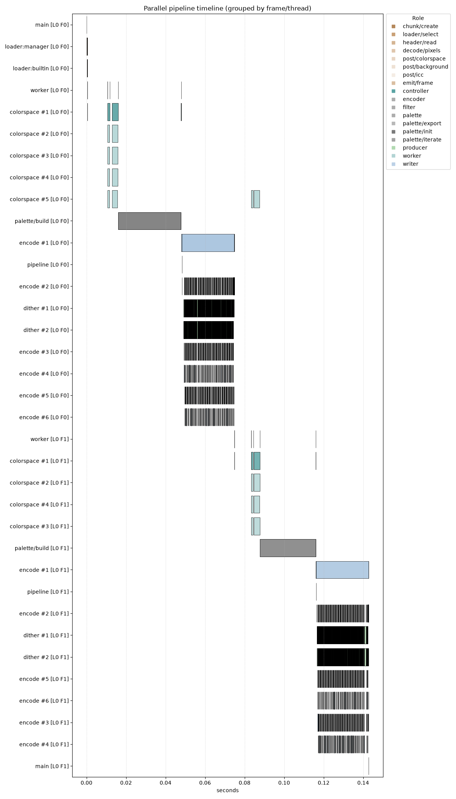

# Animation Threading

For input formats, loader support, playback controls, timing, and output-state interactions, see [Animation playback in img2sixel](../encoder/animation.md). This document covers scheduling and frame ownership. Playback and prepare-ahead workers inherit the owning encoder’s resolved policy snapshot, including its frame keys. Serial playback submission enters the same snapshot. The [palette policy](../cli/threading-policy.md#precedence-and-interactions) defines playback overrides and inheritance; both accepted palette modes currently wait for each frame’s own palette.

## Current frame pipeline

Supported multi-frame loaders hand frames to the encoder through a bounded read-ahead queue. Its depth is `load_depth`, default 4 and maximum 16. With `load=ahead`, loading overlaps downstream work; `load=serial` keeps the loader callback synchronous. The [threading-policy reference](../cli/threading-policy.md) owns these controls and their precedence.

With `prepare=ahead`, frame n+1 can be prepared while frame n is emitted. The two lanes overlap independent preparation and output work; output and retained delta history are still committed one frame at a time in order.

```text
loader / callback       preparation                 ordered emission
-----------------       -----------                 ----------------
load frame 0 ---------> prepare frame 0 -----------> emit frame 0
load frame 1 ---------> prepare frame 1 (overlap) --> emit frame 1
load frame 2 ---------> prepare frame 2 (overlap) --> emit frame 2
wait when queue full                                commit in frame order
```

The public `sixel_playback_*` API has a separate admission bound: up to its configured `CAPACITY`, independently of loader `load_depth`. Reservations and submitted frames count toward that capacity. The API supplies its own frames and does not turn loader read-ahead depth into an admission limit.

The retained two-frame timeline below records a specific measurement revision in [threading-run.json](measurements/threading-run.json). It shows serial frame-level intervals with internal dither and encode workers. It is measurement evidence for that run, not a representation of every permitted prepare/emit overlap.



The fixture intentionally has two frames and no loop extension. An infinitely
looping animation is unsuitable for a reproducible timeline command because
neither the JSONL record nor the SIXEL output has a natural completion point.

## What is and is not shared

Preparation owns private frame and palette state; emission owns ordered output and temporal history. Caller-local budget scopes limit preprocessing, including palette/main overlap, and `prepare_workers` does not reduce the emission allocation. The [mode explanation](policy-modes.md#frame-overlap-and-ordered-publication) places these stages in the complete scheduling model.

Each component can create an independent short-lived pool. The budget is not a process-wide scheduler: control, loader-handoff and writer threads exist outside planned work slots, and separate API clients are not jointly admitted against one root quota. [Threading overview](overview.md#worker-budget-is-not-a-process-thread-limit) defines that distinction.

A process-wide coordinator would need to account for both prepare and emit lanes, their internal pools and other concurrent clients. Dividing a budget eagerly at animation start would not model loader stalls, temporarily empty queues or completion-driven reclamation.

## Temporal state constrains parallelism

Animation is more than an ordered list of independent still images. Delta
output retains the colors left on the display plane across frame boundaries.
Emission commits that state in display order. Ahead preparation can predict whether delta output needs an alpha/keep palette entry. If committed history requires a different reservation, the worker discards the prepared result and prepares again from a pristine source copy before emission. This correctness rule applies where that reservation affects the palette; it is not a general reason to redo every prepared frame.

Frame ownership also matters. The handoff can retain a shareable frame by reference, or clone it when later preprocessing could conflict with loader reuse. Performance changes must preserve that lifetime contract as well as visual ordering. Packed-alpha separation also counts as preprocessing that mutates storage, even if no explicit float precision, crop, resize or workspace conversion requested a copy. The existing planner marks packed-to-RGB normalization as a colorspace operation, so handoff already requires a copy; see the [generated animation contract](../encoder/output/output-colorspace.md#generated-palettes-in-animation).

## Future budget-coordinator requirements

A process-wide budget design should be attempted as a separate architecture
change. At minimum it needs:

1. one explicit root budget for the operation;
2. incremental leases for only the stages that are runnable now;
3. reclamation when palette, dither, decode, or encode stages finish;
4. no hidden worker creation outside the accounted control threads;
5. ordered frame publication and temporal-state commit; and
6. timeline fields that record requested, granted, active, and returned
   workers.

The retained timelines establish host-specific measurement baselines. They do not prove process-wide accounting or simultaneous publication of frames.
