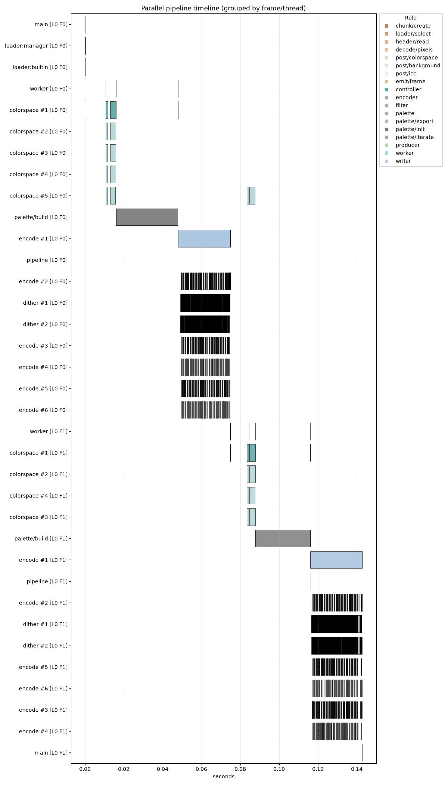
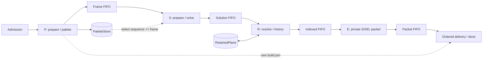

# Animation Threading

For input formats, loader support, playback controls, timing, and output-state interactions, see [Animation playback in img2sixel](../encoder/animation.md). This document covers scheduling and frame ownership. Playback and prepare-ahead workers inherit the owning encoder’s resolved policy snapshot, including its frame keys. Serial playback submission enters the same snapshot. The [palette policy](../cli/threading-policy.md#precedence-and-interactions) defines playback overrides and inheritance; frame mode waits for each frame’s own palette, while eligible latest sessions select a completed palette at application start.

## Current frame pipeline

Supported multi-frame loaders hand frames to the encoder through a bounded read-ahead queue. Its depth is `load_depth`, default 4 and maximum 16. With `load=ahead`, loading overlaps downstream work; `load=serial` keeps the loader callback synchronous. The [threading-policy reference](../cli/threading-policy.md) owns these controls and their precedence.

With `prepare=ahead`, frame n+1 can be prepared while frame n is emitted. The two lanes overlap independent preparation and output work; output and retained delta history are still committed one frame at a time in order. GPU palette application also permits this overlap: the helper performs CPU frame preparation and palette construction, while ordered emission acquires the GPU lookup plan and backend lease. Without an admitted deferred capability, the helper does not apply a palette or write output. Helper availability follows the shared [encoder capability](encoder.md#test-coverage); builds without threading, PCC and TinyCC keep serial preparation. Tests that gate on preparation callbacks skip on those builds instead of waiting for a worker that cannot start. `prepare=serial` disables this helper; a GPU auto-policy cutoff does not disable CPU preparation overlap.

```text
loader / callback       preparation                 ordered emission
-----------------       -----------                 ----------------
load frame 0 ---------> prepare frame 0 -----------> emit frame 0
load frame 1 ---------> prepare frame 1 (overlap) --> emit frame 1
load frame 2 ---------> prepare frame 2 (overlap) --> emit frame 2
wait when queue full                                commit in frame order
```

The public `sixel_playback_*` API has a separate admission bound: up to its configured `CAPACITY`, independently of loader `load_depth`. Reservations and submitted frames count toward that capacity. The API supplies its own frames and does not turn loader read-ahead depth into an admission limit. Its sequences start at one in submission order, independently of reservations. RGB inputs need no animation flag. The [public API comments](../../include/sixel.h.in) describe callbacks and `palette_sequence`; the [policy reference](../cli/threading-policy.md#precedence-and-interactions) owns explicit-config precedence, including zero, and NULL-config inheritance.

The retained two-frame timeline below records a specific measurement revision in [threading-run.json](measurements/threading-run.json). It shows serial frame-level intervals with internal dither and encode workers. It is measurement evidence for that run, not a representation of every permitted prepare/emit overlap.



The fixture intentionally has two frames and no loop extension. An infinitely looping animation is unsuitable for a reproducible timeline command because neither the JSONL record nor the SIXEL output has a natural completion point.

Eligible RGB8 GPU `sixel_playback_t` sessions use the [independent controller](../../src/encoder-playback-independent.inc.h), with preparation overlap, at least two admission slots and explicit frame or latest palette mode. P prepares immutable inputs and constructs palettes. S selects one palette, prepares GPU execution and completes a history-free solve. R resolves against history and advances it. E encodes a complete indexed image into a private SIXEL packet. A separate dispatcher writes packets and invokes completion callbacks in admission order. Direct calls, loader animation and unsupported session forms retain their synchronous or deferred controller.



PaletteStore is a bounded version store, not a consuming FIFO. S selects the greatest completed compatible palette sequence at most the frame sequence: a completed own palette wins automatically. It pins that snapshot before GPU preparation and never replaces it in flight. Future publications cannot evict the last eligible result. First-frame or incompatible-profile selection waits for the own build. The store retains own jobs through completion, with capacity bounded by public admission capacity in the independent controller; other controllers retain their two-job bound.

The three result pools each hold two resources, including active consumers. S releases its solution after R finishes; R releases its image after E finishes; E releases its packet after ordered delivery/completion. Popped descriptors do not free their payloads. SPSC descriptor rings use native atomics with the existing synchronization fallback. A parking mutex handles empty/full predicates and wakeups; no GPU execution or callback runs under that mutex. The complete pipeline is not lock-free. Capacity remains an end-to-end admission bound: three admitted frames can occupy S/R/E, and four can also occupy P. Larger capacity never permits overwriting or dropping admitted results.

Only R uses RetainedPlane. It reserves an image slot before claiming an admission, resolving and advancing history; R[n+1] may use that history before E[n] or delivery completes. S has no R-completion credit. E has no source, solution or history dependency. The [delta contract](../encoder/output/delta-encoding.md#indexed-retained-state-transactions) owns the distinct publication boundaries and reset rules.

Cancellation and the R claim share the admission mutex ordering point. Claimed frames finish through delivery; unclaimed frames through the cancellation watermark complete interrupted. Later admissions wait for the preceding prefix to complete before inheriting origin/reservation predictions. An encode or delivery error stops admission, drains dependent users and invalidates history. Detach to direct encoding also invalidates history. A callback never releases pixels while the own palette build still reads them. A known own-build error suppresses delivery; a later error remains visible after already accepted bytes.

E builds complete framed packets before external delivery. A packet credit requires a free storage slot, but the slot search still bounds every array access. If that invariant is broken, the frame fails with a logic error and drains without encoding into or releasing another frame's storage. The dispatcher sends no bytes for frame n+1 until done[n] returns, preserving callbacks without frame IDs. This adds bounded packet storage and can delay first-byte delivery. Shared GPU hardware may serialize S and R commands despite independent workers. The [stage measurements](encoder.md#timeline-interpretation) distinguish service, queue residence and completion intervals; independence is not a frame-rate guarantee.

## What is and is not shared

Preparation owns private frame and palette state; emission owns ordered output and temporal history. Caller-local budget scopes limit preprocessing, and ordinary next-frame preparation does not reduce emission allocation in either palette mode. Latest preparation returns after starting an owned build; emission waits for display time, selects a completed snapshot and creates a private application dither. Frame completion joins its own build before reporting the result, even when another palette was applied. An own-build error therefore fails the frame even after bytes have been written. The store retains bounded own jobs and future records plus one eligible completed record, as described above. A selection retains its snapshot through application, independently of later store replacement. Source masks, origins, diffusion state and history belong to the current frame rather than the snapshot. The [mode explanation](policy-modes.md#frame-overlap-and-ordered-publication) places these stages in the complete scheduling model.

Ahead preparation requires a generated palette without a stateful dither cache. Presentation pairs, DRCS, palette capture and progressive contexts retain serial preparation. A change of the AUTO working colorspace also defers the next frame to the ordered owner, so it cannot change coordinates underneath the current emission. The current frame owns diagnostic dither publication; the helper owns its frame job, pristine recovery copy and palette. Independent GPU playback admits explicit latest mode for native RGB8 gamma output; automatic mode retains its existing eligibility and controller.

Each component owns its independent pools; encoder_core can retain drained workers and scratch under the [encoder reuse conditions](encoder.md#six-row-jobs-and-ordered-output). The budget is not a process-wide scheduler: control, loader-handoff and writer threads exist outside planned work slots, and separate API clients are not jointly admitted against one root quota. [Threading overview](overview.md#worker-budget-is-not-a-process-thread-limit) defines that distinction.

Within a synchronous latest session, application/encoding M receives the whole encoder budget N. Its fixed geometry and stage limits come from `sixel_dither_encode_allocate`, exactly as in frame mode. Ordinary next preparation retains its independent `prepare_workers` cap. Palette construction P has a bounded pool lease and borrows live CPU slots separately: its controller and child callbacks acquire loans only when emission leaves capacity. Pool submission and join release the caller’s CPU claim, allowing unused stage capacity, draining bands and output waits to admit background work. Emission resumes without waiting for borrowers; already admitted background jobs finish before trying to renew their loans. Latest-only preparation Q, the owned full-frame input copy, acquires a loan for its copy job; common sampling remains independent. P and Q together stay within the preparation cap at admission. Pool callbacks and serial solver iterations or box splits are cooperative boundaries; unsplit setup and finalization remain serial jobs. Thus reclamation is bounded by work granularity, not elapsed time, and a running job can temporarily overlap renewed emission demand. Publication and thread join remain distinct lifetime boundaries. The first frame and incompatible-palette recovery wait for the own build outside emission work accounting; final cleanup also releases emission demand before joining.

Independent latest playback gives E the foreground CPU work hook and P the cooperative background hook. E releases its demand before parking or publishing; the dispatcher joins P without a CPU grant. GPU solve and queue wait times do not justify changing CPU allocations. Ordinary preparation keeps its configured cap.

The palette scheduler initializes mutexes and condition variables only when thread support is enabled. A build without threads still initializes a disabled scheduler, retains the resolved policy budget and grants no asynchronous lane reservations; synchronization stubs must not turn serial frame setup into an initialization error. The serial test also covers a one-slot budget and explicit frame mode in thread-enabled builds.

A process-wide coordinator would need to account for both prepare and emit lanes, their internal pools and other concurrent clients. Dividing a budget eagerly at animation start would not model loader stalls, temporarily empty queues or completion-driven reclamation.

## Temporal state constrains parallelism

Animation is more than an ordered list of independent still images. Delta output retains the colors left on the display plane across frame boundaries. Emission commits that state in display order. Ahead preparation can predict whether delta output needs an alpha/keep palette entry. If committed history requires a different reservation, the worker discards the prepared result and prepares again from a pristine source copy before emission. Latest first checks the selected snapshot’s reservation and color profile; an incompatible candidate waits for the current frame’s own palette. A stale own prediction is joined and rebuilt from the pristine source. Epoch changes invalidate both published future records and outstanding attempts, so an obsolete completion cannot replace a repaired palette. Loader loops keep sequence continuity; input boundaries, detach and bypass behavior follow the [palette contract](../cli/threading-policy.md#contract). This correctness rule applies where that reservation affects the palette; it is not a general reason to redo every prepared frame.

Frame ownership also matters. The handoff can retain a shareable frame by reference, or clone it when later preprocessing could conflict with loader reuse. Performance changes must preserve that lifetime contract as well as visual ordering. Packed-alpha separation also counts as preprocessing that mutates storage, even if no explicit float precision, crop, resize or workspace conversion requested a copy. The existing planner marks packed-to-RGB normalization as a colorspace operation, so handoff already requires a copy; see the [generated animation contract](../encoder/output/output-colorspace.md#generated-palettes-in-animation).

Cancellation records the last admitted sequence under the queue mutex. A frame already claimed by the ordered owner may finish; any earlier admitted frame still held by the preparation helper is cancelled even though it has left the queue. Later submissions exceed that watermark and remain eligible. Cancellation does not interrupt a running preparation task. The owner waits for it, releases its job and palette workers, and only then reports its completion callback, which may recycle borrowed pixels. Output failure follows the same drain-before-release rule for the next prepared frame.

## Future budget-coordinator requirements

A process-wide budget design should be attempted as a separate architecture change. At minimum it needs:

1. one explicit root budget for the operation;
2. incremental leases for only the stages that are runnable now;
3. reclamation when palette, dither, decode, or encode stages finish;
4. no hidden worker creation outside the accounted control threads;
5. ordered frame publication and temporal-state commit; and
6. timeline fields that record requested, granted, active, and returned workers.

The retained timelines establish host-specific measurement baselines. They do not prove process-wide accounting or simultaneous publication of frames.

## Test coverage

<!-- test-coverage: enforced -->

| ID | Contract | Owning test |
| --- | --- | --- |
| AT-01 | Serial palette scheduling initializes successfully, grants no lanes and preserves the requested budget, including builds without threads. | [tests/encoder/planning/0045_palette_scheduler_serial.t](../../tests/encoder/planning/0045_palette_scheduler_serial.t) |
| AT-02 | With preparation overlap available, cancellation includes a prepared frame outside the queue. | [tests/encoder/planning/0189_prepare_ahead_cancel_prepared.t](../../tests/encoder/planning/0189_prepare_ahead_cancel_prepared.t) |
| AT-03 | With preparation overlap available, submissions after cancellation remain eligible. | [tests/encoder/planning/0190_prepare_ahead_cancel_new_admission.t](../../tests/encoder/planning/0190_prepare_ahead_cancel_new_admission.t) |
| AT-04 | With preparation overlap available, output failure drains preparation before the next completion releases ownership. | [tests/encoder/planning/0191_prepare_ahead_write_failure_drain.t](../../tests/encoder/planning/0191_prepare_ahead_write_failure_drain.t) |
| AT-05 | Explicit serial preparation does not enter the helper lane. | [tests/encoder/planning/0192_gpu_ahead_explicit_serial.t](../../tests/encoder/planning/0192_gpu_ahead_explicit_serial.t) |
| AT-06 | Playback cancellation/failure reports a skip without threads; its private callbacks share that compile-time condition. | [tests/encoder/planning/0022_playback_cancel_failure.t](../../tests/encoder/planning/0022_playback_cancel_failure.t) |

| AT-07 | The ready ring preserves FIFO order. | [tests/encoder/scheduling/0028_ready_fifo.t](../../tests/encoder/scheduling/0028_ready_fifo.t) |

| AT-08 | A full ring rejects publication without replacing live entries. | [tests/encoder/scheduling/0029_ready_full.t](../../tests/encoder/scheduling/0029_ready_full.t) |

| AT-09 | An empty ring leaves the destination untouched. | [tests/encoder/scheduling/0030_ready_empty.t](../../tests/encoder/scheduling/0030_ready_empty.t) |

| AT-10 | The ring preserves order across index wraparound. | [tests/encoder/scheduling/0031_ready_wrap.t](../../tests/encoder/scheduling/0031_ready_wrap.t) |

| AT-11 | Removing a descriptor does not release its resource slot. | [tests/encoder/scheduling/0032_ready_slot_release.t](../../tests/encoder/scheduling/0032_ready_slot_release.t) |

Thread-only cancellation helpers are compiled under the same `SIXEL_ENABLE_THREADS` condition as their test body. A no-thread build retains the public test entry and reports a skip, without compiling unused private callbacks.

The gated cancellation and failure cases select the CPU backend, so their ownership evidence does not depend on Metal initialization or availability. GPU dispatch and output equivalence are covered by the [encoder execution tests](encoder.md#test-coverage). These tests establish ownership and output behavior, not a scheduling deadline.

The phased integration [coverage](../encoder/palette-application/dithering/phased.md#test-coverage) separately checks solve overlap during a blocked writer, cancellation of a ready solution, later admission after cancellation, writer-failure drain and byte equality with synchronous encoding. These are deterministic ownership checks, not frame-rate guarantees.

| ID | Contract | Owning test |
| --- | --- | --- |
| AT-0056 | playback resolve past stalled encode. | [tests/dither/phased/0056_playback_resolve_past_stalled_encode.t](../../tests/dither/phased/0056_playback_resolve_past_stalled_encode.t) |
| AT-0057 | Encoding uses a distinct packet slot while earlier delivery is stalled; MSVC analysis separately checks the slot-search write bounds. | [tests/dither/phased/0057_playback_encode_past_stalled_delivery.t](../../tests/dither/phased/0057_playback_encode_past_stalled_delivery.t) |
| AT-0058 | playback claimed cancel completes. | [tests/dither/phased/0058_playback_claimed_cancel_completes.t](../../tests/dither/phased/0058_playback_claimed_cancel_completes.t) |
| AT-0059 | latest replay t0. | [tests/dither/phased/0059_latest_replay_t0.t](../../tests/dither/phased/0059_latest_replay_t0.t) |
| AT-0060 | latest replay refresh. | [tests/dither/phased/0060_latest_replay_refresh.t](../../tests/dither/phased/0060_latest_replay_refresh.t) |
| AT-0061 | latest replay small. | [tests/dither/phased/0061_latest_replay_small.t](../../tests/dither/phased/0061_latest_replay_small.t) |
| AT-0062 | latest completed own. | [tests/dither/phased/0062_latest_completed_own.t](../../tests/dither/phased/0062_latest_completed_own.t) |
| AT-0063 | latest excludes future. | [tests/dither/phased/0063_latest_excludes_future.t](../../tests/dither/phased/0063_latest_excludes_future.t) |
| AT-0067 | A non-native input drains the independent prefix before serial fallback, preserving ordered bytes. | [tests/dither/phased/0067_playback_format_transition.t](../../tests/dither/phased/0067_playback_format_transition.t) |
