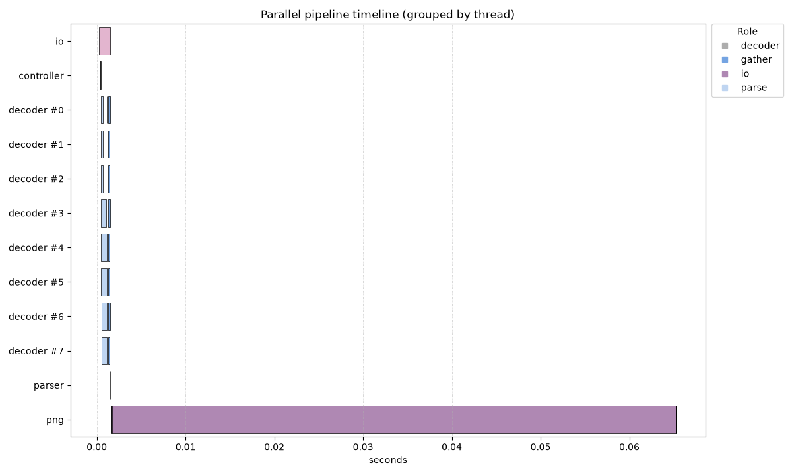
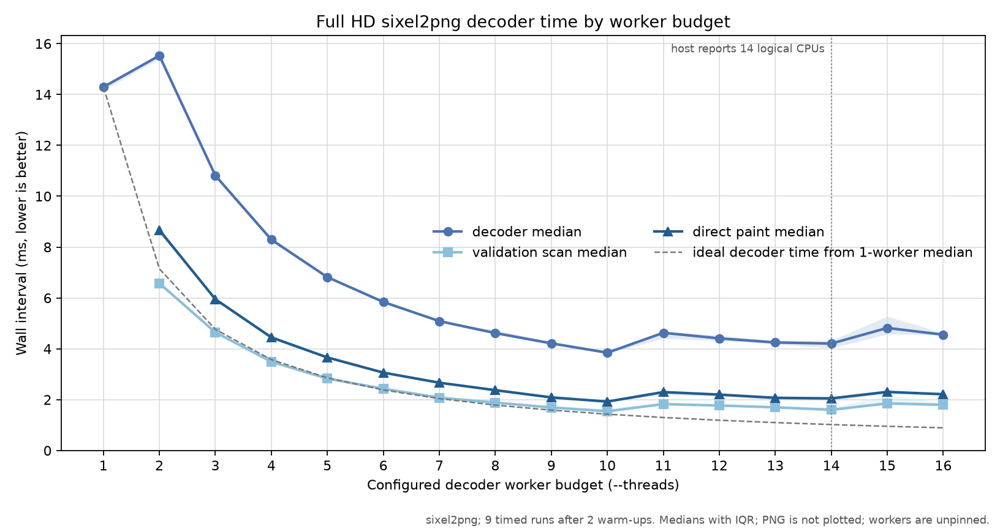

# Decoder Threading

## Why decoding is split by bytes

A SIXEL stream states vertical movement through control sequences in the input. Before parsing those sequences, an arbitrary byte offset cannot be mapped directly to a destination-row strip. The decoder therefore begins serially, establishes raster bounds and initial palette state, and passes the remaining payload to the parallel decoder as byte spans.

The serial path uses [ordinary band columns](../decoder/pipeline/README.md#ordinary-mode-band-columns). The following span design applies when a parallel request succeeds.

The default span lengths are nearly equal. `SIXEL_PARALLEL_SKEW` can bias the distribution by up to 20 percent so later workers receive systematically more or less input. Thread count is capped by payload length; a payload cannot have more non-empty initial spans than bytes.

## Parallel direct path

The ordinary parallel path parses every owned band once into private column words:

```text
serial parser establishes raster and palette
                 |
       split payload into N byte spans
                 |
       align starts to six-row band boundaries
                 |
       parallel parse into local columns
                 |
             join all N
                 |
       prefix sum of disjoint byte-span band counts
       validate extents / trusted clipping
                 |
       create all N gather workers
       all-ready release barrier
                 |
       parallel columns-to-pixels gather + join
                 |
             publish output
```

Each worker searches backward from its useful boundary for the nearest `#`, then reads that register number forward with the parser's numeric bounds. Without a preceding selector it inherits the serial anchor's register. It does not parse the complete prefix. Within its useful span, it interprets data, repeats and controls once, counts delimiters in its original disjoint byte span, and records relative painted-row bounds and the largest register. Consecutive literal data bytes update column words in one loop. Each word contains six byte indexes and six independent coverage bits, using the [serial column representation](../decoder/pipeline/README.md#ordinary-mode-band-columns).

An arbitrary split advances to the next `-` boundary unless it already follows one. A span whose aligned start exceeds its original end is empty. The preceding nonempty span owns the intervening complete band, so converging boundaries never duplicate band ownership. The controller sums original-span counts after all parsers join, adds the delimiter skipped for alignment, assigns absolute rows and validates extents. A row-overlap rejection pass is unnecessary for well-formed ordinary input: accepted spans own distinct bands by construction. Data after an embedded ST retains the legacy thread-budget-dependent behavior. An ignored tail is counted for absolute offsets; if starts also converge, the controller reconstructs the formerly duplicated first band of empty spans and retains the legacy overlap fallback before publication. This exceptional compatibility check does not reparse normal bodies.

Column storage grows locally and never retains relative rows beyond the raster height. Even a tiny trusted raster with a very large encoded paint extent keeps bounded storage; the parser still tracks outside paint. Absolute clipping is applied after prefix resolution. Gather uses the shared serial materializer with a worker-local column source, preserves initialized unpainted pixels, fills paint coverage and resolves RGBA through the established palette. It does not interpret the input again.

Palette definitions within the body, registers above 255, raster resets and unsafe numeric controls select serial fallback. Parse or allocation failure discards private columns before any shared write. All gather workers wait at a release barrier: partial worker creation aborts and joins the already-created workers while the output remains untouched. After release, gather performs no allocation or fallible parsing.

## Why a PNG phase appears

The threading timelines in this directory invoke `sixel2png`. The command first uses libsixel to decode the SIXEL stream and then serializes the returned raster as a PNG file. Its timeline therefore contains a downstream `png/io` interval in addition to the decoder interval. PNG wall time is retained to make the CLI measurement boundary explicit and to show end-to-end context; it is not decoder work and is not parallelized by the decoder's `global_budget` budget.

The checked-in eight-worker timeline uses a 1920 by 1080 raster. Eight parse intervals begin together. All eight gather workers then become ready at a barrier before their intervals begin as a parallel block. PNG output follows and dominates the remaining process wall time; it is not part of the decoder worker budget. Local parse is shown in light blue and gather in dark blue.



*Figure: Full HD decoding measured through `sixel2png`; the final PNG interval is CLI output serialization after libsixel decoding.*

The [OR-mode scaling study](../encoder/output/or-mode/scaling.md) additionally measures in-process indexed and RGBA decoder calls. Those API measurements exclude PNG serialization entirely and are reported separately from complete `sixel2png` timings.

## Worker-budget scaling

The following Full HD experiment varies `global_budget` from one through sixteen. The horizontal axis is the configured decoder worker budget, which is the closest user-facing control to an available-core budget. It is not a count of reserved physical cores: workers have no affinity, the host is not isolated, and this arm64 macOS host reports fourteen logical CPUs.

Each point is the median of nine instrumented runs after two warm-ups. The shaded region is the inclusive interquartile range. Successive rounds traverse worker counts in alternating directions to reduce monotonic time-order bias. GPU processing is disabled. PNG serialization is excluded from the plotted lines because `global_budget` does not parallelize it.



*Figure: Full HD decoder intervals measured inside `sixel2png`. PNG serialization is measured separately but intentionally omitted from these worker-scaling lines.*

The one-worker serial path took 2.799 ms at the median; two workers took 1.838 ms. The fastest observed median was 0.999 ms with 8 worker(s). The serial path and parallel workers both accumulate ordinary column words. Parallel work adds private allocation, thread startup, prefix resolution and gather coordination; those costs vary with the fixture and host.

These numbers characterize this fixture, binary and host. No CPU affinity, exclusive host, frequency control or confidence-interval claim is implied. The retained [`decoder-thread-scaling.csv`](measurements/decoder-thread-scaling.csv) contains all 144 timed observations and 32 warm-ups with their schedule positions. Decoder-specific source, build and verified library provenance are recorded under `decoder_refresh` in [`threading-run.json`](measurements/threading-run.json); encoder and animation records retain their separate provenance.

## Raster-size comparison

The same source and encoder policy produce two dedicated decoder fixtures. These are single diagnostic observations, not repeated performance benchmarks. `PNG wall` measures the command's downstream output serialization separately from decoding.

| Raster | SIXEL bytes | Parse wall | Gather wall | Decoder wall | PNG wall |
| --- | ---: | ---: | ---: | ---: | ---: |
| 900 x 675 | 295,821 | 0.443 ms | 0.076 ms | 0.840 ms | 17.121 ms |
| 1920 x 1080 | 960,950 | 0.659 ms | 0.205 ms | 1.247 ms | 63.722 ms |

These two points include scheduling and cache noise and must not be read as a scaling curve. [`decoder-size-comparison.csv`](measurements/decoder-size-comparison.csv) and both raw timelines retain the phase bounds and parse/gather fractions. Calling this only “band decoding” hides two facts: initial work units are encoded byte spans, and gather receives absolute band positions only after the local parses join.

## In-process API scaling

The retained `snake-fullhd-p256-t1.0.six` fixture decodes to 1920 x 1080 pixels. These measurements compare develop `4db3016215d202137c6ffaa096655886d956c69f` with private parallel columns at `0d0124a4c60914ae4a7513a42823d01e9ebfabd1`. Cells contain the median of 21 timed API calls after two warm-ups, with the inclusive interquartile interval in brackets. Input loading, output freeing, PNG serialization and timeline logging are excluded. Build order alternates by condition; no builds or tests run alongside the experiment, while ordinary desktop activity remains uncontrolled.

### `sixel_decode_direct`

| Workers | Before, ms [Q1, Q3] | Private columns, ms [Q1, Q3] | Before / after | After serial / parallel |
| ---: | ---: | ---: | ---: | ---: |
| 1 | 5.787 [5.704, 6.016] | 6.275 [5.835, 6.544] | 0.92x | 1.00x |
| 2 | 16.747 [16.671, 16.932] | 2.850 [2.750, 3.355] | 5.88x | 2.20x |
| 3 | 11.635 [11.574, 11.705] | 1.918 [1.890, 1.952] | 6.07x | 3.27x |
| 4 | 9.070 [9.027, 9.110] | 1.535 [1.507, 1.591] | 5.91x | 4.09x |
| 5 | 7.565 [7.529, 7.602] | 1.320 [1.299, 1.371] | 5.73x | 4.75x |
| 6 | 6.504 [6.461, 6.552] | 1.207 [1.181, 1.229] | 5.39x | 5.20x |
| 7 | 5.687 [5.638, 5.722] | 1.068 [1.047, 1.088] | 5.32x | 5.88x |
| 8 | 5.294 [5.194, 5.390] | 1.003 [0.992, 1.022] | 5.28x | 6.26x |
| 9 | 4.730 [4.699, 4.830] | 1.000 [0.970, 1.040] | 4.73x | 6.28x |
| 10 | 4.288 [4.263, 4.379] | 1.011 [0.924, 1.073] | 4.24x | 6.21x |
| 11 | 4.568 [4.406, 4.711] | 1.053 [1.025, 1.087] | 4.34x | 5.96x |
| 12 | 4.661 [4.588, 4.760] | 1.050 [1.037, 1.104] | 4.44x | 5.98x |

### `sixel_decode_raw`

| Workers | Before, ms [Q1, Q3] | Private columns, ms [Q1, Q3] | Before / after | After serial / parallel |
| ---: | ---: | ---: | ---: | ---: |
| 1 | 5.558 [5.441, 5.667] | 5.578 [5.546, 5.641] | 1.00x | 1.00x |
| 2 | 15.817 [15.759, 15.846] | 2.819 [2.783, 2.874] | 5.61x | 1.98x |
| 3 | 11.097 [10.991, 11.355] | 2.107 [2.062, 2.177] | 5.27x | 2.65x |
| 4 | 8.719 [8.659, 8.743] | 1.754 [1.711, 1.793] | 4.97x | 3.18x |
| 5 | 7.262 [7.176, 7.335] | 1.480 [1.438, 1.516] | 4.91x | 3.77x |
| 6 | 6.219 [6.160, 6.278] | 1.310 [1.284, 1.330] | 4.75x | 4.26x |
| 7 | 5.446 [5.420, 5.587] | 1.188 [1.169, 1.229] | 4.58x | 4.70x |
| 8 | 4.988 [4.921, 5.017] | 1.140 [1.129, 1.161] | 4.38x | 4.89x |
| 9 | 4.486 [4.452, 4.518] | 1.048 [1.028, 1.055] | 4.28x | 5.32x |
| 10 | 4.082 [4.022, 4.147] | 1.001 [0.971, 1.023] | 4.08x | 5.57x |
| 11 | 4.363 [4.256, 4.512] | 1.151 [1.110, 1.175] | 3.79x | 4.85x |
| 12 | 4.338 [4.285, 4.466] | 1.210 [1.150, 1.251] | 3.59x | 4.61x |

Every measured parallel budget from 2 through 12 is compared with the same implementation at one worker. Column parsing and materialization are separate parallel phases, with no second interpretation of the ordinary body.

For 100 retained photographs, per-image direct-RGBA speed ratios are:

| Workers | Median speed ratio | Range |
| ---: | ---: | ---: |
| 1 | 0.99x | 0.92–1.07x |
| 2 | 4.02x | 2.83–5.91x |
| 4 | 3.82x | 2.62–5.18x |
| 12 | 2.50x | 1.60–3.16x |

No image-size threshold is added for these retained photographs; their measured serial/parallel ratios are recorded below. This does not establish a universal crossover for smaller images.

The separate [palette-map control](../encoder/output/or-mode/scaling.md#thread-count-axis) is only 598 x 42 pixels. Its ordinary RGBA median rises from 0.021 ms at one worker to 0.083 ms at two and 0.169 ms at twelve. Thread startup dominates this small input; the photographic results do not imply that every image benefits from additional workers. The default decoder budget remains one worker.

| Workers | After serial / parallel, median | Range |
| ---: | ---: | ---: |
| 2 | 1.88x | 1.60–2.13x |
| 4 | 3.14x | 2.26–3.91x |
| 12 | 3.69x | 1.73–5.61x |

### Trusted raster output

`sixel_decode_pixels` uses the literal-run fast path for a whole six-row band inside the trusted height, bounded by the smaller of the allocated and declared positive widths. Edge bands and out-of-width characters retain scalar clipping and outside-paint flags.

| Option | Workers | Before, ms [Q1, Q3] | After, ms [Q1, Q3] | Before / after |
| --- | ---: | ---: | ---: | ---: |
| None | 1 | 6.201 [6.176, 6.254] | 6.317 [6.278, 6.371] | 0.98x |
| None | 8 | 5.917 [5.895, 6.038] | 1.679 [1.641, 1.730] | 3.52x |
| TRUST_RASTER_SIZE | 1 | 17.670 [17.563, 17.768] | 6.422 [6.357, 6.484] | 2.75x |
| TRUST_RASTER_SIZE | 8 | 5.907 [5.824, 5.938] | 1.684 [1.641, 1.744] | 3.51x |

[`decoder-api-scaling.json`](measurements/decoder-api-scaling.json) retains every sample, input hash, revision, configure arguments and verified library path, including the OR and high-color controls. The instrumented scaling chart uses a different fixture and timing boundary, so its absolute values should not be combined with this table.

### Repeated controls

A matched follow-up repeats the same 21-call blocks four times after two warm-ups, alternating build order by condition and round. The following one-worker times are medians of the four block medians. The range retains each block's before/after ratio; the primary tables above remain unchanged.

| API, one worker | Before, ms | After, ms | Before / after, median | Range across four blocks |
| --- | ---: | ---: | ---: | ---: |
| `sixel_decode_direct` | 5.692 | 5.687 | 1.001x | 0.992–1.018x |
| `sixel_decode_raw` | 5.753 | 5.889 | 0.982x | 0.958–0.993x |

The balanced one-worker direct ratios span both sides of equality. The raw ratios remain below 1.0 in these four blocks, with a median of 0.982 (about 2% slower after the change); the primary raw table is closer to equality. The observations therefore do not establish strictly unchanged serial latency.

The literal-run width is computed only after run eligibility is established, so repeated and scalar paint avoid trusted-width setup. All configured Full HD budgets and the OR/high-color controls are retained under `repeated_controls` in [`decoder-api-scaling.json`](measurements/decoder-api-scaling.json). These observations characterize this host and stream; they do not establish equal timing on every input.

## Local-buffer and undither path

When decoder-side undithering is prepared, the validation-only pass resolves row offsets and caches the start of the existing top halo and its inherited register. Local workers decode that halo and their body into private row chunks, then filter and publish only body rows. The halo is filter input, so its byte and newline semantics remain separate from the prefix sum. Converging spans retain the existing local filtering windows independently of ordinary column ownership. A local worker whose scheduled end falls inside its halo publishes no body rows, so direct-scan row bounds cannot be used as its publication bounds. Local buffers reduce direct write conflicts and permit more work to remain inside the parallel worker lifetime. This path has different allocation and copying costs from direct paint and must be measured separately.

Do not infer behavior for decoder undithering from the direct-path chart. A timeline should identify scan, decode, paint, local-copy, and output stages explicitly whenever those paths are compared.

## Fallback and correctness

Parallel decoding begins only after the serial parser has established an anchor. A worker can still encounter syntax that needs global parser context, including raster resets or palette redefinitions. Such a stream may fall back to serial handling. This is an intended correctness boundary, not proof that the configured thread option was ignored.

OR-mode streams (`P2=5`) never enter the parallel path. Their serial decoder accumulates band-plane words. The ordinary overwrite columns cannot represent OR composition, and this implementation does not add a separate parallel OR accumulator. Configured worker budgets therefore measure the same serial OR algorithm. The [OR-mode decoder study](../encoder/output/or-mode/scaling.md#how-the-band-plane-decoder-works) explains that representation and the measurements.

Parallel work must preserve:

- control-sequence and palette semantics at each span boundary;
- disjoint row ownership, or clean fallback before shared-buffer writes;
- raster clipping and paint-mask behavior;
- identical malformed-input and allocation-failure handling; and
- the public decoder's output ownership contract.

The ordinary timeline records paired starts and finishes for both parse and gather. `tests/cli/sixel2png/0011_parallel_timeline_spans_paired.t` keeps that diagnostic contract from silently degrading back to zero-length markers. `0012_parallel_gather_barrier.t` verifies that every gather worker reaches the barrier before publication begins. Decoder tests 0025 and 0026 cover partial gather creation and disjoint publication from converging byte spans, including the clean-fallback guarantee.

## Measurement limits

The checked-in timeline and two-size comparison are single diagnostic observations from one generated image class. The worker-budget figure is a repeated decoder scaling curve, but remains one session on one host. A broader performance study should vary payload size, SIXEL command mix, destination dimensions, palette changes, output format, and host. Measure parser/paint time separately from PNG serialization when the question is decoder parallelism.

## Test coverage

<!-- test-coverage: enforced -->

| ID | Contract | Owning test |
| --- | --- | --- |
| DTH-01 | Successful parallel requests preserve initial and inherited registers and literal row placement in 8-bit indexed, 16-bit indexed and RGBA buffers. | [tests/processing/decoder/0091_parallel_inherited_register.t](../../tests/processing/decoder/0091_parallel_inherited_register.t) |
| DTH-02 | Prefix-derived absolute rows clip to a trusted raster and report out-of-raster paint. | [tests/processing/decoder/0092_parallel_prefix_clipping.t](../../tests/processing/decoder/0092_parallel_prefix_clipping.t) |
| DTH-03 | A large encoded paint extent remains safe when clipped to a small trusted canvas, including validation diagnostics. | [tests/processing/decoder/0093_parallel_large_clipped_scan.t](../../tests/processing/decoder/0093_parallel_large_clipped_scan.t) |
| DTH-04 | Worker-local column allocation failure discards private paint and leaves shared pixels and coverage untouched. | [tests/processing/decoder/0101_parallel_columns_allocation_failure.t](../../tests/processing/decoder/0101_parallel_columns_allocation_failure.t) |
| DTH-05 | Partial parse-worker creation joins started workers and returns a clean serial fallback. | [tests/processing/decoder/0102_parallel_parse_create_failure.t](../../tests/processing/decoder/0102_parallel_parse_create_failure.t) |
| DTH-06 | Embedded ST followed by trailing data preserves legacy absolute offsets and overlap fallback at each tested worker budget. | [tests/processing/decoder/0103_parallel_early_st_compatibility.t](../../tests/processing/decoder/0103_parallel_early_st_compatibility.t) |

The [decoder suite](../../tests/processing/decoder) also covers sparse bands, converging spans, palette redefinitions and partial worker creation; the [CLI suite](../../tests/cli/sixel2png) checks paired timeline spans and the all-ready gather barrier. Timing observations depend on the host and are not correctness assertions.
