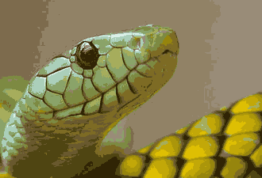
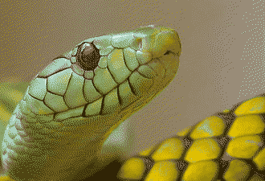

# Dithering, Step by Step

A terminal can show a picture with only a few hundred colors, and often far fewer. Yet a photograph drawn with 16 colors can look almost smooth. The trick is **dithering**: mixing palette colors in fine patterns that the eye averages. In this tutorial you write those patterns yourself, look at what goes wrong, and learn to measure the result.

| The nearest of 16 colors | The same 16 colors, dithered |
| --- | --- |
|  |  |

You do not need libsixel for the first five lessons, and you do not need the [SIXEL codec tutorial](../sixel-codec/README.md), although the two fit together. If you can write a loop over an array in C, you are ready. This chapter teaches by building and looking; the [dithering concepts](../../concepts/dithering/README.md) page explains the theory, and the [dithering reference](../../encoder/palette-application/dithering/README.md) documents every method of `img2sixel -d`.

## Your first dither in one minute

Build the programs, make a test gradient and a palette, and compare two steps:

```sh
cd docs/tutorial/dithering/code
make
./dtool gradient 640 80 > gradient.ppm
./dtool cube 3 > cube27.ppm
./step1 gradient.ppm cube27.ppm > bands.ppm
./step3 gradient.ppm cube27.ppm > dots.ppm
```

Open `bands.ppm` and `dots.ppm` in any image viewer. To see them in a SIXEL terminal, send them through the encoder of the codec tutorial, which uses each color of a picture with at most 256 colors as it is:

```sh
make -C ../../sixel-codec/code
../../sixel-codec/code/step6 encode dots.ppm
```

## The programs you will use

| Command | What it does |
| --- | --- |
| `./stepN IN.ppm PALETTE.ppm [OPTION] > OUT.ppm` | Dithers a picture with a palette |
| `./stepN bench IN.ppm PALETTE.ppm [OPTION]` | Measures how fast that is |
| `./stepN selftest` | Checks sizes, palette colors and the average tone |
| `./dtool gradient W H` | Writes a test gradient |
| `./dtool flat W H R G B` | Writes one flat color |
| `./dtool cube LEVELS`, `./dtool gray LEVELS` | Writes a fixed palette |
| `./dtool average N IN.ppm` | Shows a picture as an eye averaging N × N pixels would |
| `./dtool measure REFERENCE.ppm OUT.ppm` | Prints the three numbers of [lesson 5](step5-good-dither.md) |

Pictures are PNM files, the format described in the [codec tutorial](../sixel-codec/README.md#pictures-as-pnm-files). A palette is also a PNM picture: each of its pixels is one palette color.

## Your part: one function

Everything around the method is already written in [`code/common.c`](code/common.c) and [`code/main.c`](code/main.c). Your job is one function, declared in [`code/tutorial.h`](code/tutorial.h):

```c
int dither(image_t *out, image_t const *in, palette_t const *pal,
           char const *option);
```

[`code/mydither.c`](code/mydither.c) is a starting point: `make mydither && ./mydither selftest`. Steps 1 to 4 are worked answers.

## The palette is given

A dither does not choose colors. It only arranges the colors it is given, and this chapter does not teach how to choose them. It uses two kinds of palette:

| Palette | Colors | What it is good for |
| --- | --- | --- |
| Cube, `./dtool cube 3` or `6` | 27 or 216 | Covers all colors evenly. Dithering works dramatically, with coarse grain. |
| Grays, `./dtool gray 2`, `4` or `16` | 2 to 16 | The clearest place to see each effect. |
| [`palettes/snake16.ppm`](code/palettes/snake16.ppm), [`snake256.ppm`](code/palettes/snake256.ppm) | 16 or 255 | Fit to one photograph, `images/snake.ppm`. This is what real output looks like. |

Palettes fit to a picture were made by libsixel. How to make one is a big subject of its own, starting from [palette clustering](../../concepts/clustering/README.md). [Lesson 5](step5-good-dither.md) shows why it matters to dithering.

## The journey

| Lesson | You learn | What you will see |
| --- | --- | --- |
| [1. The nearest color](step1-nearest.md) | Why few colors break smooth shading | Banding |
| [2. Patterns](step2-ordered.md) | Nudging each pixel by its position | Regular grids and random noise |
| [3. Error diffusion](step3-error-diffusion.md) | Handing on what a pixel could not show | Grain |
| [4. Kernels and scan order](step4-kernels.md) | Changing who receives the error | Patterns and lost tone |
| [5. What makes a dither good?](step5-good-dither.md) | Tone, structure, noise and contours | Why no single number decides |
| [6. Measuring a dither](step6-measuring.md) | Scoring your output with `lsqa` | Metrics that disagree, and why |

## Checking your work

```sh
make check
```

[`code/check.sh`](code/check.sh) runs every self test and requires that the same input always gives the same output, that step 4 with its `fs` kernel is exactly step 3, and that the other kernels and scan orders really change the picture.

## From the tutorial to libsixel

The tutorial programs are deliberately small. libsixel's [dithering](../../encoder/palette-application/dithering/README.md) adds more methods, [clamp policies](../../encoder/palette-application/clamp-policy.md), fast [lookup policies](../../encoder/palette-application/lookup-policy/README.md), a [working color space](../../encoder/palette-application/working-colorspace/README.md) and parallel work bands. The [measurement record](measurements.md) has every number of this chapter, the conditions and the commands to reproduce them.

A browser may shrink a picture to fit its column, which blurs the very dots these lessons are about, so open a picture on its own to see its real pixels. The pictures are real output of the programs, generated by [`tools/plot_dither_tutorial_figures.py`](../../../tools/plot_dither_tutorial_figures.py). Regenerate them with `tools/reproduce_dither_tutorial_figures.sh`; pass `--check` to verify that they are up to date.
