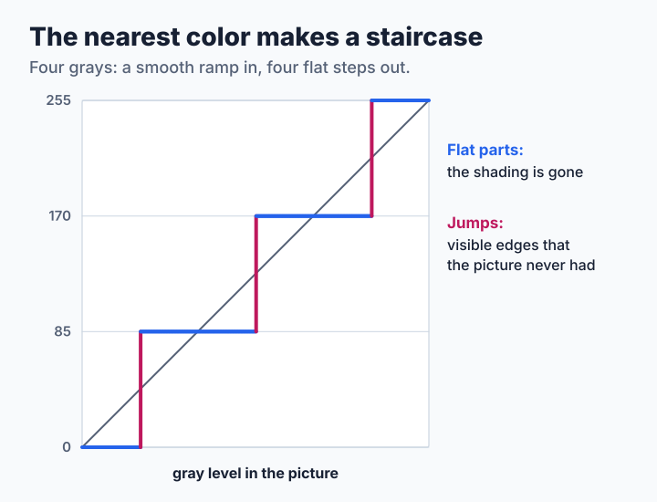
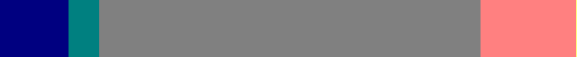
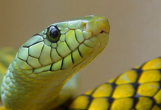
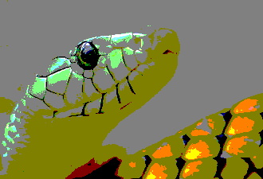

# Step 1: The Nearest Color

The simplest thing to do with a small palette is to give each pixel the closest color it has. This lesson does exactly that and looks hard at the result, because everything in this chapter is an answer to what goes wrong here. The source is [`code/step1.c`](code/step1.c).

**You will learn:**

- how to find the nearest palette color,
- what banding is and why it appears,
- why this cost is worth remembering.

## Finding the nearest color

A color is three numbers, so it is a point in a space. The nearest palette color is the one with the smallest distance to that point, and it can be found by trying them all:

```c
for (i = 0; i < pal->ncolors; i++) {
    dr = r - pal->rgb[i][0];
    dg = g - pal->rgb[i][1];
    db = b - pal->rgb[i][2];
    distance = (long)dr * dr + (long)dg * dg + (long)db * db;
    if (distance < best_distance) {
        best_distance = distance;
        best = i;
    }
}
```

There is no need for a square root: the smallest squared distance belongs to the smallest distance. The whole dither is then one loop:

```c
for (i = 0; i < n; i++, p += 3) {
    put_color(out, i, pal, nearest_color(pal, p[0], p[1], p[2]));
}
```

Later steps call the same [`nearest_color()`](code/common.c) with a changed color. Only what they ask for differs.

## Banding

Here is a smooth gradient, and the same gradient with 16 grays:

| Picture | Gradient |
| --- | --- |
| Original |  |
| Nearest of 16 grays |  |

The flat stripes are **banding**, also called contouring or posterization. They come from one fact: a range of input values all land on the same palette color, and the next value jumps to another one.



The eye makes this worse, because it is good at finding edges. The two sides of a step in the 16-gray gradient differ by only 17 levels out of 255, yet the edge is the first thing you see.

With a palette not made for the picture, things become dramatic. The test gradient of the lessons turns into a few unrelated colors, and a photograph loses most of its colors:

| Picture | Original | Nearest of a 27-color cube |
| --- | --- | --- |
| Gradient |  |  |
| Photograph |  |  |

A palette fit to the picture helps a lot, but the smooth areas still break into patches, as the blurred background on the [chapter's first page](README.md) shows. More colors only make the bands narrower.

> **Try it.** Make palettes of 2, 4 and 16 grays with `./dtool gray N > gray.ppm`, and a gradient with `./dtool gradient 640 80 0 0 0 255 255 255 > ramp.ppm`. Dither with each palette and count the bands. Then try a gradient that covers only levels 100 to 140: how many of the 16 grays does it use, and what happens to its detail?

> **Try it: write it yourself.** Open [`code/mydither.c`](code/mydither.c) and make it pass `./mydither selftest`.

## What it costs

Each pixel compares with every palette color. With `K` colors, a picture of `P` pixels takes `P × K` comparisons. That hardly matters at 16 colors, but at 256 colors, finding the color becomes most of the work of every method in this chapter. The [speed table](step4-kernels.md#how-fast-is-it) shows it. libsixel has a whole family of [lookup policies](../../encoder/palette-application/lookup-policy/README.md) for this one question.

## Where to go next

This method is `img2sixel -d none`. Its problem is that each pixel decides alone, so an area of nearly equal pixels all make the same choice. [Step 2](step2-ordered.md) makes them choose differently.
