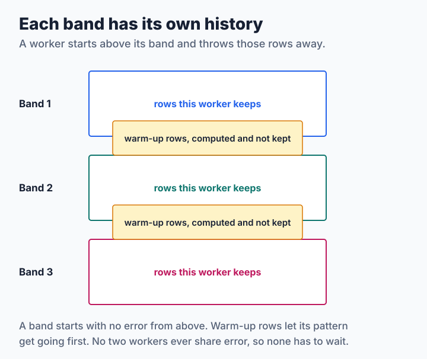

# Step 10: Dithering on Many Cores

A palette application touches every pixel, and a computer has many cores. Whether they can share the work depends on one question: does a pixel need the result of another pixel? For a pattern it does not, and for error diffusion it always does. This lesson splits both, finds the artifact that the split causes in error diffusion, and reduces it. The source is [`code/step10.c`](code/step10.c).

**You will learn:**

- why a positional method needs no care at all,
- why splitting error diffusion changes the picture,
- what a warm-up does to a seam, and what it does not,
- how to keep the output independent of the number of threads.

Choose the method and the split with an option, for example `./step10 IN.ppm PALETTE.ppm fs,bands=4,overlap=6`. As in the [codec tutorial](../sixel-codec/step6-threads.md), `TUTORIAL_THREADS` sets the number of threads.

## A pattern splits by itself

The Bayer pattern of [lesson 2](step2-ordered.md) needs only a pixel's own value and position. So any thread can do any row, at any time, and the result is the same as on one thread:

```sh
./step2 gradient.ppm cube27.ppm > one.ppm
./step10 gradient.ppm cube27.ppm bayer,bands=7 > many.ppm
cmp one.ppm many.ppm
```

libsixel's [positional methods](../../encoder/palette-application/dithering/README.md#positional-candidate-precision), including `bluenoise`, are parallel for this reason.

## Bands with their own history

Error diffusion cannot do that. Every pixel depends on the previous ones, all the way back to the top left corner. The usual way out is to give up that dependency: cut the picture into bands of rows, and let each band have an error history of its own:



The work is shared with a counter: each thread takes the next band that nobody has started, so a fast core simply does more. Only the counter needs a lock, and it is taken once per band.

```c
pthread_mutex_lock(&job->lock);
band = job->next_band++;
pthread_mutex_unlock(&job->lock);
```

One choice here matters more than it looks: the **number of bands is not the number of threads**. A band's output depends only on its own rows, so the picture is the same on 1, 3 or 16 threads, as long as `bands` stays the same. `make check` requires this. With `bands=1`, it is exactly step 3 on any number of threads.

The heights are also rounded up to whole groups of six rows, the height of a [SIXEL band](../sixel-codec/step0-by-hand.md), so that a finished band can go straight to the encoder.

## The seam

But a band starts with no error from above. Its first rows behave like the top of a picture, where [the pattern has not got going yet](step3-error-diffusion.md#grain). Here are the rows around the boundary between two bands of a gradient, enlarged four times:

| Split | Rows 48 to 72 |
| --- | --- |
| One band |  |
| Two bands |  |
| Two bands, with 6 warm-up rows |  |
| Bayer pattern, two bands |  |

The second strip has a horizontal line across it. The eye is very good at finding such a line, since it runs the whole width of the picture and nothing in the picture explains it. An area score can hardly see it, because a seam is a tiny part of the picture's area.

So let each band start a few rows early, and let it throw those rows away. They warm up the error, in the way a band that had a real history would have it:

```c
start = first - job->overlap;
start = start < 0 ? 0 : start;
/* ... */
if (y >= first) {
    put_color(job->out, y * w + x, pal, index);
}
```

This costs little: it repeats a few rows of each band. It is an approximation, because the warm-up itself starts cold, so the output is still not that of a single band.

## Measuring a seam

A global score hides a seam, so measure the look of the band's first rows. The new helper counts how often the color changes along a row, at the start of each band and elsewhere:

```sh
./dtool seams out.ppm 60
```

Here are three pictures with the 16 colors fit to the photograph:

<!-- measurements:begin:seams -->
| Picture, 16-color palette | Bands | Color changes per row, band starts | Color changes per row, elsewhere | Bytes | Area ΔE00 |
| --- | --- | --- | --- | --- | --- |
| Gradient, 640×240 | One band | 231 | 232 | 37,564 | 16.17 |
| Gradient, 640×240 | Four bands | 376 | 235 | 40,263 | 16.17 |
| Gradient, 640×240 | Four bands, 6 warm-up rows | 230 | 233 | 38,208 | 16.18 |
| Flat gray 64, 640×240 | One band | 222 | 234 | 52,842 | 18.81 |
| Flat gray 64, 640×240 | Four bands | 639 | 238 | 56,694 | 18.66 |
| Flat gray 64, 640×240 | Four bands, 6 warm-up rows | 242 | 233 | 52,845 | 18.82 |
| Photograph, 600×450 | One band | 296 | 280 | 129,015 | 2.06 |
| Photograph, 600×450 | Four bands | 284 | 281 | 128,972 | 2.04 |
| Photograph, 600×450 | Four bands, 6 warm-up rows | 302 | 281 | 128,955 | 2.05 |
<!-- measurements:end -->

On the two smooth pictures, a cold start changes the color far more often than anywhere else, and warm-up brings the rows back in line. The area score hardly notices any of this. The bytes do notice: every cold row is noisy, so it costs stream. On the busy photograph, the band starts are about the same in all three rows, as there is plenty of other structure there to hide a seam. No single row of this table decides the matter either. libsixel's [seam protocol](../../threading/measurement.md#band-seam-quality-protocol) asks for seam-local error maps and spatial metrics across many pictures.

> **Try it.** Make a palette with many more colors, and repeat this for `./dtool flat 640 240 64 64 64` with bands of different heights and warm-up rows from 0 to 24. How many warm-up rows are enough? Does the answer change with 255 colors? libsixel's rule, six rows up to 32 colors and none above, is a choice for its pictures, so check whether it holds for yours.

## How fast is it?

All these use 14 bands, so the output is the same in each row of the table:

<!-- measurements:begin:threads -->
| 14 bands, ns per pixel | 1 thread | 2 threads | 4 threads | 8 threads | 14 threads |
| --- | --- | --- | --- | --- | --- |
| Floyd–Steinberg, 16 colors | 27.3 (1.0×) | 14.0 (1.9×) | 7.5 (3.6×) | 4.7 (5.8×) | 3.7 (7.4×) |
| Floyd–Steinberg, 255 colors | 157.7 (1.0×) | 83.7 (1.9×) | 45.7 (3.5×) | 27.2 (5.8×) | 22.9 (6.9×) |
| Bayer pattern, 16 colors | 22.3 (1.0×) | 11.9 (1.9×) | 6.5 (3.4×) | 4.0 (5.6×) | 3.1 (7.2×) |
| Bayer pattern, 255 colors | 155.7 (1.0×) | 81.9 (1.9×) | 44.8 (3.5×) | 26.6 (5.9×) | 21.8 (7.1×) |
<!-- measurements:end -->

Every method gains about 7 times on 14 threads, because bands share nothing and each thread's work is mostly one long loop over the pixels. It does not reach 14 times: this machine has ten performance cores and four slower ones, and other programs were running during the measurement. The [lesson on threads](../sixel-codec/step6-threads.md#why-14-cores-do-not-give-14) in the codec tutorial explains the general limits.

The band count is a trade: more bands share the work better, but make more seams. The picture also changes when you change it. libsixel [chooses it from the worker budget](../../threading/encoder.md#ditherencode-budget-policy), so a different number of workers can give different pixels, which is why a comparison of its error diffusion must fix that budget.

## A challenge: the exact picture on many threads

There is a way to get exactly the picture of one thread: start a row only as far as the row above it has finished. Floyd–Steinberg sends error only to the next row and the next pixel, so row `y` can process column `x` once row `y - 1` has passed column `x + 1`. The rows then work in parallel in a staircase, called a **wavefront**.

> **Challenge.** Write it. Keep the error for the next pixel in a local variable and give each row its own array for the row below, so that each array has one writer and one reader, then publish each row's progress through an atomic counter with `<stdatomic.h>`. In a test of this design on the photograph with 255 colors, the output was byte for byte that of step 3, and it reached about 3 times the speed on 4 threads. It then got slower again from 8 threads on, on a loaded machine, because threads spend their time spinning and waiting for each other. With a kernel of three rows, or a [whole-number error](step8-integer-error.md) whose additions may come in any order, what changes in your design?

libsixel's CPU diffusion does not schedule this way. It uses bands as this lesson does, and [its source](../../../src/dither-carry.c) mentions a wavefront only as something the integer sums would make possible. On a GPU it has another approach: [`phased`](../../encoder/palette-application/dithering/phased.md) updates pixels in four spatial phases instead of a scan.

## Where to go from here

That is the end of this chapter. You have written a dither, said what is wrong with it, measured that, and made it fast. libsixel's [dithering reference](../../encoder/palette-application/dithering/README.md) has every method and measurement, the [threading overview](../../threading/overview.md#work-band-seams-and-image-quality) explains how bands fit into the whole pipeline, and the [SIXEL codec tutorial](../sixel-codec/README.md) turns your output into a stream. How to choose the palette, which this chapter took as given, starts at [palette clustering](../../concepts/clustering/README.md).
