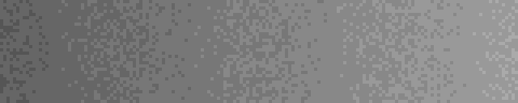
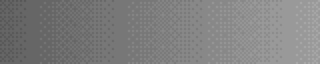
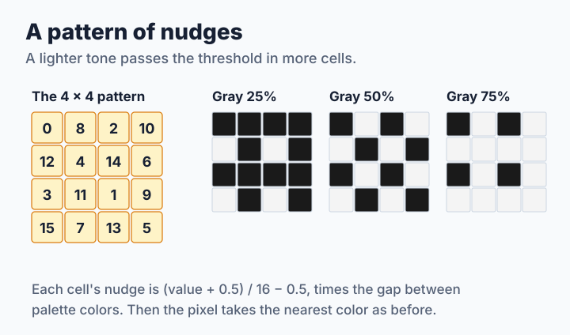
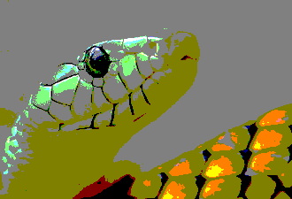
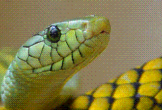

# Step 2: Patterns

An area of gray 64 cannot be shown with black and white, but a mix of one white pixel to three black ones comes close when seen from a distance. To get that mix, identical pixels must make different choices. The cheapest way is to nudge each pixel by something that depends only on where it is. The source is [`code/step2.c`](code/step2.c).

**You will learn:**

- how a small nudge turns a band into a mix,
- how far to nudge,
- why random nudges look worse than a pattern,
- what a position-based method can do that the next lessons cannot.

## A nudge before choosing

Add a nudge to the pixel, and then pick the nearest color as before. The nudge must span about the gap between two neighboring palette colors, half up and half down, so that a value between two colors lands on each of them a fair share of the time:

```c
cell = use_random ? random_cell(&state) : bayer(x, y);
nudge = ((cell + 0.5) / 64.0 - 0.5) * gap;
put_color(out, y * in->width + x, pal,
          nearest_color(pal, clamp(p[0] + nudge),
                        clamp(p[1] + nudge),
                        clamp(p[2] + nudge)));
```

The `gap` comes from [`palette_gap()`](code/common.c). For a cube it is exactly the step between levels. For a palette fit to a picture the colors are not evenly spaced, so it is only a typical value, and that already shows a weakness of this method.

## Random or regular

The first idea is a random nudge per pixel. It works, but look at the result next to a regular pattern. The second row of each pair is enlarged four times:

| Method | 16 grays |
| --- | --- |
| Random nudge |  |
| |  |
| Bayer pattern |  |
| |  |

Random dots form clumps by chance, and a clump is large enough to see. The **Bayer pattern** places each new dot as far as possible from the earlier ones, so even a light tone stays evenly spread:



The pattern can be built by repeating a 2 × 2 pattern inside itself, one level for each pair of coordinate bits:

```c
for (i = 0; i < 3; i++) {
    value = value << 2 | ((x ^ y) >> i & 1) << 1 | (y >> i & 1);
}
```

Three levels give an 8 × 8 tile with values from 0 to 63.

## The price of a pattern

The bands are gone, even with the 27-color cube, but something new has appeared:

| Nearest of a 27-color cube | Bayer pattern |
| --- | --- |
|  |  |

A regular grid is easy for the eye to find, and it does not follow the picture. Measured in [lesson 6](step6-measuring.md), it shows up as a strong stripe score that no other method has. libsixel's position-based methods fight this differently: [`x_dither` and `a_dither`](../../encoder/palette-application/dithering/README.md#a_dither-addition-based-positional-dither) scramble the pattern with arithmetic, and [`bluenoise`](../../encoder/palette-application/dithering/README.md#bluenoise-tiled-blue-noise-perturbation) uses a large tile prepared so that it has no low-frequency structure.

> **Try it.** Change the 3 in the loop above to 1 or 2 and make the pattern's tile 2 × 2 or 4 × 4, changing the 64 to match. How does the texture change, and how many tones can a tile show?

> **Try it.** Multiply `nudge` by 0.5 and by 2. Which bands come back, and when does the noise overwhelm the picture?

## What position gives you

Nothing in this loop depends on another pixel. Any pixel can be computed first, on any thread, and a change in one part of an animation frame does not disturb the pattern elsewhere. That independence is what the next step gives up in exchange for better quality.
