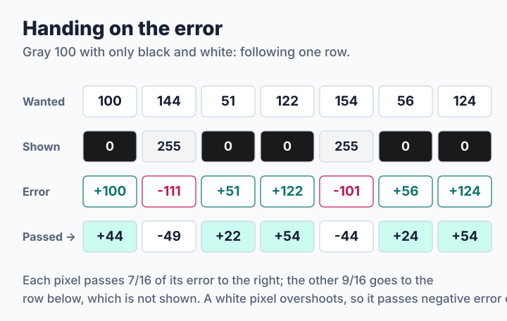
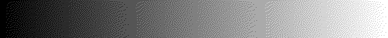
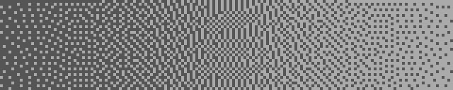
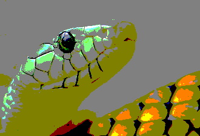
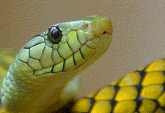

# Step 3: Error Diffusion

A pattern does not know how far each pixel actually missed. Error diffusion does: whatever a pixel could not show is handed on to its neighbors, so nothing is lost. This small idea from 1976, Floyd–Steinberg dithering, is still the default of many programs, including `img2sixel` for palettes above 16 colors. The source is [`code/step3.c`](code/step3.c).

**You will learn:**

- how handing on the error keeps the tone of an area,
- how to store the error for pixels not yet visited,
- what grain is, and what decides how coarse it is.

## Handing on what is left

Choose the nearest color for the pixel plus the error it has received. The difference between what was wanted and what was shown is the new error. Follow one row of gray 100 with only black and white:



White appears at just the right rate, without any pattern having been planned. Floyd and Steinberg share the error between four neighbors that have not been visited yet, in sixteenths:

```text
        *   7
    3   5   1
```

## Two rows of error

Only two rows of errors are needed: one for the row being painted, and one for the row below. Both have one extra element on each side, so that the neighbors of the first and last column always exist:

```c
for (c = 0; c < 3; c++) {
    want = clamp(p[c] + this_row[k + c]);
    error = want - (float)pal->rgb[index][c];
    this_row[k + 3 + c] += error * 7.0f / 16.0f;
    next_row[k - 3 + c] += error * 3.0f / 16.0f;
    next_row[k + c] += error * 5.0f / 16.0f;
    next_row[k + 3 + c] += error * 1.0f / 16.0f;
}
```

`clamp()` matters more than it looks. Near black, a pixel can never go lower than the darkest palette color, so without a limit negative error would pile up without end and darken everything after it. Limiting `want` to 0–255 throws that part of the error away. libsixel's [clamp policy](../../encoder/palette-application/clamp-policy.md) treats this question much more carefully.

> **Try it.** Remove the `clamp()` and use a palette that does not reach white, made with `printf 'P3 2 1 255 0 0 0 128 128 128\n' > dark.ppm`. What happens to the picture?

## Grain

Now look at what the method does to a gradient. Grain is the fine texture that replaces the bands, and it gets coarser when the palette colors lie farther apart, because the pixels must jump farther to average out:

| Palette | Result |
| --- | --- |
| 16 grays |  |
| Enlarged four times |  |
| 4 grays |  |
| Enlarged four times |  |

The bands did not disappear for free. Banding and grain are the same error in two forms: the nearest color leaves a large error that stays in one place, and error diffusion spreads it into many small steps that the eye averages. The same pixels are on average farther from the original than before, as [lesson 5](step5-good-dither.md) measures.

Look at the top edge of the 4-gray strip as well. The first rows have received no error yet, so the pattern needs a few rows to get going, and along the top the dots start late. This start-up effect is a real artifact, and libsixel works around the same thing at the [boundaries of its parallel bands](../../threading/overview.md#work-band-seams-and-image-quality).

## The photograph

Here is the result on the photograph, with the same two palettes as before. The cube has no good colors for this picture, and yet the snake's shading returns:

| Palette | Nearest color | Error diffusion |
| --- | --- | --- |
| 27-color cube |  |  |
| Its own 16 colors |  |  |

Dithering adds no information, though. It cannot bring back the colors of a palette that does not contain them, and it makes the stream larger, because fine dots break the runs that SIXEL compresses. [Lesson 6](step6-measuring.md) counts those bytes.

> **Try it.** Dither `./dtool flat 200 80 96 96 96` with two grays. Use `./dtool average 16` on the result. Is the area gray 96 again? Try the same with step 1.

## Where to go next

This method is `img2sixel -d fs`. Every choice of the sixteenths in the kernel is a trade between how far the error travels and what kind of texture results, and [step 4](step4-kernels.md) puts those choices in a table.
