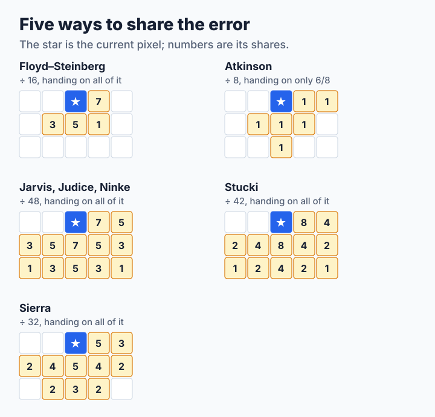
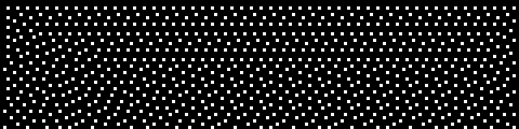
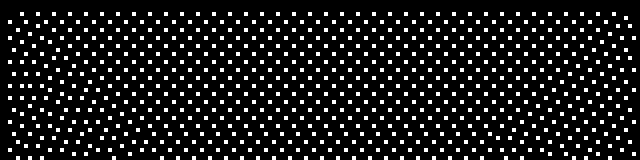
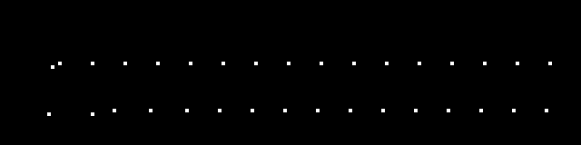
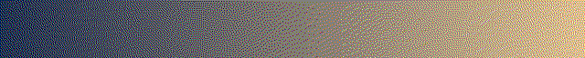
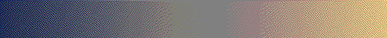
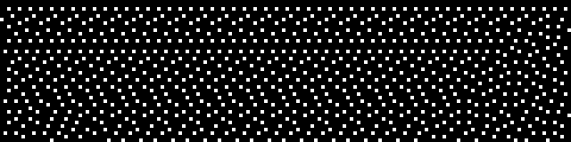

# Step 4: Kernels and Scan Order

Floyd and Steinberg's four weights are not the only choice. Once the weights are in a table, the same loop becomes every classic error-diffusion method, and a small change to the loop changes the direction it scans. The source is [`code/step4.c`](code/step4.c).

**You will learn:**

- how a table turns one loop into many methods,
- why a kernel that drops part of the error behaves differently,
- what scanning in both directions changes, and how little that can be,
- where the time of a dither goes.

## A table of kernels

A kernel is a list of neighbors and their shares, and its name selects a row of this table:

```c
static kernel_t const kernels[] = {
    {"fs", 16, 4, {{1, 0, 7}, {-1, 1, 3}, {0, 1, 5}, {1, 1, 1}}},
    {"atkinson", 8, 6, {{1, 0, 1}, {2, 0, 1}, {-1, 1, 1}, {0, 1, 1},
                        {1, 1, 1}, {0, 2, 1}}},
    /* ... */
};
```

Each entry is `dx`, `dy` and a weight, and the loop of step 3 becomes a loop over the entries:

```c
for (t = 0; t < kernel->ntaps; t++) {
    tap = &kernel->taps[t];
    target = (x + (reverse ? -tap->dx : tap->dx) + MARGIN) * 3;
    rows[tap->dy][target + c] +=
        error * (float)tap->weight / (float)kernel->divisor;
}
```

Kernels reach up to two rows down, so the program now keeps three rows of error and rotates them. The test script requires that the `fs` row gives exactly the same pixels as step 3, which is a quick way to trust a table.



## What the kernels do

On a flat light area with black and white, each kernel places its dots in its own way. These are enlarged four times, from a flat gray 32:

| Kernel | Flat gray 32 |
| --- | --- |
| Floyd–Steinberg |  |
| Jarvis, Judice, Ninke |  |
| Atkinson |  |

Atkinson stands out. It hands on only 6/8 of the error and throws away the rest, so a gray 32 with black and white rarely builds up enough error to place a dot: its average falls to about 1, where Floyd–Steinberg stays at 31. Tones near the palette's colors collapse onto them. That gives a clean, high-contrast look with few dots, and a shorter stream, but the tone is no longer kept. On the gradient, a flat band has come back in the middle, exactly where the original is close to one palette color:

| Kernel | 27-color cube |
| --- | --- |
| Floyd–Steinberg |  |
| Atkinson |  |

That is why `img2sixel` chooses Atkinson only for very small palettes, as the [`auto` rule](../../encoder/palette-application/dithering/README.md#auto-palette-size-selection) describes.

## Scan order

Error flows mostly to the right when every row runs from left to right. **Serpentine** order reverses every second row and mirrors the kernel, so that the flow alternates:

```c
reverse = serpentine && (y & 1);
for (i = 0; i < w; i++) {
    x = reverse ? w - 1 - i : i;
```

| Scan order | Flat gray 32 |
| --- | --- |
| Left to right |  |
| Serpentine |  |

The difference here is small, and the [scores in lesson 6](step6-measuring.md#scoring-the-methods) barely move either. It can matter more on other pictures, so try it instead of assuming.

> **Try it: invent a kernel.** Add a row to the table, for example `{"mine", 4, 2, {{1, 0, 2}, {0, 1, 2}}}`. Give it a gradient and a flat area. Does it keep the tone? What pattern does it leave? Then give it a share that adds up to more than the divisor and watch what happens.

## How fast is it?

Each cell is the time per pixel on the 600×450 photograph, on one thread. The [measurement record](measurements.md) has the conditions.

<!-- measurements:begin:speed -->
| Method | 16 colors, ns per pixel | 256 colors, ns per pixel |
| --- | --- | --- |
| Nearest color (step 1) | 10.8 | 164.9 |
| Random nudge (step 2) | 23.3 | 162.9 |
| Bayer pattern (step 2) | 23.9 | 164.3 |
| Floyd–Steinberg (step 3) | 26.8 | 166.3 |
| Floyd–Steinberg, serpentine (step 4) | 27.4 | 176.5 |
| Atkinson (step 4) | 28.4 | 175.5 |
| Jarvis, Judice, Ninke (step 4) | 35.0 | 187.9 |
<!-- measurements:end -->

With 256 colors, the method hardly matters. Nearly all the time goes into `nearest_color()`, which tries every palette color for every pixel. The kernels only matter at small palettes. This is why making dithering fast is mostly a question of [finding the color fast](../../encoder/palette-application/lookup-policy/README.md).

## Where to go next

You now have several methods that all look different, and each one is better at something. Which is best? [Step 5](step5-good-dither.md) makes that question precise.
