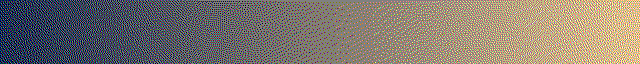
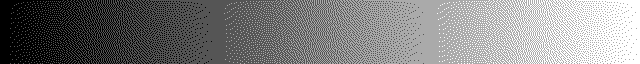
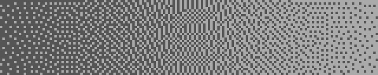
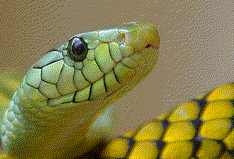

# Step 5: What Makes a Dither Good?

No program in this lesson is new. You have four methods and many outputs, and they do not agree on a winner: one has no pattern but more noise, one keeps its dots few but loses tone. To choose, you need to say what "good" means. This lesson gives you the words and three simple numbers, computed by [`code/dtool.c`](code/dtool.c), and the next one measures properly.

**You will learn:**

- why a dither deliberately makes each pixel worse,
- the four questions to ask about a dither,
- why the viewing distance changes the answer,
- what no dither can fix.

## Worse pixels, better picture

Measure the distance between the original and the output, pixel by pixel, and the nearest color wins. It was built to: no other choice is closer for any single pixel. But look at what an eye averaging over a small area would see. `dtool average 16` replaces each pixel by the mean of a 16 × 16 square around it:

| Picture | Gradient |
| --- | --- |
| Original |  |
| Nearest color |  |
| Nearest color, averaged |  |
| Error diffusion |  |
| Error diffusion, averaged |  |

So every pixel is worse, and the picture is better. A dither moves error to where the eye does not look: into fine detail that it averages away. The [dithering concepts](../../concepts/dithering/README.md#noise-spectrum-where-the-error-goes) page explains this as moving the error to high spatial frequencies.

`dtool measure` prints three numbers that show the trade:

```sh
./dtool measure original.ppm output.ppm
```

- **Pixel error** is the root mean square difference per pixel. It is the size of the error, wherever it went.
- **Area error** does the same with the means of 16 × 16 tiles. It is what is left after the eye has averaged.
- **Flat runs** is the average length of a run of equal brightness along a row. Bands make it long, and dots make it short.

<!-- measurements:begin:simple -->
| Picture | Method | Pixel error | Area error | Flat runs |
| --- | --- | --- | --- | --- |
| Gradient, 640×240, 27-color cube | Nearest color (step 1) | 35.9 | 34.8 | 128.0 |
| Gradient, 640×240, 27-color cube | Bayer pattern (step 2) | 51.5 | 0.7 | 1.4 |
| Gradient, 640×240, 27-color cube | Floyd–Steinberg (step 3) | 51.2 | 0.7 | 1.2 |
| Gradient, 640×240, 27-color cube | Atkinson (step 4) | 46.1 | 7.5 | 1.6 |
| Gradient, 640×240, 27-color cube | The original itself | 0.0 | 0.0 | 32.0 |
| Photograph, 600×450, its 16-color palette | Nearest color (step 1) | 10.6 | 6.5 | 11.5 |
| Photograph, 600×450, its 16-color palette | Bayer pattern (step 2) | 12.8 | 5.6 | 2.0 |
| Photograph, 600×450, its 16-color palette | Floyd–Steinberg (step 3) | 17.7 | 5.3 | 2.3 |
| Photograph, 600×450, its 16-color palette | Atkinson (step 4) | 11.9 | 5.5 | 3.7 |
| Photograph, 600×450, its 16-color palette | The original itself | 0.0 | 0.0 | 4.3 |
<!-- measurements:end -->

On the gradient, error diffusion makes the pixel error larger and the area error about fifty times smaller. Atkinson gives some of that back, which you saw as a band in the last lesson. On the photograph with its own palette the numbers are much closer. The palette already fits, so there is less for the dither to do.

## Four questions

Good means different things, and they can pull against each other. The table comes from the choice of metrics in [Combining metrics for dithered output](../../quality/metrics.md#combining-metrics-for-dithered-output), which defines them precisely:

| Question | Bad result looks like | Seen in |
| --- | --- | --- |
| Is the **tone** right after averaging? | An area too light, too dark or the wrong hue | Atkinson on a flat area |
| Is the **structure** kept? | Soft edges, broken thin lines | Dots that compete with fine detail |
| Is the **noise** fine and shapeless? | Visible dots, clumps, stripes, grids | Random nudges, the Bayer grid |
| Are smooth areas free of **contours**? | Bands | The nearest color |

Stream size is a fifth question that matters in SIXEL: fine dots break runs, so the same picture needs more bytes. [Lesson 6](step6-measuring.md) counts them.

## How far away are you?

Whether grain is visible depends on how large a pixel looks. Here is the same output at its own size and enlarged four times:

| Size | 4 grays |
| --- | --- |
| Original size |  |
| Enlarged four times |  |

So a dither has no quality on its own, only a quality at a viewing distance. A pixel on a dense laptop screen is far smaller to the eye than a pixel on an old monitor or a terminal scaled up by a remote session. When you compare methods, look at more than one size, and state which one you mean. The [display technologies](../../concepts/displays/README.md) page explains pixel density.

## What no dither can fix

An average can only land between the colors of a palette. A dither can therefore reach any mix of them, and nothing outside them. Here is one method and one photograph with four palettes:

| Palette | Result |
| --- | --- |
| 27-color cube |  |
| 216-color cube |  |
| Its own 16 colors |  |
| Its own 255 colors |  |

A cube surrounds every color, so any tone can be mixed, at the cost of strong grain. A palette of 16 colors fit to the picture lies close to its colors, so the grain is fine, but a saturated color outside the palette's reach stays out of reach. That is the job of [palette clustering](../../concepts/clustering/README.md) and of the [cover policy](../../encoder/palette-construction/cover-policy/README.md), not of the dither. When you compare dithers, always use the same palette, or you will be measuring the palette.

> **Try it: look before you measure.** Make the four outputs of the methods so far on a picture of your own, at the same palette. Rank them by eye at two sizes, and write the ranking down. Then run `dtool measure`. In the next lesson you will compare all of them with a real measuring tool.

## Where to go next

Three numbers show the idea, but they treat every pixel as equal and average plain numbers. The eye does neither. [Step 6](step6-measuring.md) uses libsixel's measuring tool, and it finds something that these three numbers cannot see.
