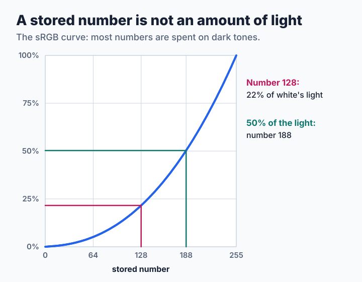
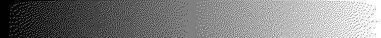
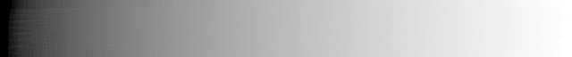
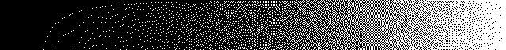
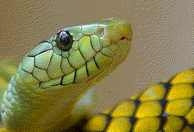
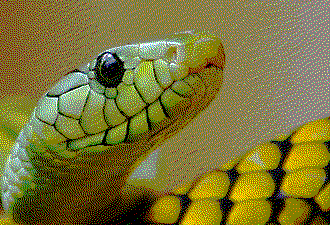

# Step 7: Dithering in Linear Light

[Lesson 6](step6-measuring.md#what-the-three-numbers-missed) ended with a surprise: our dither balances the numbers in the file, while the eye adds up light, and the two do not agree. This lesson moves the arithmetic to where the eye does it. The change is small, and it changes what the program keeps constant. The source is [`code/step7.c`](code/step7.c).

**You will learn:**

- why half of the number 255 is not half of the light,
- how to do error diffusion in light with a few changed lines,
- where this fixes the picture, and where it does not help.

## Numbers and light

The numbers in a picture file are not amounts of light. They follow the sRGB curve, which spends most of its numbers on dark tones, because that is where the eye tells tones apart best:



Now take a flat gray 128 and only black and white. Steps 3 and 4 hand on numbers, so half of their pixels turn white, which is half of white's light. From a distance, that area looks like level 188 and not like 128. The right share of white pixels is 22%.

You can see this on a gradient with black and white. The `dtool light` command averages a picture in light, as an eye far away does:

| What | Picture |
| --- | --- |
| The original |  |
| Dithered with the stored numbers (step 3) |  |
| The same, averaged in light |  |
| Dithered in light (step 7) |  |
| The same, averaged in light |  |

The third strip is much too light. The last one follows the original, apart from the first columns, which we come back to below.

## The change

Three things move into light: the picture, the palette and the error. First convert the 256 possible numbers once with the sRGB formula, and the palette colors with them:

```c
for (i = 0; i < 256; i++) {
    light[i] = stored_to_light(i);
}
for (i = 0; i < pal->ncolors; i++) {
    for (c = 0; c < 3; c++) {
        pal_light[i][c] = light[pal->rgb[i][c]];
    }
}
```

Everything else follows step 3, with light from 0 to 1 where it had numbers from 0 to 255. The nearest color has to be found in light as well, so that the color a pixel chooses and the error it hands on agree. Compare the two programs:

```sh
diff step3.c step7.c
```

The output is still the palette's stored colors, because a terminal expects those. Only the decisions were made in light. The self test holds the program to this: a flat gray 64 with black and white must average 13 in stored numbers, because gray 64 has only 5% of the light of white.

> **Try it.** Dither a flat gray 128 with black and white, and average the result in both ways:
>
> ```sh
> ./dtool flat 200 80 128 128 128 > flat.ppm
> ./dtool gray 2 > bw.ppm
> ./step7 flat.ppm bw.ppm > out.ppm
> ./dtool light 16 out.ppm > light.ppm
> ./dtool average 16 out.ppm > numbers.ppm
> ```
>
> Look at the numbers of a pixel in the middle of each. Which average comes back close to 128? Then do the same with step 3.

## What it fixes

Here is the same score as in lesson 6, area ΔE00, which averages light in tiles:

<!-- measurements:begin:linear -->
| Picture and palette | Area ΔE00 | MS-SSIM | Bytes |
| --- | --- | --- | --- |
| Gradient, 640×240, 27-color cube | 5.95 → 0.58 | 0.641 → 0.633 | 144,441 → 144,731 |
| Photograph, 600×450, 27-color cube | 6.74 → 0.58 | 0.777 → 0.765 | 239,701 → 224,816 |
| Photograph, 600×450, its 16-color palette | 2.06 → 2.09 | 0.915 → 0.926 | 129,015 → 135,126 |
<!-- measurements:end -->

With the cube, the area error nearly vanishes, on the photograph as well as on the gradient. Yet the MS-SSIM hardly moves, because the grain is as coarse as before. Look at the photograph:

| Original | Stored numbers (step 3) | Linear light (step 7) |
| --- | --- | --- |
|  |  |  |

The stored version is lighter than the original, most clearly in the background. The linear version has the right brightness, but it is not simply better. Its dark parts are built from few bright dots on black, and each stands out.

The palette that fits the photograph shows the limit of this idea. With its own 16 colors the area error does not improve at all, because a palette with close neighbors has little error to balance. How far apart two colors are decides how much the curve matters, and this lesson has not separated the other causes that may play a part.

## Where it does not help

The linear strip above has a dark edge at its left end. The darkest columns have so little light that no error has piled up enough for a white pixel when the first rows go by, and the pattern starts late, as in [lesson 3](step3-error-diffusion.md#grain). A pixel of white has 100% of the light, so a few dots must carry a dark area alone.

Light is also not the same as visibility. Distance in light says nothing about how visible a difference is, as the [`linear` section](../../encoder/palette-application/working-colorspace/README.md#linear-linear-light-srgb-coordinates) of libsixel's reference points out. A small step between two dark colors is a large step to the eye, and yet distance in light says it is tiny. So the nearest color by light is not the color that looks nearest.

> **Try it: separate the two decisions.** Change `step7.c` to diffuse in light, but to choose the color by comparing stored numbers. For that you need the stored number of the wanted light, which is the inverse of `stored_to_light()`. Which of the columns in the table changes?

> **Challenge.** libsixel also offers working spaces built for visibility instead of light, such as Oklab. Its formula is in the [working color space](../../encoder/palette-application/working-colorspace/README.md#oklab-approximately-perceptual-opponent-coordinates) reference. Add it to your program. What should happen to the error at the boundary of the color range, where Oklab's numbers no longer describe a real color?

## Where to go from here

libsixel's `img2sixel -W` chooses the space of this arithmetic, and the [working color space](../../encoder/palette-application/working-colorspace/README.md) reference compares them with measurements and costs. [Step 8](step8-integer-error.md) leaves the color space alone and returns to the error itself: how to store it exactly, and what to do when it grows too large.
