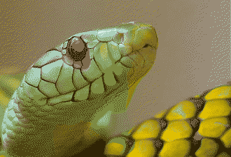
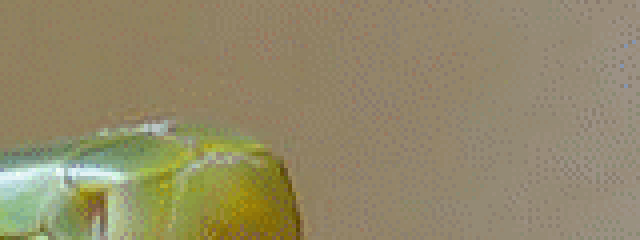
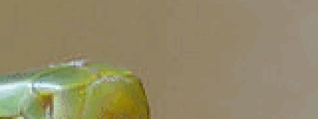

# Step 8: The Error as Whole Numbers

So far the error has been a floating-point number, and `clamp()` has quietly thrown part of it away. This lesson makes both of those decisions on purpose. It stores the error exactly in whole numbers, and it gives you three ways to limit it and one way to ignore it. The source is [`code/step8.c`](code/step8.c).

**You will learn:**

- how to hand on shares of an error without any rounding,
- what a promise of exactness is worth, and what it costs,
- why limiting the error changes a picture so much,
- how ignoring small errors saves bytes, and what it costs.

Run this program as `./step8 IN.ppm PALETTE.ppm [OPTION]`, where the option is a list of words separated by commas. Its default is `fs,clamp=soft,deadzone=0`.

## No share is ever divided

Look again at how lesson 4 hands on a share: `error * weight / divisor`. Each share is rounded to a nearby floating-point number, and each is rounded again when it is added. Instead, leave the division out. If an error row counts in sixteenths for Floyd–Steinberg, each share is a whole number:

```c
error = want[c] - pal->rgb[index][c];
for (t = 0; t < s.kernel->ntaps; t++) {
    tap = &s.kernel->taps[t];
    target = (x + (reverse ? -tap->dx : tap->dx) + MARGIN) * 3;
    rows[tap->dy][target + c] += error * tap->weight;
}
```

Only when a pixel's turn comes is the sum divided, once, and rounded:

```c
value = source[n] * d + carry[n];
want[n] = round_div(value, d);
```

Nothing has been lost on the way, and a whole-number sum does not depend on the order of its additions. Rounding happens in only one place, so it is worth doing with care. `round_div()` sends an exact half to the even neighbor, so that rounding leans neither up nor down on average. It gives the same answer on every computer, for negative numbers as well, where C's division rounds toward zero.

What gets rounded away is lost: `want` is a whole level, and the fraction of a level does not reach the next pixel. Step 3 keeps that fraction, so the two programs choose slightly different pixels. Their pixel error on the photograph with 16 colors differs only in the second decimal. libsixel's [byte carry](../../encoder/palette-application/clamp-policy.md#byte-carry-arithmetic) makes the same choice.

## What the exactness is worth

This is where it would be pleasant to show floats going wrong, but they do not, at least not here. Building step 3 with `-ffast-math`, without optimization or for x86-64 gave exactly the same photograph on this machine. Reversing the order of the additions in step 4 changed no pixel in the 270,000 of the photograph with `jajuni`, whose 48ths are not exact in binary.

So exactness is a promise and not an improvement you can see. The floats happened to agree on these pictures, and nothing guarantees that they will on the next one. Whole numbers cannot disagree: the sum is the same by arithmetic, not by luck. That matters when a test compares output byte for byte across compilers and machines, and it matters when threads add shares in an order nobody chose, which is a real idea for [lesson 10](step10-threads.md#a-challenge-the-exact-picture-on-many-threads).

It also has a price here:

<!-- measurements:begin:carry-speed -->
| Palette | Floats (step 3), ns per pixel | Whole numbers (step 8), ns per pixel |
| --- | --- | --- |
| 16 colors | 26.6 | 41.2 |
| 255 colors | 158.2 | 175.3 |
<!-- measurements:end -->

This program is slower. It uses 64 bits, so that `clamp=none` cannot overflow, it divides three times per pixel, and it looks at every limit for every pixel. Do not read this as a verdict on integers. libsixel's [byte diffusion](../../encoder/palette-application/dithering/README.md#byte-spatial-diffusion) uses 32 bits with a proof that they are enough, and tests all three channels against one interval with a single comparison.

> **Try it: reverse the order yourself.** In `step8.c`, make the loop over `t` run backwards. Then do it in `step4.c`. Compare the output of each with the original, on several pictures and with the `jajuni` kernel. Can you find a picture where the floats change?

## Three ways to limit the error

A palette has a boundary. A color beyond its darkest or brightest entry cannot be reached, and error pointing that way only piles up. [Lesson 3](step3-error-diffusion.md#two-rows-of-error) limited each channel with `clamp()` without discussing it. There are real choices here:

| Option | What it does |
| --- | --- |
| `clamp=none` | No limit: the error keeps piling up |
| `clamp=hard` | Limit each channel to 0–255 on its own, as in step 3 |
| `clamp=soft` | Scale the whole error down, by one factor, until all channels fit in 0–255 with 1% of room to spare |

The difference between hard and soft is in the direction. Suppose a pixel of blue 250 receives an error of +20 in red, green and blue. Hard limits only the blue, to 255, and the result has moved toward yellow, a hue nobody asked for. Soft scales all three by the same fraction, so the direction of the error stays the same, and its hue does too.

The fraction is the smallest over the channels of room left / size of the error. To compare two fractions without dividing, multiply across:

```c
if (room * *c < *b * size) {
    *b = room;
    *c = size;
}
```

Look at what that does to the snake's eye, which is nearly black in the palette's darkest corner:

| `clamp=soft` | `clamp=hard` | `clamp=none` |
| --- | --- | --- |
|  |  |  |

The eye is a small dark area in a light picture, darker than almost all of the palette. With no limit, its unreachable darkness turns into a debt that the pixels after it pay in light, so a patch of light appears below and to the right. A hard limit forgets most of that debt but changes its direction. The soft limit keeps the eye clean. The numbers on the whole picture say the same, though much more mildly, since it is one small spot:

<!-- measurements:begin:clamp -->
| Limit | Area ΔE00 | MS-SSIM | Bytes |
| --- | --- | --- | --- |
| `soft` | 2.03 | 0.921 | 124,089 |
| `hard` | 2.06 | 0.915 | 128,849 |
| `none` | 3.11 | 0.872 | 117,388 |
<!-- measurements:end -->

> **Try it.** Find the same effect in your own picture. A picture with small saturated or very dark details and a palette that does not reach them should show it. Is the soft limit always better? With only 16 grays on the color photograph, it is not: compare the area error yourself.

## Ignoring small errors

Now a different kind of limit. A palette color often lies very close to the wanted color, and the pixel could simply take it. Yet error diffusion hands on even an error of 1 level, and eventually some pixel turns to the next color. That adds dots to a smooth area, and each dot breaks a run in the stream.

A **deadzone** drops the waiting error when it is shorter than some length. It is a test on the length of the error as a vector, and comparing the squares needs no square root:

```c
if (norm < radius * radius) {
    for (n = 0; n < 3; n++) {
        want[n] = source[n];    /* too small to act on: drop it */
    }
    return;
}
```

Only the error that has arrived is dropped. The pixel's own error is handed on as usual, and when it is large enough, the pattern carries on. So with colors far apart nothing changes, and with colors close together it does:

<!-- measurements:begin:deadzone -->
| Picture and palette | Deadzone | Area ΔE00 | MS-SSIM | Bytes |
| --- | --- | --- | --- | --- |
| Flat gray 100, 320×240, 16 grays | 0 | 0.07 | 0.959 | 25,831 |
| Flat gray 100, 320×240, 16 grays | 5 | 0.75 | 1.000 | 349 |
| Flat gray 100, 320×240, 16 grays | 10 | 0.75 | 1.000 | 349 |
| Flat gray 100, 320×240, 16 grays | 20 | 0.75 | 1.000 | 349 |
| Photograph, 600×450, its 16-color palette | 0 | 2.03 | 0.921 | 124,089 |
| Photograph, 600×450, its 16-color palette | 5 | 2.03 | 0.921 | 123,857 |
| Photograph, 600×450, its 16-color palette | 10 | 2.07 | 0.923 | 119,120 |
| Photograph, 600×450, its 16-color palette | 20 | 2.34 | 0.926 | 91,089 |
| Photograph, 600×450, its 255-color palette | 0 | 0.39 | 0.991 | 325,485 |
| Photograph, 600×450, its 255-color palette | 5 | 0.57 | 0.990 | 279,258 |
| Photograph, 600×450, its 255-color palette | 10 | 0.73 | 0.991 | 251,202 |
| Photograph, 600×450, its 255-color palette | 20 | 0.86 | 0.991 | 240,376 |
| Photograph, 600×450, 27-color cube | 0 | 6.74 | 0.777 | 239,568 |
| Photograph, 600×450, 27-color cube | 5 | 6.73 | 0.776 | 239,506 |
| Photograph, 600×450, 27-color cube | 10 | 6.74 | 0.776 | 239,371 |
| Photograph, 600×450, 27-color cube | 20 | 6.74 | 0.776 | 238,699 |
<!-- measurements:end -->

Read the table from the bottom up. With the cube, errors are usually far larger than any of these lengths, and the deadzone does nothing. With the photograph's 255 colors, a deadzone of 5 removes about a seventh of the stream, and the area error grows by about half. On a flat area close to a palette color, the whole pattern disappears, and with it almost every byte: the stream shrinks about 70 times, and the area is now off by 2 levels for good.

That is the trade. Here is the smooth background of the photograph, enlarged:

| Deadzone 0 | Deadzone 10 |
| --- | --- |
|  |  |

The dots are gone, and thin contour lines have appeared. Banding has come back in a mild form, because small errors are exactly what breaks up the steps of [lesson 1](step1-nearest.md).

> **Challenge.** Make `step8` faster without changing a single output pixel. Use 32 bits where you can show that they are enough, skip the soft limit when no channel is out of range, and work with the source and error of each pixel in one place. `make check` tells you whether the picture stayed the same, if you add your program to it. What part of the time does each change save?

## Where to go from here

libsixel has all of this: `-d fs:deadzone=5`, with [5 as its default](../../encoder/palette-application/dithering/README.md#byte-spatial-diffusion), and `-0 soft`, `-0 hard` and `-0 none` in its [clamp policy](../../encoder/palette-application/clamp-policy.md), which applies the same scaling to floats. The reference has [a sweep of deadzone values](../../encoder/palette-application/dithering/README.md#historical-integer-carry-measurements) over a larger set of pictures. All these programs still spend most of their time finding the nearest color, and [step 9](step9-lookup.md) goes after that.
