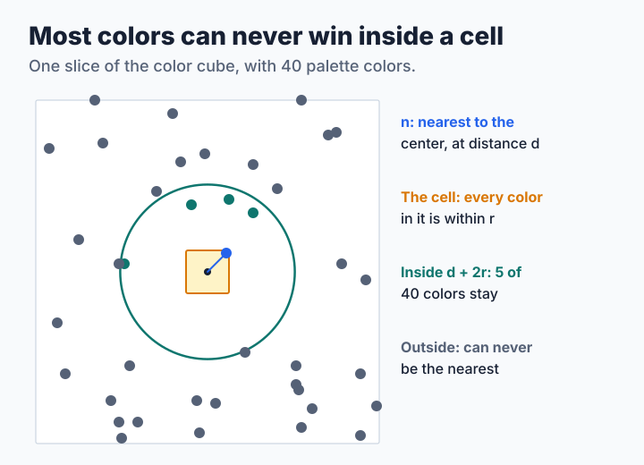

# Step 9: Finding the Nearest Color Faster

[Lesson 4](step4-kernels.md) measured something striking: with 255 colors, every method takes well over 150 nanoseconds per pixel, however it shares the error. Almost all of that time goes into one loop, the search through the palette that [lesson 1](step1-nearest.md) wrote. This lesson makes that search faster in three ways, and finds out which of them still give the same picture. The source is [`code/step9.c`](code/step9.c), which is step 3 with a choice of searches.

**You will learn:**

- why remembering answers works less well for a dither than you would expect,
- how to give up exactness, and what you get for it,
- how to rule out colors without looking at them,
- how to test a speed-up that must not change the picture.

Choose the method with an option: `./step9 IN.ppm PALETTE.ppm grid`. Add `,stats` to see how much work it did, for example `grid,stats`.

## Remembering recent answers

A photograph repeats itself, so the first idea is to keep recent answers in a table, with the color as the key:

```c
uint32_t color = (uint32_t)r << 16 | (uint32_t)g << 8 | (uint32_t)b;
uint32_t slot = (color * 2654435761u) >> 16;

if (t->cache_key[slot] == color + 1) {
    return t->cache_index[slot];
}
```

The multiplication scatters similar colors over the 65,536 slots. A second color can land in the same slot, and it then replaces the first. The key is stored and compared, so an answer always belongs to its color, and the output is exactly that of step 3.

Run it with `cache,stats`, and watch how many colors it still compares per pixel. The dither makes this idea work less well than it sounds. Error diffusion adds a different error to each pixel, so even a flat area asks for many different colors, and a table has far fewer hits than the photograph has repeated colors. Remembering does help, as libsixel's exact [VP-tree memo](../../encoder/palette-application/lookup-policy/vptree.md) shows, but only by so much.

## One answer per cell

Now give up exactness. Cut the color cube into 32 × 32 × 32 cells, and let the first color that enters a cell decide for every later color in the same cell:

```c
int cell = (r >> 3) << 10 | (g >> 3) << 5 | (b >> 3);

if (t->memo[cell] == NOT_YET) {
    t->memo[cell] = (short)scan(t, r, g, b);
}
return t->memo[cell];
```

This is much faster, because the table has so few cells that hits are the rule. Its answers can be wrong: a palette boundary can run through a cell, and then every color on the far side gets the wrong one. And a wrong answer does not stay in its pixel, because its larger error goes on to the next pixels and changes their choices. That is how a small change of method moves a large share of a picture's pixels. Yet the dither also repairs part of the damage, because the error of a wrong choice is handed on as well.

## A list per cell

Can a cell save the search and still be exact? It can, if it stores a list instead of an answer. Most colors can never be the nearest for anything in a given cell, and a little geometry finds which ones:



Let `n` be the nearest palette color to the center `c` of the cell, at distance `d`, and let every color of the cell lie within `r` of `c`. Take any color `q` in the cell:

1. `q` is at most `d + r` from `n`, by going through `c`.
2. So the nearest color to `q` is at most `d + r` from `q`.
3. So that color is at most `d + 2r` from `c`, by going through `q`.

Any color farther from `c` than `d + 2r` can be left out. The list is built the first time a cell is used, with cells of 16 × 16 × 16, and the search then compares only the colors on it:

```c
limit = sqrt(best) + 2.0 * r;
limit *= limit;
/* ... */
if (dr * dr + dg * dg + db * db <= limit) {
    t->pool[t->pool_used++] = (unsigned char)i;
    count++;
}
```

There is one subtle point about ties: when two colors are equally near, the full scan takes the first. The lists keep the palette's order, so they take the same one, and the output does not change by a single byte. `make check` requires this, on three palettes and two pictures. That test is what makes the speed-up trustworthy, because a wrong factor in the bound would produce a picture that looks perfectly fine.

## How much does it save?

All of this is on the 600×450 photograph, and times include building the tables:

<!-- measurements:begin:lookup -->
| Palette | Method | ns per pixel | Colors compared per pixel | Pixels changed | Area ΔE00 |
| --- | --- | --- | --- | --- | --- |
| 16 colors | Compare with every color | 24.1 | 16.0 | 0.0% | 2.063 |
| 16 colors | Remember recent colors | 24.4 | 12.0 | 0.0% | 2.063 |
| 16 colors | One answer per cell | 15.9 | 1.1 | 32.1% | 2.069 |
| 16 colors | A list of candidates per cell | 25.3 | 5.5 | 0.0% | 2.063 |
| 255 colors | Compare with every color | 154.7 | 255.0 | 0.0% | 0.333 |
| 255 colors | Remember recent colors | 120.4 | 166.7 | 0.0% | 0.333 |
| 255 colors | One answer per cell | 19.8 | 8.1 | 54.0% | 0.337 |
| 255 colors | A list of candidates per cell | 48.6 | 31.1 | 0.0% | 0.333 |
<!-- measurements:end -->

The last two columns say what exactness means here. "Pixels changed" compares each output with the full scan's. The two exact methods change nothing. The cells of the memo change a large share of the pixels, and yet the area error hardly moves. This matches what [the lookup policy](../../encoder/palette-application/lookup-policy/README.md#measured-trade-offs) warns about in general: exact lookup minimizes only the distance of the current pixel, and not the quality of the picture.

The two palettes differ a lot. With 16 colors the full scan is already short, and the list is no faster, because finding and building it costs what the shorter search saves. With 255 colors the list makes the search several times faster. The speed-up depends on the palette and not on the method alone, so measure with your real palette sizes before you choose.

> **Try it.** The list for a cell can be long or short. Print the longest list and the mean length for each palette, and try the picture `./dtool gradient 640 240 0 0 0 255 255 255`. Which picture uses the fewest cells? Then find a palette that makes the lists long. Hint: put all its colors close together.

> **Challenge.** Neighboring pixels of a dither usually choose close colors. Before you search, measure the distance to the color the previous pixel chose, and use it as the starting best distance. A candidate whose first channel alone is farther than that can be skipped at once. Keep the output identical to step 3. How many colors do you still compare? libsixel passes the same kind of hint through its [lookup policies](../../encoder/palette-application/lookup-policy/vptree.md).

## Where to go from here

Two of these methods correspond to libsixel's [`-~` lookup policies](../../encoder/palette-application/lookup-policy/README.md#variants): the memo to [`5bit`](../../encoder/palette-application/lookup-policy/5bit.md), and the list to [`gridlut`](../../encoder/palette-application/lookup-policy/gridlut.md). libsixel's default is the exact [`vptree`](../../encoder/palette-application/lookup-policy/vptree.md), a tree of the palette, and the reference has more methods and [measurements](../../encoder/palette-application/lookup-policy/measurements/README.md) of all of them. One way of speeding up is left, and it is the hardest for error diffusion: [using several cores](step10-threads.md).
