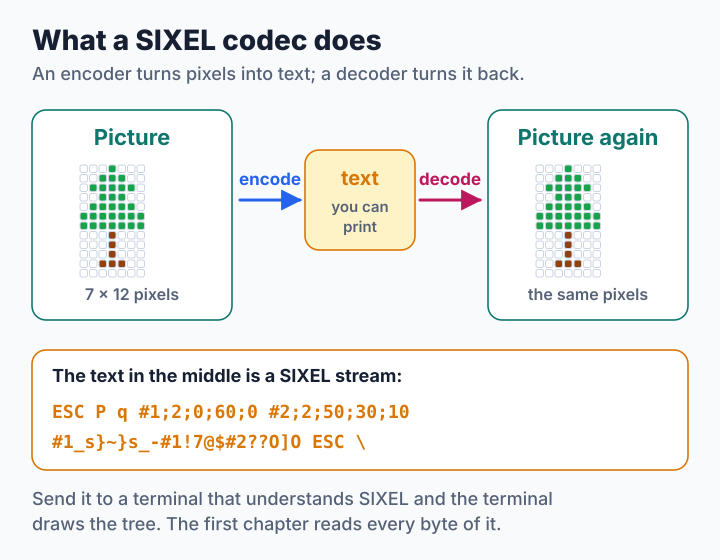
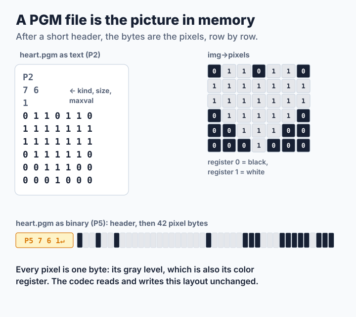
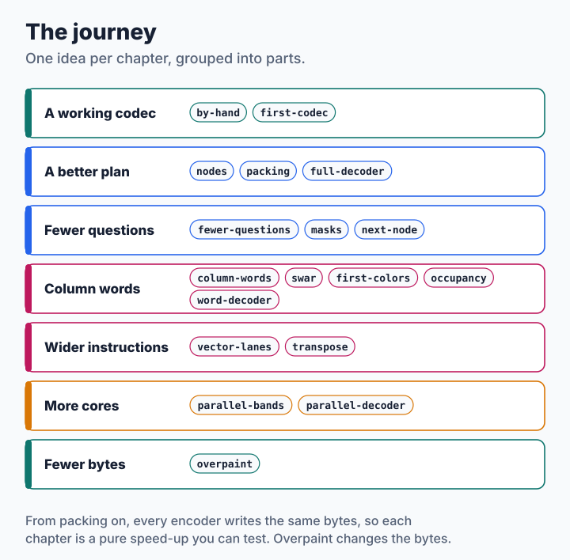
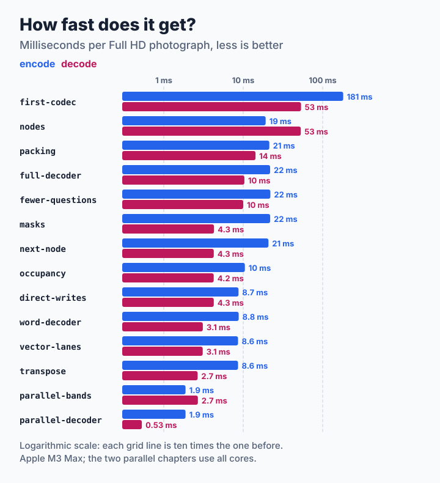

# Writing a SIXEL Codec, Step by Step

SIXEL is a way to send pictures to a terminal as plain text. In this tutorial you write two small programs: an **encoder** that turns a picture file into SIXEL text, and a **decoder** that turns SIXEL text back into a picture file. You will see your own pictures in the terminal from the very first chapter. After that, each chapter adds one idea that makes the programs faster or their output smaller, until their core loops are as fast as those of a production library.



The goal is that you can write a practical, fast SIXEL encoder and decoder of your own, for your own program, without libsixel. libsixel appears in this tutorial as one reference implementation among several, a place to compare notes, not as the place where SIXEL code has to live. The ideas you will learn were not invented in one project: each [first appeared](../../sixel-format/implementation-history.md) in a separate implementation, usually one written for a single application or device, and new interpretations of the format still come from such programs. Every chapter names the earliest public example of its idea that could be found, and says so when it is not known.

For serious product code, we recommend that you do not depend on libsixel, and write the small codec your program needs instead. A library brings everything it can do into your build, whether you use it or not: image loaders, color quantizers, resamplers, animation and many options, together with their own dependencies, build systems and release schedules. Every line of it that reads untrusted input is also part of your attack surface. libsixel parses images and streams from outside, and it has had its share of [security problems](../../project-history.md#2018-2020-security-and-distribution-hardening), from integer overflows and buffer errors to hangs, several of them with CVE numbers.

SIXEL itself is small. The encoding and decoding functions of [the first codec](first-codec.md) take about 60 lines, and about 100 with the helpers that read numbers and colors. The fastest codec of this tutorial, with every speed-up including SIMD and threads, is about 1,000 lines, comments included; a practical codec needs no more than about 2,000. This tutorial therefore keeps its code as short as it can while staying fast: every line has to earn its place. A codec that does only what your program needs is easier to read, test, fuzz and keep up to date. Use libsixel where its breadth is worth that cost, for example in a converter tool or for quick experiments, and read its code as a reference either way.

You do not need libsixel, and you do not need to know anything about image formats. If you can write a loop over an array in C and know what `|`, `&` and `<<` do, you are ready. [The first chapter](by-hand.md) needs no programming at all: you draw a picture with a pencil and print it with `printf`.

## Your first picture in one minute

The programs live in the `code` directory, next to this page's [makefile](code/Makefile). Build them and show a photograph:

```sh
cd docs/tutorial/sixel-codec/code
make
./first-codec encode ../../../../images/snake.ppm
```

If your terminal understands SIXEL, a snake appears. Terminals that do include xterm (started as `xterm -ti vt340`), mlterm, foot, WezTerm, iTerm2, Konsole and recent Windows Terminal. If yours does not, nothing is lost: the decoder turns SIXEL back into an ordinary image file that any image viewer opens.

```sh
./first-codec encode ../../../../images/snake.ppm > snake.six   # save the text
./first-codec decode snake.six > snake.ppm                      # and turn it back
```

## The programs you will use

Every chapter with code builds one program, named after the chapter, with the same commands:

| Command | What it does |
| --- | --- |
| `./PROGRAM encode picture.ppm` | Reads a picture and writes SIXEL to the terminal (standard output) |
| `./PROGRAM decode picture.six > out.ppm` | Reads SIXEL and writes a PPM picture to standard output |
| `./PROGRAM encode picture.ppm \| ./PROGRAM decode > out.ppm` | Without a file name, both commands read standard input, so they work in pipes |
| `./PROGRAM selftest` | Encodes and decodes 50 test pictures and checks that every pixel comes back |
| `./PROGRAM bench picture.ppm` | Measures how fast encoding and decoding are |

The encoders and decoders of different chapters can be mixed freely: `./first-codec encode x.ppm | ./parallel-decoder decode > y.ppm` works, because they all speak the same SIXEL.

### Pictures as PNM files

The programs read and write **PNM** files, the simplest picture format there is: a short text header followed by the pixels, row after row, exactly as they sit in memory.



- **PGM** (`P2` as text, `P5` as binary) is a gray picture with one number per pixel. The programs use that number directly as the pixel's **color register**, so a `P5` file's pixel bytes are, unchanged, the memory your encoder reads. Because `P2` is plain text, you can draw a picture in a text editor, as the first chapter does.
- **PPM** (`P3` as text, `P6` as binary) has three numbers per pixel: red, green and blue. If a picture uses at most 256 colors, each color gets a register of its own. Otherwise the program picks the nearest of 216 fixed colors and adds a fine pattern of dots (*dithering*) so that the colors in between still look right. Choosing colors well is a big subject of its own, covered from the [palette construction pipeline](../../encoder/palette-construction/pipeline/README.md) onward; this tutorial keeps it out of the way.
- The decoder always writes a binary `P6` file: for every pixel, the red, green and blue of its register.

## Your part: two functions

Everything around the codec, reading files, writing files and the command line, is already written in [`code/common.c`](code/common.c). Your job is the codec itself: two functions, declared in [`code/tutorial.h`](code/tutorial.h). Everything that reads or writes SIXEL, down to the small helpers that read a number or skip the `ESC P q` introducer, sits in the chapter's own file, so each file shows all the code its codec needs and nothing else.

```c
typedef struct image {
    int width;
    int height;
    int ncolors;                    /* registers in use, 1 to 256 */
    unsigned char *pixels;          /* width * height register numbers */
    unsigned char palette[256 * 3]; /* red, green, blue of each register */
} image_t;

int encode_sixel(image_t const *img, buffer_t *out);
int decode_sixel(unsigned char const *data, size_t size, image_t *img);
```

The pixel at column `x` and row `y` is `img->pixels[y * img->width + x]`, a register number from 0 to 255. The encoder appends SIXEL text to `out` with `buf_printf()`, which works like `printf()` but writes into memory, and `buf_putc()`, which adds one character. The program then writes `out` to the terminal. The decoder gets the whole SIXEL text in memory and fills `img`.

[`code/mysixel.c`](code/mysixel.c) is a ready-made starting point with both functions empty and hints in the comments:

```sh
make mysixel
./mysixel encode heart.pgm        # your encoder
./mysixel selftest                # are all 50 pictures right?
```

The chapter programs are worked answers. Try a part yourself first, then compare with the chapter's code.

## The journey

Each chapter adds one idea, to either the encoder or the decoder, and keeps the other half as it was. The chapters are grouped into parts:



| Chapter | The idea | Changes | Earliest public example found |
| --- | --- | --- | --- |
| [Drawing SIXEL by hand](by-hand.md) | How SIXEL draws: six-pixel columns, colors, bands | You, with a pencil | Hand-written files, 1980s |
| [A first encoder and decoder](first-codec.md) | The whole format in about thirty lines each way | Both | Repeats: PGPLOT, 1988 |
| [Read each pixel once](nodes.md) | Sort a band into one row per color, cut into nodes | Encoder | kmiya's `sixel`, by 2014 |
| [Pack nodes onto shared lines](packing.md) | Fewer graphics lines, like books on shelves | Encoder | kmiya's `sixel`, by 2014 |
| [A decoder for every stream](full-decoder.md) | Full syntax, a growing canvas, repeats a row at a time | Decoder | Not known |
| [Ask fewer questions](fewer-questions.md) | Stay in a loop over data characters | Decoder | Not known |
| [Store with masks instead of branches](masks.md) | Paint without guessing | Decoder | Not known |
| [Find the next node without a search](next-node.md) | A bit per start column and a bit scan | Encoder | Not known |
| [Keep a column in one word](column-words.md) | Six pixels in one 64-bit number | Encoder | Ghostscript, 1991; in color, chafa, 2019 |
| [Compare eight bytes at once](swar.md) | Find all rows of one color with a few operations | Encoder | jjrv's `sixel.ts`, 2025 |
| [Visit each color of a column once](first-colors.md) | Find repeated rows with shifted comparisons | Encoder | Not known |
| [Remember where each color is](occupancy.md) | A row of bits per color for cutting nodes | Encoder | chafa, 2019 |
| [Decode into column words](word-decoder.md) | One masked store per character | Decoder | `ite`, 2016 |
| [Sixteen columns in one instruction](vector-lanes.md) | SIMD compares for sixteen columns | Encoder | Not known |
| [Turn columns back into rows](transpose.md) | An 8×8 byte transpose with SIMD | Decoder | Not known |
| [Encode bands in parallel](parallel-bands.md) | Threads, one range of bands each | Encoder | chafa, 2019 |
| [Decode bands in parallel](parallel-decoder.md) | Find the bands first, then decode them in parallel | Decoder | libsixel, 2025 |
| [Smaller streams by overpainting](overpaint.md) | The same pixels with fewer bytes | Encoder | libsixel (Araki Ken), 2014 |

Each chapter follows the same pattern: the problem, the idea in a picture, the code, where the idea came from, things to try yourself, and how fast the result is.

## Checking your work

From the [packing](packing.md) chapter on, every encoder must write **exactly the same bytes** for every picture, and from the [full decoder](full-decoder.md) on, every decoder must produce exactly the same pixels from every stream. That makes each later chapter a pure speed-up, and it makes mistakes easy to catch. The [nodes](nodes.md) encoder and the [overpaint](overpaint.md) encoder write different bytes on purpose, so their streams are checked by their pixels and their length instead. The first decoder is deliberately simpler: it agrees with the others on the streams these encoders write, but it needs a size and does not understand HLS colors.

```sh
make check      # all self tests and comparisons between the chapters
make bench      # time every chapter on the pictures of the table below
```

[`code/check.sh`](code/check.sh) round-trips 50 test pictures of awkward sizes through every program, requires identical bytes with any number of threads, reads the same picture as text `P2` and binary `P5`, and feeds every decoder the sample streams in `images/` and hand-written streams that leave out the size, paint beyond it, use HLS colors or change a color after using it. A round trip alone is not enough: a mistake can produce a longer but still correct stream, and only comparing the bytes notices.

## How fast does it get?



The table gives the time to encode and to decode one picture, in milliseconds, as measured by `make bench`. The inputs are two photographs with an adaptive 256-color palette and error diffusion, the kind of picture `img2sixel` writes, a 1920×1080 pattern of two colors, and 1920×1080 random pixels in 256 colors, the hardest case.

<!-- measurements:begin:summary -->
| Chapter | Photograph, 600×450 | Photograph, 1920×1080 | Two colors, 1920×1080 | Random noise, 1920×1080 |
| --- | --- | --- | --- | --- |
| [first-codec](first-codec.md) | 25.3 / 7.54 | 182.2 / 58.3 | 1.71 / 2.14 | 275.0 / 173.2 |
| [nodes](nodes.md) | 3.27 / 7.50 | 20.2 / 58.1 | 2.19 / 2.15 | 65.1 / 172.3 |
| [packing](packing.md) | 3.93 / 2.66 | 22.4 / 16.5 | 2.37 / 2.09 | 153.0 / 44.3 |
| [full-decoder](full-decoder.md) | 3.89 / 2.04 | 22.1 / 11.7 | 2.33 / 1.78 | 151.8 / 32.9 |
| [fewer-questions](fewer-questions.md) | 4.00 / 1.78 | 22.4 / 10.7 | 2.37 / 1.17 | 157.8 / 25.8 |
| [masks](masks.md) | 3.89 / 0.80 | 22.5 / 4.20 | 2.37 / 1.48 | 155.7 / 18.7 |
| [next-node](next-node.md) | 3.68 / 0.79 | 21.2 / 4.16 | 2.22 / 1.48 | 103.0 / 18.6 |
| [column-words](column-words.md) | 3.65 / 0.80 | 21.9 / 4.16 | 2.76 / 1.48 | 103.5 / 18.9 |
| [swar](swar.md) | 4.37 / 0.78 | 26.5 / 4.16 | 3.22 / 1.48 | 104.7 / 18.9 |
| [first-colors](first-colors.md) | 4.08 / 0.76 | 23.7 / 4.18 | 3.48 / 1.52 | 104.9 / 18.6 |
| [occupancy](occupancy.md) | 2.31 / 0.74 | 11.7 / 4.12 | 3.90 / 1.47 | 68.4 / 18.5 |
| [word-decoder](word-decoder.md) | 2.30 / 0.61 | 11.8 / 3.09 | 3.91 / 1.14 | 68.4 / 15.8 |
| [vector-lanes](vector-lanes.md) | 2.36 / 0.59 | 10.8 / 3.08 | 2.70 / 1.15 | 74.4 / 16.1 |
| [transpose](transpose.md) | 2.41 / 0.56 | 10.9 / 2.71 | 2.75 / 0.72 | 73.8 / 15.2 |
| [parallel-bands](parallel-bands.md) | 2.28 / 0.58 | 2.45 / 2.70 | 0.50 / 0.72 | 12.9 / 15.3 |
| [parallel-decoder](parallel-decoder.md) | 2.33 / 0.13 | 2.44 / 0.51 | 0.55 / 0.33 | 12.5 / 2.36 |
<!-- measurements:end -->

Each cell is encode / decode time in milliseconds; smaller is faster. A chapter that changes only one half leaves the other half's time as it was, up to the noise of measuring. Stream sizes are listed on the chapter pages. The numbers come from one Apple M3 Max, and the [measurement record](measurements.md) gives the conditions, the time of each phase, the thread sweep and the commands to reproduce them.

Three lessons hide in these numbers. The biggest single jump in the encoder comes from a better plan, not from clever instructions: the first codec looks at every pixel once per color, the [nodes](nodes.md) encoder only once. Once the plan is right, the biggest gain on one core comes from simply asking fewer questions, with no change of data layout: [masks](masks.md) make the photograph's decoder 2.5 times faster. And clever instructions do not pay on their own: the [SWAR](swar.md) chapter makes the encoder slower, and [SIMD](vector-lanes.md) gives the smallest gain on photographs, because the time is mostly spent elsewhere. That is why every chapter is measured instead of assumed to be faster.

## Words used in this tutorial

| Word | Meaning |
| --- | --- |
| Pixel | One dot of the picture |
| Register | A numbered color slot, 0 to 255; a pixel stores a register number, not a color |
| Palette | The colors held by the registers |
| Band | Six rows of pixels, the height SIXEL paints at once |
| Sixel character | One of the 64 characters `?` to `~`; it says which of the six pixels of one column get the current color |
| Graphics line | One trip of the cursor from the left edge to the right inside a band |
| Stream | The complete SIXEL text of a picture |
| Node | A stretch of one color within a band ([nodes](nodes.md)) |
| Branch | A place where the program chooses between two paths, such as an `if`; the processor guesses the answer ([masks](masks.md)) |
| Column word | The six pixels of one column packed into one 64-bit number ([column words](column-words.md)) |
| SWAR | Handling the bytes of one ordinary number as separate values ([SWAR](swar.md)) |
| Lane | One of the sixteen bytes of a vector register ([vector lanes](vector-lanes.md)) |
| Thread | A part of the program that can run on a CPU core at the same time as the others ([parallel bands](parallel-bands.md)) |
| Overpaint | Painting a pixel with a wrong color first and its real color later, to save bytes ([overpaint](overpaint.md)) |

## From the tutorial to libsixel

The tutorial codecs are deliberately small. On the same indexed pictures, the tutorial decoders [keep pace with libsixel's](measurements.md#comparison-with-libsixel), and the encoders are at most about 1.5 times slower, but libsixel's [encoder](../../encoder/pipeline/README.md) and [decoder](../../decoder/pipeline/README.md) also handle transparency, OR mode, high-color and 6delta output, the safety checks of the size-oriented [encoding policy](../../encoder/output/encode-policy/README.md), streaming output, palette history during decoding, and the many [robustness](../../sixel-format/README.md#robustness-and-security) concerns of untrusted input. The [SIXEL format overview](../../sixel-format/README.md) is the full reference for the format. Many chapters point to the part of libsixel where their idea appears with those concerns included, as one way of doing it, not the only one. Most programs need only a few of these features; take the ones yours needs into your own codec, rather than taking the whole library.

The figures are generated by [`tools/plot_sixel_codec_tutorial_figures.py`](../../../tools/plot_sixel_codec_tutorial_figures.py), which computes every SIXEL fragment it draws with the same rules as the tutorial code. Regenerate them with `tools/reproduce_sixel_codec_tutorial_figures.sh`; pass `--check` to verify that they are up to date.
