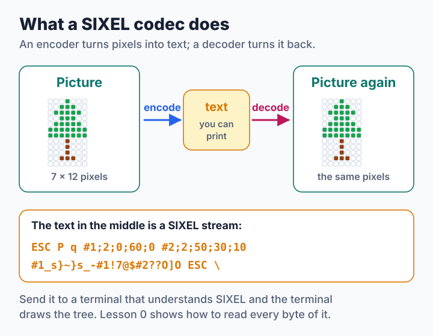
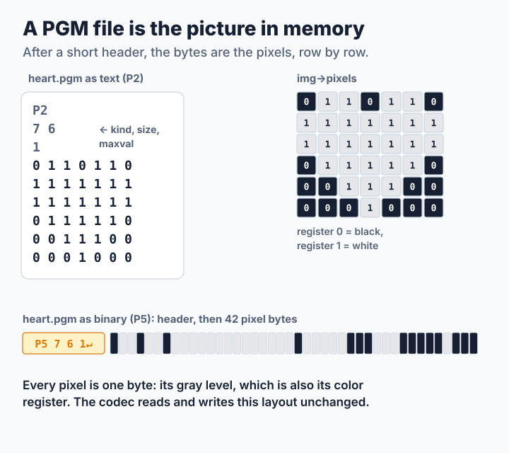
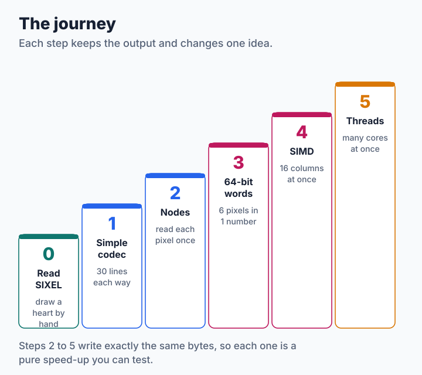
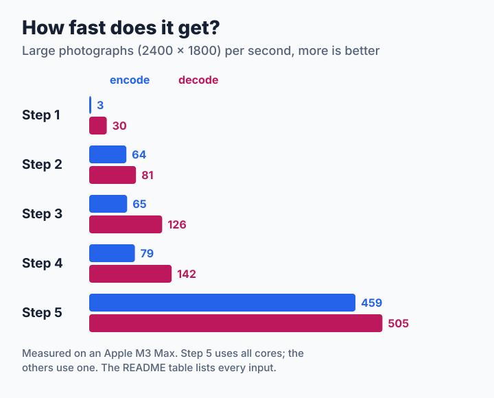

# Writing a SIXEL Codec, Step by Step

SIXEL is a way to send pictures to a terminal as plain text. In this tutorial you write two small programs: an **encoder** that turns a picture file into SIXEL text, and a **decoder** that turns SIXEL text back into a picture file. You will see your own pictures in the terminal from the very first lesson. After that, five steps make the programs faster, one idea at a time, until they use the same tricks as libsixel itself.



You do not need libsixel, and you do not need to know anything about image formats. If you can write a loop over an array in C and know what `|`, `&` and `<<` do, you are ready. [Lesson 0](step0-by-hand.md) needs no programming at all: you draw a picture with a pencil and print it with `printf`.

## Your first picture in one minute

The programs live in the [`code`](code) directory. Build them and show a photograph:

```sh
cd docs/tutorial/sixel-codec/code
make
./step1 encode ../../../../images/snake.ppm
```

If your terminal understands SIXEL, a snake appears. Terminals that do include xterm (started as `xterm -ti vt340`), mlterm, foot, WezTerm, iTerm2, Konsole and recent Windows Terminal. If yours does not, nothing is lost: the decoder turns SIXEL back into an ordinary image file that any image viewer opens.

```sh
./step1 encode ../../../../images/snake.ppm > snake.six   # save the text
./step1 decode snake.six > snake.ppm                      # and turn it back
```

## The programs you will use

Every step builds one program with the same commands:

| Command | What it does |
| --- | --- |
| `./stepN encode picture.ppm` | Reads a picture and writes SIXEL to the terminal (standard output) |
| `./stepN decode picture.six > out.ppm` | Reads SIXEL and writes a PPM picture to standard output |
| `./stepN encode picture.ppm \| ./stepN decode > out.ppm` | Without a file name, both commands read standard input, so they work in pipes |
| `./stepN selftest` | Encodes and decodes 50 test pictures and checks that every pixel comes back |
| `./stepN bench picture.ppm` | Measures how fast encoding and decoding are |

The encoder and decoder of different steps can be mixed freely: `./step1 encode x.ppm | ./step5 decode > y.ppm` works, because they all speak the same SIXEL.

### Pictures as PNM files

The programs read and write **PNM** files, the simplest picture format there is: a short text header followed by the pixels, row after row, exactly as they sit in memory.



- **PGM** (`P2` as text, `P5` as binary) is a gray picture with one number per pixel. The programs use that number directly as the pixel's **color register**, so a `P5` file's pixel bytes are, unchanged, the memory your encoder reads. Because `P2` is plain text, you can draw a picture in a text editor, as Lesson 0 does.
- **PPM** (`P3` as text, `P6` as binary) has three numbers per pixel: red, green and blue. If a picture uses at most 256 colors, each color gets a register of its own. Otherwise the program picks the nearest of 216 fixed colors and adds a fine pattern of dots (*dithering*) so that the colors in between still look right. Choosing colors well is a big subject of its own, covered from the [palette construction pipeline](../../encoder/palette-construction/pipeline/README.md) onward; this tutorial keeps it out of the way.
- The decoder always writes a binary `P6` file: for every pixel, the red, green and blue of its register.

## Your part: two functions

Everything around the codec, reading files, writing files and the command line, is already written in [`code/common.c`](code/common.c). Your job is the codec itself: two functions, declared in [`code/tutorial.h`](code/tutorial.h).

```c
typedef struct image {
    int width;
    int height;
    int ncolors;                    /* registers in use, 1 to 256 */
    unsigned char *pixels;          /* width * height register numbers */
    unsigned char palette[256 * 3]; /* red, green, blue of each register */
} image_t;

int encode_sixel(image_t const *img, buffer_t *out);
int decode_sixel(unsigned char const *data, size_t size, image_t *img);
```

The pixel at column `x` and row `y` is `img->pixels[y * img->width + x]`, a register number from 0 to 255. The encoder appends SIXEL text to `out` with `buf_printf()`, which works like `printf()` but writes into memory, and `buf_putc()`, which adds one character. The program then writes `out` to the terminal. The decoder gets the whole SIXEL text in memory and fills `img`.

[`code/mysixel.c`](code/mysixel.c) is a ready-made starting point with both functions empty and hints in the comments:

```sh
make mysixel
./mysixel encode heart.pgm        # your encoder
./mysixel selftest                # are all 50 pictures right?
```

Steps 1 to 5 are worked answers. Try a part yourself first, then compare with the step's code.

## The journey



| Lesson | You learn | Encoder | Decoder |
| --- | --- | --- | --- |
| [0. By hand](step0-by-hand.md) | How SIXEL draws: six-pixel columns, colors, bands | You, with a pencil | Your terminal |
| [1. A first codec](step1-run-length.md) | The whole format in about thirty lines each way | Looks at the band once per color | Paints one pixel at a time |
| [2. Nodes](step2-nodes.md) | Reading each pixel only once; packing colors onto shared lines | One pass per band, kmiya's nodes | Full syntax; fills repeats a row at a time |
| [3. 64-bit words](step3-column-words.md) | Changing how data sits in memory; bit tricks on whole words | Six pixels in one number | One store per character |
| [4. SIMD](step4-simd.md) | Vector instructions that work on 16 bytes at once | Sixteen columns at once | Turns columns back into rows quickly |
| [5. Threads](step5-threads.md) | Splitting work between CPU cores | Bands in parallel | Finds the bands first, then decodes them in parallel |

Each lesson follows the same pattern: the problem, the idea in a picture, a small example you can follow by hand, the code, things to try yourself, and how fast the result is.

## Checking your work

Steps 2 to 5 must write **exactly the same bytes** for every picture, and every decoder must produce exactly the same pixels. That makes each step a pure speed-up, and it makes mistakes easy to catch:

```sh
make check      # all self tests and comparisons between the steps
make bench      # time every step on the pictures of the table below
```

[`code/check.sh`](code/check.sh) round-trips 50 test pictures of awkward sizes through every step, requires steps 2 to 5 to write identical bytes with any number of threads, reads the same picture as text `P2` and binary `P5`, and feeds every decoder the sample streams in `images/` and hand-written streams that leave out the size, paint beyond it, use HLS colors or change a color after using it. A round trip alone is not enough: a mistake can produce a longer but still correct stream, and only comparing the bytes notices.

## How fast does it get?



The table gives the time to encode and to decode one picture, in milliseconds, as measured by `make bench`. The inputs are `images/snake.ppm` (600×450, mapped to 216 colors with dithering), the same photograph enlarged four times (2400×1800), a 2400×1800 pattern of two colors, and 2400×1800 random pixels in 256 colors, the hardest case for every step.

<!-- measurements:begin -->
| Step | Photograph, 600×450 | Photograph, 2400×1800 | Two colors, 2400×1800 | Random noise, 2400×1800 |
| --- | --- | --- | --- | --- |
| 1 | 21.0 / 2.42 | 319.8 / 33.0 | 3.52 / 4.61 | 592.9 / 373.7 |
| 2 | 1.21 / 1.12 | 15.6 / 12.4 | 4.84 / 3.77 | 339.1 / 71.3 |
| 3 | 1.20 / 0.71 | 15.3 / 7.95 | 8.27 / 4.24 | 150.7 / 56.2 |
| 4 | 1.04 / 0.60 | 12.7 / 7.04 | 5.76 / 3.44 | 161.8 / 55.2 |
| 5 | 1.05 / 0.32 | 2.18 / 1.98 | 1.04 / 0.63 | 25.0 / 49.8 |
<!-- measurements:end -->

Each cell is encode / decode time in milliseconds; smaller is faster. Stream sizes are listed on the lesson pages; steps 2 to 5 write identical streams.

The machine was an Apple M3 Max (10 performance and 4 efficiency cores) running macOS 27 with Apple clang 21 at `-O2`, with little other load. `make bench` reports the fastest of 10 repetitions for each cell, and the table keeps the faster of two such runs; differences of a few percent are noise. Step 5 uses up to one thread per CPU, but no more than the picture needs: the small photograph encodes on one thread and decodes on three.

Two lessons hide in these numbers. The biggest jump, 20 times at step 2, comes from a better plan, not from clever instructions: step 1 looks at every pixel once per color, step 2 only once. And the clever instructions of steps 3 and 4 do not help every picture equally; sometimes they even cost time. That is why every step is measured instead of assumed to be faster. Each lesson explains its own numbers.

## Words used in this tutorial

| Word | Meaning |
| --- | --- |
| Pixel | One dot of the picture |
| Register | A numbered color slot, 0 to 255; a pixel stores a register number, not a color |
| Palette | The colors held by the registers |
| Band | Six rows of pixels, the height SIXEL paints at once |
| Sixel character | One of the 64 characters `?` to `~`; it says which of the six pixels of one column get the current color |
| Graphics line | One trip of the cursor from the left edge to the right inside a band |
| Stream | The complete SIXEL text of a picture |
| Node | A stretch of one color within a band (step 2) |
| Column word | The six pixels of one column packed into one 64-bit number (step 3) |
| Lane | One of the sixteen bytes of a vector register (step 4) |
| Thread | A part of the program that runs on its own CPU core (step 5) |

## From the tutorial to libsixel

The tutorial codecs are deliberately small. libsixel's [encoder](../../encoder/pipeline/README.md) and [decoder](../../decoder/pipeline/README.md) also handle transparency, OR mode, high-color and 6delta output, the size-oriented [encoding policy](../../encoder/output/encode-policy/README.md), streaming output, palette history during decoding, and the many [robustness](../../sixel-format/README.md#robustness-and-security) concerns of untrusted input. The [SIXEL format overview](../../sixel-format/README.md) is the full reference for the format. Each lesson ends by pointing to the part of libsixel where its idea appears with all of those concerns included.

The figures are generated by [`tools/plot_sixel_codec_tutorial_figures.py`](../../../tools/plot_sixel_codec_tutorial_figures.py), which computes every SIXEL fragment it draws with the same rules as the tutorial code. Regenerate them with `tools/reproduce_sixel_codec_tutorial_figures.sh`; pass `--check` to verify that they are up to date.
