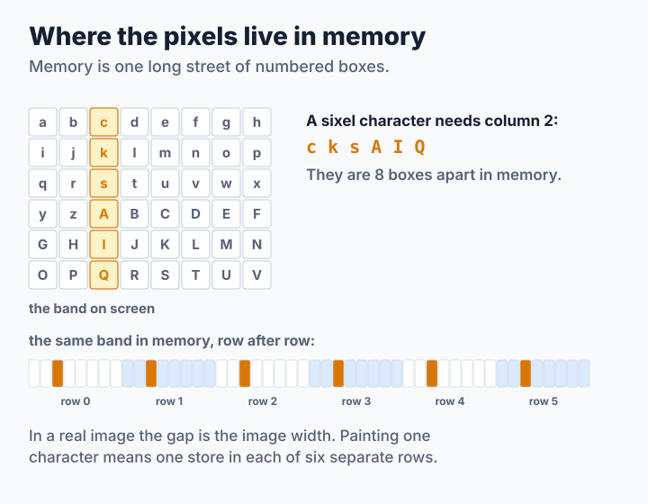
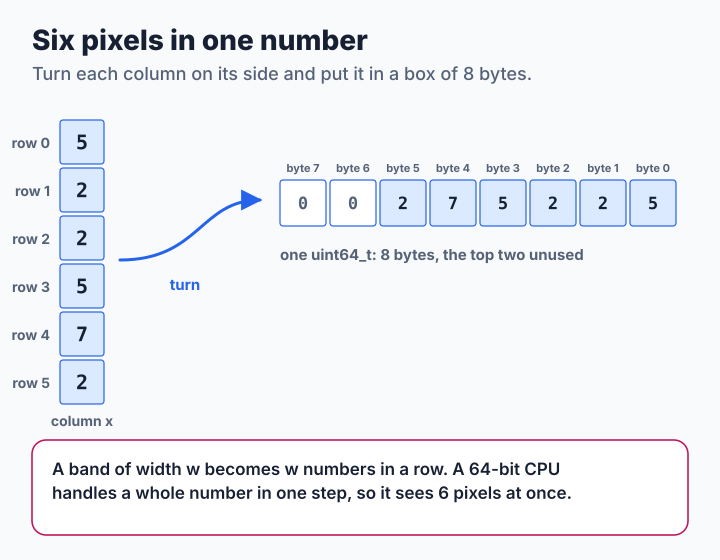

# Keep a Column in One Word

A sixel character is about one column of six pixels, but the picture keeps those six pixels a whole row apart. This chapter changes *where the data sits in memory*: the encoder first copies the six pixels of each column into one 64-bit number, and only then sorts them into drawers. On its own this makes nothing faster. It is the layout that the next three chapters need. The decoder is the [masks](masks.md) chapter's, and the stream is still the [packing](packing.md) chapter's. The source is [`code/column-words.c`](code/column-words.c).

**You will learn:**

- how pixels are laid out in memory, and why a column is spread out,
- how to pack the six pixels of a column into one 64-bit number, a *column word*,
- why a change of layout can cost time before it pays.

## Where the pixels live in memory

Memory is one long street of numbered boxes, one byte each. A picture is stored row after row: first all of row 0, then all of row 1, and so on. The pixel at column `x` of row `y` lives in box `y * width + x`.



A sixel character needs the six pixels of one column, but those pixels are a whole row apart. In a picture 1920 pixels wide, they are 1920 boxes apart.

## Six pixels in one number

The fix is to turn each column on its side. A 64-bit integer (`uint64_t`) is eight bytes long. Put the register number of row 0 in byte 0, row 1 in byte 1, and so on up to row 5. Bytes 6 and 7 stay zero. This number is a **column word**:



The figure draws byte 0 on the right, the way we write the ones digit of a number on the right. A band of width `w` becomes an array of `w` column words, one after another in memory, so walking across the band walks along the street. The encoder builds them one row at a time, which keeps the loops simple enough that the compiler can speed them up on its own:

```c
for (int r = 0; r < rows; r++) {
    unsigned char const *row = img->pixels + (size_t)(y + r) * e->width;
    for (int x = 0; x < e->width; x++)
        e->columns[x] |= (uint64_t)row[x] << (8 * r);   /* row r, byte r */
}
```

Sorting into drawers then reads one word per column and takes its six bytes apart:

```c
for (int x = 0; x < e->width; x++) {
    uint64_t word = e->columns[x];
    for (int r = 0; r < rows; r++) {
        unsigned int c = (unsigned int)(word >> (8 * r)) & 0xff;
        e->map[(size_t)c * e->width + x] |= (unsigned char)(1u << r);
        e->used[c] = 1;
    }
}
```

Cutting nodes and writing them are unchanged. The encoder now keeps its work areas in one `encoder_t` and encodes one band at a time in `encode_band()`, which later chapters build on.

## Where this idea came from

Packing the six pixels of a column into one value is old. Ghostscript's LN03 printer driver of 1991 transposed six-by-eight blocks of a monochrome bitmap into column bytes. For color, chafa's SIXEL encoder of 2019 kept the six pixels of a column in the low six bytes of one 64-bit word from its first version; whether it was the first color encoder to do so is not known. The [implementation history](../../sixel-format/implementation-history.md#chafa-column-words-and-parallel-batches) gives the sources.

> **Try it.** Print the column word of a few columns of the heart from the first chapter in hexadecimal, and check that byte 0 is the top row. Then predict the word of a column whose six pixels all have register 1.

## How fast is it?

<!-- measurements:begin:column-words -->
| Input | Encode | Speed-up | Decode | Speed-up | Stream |
| --- | --- | --- | --- | --- | --- |
| Photograph, 600×450 | 3.65 ms | 1.0× | 0.80 ms | 1.0× | 328,750 bytes |
| Photograph, 1920×1080 | 21.9 ms | 1.0× | 4.16 ms | 1.0× | 1,663,155 bytes |
| Two colors, 1920×1080 | 2.76 ms | 0.8× | 1.48 ms | 1.0× | 692,322 bytes |
| Random noise, 1920×1080 | 103.5 ms | 1.0× | 18.9 ms | 1.0× | 9,316,560 bytes |
<!-- measurements:end -->

Nothing got faster, and sorting the photograph into drawers takes 1.3 ms instead of 0.7 ms: building the words is an extra pass, and taking them apart again saves nothing. The [measurement record](measurements.md#encoder-phases) lists every phase. A layout pays only when the code that follows uses it. The [next chapter](swar.md) starts doing that by asking all six rows of a word one question at once.

Previous: [Find the next node without a search](next-node.md) · Next: [Compare eight bytes at once](swar.md)
