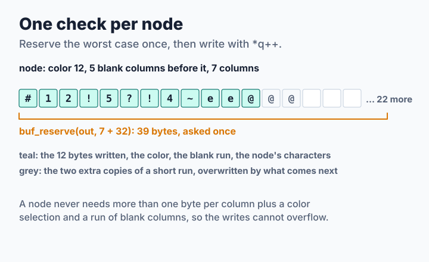

# Write Without Checking Every Byte

After the [occupancy](occupancy.md) chapter, more than half of the photograph's encoding time goes into writing the stream. Every character passes through `buf_putc()`, which first asks whether the buffer still has room, and every run of a node goes through a few branches to decide between `!` and plain copies. This chapter asks about room once per node and then writes through a plain pointer. The decoder is the [masks](masks.md) chapter's, and the stream is still the [packing](packing.md) chapter's. The source is [`code/direct-writes.c`](code/direct-writes.c).

**You will learn:**

- how to bound the bytes a piece of output can need,
- how writing through a pointer replaces a check per byte with one per node,
- how to write a short run without deciding how short it is.

## How many bytes can a node need?

A node covers the columns from `sx` to `mx`. Each column gives at most one character, because a run of equal characters only gets shorter when it is written as `!` and a count. Before the characters come at most a color selection, `#` and three digits, and one run of blank columns up to the node, `!`, at most four digits and `?`. So `mx - sx + 32` bytes are always enough, with room to spare:



`put_band()` reserves that much once, takes a pointer `q` to the first free byte, and writes with `*q++`. At the end of the node it stores how far `q` got:

```c
buf_reserve(out, (size_t)(np->mx - np->sx) + 32);
unsigned char *q = out->data + out->size;
if (np->color != color) {
    *q++ = '#';
    q = put_num(q, color = np->color);
}
q = put_run(q, '?', np->sx - x);
/* ... the node's characters ... */
out->size = (size_t)(q - out->data);
```

`put_num()` and `put_run()` are the `buf_putnum()` and `buf_putrun()` of the earlier chapters, rewritten to take and return the pointer instead of a buffer.

## Short runs without a branch

Most runs in a photograph are one, two or three columns long, and those are written as plain copies. Instead of asking how many copies to write, the loop always writes three and then moves the pointer by the length of the run:

```c
if (run <= 3) {
    q[0] = q[1] = q[2] = (unsigned char)(ch + '?');    /* no branch */
    q += run;
} else {
    q = put_run(q, ch + '?', run);
}
```

The bytes after the run are written over by whatever comes next. At most two of them reach past the node's last character, and they always fall inside the spare bytes of the reservation.

## Where this idea came from

Reserving the worst case once and then writing without checks is an old habit of fast serializers and compressors. Which SIXEL encoder did it first is not known. libsixel's encoder reserves each node's span before writing its runs, in [`sixel_put_run_reserved()`](../../../src/encoder-core-encode.c), since 2026.

> **Try it.** Replace the branch-free copy with `while (run-- > 0) *q++ = ch;` and measure the photograph and random noise. Which picture has more short runs?

## How fast is it?

<!-- measurements:begin:direct-writes -->
| Input | Encode | Speed-up | Decode | Speed-up | Stream |
| --- | --- | --- | --- | --- | --- |
| Photograph, 600×450 | 1.72 ms | 1.2× | 0.80 ms | 1.0× | 328,750 bytes |
| Photograph, 1920×1080 | 8.73 ms | 1.2× | 4.26 ms | 1.0× | 1,663,155 bytes |
| Two colors, 1920×1080 | 4.19 ms | 1.2× | 1.50 ms | 1.0× | 692,322 bytes |
| Random noise, 1920×1080 | 60.5 ms | 1.1× | 18.7 ms | 1.0× | 9,316,560 bytes |
<!-- measurements:end -->

Writing the photograph's stream gets about a third faster, and the whole encoder about 1.2 times. Random noise, with its many short runs, gains about 1.1 times. Together with the previous chapter, the photograph now encodes 2.4 times faster than with [next node](next-node.md). The encoder is done with the ideas that need no special instructions; the decoder's turn comes next.

Previous: [Remember where each color is](occupancy.md) · Next: [Decode into column words](word-decoder.md)
