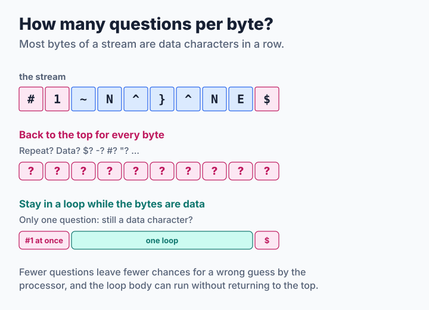

# Ask Fewer Questions

The [full decoder](full-decoder.md) returns to the top of its big loop for every byte, and every time it works through the same list: is it `!`, is it a sixel character, is it `$`, `-`, `#`, or `"`? But most bytes of a stream are data characters that follow one another, so most of those answers are already known. This chapter removes questions whose answer is obvious, and changes nothing else. The encoder is the [packing](packing.md) chapter's. The source is [`code/fewer-questions.c`](code/fewer-questions.c).

**You will learn:**

- why a question can cost more than the work it decides,
- how to stay in an inner loop while the bytes are data characters,
- how to read the common case of a number without a general parser.

## Asking about every byte

Follow the bytes `#1~N^}^NE$` through the full decoder. It reads `#`, calls a parser that allows five parameters, goes back to the top, reads `~`, asks whether it is `!`, asks whether it is a data character, paints, goes back to the top, and so on for every byte:



The fix is an inner loop that stays put while the bytes are data characters. It asks only whether the next byte is still one, and whether the column is still on the canvas:

```c
if (y + 6 <= cv.height) {
    row = cv.pixels + (size_t)y * cv.width;
    last = -1;
    while (p < end && *p >= '?' && *p <= '~' && x < cv.width) {
        bits = *p++ - '?';
        dst = row + x;
        for (int r = 0; r < 6; r++, dst += cv.width)
            if (bits >> r & 1) *dst = (unsigned char)color;
        band_rows |= bits;
        if (bits != 0) last = x;
        x++;
    }
    /* ... */
}
```

The loop also moves bookkeeping out of the way. It checks the canvas once before it starts instead of once per character, and it records the last painted column once when it ends.

## Reading plain numbers on the spot

The same thinking applies to numbers. Nearly every `#` in a stream is a plain selection such as `#42`, with no `;` after it. Reading that on the spot with `parse_plain_number()` is much cheaper than a general parser that has to allow five parameters. Anything less plain falls back to `parse_params()`:

```c
ch = *p++;
if (ch == '#' && parse_plain_number(&p, end, &n)) {
    color = n > 255 ? 255 : n;
    if (color >= img->ncolors) img->ncolors = color + 1;
    continue;
}
```

`!n` gets the same treatment. A repeated character still goes through the old path, with one `memset()` per painted row, because a long run is where that call earns its cost.

## Where this idea came from

Which SIXEL decoder first stayed in a loop over data characters, or first read plain numbers on the spot, is not known. libsixel's decoder has such a fast lane; the [decoding pipeline](../../decoder/pipeline/README.md) describes which tokens it consumes.

> **Try it: write the inner loop yourself.** Copy `full-decoder.c` to `mine.c` and add an inner loop for data characters to its decoder, without looking at `fewer-questions.c`:
>
> ```sh
> cp full-decoder.c mine.c
> cc -O2 -o mine common.c mine.c -lpthread
> ./full-decoder decode ../../../encoder/output/high-color/study/snake-256-fs.six > photo.ppm
> ./mine selftest
> ./mine bench photo.ppm 1 10
> ```
>
> Then compare `./mine decode noraster.six` with `./full-decoder decode noraster.six`, using the stream from the previous chapter. The two must agree.

## How fast is it?

<!-- measurements:begin:fewer-questions -->
| Input | Encode | Speed-up | Decode | Speed-up | Stream |
| --- | --- | --- | --- | --- | --- |
| Photograph, 600×450 | 3.86 ms | 1.0× | 1.72 ms | 1.1× | 328,750 bytes |
| Photograph, 1920×1080 | 22.0 ms | 1.0× | 9.93 ms | 1.1× | 1,663,155 bytes |
| Two colors, 1920×1080 | 2.31 ms | 1.0× | 0.94 ms | 2.3× | 692,322 bytes |
| Random noise, 1920×1080 | 152.0 ms | 1.0× | 25.6 ms | 1.2× | 9,316,560 bytes |
<!-- measurements:end -->

The two-color pattern decodes 2.3 times faster and random noise 1.2 times, but the photograph gains only a few percent. The questions about each *byte* are gone, yet the six questions about each *bit* remain, and in a dithered photograph those are the expensive ones. The [next chapter](masks.md) explains why, and removes them.

Previous: [A decoder for every stream](full-decoder.md) · Next: [Store with masks instead of branches](masks.md)
