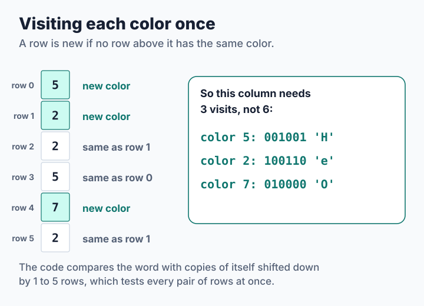

# Visit Each Color of a Column Once

The [SWAR](swar.md) encoder fills a slot in one step, but it still looks at all six pixels of every column and checks a slot for each. A column can hold up to six different colors, but often holds fewer. This chapter visits each column once per color *in it*, not once per row, and finds those colors with the zero-byte trick as well. The decoder is the [masks](masks.md) chapter's, and the stream is still the [packing](packing.md) chapter's. The source is [`code/first-colors.c`](code/first-colors.c).

**You will learn:**

- how comparing a word with shifted copies of itself finds repeated rows,
- how to visit the set bits of a number one by one,
- why independent steps let the processor overlap them.

## The first row of each color

A row starts a new color if no row above it has the same color. The column 5, 2, 2, 5, 7, 2 holds only three colors, so rows 0, 1 and 4 start one and the other rows repeat:



The code finds all those rows at once. It compares the word with copies of itself shifted up by one to five rows, which compares every row with every row above it, and marks a row as a repeat when any comparison finds a zero byte:

```c
for (int x = 0; x < e->width; x++) {
    uint64_t word = e->columns[x], repeat = 0;
    for (int k = 1; k < rows; k++)                  /* same as k rows up? */
        repeat |= zero_bytes(word ^ (word << (8 * k))) & (~UINT64_C(0) << (8 * k));
    for (uint64_t firsts = lanes & ~repeat; firsts != 0; firsts &= firsts - 1) {
        unsigned int c = (unsigned int)(word >> (ctz64(firsts) & ~7)) & 0xff;
        e->map[(size_t)c * e->width + x] =
            (unsigned char)(equal_bytes(word, c) & ((1u << rows) - 1));
        e->used[c] = 1;
    }
}
```

`firsts` has one bit set for every row that starts a new color. `firsts &= firsts - 1` clears the lowest set bit, a common trick for visiting the set bits of a number one by one. `ctz64()` tells where the lowest set bit is, and `& ~7` turns that bit position into the position of its byte. Each (color, column) pair then costs one store into its drawer, and no slot is read at all.

The five shifted comparisons do not depend on one another, and neither do the visits to the colors of one column. A processor can work on such independent steps at the same time, which a chain of `if`s on loaded slots does not allow.

## Where this idea came from

Which SIXEL encoder first found the distinct colors of a column with shifted comparisons is not known. jjrv's `sixel.ts` of 2025 uses zero-byte tests over column words to find which colors are still pending, a related idea; the [implementation history](../../sixel-format/implementation-history.md#column-oriented-encoders-notcurses-and-jjrvs-gist) describes it.

> **Try it.** Work out `repeat` and `firsts` by hand for the column 3, 3, 3, 3, 3, 3 and for the column 1, 2, 3, 4, 5, 6. How many colors does the inner loop visit in each? Which kind of column does a photograph have more of?

## How fast is it?

<!-- measurements:begin:first-colors -->
| Input | Encode | Speed-up | Decode | Speed-up | Stream |
| --- | --- | --- | --- | --- | --- |
| Photograph, 600×450 | 4.08 ms | 1.1× | 0.76 ms | 1.0× | 328,750 bytes |
| Photograph, 1920×1080 | 23.7 ms | 1.1× | 4.18 ms | 1.0× | 1,663,155 bytes |
| Two colors, 1920×1080 | 3.48 ms | 0.9× | 1.52 ms | 1.0× | 692,322 bytes |
| Random noise, 1920×1080 | 104.9 ms | 1.0× | 18.6 ms | 1.0× | 9,316,560 bytes |
<!-- measurements:end -->

Sorting the photograph into drawers takes 3.2 ms instead of 5.6 ms, so the SWAR chapter's loss is half recovered, but the plain loop of the [column-words](column-words.md) chapter was still faster at 1.3 ms. The five shifted comparisons are a fixed cost for every column. Classifying is not where this chapter pays, though: each (color, column) pair is now visited exactly once, and that is the moment to note where each color is. The [next chapter](occupancy.md) does that, and cutting nodes becomes six times faster.

Previous: [Compare eight bytes at once](swar.md) · Next: [Remember where each color is](occupancy.md)
