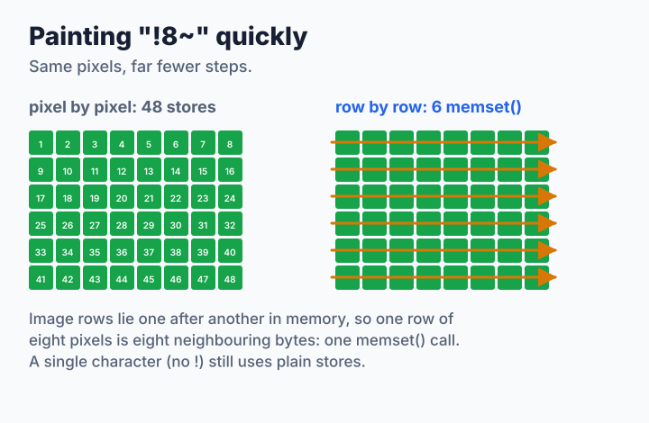

# A Decoder for Every Stream

The first decoder needs help from the stream: a size before any painting, colors in RGB only, and paint inside the size. Streams from other programs do not always give that help. This chapter writes a decoder that reads the whole body syntax, and makes repeats cheap on the way. The encoder is the [packing](packing.md) chapter's. The source is [`code/full-decoder.c`](code/full-decoder.c).

**You will learn:**

- how the decoder handles HLS colors,
- how a canvas grows when a stream has no size or paints beyond it,
- why a repeat should fill a row at a time, and when a single store is better.

## HLS colors

`#n;1;h;l;s` defines a color by hue (an angle, 0 to 360), lightness and saturation. SIXEL puts blue at 0°, red at 120° and green at 240°, so `set_hls()` in [`code/full-decoder.c`](code/full-decoder.c) turns the hue before using the usual formula.

## A canvas that grows

The canvas grows when a stream paints outside it. It at least doubles each time, so that growing stays cheap even for a stream with no size at all. The final picture covers both the declared size and every painted pixel, the same rule libsixel uses for [raster declarations versus observed paint](../../decoder/pipeline/README.md#raster-declaration-versus-observed-paint).

```c
if (x + repeat > cv.width || y + 6 > cv.height)
    if (x + repeat > TUTORIAL_MAX_SIDE ||
            canvas_reserve(&cv, x + repeat, y + 6) != 0)
        goto fail;
```

`canvas_reserve()` rounds the new width and height up to the next power of two and copies the old rows into the new canvas. `band_rows` collects the rows painted in the band, so the decoder knows the picture's height without checking every character.

> **Try it.** Decode a stream that has no size and paints beyond its own edge. The first decoder fails; this one grows the canvas:
>
> ```sh
> printf '\033Pq#1;2;100;0;0#1~~~$#2;2;0;100;0!5N-#1!3@\033\\' > noraster.six
> ./first-codec decode noraster.six > a.ppm; echo $?
> ./full-decoder decode noraster.six > b.ppm; echo $?
> ```

## Repeats a row at a time

In memory, a row of the picture is a run of neighboring bytes. So `!8~`, which fills eight columns of six rows, is six runs of eight bytes, and each run takes one `memset()` call instead of eight separate stores:



```c
if (ch >= '?' && ch <= '~') {
    bits = ch - '?';
    if (bits != 0) {
        /* ... grow the canvas to (x + repeat) x (y + 6) if needed ... */
        for (int r = 0; r < 6; r++) {
            if ((bits >> r & 1) == 0) continue;
            dst = cv.pixels + (size_t)(y + r) * cv.width + x;
            if (repeat == 1) *dst = (unsigned char)color;   /* the common case */
            else memset(dst, color, (size_t)repeat);
        }
        band_rows |= bits;
    }
    x += repeat;                /* the source also clamps x to the size limit */
}
```

A single character, the common case in photographs, still uses a plain store, because calling `memset()` for one byte costs more than it saves. A run of blank columns, `!n?`, now costs one addition to `x` instead of a walk over `n` columns.

The decoders from here on still keep things simple in two ways that a stream from another program can notice. A register the stream never defines is black, where a real terminal and libsixel start from the VT340's default colors. And registers above 255 are treated as register 255, where libsixel keeps them apart. A production decoder needs both; this tutorial keeps its images at one byte per pixel.

## Where this idea came from

Software decoders are as old as the hand-written files: Chiesa's 1990 tutorial came with a viewer in Amiga BASIC, and terminal emulators such as RLogin, which added SIXEL in 2010, read the full syntax. Which decoder first filled repeats a row at a time is not known. The [implementation history](../../sixel-format/implementation-history.md) lists the records that were checked.

## How fast is it?

<!-- measurements:begin:full-decoder -->
| Input | Encode | Speed-up | Decode | Speed-up | Stream |
| --- | --- | --- | --- | --- | --- |
| Photograph, 600×450 | 3.80 ms | 1.0× | 1.83 ms | 1.3× | 328,750 bytes |
| Photograph, 1920×1080 | 21.8 ms | 1.0× | 10.4 ms | 1.4× | 1,663,155 bytes |
| Two colors, 1920×1080 | 2.32 ms | 1.0× | 2.19 ms | 1.1× | 692,322 bytes |
| Random noise, 1920×1080 | 151.9 ms | 1.0× | 30.5 ms | 1.2× | 9,316,560 bytes |
<!-- measurements:end -->

The photograph decodes 1.4 times faster, random noise 1.2 times, and the two-color pattern a little. The encoder has not changed; its row only shows how much one measurement differs from the next.

The decoder now reads every stream it meets, but it asks several questions about every byte and six more about every character. The next two chapters take those questions away: [fewer questions](fewer-questions.md) about each byte, and [masks](masks.md) instead of questions about each bit.

Previous: [Pack nodes onto shared lines](packing.md) · Next: [Ask fewer questions](fewer-questions.md)
